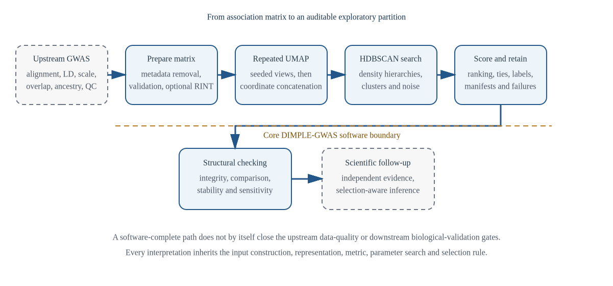
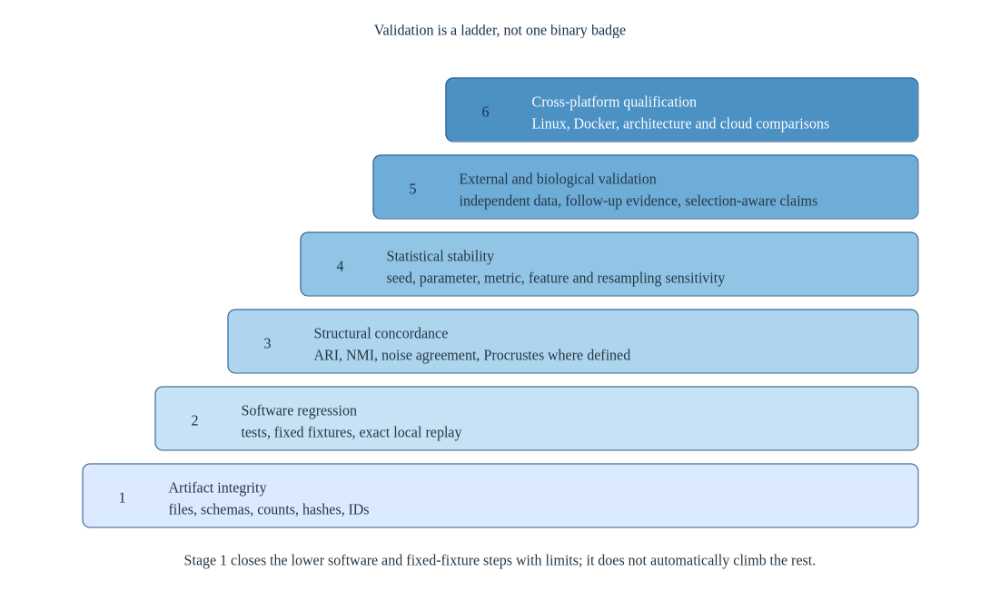
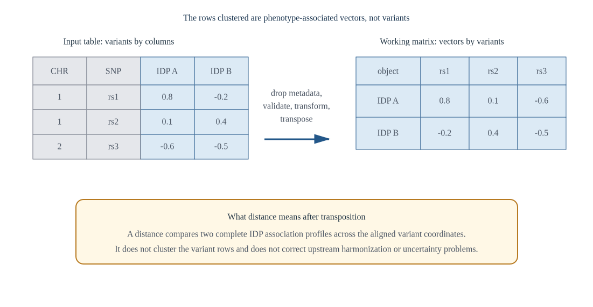
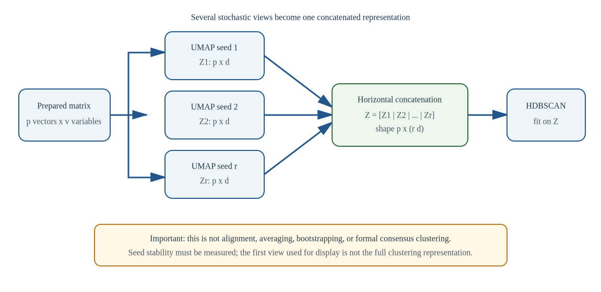
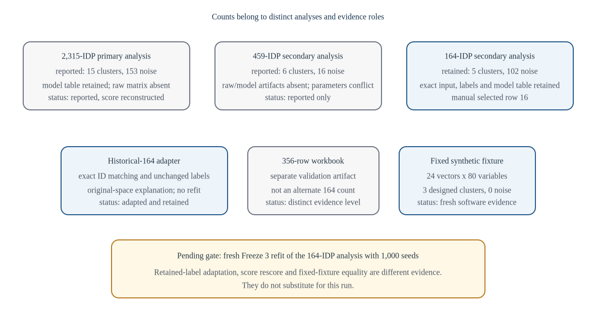

# Editorial and evidence status

This edition is written for analysts, graduate learners, domain scientists, and methods reviewers who need one continuous account of what DIMPLE-GWAS does, why its design choices matter, how to operate it, and where its present evidence stops.

**Release boundary.** DIMPLE-GWAS Freeze 3 RC1 (`3.0.0rc1`) is a software-complete release candidate under the available local tests, fixed-fixture regression, and retained-output evidence. It is not yet a final scientific freeze or a fully qualified cross-platform release. The fresh historical 164-IDP 1,000-seed rerun and Docker/Linux/GCP/AWS qualification remain separate gates.

The book is a documentation edition, not a new software freeze. Its content is governed by the Stage 1 evidence pack dated 26 August 2026 and the unchanged package-source digest `df87825992ab51dc016c673cf420a978ba5c161bd6c755e00a5199ead310e65b`.

Copyright and publication decisions remain with the DIMPLE-GWAS authors. This internal draft is for scientific, operational, and editorial review.

\newpage


# Preface: three ways through one method

DIMPLE-GWAS sits at an awkward but productive boundary. It is a scientific method whose output can be tempting to overinterpret, a computational pipeline whose behavior depends on exact contracts, and a teaching problem that spans summary-statistic geometry, nonlinear representation, density clustering, model selection, and post-selection reasoning. Earlier documentation placed all of those responsibilities in the same stream. The result was comprehensive but difficult to learn from.

Documentation Edition 3 separates the reading tasks while preserving one evidence base.

The **academic textbook** develops the method in dependency order. It begins with the scientific unit, then builds the geometry, nonlinear representation, density hierarchy, model search, selection, validation, and interpretation. Equations are used to expose assumptions rather than to decorate prose. Implementation details appear where they illuminate a statistical decision; exhaustive contracts are deferred to the reference.

The **analyst workbook** begins with predictions and checkpoints. A learner inspects configuration before computing, uses a fresh output root, reads manifests before plots, compares partitions without relying on numeric label names, and labels every case as fresh, retained, reconstructed, illustrative, or protocol-only.

The **technical reference** is deliberately lookup-oriented. It records commands, defaults, function and output contracts, errors, provenance, and the analysis hierarchy. This is where exact implementation traceability belongs.

## Suggested paths

**New analyst.** Read Chapters 1-3, then complete Workbook Labs 0-4. Return to Chapters 8-11 before expanding a search. Use the reference when an option, field, or failure needs exact interpretation.

**Statistics or data-science learner.** Read the textbook in order and work the numerical interludes. Chapters 5-8 form the UMAP/densMAP/HDBSCAN spine; Chapters 9-11 show why model search and validation cannot be treated as afterthoughts.

**Domain scientist.** Begin with Chapters 1, 2, 12, 13, and 14. These chapters distinguish algorithmic grouping from genetic or biological explanation and show how retained historical results differ from fresh reruns.

**Methods reviewer.** Read Chapters 10-15, then use the technical reference, claim register, reviewer-literature crosswalk, analysis hierarchy, and known-limitations file.

## Evidence vocabulary

This edition uses five status words consistently:

- **Freshly executed** means run during the recorded Stage 1 local verification.
- **Retained historical** means preserved from an earlier analysis with immutable artifact identity.
- **Reconstructed** means derived exactly from retained artifacts, for example reapplying a score or adapting a schema, without refitting the original model.
- **Illustrative** means chosen to teach a calculation or decision and not presented as empirical evidence.
- **Protocol-only** means the commands and acceptance criteria are specified but the consequential run has not been performed.

The distinction is part of the scientific result. A hash check, an exact fixed-fixture replay, a table rescore, a retained-label adapter, a fresh manuscript-scale fit, and an external biological replication answer different questions.

## Notation and conventions

We write an input table as $X \in \mathbb{R}^{v \times p}$, with $v$ aligned variant rows and $p$ phenotype-associated vectors or IDPs in analysis columns. After metadata removal, validation, optional column-wise transformation, and transposition, the working matrix is $Y=X^{\mathsf T}\in\mathbb{R}^{p\times v}$: one row per object being clustered.

The term *noise* is reserved for HDBSCAN label `-1`. It means unassigned under a fitted representation and parameterization. It is never shorthand for failed biology, a non-heritable phenotype, or a phenotype without pleiotropic relationships.

Citations support general methodological context. They do not validate DIMPLE-GWAS outputs. Software-specific facts are tied to the Stage 1 claim and implementation registers.

\newpage


# Part I - Scientific problem and representation {.unnumbered}

The first four chapters define the unit, geometry and representation questions before any density model is selected.

\newpage


# The scientific problem and the complete pipeline

Imagine that a research programme has estimated genetic association profiles for hundreds or thousands of imaging-derived phenotypes. Each phenotype now has a long vector of association statistics over a common set of variants. The immediate scientific question is not whether any single variant is associated with a phenotype; that work has already happened upstream. The new question is whether the *profiles* show repeatable structure. Do some phenotypes occupy similar regions of this high-dimensional association space? Are there dense groups, diffuse transitions, and observations that do not belong to any sufficiently persistent group?

DIMPLE-GWAS is an exploratory answer to that question. It prepares the profile matrix, creates several seeded UMAP or densMAP representations, concatenates their coordinates, fits HDBSCAN candidates, evaluates the resulting partitions, ranks eligible models, and preserves selected labels with enough provenance to reconstruct what happened. This sounds like a single algorithm. In practice it is a chain of scientific choices. Changing the input construction, transformation, distance metric, neighborhood scale, seed schedule, density parameters, candidate population, or score changes the object being selected.

{#fig-pipeline width=95%}

## What is being clustered?

The rows supplied to HDBSCAN ultimately represent phenotype-associated vectors or IDPs. They are not participants, variants, brain voxels, or individual GWAS records. If $p$ phenotype vectors are measured over $v$ aligned variant coordinates, the working matrix is

$$
Y = \begin{bmatrix}
\mathbf{y}_1^{\mathsf T}\\
\vdots\\
\mathbf{y}_p^{\mathsf T}
\end{bmatrix}\in\mathbb{R}^{p\times v},
$$

where row $\mathbf{y}_i$ is the association profile for phenotype $i$. The pipeline seeks a partition of these $p$ rows after nonlinear representation. A label therefore means “this phenotype vector was assigned to this density component under this declared construction.” It does not mean “these people form a subtype” or “these variants share one mechanism.”

That distinction is easy to state and surprisingly easy to lose. A cluster label is compact. The chain of assumptions that created it is not. Responsible reporting keeps the chain visible.

## A first end-to-end example

The fixed synthetic fixture contains 24 analysis vectors and 80 numeric variables after four metadata columns are removed. Its configuration fits one three-dimensional densMAP representation with seed 42 and then one HDBSCAN candidate. Stage 1 executed the complete route and observed three clusters, no noise, and selected model `model_060fac0208bb58e2`. Reproducing the retained model produced the same model identifier and a byte-identical label file. Comparison reported ARI and NMI of 1, noise-set Jaccard of 1, mapped membership fraction of 1, variation of information of 0, and Procrustes disparity of approximately $2.71\times10^{-31}$. Validation passed 24 of 24 artifact checks.

Those are strong software facts and weak scientific facts. The synthetic groups were deliberately clear, the search contained one candidate, and the run used one seed. The example shows that a reader can traverse the input, configuration, fit, retention, reproduction, comparison, and validation contracts. It does not show that real IDP structure is stable, that three is a privileged cluster count, or that the method outperforms an alternative.

This example also exposes an important property of the legacy score. With only one eligible candidate, table-relative component ranges collapse. The implementation uses a documented zero-range fallback and the candidate receives a final score of 1. The number does not mean perfect external validity; it means the candidate is the only eligible point in the table-relative scoring problem.

## Seven decisions hidden inside “run the pipeline”

First, the analyst decides what the profile coordinates mean. Effect estimates, $Z$-scores, signed statistics, or another aligned quantity create different geometries. Variant alignment, allele orientation, LD structure, study overlap, uncertainty, ancestry, and imaging confounds remain upstream responsibilities. DIMPLE-GWAS validates shape and numeric content; it cannot repair invalid summary statistics.

Second, the input contract separates metadata from analysis columns and transposes the matrix. Optional rank-based inverse normal transformation changes each analysis column before that transpose. No PCA, ICA, SVD, or MDS is silently inserted before UMAP.

Third, UMAP defines neighborhoods under the selected metric and constructs a stochastic low-dimensional representation. Standard mode currently uses three output components, Euclidean metric, zero minimum distance, and densMAP enabled. These are defaults, not universal scientific recommendations.

Fourth, repeated embeddings create several coordinate blocks. Freeze 3 concatenates them horizontally. It does not align them, average them, create a co-association matrix, or fit a formal consensus partition. The resulting distance aggregates separation over the declared coordinate blocks; its meaning depends on their construction and scale.

Fifth, HDBSCAN turns the concatenated representation into a density hierarchy and extracts clusters by EOM or leaf selection. Label `-1` is an unassigned result under that fit. It is neither a quality-control verdict nor a biological-null class.

Sixth, the pipeline evaluates and ranks a complete declared candidate population. Standard and extended search modes currently enumerate 2,430 and 1,728 candidates respectively; the fixed tutorial enumerates one. Metrics have different geometries and noise rules. The legacy score is table-relative and DBCV is supplementary rather than part of that score.

Seventh, selected outputs return the analyst to the evidence. Manifests, resolved configuration, candidate tables, failures, labels, original-space similarities, comparison metrics, and validation reports make different claims. Reading a plot before reading those artifacts reverses the intended order.

## The evidence ladder

The word *validated* is incomplete unless it names a level. Artifact validation asks whether files exist, parse, agree in row counts, and match hashes. Software regression asks whether tests and bounded fixtures behave as expected. Structural comparison asks whether two partitions agree after label permutation, whether their noise sets match, or whether compatible coordinates align. Statistical validation asks how conclusions change under seeds, parameters, metrics, features, or resampling. Biological validation asks whether an independently supported scientific interpretation survives. Cross-platform qualification asks whether the method behaves within declared tolerances across environments.

{#fig-validation-ladder width=90%}

Stage 1 supplies strong local evidence at the lower levels. It does not complete the real-data stability, biological, Docker, Linux, or cloud layers. This is why the release boundary is not a ceremonial warning. It is a map of what the current results can bear.

## Why the next chapter starts with the matrix

Every downstream quantity inherits the scientific meaning and defects of the profile coordinates. Before learning UMAP or HDBSCAN, we therefore need to understand how a collection of GWAS-derived columns becomes a geometry among phenotype vectors—and why proximity in that geometry is an exploratory statement rather than a genetic mechanism.

**Evidence trail.** Stage 1 claims AUTH-001 to AUTH-003, QA-001 to QA-004, REL-001, SLM-001, SLM-010, SLM-018, SLM-022 and SLM-023; analysis levels 6-7 in `08_ANALYSIS_HIERARCHY_AND_GOLDEN_RUNS.md`.

## Questions for the reader

1. In one sentence, identify the unit clustered by DIMPLE-GWAS and two units it does not cluster.
2. Why can exact fixed-fixture agreement establish software evidence without establishing scientific validity?
3. A report says “the validate command proved the clusters are biologically valid.” Rewrite the statement so that it matches the command's actual scope.

\newpage


# GWAS summary statistics as high-dimensional trait vectors

The attractive simplification behind DIMPLE-GWAS is that every phenotype can be represented by a point. The dangerous simplification is forgetting what had to be true for those points to be comparable.

Suppose the input table has $v$ variant rows, $m$ metadata columns, and $p$ analysis columns. Before preprocessing, write the numeric block as $X\in\mathbb{R}^{v\times p}$. Entry $x_{ji}$ is the association quantity for variant $j$ and phenotype $i$. After metadata removal and transposition, phenotype $i$ becomes row $\mathbf{y}_i=(x_{1i},\ldots,x_{vi})$ of $Y=X^{\mathsf T}$.

{#fig-orientation width=92%}

The algebra is simple. The scientific contract is not.

## Aligned coordinates are a prerequisite

A coordinate-by-coordinate distance assumes that row $j$ refers to a comparable quantity in every analysis column. Variant identifiers, alleles, strand orientation, genome build, imputation and quality thresholds, and the sign convention must be aligned upstream. A sign reversal in one phenotype does not look like a small clerical error in Euclidean space; it can rotate the entire association profile away from otherwise similar vectors.

DIMPLE-GWAS does not perform allele harmonization, LD pruning, genomic control, study-overlap correction, ancestry adjustment, or imaging-confound correction. Those operations require information and estimands outside the clustering package. Summary-statistic QC guidance and LD-score methods demonstrate why inflation, overlap, and covariance cannot be inferred from a bare numeric matrix [@winkler2014qc; @buliksullivan2015ldsc; @buliksullivan2015rg].

The pipeline's input validation should therefore be viewed as a *software contract*, not a GWAS-validity certificate. It can establish that the analysis block is present, numeric, finite under the declared rules, and oriented as expected. It cannot establish that the numbers were scientifically commensurate before arrival.

## Scale defines what “near” means

If one phenotype column contains effect sizes and another contains $Z$-scores, equal numeric differences do not have equal meaning. Even when every column uses the same nominal statistic, unequal sample sizes and standard errors can change scale and noise. A large coordinate can reflect a strong association, a small standard error, population structure, LD, or another feature of the upstream study.

Consider three variants and two phenotype vectors:

$$
\mathbf{y}_A=(0.8,0.1,-0.6),\qquad
\mathbf{y}_B=(-0.2,0.4,-0.5).
$$

Their Euclidean distance is

$$
d_E(A,B)=\sqrt{(0.8+0.2)^2+(0.1-0.4)^2+(-0.6+0.5)^2}
=\sqrt{1.10}\approx1.049.
$$

The number is exact for the supplied coordinates. It is not automatically an exact measure of genetic dissimilarity. If the first coordinate is much less precise, in high LD with many nearby coordinates, or allele-misaligned for one phenotype, the scientific meaning changes while the arithmetic does not.

This motivates weighted or covariance-aware distances in some applications, but Freeze 3 does not silently implement such a model. The correct documentation stance is explicit: the package treats the prepared numeric coordinates as its geometry. Analysts who require uncertainty or covariance modelling must design and validate that upstream or extend the method transparently.

## Correlation is another geometry, not a causal shortcut

Two profiles can be similar because their signed patterns rise and fall together even if their magnitudes differ. Pearson correlation between centered vectors can capture this pattern similarity:

$$
r_{AB}=\frac{\sum_j(y_{Aj}-\bar y_A)(y_{Bj}-\bar y_B)}
{\sqrt{\sum_j(y_{Aj}-\bar y_A)^2}\sqrt{\sum_j(y_{Bj}-\bar y_B)^2}}.
$$

Spearman correlation applies the same idea to ranks. Freeze 3 uses Pearson or Spearman similarity in its *post hoc original-space explanation* route, not as proof of shared causal variants or formal genetic correlation. The distinction matters. LD-score regression estimates a different object under an explicit model [@buliksullivan2015rg]. A high profile correlation can be informative as a descriptive diagnostic while remaining compatible with LD, sample overlap, scale, confounding, or phenotype-construction explanations.

## High dimension changes intuition

When $v$ is very large, distances can become difficult to discriminate. For some distributions, the relative contrast between the nearest and farthest points decreases as dimension grows [@aggarwal2001distance]. Neighborhood lists can also develop *hubs*: observations that appear unusually often among other observations' nearest neighbors [@radovanovic2010hubness].

Neither phenomenon says that high-dimensional data are unusable or that a “true topology” will reveal itself if one chooses the right nonlinear plot. They say that the chosen metric, scaling, feature set, and neighborhood size become part of the scientific analysis. A responsible workflow asks whether neighbor relations survive plausible perturbations.

One useful diagnostic is to compare $k$-nearest-neighbor sets under alternative preprocessing or metrics. For object $i$, let $N_k^{(a)}(i)$ and $N_k^{(b)}(i)$ be the neighbor sets under two choices. Their Jaccard agreement is

$$
J_i=\frac{|N_k^{(a)}(i)\cap N_k^{(b)}(i)|}{|N_k^{(a)}(i)\cup N_k^{(b)}(i)|}.
$$

A low average $J_i$ is not a software error; it is evidence that the local geometry is choice-sensitive. Freeze 3 reports trustworthiness and continuity for original-to-embedded neighborhoods, but Stage 1 did not complete a real-data metric or feature-set stability study.

## The observational unit can carry correlated error

Each row of $Y$ is treated as an object, but the coordinate noise within and between rows may be correlated. Shared participants across GWAS, overlapping covariates, common preprocessing, related phenotypes, and LD across variants violate a naive view of independent coordinates. This does not invalidate exploratory geometry by definition. It limits the estimand: the observed profile space includes biological and technical covariance unless explicitly separated.

For imaging-derived phenotypes, upstream image processing and confound control also shape the association vectors. Large IDP GWAS demonstrate how phenotype definition, imaging quality, population structure, and genetic QC interact [@elliott2018idp]. Cross-ancestry transfer is not automatic [@martin2019portability]. A cluster may therefore be a useful map of the supplied statistical summaries while remaining agnostic about why the summaries cohere.

## What the software enforces

The current preprocessing path drops a configured metadata prefix, requires the remaining columns to be numeric under its coercion rules, optionally applies column-wise rank inverse normal transformation, rejects unresolved missing or non-numeric values, transposes to vectors by variables, and converts the working array for downstream computation. No linear reducer is inserted. Identifiers are carried forward so that retained labels can be joined and validated exactly.

This contract prevents several mechanical failures: treating metadata as features, clustering variant rows by accident, silently keeping strings, or losing phenotype identifiers. It cannot detect a plausible-looking but scientifically misaligned numeric matrix. That responsibility is shared between upstream provenance and analyst review.

## A preflight argument, not just a checklist

Before fitting, an analyst should be able to defend four sentences:

1. Every analysis column refers to a phenotype-associated vector measured over the same ordered coordinates.
2. The sign, scale, and missingness conventions are comparable or their differences are an intentional part of the geometry.
3. Upstream QC and overlap decisions are documented outside DIMPLE-GWAS.
4. The metadata prefix and identifiers make the post-transpose unit unambiguous.

If any sentence is false, a beautiful embedding will not repair it. The next chapter therefore treats preprocessing and metric choice as scientific modelling decisions rather than a routine prelude.

**Evidence trail.** Claims PRE-001 to PRE-003, UMA-001, BIO-001, SLM-004, SLM-013, SLM-014 and SLM-024; implementation coverage COV-002, COV-003 and COV-009.

## Questions for the reader

1. Give two upstream errors that the numeric input contract cannot detect.
2. Explain why a Euclidean distance can be computationally correct but scientifically misleading.
3. What extra design would be needed before calling original-space correlation evidence of a shared genetic mechanism?

\newpage


# Geometry before algorithms: preprocessing, distance, and RINT

Analysts often ask which UMAP or HDBSCAN parameters they should use. That question arrives too late. Before either algorithm runs, preprocessing has already decided which differences are large, which orderings matter, and which observations can become neighbors.

## Preprocessing is a model of relevance

Let $\mathbf{y}_i\in\mathbb{R}^v$ and $\mathbf{y}_j\in\mathbb{R}^v$ be two phenotype vectors. Euclidean distance gives every coordinate the same squared-error role:

$$
d_E(i,j)=\left(\sum_{q=1}^{v}(y_{iq}-y_{jq})^2\right)^{1/2}.
$$

Manhattan distance uses absolute differences,

$$
d_1(i,j)=\sum_{q=1}^{v}|y_{iq}-y_{jq}|,
$$

and cosine distance focuses on direction,

$$
d_{\cos}(i,j)=1-\frac{\mathbf{y}_i^{\mathsf T}\mathbf{y}_j}{\|\mathbf{y}_i\|_2\|\mathbf{y}_j\|_2}.
$$

None is universally correct. Euclidean distance reacts strongly to large coordinate differences. Manhattan distance changes that influence pattern but remains scale-sensitive. Cosine distance discounts overall magnitude but can become unstable near zero. Correlation distance additionally removes location and scale within each vector. Each asks a different scientific question.

Freeze 3 exposes metrics through its UMAP and HDBSCAN configuration, but the metric contracts are not perfectly interchangeable. Silhouette follows the configured clustering metric and declared noise scope. Calinski-Harabasz and Davies-Bouldin are Euclidean, non-noise diagnostics in the current implementation. DBCV uses the configured clustering metric when enabled. Comparing metric values without disclosing geometry and scope is therefore invalid even when every number was computed correctly.

## A small scaling example

Consider three objects over two coordinates:

$$
A=(0,0),\qquad B=(1,1),\qquad C=(2,100).
$$

Without scaling, $d_E(A,B)=\sqrt{2}$ while $d_E(B,C)\approx99.005$. The second coordinate dominates. Standardizing the coordinates over this three-point sample would reduce that domination, but it would also define “one unit” using this particular sample. If the large second-coordinate range carries genuine scientific meaning, standardization can erase it. If it is a unit artifact, failing to standardize can create spurious neighborhoods.

DIMPLE-GWAS does not insert a generic z-score standardization stage before UMAP. The analyst should not assume that every conventional preprocessing step occurs simply because it is common elsewhere. The resolved configuration and implementation path are the authority.

## Rank inverse normal transformation

Freeze 3 optionally applies a rank-based inverse normal transformation column by column in the original variants-by-vector table. For a column with $n$ non-missing values, tied observations receive average ranks $r_j$, which are mapped to

$$
z_j=\Phi^{-1}\left(\frac{r_j-0.5}{n}\right),
$$

where $\Phi^{-1}$ is the standard normal quantile function. The transform preserves rank order but changes spacings and marginal interpretation.

Take the values $(2,2,5,9)$. Their average ranks are $(1.5,1.5,3,4)$. With $n=4$, the plotting positions are $(0.25,0.25,0.625,0.875)$, giving approximate transformed values $(-0.674,-0.674,0.319,1.150)$. The two tied values remain tied. The original gaps $(0,3,4)$ become new normal-quantile gaps determined by order rather than magnitude.

This can reduce the influence of heavy marginal tails and place columns on a common rank-normal scale. It can also remove meaningful magnitude information and alter distances substantially. RINT is therefore a sensitivity choice, not a correction that automatically improves every dataset [@beasley2009rint]. It does not impute missing data, fix allele orientation, model LD, correct overlap, or remove ancestry and imaging confounds.

The implementation rejects all-missing columns and remaining missing or non-numeric values. This is scientifically preferable to silently inventing coordinates, but it means the analyst must decide whether a missingness problem should be solved upstream, by feature exclusion, or through a separately justified model.

## Metric choice and neighbor graphs

UMAP begins with nearest-neighbor relations. A small change in distance can change the $k$th neighbor, which changes the local graph, which changes the embedding, which changes the density landscape seen by HDBSCAN. This cascading dependence is why metric sensitivity is not a cosmetic robustness plot.

Suppose point $A$ has candidate neighbors $B$ and $C$. Under Euclidean distance, $B$ may be closer because their magnitudes match. Under cosine distance, $C$ may be closer because the vectors point in a similar direction. There is no algorithmic contradiction. The methods are preserving different relationships.

In high dimensions, one should ask at least three questions. Is the nearest-neighbor graph stable under plausible transformations? Are a small number of hubs dominating many neighbor lists? Do resulting partitions change structurally, including noise status, under the alternative? The appropriate response to disagreement is to report dependence, not to select the graph that looks most biologically appealing after seeing the labels.

## Separate preprocessing sensitivity from selection

A common design error is to include many preprocessing choices in one giant candidate search and then select the best internal score as if all candidates estimated the same object. They do not. A metric or transformation can redefine the geometry itself, whereas an HDBSCAN parameter changes a density interpretation within a geometry.

A clearer analysis has nested questions:

1. Define a small set of scientifically defensible preprocessing/metric families.
2. Inspect neighborhood properties within each family.
3. Search clustering parameters without mixing incompatible score meanings.
4. Compare the selected partitions structurally across families.
5. Treat family disagreement as part of uncertainty.

Freeze 3 can enumerate candidate parameters and compare retained partitions, but Stage 1 did not execute a complete real-data design of this kind. Edition 3 therefore teaches it as a validation strategy rather than a completed result.

## What to inspect in a run

The resolved configuration is the only reliable record of whether RINT, densMAP, a metric, or a particular parameter value was active after built-in defaults, YAML settings, and explicit command-line overrides were merged. The input contract in the run manifest records the prepared orientation and shape. Candidate tables record metric names and diagnostic scopes. A report should carry those fields into any comparison of scores or plots.

In the fixed Stage 1 run, the prepared shape was 24 by 80, RINT was not invoked by the retained tutorial configuration, UMAP and HDBSCAN used Euclidean distance, and one candidate was fitted. Those facts belong to the fixture. They should not be silently upgraded to recommendations for manuscript-scale IDP analysis.

## Why the next chapter compares representations

After the geometry is declared, we still need a representation strategy. Linear decompositions, metric-preserving maps, neighborhood embeddings, and multivariate genetic models retain different aspects of the data. Understanding those differences prevents a false contest in which “nonlinear” is treated as synonymous with “better.”

**Evidence trail.** Claims PRE-001 to PRE-003, MET-001 to MET-004, SLM-009, SLM-014 and SLM-024; coverage COV-002, COV-003, COV-009 and COV-010.

## Questions for the reader

1. Recompute the RINT example and explain what information is preserved and lost.
2. Why can Calinski-Harabasz and a non-Euclidean silhouette be inappropriate to compare as if they used the same geometry?
3. Sketch a sensitivity design that keeps preprocessing-family uncertainty separate from within-family HDBSCAN tuning.

\newpage


# Linear and nonlinear views of multivariate structure

Dimension reduction is sometimes described as a race in which one method wins. That framing is usually wrong. A principal component, an independent component, a metric map, and a neighborhood embedding are different summaries of a high-dimensional object. The useful question is not “Which method is best?” but “Which relationship does this method try to preserve, and does that relationship match the scientific task?”

## PCA: directions of variance

For a centered data matrix $Y\in\mathbb{R}^{p\times v}$, principal component analysis seeks orthogonal directions $\mathbf{w}_k$ that maximize projected variance. The first component solves

$$
\mathbf{w}_1=\arg\max_{\|\mathbf{w}\|_2=1}\operatorname{Var}(Y\mathbf{w}),
$$

and subsequent components maximize variance subject to orthogonality. Equivalently, the loadings are eigenvectors of a covariance matrix or right singular vectors of the centered data.

PCA supplies linear axes, ordered variance, and loadings that can help identify which coordinates contribute to an axis. It is valuable when global continuous structure and linear combinations are the target. It does not automatically recover biological mechanisms, and a component can reflect technical variance or correlated error. Nevertheless, it is an important comparator precisely because it asks a clear, different question [@jolliffe2002pca].

## ICA: statistical independence under stronger assumptions

Independent component analysis represents observed data as mixtures of latent sources, often written

$$
Y = AS,
$$

where rows or columns of $S$ are sought to be statistically independent and $A$ is a mixing matrix. Identifiability requires assumptions such as non-Gaussianity and is generally only up to scaling and permutation. ICA can separate patterns that variance ordering alone does not distinguish, but an “independent component” remains a statistical construct requiring scientific validation [@hyvarinen2000ica].

Oblong and colleagues applied genomic PCA and ICA to 2,240 brain IDPs and explicitly evaluated reproducibility across UK Biobank releases [@oblong2024components]. That work is a relevant comparator and a reminder: reproducibility is an empirical analysis, not a property conferred by the name of a method.

## MDS and metric preservation

Classical multidimensional scaling begins from pairwise dissimilarities and seeks coordinates whose Euclidean distances approximate them. When the dissimilarities are Euclidean, classical MDS is closely connected to PCA. Non-metric MDS can instead preserve rank order. These methods foreground global pairwise relationships, whereas UMAP foregrounds a weighted neighborhood graph.

This difference explains why two valid representations can disagree. A method preserving global distance may sacrifice local density detail. A neighborhood method may retain local adjacency while distorting long-range distance. A visually separated pair of UMAP groups need not be far apart in the original metric, and a large principal-component separation need not define a persistent density cluster.

## UMAP: a graph and an optimization problem

UMAP constructs local neighborhoods, converts them into a fuzzy graph, and optimizes low-dimensional coordinates whose fuzzy relationships resemble that graph [@mcinnes2018umap]. The output axes are not loadings. Their sign, rotation, orientation, and precise positions can change across runs. The inferential object is closer to a neighborhood representation than to an ordered linear decomposition.

This makes UMAP useful for irregular local structure and exploratory visualization. It also creates familiar hazards: apparent global distances can be misleading, parameters alter the graph, and stochastic optimization adds variability. densMAP adds a density-related objective, but it does not turn the map into a calibrated physical or biological space [@narayan2021densmap].

## Multivariate genetic methods ask other questions

Genomic SEM models a specified multivariate genetic covariance structure [@grotzinger2019genomicsem]. MTAG combines information across traits to estimate trait-specific association effects [@turley2018mtag]. MOSTest and PLEIO are multivariate association methods designed to detect pleiotropic signal under their own assumptions [@vandermeer2020mostest; @lee2021pleio]. These are not alternative plotting algorithms. They estimate or test objects that DIMPLE-GWAS does not.

A fair comparison must therefore declare an estimand. If the target is locus discovery, a clustering purity score is irrelevant. If the target is recovery of a known continuous genetic factor, the evaluation should measure factor recovery rather than visual separation. If the target is exploratory grouping for follow-up, one might compare partition stability, neighborhood preservation, interpretability, and external replication under matched inputs and tuning budgets.

Stage 1 found no completed matched benchmark of this kind. Edition 3 uses “complementary” rather than “superior” for the current evidence.

## What Freeze 3 actually does

The active preprocessing-to-embedding path contains no PCA, ICA, SVD, or MDS. The full prepared vectors-by-variant matrix is passed directly to UMAP. This implementation fact should not be expanded into “no information is lost.” Metadata removal, optional RINT, metric construction, neighborhood selection, low-dimensional optimization, and concatenation all transform the relationships available downstream.

The absence of a linear reducer has two practical consequences. First, computation and neighborhood search operate on the full prepared variable dimension. Second, analysts cannot interpret the displayed UMAP coordinates as PCA-like loadings. If an explanation requires which original coordinates distinguish a group, the correct route is to return to the original matrix and to independent scientific follow-up, not to name an embedding axis.

## A comparator thought experiment

Suppose a dataset contains one broad linear gradient with two small, curved high-density regions. PCA may accurately summarize the dominant global gradient. UMAP may emphasize the local regions. HDBSCAN on the UMAP representation may call those regions clusters and treat the bridge as noise. None of these statements makes another method wrong. They answer different questions about variance, neighborhood, and density.

Now suppose the same apparent regions disappear when the metric changes or when participants from an independent cohort generate the summary statistics. The original plot remains a faithful output of its run, but the scientific interpretation weakens. Representation quality and biological transportability are separate claims.

## The decision created by this chapter

An analyst should be able to write a one-paragraph representation rationale before fitting: the structure of interest, the relationships to preserve, the role of linear comparators, the sensitivity analyses, and the claim that will be withheld unless external evidence arrives. That rationale is more important than declaring one method modern and another old.

The next two chapters open UMAP and densMAP so that the pipeline's nonlinear representation can be understood as a sequence of local graph decisions rather than a visual black box.

**Evidence trail.** Claims PRE-002, UMA-001, SLM-002 and SLM-024; dossier domains 1 and 10; gap G-010.

## Questions for the reader

1. Contrast the inferential objects of PCA and UMAP in two sentences.
2. Why would a matched benchmark against MOSTest require a different outcome than a benchmark of cluster stability?
3. Rewrite “DIMPLE is superior because it is nonlinear” as a bounded, testable research claim.

\newpage


# Part II - Building the nonlinear representation {.unnumbered}

These chapters open the UMAP/densMAP construction and the repeated-view strategy used by Freeze 3.

\newpage


# UMAP: from neighborhood graphs to coordinates

UMAP is often encountered as a two-dimensional scatterplot. In DIMPLE-GWAS, the important object comes earlier: a weighted graph describing local relationships in the prepared phenotype-vector space. The coordinates are an optimized representation of that graph, not direct measurements and not biological loadings.

## Step 1: find local neighbors

For each object $i$, UMAP identifies a set of nearest neighbors under the selected metric. The parameter `n_neighbors` controls the local scale at which this graph is built. A small value emphasizes fine local relations and can fragment broader structure. A large value mixes information over a wider region and can smooth small groups. The setting does not directly specify a cluster count; it defines which relationships the representation tries hardest to retain.

High-dimensional neighbor search is already sensitive to preprocessing and metric choice. UMAP cannot recover a metric-independent neighborhood graph because no such graph has been supplied. Its local construction begins after those choices.

## Step 2: calibrate distance locally

Objects can occupy regions of different sampling density. A raw distance of 0.4 may be very close in a sparse region and ordinary in a dense one. UMAP gives each object a local connectivity offset $\rho_i$ and a local scale $\sigma_i$. A pedagogical form of the directed membership strength from $i$ to neighbor $j$ is

$$
p_{j\mid i}=\exp\left[-\frac{\max(0,d(i,j)-\rho_i)}{\sigma_i}\right].
$$

Distances within the local-connectivity offset receive maximal membership; distances beyond it decay relative to the local scale. The library chooses $\sigma_i$ numerically to satisfy a target effective neighborhood mass. DIMPLE-GWAS delegates those internals to `umap-learn`; it does not reimplement the solver.

For intuition, let $\rho_i=0.2$, $\sigma_i=0.5$, and $d(i,j)=0.7$. Then

$$
p_{j\mid i}=\exp[-(0.7-0.2)/0.5]=e^{-1}\approx0.368.
$$

If $j$'s neighborhood has a different scale, $p_{i\mid j}$ need not equal this value. The graph is initially directed.

## Step 3: symmetrize the fuzzy graph

UMAP combines the two directed memberships with a fuzzy union:

$$
p_{ij}=p_{j\mid i}+p_{i\mid j}-p_{j\mid i}p_{i\mid j}.
$$

If both directions are 0.368, the union is approximately $0.601$. The `set_op_mix_ratio` parameter can blend union-like and intersection-like behavior. The result is a weighted undirected relation: high $p_{ij}$ means the high-dimensional graph considers the pair strongly connected under the local construction.

This is not a probability that the two phenotype vectors share a biological mechanism. It is a graph membership strength induced by the chosen data, metric, neighbor count, and local calibration.

## Step 4: define low-dimensional relationships

UMAP places coordinate vectors $\mathbf{z}_i\in\mathbb{R}^d$ in a low-dimensional space. A common pedagogical form for low-dimensional membership is

$$
q_{ij}=\frac{1}{1+a\|\mathbf{z}_i-\mathbf{z}_j\|^{2b}},
$$

where $a$ and $b$ are chosen from `min_dist` and `spread`. Close points have high $q_{ij}$; distant points have lower membership. Smaller `min_dist` permits tighter packing of strongly connected points. It does not guarantee more truthful clusters.

## Step 5: optimize a cross-entropy-like objective

The coordinates are optimized so that $q_{ij}$ resembles $p_{ij}$. Conceptually, the loss contains attractive terms for strong graph edges and repulsive terms for non-edges:

$$
\mathcal{L}=\sum_{i<j}\left[p_{ij}\log\frac{p_{ij}}{q_{ij}}+(1-p_{ij})\log\frac{1-p_{ij}}{1-q_{ij}}\right].
$$

Implementations use stochastic optimization and negative sampling rather than enumerating every non-edge. `learning_rate`, `repulsion_strength`, `negative_sample_rate`, initialization, and the random seed affect the optimization path. Supplying a fixed random state improves bounded reproducibility but can constrain parallelism, as the Stage 1 warning record shows.

## Why global distance is unsafe to read literally

The optimization emphasizes fuzzy local relationships, not exact preservation of every high-dimensional pairwise distance. Two regions can be placed far apart because there are few graph edges between them, but the amount and direction of empty space are not calibrated scientific measures. Rotations, reflections, and other changes can preserve relevant structure. Stochastic runs can also change global arrangement.

This is why UMAP axes are unnamed descriptive coordinates. Correlating an axis with original variables can be a descriptive exploratory calculation, but the axis is not a loading, a causal gradient, or a stable effect size.

## Parameters as questions

`n_neighbors` asks how local the graph should be. `min_dist` and `spread` shape the low-dimensional packing curve. The metric defines high-dimensional proximity. `n_components` sets representation capacity. `local_connectivity`, `set_op_mix_ratio`, learning rate, repulsion, and negative sampling alter graph construction or optimization. The seed controls a stochastic realization but does not fix differences caused by dependencies, threading, or hardware.

Parameter values should therefore be justified as a family of plausible questions. A sensitivity study should compare graph or partition structure, not merely choose the plot with the clearest gaps.

## Freeze 3 implementation

Freeze 3 passes the full prepared matrix directly to `umap-learn`. Standard mode currently resolves to `n_neighbors=30`, `min_dist=0`, three components, Euclidean metric, and densMAP enabled; custom configurations can override those values. The runner creates one embedding per declared seed and converts the coordinate blocks to `float32` before concatenation. The first view supplies display coordinates, while HDBSCAN uses the full concatenated representation.

The run manifest and model records preserve resolved parameters, seed lists, versions, and representation identifiers. The package does not write every individual embedding or the complete concatenated array as a canonical output. Absence of those files is a current contract, not evidence of a failed run.

## Diagnostics without overclaiming

Trustworthiness measures how often low-dimensional neighbors are unexpected relative to the original space; continuity measures how often original neighbors are missing from the embedding. Both depend on $k$, sampling, and the original metric [@venna2010trust]. In the fixed Stage 1 run, trustworthiness was about 0.868 and continuity about 0.878 at $k=10$. These values describe neighborhood retention for the synthetic fixture. They do not validate its three groups biologically.

The next chapter adds densMAP's density-related objective. That addition changes what the representation tries to preserve, but it does not remove the interpretive limits just developed.

**Evidence trail.** Claims UMA-001, UMA-003, UMA-004, MET-001 and SLM-004; coverage COV-004 and COV-009; primary sources [@mcinnes2018umap; @umap_reproducibility_docs].

## Questions for the reader

1. Calculate the fuzzy union when the two directed memberships are 0.2 and 0.7.
2. Explain why rotating a UMAP plot can preserve its relevant geometry while changing axis values.
3. What would you compare across two `n_neighbors` settings if visual appeal were excluded from the decision?

\newpage


# densMAP and relative local density

Standard UMAP is principally concerned with neighborhood relationships. Yet density matters for the next stage of DIMPLE-GWAS: HDBSCAN will interpret dense and sparse regions of the representation. If the embedding compresses one region and expands another, density clustering can see a landscape that differs from the original local structure. densMAP was designed to preserve more information about relative local density while retaining UMAP's graph objective [@narayan2021densmap].

## What density can mean in a neighborhood graph

In a simple Euclidean space, local density might be estimated from the radius required to reach $k$ neighbors. Let $r_i^{\mathrm{orig}}$ summarize a local radius around object $i$ in the original space and $r_i^{\mathrm{emb}}$ the corresponding radius in the embedding. A density-preserving objective encourages the pattern of these radii to correspond across spaces.

The exact densMAP implementation uses local radius proxies and a correlation-oriented regularization inside the optimization. A useful conceptual objective is

$$
\mathcal{L}_{\text{densMAP}}
=\mathcal{L}_{\text{UMAP}}
+\lambda\,\mathcal{L}_{\text{density}},
$$

where $\lambda$ is controlled by a density-weight parameter. The density term is not a claim that either radius equals true biological density. It is a penalty encouraging the low-dimensional representation to retain more of a chosen local-density ordering.

## A compression example

Imagine two groups with the same number of observations. Group A occupies a small original-space neighborhood; group B is spread over a much larger region. Standard UMAP may draw both as similarly compact islands if doing so preserves their neighbor graphs. HDBSCAN would then receive misleadingly similar apparent densities. densMAP penalizes this particular loss of relative density information, making it more likely that A remains visually and numerically denser than B.

Now change the metric or the feature scaling. The original neighborhood radii change, so the density target changes. densMAP cannot escape the geometry declared upstream. It preserves information about density *under that construction*.

## Parameters and trade-offs

The density regularization competes with the ordinary UMAP objective. Increasing its weight can improve relative-density correspondence while changing local adjacency or visual compactness. The fraction of training epochs during which the density term is active and the density neighborhood scale also affect the result. There is no parameter setting that guarantees simultaneous preservation of all neighborhoods, global distances, densities, and cluster boundaries.

This trade-off is scientifically relevant in DIMPLE-GWAS because HDBSCAN is downstream. A densMAP setting that changes the persistence of a density component has changed the selected clustering problem, not merely the appearance of a plot.

## “Density preserving” needs a careful object

Three unsafe shortcuts are common.

First, “densMAP preserves the true density of the data.” It does not. It adds an objective for correspondence of local density proxies between declared spaces.

Second, “a dense embedded region is a biological subtype.” Density can reflect biological coherence, but also scale, duplicated information, LD, sample overlap, technical correlation, or transformation choices.

Third, “densMAP makes HDBSCAN valid.” It can reduce a particular representation mismatch, but cluster validity still depends on parameter sensitivity, candidate selection, and external evidence.

The safe statement is narrower: densMAP is intended to retain more information about relative local density than standard UMAP, and its consequences should be measured in the actual analysis.

## The implementation and the missing comparison

Freeze 3 exposes a Boolean `densmap` setting and the relevant UMAP parameters through resolved configuration. Standard mode enables densMAP. The Stage 1 fixed tutorial also used densMAP and produced one clear synthetic partition. No current Stage 1 benchmark systematically compared densMAP against standard UMAP on the real IDP analyses. The documentation therefore describes the implemented option and the method's rationale without claiming that densMAP improved the manuscript results.

A useful comparison would hold preprocessing, metric, seeds, and HDBSCAN search as constant as possible; fit both representation families; report trustworthiness, continuity, local-radius correspondence, cluster and noise stability, candidate failures, and the sensitivity of selected partitions. Because selection is performed within each family, the comparison should also disclose candidate populations and avoid treating different table-relative scores as absolute cross-family measurements.

## A diagnostic thought experiment

Suppose densMAP produces a higher DBCV and more noise than standard UMAP. One interpretation is that preserving relative density exposed sharper dense cores and left transition observations unassigned. Another is that the regularization exaggerated density contrasts that are unstable to seed or metric. Internal metrics alone cannot choose between those stories. Seed stability, alternative preprocessing, original-space inspection, and external evidence are needed.

This illustrates a general rule: a method designed around density does not turn density into truth. It changes which structural property the representation prioritizes.

## From one stochastic fit to several

Even with parameters fixed, UMAP and densMAP use stochastic optimization. DIMPLE-GWAS addresses dependence on a single realization by fitting repeated seeded views and concatenating their coordinates. The next chapter explains exactly what that operation computes—and why it should be called an empirical multi-view representation rather than a proven consensus estimator.

**Evidence trail.** Claims UMA-003, SLM-003 and SLM-008; coverage COV-005; gap COV-005's absent densMAP-versus-UMAP benchmark.

## Questions for the reader

1. Why does changing the original-space metric also change the density object densMAP tries to preserve?
2. Give two explanations for a higher DBCV under densMAP that do not imply better biological validity.
3. Design a fair densMAP-versus-UMAP comparison without comparing table-relative legacy scores as absolute values.

\newpage


# Repeated stochastic embeddings as a multi-view representation

A single UMAP result is one optimized realization of a stochastic procedure. DIMPLE-GWAS does not hide this fact. It fits several seeded embeddings and exposes HDBSCAN to all of their coordinate blocks at once. The intuition is appealing: a relationship that appears across several views may be less dependent on one optimization path. The exact operation, however, is concatenation—not averaging, alignment, bootstrapping, or formal consensus clustering.

{#fig-repeated width=94%}

## The implemented construction

Let $f_s(Y)\in\mathbb{R}^{p\times d}$ be the UMAP or densMAP embedding under seed $s$. For seeds $s_1,\ldots,s_r$, Freeze 3 constructs

$$
Z=[f_{s_1}(Y)\mid f_{s_2}(Y)\mid\cdots\mid f_{s_r}(Y)]
\in\mathbb{R}^{p\times rd}.
$$

HDBSCAN is fitted to rows of $Z$. If it uses Euclidean distance, then the squared distance between objects $i$ and $j$ is

$$
\|Z_i-Z_j\|_2^2
=\sum_{t=1}^{r}\|f_{s_t}(Y)_i-f_{s_t}(Y)_j\|_2^2.
$$

This equation gives the most honest interpretation of concatenated distance: it aggregates coordinate separation across the declared seeded views. It is not automatically an unbiased estimate of expected biological proximity. Coordinate scale, dependence among runs, the embedding objective, and the number of blocks all affect it.

## A hand calculation

Suppose two two-dimensional embeddings give object-pair differences ((1,0)) and ((0,2)). The concatenated difference is ((1,0,0,2)), with distance

$$
\sqrt{1^2+0^2+0^2+2^2}=\sqrt{5}.
$$

The second view contributes four fifths of the squared distance. If its coordinates were scaled by two, it would contribute sixteen units instead. Concatenation therefore makes coordinate scaling part of the metric, even when every view was produced by the same algorithm.

UMAP coordinates are not naturally aligned across seeds. One run may rotate, reflect, or reorganize global regions relative to another. Euclidean distances *within* each coordinate block are invariant to rotations and reflections, so concatenated pairwise distances do not require the axes to have the same names. But other stochastic differences—local rearrangements, changed gaps, and scale—still matter.

## What repetition does not do

A cluster ensemble usually aggregates several partitions, often using voting, co-association, or another formal rule [@strehl2002ensembles]. Consensus clustering often uses resampling and a consensus matrix to examine stability [@monti2003consensus]. Freeze 3's fit path does neither. It concatenates representations before one HDBSCAN fit.

That distinction has practical consequences. The final labels do not tell us how often two objects were neighbors across seeds. They do not provide a per-object stability probability. They do not reveal whether one coordinate block dominates. A thousand blocks increase representation dimension and computation, but the count alone does not create a theorem of convergence to “true topology.”

## Seed schedules and provenance

For $r$ random states, legacy seed mode uses seeds 1 through $r$. Modern mode begins at a configured random state. The resolved configuration and run manifest preserve the schedule. Supplying seeds supports controlled local replay, but exact results can still depend on package versions, thread scheduling, floating-point behavior, architecture, and native libraries [@umap_reproducibility_docs; @collange2015numeric].

Stage 1 used one seed in the fixed fixture. It observed byte-identical labels during local reproduction under the recorded environment. That is useful regression evidence. It does not test the claimed benefit or cost of many repeated embeddings.

The historical 164-IDP analysis used 1,000 seeds according to the retained reconstruction. The fresh Freeze 3 refit of that analysis has not been run. Documentation must therefore say “historical selected configuration” or “retained labels,” not “freshly reproduced by 1,000-seed fitting.”

## How to evaluate a repeated-view strategy

A useful study separates at least four questions.

**Marginal seed variability.** Fit single-seed representations or partitions and measure pairwise neighborhood and partition agreement. This estimates how much one realization varies.

**Aggregation behavior.** Compare concatenations built from increasing numbers of seeds. Track whether distances, selected partitions, noise sets, and candidate rankings stabilize.

**Block influence.** Examine whether coordinate blocks have comparable dispersion and whether a small subset dominates concatenated distance. Any normalization should be prespecified because it changes the implemented method.

**External transport.** Repeat the entire construction on independent or meaningfully perturbed data. Agreement only among seeds of one dataset does not establish biological generalization.

The study should retain all seed schedules and candidate populations. Selecting the most stable-looking subset of seeds after inspecting results creates another layer of selection.

## Display coordinates and analytical coordinates

Freeze 3 retains the first embedding as visualization coordinates. The displayed scatterplot therefore shows $d$ coordinates, while HDBSCAN may have used $rd$. A pair that appears close in the display can be separated in later blocks, and vice versa. The plot is a view of the analysis, not a literal drawing of the full clustering space.

This is one reason original-space explanation matters. A cluster should be examined in the original association-profile coordinates and across sensitivity analyses rather than named from the position of one displayed island.

## Computational consequences

Repeated embeddings increase runtime and memory approximately with the number of views, though caching and library behavior affect exact scaling. The concatenated matrix grows from $p\times d$ to $p\times rd$. Standard mode declares 1,000 seeds, so a consequential full run needs explicit resource planning, thread control, environment capture, and a fresh output root. Edition 3 does not launch that run without user authorization.

## The decision created by this chapter

Repeated embeddings are defensible when described as an empirical representation strategy whose stability must be measured. They become misleading when the number of seeds is used as a substitute for sensitivity evidence. The next chapter asks how HDBSCAN converts this representation into a density hierarchy and why some observations remain unassigned.

**Evidence trail.** Claims UMA-002, UMA-004, SCI-164P, SLM-005 and SLM-016; coverage COV-006; gap G-004.

## Questions for the reader

1. If one of ten coordinate blocks has five times the scale of the others, what happens to concatenated Euclidean distance?
2. Distinguish representation concatenation, partition ensembles, and consensus clustering.
3. Name two results required before saying that increasing from 100 to 1,000 seeds improved robustness.

\newpage


# Part III - Discovering and selecting density structure {.unnumbered}

The next three chapters move from the HDBSCAN hierarchy through complete search-space design to transparent model selection.

\newpage


# HDBSCAN: from mutual reachability to persistent clusters

K-means asks for a fixed number of groups organized around centroids. HDBSCAN asks a different question: which connected regions remain sufficiently dense across a hierarchy of scales? This makes HDBSCAN attractive for irregular shapes, variable cluster counts, and explicit unassigned observations. It also means that cluster identity depends on the representation, metric, density parameters, and extraction rule.

## Core distance

For a chosen `min_samples` value $k$, the core distance of object $i$ is the distance to its $k$th nearest neighbor:

$$
c_k(i)=d(i,N_k(i)).
$$

In a dense region, $c_k(i)$ is small; in a sparse region, it is larger. Increasing `min_samples` generally makes the density criterion more conservative because a point must look dense over a broader neighborhood.

## Mutual-reachability distance

HDBSCAN transforms pairwise distance into

$$
d_{\mathrm{mreach},k}(i,j)=\max\{c_k(i),c_k(j),d(i,j)\}.
$$

This prevents two sparse points from appearing strongly connected merely because they are close to one another. The connection is no stronger than the sparser endpoint's core distance.

Suppose $c_k(A)=0.4$, $c_k(B)=0.7$, and $d(A,B)=0.3$. Then $d_{\mathrm{mreach}}(A,B)=0.7$. If $B$ lies in a sparse region, its local scale controls the edge even though the raw pairwise distance is small.

## From a spanning tree to a hierarchy

HDBSCAN constructs a minimum spanning tree under mutual-reachability distance and considers components as edges are removed from large distance to small density scale. It is convenient to express density level as $\lambda=1/d_{\mathrm{mreach}}$. As $\lambda$ increases, the hierarchy moves toward denser structure and components split.

The raw hierarchy contains many short-lived branches. A condensed tree applies `min_cluster_size`, removing branches that never contain enough observations and recording how points leave surviving components. A cluster's stability integrates its membership over the density interval in which it persists. In conceptual form,

$$
S(C)=\sum_{i\in C}(\lambda_i-\lambda_{\mathrm{birth},C}),
$$

where $\lambda_i$ is the level at which object $i$ leaves cluster $C$. The contributed `hdbscan` package handles the exact bookkeeping; DIMPLE-GWAS supplies declared parameters and retains outputs.

## EOM and leaf selection

Excess-of-mass (EOM) selection compares the stability of a parent cluster with the aggregate stability of descendants and chooses a non-overlapping set. Leaf selection chooses terminal branches of the condensed tree, often producing finer groups. Neither rule is universally correct. EOM favors stable coarser structure; leaf selection emphasizes local terminal density components.

Freeze 3 exposes both. It also records that maximum cluster size has no effective pruning role under leaf selection in the current backend mapping. This is a parameter-interaction fact, not a reason to treat the selection methods as interchangeable.

`cluster_selection_epsilon` can merge fine structure below a distance threshold; `alpha`, persistence thresholds, minimum cluster size, minimum samples, metric, single-cluster permission, and maximum cluster size further alter the extracted solution. Each should be visible in the resolved configuration and candidate table.

## Why label `-1` is valuable and easy to misuse

HDBSCAN assigns `-1` to observations not retained in a selected sufficiently persistent dense component. This is an algorithmic statement. An unassigned phenotype can lie between groups, occupy a sparse tail, be unstable under seeds, be affected by scale, or represent scientifically interesting uniqueness. It is not automatically error, non-heritability, absence of pleiotropy, or a failed phenotype.

The amount of noise also changes internal metrics. A model can improve non-noise silhouette by assigning difficult boundary points to `-1`. That may be appropriate, but it creates a trade-off between compact clusters and coverage. A score that includes or excludes noise encodes a scientific preference and must disclose it.

## A topology can be invalid for scoring without being a backend failure

Freeze 3 requires at least two non-noise clusters for an eligible clustering topology. A fit yielding one or zero non-noise clusters is retained as `invalid_topology` rather than silently discarded. A backend exception is recorded as a failure. This distinction preserves the search landscape: the analyst can see whether a parameter family was computationally invalid, structurally ineligible, or simply lower ranked.

Retaining these outcomes matters. If most candidates fail or collapse to one cluster, the chosen model may be a fragile survivor rather than strong evidence of natural grouping.

## Metrics and hierarchy answer different questions

Silhouette compares within-cluster cohesion with the nearest alternative cluster under a declared metric. DBCV evaluates a density-oriented relative validity structure. Cluster persistence comes from the HDBSCAN hierarchy. Calinski-Harabasz and Davies-Bouldin use Euclidean centroid geometry in the current implementation. Agreement among these diagnostics can be reassuring; disagreement is also informative because they reward different structure.

No internal metric identifies the biological origin of the separation. A high DBCV says that the partition fits a density-validity criterion under the representation. It does not say that the clusters are causal classes.

## K-means is a comparator, not a straw man

K-means minimizes within-cluster squared Euclidean distance around centroids. It can be effective for roughly convex, similar-variance groups and offers an interpretable objective. It may be poorly matched to irregular, hierarchical, or variable-density structure. Calling it “completely ineffective” replaces a design comparison with rhetoric. A fair study should choose methods based on the geometry and evaluate them under a matched target.

## What to inspect after a fit

Inspect the label counts, the number of non-noise clusters, the noise fraction, cluster sizes, probabilities or persistence summaries where retained, diagnostic scopes, and candidate status. Compare these across neighboring parameter settings. A selected cluster that vanishes when `min_samples` changes by one deserves a different claim from a persistent branch across a reasonable family.

The next chapter constructs that family explicitly. Search-space design is not merely a compute setting; it defines the alternatives against which the selected HDBSCAN model can win.

**Evidence trail.** Claims HDB-001 to HDB-003, MET-002 to MET-004, SLM-006, SLM-008 and SLM-009; coverage COV-007 and COV-010; primary sources [@campello2015hdbscan; @mcinnes2017hdbscan].

## Questions for the reader

1. Compute mutual-reachability distance for core distances 0.5 and 0.2 with raw distance 0.4.
2. Why can assigning more observations to noise increase non-noise silhouette?
3. Give a situation in which leaf selection is scientifically interesting but less stable than EOM.

\newpage


# Searching the model landscape

A model cannot win against candidates that were never considered. The DIMPLE-GWAS search space is therefore part of the estimand. It declares which UMAP/densMAP families, HDBSCAN settings, metrics, and other options are eligible to compete.

## Cartesian enumeration

If a configuration provides parameter lists $A_1,\ldots,A_m$, the candidate set is their Cartesian product,

$$
\mathcal{C}=A_1\times A_2\times\cdots\times A_m,
\qquad |\mathcal{C}|=\prod_{\ell=1}^{m}|A_\ell|.
$$

Three neighbor values, two `min_dist` values, two seed counts, four minimum cluster sizes, three minimum-samples values, and two selection methods already create $3\times2\times2\times4\times3\times2=288$ candidates before adding metrics or epsilon values.

Freeze 3 enumerates the declared product deterministically. It does not silently sample a large grid. Stable content-derived identifiers name candidates and UMAP families. Standard mode currently enumerates 2,430 candidates; extended mode 1,728; the fixed tutorial one. A hard limit and warning thresholds protect against accidental explosion.

## Preflight before compute

The `show-search-space` command resolves configuration and writes or displays the candidate population without fitting. This is one of the most important commands in the software because it converts a vague configuration into a countable computational and scientific commitment.

A preflight should answer:

- Which parameters vary, and why are their values plausible?
- Which settings define reusable UMAP families and which require new embeddings?
- How many candidates will be fitted?
- Which metrics and noise rules apply?
- What failure and retention policy is active?
- How many top models and label artifacts will be retained?
- Is the output root new and empty?

The Stage 1 enumeration of standard and extended spaces exited zero without fitting either large grid. Enumeration evidence is not execution evidence.

## Search design encodes scientific beliefs

A narrow grid can miss relevant structure. A very broad grid can create selection optimism: with enough noisy candidates, one may look excellent by chance or by exploiting an internal criterion [@cawley2010selection; @varma2006bias]. Search breadth is therefore neither inherently conservative nor inherently rigorous.

The candidate set should be large enough to test plausible structural choices and small enough that every family has a scientific rationale. Parameters chosen to force a desired cluster count or noise fraction convert exploration into target-driven selection. The Modded lineage contained a soft score favoring particular cluster and noise targets; Freeze 3 rejected that as biologically pre-committed.

## Separate representation families from cluster candidates

Many HDBSCAN candidates can reuse one concatenated embedding when their UMAP-family settings are identical. Freeze 3 groups and caches by stable family identity. This saves compute and makes the hierarchy visible: representation choices sit above density-partition choices.

This structure also improves analysis. One can summarize the best and typical behavior within each representation family, ask whether a family has many invalid topologies, and compare selected partitions across families. A single global winner can hide that an entire family is unstable or that several families yield structurally equivalent partitions.

## Failures are data about the search

Backend exceptions, invalid topologies, and eligible candidates are different outcomes. Freeze 3 retains failed and invalid rows, writes a failure log, and can operate in strict mode when an error should stop the run. Hiding failures would overstate the effective search and bias later summaries.

Suppose 200 candidates are declared, 150 fail due to a metric/backend interaction, 45 produce one cluster, and five are eligible. Calling the selected model “best of 200” is misleading. It is the deterministic winner among five eligible candidates inside a search with substantial failure and collapse. The failure pattern should influence whether the search design is trusted.

## Compute, memory, and reproducibility

Repeated embeddings, candidate parallelism, BLAS/OpenMP threads, just-in-time compilation, and retained top artifacts all affect resource use. Exact runtime depends on $p$, $v$, seed count, neighbor search, representation families, candidates, dependencies, architecture, and cache state. Edition 3 uses runtime classes rather than inventing universal minute estimates.

Parallelism can also alter numerical order and reproducibility. A responsible production run records requested jobs and relevant thread variables, uses a fresh output root, monitors failures, and preserves the environment manifest. More workers are not always faster when nested libraries oversubscribe cores.

## A bounded custom-search example

Edition 2 retained a 32-candidate custom tutorial, and Stage 1 verified current search enumeration and the one-candidate fixed path. A small custom search is pedagogically useful when it varies one representation decision and one or two HDBSCAN decisions, then asks the reader to interpret failures, ties, family summaries, and partition comparisons. It is not a substitute for a prespecified real-data sensitivity design.

For example, one might compare two neighbor sizes, two seeds, two minimum cluster sizes, two minimum-samples values, and EOM versus leaf: $2^5=32$ candidates if all combinations are admissible. Before running, the learner predicts which parameter changes may increase noise and which belong to the same UMAP family. After running, the learner checks those predictions against artifacts rather than selecting by the nicest plot.

## Search-space provenance

The resolved configuration records the inputs after precedence resolution. Search manifests record candidates and identifiers. Model tables record status and metrics. The run manifest reconciles declared, successful, invalid, and failed counts. These artifacts define the population to which the score and rank refer.

The next chapter examines that score. Because the legacy formula depends on the observed ranges of the candidate table, changing the search changes not only the candidates but also the numerical scale on which they are selected.

**Evidence trail.** Claims SEA-001 to SEA-003, OUT-001 and SLM-011; coverage COV-008, COV-014 and COV-023.

## Questions for the reader

1. Calculate the size of a grid with 3 neighbor values, 2 dimensions, 5 cluster sizes, 4 minimum-samples values, and 2 selection methods.
2. Why is a candidate failure log part of statistical reporting rather than only debugging?
3. Describe one risk of a search that is too narrow and one risk of a search that is too broad.

\newpage


# Scoring and selecting models

A scalar score compresses several desirable properties into one ordering. That can make a large search usable. It can also conceal value judgments, unit dependence, edge cases, and selection-induced optimism. Freeze 3 preserves the historical `legacy_dimple` score for compatibility and exposes its components so that readers can see exactly what the number means.

## Eligible candidates

A candidate is eligible for the legacy score when its fit status is `success` and silhouette is available. The pipeline separately records failed fits and invalid topologies. An eligible candidate $i$ has silhouette $s_i$, number of clusters $c_i$, and number of noise points $n_i$.

For each active component, the implementation divides by the maximum among eligible candidates:

$$
\tilde s_i=\frac{s_i}{\max_j s_j},\qquad
\tilde c_i=\frac{c_i}{\max_j c_j},\qquad
\tilde n_i=\frac{n_i}{\max_j n_j}.
$$

If a component maximum is zero, its normalized values are set to zero. These are maximum normalizations, not min-max normalizations.

Next calculate raw ranges,

$$
r_s=\max s-\min s,\quad r_c=\max c-\min c,\quad r_n=\max n-\min n.
$$

When the total range is positive, component weights are

$$
w_s=\frac{r_s}{r_s+r_c+r_n},\qquad
w_c=\frac{r_c}{r_s+r_c+r_n},\qquad
w_n=\frac{r_n}{r_s+r_c+r_n}.
$$

The raw score is

$$
R_i=w_s\tilde s_i+w_c\tilde c_i-w_n\tilde n_i.
$$

Finally, raw scores are min-max rescaled:

$$
S_i=\frac{R_i-\min_j R_j}{\max_j R_j-\min_j R_j}.
$$

If the final range is zero, every eligible candidate receives score 1.

## The default noise rule

With `fit_include_noise=false`, which is the default, the score substitutes zero for the noise component and sets its weight to zero. Observed noise remains reported in the model table; it simply does not influence the legacy ranking. With `fit_include_noise=true`, the noise penalty becomes active and silhouette uses the declared noise-inclusive scope.

This is a substantive choice. Excluding noise avoids rewarding or punishing coverage through that component, while including it expresses a preference for fewer unassigned observations. Neither rule turns `-1` into biology.

## A hand-worked score

Consider three eligible candidates:

| Model | Silhouette $s$ | Clusters $c$ | Noise $n$ |
|---|---:|---:|---:|
| A | 0.50 | 4 | 20 |
| B | 0.60 | 6 | 40 |
| C | 0.55 | 5 | 10 |

If noise is excluded, $r_s=0.10$, $r_c=2$, and $r_n=0$. The realized weights are approximately $w_s=0.0476$ and $w_c=0.9524$. Cluster-count variation dominates because the historical formula compares raw ranges in native units. Candidate B is strongly favored even though its silhouette advantage is modest.

This is not a calculation error. It is a property of the compatibility formula. It shows why the manifest records realized ranges and weights and why a score should not be described as a universal measure of cluster quality.

## Table-relative meaning

Both normalizations and weights depend on the eligible candidate table. Add a candidate with an extreme cluster count and the maximum, range, weights, raw scores, and final scores can all change—even for previously unchanged models. Legacy scores from two different candidate populations are therefore not absolute quantities that can be compared without reconstructing both tables.

The fixed tutorial makes the edge case visible. With one eligible candidate, all ranges and the final score range are zero; active components receive fallback weights and the final score is 1. The correct interpretation is “only eligible candidate under this table-relative rule,” not “perfect clustering.”

## Custom scoring

Freeze 3 also supports a declared custom profile. Each named metric has a non-negative weight and a direction to maximize or minimize. Eligible values are min-max normalized; minimized metrics are inverted; weights are normalized to sum to one; the weighted result is finally rescaled to $[0,1]$. A constant metric contributes zero.

Custom scoring is more explicit, not automatically more valid. Weights still encode preferences, metrics still share selection data, and the candidate population still influences normalization. A biologically targeted weight set requires a prespecified rationale and independent evaluation.

## Ranking and ties

Freeze 3 ranks eligible rows by score descending, then raw score descending, then stable model ID ascending, using stable sorting. Sequential ranks are assigned even when numerical scores tie. A rank-one row is therefore the deterministic winner under these rules, not necessarily a uniquely better statistical model.

The selected historical 164-IDP solution makes this distinction concrete. The retained row was manually chosen at sorted position 16 rather than automatically selected as score rank one. Documentation that says “the score selected the five-cluster model” is false. The accurate statement is that the historical workflow manually selected that retained row; the decision rationale is not fully preserved.

## Pareto summaries and family views

A scalar score hides trade-offs. Freeze 3 therefore writes family summaries and a supplementary Pareto front. The current Pareto calculation maximizes silhouette and cluster count while minimizing noise fraction and largest-cluster fraction. A candidate is retained when no other successful candidate is at least as good on all four objectives and strictly better on one.

Pareto membership does not mean truth. The set changes when objectives or directions change, and “more clusters” is not universally desirable. Its value is to expose unresolved trade-offs that a scalar score collapses.

## Selection optimism

Selecting the best of many candidates using a noisy internal criterion makes that winner's observed performance optimistic [@cawley2010selection; @varma2006bias]. The problem grows when the search, score, and interpretation are revised after inspecting outcomes. Internal cross-validation or resampling can reduce some bias, but the final scientific claim still needs independent or selection-aware evaluation.

A responsible report therefore includes the candidate population, failure counts, score formula, realized weights, tie rule, sensitivity of near-top models, and any manual decision. It distinguishes “best under this search” from “stable across reasonable searches” and from “externally validated.”

## The decision created by this chapter

Use the legacy score as an auditable compatibility ranking, not an absolute validity scale. Use custom scoring only with declared objectives. Inspect families and trade-offs. Preserve manual choices. The next chapter asks what evidence can establish that a selected partition or representation is actually reproducible.

**Evidence trail.** Claims SCO-001 to SCO-004, SCI-164R, SLM-010 to SLM-012; coverage COV-011 to COV-013 and COV-024.

## Questions for the reader

1. In the three-candidate example, compute the realized weights when noise is included.
2. Why can an unchanged candidate receive a different legacy score after other candidates are added?
3. Write one sentence that reports a tied rank-one result without calling it uniquely correct.

\newpage


# Part IV - Interpretation and scientific practice {.unnumbered}

The final textbook chapters separate artifact, structural, statistical and biological evidence, then position DIMPLE-GWAS among complementary multivariate genetic methods.

\newpage


# Validation, stability, and reproducibility

Two runs can be “the same” in several incompatible senses. Their files may have the same hashes. Their numeric label codes may differ while the partition is identical. Their partitions may differ slightly but preserve the same broad structure. They may agree on one computer and diverge across architectures. And even perfect computational agreement says nothing by itself about biological truth.

## Artifact integrity

The `validate` command checks required artifact presence, readability, schemas, row counts, identifiers, selected-model links, and recorded hashes. A complete run should have internally reconcilable resolved configuration, search manifests, model tables, selected artifacts, and run manifest.

This is necessary evidence. It detects truncation, substitution, stale labels, broken joins, and missing files. It does not test whether the chosen representation or partition is scientifically appropriate. The command name should be read as *artifact validation*.

Stage 1 ran this route on the fixed synthetic result and passed 24 of 24 checks with no failures or warnings.

## Exact local reproduction

`reproduce-model` takes a retained model summary and refits one recorded model into a fresh output root. Under the Stage 1 environment, the fixed model reproduced the same model identifier and a byte-identical label file. This is exact local regression evidence for one fixture.

A fixed seed is important but not sufficient for universal bitwise reproducibility. UMAP's stochastic optimization, multithreading, BLAS/OpenMP reductions, native code, compiler choices, dependency versions, and architecture can change floating-point order or neighbor search [@umap_reproducibility_docs; @collange2015numeric]. A container controls much of the environment but does not guarantee identical arithmetic across every processor.

## Labels must be compared without trusting their names

Cluster labels are arbitrary symbols. A partition $(0,0,1,1)$ is structurally identical to $(7,7,3,3)$. Freeze 3 aligns exact identifier sets and uses permutation-invariant metrics and a Hungarian mapping rather than requiring equal numeric codes.

The adjusted Rand index counts pairwise agreements and corrects for chance [@hubert1985ari]. If $a$ counts pairs placed together in both partitions, $b$ pairs together only in the first, $c$ together only in the second, and $d$ separated in both, the unadjusted Rand logic uses $(a+d)/(a+b+c+d)$; ARI adjusts the expected value under a random-partition model.

Normalized mutual information expresses shared information between partitions under a stated normalization [@vinh2010nmi]. Variation of information,

$$
VI(U,V)=H(U)+H(V)-2I(U;V),
$$

is an information distance and equals zero for identical partitions [@meila2007vi]. Noise-set Jaccard compares which identifiers are `-1`. Mapped membership fraction reports agreement after label alignment.

Stage 1 observed ARI, NMI, noise-set Jaccard, and mapped membership fraction of 1 and variation of information 0 for the fixed original and reproduction.

## Coordinate comparison is conditional

When compatible coordinates with at least two dimensions exist, Procrustes analysis centers, scales, and rotates/reflection-aligns one configuration to another, then measures residual disparity [@gower1975procrustes]. A near-zero disparity establishes coordinate concordance under the allowed transformation. It does not establish identical manifold topology or biological validity.

Stage 1's fixed comparison reported disparity approximately $2.71\times10^{-31}$. The historical 164 artifact has one missing third coordinate for `IDP_2143`; two complete coordinates can support bounded retained diagnostics, but the missing value must not be silently imputed.

## Stability asks a different question

Reproduction holds the recorded conditions fixed. Stability deliberately perturbs conditions that are scientifically plausible. Useful perturbations include seeds, neighbor counts, metrics, densMAP state, RINT, feature sets, HDBSCAN parameters, and resampled or independent data.

A stability report should not collapse all perturbations into one average. Seed variation probes optimization dependence. Parameter variation probes specification dependence. Feature and metric variation probe the original geometry. Resampling probes data dependence. Independent cohorts probe transportability. Each has a different interpretation.

Stage 1 did not complete a real-data stability study. The retained historical 164 labels and score table cannot substitute for it.

## Exact, structural, and scientific equivalence

It is useful to state conclusions in a three-level form:

- **Exact equivalence:** specified files or arrays are byte-for-byte identical under a recorded environment.
- **Structural equivalence:** partitions, noise sets, neighborhoods, or coordinates agree within declared metrics and tolerances.
- **Scientific equivalence:** the substantive interpretation and downstream conclusion are supported under relevant data and design changes.

The first can fail while the second holds because of harmless floating-point differences or label permutation. The second can hold while the third fails because the same unstable or biased structure was reproduced perfectly.

## Cross-platform qualification

A cross-platform plan should run the same immutable fixture and configuration on each target, retain full manifests, compare artifact schemas, and define tolerances before looking at results. Hash equality is useful where expected. Structural metrics are needed where floating-point paths may differ. Runtime differences should be reported without mixing hardware performance with scientific output quality.

No Stage 1 Docker, Linux, x86-64, GCP, or AWS run exists. The present label is therefore local macOS arm64 evidence, not platform independence.

## The decision created by this chapter

Name the equivalence being claimed, use metrics that respect label symmetry, keep artifact integrity separate from biology, and design perturbations around specific uncertainty sources. The next chapter returns to the original summary-statistic matrix to ask what a selected partition looks like before nonlinear representation.

**Evidence trail.** Claims CMP-001, CMP-002, VAL-001, QA-003, SLM-016 to SLM-019; coverage COV-019 to COV-021; gaps G-006, G-012 and G-013.

## Questions for the reader

1. Why are $(0,0,1,1)$ and $(5,5,2,2)$ the same partition?
2. Give one example each of exact, structural, and scientific equivalence.
3. Design a platform comparison in which hash inequality is allowed but structural disagreement is not.

\newpage


# Returning to the original summary-statistic space

An embedding is useful because it simplifies. Interpretation is dangerous for the same reason. Once a model is selected, the analyst should return to the original association-profile matrix and ask whether members assigned together actually show coherent patterns there.

Freeze 3's `explain` command performs this post hoc description without refitting or reranking. It loads either a native retained model or an adapted legacy label table, verifies identity and hashes where available, aligns vector identifiers with the original matrix, computes Pearson or Spearman similarity, orders observations within cluster blocks, writes summaries, and renders static and interactive heatmaps.

## Original-space similarity

For vectors $i$ and $j$, Pearson similarity is their centered correlation over the included variables. Spearman similarity is Pearson correlation of their ranks. Both are descriptive summaries of the supplied coordinates. They do not model LD, coordinate uncertainty, sample overlap, ancestry, or causal variants.

A cluster whose members have high within-block similarity in the original matrix has survived one useful sanity check: it is not only an artifact of the selected display coordinates. But the check is conditional on the same data used to construct and select the partition. It is not independent validation.

## Ordering is for reading, not refitting

A raw label order can scatter cluster members across a heatmap. Freeze 3 first keeps cluster blocks together, places noise according to the declared policy, and then uses hierarchical ordering within blocks. Cutpoints record the boundaries. This makes patterns visible without changing memberships.

For large analyses, the software can choose a block-preserving subset for display. The full similarity and analytical summaries remain distinct from the displayed subset. A sampled heatmap must never be described as though the excluded observations were absent from the analysis.

## What a heatmap can show

A heatmap can reveal internally coherent blocks, gradients within a cluster, heterogeneous clusters, relationships among noise observations, and discrepancies between embedding-based labels and original-space similarity. Annotations can help identify whether apparent structure follows modality, anatomical family, data source, or another known category.

These observations guide follow-up. They do not prove that a visual block has one mechanism. Color-scale limits, ordering, sampling, and annotation choices can create strong perceptual narratives. Captions should state the similarity metric, included observations, ordering, noise treatment, and evidence status.

## Coordinate associations

Freeze 3 can optionally compute descriptive associations between supplied coordinates and original variables. These may suggest which original dimensions vary with a displayed direction. They are especially easy to overread. A UMAP axis is not a stable latent loading, and the association is calculated after constructing and selecting the representation. Treat it as exploratory and verify any scientific conclusion independently.

The optional coordinate-association path was not freshly covered in Stage 1, and one related XLSX path was skipped because `openpyxl` was absent. Documentation should not imply broader execution than the retained evidence supports.

## Native artifacts and legacy adapters

A native explanation begins from a retained model summary and verifies the label hash and input identity. A legacy explanation adapts historical tables, detects or accepts orientation, aligns IDs, and writes exclusions only when incomplete matching is explicitly allowed. Exact matching is the default because silent dropping would change the result population.

The historical 164-IDP route achieved exact matching for all 164 IDs and preserved the five clusters and 102 noise assignments. That is an exact adaptation and descriptive explanation of retained labels. UMAP and HDBSCAN were not refitted, so “reproduced the historical clustering” is too broad.

## Reading noise in original space

Noise should be inspected rather than hidden. Some noise vectors may resemble a cluster weakly, form a gradient, or show a small dense group below the minimum cluster size. Others may be genuinely isolated under the selected geometry. Original-space similarity can distinguish these descriptive patterns, but biological interpretation still requires upstream and independent evidence.

Reporting only non-noise groups can bias the scientific story by treating coverage as invisible. At minimum report the count and fraction of noise, how it changes across plausible settings, and whether noise observations show recognizable original-space structure.

## An interpretation workflow

Begin with identity: exact IDs, input hash, label hash, and analysis level. Then inspect cluster and noise counts. Next read the full similarity summary and within-block ordering before viewing the heatmap. Compare original-space relationships with the selected partition and with alternative models. Record mismatches rather than explaining them away. Only then bring in annotations and domain hypotheses.

Finally, separate three sentences in the report:

1. **Observed:** which retained objects were assigned together and what descriptive original-space pattern they showed.
2. **Interpretation:** a plausible scientific explanation.
3. **Needed evidence:** the independent, perturbational, or selection-aware analysis required to support that explanation.

## Why the next chapter is about inference

Returning to original space makes selected groups easier to describe, which increases the temptation to test and name them as though they were prespecified. The next chapter explains the double-use problem and how a discovered topology can become a defensible biological claim.

**Evidence trail.** Claims INT-001 to INT-003, SCI-164, SLM-004, SLM-007, SLM-013 and SLM-016; coverage COV-016 to COV-018.

## Questions for the reader

1. Why is a high within-cluster Pearson similarity not independent validation?
2. List the caption details required for a sampled original-space heatmap.
3. Rewrite “Cluster 2 is the neurodevelopment pathway” into observation, hypothesis, and needed-evidence sentences.

\newpage


# From discovered topology to defensible biological claims

Unsupervised analysis creates hypotheses precisely because it can reveal structure that was not prespecified. The same flexibility creates an inferential problem: after choosing clusters from the data, it is easy to test those clusters on the same data and treat a small $p$-value as confirmation.

## The double-use problem

Suppose a pipeline selects a partition because it maximizes internal separation. The analyst then tests whether the selected groups differ on a variable that contributed to the representation or selection. The groups were constructed to differ under related information, so the ordinary null distribution no longer describes a prespecified comparison. This is a form of circular analysis or “double dipping” [@kriegeskorte2009double].

The problem is broader than reusing an identical column. Trying many preprocessing choices, clusterings, annotations, and narrative labels before reporting the strongest contrast also creates selection. A conventional test that ignores this search can be anti-conservative.

## Descriptive characterization is still valuable

The appropriate response is not to forbid post hoc analysis. A selected cluster can be described: its members, original-space similarity, annotation composition, noise boundary, and sensitivity. Descriptive summaries help formulate hypotheses and design follow-up.

The language should match the design. “The selected cluster contained…” and “members showed a higher descriptive similarity…” are supported by the retained artifacts. “The cluster represents a causal pathway” requires evidence that the discovery pipeline does not supply.

## Paths to stronger inference

**Independent validation.** Apply a prespecified representation and assignment or comparison strategy to an independent cohort or data release. Independence is strongest when upstream GWAS estimation is also independent.

**Sample splitting.** Use one partition of the data for discovery and another for confirmation. In summary-statistic settings, creating genuinely independent splits may be difficult and can reduce precision, but the principle makes the information boundary explicit.

**Nested resampling.** Repeat all tuning inside resamples and evaluate held-out structure outside the selection loop. This addresses some selection optimism but requires a defined target and a way to map clusters across folds.

**Selective inference.** Use methods whose null distribution accounts for the selection event. Selective inference for hierarchical clustering exists in specialized settings but is not implemented by DIMPLE-GWAS [@gao2024selective]. One cannot obtain its guarantees by adding a caution sentence to an ordinary test.

**External biological evidence.** Functional annotations, QTLs, fine mapping, colocalization, experimental results, or clinical associations can support interpretation when their design is appropriate. DIMPLE-GWAS does not execute these analyses, and their presence does not erase the need to account for cluster selection.

## Discrete groups versus continuous structure

Density clustering produces labels, but the scientific system may contain gradients, overlapping processes, or hierarchical continua. A label is a useful summary if it is stable and predictive for the intended use. It need not imply that nature contains a sharp boundary.

Evidence for continuity can appear as unstable border assignments, gradual original-space similarity, sensitivity to minimum cluster size, or persistent coarse groups with fragile leaves. Rather than forcing a binary verdict, report both discrete and continuous summaries where they illuminate different aspects of the data.

## Naming clusters

A biological name compresses an interpretation into a label and can become more memorable than the evidence. Names should begin descriptively—membership, modality enrichment, or an observed pattern—and advance to mechanistic language only with independent support.

“Cluster enriched for diffusion measures” states composition. “White-matter genetic mechanism” states an explanation. The second may be a hypothesis, but the label should not silently convert it into a fact.

## Noise as a scientific question

The reviewer record correctly treats noise observations as worthy of follow-up. The safe framing is that they were not assigned to a sufficiently persistent dense component under the fitted pipeline. Their meaning could include transitions, unique profiles, small groups, unstable associations, or technical effects. Whether they are biologically independent or non-pleiotropic is unresolved.

A useful analysis compares noise frequency and identity across seeds, parameter families, metrics, and independent data; examines original-space similarity; and avoids selecting a post hoc explanation solely because it fits a favored narrative.

## A claim ladder

The following ladder helps calibrate prose:

1. **Artifact claim:** the retained file assigns these identifiers to these labels.
2. **Structural claim:** the partition shows this internal or cross-run agreement under named metrics.
3. **Descriptive scientific claim:** these selected members show this pattern in the supplied data.
4. **Replicative claim:** a prespecified pattern appears in independent data.
5. **Mechanistic or causal claim:** an appropriate design supports a pathway or causal interpretation.

Evidence does not skip levels because a plot is compelling. A methods paper should make the highest supported rung clear and name the next required analysis.

## Reviewer-facing practice

When responding to a request for “validation,” identify the requested layer. If the request concerns software integrity, a manifest-backed rerun and comparison may suffice. If it concerns cluster stability, a perturbation analysis is needed. If it concerns biological relevance, independent or carefully designed downstream evidence is needed. If it concerns an alternative method, specify the matched estimand and benchmark.

Stage 1 found several reviewer-facing analyses still unperformed, including the quantitative external ABCD package and a fair comparator benchmark. The action register records requirements, not completed evidence.

## The decision created by this chapter

Treat discovered clusters as data-dependent summaries that can generate and organize hypotheses. Advance to confirmation through independent, split-sample, nested, or genuinely selection-aware designs. The next chapter applies this discipline to every DIMPLE-GWAS case currently in the evidence archive.

**Evidence trail.** Claims BIO-001, BIO-002, SLM-007, SLM-008, SLM-015 and SLM-020; gaps G-009 to G-012; sources [@kriegeskorte2009double; @gao2024selective].

## Questions for the reader

1. Give an example of a descriptive post-selection statement and its invalid confirmatory upgrade.
2. Why can an independent annotation still fail to provide independent confirmation if the analysis was chosen after inspecting it?
3. Place “exact label hash,” “replicated annotation pattern,” and “causal pathway” on the claim ladder.

\newpage


# Worked DIMPLE-GWAS cases and their evidence boundaries

The DIMPLE-GWAS archive contains several analyses that are easy to conflate because they share software, terminology, or files. Their counts cannot be combined. Each case answers a different question and carries a different evidence status.

{#fig-analysis-hierarchy width=96%}

## Case 1: the fresh fixed synthetic baseline

The Stage 1 fixture contains 24 vectors and 80 numeric variables after metadata removal. It fits one three-dimensional densMAP view using `n_neighbors=10`, `min_dist=0`, Euclidean metric and seed 42. HDBSCAN uses minimum cluster size 5, minimum samples 2, epsilon 0, EOM selection and Euclidean distance.

The run produced one successful candidate, three clusters and no noise. Silhouette was approximately 0.9424, DBCV 0.9452, trustworthiness 0.8676, continuity 0.8779, Calinski-Harabasz 3642.25 and Davies-Bouldin 0.0721. Reproduction produced byte-identical labels; comparison was structurally exact under the reported metrics; validation passed 24/24 checks.

**Supported conclusion:** the bounded current software path executed consistently under the recorded macOS arm64 environment.

**Not supported:** that three clusters are expected in IDP data, that one seed is robust, that score 1 is absolute validity, or that the fixture establishes biological performance.

## Case 2: the primary 2,315-IDP analysis

The manuscript reports 2,315 IDPs, 15 clusters and 153 noise assignments. A retained 2,430-row candidate table allows exact forensic reapplication of the historical score, with maximum discrepancy around numerical rounding. The raw matrix is absent.

**Supported conclusion:** the reported result and retained candidate-score structure can be documented; the historical score can be reconstructed from the retained table.

**Not supported:** that Stage 1 freshly refitted the representation or labels. A score reconstruction does not recreate UMAP/densMAP coordinates or HDBSCAN membership.

## Case 3: the 459-IDP diffusion/white-matter analysis

The manuscript and supplement report 459 IDPs, six clusters, 16 noise assignments, and non-noise cluster sizes 24, 41, 31, 44, 272 and 31. The arithmetic closes: 443 non-noise plus 16 noise equals 459. The raw matrix and full model table are absent, and parameter records conflict.

**Supported conclusion:** these are reported secondary-analysis counts with an unresolved configuration conflict.

**Not supported:** an authoritative reproduction YAML. Selecting one conflicting record without an execution artifact would fabricate certainty.

## Case 4: the retained historical 164-IDP analysis

The exact historical input contains 86,885 variant rows, four metadata columns and 164 analysis columns. Retained labels contain five non-noise clusters of sizes 9, 13, 15, 14 and 11, plus 102 noise assignments (62.19%). The reconstructed selected parameters are epsilon 0, minimum samples 4, minimum cluster size 6, EOM selection, densMAP and 1,000 seeds, with noise included in the historical score.

The selected historical row was manually chosen at sorted position 16, not rank one. That fact prevents a clean retrospective story in which the score automatically discovered one uniquely optimal solution.

Freeze 3 exactly adapted the 164 identifiers and labels to the current explanation schema and re-scored all 333 retained model rows with maximum score difference zero. It did not rerun the 1,000 seeded embeddings or refit HDBSCAN.

**Supported conclusion:** exact retained membership, schema adaptation, original-space descriptive explanation and score reconstruction.

**Not supported:** fresh clustering reproduction, real-data seed stability, or a claim that the manual selection was the unique score optimum.

One historical third-coordinate value is missing for `IDP_2143`. The label is present. Two-coordinate retained diagnostics can be reported with that limitation; silent imputation is not allowed.

## Case 5: the 356-row validation workbook

The 356-row workbook is a distinct retained validation artifact. It is not an alternative count for the 164-IDP analysis. Joining or summarizing the two without an explicit transformation record would mix analysis populations.

This case illustrates a broader provenance rule: a familiar column name such as `Cluster` does not make two files commensurate. Counts require identities, source population, generation method, and analysis level.

## Case 6: MNIST and other demonstrations

MNIST and hand-worked toy data can teach representation, clustering, and diagnostic behavior because their structure is easy to inspect. They are not evidence for imaging-genetic biology. High purity can coexist with fragmentation, noise, parameter dependence, or a mismatch between the benchmark target and the scientific problem.

Use benchmarks to test software contracts or a clearly stated methodological property. Do not transfer their cluster counts, tuning choices, or apparent performance to IDP analyses.

## The pending 164-IDP 1,000-seed run

The fresh full refit is computationally consequential and was intentionally not launched in Stage 1. A valid execution needs the immutable historical input, the reconstructed configuration, an approved environment, explicit threads and jobs, a fresh output root, retained logs, complete manifests, comparison to the historical labels, and predeclared acceptance criteria.

The outcome could match the retained result exactly, agree structurally but not bytewise, or differ materially. Each possibility is scientifically informative. The protocol should not define success solely as recovery of the old labels; doing so would convert validation into confirmation seeking.

## A case-study reporting template

Every case should state: analysis level; input size and identity; configuration and seed provenance; environment; whether it was freshly executed; output status; supported conclusion; unsupported conclusions; and the next evidence needed. This template is useful because it prevents the most common historical error—merging a retained result, an adapter, a rescore and a fresh refit under one word: “reproduced.”

## The decision created by this chapter

The archive supports a strong local software story and a carefully bounded historical story. It does not yet support a complete scientific freeze. The final chapter positions that exploratory topology story among other multivariate genetic methods without claiming a benchmark that has not been performed.

**Evidence trail.** Claims SCI-2315, SCI-459, SCI-164, SCI-164P, SCI-164R, SCI-356, QA-003 and QA-004; gaps G-001 to G-004 and G-013 to G-014.

## Questions for the reader

1. For each case, identify whether the evidence is fresh, retained, reconstructed, illustrative, or protocol-only.
2. Why does exact re-scoring of 333 rows not reproduce a clustering?
3. What acceptance criterion for the fresh 164 run would avoid defining success as agreement with the historical result?

\newpage


# DIMPLE-GWAS in multivariate statistical genetics

DIMPLE-GWAS explores topology among phenotype-associated summary-statistic vectors. Its distinctive contribution is not a new association test or covariance model. It is a workflow for representing many profiles nonlinearly, exploring density structure, retaining unassigned observations, ranking declared candidates, and preserving enough evidence to interrogate the result.

This positions the method alongside, rather than above, a family of multivariate genetic approaches.

## Continuous axes and exploratory groups

Genomic PCA summarizes correlated genetic patterns through orthogonal variance directions. Genomic ICA seeks statistically independent sources. These approaches can reveal broad continuous structure and supply loadings or mixing patterns for interpretation. DIMPLE-GWAS instead asks whether a nonlinear representation contains persistent density components. A dataset can contain both: continuous axes with locally dense regions or hierarchical groups.

The appropriate comparison reports both kinds of structure. If DIMPLE clusters merely discretize one principal gradient, that is scientifically different from clusters capturing irregular relationships not summarized by a few linear axes. The comparison must be performed on matched, harmonized inputs and evaluated beyond visual impression.

## Covariance modelling and multivariate association

Genomic SEM specifies and estimates models of genetic covariance [@grotzinger2019genomicsem]. MTAG uses cross-trait covariance to improve trait-specific association estimates under its assumptions [@turley2018mtag]. MOSTest and PLEIO combine multivariate association evidence for locus discovery [@vandermeer2020mostest; @lee2021pleio]. These methods can answer confirmatory or discovery questions that DIMPLE-GWAS does not implement.

DIMPLE output could help generate hypotheses about sets of phenotypes for later covariance modelling or association testing. That downstream use should account for selection and avoid presenting data-derived groups as prespecified. Conversely, covariance-model results could provide external structure against which exploratory DIMPLE groupings are compared.

## What a fair benchmark would require

A fair benchmark begins with a shared target. Possible targets include recovery of simulated continuous factors, detection of simulated nonlinear groups, stability under sample or summary-statistic perturbation, prediction or replication in an independent release, interpretability under known annotations, or computational cost at fixed scale.

The benchmark should then hold input harmonization, phenotype population, feature set, tuning budget, and evaluation data constant where the methods permit. It should report failure modes and sensitivity, not only the best result. It should avoid using DIMPLE's own internal score as the sole outcome when comparing DIMPLE with a method that optimizes a different objective.

No such comprehensive current benchmark exists in the Stage 1 pack. Any statement of superiority, equivalence, or replacement would therefore exceed the evidence.

## Appropriate use cases

DIMPLE-GWAS is most defensible when the analyst has a well-harmonized collection of comparable phenotype-associated vectors; wants exploratory topology rather than a prespecified factor model or association test; can afford declared sensitivity analyses; will inspect original-space structure and noise; and can keep downstream interpretation descriptive until independent evidence arrives.

It is a poor fit when coordinates are incomparable or badly harmonized, uncertainty must be modelled explicitly but is ignored, the scientific target is a formal multivariate association test, a fixed cluster count is required by design, compute limits preclude even basic sensitivity work, or the analyst intends to treat UMAP axes and cluster labels as mechanisms.

## Research priorities

The strongest next methodological work is not another rhetorical defense of nonlinearity. It is empirical.

1. Complete the fresh 164-IDP refit in a controlled environment and compare exact, structural and scientific equivalence.
2. Run prespecified real-data seed, metric, transformation, feature and hyperparameter stability studies.
3. Compare single views, increasing concatenation sizes, and formal ensemble or consensus alternatives.
4. Benchmark linear, nonlinear, covariance-model and multivariate-association methods under matched targets.
5. Develop selection-aware or independent validation routes for biological characterization.
6. Qualify Docker, Linux, architectures and cloud environments with declared tolerances.
7. Preserve raw matrices, signed or tagged source identity, and immutable execution manifests.

## A defensible final method statement

DIMPLE-GWAS Freeze 3 RC1 implements a source-audited local pipeline for exploring density topology among aligned phenotype-associated summary-statistic vectors. It applies declared preprocessing, repeated seeded UMAP or densMAP embeddings, coordinate concatenation, contributed HDBSCAN candidate fitting, transparent scoring and ranking, artifact retention, original-space description, structural comparison, and integrity validation. Under the recorded Stage 1 macOS arm64 environment, the test suite and bounded synthetic workflow were internally consistent, and retained historical score calculations were reconstructed exactly. The current evidence does not establish manuscript-scale fresh reproduction, real-data stability, independent biological validity, universal method superiority, or cross-platform identity.

That statement is deliberately less exciting than “discovering the true genetic architecture.” It is also more useful. It tells readers what was built, what was observed, and which work can genuinely strengthen the scientific claim.

## Closing perspective

Exploratory topology methods are most valuable when they make uncertainty visible. Noise, parameter sensitivity, disagreement among representations, and manual historical choices are not blemishes to be edited away. They are information about the limits of the map.

The analyst's task is therefore dual: construct a representation that makes a scientifically motivated form of structure inspectable, and preserve enough evidence to know when that structure is contingent. The workbook now turns that responsibility into a reproducible sequence of actions. The technical reference then supplies the exact contracts needed when a concept becomes a command, a function, or a file.

**Evidence trail.** Claims SLM-001, SLM-002, REL-001 and BIO-001; dossier domain 10; gap G-010; comparator sources [@oblong2024components; @grotzinger2019genomicsem; @turley2018mtag; @vandermeer2020mostest; @lee2021pleio].

## Questions for the reader

1. Write a one-sentence use case in which DIMPLE-GWAS and genomic PCA are complementary.
2. Define a matched benchmark target that would make a nonlinear-versus-linear comparison meaningful.
3. Which clause in the final method statement would change after a successful cross-platform qualification, and which would remain scientifically unresolved?

\newpage


# Part V - Analyst workbook {.unnumbered}

The workbook converts the conceptual sequence into an evidence-labelled path from environment inspection to a pending manuscript-scale protocol.

\newpage


# Analyst workbook: learning paths and evidence habits

The workbook teaches one habit above all: predict, execute, inspect, and only then interpret. Every lab uses a fresh output directory and labels its evidence as freshly executed, retained historical, reconstructed, illustrative, or protocol-only.

## Core path

Complete Labs 0-4 in order. They cover the environment, input contract, hand calculations, a fixed model, and a bounded search. Continue with Labs 5-6 to compare and explain retained results. Lab 7 teaches the historical 164-IDP evidence without pretending to refit it. Lab 8 is the pending manuscript-scale protocol and must not be executed without explicit approval.

## What to record for every command

Record the working directory, environment, full command, start/end time, exit status, inputs and hashes, resolved configuration, output root, warnings, failures, and the next analytical decision. Keep raw private manifests immutable; sanitize absolute local paths only in publication copies.

## Output rule

Never reuse an existing result root. A failed attempt remains evidence. Correct the cause and write a new directory rather than deleting or overwriting the first run.

\newpage


# Lab 0 - Environment and CLI inspection

**Evidence status:** freshly executed in Stage 1; safe to repeat locally.

**Purpose:** establish software identity and map analyst tasks to current commands before touching data.

**Working directory:** `DIMPLE-GWAS-freeze3/`.

Run:

```bash
python -m dimple_gwas --version
python -m dimple_gwas --help
python -m dimple_gwas run --help
python -m dimple_gwas inspect-config --help
python -m dimple_gwas show-search-space --help
python -m dimple_gwas score-existing --help
python -m dimple_gwas summarize-models --help
python -m dimple_gwas reproduce-model --help
python -m dimple_gwas explain --help
python -m dimple_gwas compare --help
python -m dimple_gwas validate --help
```

Stage 1 observed version `3.0.0rc1`; all help surfaces exited zero. Record Python, operating system, architecture, and package versions. Confirm that the package source digest matches the Stage 1 identity if the source is expected to be unchanged.

**Decision checkpoint:** if the version or source digest differs, do not apply Stage 1 numeric expectations until the affected checks are rerun.

**Reflection:** classify `validate`, `compare`, and `explain` as artifact integrity, structural comparison, or retained-result description. None is a biological-validation command.

\newpage


# Lab 1 - Input orientation, identifiers, and the data contract

**Evidence status:** input contract verified by source/tests; the small table below is illustrative.

Create a paper table with two metadata columns, three variant rows, and two numeric phenotype columns. Draw the table after metadata removal and transposition. Confirm that the two phenotype identifiers become the two rows being clustered.

Then inspect the retained synthetic input:

```text
benchmarks/synthetic/synthetic_matrix.tsv
benchmarks/synthetic/synthetic_annotations.csv
```

Check the header, delimiter, row count, metadata prefix, number of analysis columns, identifier source, non-numeric values, missingness, and annotation join key. The fixed contract produces 24 vectors by 80 numeric variables after four metadata columns are removed.

Resolve the tutorial configuration without fitting:

```bash
python -m dimple_gwas inspect-config \
  --search-mode fixed \
  --config docs/textbook/edition2/labs/01_fixed_synthetic/tutorial_config.yaml
```

**Decision checkpoint:** explain why a numeric, correctly oriented matrix can still fail scientific harmonization. Name the external provenance record that would establish allele, scale, overlap, ancestry, and QC choices.

**Failure exercise:** imagine one phenotype column contains a string value. Predict whether coercion should fail, silently drop the row, or impute. Verify the contract in the preprocessing reference; do not modify the authoritative fixture.

\newpage


# Lab 2 - Hand calculations for geometry and scoring

**Evidence status:** illustrative calculations grounded in implemented formulas.

## Distance

For $A=(0.8,0.1,-0.6)$ and $B=(-0.2,0.4,-0.5)$, calculate Euclidean, Manhattan, and cosine distance. Write one sentence explaining how each changes the meaning of proximity.

## RINT

For values $(2,2,5,9)$, assign average ranks, compute $(r-0.5)/4$, and apply the standard normal inverse. Confirm the approximate output $(-0.674,-0.674,0.319,1.150)$. State which information is preserved and lost.

## Mutual reachability

For core distances $c(A)=0.4$, $c(B)=0.7$, and raw distance $d(A,B)=0.3$, compute mutual-reachability distance. Explain why the sparse endpoint controls the edge.

## Legacy score

Use the three-candidate table in Textbook Chapter 10. Compute component maxima, raw ranges, realized weights, raw scores, and final scores first with noise excluded and then included.

**Decision checkpoint:** identify every step whose numerical result depends on the candidate population. Explain why a score from a different table is not an absolute comparator.

\newpage


# Lab 3 - Small fixed synthetic model

**Evidence status:** freshly executed in Stage 1; synthetic software evidence only.

**Prerequisites:** Labs 0-2; dependencies available; fresh empty output roots.

Predict one candidate, 24 prepared vectors, 80 variables, and a complete manifest/model tree. Then run:

```bash
python -m dimple_gwas show-search-space \
  --search-mode fixed \
  --config docs/textbook/edition2/labs/01_fixed_synthetic/tutorial_config.yaml \
  --output-dir docs/edition3/labs/executed/lab03_search

python -m dimple_gwas run \
  --config docs/textbook/edition2/labs/01_fixed_synthetic/tutorial_config.yaml \
  --output-dir docs/edition3/labs/executed/lab03_run
```

**Runtime class:** bounded local smoke run; do not extrapolate its time to manuscript-scale analysis.

Inspect `resolved_config.yaml`, both search manifests, `run_manifest.json`, `models/all_models.tsv`, `models/model_selection_manifest.json`, the top-model summary, labels, annotations, and log. Reconcile declared, successful, invalid, and failed counts.

Stage 1 expectation: model `model_060fac0208bb58e2`, three designed groups, no noise. Treat a different result as a diagnostic event requiring environment/source/config comparison, not as permission to overwrite evidence.

Validate into another fresh directory. State why 24 passed artifact checks would still not establish biological validity.

\newpage


# Lab 4 - Small search, candidate failures, and ranking

**Evidence status:** the 32-candidate Edition 2 tutorial is retained; Stage 1 verified current enumeration and scoring contracts. Repeat only into fresh Edition 3 roots.

Use the bounded custom-search tutorial configuration retained under Edition 2. Inspect it first and calculate the Cartesian count by hand. Then use `show-search-space` and reconcile the command's count with your calculation before fitting.

After the run, answer:

1. How many UMAP families were fitted and reused?
2. How many candidates succeeded, were invalid topologies, or failed?
3. What were the realized legacy or custom scoring ranges and weights?
4. Did any numerical scores tie, and how did the deterministic model-ID rule order them?
5. Which candidates are Pareto members, and which chosen objectives created that set?
6. Does the selected partition remain similar among near-top candidates?

Create summaries with:

```bash
python -m dimple_gwas summarize-models \
  --models <run-dir>/models/all_models.tsv \
  --output-dir docs/edition3/labs/executed/lab04_summaries \
  --top-n-models 10
```

**Decision checkpoint:** write two result sentences: “winner under this declared search” and “evidence still needed before a stability claim.”

\newpage


# Lab 5 - Reproduce and compare two runs

**Evidence status:** freshly executed on the fixed fixture in Stage 1.

Reproduce the retained top model into a fresh directory:

```bash
python -m dimple_gwas reproduce-model \
  --model-json docs/edition3/labs/executed/lab03_run/models/top_model_artifacts/model_060fac0208bb58e2/summary.json \
  --output-dir docs/edition3/labs/executed/lab05_reproduction \
  --n-jobs 1
```

Then compare the two retained model summaries:

```bash
python -m dimple_gwas compare \
  --left docs/edition3/labs/executed/lab03_run/models/top_model_artifacts/model_060fac0208bb58e2/summary.json \
  --right docs/edition3/labs/executed/lab05_reproduction/models/top_model_artifacts/model_060fac0208bb58e2/summary.json \
  --output-dir docs/edition3/labs/executed/lab05_comparison \
  --require-same-order
```

Inspect exact ID agreement, label mapping, ARI, NMI, VI, noise Jaccard, mapped membership, cluster-size comparison, and Procrustes status. Stage 1 expectations were exact label-hash equality, ARI/NMI/noise Jaccard/mapped fraction 1, VI 0, and near-zero Procrustes disparity.

**Decision checkpoint:** label each observation as exact equivalence, structural equivalence, or neither. Write a separate sentence explaining why the result does not establish cross-platform or biological equivalence.

\newpage


# Lab 6 - Original-space explanation and heatmaps

**Evidence status:** freshly executed on the fixed fixture in Stage 1.

Run the native explanation route without refitting:

```bash
python -m dimple_gwas explain \
  --model-json docs/edition3/labs/executed/lab03_run/models/top_model_artifacts/model_060fac0208bb58e2/summary.json \
  --outdir docs/edition3/labs/executed/lab06_explanation
```

Confirm that the manifest records the retained input and label identity. Inspect cluster summaries, similarity output, order and cutpoints, exclusions, static and interactive heatmaps, and README. Verify that the display order changes presentation, not membership.

For each cluster, write:

- one observed original-space pattern;
- one plausible scientific hypothesis;
- one alternative technical or design explanation;
- the independent evidence needed to discriminate them.

Inspect noise rather than omitting it. Ask whether noise observations form gradients, weak similarities, small blocks, or isolated patterns.

**Decision checkpoint:** explain why this command is post hoc description and not a refit, reranking, or independent validation.

\newpage


# Lab 7 - Retained historical 164-IDP reconstruction

**Evidence status:** retained historical labels plus fresh Stage 1 schema/score reconstruction; no fresh clustering fit.

Begin with the analysis hierarchy. Record the 164-IDP input identity, retained five-cluster/102-noise result, reconstructed selected parameters, and manual sorted-row-16 decision.

Reapply the historical score without refitting:

```bash
python -m dimple_gwas score-existing \
  --models ../freeze3_workspace/comparisons/idp_runs/historical_tables/original_164_model_table.tsv \
  --config configs/original_idp_164_historical_search.yaml \
  --fit-include-noise \
  --output docs/edition3/labs/executed/lab07_rescored_164.tsv
```

Stage 1 joined all 333 rows and observed maximum absolute score difference zero. Compare source and reconstructed score columns, but do not use the result to claim new labels.

Read the retained-adapter explanation artifacts and confirm exact ID matching. Document the missing third coordinate for `IDP_2143` without imputing it.

**Decision checkpoint:** write three separate statements for retained membership, score reconstruction, and pending refit. If any sentence uses “reproduced,” qualify exactly what was reproduced.

\newpage


# Lab 8 - Manuscript-scale and 1,000-seed protocol

**Evidence status:** protocol-only. Do not execute without explicit user approval and an approved compute/environment plan.

## Entry requirements

Require immutable input/config hashes, a clean project-scoped or container environment, package source identity, explicit thread/job settings, storage and runtime planning, a fresh output root, and predeclared comparison criteria. For the 459 analysis, stop: conflicting parameters and absent artifacts prevent an authoritative configuration.

## Preflight

Resolve configuration, enumerate the search, estimate the number of UMAP families and concatenated representation size, confirm available storage/memory, and review privacy exposure in manifests. Do not define success as recovery of the historical labels.

## Execution record

Retain the exact command, environment, dependency versions, seeds, warnings, failures, start/end times, resolved configuration, input and source hashes, candidate and family counts, and all manifests. Never reuse the historical-adapter output directory.

## Acceptance analysis

Validate artifacts; compare with retained historical labels using permutation-invariant metrics; report noise and cluster-size changes; evaluate coordinate concordance only where compatible; inspect nearby models and parameter families; and perform prespecified seed/metric/parameter sensitivity. Separate exact, structural, statistical and scientific conclusions.

## Stop conditions

Stop on source/config drift, unresolved input identity, occupied output roots, resource oversubscription, unexplained high failure rates, or privacy-risk outputs that cannot be retained safely. Preserve failed logs.

**Decision checkpoint:** before approval, state the compute cost class, scientific question, acceptance metrics, and what a divergent result would mean. Divergence is evidence, not automatically failure.

\newpage


# Troubleshooting and recovery

## Start with the evidence layer

- **Parser or configuration failure:** inspect current `--help`, resolved precedence, types, choices, and validation errors.
- **Input failure:** verify orientation, metadata prefix, numeric conversion, missingness, delimiter/sheet, and identifiers before changing analysis parameters.
- **Occupied output directory:** choose a new path; do not delete evidence to satisfy the command.
- **Candidate failure:** retain the failure row and log; distinguish backend exception from invalid topology.
- **Unexpected label change:** compare source, config, seed, dependency, architecture, threads, IDs, and hashes before interpreting science.
- **Explanation mismatch:** use exact identifier sets by default; investigate orientation and join keys rather than allowing silent exclusions.
- **Missing Parquet or XLSX support:** confirm optional dependencies and whether the run treats failure as warning or strict error.
- **Slow or oversubscribed run:** inspect candidate and UMAP-family counts, repeated seeds, job settings, BLAS/OpenMP threads, JIT warm-up, and memory.

## Recovery rule

Preserve the failed root. Correct one identified cause, document the change, and write a new root. A clean rerun that hides its predecessor is less reproducible than a failed attempt with an intelligible lineage.

\newpage


# Selected solutions and adjudication notes

These are model answers, not scripts to memorize. A strong response states the relevant evidence level and names what remains unsupported.

## Chapter 1

1. The clustered unit is a phenotype-associated vector or IDP profile. The pipeline does not cluster people or variants.
2. A designed fixture can prove that the implementation traverses its declared contracts and reproduces retained artifacts; it lacks the data complexity and independent outcome needed for a scientific-validity claim.
3. “The validate command confirmed required artifacts, schemas, counts and hashes for the run; biological validity requires separate evidence.”

## Chapter 2

1. Examples include allele/sign misalignment, inappropriate cross-phenotype scale, unmodelled sample overlap, ancestry mismatch, LD duplication or upstream imaging confounding.
2. The arithmetic is correct for the supplied coordinates, but the coordinates may not represent commensurate or equally precise scientific quantities.
3. Use an explicit genetic-covariance method or independent biological/replication design that models the relevant uncertainty and overlap.

## Chapter 3

1. RINT preserves order and ties but replaces original magnitudes and gaps with normal-quantile spacings.
2. The metrics use different geometries and objectives; their values are not measurements on one common absolute scale.
3. Prespecify a few defensible preprocessing families, search clustering within each, then compare partitions and neighborhoods across families.

## Chapter 4

1. PCA estimates ordered linear variance directions with loadings; UMAP optimizes coordinates for a fuzzy local-neighborhood graph.
2. MOSTest targets multivariate locus association, so cluster stability would not measure its purpose. A matched benchmark needs a shared estimand.
3. “Under a matched simulation with nonlinear density groups, DIMPLE-GWAS will be evaluated against linear comparators for recovery and stability under a prespecified tuning budget.”

## Chapter 5

1. $0.2+0.7-(0.2)(0.7)=0.76$.
2. Rotation changes coordinate axes but preserves pairwise Euclidean distance within the embedding.
3. Compare neighbor overlap, trustworthiness/continuity, partition ARI/NMI, noise stability and sensitivity of selected families.

## Chapter 6

1. Density proxies are functions of the declared original-space neighborhoods, so a new metric defines a new local-density target.
2. Sharper algorithmic density cores or an unstable exaggeration of metric/seed-specific contrast can both raise DBCV.
3. Hold non-density choices fixed, compare neighborhood and radius correspondence plus structural stability, and avoid absolute comparison of separately normalized legacy scores.

## Chapter 7

1. Its squared contribution becomes 25 times that of an otherwise similar-scale block, so it can dominate concatenated distance.
2. Concatenation joins representations before one fit; an ensemble aggregates partitions; consensus clustering estimates stability or a consensus structure across resamples/solutions.
3. Show improvement or stabilization in prespecified neighborhood/partition metrics and external or perturbational transport, with computation and candidate populations held accountable.

## Chapter 8

1. $\max(0.5,0.2,0.4)=0.5$.
2. Removing difficult boundary points can make remaining clusters more compact and separated.
3. Fine leaves may reflect meaningful substructure yet merge or exchange members under small seed/parameter changes.

## Chapter 9

1. $3\times2\times5\times4\times2=240$.
2. Failures define the effective candidate population and can reveal incompatibility or fragile survival of the winner.
3. Too narrow: miss plausible structure. Too broad: overfit an internal criterion and inflate compute/multiplicity.

## Chapter 10

1. With noise included, raw ranges are 0.10, 2 and 30, so weights are approximately 0.0031, 0.0623 and 0.9346. The example exposes domination by native-unit range.
2. Maxima, component ranges, realized weights and final min-max scaling depend on the other eligible rows.
3. “Models A and B had equal displayed score; the stable raw-score/model-ID tie break placed A first.”

## Chapter 11

1. Cluster codes are nominal; relabeling every member together leaves the equivalence relation unchanged.
2. Exact: byte-identical labels. Structural: ARI 1 after label permutation. Scientific: a prespecified independent cohort supports the same conclusion.
3. Declare acceptable tolerances for ARI/NMI/noise agreement and coordinate disparity while allowing non-identical floating-point artifacts.

## Chapter 12

1. The same matrix helped construct/select the labels, so within-cluster correlation is conditional and post-selection.
2. State input/analysis level, metric, included observations, ordering, noise policy, sampling and non-inferential status.
3. Observation: members assigned to Cluster 2 showed a shared profile pattern. Hypothesis: this may reflect a neurodevelopmental process. Needed evidence: independent, selection-aware genetic and biological validation.

## Chapter 13

1. Descriptive: “selected cluster members had higher mean annotation X.” Invalid upgrade: “annotation X confirms the cluster mechanism” using the same selected data.
2. If the annotation influenced which preprocessing, model or narrative was chosen, the final test still reflects selection.
3. Exact label hash is artifact evidence; replicated annotation pattern is replicative evidence; causal pathway is the highest mechanistic claim.

## Chapter 14

1. Fixed fixture: fresh. 2,315 and 459: reported/retained. 164 labels: retained; adapter/rescore: reconstructed. MNIST/toy: illustrative or benchmark. Full 164 refit: protocol-only.
2. Scoring uses retained metrics; it creates no new embedding or labels.
3. Prespecify structural comparison metrics and sensitivity outcomes while accepting concordance or divergence as informative results.

## Chapter 15

1. PCA can summarize continuous global genetic axes while DIMPLE explores local density groups around or beyond those axes.
2. Example: recovery of known simulated nonlinear groups under matched input, tuning budget, perturbations and held-out evaluation.
3. Cross-platform qualification would update the platform clause; real-data stability and biological validity would remain separate unless directly tested.

\newpage


# Part VI - Technical reference {.unnumbered}

This lookup section records the current command, configuration, function, output, error and provenance contracts without interrupting the textbook narrative.

\newpage


# Technical reference: command-line interface

The installed entry point is `dimple-gwas`; `python -m dimple_gwas` is equivalent. Always inspect the live help for the installed version. The reference below is curated from the verified `3.0.0rc1` parser and Stage 1 help captures.

## Command map

| Intent | Command | Fits a model? | Principal result |
|---|---|:---:|---|
| Run a candidate search | `run` | yes | complete run tree |
| Resolve settings | `inspect-config` | no | YAML to stdout or file |
| Enumerate candidates | `show-search-space` | no | counts and optional TSV/JSON manifests |
| Re-score a retained table | `score-existing` | no | scored table plus manifest |
| Summarize a model table | `summarize-models` | no | top, family, Pareto and count summaries |
| Refit one retained model | `reproduce-model` | yes | one-model run tree |
| Describe retained labels | `explain` / `interpret` | no | similarities, summaries, heatmaps and manifest |
| Compare two retained results | `compare` | no | partition/coordinate agreement artifacts |
| Validate a run contract | `validate` | no | check table, report and manifest |

## `run`

Resolves a built-in mode, YAML, and explicit overrides; validates the configuration; enumerates the complete candidate product; prepares the input; fits repeated UMAP/densMAP families; fits HDBSCAN candidates; evaluates, scores and ranks eligible results; retains failures; refits or retains top artifacts as implemented; and writes provenance.

Required through configuration or override: `input.path` and a fresh `output-dir`. Important option families are input and annotations, UMAP/densMAP, HDBSCAN, execution limits and jobs, scoring, and search mode. CLI overrides take precedence over YAML, which takes precedence over built-in mode defaults.

Operational rule: preflight with `inspect-config` and `show-search-space`; do not use `run` merely to discover the candidate count.

## `inspect-config`

Resolves and validates configuration without fitting. It prints the resolved YAML and candidate count; `--output` optionally retains the YAML. Use it to establish the actual analysis specification after precedence resolution.

## `show-search-space`

Enumerates the complete deterministic Cartesian product. `--output-dir` writes `search_space_manifest.tsv` and `.json`; `--show-first N` limits only the stdout preview. It never silently truncates the actual candidate set.

## `score-existing`

Reads a native or adapted historical CSV/TSV candidate table, applies `legacy_dimple` or a configured custom score, preserves source score columns with `source_` prefixes, and writes the scored table plus manifest. `--fit-include-noise` should be used only when it reflects the historical or prespecified score population. This command does not refit UMAP or HDBSCAN.

## `summarize-models`

Reads a native model table and writes top models, family summaries, a Pareto table, and summary counts. It ranks only when required. `--top-n-models` affects the summary output, not the original run.

## `reproduce-model`

Reads a native retained `summary.json`, reconstructs a fixed one-candidate configuration, and performs a fresh fit. `--input` can override a stale recorded path; `--n-jobs` controls requested jobs. Reproduction can be exact or structurally similar depending on environment and dependencies.

## `explain` and `interpret`

These names are aliases. Exactly one source is required:

- `--model-json` for a native top-model summary; or
- `--legacy-table` with an original `--input` for historical labels/coordinates.

Key options select matrix orientation, ID and label columns, optional coordinate columns, Pearson/Spearman similarity, ordering, noise policy, undefined-correlation behavior, exact/incomplete matching, heatmap bounds, similarity writing, and opt-in coordinate associations. Native mode verifies recorded hashes and identity where present. The command does not refit or rerank.

## `compare`

`--left` and `--right` accept native summaries or tabular labels. `--output-dir` must be fresh. Exact ID sets are required; `--require-same-order` additionally tests source order. The command reports ARI, NMI, variation of information, noise-set Jaccard, Hungarian label mapping, mapped membership, changed status, cluster sizes, and conditional Procrustes disparity.

## `validate`

`--run-dir` identifies the run; `--output-dir` optionally selects a separate fresh validation root. Checks cover required files, readability, schemas, counts, selected-model links and hashes. Failed checks produce failure status and a nonzero exit code. The command does not assess biological validity.

## Search modes

| Mode | Built-in purpose | Candidate count before YAML/CLI override |
|---|---|---:|
| `standard` | legacy-compatible UMAP family and HDBSCAN grid | 2,430 |
| `extended` | broader representation and clustering alternatives | 1,728 |
| `custom` | analyst-declared lists/ranges | configuration-dependent |
| `fixed` | one complete scalar configuration | 1 |

## Exit and mutation behavior

Parser and validation errors fail before fitting. Output-producing commands refuse unsafe occupied roots under their contract. Non-strict searches retain candidate errors and continue; strict behavior can promote errors. Preserve stderr/stdout, exit status, and the run's own logs and manifests.

\newpage


# Technical reference: configuration

## Precedence and identity

Configuration resolves in this order: built-in search mode, YAML overlay, explicit command-line overrides. Nested mappings merge recursively; a supplied leaf replaces the prior value. The validated resolved configuration—not the template YAML—is the analysis specification and receives a stable digest in the run evidence.

Scalar values, lists, comma-separated sequences, exclusive-stop range strings such as `2:20:2`, and YAML range mappings `{start: 2, stop: 20, step: 2}` are normalized according to the field type. Fixed mode requires one value for every searched UMAP and HDBSCAN parameter.

## Input block

| Field | Standard default | Meaning |
|---|---|---|
| `path` | null | CSV/TSV/gzip matrix path; required for fitting |
| `drop_first_n_cols` | 4 | leading metadata columns removed before numeric analysis |
| `sep` | inferred/null | explicit delimiter override |
| `zscore_transform` | `none` | `none` or column-wise `rint` |
| `annotation_file` | null | optional annotation table |
| `annotation_index_col` | `index` | annotation join key |

## UMAP/densMAP block

| Field | Standard default | Constraint / interpretation |
|---|---:|---|
| `n_neighbors` | 30 | integer at least 2; local graph scale |
| `min_dist` | 0.0 | non-negative and not greater than spread |
| `n_components` | 3 | positive output dimension |
| `metric` | `euclidean` | one of the supported UMAP metrics |
| `spread` | 1.0 | positive packing scale |
| `learning_rate` | 1.0 | positive optimization rate |
| `repulsion_strength` | 1.0 | non-negative repulsive weighting |
| `negative_sample_rate` | 5 | positive integer |
| `local_connectivity` | 1.0 | non-negative local connectivity |
| `set_op_mix_ratio` | 1.0 | value in [0,1] |
| `random_state` | 42 | seed origin in modern mode |
| `densmap` | true | density-regularized UMAP toggle |

Supported metric names include Euclidean/L2, Manhattan/L1/cityblock, Chebyshev, Minkowski, Canberra, Bray-Curtis, cosine, correlation, Hamming, Jaccard, Dice, Russell-Rao, Sokal-Michener, Sokal-Sneath and Yule. Data/backend compatibility remains a runtime question.

## HDBSCAN block

| Field | Standard default | Constraint / interpretation |
|---|---|---|
| `min_cluster_size` | range 5:50:1 | integer at least 2 |
| `min_samples` | range 2:20:1 | integer at least 1 |
| `cluster_selection_epsilon` | range 0:3:1 | non-negative |
| `cluster_selection_persistence` | 0.0 | non-negative |
| `cluster_selection_method` | `eom` | `eom` or `leaf` |
| `alpha` | 1.0 | positive |
| `allow_single_cluster` | false | backend selection permission; topology eligibility still matters |
| `max_cluster_size` | 0 | 0 for unbounded; any nonzero value must not be below minimum size |
| `metric` | `euclidean` | supported clustering metric |

Under leaf selection, maximum cluster size has no effective pruning role in the current mapping and is annotated. Some nonstandard metrics force the contributed backend's generic algorithm.

## Execution block

| Field | Standard default | Meaning |
|---|---:|---|
| `n_random_states` | 1000 | number of seeded embedding blocks |
| `n_jobs` | -1 | jobs passed to supported operations |
| `candidate_jobs` | 1 | candidate-level parallelism |
| `top_n_models` | 20 | retained top artifacts |
| `warn_candidate_count` | 5000 | preflight warning threshold |
| `max_candidate_models` | 0 | 0 disables hard cap; positive rejects larger grids |
| `max_samples_trust` | 3000 | bounded sample size for neighborhood metrics |
| `max_samples_silhouette` | 0 | 0 means no configured silhouette sampling cap |
| `trust_k` | 30 | requested neighborhood size, bounded by data |
| `trust_seed` | 42 | deterministic diagnostic sampling seed |
| `silhouette_seed` | 42 | deterministic silhouette sampling seed |
| `legacy_ensemble_seeds` | true | seeds 1 through `n_random_states` |
| `write_parquet` | true | attempt optional Parquet output |
| `compute_dbcv` | true | compute optional density diagnostic |
| `strict` | false | error escalation policy |

Standard defaults can be computationally consequential; “default” is not “safe quickstart.” The fixed tutorial overrides the seed count and search to one.

## Scoring block

`profile` is `legacy_dimple` or `custom`; the default is legacy. `fit_include_noise` is false by default. A custom mapping names model-table metrics with positive weights and `maximize`/`minimize` direction. Missing active metrics, invalid directions or unusable weights fail validation or scoring.

## Interpretation block

Defaults are Pearson similarity, `cluster_then_hclust` order, noise `separate_last`, undefined-correlation `error`, complete ID matching, full-heatmap bound 1,200, similarity writing enabled, forced large matrices disabled, coordinate associations disabled, Pearson coordinate method and 100 top associations.

## Validation rules

The configuration rejects unknown top-level keys, empty or malformed ranges, zero steps, non-finite values, unsupported metrics, invalid parameter bounds, non-scalar fixed-mode search fields, invalid execution limits and undeclared custom-score directions. Data-dependent backend failures remain retained candidate failures in non-strict searches.

\newpage


# Technical reference: function atlas

The complete implementation-truth register is `evidence/02_IMPLEMENTATION_TRUTH_REGISTER.tsv`. It is the concise authoritative atlas for this reader draft: 45 records spanning CLI dispatch, configuration, I/O, preprocessing, UMAP/densMAP, HDBSCAN, search enumeration, metrics, scoring, ranking, pipeline orchestration, reporting, provenance, interpretation, visualization, comparison, validation and standard defaults.

## Workflow call path

`cli.main` dispatches a command. For `run`, configuration is resolved and validated, the input table is read and prepared, candidate families are enumerated, repeated embeddings are fitted and concatenated, HDBSCAN candidates are evaluated, scoring and ranking are applied, top/family/Pareto summaries are formed, artifacts are written, and provenance is finalized.

## Core analytical functions

| Module / function | Role | Important contract |
|---|---|---|
| `preprocessing.prepare_analysis_matrix` | build vectors-by-variables working matrix | metadata removal, numeric validation, optional column-wise RINT, transpose; no PCA/imputation |
| `umap_runner.fit_repeated_umap` | construct representation | one seeded UMAP/densMAP block per seed; horizontal concatenation; first view for display |
| `hdbscan_runner.fit_hdbscan` | fit density hierarchy | contributed `hdbscan`; label `-1` is noise; fit errors retained by pipeline |
| `search_space.enumerate_candidates` | declare candidate population | complete deterministic Cartesian product; stable IDs; hard limit can reject |
| `metrics.embedding_quality` | neighborhood diagnostics | trustworthiness/continuity with bounded $k$ and deterministic sampling |
| `metrics.evaluate_clustering` | candidate diagnostics | metric- and noise-scoped values; fewer than two non-noise clusters is invalid topology |
| `scoring.legacy_dimple_score` | compatibility score | maximum normalization, raw-range weights, optional noise penalty, final zero-range fallback to 1 |
| `scoring.custom_score` | declared multi-metric score | direction-aware min-max components and normalized weights |
| `ranking.rank_models` | deterministic order | score desc, raw score desc, model ID asc; sequential ranks for ties |
| `ranking.pareto_front` | supplementary trade-off set | objective-dependent nondominance; not a truth set |
| `pipeline.run_search` | end-to-end orchestration | complete run tree, failure retention, explicit randomness and parallelism |
| `interpretation.run_explanation` | post hoc original-space description | identity checks, no refit/rerank, exact IDs by default |
| `comparison.run_comparison` | structural run comparison | exact ID alignment, permutation-invariant metrics, conditional Procrustes |
| `validation.run_validation` | artifact integrity audit | required files, schemas, counts and hashes; not biological validation |

## Dossier fields

For exact signatures, inputs, outputs, defaults/precedence, randomness, side effects, files read and written, errors, source locations, test evidence and evidence status, use the implementation-truth register. Edition 2's complete 20-field dossiers are preserved unchanged as a deeper audit source. The final public Edition 3 reference should mechanically regenerate complete dossiers from the current source rather than duplicate hand-maintained values.

\newpage


# Technical reference: output atlas

## Run root

`resolved_config.yaml` records the actual specification. `search_space_manifest.tsv` and `.json` record complete enumeration. `run_manifest.json` records software, source/input/config identities, environment, seeds, threads, counts, runtime, warnings, failures, selected model and artifact links. `logs/run.log` and `logs/model_failures.tsv` preserve execution history.

## Model tables and selection

`models/all_models.tsv` contains every candidate, including failed and invalid rows. Optional `all_models.parquet` is a columnar equivalent. `ranked_models.tsv` orders scored rows first; `top_models.tsv` contains the retained top subset. `best_model.json` and `model_selection_manifest.json` preserve the selected row, exact parameters, score formula, realized weights, ordering and identifiers. `pareto_front.tsv` and `family_summaries.tsv` expose trade-offs and parameter-family summaries.

Each retained top model has `top_model_artifacts/<model_id>/labels.tsv`, `summary.json`, optional annotations, and `reproduce.yaml`. The label file uses exact `feature_id` identity and `-1` for noise. Top-only retention does not preserve labels for every candidate.

Compatibility aliases beginning `stage02`, `stage03` and `stage09` exist for historical workflows. Native TSV/JSON artifacts are preferred when exact current schemas are needed.

## Explanation outputs

The explanation family includes an interpretation manifest, README, cluster summaries, exact or sampled similarity artifacts, order and cutpoint tables, projection-quality diagnostics, optional coordinate associations, exclusions, and static/interactive heatmaps. Ordering and display sampling do not change memberships. Native mode verifies retained identities; legacy mode records adaptation decisions.

## Comparison outputs

Comparison writes a summary, membership comparison, cluster sizes, confusion matrix, optimal label mapping, and manifest. Read label mapping before comparing numeric label values. Procrustes appears only when compatible coordinate arrays exist.

## Validation outputs

Validation writes `validation_checks.tsv`, `validation_report.json`, and `validation_manifest.json`. These document artifact/schema/count/hash status, not biological validity.

## Important non-artifacts

The cleaned/transformed input matrix, individual repeated embeddings, and full concatenated embedding are in-memory intermediates in the current run contract. Their absence is not a failed run. The first embedding's display coordinates are not the complete (rd)-dimensional clustering representation.

## Universal inspection fields

For every file confirm: producer; creation condition; format and schema; row identity/join keys; ordering; label/noise convention; missingness; source and input hashes; downstream consumers; privacy exposure; and whether the example is fresh, retained, reconstructed, illustrative or protocol-only.

The exhaustive machine-readable Edition 2 output atlas remains a verified salvage source. Edition 3's final reference pass should regenerate its 35 patterns directly from current source and Stage 1 evidence before public release.

\newpage


# Technical reference: errors and recovery

| Failure surface | Typical cause | Evidence-preserving response |
|---|---|---|
| parser exit | missing command or invalid option | read live help; retain command and stderr |
| configuration error | unknown key, bad type/range, unsupported metric, invalid interaction | inspect resolved inputs; correct YAML/override into a new command record |
| input error | missing file, delimiter, metadata prefix, nonnumeric/missing values, duplicate IDs | repair upstream or issue a new validated input; never silently impute through the pipeline |
| occupied output root | path already contains artifacts | choose a new root; preserve existing evidence |
| candidate `failed` | backend/runtime exception | keep failure row/log; inspect family pattern and environment |
| candidate `invalid_topology` | fewer than two non-noise clusters or unusable diagnostic | retain as an evaluated structural outcome |
| optional Parquet/XLSX issue | absent optional dependency or unsupported source | use native required artifacts; install only in an approved isolated environment if coverage is required |
| explanation ID mismatch | wrong orientation/key/table or genuinely different populations | require exact match; use incomplete mode only with explicit exclusions |
| hash mismatch | stale, modified or substituted artifact | stop interpretation; recover immutable source or document the change |
| validation failure | missing/schema/count/hash inconsistency | repair by a new derivation; do not edit the manifest to match the defect |

An exception is not permission to change the scientific method. Preserve the failing evidence, isolate the cause, and rerun only into a fresh root.

\newpage


# Technical reference: provenance and release status

## Identity

The live Freeze 3 tree is not a Git checkout. The Stage 1 authoritative package-source SHA-256 is `df87825992ab51dc016c673cf420a978ba5c161bd6c755e00a5199ead310e65b`; per-file hashes appear in the source inventory. A hash identifies content but is not a substitute for signed source history.

## Minimum run provenance

Retain software/version, package source digest, input size/hash/path, resolved configuration and digest, command, start/finish timestamps, Python and package versions, OS and architecture, seeds, threads/jobs, backend names, candidate/family counts, warnings/failures/exclusions, selected model ID, artifact hashes and validation status.

## Privacy

Native manifests can contain absolute paths, commands, platform details, filenames and study identifiers. Keep immutable private evidence; create a sanitized publication copy that removes workstation paths and restricted identifiers without changing scientific values. Record the sanitization method and source hash.

## Release matrix

| Layer | Current status |
|---|---|
| Source and local software path | verified by hashes, 44 passing tests and bounded execution |
| Optional XLSX path | one test skipped; dependency absent |
| Fixed synthetic regression | fresh exact local reproduction and structural comparison |
| Historical 164 labels and score table | retained/adapted; score reconstruction exact; fresh refit pending |
| 2,315 and 459 manuscript analyses | reported/retained evidence only; raw matrices absent; 459 parameters conflict |
| Real-data stability | pending |
| Biological/external validation | pending or incomplete |
| Docker/Linux/cloud/cross-platform | pending |

Use the full release-boundary sentence in the front matter. Elsewhere name only the relevant layer.

\newpage


# Appendix A - Notation and glossary

## Notation

- $v$: number of aligned original variables, usually variant rows.
- $p$: number of phenotype-associated vectors or IDPs; the objects clustered.
- $X\in\mathbb{R}^{v\times p}$: numeric input block before transpose.
- $Y=X^{\mathsf T}\in\mathbb{R}^{p\times v}$: prepared working matrix.
- $d$: dimensions in one UMAP/densMAP view.
- $r$: number of seeded views.
- $Z\in\mathbb{R}^{p\times rd}$: horizontally concatenated representation.
- $d(i,j)$: declared pairwise distance.
- $c_k(i)$: HDBSCAN core distance to the $k$th neighbor.
- $d_{\mathrm{mreach},k}(i,j)$: mutual-reachability distance.
- `-1`: HDBSCAN noise/unassigned label.

## Glossary

**Analysis level.** A distinct data population, method execution and evidence role whose counts must not be mixed with another level.

**Candidate.** One complete declared combination of representation and clustering parameters.

**Concatenated embedding.** Horizontal join of repeated seeded coordinate blocks; not alignment, averaging or consensus.

**DBCV.** Density-based clustering validation diagnostic; optional and not part of the legacy score.

**densMAP.** UMAP extension that adds a relative local-density preservation objective.

**EOM.** Excess-of-mass cluster extraction from the HDBSCAN condensed hierarchy.

**IDP.** Imaging-derived phenotype. In the pipeline it is represented by an aligned association-profile vector.

**Legacy DIMPLE score.** Table-relative compatibility score combining normalized silhouette and cluster count, optionally penalizing noise, with weights derived from raw component ranges.

**Noise.** HDBSCAN label `-1`: unassigned under the fitted representation and parameters.

**RINT.** Rank-based inverse normal transformation applied column-wise before transpose when enabled.

**Structural equivalence.** Agreement of partitions, noise sets, neighborhoods or coordinates under declared metrics, which need not imply byte equality or biological validity.

**UMAP family.** Candidate group sharing the same UMAP/densMAP representation settings and therefore able to reuse one concatenated embedding.

\newpage


# Appendix B - Evidence and claim index

Stage 1 provides the source-of-truth pack for this draft:

- authority, lineage and release boundary;
- 45-row implementation truth register;
- 14-domain verified methods and educational dossier;
- prior-report claim audit and claim-evidence register;
- verified bibliography;
- reviewer-literature crosswalk;
- analysis hierarchy;
- function-concept-output coverage;
- tutorial execution baseline;
- safe-language and misconception register;
- unresolved evidence gaps;
- gate report and manifest.

Chapter evidence trails cite claim IDs from those registers. The identifier is a traceability aid, not an in-text scientific citation. General methods claims cite the verified bibliography; current software facts resolve to code, tests, configurations, logs or retained artifacts.

The Stage 1 gate is `PASS_WITH_LIMITATIONS`. Conditions carried into this draft are: preserve restrictive release language; teach the fixed baseline as software evidence only; separate historical 164 adaptation from fresh refitting; issue no 459 reproduction configuration; keep selected-data biology descriptive; sanitize publishable QA paths; and rerun final QA in the authoring environment.

\newpage
