<div class="page-header">DIMPLE-GWAS Freeze 3 RC1 Analyst Manual</div>
<div class="page-footer">RC1 first draft · 25 August 2026</div>

<div class="title-page">

# DIMPLE-GWAS Freeze 3 RC1 Analyst Manual

## First-draft textbook and operational reference

**Software version:** `3.0.0rc1`  
**Manual edition:** 25 August 2026  
**Source identity:** package-source SHA-256 `df87825992ab51dc016c673cf420a978ba5c161bd6c755e00a5199ead310e65b`  
**Git identity:** unavailable in the supplied snapshot; checksum identity is used.

> **Release status**  
> **DIMPLE-GWAS Freeze 3 RC1 is a software-complete release candidate. It is not yet a scientifically frozen or cross-platform validated release.**

Fresh local evidence includes a 45-test pass, executed Tutorials 1–3, and bounded fixed-fixture comparison/validation. Historical 164-IDP reconstruction is separated from the pending fresh 1,000-seed run. Docker, Linux, GCP, and AWS packaging/validation are deliberately outside this build.

</div>

## Contents

- **Part I — Orientation and conceptual foundations**
  - [1. What DIMPLE-GWAS is and is not](#1-what-dimple-gwas-is-and-is-not)
  - [2. The scientific problem: structure among genetically informed phenotype vectors](#2-the-scientific-problem-structure-among-genetically-informed-phenotype-vectors)
  - [3. Stage 1 scope and the Freeze 3 RC1 status boundary](#3-stage-1-scope-and-the-freeze-3-rc1-status-boundary)
  - [4. From input matrix to candidate partitions](#4-from-input-matrix-to-candidate-partitions)
  - [5. Essential GWAS, vector-space, distance, and clustering concepts](#5-essential-gwas-vector-space-distance-and-clustering-concepts)
  - [6. Why repeated nonlinear embeddings and density clustering are used](#6-why-repeated-nonlinear-embeddings-and-density-clustering-are-used)
  - [7. Choosing among complementary methods](#7-choosing-among-complementary-methods)
  - [8. Scientific interpretation, circularity, and validation boundaries](#8-scientific-interpretation-circularity-and-validation-boundaries)
- **Part II — Installation, data preparation, and the first successful run**
  - [9. System requirements and isolated environment setup](#9-system-requirements-and-isolated-environment-setup)
  - [10. Input data contract, orientation, metadata columns, and missingness](#10-input-data-contract-orientation-metadata-columns-and-missingness)
  - [11. Configuration files and precedence](#11-configuration-files-and-precedence)
  - [12. Inspecting a configuration and enumerating the search space](#12-inspecting-a-configuration-and-enumerating-the-search-space)
  - [13. Fixed synthetic quickstart](#13-fixed-synthetic-quickstart)
  - [14. Reading the run manifest](#14-reading-the-run-manifest)
- **Part III — The complete DIMPLE-GWAS workflow**
  - [15. Preprocessing and optional RINT](#15-preprocessing-and-optional-rint)
  - [16. UMAP and densMAP fundamentals](#16-umap-and-densmap-fundamentals)
  - [17. Repeated seeds, concatenated embeddings, determinism, and compute cost](#17-repeated-seeds-concatenated-embeddings-determinism-and-compute-cost)
  - [18. HDBSCAN concepts and the Freeze 3 search grid](#18-hdbscan-concepts-and-the-freeze-3-search-grid)
  - [19. Candidate-model metrics](#19-candidate-model-metrics)
  - [20. The legacy_dimple score and optional alternatives](#20-the-legacy_dimple-score-and-optional-alternatives)
  - [21. Ranking, summarising, and choosing a model](#21-ranking-summarising-and-choosing-a-model)
  - [22. Reproducing a selected model](#22-reproducing-a-selected-model)
  - [23. Comparing partitions and validating outputs](#23-comparing-partitions-and-validating-outputs)
- **Part IV — Explainability and responsible interpretation**
  - [24. Why UMAP coordinates are not biological loadings](#24-why-umap-coordinates-are-not-biological-loadings)
  - [25. Returning to the original input-vector space](#25-returning-to-the-original-input-vector-space)
  - [26. Pearson and Spearman association summaries](#26-pearson-and-spearman-association-summaries)
  - [27. Cluster heatmaps, ordering, annotations, and cutpoints](#27-cluster-heatmaps-ordering-annotations-and-cutpoints)
  - [28. Noise assignments and uncertainty](#28-noise-assignments-and-uncertainty)
  - [29. Avoiding double dipping and post-selection overclaiming](#29-avoiding-double-dipping-and-post-selection-overclaiming)
  - [30. Technical, statistical, and biological validation](#30-technical-statistical-and-biological-validation)
  - [31. Reporting a DIMPLE-GWAS analysis](#31-reporting-a-dimple-gwas-analysis)
- **Part V — Worked case studies**
  - [32. Fixed synthetic dataset case study](#32-fixed-synthetic-dataset-case-study)
  - [33. Custom bounded search-space case study](#33-custom-bounded-search-space-case-study)
  - [34. Explanation, comparison, and validation case study](#34-explanation-comparison-and-validation-case-study)
  - [35. MNIST as a software benchmark](#35-mnist-as-a-software-benchmark)
  - [36. Original 164-IDP analysis](#36-original-164-idp-analysis)
- **Part VI — Operational reference**
  - [37. Complete command reference](#37-complete-command-reference)
  - [38. Complete configuration reference](#38-complete-configuration-reference)
  - [39. Search-space reference](#39-search-space-reference)
  - [40. Scoring and model-selection reference](#40-scoring-and-model-selection-reference)
  - [41. Output atlas and data dictionary](#41-output-atlas-and-data-dictionary)
  - [42. Provenance and reproducibility checklist](#42-provenance-and-reproducibility-checklist)
  - [43. Error messages, troubleshooting, and recovery](#43-error-messages-troubleshooting-and-recovery)
  - [44. Performance, memory, threading, and bounded-run guidance](#44-performance-memory-threading-and-bounded-run-guidance)
  - [45. Migration from Dev and Freeze 2](#45-migration-from-dev-and-freeze-2)
  - [46. Known issues and scientific limitations](#46-known-issues-and-scientific-limitations)
- **Appendices**
  - [Appendix A — Glossary](#appendix-a-glossary)
  - [Appendix B — Mathematical notation and equations](#appendix-b-mathematical-notation-and-equations)
  - [Appendix C — Verified bibliography](#appendix-c-verified-bibliography)
  - [Appendix D — Reviewer-method crosswalk](#appendix-d-reviewer-method-crosswalk)
  - [Appendix E — Claim and evidence index](#appendix-e-claim-and-evidence-index)
  - [Appendix F — Tutorial checksums and environment](#appendix-f-tutorial-checksums-and-environment)
  - [Appendix G — Release-status and validation matrix](#appendix-g-release-status-and-validation-matrix)
  - [Appendix H — Docker/cloud-stage handoff synopsis](#appendix-h-dockercloud-stage-handoff-synopsis)

## How to use this book

- New analysts: Chapters 1, 3–4, and 9–14, then the `QUICKSTART.md` workflow.
- Operators: Parts III and VI plus the machine-readable output atlas.
- Methods reviewers: Parts I and IV, the case-study boundaries, verified bibliography, and claim/evidence index.

Every chapter labels implementation behavior, evidence, mistakes, and limits. Defaults, tutorial settings, historical settings, and recommendations are not interchangeable.

## Pending validation at a glance

| Gate | Current status |
| --- | --- |
| Local software/tests | Pass: 45 tests, macOS arm64 |
| Fixed-fixture run/compare/validate | Pass, bounded to the executed fixture/environment |
| Historical 164-IDP reconstruction | Historical-only; manual row-16 choice disclosed |
| Fresh 164-IDP 1,000-seed search | Deferred until Docker phase |
| Statistical and biological validation | Not established by this manual build |
| Docker/Linux/GCP/AWS | Not built or tested |


<div class="part-page"></div>


# Part I — Orientation and conceptual foundations

# 1. What DIMPLE-GWAS is and is not

> **Release status.** DIMPLE-GWAS Freeze 3 RC1 (`3.0.0rc1`) is software-complete under local and fixed-fixture evidence. It is not yet scientifically frozen or cross-platform validated.

## Orientation

This chapter belongs to **Part I — Orientation and conceptual foundations**. It separates observed Freeze 3 behavior from scientific interpretation, historical evidence, and pending release work.

## Learning objectives

After this chapter, you can:

- Distinguish phenotype-vector clustering from association testing; state the RC1 scope accurately.
- identify the evidence artifact that supports the behavior or boundary;
- describe one common misuse in language appropriate for a methods report.

Prerequisites: none.

## Explanation and implementation

DIMPLE-GWAS Stage 1 groups phenotype-associated vectors according to structure in their genetic association profiles. It accepts a variant-by-vector matrix, creates a nonlinear representation, fits density-based partitions, ranks declared candidates, and preserves selected labels and provenance. It does not run a GWAS, identify causal variants, perform enrichment, fine mapping, PRS, QTL analysis, Genomic SEM, genomic PCA/ICA, MTAG, PLEIO, or MOSTest. Those may be upstream, downstream, or comparator methods, but they are not hidden Freeze 3 features.

The unit clustered is a vector/IDP, not a person and not a variant. A cluster is an algorithmic grouping conditional on input construction, preprocessing, metric, embedding parameters, seeds, HDBSCAN settings, candidate population, and selection rule. Treat it as a testable descriptive structure rather than a biological truth label.

## Evidence-backed example

Read `pyproject.toml`, run `dimple-gwas --version`, and inspect `evidence/software_truth_report.md`. All identify package `3.0.0rc1`; the evidence report also names pending scientific and cross-platform gates.

## Outputs to inspect

Start with `run_manifest.json`, `models/model_selection_manifest.json`, retained `labels.tsv`, and the claim/evidence register. Together they answer what was run, what was selected, and how strongly it may be interpreted.

## Common mistakes

Do not describe the software as a multivariate association test or an automatic biological-discovery engine. Do not collapse Stage 1 clustering and later scientific validation into one claim.

## Scientific and operational limits

The current build proves local software behavior and bounded fixture reproduction. It does not prove that any real-data cluster is stable, causal, clinically useful, or externally replicated.

## Completion check

In one sentence, name the clustered unit, the implemented output, and one task the software does not perform. Then label the release correctly as RC1.

<p class="xref"><strong>Operational cross-reference:</strong> Chapter 37 covers commands, Chapter 38 configuration, Chapter 41 artifact schemas, Chapter 42 provenance, and Chapter 46 current limitations.</p>


# 2. The scientific problem: structure among genetically informed phenotype vectors

> **Release status.** DIMPLE-GWAS Freeze 3 RC1 (`3.0.0rc1`) is software-complete under local and fixed-fixture evidence. It is not yet scientifically frozen or cross-platform validated.

## Orientation

This chapter belongs to **Part I — Orientation and conceptual foundations**. It separates observed Freeze 3 behavior from scientific interpretation, historical evidence, and pending release work.

## Learning objectives

After this chapter, you can:

- Describe the matrix-level scientific question; distinguish a phenotype vector from a variant.
- identify the evidence artifact that supports the behavior or boundary;
- describe one common misuse in language appropriate for a methods report.

Prerequisites: 1.

## Explanation and implementation

Suppose each phenotype or imaging-derived phenotype (IDP) is represented by association values across a common set of variants. Two vectors can be near one another when their association profiles are similar under the chosen preprocessing and metric. DIMPLE-GWAS asks whether the collection contains density structure that can be summarized as clusters plus unassigned observations.

This framing is deliberately matrix-level. It does not require predefined phenotype groups, but it does require comparable columns: aligned variant rows, consistent alleles and scales upstream, stable identifiers, and an explicit metadata prefix. Shared structure may reflect biology, linkage disequilibrium, sample overlap, technical effects, phenotype construction, or combinations of these. The clustering result begins a scientific investigation; it does not identify which explanation is correct.

## Evidence-backed example

The synthetic fixture has 80 variant rows, four metadata columns, and 24 trait vectors arranged into three known generator groups. It is useful because shape and expected engineering structure are known, not because it imitates every property of GWAS data.

## Outputs to inspect

Inspect the input header and dimensions before any embedding. Later, inspect `labels.tsv` alongside the exact `feature_id` values rather than assuming spreadsheet column order remained unchanged.

## Common mistakes

A high original-space correlation is not necessarily a shared mechanism; a visually close 2D point pair is not necessarily close in the full concatenated representation; a cluster is not a set of variants.

## Scientific and operational limits

Input provenance and upstream QC remain the analyst's responsibility. Freeze 3 verifies numeric shape and identifiers but cannot reconstruct omitted allele harmonization, population structure, covariate design, or study overlap.

## Completion check

Sketch a 6-variant by 3-vector table. Mark the variant axis, vector axis, metadata prefix, and the unit that becomes one HDBSCAN observation.

<p class="xref"><strong>Operational cross-reference:</strong> Chapter 37 covers commands, Chapter 38 configuration, Chapter 41 artifact schemas, Chapter 42 provenance, and Chapter 46 current limitations.</p>


# 3. Stage 1 scope and the Freeze 3 RC1 status boundary

> **Release status.** DIMPLE-GWAS Freeze 3 RC1 (`3.0.0rc1`) is software-complete under local and fixed-fixture evidence. It is not yet scientifically frozen or cross-platform validated.

## Orientation

This chapter belongs to **Part I — Orientation and conceptual foundations**. It separates observed Freeze 3 behavior from scientific interpretation, historical evidence, and pending release work.

## Learning objectives

After this chapter, you can:

- Classify verified, historical, pending, and out-of-scope claims.
- identify the evidence artifact that supports the behavior or boundary;
- describe one common misuse in language appropriate for a methods report.

Prerequisites: 1.

## Explanation and implementation

Release language is an evidence statement. ‘Software-complete RC1’ means the intended commands and local contracts are present and the bounded test evidence passes. ‘Scientifically frozen’ would additionally require the agreed full scientific reconstruction and resolution of material scientific issues. ‘Cross-platform validated’ would require evidenced execution and comparison on the target Docker/Linux/cloud platforms.

Freeze 3 therefore has four evidence classes: fresh local evidence; historical-only evidence; protocol-only pending work; and out-of-scope methods. The 45-test result and synthetic tutorials are fresh local evidence. Historical 164-IDP counts and the manual row-16 selection are historical. The fresh 1,000-seed 164-IDP run and Docker/GCP/AWS work are pending. Stage 2 and other association tools are outside the executable core.

## Evidence-backed example

Use Appendix G as a validation matrix. Notice that a pass at the software layer does not change the pending status of biological or cross-platform validation.

## Outputs to inspect

The environment snapshot, missing-evidence register, test report, tutorial manifests, and Docker handoff are the release-status evidence set.

## Common mistakes

Avoid ‘fully reproducible,’ ‘platform independent,’ ‘Freeze 3 final,’ or ‘validated’ without naming the validation layer and platform. Do not use historical adaptation as shorthand for a fresh rerun.

## Scientific and operational limits

This status can change only when new artifacts directly meet a named gate. Editorial confidence or dependency pinning cannot substitute for execution evidence.

## Completion check

Classify each statement—‘45 tests passed,’ ‘five historical clusters,’ ‘works on AWS,’ and ‘biologically distinct’—as fresh, historical, pending, or unsupported.

<p class="xref"><strong>Operational cross-reference:</strong> Chapter 37 covers commands, Chapter 38 configuration, Chapter 41 artifact schemas, Chapter 42 provenance, and Chapter 46 current limitations.</p>


# 4. From input matrix to candidate partitions

> **Release status.** DIMPLE-GWAS Freeze 3 RC1 (`3.0.0rc1`) is software-complete under local and fixed-fixture evidence. It is not yet scientifically frozen or cross-platform validated.

## Orientation

This chapter belongs to **Part I — Orientation and conceptual foundations**. It separates observed Freeze 3 behavior from scientific interpretation, historical evidence, and pending release work.

## Learning objectives

After this chapter, you can:

- Trace data through preprocessing, embedding, clustering, scoring, and retained artifacts.
- identify the evidence artifact that supports the behavior or boundary;
- describe one common misuse in language appropriate for a methods report.

Prerequisites: 1-3.

## Explanation and implementation

The Stage 1 workflow is a producer–consumer chain. Freeze 3 reads the table, removes the declared leading metadata columns, optionally applies RINT to analysis columns, and transposes to vectors by input variables. For each UMAP parameter family it generates repeated seeded UMAP/densMAP embeddings and concatenates them horizontally. It then evaluates the complete declared HDBSCAN Cartesian product, retains success, invalid-topology, and failure rows, calculates diagnostics, applies the declared score, ranks eligible candidates, and refits retained models to preserve labels.

Downstream commands do different work. `reproduce-model` refits one retained parameterization. `explain` does not refit; it matches exact IDs and returns to original input-vector space. `compare` measures structural and optional coordinate concordance. `validate` checks files, schemas, counts, readability, and recorded hashes. No PCA, SVD, or ICA reducer is silently inserted before UMAP.

## Evidence diagram or figure

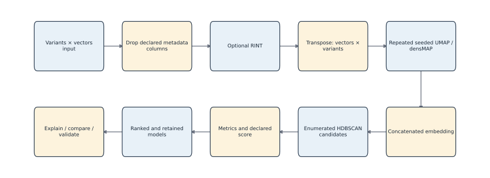

*Stage 1 producer–consumer workflow. Editable source: `assets/diagrams/diagram_01_stage1_workflow.mmd`.*

## Evidence-backed example

Follow `assets/diagrams/diagram_01_stage1_workflow.mmd` from input to downstream utilities. Each arrow corresponds to an implementation module named in `evidence/source_to_manual_traceability.tsv`.

## Outputs to inspect

At the run root, inspect `resolved_config.yaml`, the search-space manifests, `models/`, `run_manifest.json`, and `logs/run.log`. Chapter 41 maps every named output to its producer and consumer.

## Common mistakes

Do not treat `stage09_*` display coordinates as the full concatenated embedding. Do not expect cleaned inputs or individual repeated embeddings on disk; current Freeze 3 keeps them in memory.

## Scientific and operational limits

A workflow diagram explains control and data flow, not scientific validity. Every transformation can change geometry, and the selected model remains conditional on the declared search and score.

## Completion check

Given an artifact name, identify its producer and whether it refits data. Verify your answer in `output_producer_consumer_map.tsv`.

<p class="xref"><strong>Operational cross-reference:</strong> Chapter 37 covers commands, Chapter 38 configuration, Chapter 41 artifact schemas, Chapter 42 provenance, and Chapter 46 current limitations.</p>


# 5. Essential GWAS, vector-space, distance, and clustering concepts

> **Release status.** DIMPLE-GWAS Freeze 3 RC1 (`3.0.0rc1`) is software-complete under local and fixed-fixture evidence. It is not yet scientifically frozen or cross-platform validated.

## Orientation

This chapter belongs to **Part I — Orientation and conceptual foundations**. It separates observed Freeze 3 behavior from scientific interpretation, historical evidence, and pending release work.

## Learning objectives

After this chapter, you can:

- Define summary statistics, vectors, distances, partitions, and internal metrics.
- identify the evidence artifact that supports the behavior or boundary;
- describe one common misuse in language appropriate for a methods report.

Prerequisites: 2.

## Explanation and implementation

A GWAS summary statistic is a result indexed by a genetic variant and phenotype. A vector is the ordered set of analysis values for one phenotype across the aligned variant rows. A distance metric maps two vectors—or two embedded observations—to a nonnegative dissimilarity. A partition assigns observations to groups; HDBSCAN may also leave observations unassigned with label `-1`.

Internal clustering metrics summarize geometric properties of the same representation used to fit or assess the partition. Silhouette contrasts an observation's mean within-cluster distance with its nearest other-cluster mean distance. DBCV evaluates density connectedness and separation. Neither asks whether a cluster is biologically meaningful. Projection metrics such as trustworthiness and continuity assess neighborhood preservation, not labels or mechanism.

Pleiotropy is a biological/statistical concept about genetic effects across traits. A density cluster among phenotype vectors can generate hypotheses about shared structure, but cluster membership is not itself proof of pleiotropy or its cause.

## Evidence-backed example

For three points, compute within- and between-cluster distances under two metrics. The exercise shows why a metric choice is part of the scientific definition of neighborhood rather than a cosmetic option.

## Outputs to inspect

Candidate tables contain topology counts, cluster-size summaries, silhouette, DBCV, Calinski–Harabasz, Davies–Bouldin, HDBSCAN persistence, projection metrics, status, warnings, and errors. Check each metric's scope and metric columns.

## Common mistakes

Do not compare metric values calculated under undocumented metrics or representations. Do not treat a large score as an external p-value. Do not call every input column a ‘feature’ when the clustered observation is the vector/IDP.

## Scientific and operational limits

Distance concentration, correlations among variants, scaling, missingness, and finite sample size can alter geometry. Internal metrics can reward a representation-specific structure that fails to reproduce externally.

## Completion check

Define vector, metric, partition, candidate model, and noise label without using any biological conclusion in the definition.

## Evidence and references

See Rousseeuw (1987), DOI 10.1016/0377-0427(87)90125-7, and Moulavi et al. (2014), DOI 10.1137/1.9781611973440.96.

<p class="xref"><strong>Operational cross-reference:</strong> Chapter 37 covers commands, Chapter 38 configuration, Chapter 41 artifact schemas, Chapter 42 provenance, and Chapter 46 current limitations.</p>


# 6. Why repeated nonlinear embeddings and density clustering are used

> **Release status.** DIMPLE-GWAS Freeze 3 RC1 (`3.0.0rc1`) is software-complete under local and fixed-fixture evidence. It is not yet scientifically frozen or cross-platform validated.

## Orientation

This chapter belongs to **Part I — Orientation and conceptual foundations**. It separates observed Freeze 3 behavior from scientific interpretation, historical evidence, and pending release work.

## Learning objectives

After this chapter, you can:

- Explain the design rationale while rejecting topology or determinism guarantees.
- identify the evidence artifact that supports the behavior or boundary;
- describe one common misuse in language appropriate for a methods report.

Prerequisites: 4-5.

## Explanation and implementation

UMAP is a nonlinear neighborhood-based embedding method; densMAP augments its objective to encourage correspondence in local density. DIMPLE-GWAS repeats seeded embeddings because one stochastic optimization can be sensitive to initialization. It concatenates the repeated coordinates so HDBSCAN receives information from all executed repeats. Density clustering is attractive because it can represent irregular clusters and explicitly leave low-density observations unassigned.

The rationale is empirical, not a mathematical guarantee. Concatenation does not prove that stochasticity has vanished, that Euclidean distances estimate an exact expectation, that ‘true topology’ has been recovered, or that a formal consensus partition has been computed. Base parameters, number and sequence of seeds, implementation versions, numerical libraries, hardware, threads, and the input matrix all remain part of the result.

## Evidence-backed example

Tutorial 1 uses one repeated seed for speed; Tutorial 2 uses two. The production standard declares 1,000. These are tutorial value, tutorial value, and configuration default—not interchangeable recommendations.

## Outputs to inspect

Inspect the resolved UMAP parameters, `random_seeds`, package versions, thread settings, projection-quality fields, and HDBSCAN metric in the manifest/candidate table.

## Common mistakes

Do not interpret a clean 2D plot as proof that the concatenated representation is stable. Do not increase repeats without estimating compute and storage consequences. Do not call label `-1` a failed phenotype.

## Scientific and operational limits

Nonlinear embeddings can distort global distances, and density clustering is parameter dependent. Empirical stability should be assessed across justified perturbations and, for scientific conclusions, external or held-out evidence.

## Completion check

Explain in two sentences why repeats are used and then name three guarantees the implementation does not make.

## Evidence and references

See McInnes et al. (2018), DOI 10.21105/joss.00861; Narayan et al. (2021), DOI 10.1038/s41587-020-00801-7; and Campello et al. (2015), DOI 10.1145/2733381.

<p class="xref"><strong>Operational cross-reference:</strong> Chapter 37 covers commands, Chapter 38 configuration, Chapter 41 artifact schemas, Chapter 42 provenance, and Chapter 46 current limitations.</p>


# 7. Choosing among complementary methods

> **Release status.** DIMPLE-GWAS Freeze 3 RC1 (`3.0.0rc1`) is software-complete under local and fixed-fixture evidence. It is not yet scientifically frozen or cross-platform validated.

## Orientation

This chapter belongs to **Part I — Orientation and conceptual foundations**. It separates observed Freeze 3 behavior from scientific interpretation, historical evidence, and pending release work.

## Learning objectives

After this chapter, you can:

- Compare PCA, ICA, clustering, and multivariate association tools by input, output, and goal.
- identify the evidence artifact that supports the behavior or boundary;
- describe one common misuse in language appropriate for a methods report.

Prerequisites: 5-6.

## Explanation and implementation

Methods are comparable only after their questions and outputs are aligned. PCA provides orthogonal linear variance components and loadings; ICA seeks statistically independent linear components; k-means creates exhaustive centroid-based groups; hierarchical clustering supplies a nested grouping; mixture models provide probabilistic components. UMAP is a representation method, while HDBSCAN is the clustering stage. DBCV is a diagnostic, not a clustering algorithm.

Genomic SEM models multivariate genetic covariance, MTAG estimates trait-specific multi-trait associations, PLEIO provides joint pleiotropic-locus tests, and MOSTest is an omnibus multivariate association approach. These methods do not all accept the same inputs or return the same scientific object as DIMPLE-GWAS. They may be alternatives for a different question or complementary stages, but they are not implemented by Freeze 3.

No method is universally ‘completely ineffective.’ PCA/ICA components can be useful and reproducible without becoming automatically causal biological mechanisms.

## Evidence-backed example

Use `evidence/comparator_matrix.tsv` to select a method for three questions: reduce a matrix linearly, identify omnibus associated loci, and cluster phenotype vectors with an unassigned-noise option.

## Outputs to inspect

The comparator matrix records purpose, input, output, assumptions, noise handling, interpretability, strengths, limitations, relationship to DIMPLE-GWAS, and implementation status.

## Common mistakes

Do not rank unlike methods with a single ‘best’ score. Do not imply that the manual executed a comparator marked `implemented_in_freeze3=no`. Correctly attribute the genomic PCA/ICA paper to Oblong et al., not to an inferred reviewer author.

## Scientific and operational limits

Conceptual comparisons do not establish empirical superiority. A fair benchmark would need common data, preregistered objectives, suitable metrics, and evidence for each implementation.

## Completion check

For one planned analysis, write the input, desired output, and validation target before naming a method.

## Evidence and references

See Oblong et al. (2024), DOI 10.1111/gbb.12876; Grotzinger et al. (2019), DOI 10.1038/s41562-019-0566-x; MTAG DOI 10.1038/s41588-017-0009-4; MOSTest DOI 10.1038/s41467-020-17368-1; and PLEIO DOI 10.1016/j.ajhg.2020.11.017.

<p class="xref"><strong>Operational cross-reference:</strong> Chapter 37 covers commands, Chapter 38 configuration, Chapter 41 artifact schemas, Chapter 42 provenance, and Chapter 46 current limitations.</p>


# 8. Scientific interpretation, circularity, and validation boundaries

> **Release status.** DIMPLE-GWAS Freeze 3 RC1 (`3.0.0rc1`) is software-complete under local and fixed-fixture evidence. It is not yet scientifically frozen or cross-platform validated.

## Orientation

This chapter belongs to **Part I — Orientation and conceptual foundations**. It separates observed Freeze 3 behavior from scientific interpretation, historical evidence, and pending release work.

## Learning objectives

After this chapter, you can:

- Recognize post-selection circularity and select appropriate validation layers.
- identify the evidence artifact that supports the behavior or boundary;
- describe one common misuse in language appropriate for a methods report.

Prerequisites: 1-7.

## Explanation and implementation

When the same data choose a representation, select a partition, and then supply the evidence used to declare that partition meaningful, naive inferential statements can be circular. Internal scores are useful for navigation within a declared candidate population, but they do not become independent hypothesis tests. Original-space correlations computed after selecting labels are descriptive conditional summaries.

A validation ladder keeps claims calibrated. Software validation checks code contracts. Technical validation checks whether an analysis and its artifacts can be rerun or compared under stated conditions. Statistical validation studies stability, uncertainty, multiplicity, and selection. Biological validation uses independent data, domain evidence, or an appropriately designed external analysis. Cross-platform validation tests the packaged workflow on the claimed systems.

The safe pattern is: describe what was selected and why, report sensitivity and uncertainty, reserve inferential claims for methods that address the selection process, and seek held-out or independent validation.

## Evidence-backed example

The synthetic comparison has ARI=NMI=noise Jaccard=mapped membership=1. That establishes bounded structural concordance for the fixture; it does not validate the biological interpretation of real IDPs.

## Outputs to inspect

Inspect the score/selection manifest, comparison summary, validation report, exclusions, and any independent validation artifacts. Record which validation layer each supports.

## Common mistakes

Do not perform an ANOVA on the same matrix and labels and present the p-value as independent cluster confirmation. Do not turn an internal score into biological effect size or uncertainty.

## Scientific and operational limits

Selective-inference literature establishes the general problem, but the cited hierarchical-clustering procedure is not a turnkey inferential solution for the complete UMAP+HDBSCAN selection pipeline.

## Completion check

Rewrite ‘clusters were validated by strong within-cluster correlations’ so that it is accurate, conditional, and descriptive.

## Evidence and references

See Gao, Bien & Witten (2024), DOI 10.1080/01621459.2022.2116331. The scope difference from DIMPLE-GWAS is explicit.

<p class="xref"><strong>Operational cross-reference:</strong> Chapter 37 covers commands, Chapter 38 configuration, Chapter 41 artifact schemas, Chapter 42 provenance, and Chapter 46 current limitations.</p>


<div class="part-page"></div>


# Part II — Installation, data preparation, and the first successful run

# 9. System requirements and isolated environment setup

> **Release status.** DIMPLE-GWAS Freeze 3 RC1 (`3.0.0rc1`) is software-complete under local and fixed-fixture evidence. It is not yet scientifically frozen or cross-platform validated.

## Orientation

This chapter belongs to **Part II — Installation, data preparation, and the first successful run**. It separates observed Freeze 3 behavior from scientific interpretation, historical evidence, and pending release work.

## Learning objectives

After this chapter, you can:

- Create an isolated environment; verify the installed version and dependencies.
- identify the evidence artifact that supports the behavior or boundary;
- describe one common misuse in language appropriate for a methods report.

Prerequisites: basic shell.

## Explanation and implementation

Use a supported Python in an isolated environment so package resolution is auditable and does not alter system Python. This manual build used Python 3.12.13 on macOS arm64 and installed the package editable with its `test` and `plots` extras. The exact resolved package list is retained in `evidence/resolved_dependencies.txt`; `pip check` reported no broken requirements.

From the Freeze 3 root, a portable setup pattern is:

```bash
python3 -m venv .venv
. .venv/bin/activate
python -m pip install --upgrade pip
python -m pip install -e '.[test,plots]'
dimple-gwas --version
python -m pip check
```

The `.venv` name is an example. Keep it out of release artifacts. On Windows, use the platform's activation command. For restricted networks, acquire dependencies through the institution's approved package process and record their hashes.

## Evidence-backed example

The documentation build used `docs/manual/build/runtime_env`, then passed the absolute environment interpreter to every captured command. The runtime manifest reports exact scientific-library versions and a package-source SHA-256.

## Outputs to inspect

Check the printed version, `pip check`, `python -m pip freeze`, the CLI top-level help, and available storage before choosing a search scale.

## Common mistakes

Do not install into macOS system Python; do not assume `python` and `pip` point to the same environment; do not commit the environment directory; do not publish manifests containing unnecessary private paths.

## Scientific and operational limits

A working local installation is not a Docker or security validation. Native build requirements and numerical backends can differ on Linux or x86_64.

## Completion check

Open a new shell, activate the environment, and prove that `which python`, `python -m pip --version`, and `dimple-gwas --version` all refer to the intended environment.

<p class="xref"><strong>Operational cross-reference:</strong> Chapter 37 covers commands, Chapter 38 configuration, Chapter 41 artifact schemas, Chapter 42 provenance, and Chapter 46 current limitations.</p>


# 10. Input data contract, orientation, metadata columns, and missingness

> **Release status.** DIMPLE-GWAS Freeze 3 RC1 (`3.0.0rc1`) is software-complete under local and fixed-fixture evidence. It is not yet scientifically frozen or cross-platform validated.

## Orientation

This chapter belongs to **Part II — Installation, data preparation, and the first successful run**. It separates observed Freeze 3 behavior from scientific interpretation, historical evidence, and pending release work.

## Learning objectives

After this chapter, you can:

- Validate column roles, orientation, identifiers, numeric values, and missingness before a run.
- identify the evidence artifact that supports the behavior or boundary;
- describe one common misuse in language appropriate for a methods report.

Prerequisites: 2, 9.

## Explanation and implementation

The standard run contract is a CSV/TSV table with variants in rows, a declared leading metadata prefix, and vectors/IDPs in the remaining columns. The default `drop_first_n_cols` is 4. Analysis columns must be numeric after parsing. Their column names become `feature_id` values after transpose, so they must be stable and unique. The original row axis supplies the variables across which vectors are compared.

Freeze 3 reads the separator explicitly when configured or through its table reader, drops the prefix, optionally transforms analysis columns, and transposes. The native explanation path expects exact retained IDs and the original matrix. Legacy explanation can infer orientation only through exact overlap and should use explicit orientation/ID options when ambiguity exists. Missing, nonnumeric, constant, duplicate, or mismatched values can make preprocessing or correlations undefined.

The input-orientation diagram at `assets/diagrams/diagram_02_input_orientation.mmd` is the safest mental model.

## Evidence diagram or figure

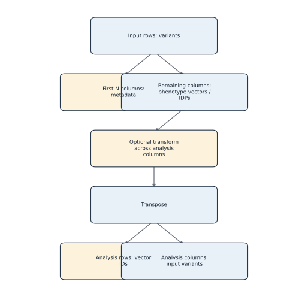

*Input orientation and transposition. Editable source: `assets/diagrams/diagram_02_input_orientation.mmd`.*

## Evidence-backed example

The fixture `benchmarks/synthetic/synthetic_matrix.tsv` has 80 rows and 28 columns: four metadata plus 24 vectors. After the prefix is dropped and data are transposed, the analysis matrix is 24 vectors by 80 variables.

## Outputs to inspect

Before a run, inspect header uniqueness, first rows, dimensions, numeric conversion, missing counts, separator, and the annotation join column. After a run, confirm the manifest's `input_contract` and input SHA-256.

## Common mistakes

Do not set `drop_first_n_cols` by guessing. Do not use annotation row number as vector identity. Do not let spreadsheet software rewrite scientific notation or identifiers. Do not silently impute missing values outside an approved upstream protocol.

## Scientific and operational limits

Freeze 3 cannot determine whether upstream variants are allele-aligned, comparable across phenotypes, or scientifically eligible. Protected study matrices should not be copied into the manual or image.

## Completion check

For a prospective input, record row count, metadata columns, vector count, separator, missingness rule, upstream harmonization provenance, and the expected feature-ID set.

<p class="xref"><strong>Operational cross-reference:</strong> Chapter 37 covers commands, Chapter 38 configuration, Chapter 41 artifact schemas, Chapter 42 provenance, and Chapter 46 current limitations.</p>


# 11. Configuration files and precedence

> **Release status.** DIMPLE-GWAS Freeze 3 RC1 (`3.0.0rc1`) is software-complete under local and fixed-fixture evidence. It is not yet scientifically frozen or cross-platform validated.

## Orientation

This chapter belongs to **Part II — Installation, data preparation, and the first successful run**. It separates observed Freeze 3 behavior from scientific interpretation, historical evidence, and pending release work.

## Learning objectives

After this chapter, you can:

- Resolve built-in, YAML, and CLI precedence; identify default versus tutorial values.
- identify the evidence artifact that supports the behavior or boundary;
- describe one common misuse in language appropriate for a methods report.

Prerequisites: 9-10.

## Explanation and implementation

Configuration resolution is deterministic: start with a built-in search mode, deep-merge a YAML mapping, then apply only explicit CLI values. The result is validated and written as `resolved_config.yaml`. Therefore a YAML value can differ from the run value when a CLI override is present; the resolved file, not memory or the source overlay alone, is authoritative for that run.

The four modes are `standard`, `extended`, `custom`, and `fixed`. `custom` requires a YAML file. `fixed` requires one value for every searched UMAP and HDBSCAN parameter. Scalar values produce one choice; lists produce choices; numeric `{start, stop, step}` mappings are stop-exclusive; supported CLI strings may also encode comma lists or ranges. Unknown top-level or interpretation keys and invalid combinations fail validation.

```bash
dimple-gwas inspect-config \
  --search-mode custom \
  --config docs/manual/tutorials/02_custom_search_space/tutorial_config.yaml
```

## Evidence diagram or figure

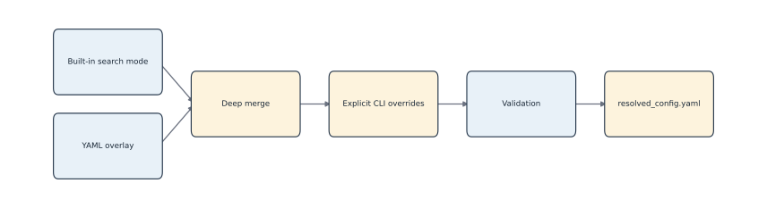

*Configuration precedence. Editable source: `assets/diagrams/diagram_03_config_precedence.mmd`.*

## Evidence-backed example

Tutorial 2 declares two values each for `umap.n_neighbors`, `umap.min_dist`, `hdbscan.min_cluster_size`, `hdbscan.min_samples`, and epsilon; other searched fields are scalar. The resolved file records two repeated states and one candidate job.

## Outputs to inspect

Compare the source YAML, captured `inspect-config` output, and run `resolved_config.yaml`. Use `evidence/configuration_key_reference.tsv` for every default and exposure.

## Common mistakes

Do not call a tutorial value a default. Do not edit a resolved output and assume the past run changed. Do not use a range's `stop` as though it were included. Do not mix `custom` with no YAML.

## Scientific and operational limits

Configuration validity means fields satisfy software constraints, not that the scientific search is appropriate. Candidate-count safety and parameter justification remain analyst responsibilities.

## Completion check

Predict the resolved value when built-in `n_jobs=-1`, YAML sets `n_jobs=2`, and CLI supplies `--n-jobs 1`. Confirm using `inspect-config`.

<p class="xref"><strong>Operational cross-reference:</strong> Chapter 37 covers commands, Chapter 38 configuration, Chapter 41 artifact schemas, Chapter 42 provenance, and Chapter 46 current limitations.</p>


# 12. Inspecting a configuration and enumerating the search space

> **Release status.** DIMPLE-GWAS Freeze 3 RC1 (`3.0.0rc1`) is software-complete under local and fixed-fixture evidence. It is not yet scientifically frozen or cross-platform validated.

## Orientation

This chapter belongs to **Part II — Installation, data preparation, and the first successful run**. It separates observed Freeze 3 behavior from scientific interpretation, historical evidence, and pending release work.

## Learning objectives

After this chapter, you can:

- Use inspect-config and show-search-space; calculate and audit candidate count.
- identify the evidence artifact that supports the behavior or boundary;
- describe one common misuse in language appropriate for a methods report.

Prerequisites: 11.

## Explanation and implementation

`inspect-config` resolves and validates configuration and prints candidate counts without fitting. `show-search-space` enumerates the complete deterministic Cartesian product and can retain full TSV/JSON manifests. These commands are mandatory preflight tools: they expose accidental explosions, invalid fields, and misunderstood ranges before UMAP consumes compute.

```bash
dimple-gwas show-search-space \
  --search-mode custom \
  --config docs/manual/tutorials/02_custom_search_space/tutorial_config.yaml \
  --output-dir docs/manual/tutorials/02_custom_search_space/search_space_new \
  --show-first 5
```

Choose a new output directory name; the manual's executed directory is evidence, not a scratch target. Standard mode proves 45 min-cluster-size choices × 18 min-samples choices × 3 epsilon choices = 2,430 candidates for one UMAP family. Shipped extended mode has 1,728 candidates, not the older provisional 5,184 number.

## Evidence-backed example

Executed Tutorial 1 enumerated one candidate; Tutorial 2 enumerated 32: four UMAP families times eight HDBSCAN configurations. Both counts appear in stdout and complete manifests.

## Outputs to inspect

Inspect `candidate_models`, UMAP/HDBSCAN family counts, candidate ordinals, stable IDs, and the first/last parameter rows. Retain config and manifest checksums together.

## Common mistakes

Do not estimate workload from HDBSCAN choices alone when UMAP parameters also vary. Do not silently sample a large Cartesian product; Freeze 3's safety ceiling raises rather than sampling.

## Scientific and operational limits

Candidate count is not runtime by itself: repeated UMAP families dominate some workloads while HDBSCAN candidate fits dominate others. Pilot evidence is still needed.

## Completion check

Calculate the Tutorial 2 count from the YAML without executing it, then match each factor to the manifest.

<p class="xref"><strong>Operational cross-reference:</strong> Chapter 37 covers commands, Chapter 38 configuration, Chapter 41 artifact schemas, Chapter 42 provenance, and Chapter 46 current limitations.</p>


# 13. Fixed synthetic quickstart

> **Release status.** DIMPLE-GWAS Freeze 3 RC1 (`3.0.0rc1`) is software-complete under local and fixed-fixture evidence. It is not yet scientifically frozen or cross-platform validated.

## Orientation

This chapter belongs to **Part II — Installation, data preparation, and the first successful run**. It separates observed Freeze 3 behavior from scientific interpretation, historical evidence, and pending release work.

## Learning objectives

After this chapter, you can:

- Execute the canonical bounded run without overwriting prior outputs.
- identify the evidence artifact that supports the behavior or boundary;
- describe one common misuse in language appropriate for a methods report.

Prerequisites: 9-12.

## Explanation and implementation

The shortest verified run starts in the Freeze 3 repository root with the installed RC1 entry point. Inspect first, enumerate second, fit third, and use a new output root.

```bash
dimple-gwas inspect-config \
  --search-mode fixed \
  --config docs/manual/tutorials/01_fixed_synthetic/tutorial_config.yaml

dimple-gwas show-search-space \
  --search-mode fixed \
  --config docs/manual/tutorials/01_fixed_synthetic/tutorial_config.yaml \
  --output-dir docs/manual/tutorials/01_fixed_synthetic/search_space_new

dimple-gwas run \
  --search-mode fixed \
  --config docs/manual/tutorials/01_fixed_synthetic/tutorial_config.yaml \
  --output-dir docs/manual/tutorials/01_fixed_synthetic/run_new
```

Replace `*_new` with unique names. The canonical documented output is `run_20260825_v2`; do not overwrite it. The fixture is small and repository-owned. It demonstrates execution structure, not production adequacy.

## Evidence-backed example

The executed canonical run prepared 24 vectors by 80 variables, evaluated one candidate, selected `model_060fac0208bb58e2`, found three clusters of eight, and assigned no noise. Exit status was zero.

## Outputs to inspect

Confirm `run_manifest.json` status, one-row search manifest, one candidate table row, selected-model JSON, label row count/uniqueness, annotation join, log, and validation output when run.

## Common mistakes

Do not copy an example output path unchanged. Do not jump directly to the plot before checking the manifest. Do not generalize ‘three clusters’ from the designed fixture to real data.

## Scientific and operational limits

One seed and one candidate make this a smoke test. They do not represent standard production compute or a robust model-selection study.

## Completion check

Run the three commands in a fresh named root and write five structural assertions that avoid exact floating-point promises.

<p class="xref"><strong>Operational cross-reference:</strong> Chapter 37 covers commands, Chapter 38 configuration, Chapter 41 artifact schemas, Chapter 42 provenance, and Chapter 46 current limitations.</p>


# 14. Reading the run manifest

> **Release status.** DIMPLE-GWAS Freeze 3 RC1 (`3.0.0rc1`) is software-complete under local and fixed-fixture evidence. It is not yet scientifically frozen or cross-platform validated.

## Orientation

This chapter belongs to **Part II — Installation, data preparation, and the first successful run**. It separates observed Freeze 3 behavior from scientific interpretation, historical evidence, and pending release work.

## Learning objectives

After this chapter, you can:

- Confirm completion, provenance, backends, seeds, threads, and hashes.
- identify the evidence artifact that supports the behavior or boundary;
- describe one common misuse in language appropriate for a methods report.

Prerequisites: 13.

## Explanation and implementation

`run_manifest.json` is the primary run-level audit record. It names the schema, software/version, command, start/finish status, platform, architecture, Python and package versions, package-source hash, input record, resolved configuration and its hash, input contract, seeds, threads, backends, search size, runtime, selected model, scoring formula/profile, artifacts, Parquet outcome, warnings, exclusions, and failures.

A healthy manifest has `status=complete`, but completion alone is not enough. Reconcile candidate counts with search manifests, failed counts with `logs/model_failures.tsv`, selected model with `model_selection_manifest.json` and `best_model.json`, and artifact hashes with files. `git_commit` is null in this source snapshot; the package-source SHA-256 and file registers substitute for build identity in this draft.

## Evidence-backed example

Tutorial 2 records 32 search candidates, 32 completed models, zero failed models, four UMAP configurations, two random seeds (42,43), contrib HDBSCAN and umap-learn backends, and an approximately 10.713-second manifest runtime in its local environment.

## Outputs to inspect

Inspect `run_manifest.json`, `resolved_config.yaml`, both search-space manifests, `models/model_selection_manifest.json`, `logs/run.log`, and `logs/model_failures.tsv` as a set.

## Common mistakes

Do not interpret a null Git commit as a random run; use the source hash. Do not ignore a recorded optional-Parquet failure. Do not assume a complete run had no invalid topologies.

## Scientific and operational limits

Manifests can disclose local paths, input hashes, platform information, and commands. Sanitize public copies without changing the retained private audit record.

## Completion check

Write an audit note that independently reconciles software version, input hash, configuration hash, candidate count, failure count, selected model, and backend names.

<p class="xref"><strong>Operational cross-reference:</strong> Chapter 37 covers commands, Chapter 38 configuration, Chapter 41 artifact schemas, Chapter 42 provenance, and Chapter 46 current limitations.</p>


<div class="part-page"></div>


# Part III — The complete DIMPLE-GWAS workflow

# 15. Preprocessing and optional RINT

> **Release status.** DIMPLE-GWAS Freeze 3 RC1 (`3.0.0rc1`) is software-complete under local and fixed-fixture evidence. It is not yet scientifically frozen or cross-platform validated.

## Orientation

This chapter belongs to **Part III — The complete DIMPLE-GWAS workflow**. It separates observed Freeze 3 behavior from scientific interpretation, historical evidence, and pending release work.

## Learning objectives

After this chapter, you can:

- Explain the implemented transformation order and decide when RINT is configured.
- identify the evidence artifact that supports the behavior or boundary;
- describe one common misuse in language appropriate for a methods report.

Prerequisites: 10-11.

## Explanation and implementation

Preprocessing defines the geometry presented to UMAP. Freeze 3 removes `input.drop_first_n_cols` leading columns, validates that analysis columns are numeric, optionally applies rank inverse normal transformation to each analysis column before transpose, and then transposes to vectors by input variables. With `zscore_transform=none`, values are not RINT-transformed. The historical option name is retained although the implemented alternative is `rint`.

For a column with ranks, RINT maps rank-based probabilities through the standard-normal quantile function. It can reduce marginal scale differences and the influence of extreme values, but it also changes the scientific quantity and does not repair upstream harmonization or dependence. The configuration default is `none`; enable RINT only with a documented rationale that matches the intended historical or prospective protocol.

## Evidence-backed example

The preprocessing tests cover RINT and numeric-matrix behavior. Both executed synthetic tutorials use `none`, so their values remain on the fixture's generated scale.

## Outputs to inspect

Inspect the input config, resolved transform, input-contract manifest, prepared-shape log line, identifier set, and any preprocessing warnings. Record upstream transformations separately.

## Common mistakes

Do not describe RINT as row-wise without naming the table orientation: implementation applies it to analysis columns before transpose. Do not call it z-scoring or assume it creates independence.

## Scientific and operational limits

RINT can alter ties, correlations, distances, and downstream partitions. The manual makes no universal recommendation between transformed and untransformed analyses.

## Completion check

Given a 5-row analysis column with a tie, explain what information ranks retain and discard, then state where transpose occurs.

<p class="xref"><strong>Operational cross-reference:</strong> Chapter 37 covers commands, Chapter 38 configuration, Chapter 41 artifact schemas, Chapter 42 provenance, and Chapter 46 current limitations.</p>


# 16. UMAP and densMAP fundamentals

> **Release status.** DIMPLE-GWAS Freeze 3 RC1 (`3.0.0rc1`) is software-complete under local and fixed-fixture evidence. It is not yet scientifically frozen or cross-platform validated.

## Orientation

This chapter belongs to **Part III — The complete DIMPLE-GWAS workflow**. It separates observed Freeze 3 behavior from scientific interpretation, historical evidence, and pending release work.

## Learning objectives

After this chapter, you can:

- Relate configured UMAP parameters to the implementation without interpreting axes as loadings.
- identify the evidence artifact that supports the behavior or boundary;
- describe one common misuse in language appropriate for a methods report.

Prerequisites: 5-6, 15.

## Explanation and implementation

Freeze 3 passes the full prepared matrix to umap-learn. The searched UMAP keys are `n_neighbors`, `min_dist`, `n_components`, `metric`, `spread`, `learning_rate`, `repulsion_strength`, `negative_sample_rate`, `local_connectivity`, `set_op_mix_ratio`, `random_state`, and `densmap`. The standard defaults are 30 neighbors, minimum distance 0, three dimensions per repeat, Euclidean metric, and densMAP enabled.

`n_neighbors` influences the local-versus-broader neighborhood balance. `min_dist` and `spread` shape allowed packing in the embedded space. The metric defines neighbor dissimilarity in the prepared input space. densMAP adds density preservation pressure. Optimizer parameters affect the fitted representation. `n_components` is per repeat; it is not necessarily the number of coordinates later used for a display plot.

No user-visible PCA, SVD, or ICA pre-reducer exists in the production path. UMAP's internal initialization should not be misreported as an explicit preprocessing stage.

## Evidence-backed example

Tutorial 2 varies neighbors (10,15) and min_dist (0,0.1), giving four UMAP families. Candidate-score groups reflect those families, while the eight HDBSCAN variants within a family share the same embedding metrics.

## Outputs to inspect

Inspect flattened UMAP fields, `umap_id`, trustworthiness/continuity, seeds, runtime, and selected display coordinates. Compare the resolved config to the default reference.

## Common mistakes

Do not interpret UMAP_1/2/3 as effect directions or loadings. Do not compare coordinates from unaligned runs pointwise. Do not say densMAP preserves all global distances.

## Scientific and operational limits

UMAP behavior is stochastic and parameter/metric/data dependent. Projection diagnostics are bounded summaries, and a visually persuasive layout does not establish a unique topology.

## Completion check

Choose one UMAP parameter and describe the implementation-visible change you would audit without predicting a biologically preferred result.

## Evidence and references

See McInnes et al. (2018), DOI 10.21105/joss.00861; Narayan et al. (2021), DOI 10.1038/s41587-020-00801-7; and official UMAP parameter documentation.

<p class="xref"><strong>Operational cross-reference:</strong> Chapter 37 covers commands, Chapter 38 configuration, Chapter 41 artifact schemas, Chapter 42 provenance, and Chapter 46 current limitations.</p>


# 17. Repeated seeds, concatenated embeddings, determinism, and compute cost

> **Release status.** DIMPLE-GWAS Freeze 3 RC1 (`3.0.0rc1`) is software-complete under local and fixed-fixture evidence. It is not yet scientifically frozen or cross-platform validated.

## Orientation

This chapter belongs to **Part III — The complete DIMPLE-GWAS workflow**. It separates observed Freeze 3 behavior from scientific interpretation, historical evidence, and pending release work.

## Learning objectives

After this chapter, you can:

- Trace seed generation and concatenation; bound determinism and resource claims.
- identify the evidence artifact that supports the behavior or boundary;
- describe one common misuse in language appropriate for a methods report.

Prerequisites: 16.

## Explanation and implementation

For each UMAP family, Freeze 3 derives a deterministic sequence of integer seeds from the configured base state and repeat count. It executes one embedding per seed and horizontally concatenates the resulting `n_components` coordinates. With 1,000 repeats and three components, the HDBSCAN input has 3,000 coordinates per vector. A smaller display embedding is retained separately for selected-model visualization.

Repeats multiply UMAP work and concatenated-memory width. Standard mode uses the historical ensemble seed behavior and 1,000 repeats; the tutorials set one or two for bounded execution. `n_jobs`, Numba behavior, BLAS/OpenMP libraries, architecture, and thread scheduling can affect runtime and numerical detail. Reproducing seeds is necessary but not sufficient for bitwise cross-platform identity.

The representation is an empirical aggregation. It is not averaged coordinates, a formal consensus cluster, or a proof of expected-distance estimation.

## Evidence diagram or figure

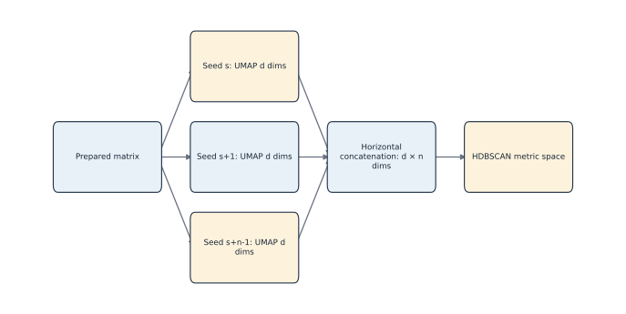

*Repeated embeddings and concatenation. Editable source: `assets/diagrams/diagram_04_repeated_embeddings.mmd`.*

## Evidence-backed example

Tutorial 2's manifest lists seeds 42 and 43, three components per repeat, and four UMAP families. Each family therefore supplies a 24×6 concatenated matrix in memory; this matrix is not written to disk.

## Outputs to inspect

Inspect `random_seeds`, `umap_seeds`, `n_random_states`, `legacy_ensemble_seeds`, UMAP runtime, package versions, thread settings, and source hash.

## Common mistakes

Do not confuse the three display columns with all repeated coordinates. Do not publish a runtime estimate by linearly scaling a JIT-heavy smoke test without qualification. Do not promise identical floating-point embeddings across machines.

## Scientific and operational limits

The full 164-IDP 1,000-seed run is pending Docker. Cross-platform acceptance should use exact label/schema checks where appropriate and tolerances/alignment for floating-point coordinates.

## Completion check

Calculate concatenated width for 1, 2, 10, and 1,000 repeats at three dimensions; identify which output file does not exist in current Freeze 3.

<p class="xref"><strong>Operational cross-reference:</strong> Chapter 37 covers commands, Chapter 38 configuration, Chapter 41 artifact schemas, Chapter 42 provenance, and Chapter 46 current limitations.</p>


# 18. HDBSCAN concepts and the Freeze 3 search grid

> **Release status.** DIMPLE-GWAS Freeze 3 RC1 (`3.0.0rc1`) is software-complete under local and fixed-fixture evidence. It is not yet scientifically frozen or cross-platform validated.

## Orientation

This chapter belongs to **Part III — The complete DIMPLE-GWAS workflow**. It separates observed Freeze 3 behavior from scientific interpretation, historical evidence, and pending release work.

## Learning objectives

After this chapter, you can:

- Interpret density parameters and enumerate standard/custom grids.
- identify the evidence artifact that supports the behavior or boundary;
- describe one common misuse in language appropriate for a methods report.

Prerequisites: 5, 17.

## Explanation and implementation

Freeze 3 fits the contributed `hdbscan` package to each concatenated embedding. `min_cluster_size` sets the smallest extracted group, while `min_samples` affects core distances and conservativeness. `cluster_selection_epsilon` can merge fine structure below a distance threshold. `cluster_selection_method` is `eom` or `leaf`; `max_cluster_size` has no effect for leaf selection and is recorded with a parameter note when set. Other exposed controls are persistence, alpha, single-cluster permission, maximum cluster size, and metric.

The standard grid uses min-cluster-size 5 through 49, min-samples 2 through 19, and epsilon 0,1,2: 2,430 candidates. Candidate identity also includes UMAP family. Every evaluation becomes `success`, `invalid_topology` when fewer than two non-noise clusters are found, or `failed` with an error. Failure rows are retained, not removed.

## Evidence diagram or figure

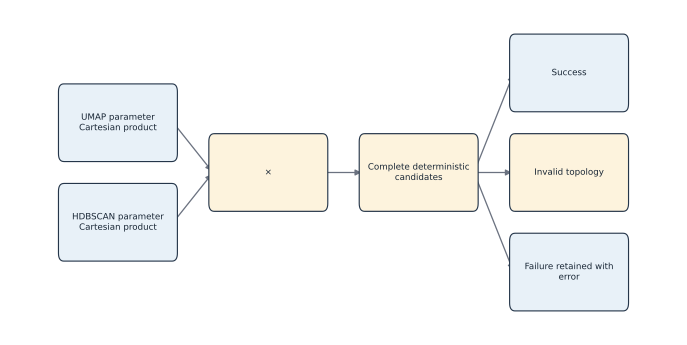

*Complete search-space enumeration. Editable source: `assets/diagrams/diagram_05_search_space.mmd`.*

## Evidence-backed example

Tutorial 2 evaluates min-cluster-size 4/6, min-samples 2/4, epsilon 0/0.05, and scalar EOM/Euclidean settings across four UMAP families. All 32 candidates succeeded and produced three clusters with no noise.

## Outputs to inspect

Inspect `hdbscan_id`, flattened parameters, status, error message, cluster/noise counts, persistence summaries, metric warnings, candidate runtime, and `model_failures.tsv`.

## Common mistakes

Do not interpret increasing `min_samples` as universally better. Do not use numeric cluster labels as stable identity across fits. Do not call noise observations false or biologically irrelevant.

## Scientific and operational limits

Density structure depends on the concatenated representation and metric. A grid can expose sensitivity but does not identify a uniquely correct biological scale.

## Completion check

For a failed candidate, verify that its ordinal, model ID, parameters, status, and error remain present in `all_models.tsv`.

## Evidence and references

See Campello et al. (2015), DOI 10.1145/2733381; McInnes et al. (2017), DOI 10.21105/joss.00205; and official hdbscan API documentation.

<p class="xref"><strong>Operational cross-reference:</strong> Chapter 37 covers commands, Chapter 38 configuration, Chapter 41 artifact schemas, Chapter 42 provenance, and Chapter 46 current limitations.</p>


# 19. Candidate-model metrics

> **Release status.** DIMPLE-GWAS Freeze 3 RC1 (`3.0.0rc1`) is software-complete under local and fixed-fixture evidence. It is not yet scientifically frozen or cross-platform validated.

## Orientation

This chapter belongs to **Part III — The complete DIMPLE-GWAS workflow**. It separates observed Freeze 3 behavior from scientific interpretation, historical evidence, and pending release work.

## Learning objectives

After this chapter, you can:

- Separate topology, silhouette, DBCV, cluster-size, and projection diagnostics.
- identify the evidence artifact that supports the behavior or boundary;
- describe one common misuse in language appropriate for a methods report.

Prerequisites: 18.

## Explanation and implementation

Candidate metrics serve different purposes. Topology fields describe non-noise cluster count, noise count/fraction, and cluster sizes. Silhouette uses the configured HDBSCAN metric and the declared sampling scope. DBCV is optionally computed as a density-aware diagnostic. Calinski–Harabasz and Davies–Bouldin are supplied with explicit metric/context fields. HDBSCAN persistence summaries describe retained clusters. Trustworthiness and continuity belong to the embedding family, not to one HDBSCAN extraction.

Metrics can be missing when a topology is invalid, a calculation is undefined, a backend cannot support a metric, or a candidate fails. Read `status`, scope, sampled flags, sample sizes, and `metric_warnings` before comparing numbers. The candidate table is deliberately wide so these qualifications are not hidden.

## Evidence-backed example

The selected Tutorial 2 candidate has silhouette about 0.970354 and DBCV about 0.976386, with three equal clusters and no noise. These values describe the designed fixture under Euclidean geometry; they are not expected production targets.

## Outputs to inspect

Inspect metric value plus its metric/scope/sampled/sample-size columns, topology counts, persistence, warnings, and the run's compute flags.

## Common mistakes

Do not call silhouette inherently Euclidean; Freeze 3 supplies the configured metric. Do not compare a sampled score with a full score without noting scope. Do not call DBCV the universal best metric.

## Scientific and operational limits

All internal metrics are conditional on representation and candidate population. They lack independent biological evidence and can disagree legitimately.

## Completion check

Choose two candidates and write a comparison that mentions representation, metric, scope, topology, and warnings before selecting any score.

## Evidence and references

See Rousseeuw (1987), DOI 10.1016/0377-0427(87)90125-7, and Moulavi et al. (2014), DOI 10.1137/1.9781611973440.96.

<p class="xref"><strong>Operational cross-reference:</strong> Chapter 37 covers commands, Chapter 38 configuration, Chapter 41 artifact schemas, Chapter 42 provenance, and Chapter 46 current limitations.</p>


# 20. The legacy_dimple score and optional alternatives

> **Release status.** DIMPLE-GWAS Freeze 3 RC1 (`3.0.0rc1`) is software-complete under local and fixed-fixture evidence. It is not yet scientifically frozen or cross-platform validated.

## Orientation

This chapter belongs to **Part III — The complete DIMPLE-GWAS workflow**. It separates observed Freeze 3 behavior from scientific interpretation, historical evidence, and pending release work.

## Learning objectives

After this chapter, you can:

- Reconstruct the score, define dynamic-range weights, and distinguish computed metrics from score terms.
- identify the evidence artifact that supports the behavior or boundary;
- describe one common misuse in language appropriate for a methods report.

Prerequisites: 19.

## Explanation and implementation

`legacy_dimple` is the default compatibility score. Among eligible candidates, each included component is divided by its maximum. Its weight is the component's raw observed range divided by the sum of included ranges. Raw score adds normalized silhouette and normalized non-noise cluster count and, only when `fit_include_noise=true`, subtracts normalized noise count. The raw score is finally scaled to [0,1] over the eligible candidate population; a zero range maps to 1.

This is population-relative: adding or removing candidates can change maxima, ranges, weights, and final scores even if an existing candidate's own metrics do not change. DBCV may be present in the table but is not a legacy-score term. No preferred cluster band, noise ceiling, largest-cluster target, or biological label is embedded.

The `custom` profile accepts explicitly declared metric weights and maximize/minimize directions. It should represent a preregistered analytic objective, not weights tuned after viewing a desired partition.

## Evidence-backed example

In Tutorial 2, all candidates have the same cluster count and no noise, so UMAP-family silhouette differences drive four score levels and eight-way ties within families. The selection manifest records realized formula and tie order.

## Outputs to inspect

Inspect `raw_score`, `score`, compatibility aliases, scoring profile, noise-fit flag, realized weights/ranges, eligible counts, and tie order in `model_selection_manifest.json`.

## Common mistakes

Do not say DBCV selected the model when profile is legacy. Do not compare normalized scores across candidate populations as though absolute. Do not introduce outcome-informed custom weights.

## Scientific and operational limits

A heuristic rank is not a probability, confidence, p-value, or guarantee of stability. Scientific selection should combine transparent objectives, sensitivity, and external evidence.

## Completion check

Using Appendix B, explain why the same model can receive a different normalized score after the candidate set expands.

<p class="xref"><strong>Operational cross-reference:</strong> Chapter 37 covers commands, Chapter 38 configuration, Chapter 41 artifact schemas, Chapter 42 provenance, and Chapter 46 current limitations.</p>


# 21. Ranking, summarising, and choosing a model

> **Release status.** DIMPLE-GWAS Freeze 3 RC1 (`3.0.0rc1`) is software-complete under local and fixed-fixture evidence. It is not yet scientifically frozen or cross-platform validated.

## Orientation

This chapter belongs to **Part III — The complete DIMPLE-GWAS workflow**. It separates observed Freeze 3 behavior from scientific interpretation, historical evidence, and pending release work.

## Learning objectives

After this chapter, you can:

- Audit eligibility, ranking, ties, Pareto summaries, and selection leakage.
- identify the evidence artifact that supports the behavior or boundary;
- describe one common misuse in language appropriate for a methods report.

Prerequisites: 18-20.

## Explanation and implementation

Ranking begins after statuses and scores exist. Eligible successful rows are ordered by final score descending, raw score descending, then stable `model_id` ascending. `top_models.tsv` retains the requested number; `best_model.json` and the selection manifest identify rank one. Pareto membership and family summaries are supplementary views, not alternate truth labels.

Choosing a model should be traceable to an objective declared before inspecting preferred biological labels. Review failure/invalid rates, parameter-family patterns, tied or near-tied solutions, noise and size trade-offs, stability checks, and domain-independent constraints. A rank-one row is the implementation's selected model under the declared rule, not proof that the cluster count is uniquely correct.

Target leakage includes choosing parameters because their labels resemble a published solution when those parameters were not recovered from the historical method. The 164-IDP manual row-16 selection is disclosed rather than retroactively portrayed as automatic rank one.

## Evidence diagram or figure

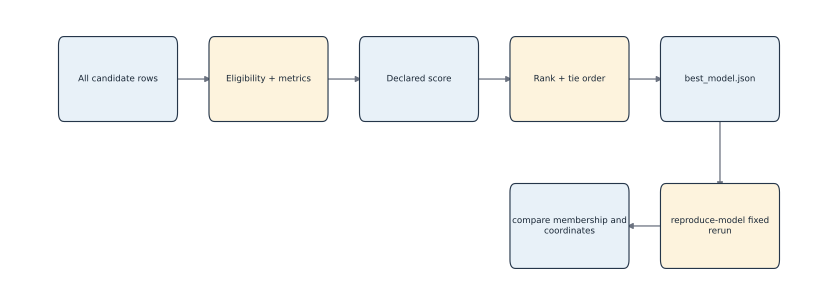

*Scoring, selection, and fixed reproduction. Editable source: `assets/diagrams/diagram_06_selection_reproduction.mmd`.*

## Evidence-backed example

Tutorial 2's first eight models tie at score 1 because their HDBSCAN choices yield the same metrics within the best UMAP family. Stable model ID breaks remaining ties; this is an engineering rule, not a biological preference.

## Outputs to inspect

Inspect ranked/all/top tables, family summaries, Pareto table, model selection manifest, best-model JSON, failures, and exact parameter records.

## Common mistakes

Do not hide ties or failed candidates. Do not select solely from a pretty plot. Do not use knowledge of desired labels to redefine the search or score and then call it replication.

## Scientific and operational limits

Internal selection uncertainty is not automatically quantified. Report sensitivity and the conditional nature of the chosen population.

## Completion check

Write a selection note for Tutorial 2 that names the rule, tie, selected ID, candidate population, and why no biological conclusion follows.

<p class="xref"><strong>Operational cross-reference:</strong> Chapter 37 covers commands, Chapter 38 configuration, Chapter 41 artifact schemas, Chapter 42 provenance, and Chapter 46 current limitations.</p>


# 22. Reproducing a selected model

> **Release status.** DIMPLE-GWAS Freeze 3 RC1 (`3.0.0rc1`) is software-complete under local and fixed-fixture evidence. It is not yet scientifically frozen or cross-platform validated.

## Orientation

This chapter belongs to **Part III — The complete DIMPLE-GWAS workflow**. It separates observed Freeze 3 behavior from scientific interpretation, historical evidence, and pending release work.

## Learning objectives

After this chapter, you can:

- Build and run a fixed one-model reproduction from a retained JSON contract.
- identify the evidence artifact that supports the behavior or boundary;
- describe one common misuse in language appropriate for a methods report.

Prerequisites: 13-14, 21.

## Explanation and implementation

A retained native `summary.json` contains the exact UMAP/HDBSCAN parameters, resolved run configuration, label-file hash, input record when available, and feature count. `reproduce-model` converts that contract to fixed mode, optionally overrides a stale input path, and performs one new fit in a new output directory. It refits; it does not copy labels.

```bash
dimple-gwas reproduce-model \
  --model-json docs/manual/tutorials/01_fixed_synthetic/run_20260825_v2/models/top_model_artifacts/model_060fac0208bb58e2/summary.json \
  --input benchmarks/synthetic/synthetic_matrix.tsv \
  --output-dir docs/manual/tutorials/03_explain_compare_validate/reproduced_new \
  --n-jobs 1
```

After the rerun, use `compare` rather than assuming numeric label equality or coordinate alignment.

## Evidence-backed example

The executed reproduction selected the same stable model ID on the same fixture and environment. Comparison found exact ID order/set, ARI/NMI/noise Jaccard/mapped membership 1, and Procrustes disparity 2.7088×10^-31.

## Outputs to inspect

Inspect source summary/hash, reproduced resolved config and run manifest, new labels, comparison outputs, and validation checks.

## Common mistakes

Do not use the original output directory. Do not call label-number equality the only correctness measure. Do not claim cross-platform determinism from a same-platform fixture.

## Scientific and operational limits

One fixed rerun tests an already selected parameterization; it does not reproduce the uncertainty or selection process of a full search.

## Completion check

Reproduce the tutorial model into a unique directory and compare it. Explain any difference separately for identifiers, membership, noise, and coordinates.

<p class="xref"><strong>Operational cross-reference:</strong> Chapter 37 covers commands, Chapter 38 configuration, Chapter 41 artifact schemas, Chapter 42 provenance, and Chapter 46 current limitations.</p>


# 23. Comparing partitions and validating outputs

> **Release status.** DIMPLE-GWAS Freeze 3 RC1 (`3.0.0rc1`) is software-complete under local and fixed-fixture evidence. It is not yet scientifically frozen or cross-platform validated.

## Orientation

This chapter belongs to **Part III — The complete DIMPLE-GWAS workflow**. It separates observed Freeze 3 behavior from scientific interpretation, historical evidence, and pending release work.

## Learning objectives

After this chapter, you can:

- Use exact IDs, permutation-invariant metrics, and artifact validation correctly.
- identify the evidence artifact that supports the behavior or boundary;
- describe one common misuse in language appropriate for a methods report.

Prerequisites: 22.

## Explanation and implementation

`compare` accepts two native summaries or label tables, requires unique exact ID sets, and can require the same order. It reports adjusted Rand index, normalized mutual information, variation of information, noise-set Jaccard, optimal label mapping, mapped membership, changed noise status, cluster sizes, and optional Procrustes disparity. Numeric labels are local names, so structural metrics are primary.

`validate` inspects one run directory for required artifacts, readable JSON/YAML, enumeration counts, ranked schema, selected artifacts, and recorded hashes. It writes one pass/warn/fail row per check and returns exit code one on failure. Validation does not refit or compare biology.

```bash
dimple-gwas compare --left LEFT/summary.json --right RIGHT/summary.json --output-dir comparison_new
dimple-gwas validate --run-dir RUN --output-dir validation_new
```

## Evidence diagram or figure

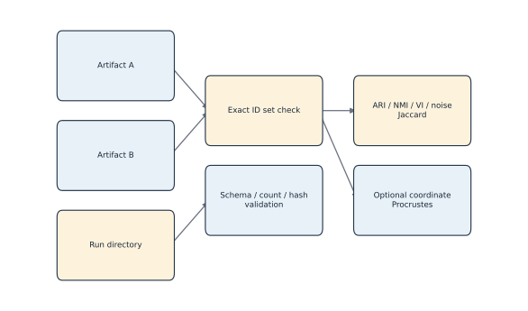

*Comparison and validation paths. Editable source: `assets/diagrams/diagram_08_compare_validate.mmd`.*

## Evidence-backed example

Tutorial 3 comparison uses 24 IDs, three clusters, no noise, perfect structural metrics, zero variation of information, and near-zero aligned coordinate disparity. Validation reports 24/24 pass with no warnings or failures.

## Outputs to inspect

Inspect `comparison_summary.json`, membership table, size table, confusion, mapping, comparison manifest, `validation_checks.tsv`, report, and validation manifest.

## Common mistakes

Do not compare raw numeric labels across fits. Do not ignore changed noise status. Do not interpret Procrustes as membership agreement. Do not call hash/schema checks biological validation.

## Scientific and operational limits

Exact label equality is stringent and environment-sensitive; permutation-invariant equality is structural. Coordinate comparison needs alignment and tolerances. Scientific conclusions need higher-layer validation.

## Completion check

Describe a case with ARI=1 but different numeric labels, and a different case with similar coordinates but changed memberships.

<p class="xref"><strong>Operational cross-reference:</strong> Chapter 37 covers commands, Chapter 38 configuration, Chapter 41 artifact schemas, Chapter 42 provenance, and Chapter 46 current limitations.</p>


<div class="part-page"></div>


# Part IV — Explainability and responsible interpretation

# 24. Why UMAP coordinates are not biological loadings

> **Release status.** DIMPLE-GWAS Freeze 3 RC1 (`3.0.0rc1`) is software-complete under local and fixed-fixture evidence. It is not yet scientifically frozen or cross-platform validated.

## Orientation

This chapter belongs to **Part IV — Explainability and responsible interpretation**. It separates observed Freeze 3 behavior from scientific interpretation, historical evidence, and pending release work.

## Learning objectives

After this chapter, you can:

- Reject axis-loading and causal interpretations of latent coordinates.
- identify the evidence artifact that supports the behavior or boundary;
- describe one common misuse in language appropriate for a methods report.

Prerequisites: 16-17.

## Explanation and implementation

A loading in a linear component model has a defined relationship to an observed variable and component. A UMAP coordinate instead comes from a nonlinear, stochastic neighborhood-preservation optimization. Axis orientation, sign, rotation, scale, and even apparent global layout can vary without changing the underlying scientific identity of points. Freeze 3's display columns are therefore descriptive coordinates, not effects, loadings, mechanisms, or causal axes.

Concatenated repeated coordinates are the density-clustering representation. Selected `UMAP_1`–`UMAP_3` columns are visualization coordinates and must not be substituted for the full concatenated matrix. Correlating input dimensions with a display coordinate can be a descriptive diagnostic when explicitly enabled, but it does not turn the coordinate into a biological component.

## Evidence-backed example

Figure 1 shows three separated synthetic groups. Its axis titles deliberately say ‘display coordinate,’ and its caption states that axes are not biological loadings.

## Outputs to inspect

Inspect display-coordinate columns, parameter/seed manifest, projection-quality table, optional coordinate-association table, and interpretation warnings.

## Common mistakes

Do not name a coordinate ‘brain-size axis’ or infer direction of effect from its sign. Do not compare unaligned coordinates across runs. Do not equate a 2D picture with the HDBSCAN fit space.

## Scientific and operational limits

Coordinates can still be useful for visualization and diagnosing local structure, but claims should be invariant to arbitrary orientation and supported in original space or independent evidence.

## Completion check

Rewrite a caption that says ‘UMAP1 loading reveals mechanism X’ into a descriptive, noncausal caption.

## Evidence and references

See McInnes et al. (2018), DOI 10.21105/joss.00861.

<p class="xref"><strong>Operational cross-reference:</strong> Chapter 37 covers commands, Chapter 38 configuration, Chapter 41 artifact schemas, Chapter 42 provenance, and Chapter 46 current limitations.</p>


# 25. Returning to the original input-vector space

> **Release status.** DIMPLE-GWAS Freeze 3 RC1 (`3.0.0rc1`) is software-complete under local and fixed-fixture evidence. It is not yet scientifically frozen or cross-platform validated.

## Orientation

This chapter belongs to **Part IV — Explainability and responsible interpretation**. It separates observed Freeze 3 behavior from scientific interpretation, historical evidence, and pending release work.

## Learning objectives

After this chapter, you can:

- Explain a retained partition without refitting and audit ID matching.
- identify the evidence artifact that supports the behavior or boundary;
- describe one common misuse in language appropriate for a methods report.

Prerequisites: 10, 23-24.

## Explanation and implementation

`explain` returns to the original matrix after a partition has been retained. It loads native summary/labels or a legacy table, resolves input orientation, validates/strips identifiers, rejects duplicates, enforces complete matching by default, applies the recorded preprocessing contract, and computes original-space similarity without refitting UMAP or HDBSCAN.

Native mode usually needs only `--model-json`; `--input` can override a stale recorded path. Legacy mode requires a label table, original input, explicit output root, and often explicit orientation/ID/label/coordinate options. The noise policy can place unassigned vectors last, include them in ordering, or exclude them with a recorded reason.

```bash
dimple-gwas explain \
  --model-json RUN/models/top_model_artifacts/MODEL/summary.json \
  --output-dir explanation_new
```

## Evidence diagram or figure

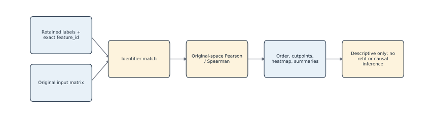

*Original-space explanation without refitting. Editable source: `assets/diagrams/diagram_07_original_space_explanation.mmd`.*

## Evidence-backed example

Tutorial 3 matches all 24 synthetic feature IDs, excludes none, writes the complete similarity table, and produces ordered heatmap/summary/projection artifacts without changing labels.

## Outputs to inspect

Inspect interpretation manifest sources/hashes, orientation, ID counts, exclusions, `heatmap_order.tsv`, similarity table, summaries, projection quality, README, and figure sidecars.

## Common mistakes

Do not let auto-orientation replace an explicit contract when both axes could overlap. Do not accept incomplete matching silently. Do not describe explanation as a refit or independent validation.

## Scientific and operational limits

Original-space summaries remain conditional on a selected partition and input construction. They can reveal descriptive coherence or contradictions but cannot establish causal mechanism.

## Completion check

Given a legacy table with duplicate IDs and one unmatched ID, predict the default outcome and the effect of allowing incomplete matching.

<p class="xref"><strong>Operational cross-reference:</strong> Chapter 37 covers commands, Chapter 38 configuration, Chapter 41 artifact schemas, Chapter 42 provenance, and Chapter 46 current limitations.</p>


# 26. Pearson and Spearman association summaries

> **Release status.** DIMPLE-GWAS Freeze 3 RC1 (`3.0.0rc1`) is software-complete under local and fixed-fixture evidence. It is not yet scientifically frozen or cross-platform validated.

## Orientation

This chapter belongs to **Part IV — Explainability and responsible interpretation**. It separates observed Freeze 3 behavior from scientific interpretation, historical evidence, and pending release work.

## Learning objectives

After this chapter, you can:

- Interpret descriptive correlation summaries and their assumptions.
- identify the evidence artifact that supports the behavior or boundary;
- describe one common misuse in language appropriate for a methods report.

Prerequisites: 25.

## Explanation and implementation

Pearson correlation summarizes linear association after centering/scaling; Spearman correlates ranks and summarizes monotone association. Freeze 3 uses the configured method to build a vector-by-vector similarity table in original input-variable space. It then summarizes within-block and between-block pairs after applying the declared order/noise policy.

Undefined correlation can arise from constant or insufficiently variable vectors. The safe default is `error`; the opt-in `zero` policy replaces undefined values and records the choice. This replacement is a computational convention, not evidence of no association. Coordinate associations, when enabled, are ranked descriptive correlations between original dimensions and supplied coordinates.

Neither correlation supplies a causal effect, an unbiased post-selection p-value, or independent replication.

## Evidence-backed example

Tutorial 3's three synthetic clusters have within-cluster Pearson means approximately 0.9963, 0.9930, and 0.9928; between-cluster means are about 0.0033–0.0047. Figure 3 labels these as post-selection descriptive summaries.

## Outputs to inspect

Inspect similarity method, pair counts, means/medians, between summaries, exclusions, undefined-correlation policy, and optional association method/top-N settings.

## Common mistakes

Do not attach naive p-values to the same selected pairs. Do not interpret zero replacement as observed zero correlation. Do not compare Pearson and Spearman without explaining the different question.

## Scientific and operational limits

Shared sample, LD, preprocessing, technical structure, and selection can drive correlations. Independent evidence is required for biological interpretation.

## Completion check

For one cluster-summary row, explain denominator/pair count and why the mean is conditional on retained membership.

<p class="xref"><strong>Operational cross-reference:</strong> Chapter 37 covers commands, Chapter 38 configuration, Chapter 41 artifact schemas, Chapter 42 provenance, and Chapter 46 current limitations.</p>


# 27. Cluster heatmaps, ordering, annotations, and cutpoints

> **Release status.** DIMPLE-GWAS Freeze 3 RC1 (`3.0.0rc1`) is software-complete under local and fixed-fixture evidence. It is not yet scientifically frozen or cross-platform validated.

## Orientation

This chapter belongs to **Part IV — Explainability and responsible interpretation**. It separates observed Freeze 3 behavior from scientific interpretation, historical evidence, and pending release work.

## Learning objectives

After this chapter, you can:

- Reconstruct heatmap order and read cutpoints and annotations safely.
- identify the evidence artifact that supports the behavior or boundary;
- describe one common misuse in language appropriate for a methods report.

Prerequisites: 25-26.

## Explanation and implementation

The explanation heatmap is a rendered view of an auditable order. `heatmap_order.tsv` records 1-based display order, exact feature ID, cluster label/noise flag, and supplied coordinates. `cluster_cutpoints.tsv` records zero- and one-based inclusive block boundaries and sizes. Within a cluster, `cluster_then_hclust` applies hierarchical ordering to the original-space similarity-derived distance; other choices are cluster, hclust, or input order.

Annotations come from an optional table joined by the declared index column. The initial tutorial configuration used the wrong join key and produced a warning; the source YAML was corrected to `index` and Tutorial 1 rerun as `run_20260825_v2`. The earlier output remains as evidence of the mistake. Figure interpretation should always use sidecars, not inferred pixel positions.

## Evidence diagram or figure


*Figure 6. Ordered original-space Pearson heatmap from the executed synthetic explanation. Descriptive, post-selection evidence. Source and checksum: `evidence/figure_source_manifest.tsv`.*

## Evidence-backed example

Figure 6 is copied byte-for-byte from Tutorial 3's `original_space_heatmap.png`; its source checksum and script/manifest are in `figure_source_manifest.tsv`. The synthetic groups are designed, and the image is unrestricted fixture evidence.

## Outputs to inspect

Inspect heatmap PNG/HTML, exact order, cutpoints, cluster summary, exclusions, annotations, manifest hash, and README caveats.

## Common mistakes

Do not reorder the image manually and leave sidecars unchanged. Do not assume coloured blocks are statistically significant. Do not publish annotations without checking privacy/access status.

## Scientific and operational limits

Large matrices are protected by thresholds and optional forcing. A full-resolution heatmap can be unreadable or disclose identifiers; use aggregate summaries and controlled access when appropriate.

## Completion check

Reconstruct the first cluster's row interval using both zero- and one-based cutpoints, and match it to `heatmap_order.tsv`.

<p class="xref"><strong>Operational cross-reference:</strong> Chapter 37 covers commands, Chapter 38 configuration, Chapter 41 artifact schemas, Chapter 42 provenance, and Chapter 46 current limitations.</p>


# 28. Noise assignments and uncertainty

> **Release status.** DIMPLE-GWAS Freeze 3 RC1 (`3.0.0rc1`) is software-complete under local and fixed-fixture evidence. It is not yet scientifically frozen or cross-platform validated.

## Orientation

This chapter belongs to **Part IV — Explainability and responsible interpretation**. It separates observed Freeze 3 behavior from scientific interpretation, historical evidence, and pending release work.

## Learning objectives

After this chapter, you can:

- Explain label -1 algorithmically and examine its parameter dependence.
- identify the evidence artifact that supports the behavior or boundary;
- describe one common misuse in language appropriate for a methods report.

Prerequisites: 18, 25.

## Explanation and implementation

HDBSCAN label `-1` means that the fitted hierarchy/extraction did not assign an observation to a retained cluster under the current representation, metric, density parameters, and selection method. It is an algorithmic status, not a biological category. Changing UMAP parameters, seed aggregation, min-cluster-size, min-samples, epsilon, metric, or selection method can change the noise set.

Inspect unassigned observations rather than discarding them rhetorically. Report count/fraction, exact IDs, probabilities/persistence when available, original-space relationships, stability across justified settings, and transitions in comparison outputs. Use ‘unassigned’ or ‘HDBSCAN noise’ with the condition attached. Avoid ‘non-pleiotropic,’ ‘failed IDP,’ ‘irrelevant,’ or ‘no shared structure.’

## Evidence-backed example

The synthetic tutorials have zero noise. The historical 164-IDP record has 102 unassigned and 62 assigned across five clusters; this is historical evidence and does not imply 102 biologically irrelevant IDPs.

## Outputs to inspect

Inspect label tables, noise count/fraction, candidate parameters, membership comparison, changed-noise status, exclusions under noise policy, and historical source status.

## Common mistakes

Do not drop noise before reporting its magnitude. Do not compare noise labels without exact IDs. Do not treat absence of assigned cluster as absence of any genetic correlation.

## Scientific and operational limits

Freeze 3 does not provide a calibrated biological uncertainty interval for each label. Stability and external data must be studied separately.

## Completion check

Write a results sentence for 102 historical noise assignments that includes parameters/evidence status and makes no biological-negation claim.

## Evidence and references

See Campello et al. (2015), DOI 10.1145/2733381.

<p class="xref"><strong>Operational cross-reference:</strong> Chapter 37 covers commands, Chapter 38 configuration, Chapter 41 artifact schemas, Chapter 42 provenance, and Chapter 46 current limitations.</p>


# 29. Avoiding double dipping and post-selection overclaiming

> **Release status.** DIMPLE-GWAS Freeze 3 RC1 (`3.0.0rc1`) is software-complete under local and fixed-fixture evidence. It is not yet scientifically frozen or cross-platform validated.

## Orientation

This chapter belongs to **Part IV — Explainability and responsible interpretation**. It separates observed Freeze 3 behavior from scientific interpretation, historical evidence, and pending release work.

## Learning objectives

After this chapter, you can:

- Identify circular analyses and replace naive inference with bounded description or external validation.
- identify the evidence artifact that supports the behavior or boundary;
- describe one common misuse in language appropriate for a methods report.

Prerequisites: 8, 25-28.

## Explanation and implementation

‘Double dipping’ occurs when data-dependent choices are ignored in a later inferential statement. DIMPLE-GWAS uses the matrix to create an embedding, enumerate/extract partitions, and select one using internal metrics. Testing separation or correlation on the same matrix as though the partition were fixed in advance can yield overconfident evidence. Multiple candidate models and analyst inspection add further selection.

Safe outputs in Freeze 3 are descriptive summaries with explicit conditioning. For inference, plan held-out variables, independent cohorts, preregistered replication, sample splitting, perturbation/stability designs, or a selective-inference method whose assumptions actually match the pipeline. Report effect sizes and uncertainty appropriate to the validation design. Never describe an omitted p-value as a flaw: the explanation utility intentionally avoids cluster ANOVA and post-selection significance.

## Evidence-backed example

Tutorial 3 reports within/between similarities and a heatmap but no ANOVA p-values. That is a deliberate boundary, not missing validation.

## Outputs to inspect

Inspect candidate population, selection rule, all exploratory views used, independent validation plan, comparison/stability evidence, and whether any test data were held out before selection.

## Common mistakes

Do not call high within-cluster correlation a validation test. Do not choose external outcomes after seeing the partition without disclosure. Do not cite a general selective-inference paper as if it implemented this exact pipeline.

## Scientific and operational limits

Independent validation may still inherit sample overlap, ancestry, measurement, or harmonization biases. The design—not the word ‘replication’—determines evidential strength.

## Completion check

Design one descriptive analysis and one genuinely external validation for the same retained partition; identify which data enter selection.

## Evidence and references

See Gao, Bien & Witten (2024), DOI 10.1080/01621459.2022.2116331, with the scope limitation stated above.

<p class="xref"><strong>Operational cross-reference:</strong> Chapter 37 covers commands, Chapter 38 configuration, Chapter 41 artifact schemas, Chapter 42 provenance, and Chapter 46 current limitations.</p>


# 30. Technical, statistical, and biological validation

> **Release status.** DIMPLE-GWAS Freeze 3 RC1 (`3.0.0rc1`) is software-complete under local and fixed-fixture evidence. It is not yet scientifically frozen or cross-platform validated.

## Orientation

This chapter belongs to **Part IV — Explainability and responsible interpretation**. It separates observed Freeze 3 behavior from scientific interpretation, historical evidence, and pending release work.

## Learning objectives

After this chapter, you can:

- Place evidence on the correct validation layer and define pending release gates.
- identify the evidence artifact that supports the behavior or boundary;
- describe one common misuse in language appropriate for a methods report.

Prerequisites: 8, 23, 29.

## Explanation and implementation

Validation is layered. Software validation covers tests and schemas. Technical reproducibility covers source/input/configuration identity, reruns, hashes, labels, and numeric tolerance. Structural concordance uses ARI/NMI/noise/mapped membership. Statistical validation addresses parameter sensitivity, instability, selection, uncertainty, and multiplicity. Biological validation asks whether groupings recur or predict independent domain evidence. Cross-platform validation tests the claimed package on Docker/Linux/cloud environments.

A result should be reported at the strongest layer actually supported. Forty-five tests support software. Twenty-four artifact checks support one run contract. Perfect fixture concordance supports bounded same-platform technical structure. MNIST supports known-label engineering behavior. None proves the historical IDP clusters biologically distinct. The fresh 164-IDP and Docker/cloud layers remain pending.

## Evidence diagram or figure

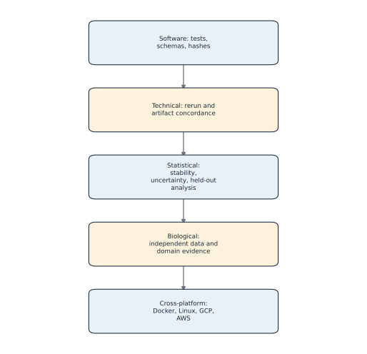

*Validation ladder; each layer requires its own evidence. Editable source: `assets/diagrams/diagram_10_validation_ladder.mmd`.*

## Evidence-backed example

Use `assets/diagrams/diagram_10_validation_ladder.mmd` and Appendix G to classify every manual evidence item. No arrow can be skipped by renaming a lower layer.

## Outputs to inspect

Inspect test JUnit/logs, validation checks, comparison metrics, source/input/config hashes, historical evidence, external-study design, and platform matrices separately.

## Common mistakes

Do not write ‘validated’ without an object, method, dataset, platform, and criterion. Do not let a checksum pass stand in for scientific replication.

## Scientific and operational limits

Statistical and biological validation protocols are context dependent and may require data or governance outside this package. This manual does not invent those results.

## Completion check

Create a five-row validation table for your run with evidence path, criterion, result, and remaining uncertainty.

<p class="xref"><strong>Operational cross-reference:</strong> Chapter 37 covers commands, Chapter 38 configuration, Chapter 41 artifact schemas, Chapter 42 provenance, and Chapter 46 current limitations.</p>


# 31. Reporting a DIMPLE-GWAS analysis

> **Release status.** DIMPLE-GWAS Freeze 3 RC1 (`3.0.0rc1`) is software-complete under local and fixed-fixture evidence. It is not yet scientifically frozen or cross-platform validated.

## Orientation

This chapter belongs to **Part IV — Explainability and responsible interpretation**. It separates observed Freeze 3 behavior from scientific interpretation, historical evidence, and pending release work.

## Learning objectives

After this chapter, you can:

- Report inputs, settings, selection, outputs, limitations, and validation without overclaim.
- identify the evidence artifact that supports the behavior or boundary;
- describe one common misuse in language appropriate for a methods report.

Prerequisites: 1-30.

## Explanation and implementation

A complete report states: software/version/source identity; input cohort and upstream GWAS construction; matrix shape/orientation/metadata prefix; preprocessing; UMAP/densMAP parameters, repeat/seed sequence, and metric; HDBSCAN search space and backend; candidate counts/failures; all calculated metrics; scoring formula/profile/noise term; selection/ties/manual decisions; retained cluster/noise counts; original-space descriptive summaries; sensitivity/comparison evidence; validation layer; and limitations.

Use conditional language: ‘under the specified representation and HDBSCAN parameters, the selected model assigned…’. Separate implementation results from interpretation and hypotheses. Disclose the historical manual row-16 choice. Name unassigned observations neutrally. If results come from adapted historical labels, say so. Include exact artifact identifiers/checksums in supplements or repositories permitted by data policy.

Methods should be reproducible without claiming bitwise platform independence; results should be readable without turning internal scores into biological proof.

## Evidence-backed example

A safe synthetic sentence is: ‘In the 24-vector fixed fixture, the one-candidate RC1 run assigned three clusters of eight and no noise; a same-environment fixed rerun had ARI and NMI 1. These engineering checks do not establish biological validity.’

## Outputs to inspect

Report from resolved config, run/selection manifests, all/ranked models, retained summary/labels, explanation/comparison/validation manifests, source/input hashes, and issue register.

## Common mistakes

Do not omit failed candidates, ties, noise, manual selection, or pending gates. Do not present display axes as biological components. Do not claim causal mechanisms from correlations.

## Scientific and operational limits

Journal word limits may require a concise main text; place complete contracts and machine-readable evidence in a suitable supplement without exposing restricted data.

## Completion check

Draft a methods paragraph and results paragraph for Tutorial 2, then highlight every phrase supported only by internal rather than external evidence.

<p class="xref"><strong>Operational cross-reference:</strong> Chapter 37 covers commands, Chapter 38 configuration, Chapter 41 artifact schemas, Chapter 42 provenance, and Chapter 46 current limitations.</p>


<div class="part-page"></div>


# Part V — Worked case studies

# 32. Fixed synthetic dataset case study

> **Release status.** DIMPLE-GWAS Freeze 3 RC1 (`3.0.0rc1`) is software-complete under local and fixed-fixture evidence. It is not yet scientifically frozen or cross-platform validated.

## Orientation

This chapter belongs to **Part V — Worked case studies**. It separates observed Freeze 3 behavior from scientific interpretation, historical evidence, and pending release work.

## Learning objectives

After this chapter, you can:

- Reproduce and interpret the verified one-candidate tutorial.
- identify the evidence artifact that supports the behavior or boundary;
- describe one common misuse in language appropriate for a methods report.

Prerequisites: 13-14.

## Explanation and implementation

Tutorial 1 is the canonical novice path. Its configuration fixes every searched field, uses the repository synthetic matrix and annotation table, one seed, three components, one HDBSCAN candidate, one job, and a new output root. The correct annotation join is `index`. Preflight proves one candidate before fitting.

The executed canonical directory is `tutorials/01_fixed_synthetic/run_20260825_v2`. It prepared 24 vectors by 80 variables, selected `model_060fac0208bb58e2`, and produced three clusters of eight with no unassigned observations. Parquet writing succeeded. The validation utility later passed all 24 run-contract checks.

The earlier `run_20260825` is intentionally retained: clustering succeeded, but the original join key was absent and annotations were skipped with a warning. The canonical rerun demonstrates the evidence-preserving response—correct source configuration, write a new output root, and retain the prior attempt.

## Evidence diagram or figure

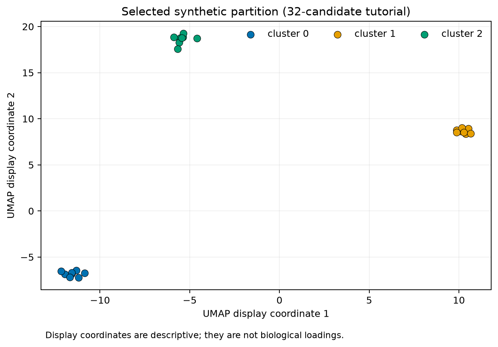


*Figure 1. Selected synthetic display coordinates; axes are not biological loadings. Source and checksum: `evidence/figure_source_manifest.tsv`.*

## Evidence-backed example

Follow Chapters 11–14 using the actual YAML. Then use Chapter 22 to reproduce the selected summary, Chapter 23 to compare it, and Chapter 25 to explain it. The complete commands and timings are in `tutorial_execution_manifest.tsv`.

## Outputs to inspect

Inspect the config, preflight manifests, canonical run manifest, candidate tables, selection manifest, labels/annotations, logs, reproduction, comparison, explanation, and validation.

## Common mistakes

Do not delete the noncanonical first run. Do not call the designed grouping discovery evidence. Do not use the fixed quickstart to choose production parameters.

## Scientific and operational limits

This fixture is a smoke test with deliberately clear structure. Runtime and accuracy are not a guarantee for large correlated GWAS inputs.

## Completion check

From only the artifacts, reconstruct input shape, candidate count, selected ID, cluster sizes, noise count, annotation status, and validation result.

<p class="xref"><strong>Operational cross-reference:</strong> Chapter 37 covers commands, Chapter 38 configuration, Chapter 41 artifact schemas, Chapter 42 provenance, and Chapter 46 current limitations.</p>


# 33. Custom bounded search-space case study

> **Release status.** DIMPLE-GWAS Freeze 3 RC1 (`3.0.0rc1`) is software-complete under local and fixed-fixture evidence. It is not yet scientifically frozen or cross-platform validated.

## Orientation

This chapter belongs to **Part V — Worked case studies**. It separates observed Freeze 3 behavior from scientific interpretation, historical evidence, and pending release work.

## Learning objectives

After this chapter, you can:

- Explain why 32 candidates are enumerated and compare families without target tuning.
- identify the evidence artifact that supports the behavior or boundary;
- describe one common misuse in language appropriate for a methods report.

Prerequisites: 18-21, 32.

## Explanation and implementation

Tutorial 2 teaches workload and family comparison without searching toward a biological target. Its custom YAML crosses two neighbor values, two minimum-distance values, two minimum-cluster sizes, two min-samples values, and two epsilon values; scalar fields contribute one. Four UMAP families × eight HDBSCAN configurations = 32 candidates. Two repeated seeds keep the example bounded.

All 32 completed successfully. The selected `model_241ad5e99af55074` has three equal clusters, no noise, silhouette about 0.970354, and DBCV about 0.976386. Eight candidates within its UMAP family tie at final score 1 because the designed fixture produces the same topology/score components for those HDBSCAN settings. The deterministic tie rule selects one ID. Figure 2 makes the four family-level score bands visible.

This is a tuning lesson about declared parameter families and compute; it is not permission to expand a grid until a desired label vector appears.

## Evidence diagram or figure

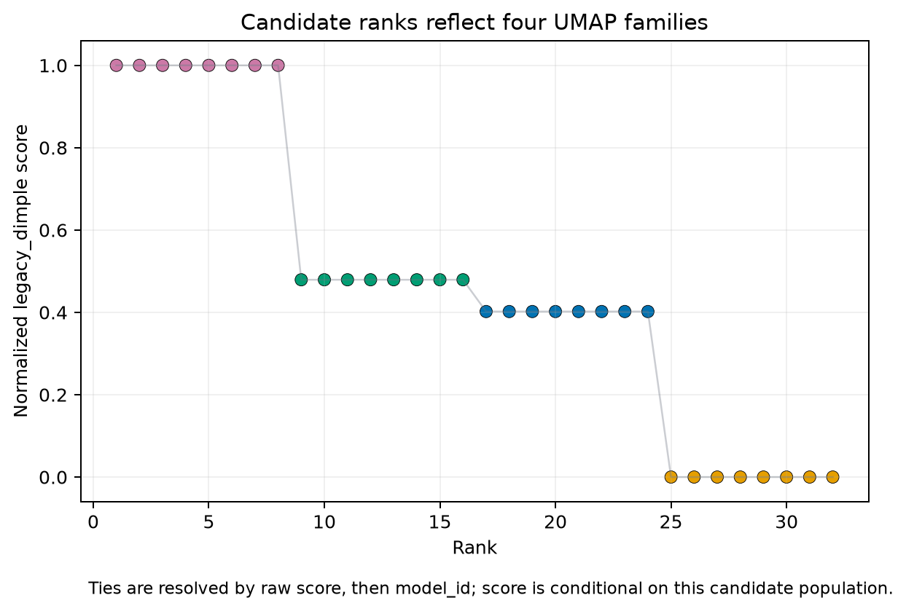


*Figure 2. Candidate score by deterministic rank in the 32-candidate tutorial. Source and checksum: `evidence/figure_source_manifest.tsv`.*

## Evidence-backed example

Compare `search_space_manifest.tsv` with `models/ranked_models.tsv`. Group by `umap_id`, inspect repeated embedding metrics, then compare HDBSCAN parameters within each group.

## Outputs to inspect

Inspect candidate count/family IDs, statuses, metrics and scopes, score ties, family summaries, Pareto table, selected parameters, runtime, seeds, and annotation output.

## Common mistakes

Do not report rank-one as unique when eight rows tie. Do not interpret DBCV as the selection term. Do not extrapolate a 10.7-second local runtime to the 1,000-seed production run.

## Scientific and operational limits

The fixture has no noise and strong designed clusters, so it does not exercise every failure or uncertainty mode. A real tuning plan needs preregistered objectives and resource pilots.

## Completion check

Calculate 32 candidates, explain why there are only four UMAP fits, and identify the exact field that breaks final ties.

<p class="xref"><strong>Operational cross-reference:</strong> Chapter 37 covers commands, Chapter 38 configuration, Chapter 41 artifact schemas, Chapter 42 provenance, and Chapter 46 current limitations.</p>


# 34. Explanation, comparison, and validation case study

> **Release status.** DIMPLE-GWAS Freeze 3 RC1 (`3.0.0rc1`) is software-complete under local and fixed-fixture evidence. It is not yet scientifically frozen or cross-platform validated.

## Orientation

This chapter belongs to **Part V — Worked case studies**. It separates observed Freeze 3 behavior from scientific interpretation, historical evidence, and pending release work.

## Learning objectives

After this chapter, you can:

- Execute and interpret all downstream Freeze 3 utilities.
- identify the evidence artifact that supports the behavior or boundary;
- describe one common misuse in language appropriate for a methods report.

Prerequisites: 22-30.

## Explanation and implementation

Tutorial 3 begins with real native outputs rather than rerunning the entire search. `score-existing` normalizes and ranks an existing model table while preserving a scoring manifest. `summarize-models` writes family, Pareto, top-model, and count summaries. `reproduce-model` performs one fixed refit. `explain` produces original-space descriptive artifacts without refitting. `compare` evaluates exact-ID structural and coordinate concordance. `validate` checks the original run contract.

All six executed commands exited zero. The same-environment fixed rerun has 24 exact IDs; ARI, NMI, noise Jaccard, and optimally mapped membership are 1; variation of information is zero; Procrustes disparity is 2.7088204667806472×10^-31. The canonical Tutorial 1 run passes 24/24 validation checks. Original-space within-cluster means are near 0.993–0.996 on the designed fixture.

Each result answers a different question. Scoring is not refitting; reproducing is not explaining; comparison is not schema validation; descriptive similarity is not biological inference.

## Evidence diagram or figure

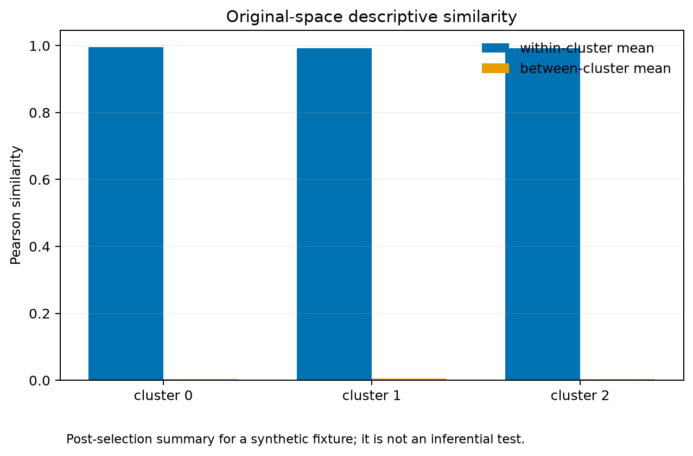


*Figure 3. Post-selection descriptive within/between original-space similarity. Source and checksum: `evidence/figure_source_manifest.tsv`.*

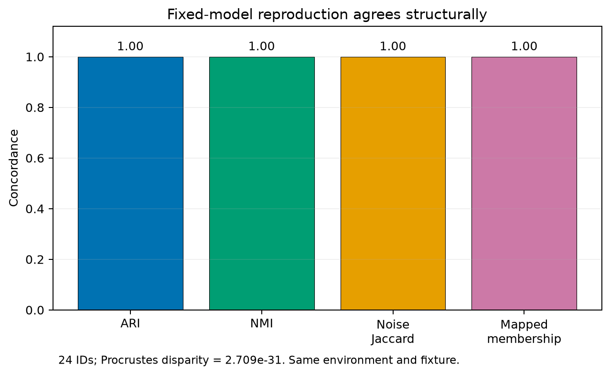


*Figure 4. Same-environment structural comparison of the fixed reproduction. Source and checksum: `evidence/figure_source_manifest.tsv`.*

## Evidence-backed example

Run the six commands from the exact command JSON in `tutorial_execution_manifest.tsv`, substituting new output roots. Verify the generated file set against Chapter 41.

## Outputs to inspect

Inspect rescoring manifest, summary counts, fixed rerun manifest, explanation manifest/sidecars, all comparison files, all validation files, and command logs.

## Common mistakes

Do not overwrite the original run. Do not compare label integers directly. Do not treat an exit-zero command as sufficient without checking its semantic assertions.

## Scientific and operational limits

The tutorial uses a small, same-platform fixture and does not test legacy incomplete matching, large heatmap safeguards, cross-hardware numerics, or biological replication.

## Completion check

For each of the six commands, write ‘refits: yes/no’ and the scientific question it cannot answer.

<p class="xref"><strong>Operational cross-reference:</strong> Chapter 37 covers commands, Chapter 38 configuration, Chapter 41 artifact schemas, Chapter 42 provenance, and Chapter 46 current limitations.</p>


# 35. MNIST as a software benchmark

> **Release status.** DIMPLE-GWAS Freeze 3 RC1 (`3.0.0rc1`) is software-complete under local and fixed-fixture evidence. It is not yet scientifically frozen or cross-platform validated.

## Orientation

This chapter belongs to **Part V — Worked case studies**. It separates observed Freeze 3 behavior from scientific interpretation, historical evidence, and pending release work.

## Learning objectives

After this chapter, you can:

- Interpret the historical known-label benchmark as engineering evidence only.
- identify the evidence artifact that supports the behavior or boundary;
- describe one common misuse in language appropriate for a methods report.

Prerequisites: 4-8.

## Explanation and implementation

MNIST is a known-label image dataset used here as historical software-benchmark evidence. It tests whether a pipeline can produce and compare structure when class labels exist and inputs are unrelated to GWAS biology. The verified prior benchmark artifacts are retained under the Freeze 3 evidence/quarantine workspace; this manual build did not redownload data or rerun the benchmark. The historical full runtime was 273.47 seconds under its recorded environment and configuration.

A benchmark may report engineering measures such as cluster/label concordance, noise, or runtime. It does not show that genetic association vectors have the same geometry, that IDP clusters are biologically meaningful, or that production resources match. Dataset licensing/acquisition, preprocessing, and environment must travel with any rerun.

Tutorial 4 is therefore evidence-backed but bounded: it documents the existing verified outputs and the approved rerun path without fabricating fresh results.

## Evidence-backed example

Read `benchmarks/mnist/MNIST_BENCHMARK_REPORT.md` and `docs/MNIST_BENCHMARK.md`, then locate the historical output checksums in the broader Freeze 3 evidence inventory. Compare every benchmark claim to its manifest.

## Outputs to inspect

Inspect acquisition/source note, input shape, known-label mapping, configuration, seeds/threads, cluster/noise metrics, runtime, environment, and artifact hashes.

## Common mistakes

Do not present MNIST accuracy as biological validation, a universal runtime, or a production default. Do not fetch new data silently during a reproducibility build.

## Scientific and operational limits

The benchmark is historical prior evidence in this manual edition. A fresh container benchmark belongs to the Docker stage and must record dataset identity and license.

## Completion check

Write one engineering claim supported by MNIST and three biological claims it cannot support.

<p class="xref"><strong>Operational cross-reference:</strong> Chapter 37 covers commands, Chapter 38 configuration, Chapter 41 artifact schemas, Chapter 42 provenance, and Chapter 46 current limitations.</p>


# 36. Original 164-IDP analysis

> **Release status.** DIMPLE-GWAS Freeze 3 RC1 (`3.0.0rc1`) is software-complete under local and fixed-fixture evidence. It is not yet scientifically frozen or cross-platform validated.

## Orientation

This chapter belongs to **Part V — Worked case studies**. It separates observed Freeze 3 behavior from scientific interpretation, historical evidence, and pending release work.

## Learning objectives

After this chapter, you can:

- Separate historical reconstruction from a future fresh 1,000-seed run protocol.
- identify the evidence artifact that supports the behavior or boundary;
- describe one common misuse in language appropriate for a methods report.

Prerequisites: 1-31.

## Explanation and implementation

The original 164-IDP case has two tracks. Track A is historical reconstruction: the authoritative record contains 164 IDPs, 102 HDBSCAN-noise assignments, and five assigned clusters of sizes 9, 13, 15, 14, and 11. The published historical solution used epsilon 0, min-samples 4, and min-cluster-size 6 and was manually selected from sorted row 16—not automatic rank one. One historical `UMAP_3` cell is missing, while labels are complete. Freeze 3 can adapt and rescore the immutable historical artifacts; that is not a new 1,000-seed fit.

Track B is the pending fresh protocol. Use the authoritative input checksum and `configs/original_idp_164_historical_search.yaml`, run `inspect-config` and complete enumeration, preflight storage/threads, then execute standard-scale 1,000 repeated seeds in a new mounted output root inside the later Docker workflow. Preserve source, input, resolved config, command, environment, seeds, thread settings, logs, failures, all candidate rows, retained artifacts, explanation, comparison to historical labels, and validation. Do not tune toward the published labels.

Original material is permitted in the project, but scientific content is provisional because development has advanced; this manual shows aggregate historical counts and protocols rather than claiming a final interpretation.

## Evidence diagram or figure

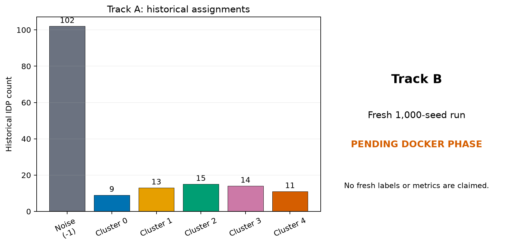


*Figure 5. Historical 164-IDP counts separated from the pending fresh-run track. Source and checksum: `evidence/figure_source_manifest.tsv`.*

## Evidence-backed example

Figure 5 separates the historical count panel from a prominent ‘fresh run pending’ panel. The protocol config and historical selected config are source artifacts; no fresh outputs are implied.

## Outputs to inspect

Track A: historical workbook/table, row-16 record, exact label vector, adaptation/rescoring manifests and counts. Track B: authoritative input/config hashes, preflight, complete run, comparison/validation, and Docker platform record.

## Common mistakes

Do not say ‘reproduced the 164 analysis’ when only labels were adapted/rescored. Do not choose a new candidate because it most resembles historical labels. Do not fill missing fresh metrics with historical numbers.

## Scientific and operational limits

The original raw 2,315- and 459-IDP inputs remain incomplete/unresolved in this workspace. Fresh 164 execution and cross-platform acceptance are named release gates.

## Completion check

Write two results paragraphs: one strictly historical and one future-tense protocol. Highlight every verb that distinguishes them.

<p class="xref"><strong>Operational cross-reference:</strong> Chapter 37 covers commands, Chapter 38 configuration, Chapter 41 artifact schemas, Chapter 42 provenance, and Chapter 46 current limitations.</p>


<div class="part-page"></div>


# Part VI — Operational reference

# 37. Complete command reference

> **Release status.** DIMPLE-GWAS Freeze 3 RC1 (`3.0.0rc1`) is software-complete under local and fixed-fixture evidence. It is not yet scientifically frozen or cross-platform validated.

## Orientation

This chapter belongs to **Part VI — Operational reference**. It separates observed Freeze 3 behavior from scientific interpretation, historical evidence, and pending release work.

## Learning objectives

After this chapter, you can:

- Select the correct command and required inputs for each task.
- identify the evidence artifact that supports the behavior or boundary;
- describe one common misuse in language appropriate for a methods report.

Prerequisites: 9-14.

## Explanation and implementation

The entry point is `dimple-gwas`; `python -m dimple_gwas` is equivalent. `run` fits the declared UMAP/HDBSCAN search. `inspect-config` resolves/validates settings. `show-search-space` enumerates without fitting. `score-existing` applies a declared score to a native or adapted historical table. `summarize-models` creates family/Pareto/top summaries. `reproduce-model` refits one retained parameterization. `explain` (alias `interpret`) summarizes retained labels in original space without refitting. `compare` compares exact-ID artifacts. `validate` checks a run contract and hashes.

Use `dimple-gwas COMMAND --help` as the runtime authority. Common run precedence is `--search-mode`, optional `--config`, then explicit input/UMAP/HDBSCAN/execution/scoring overrides. Run aliases support selected Dev spellings, but new work should prefer canonical hyphenated flags. Downstream commands have their own required inputs; they do not inherit a current run implicitly.

Minimal patterns:

```bash
dimple-gwas inspect-config --search-mode MODE --config CONFIG.yaml
dimple-gwas show-search-space --search-mode MODE --config CONFIG.yaml --output-dir NEW_DIR
dimple-gwas run --search-mode MODE --config CONFIG.yaml --output-dir NEW_DIR
dimple-gwas score-existing --models TABLE --output SCORED.tsv
dimple-gwas summarize-models --models TABLE --output-dir NEW_DIR
dimple-gwas reproduce-model --model-json SUMMARY.json --output-dir NEW_DIR
dimple-gwas explain --model-json SUMMARY.json --output-dir NEW_DIR
dimple-gwas compare --left A --right B --output-dir NEW_DIR
dimple-gwas validate --run-dir RUN --output-dir NEW_DIR
```

## Evidence-backed example

All top-level and subcommand help text was freshly captured in `build/logs/cli_help/`. The implementation-derived matrix has one row per action, flag alias, destination, default, choice, requirement, help text, and source.

## Outputs to inspect

Inspect `evidence/command_and_flag_matrix.tsv` for the complete flag list and captured help for formatting. Then verify output effects in the producer–consumer map.

## Common mistakes

Do not assume a flag accepted by `run` is accepted by `explain`. Do not omit required output roots. Do not rely on an alias when publishing a new canonical protocol without documenting it.

## Scientific and operational limits

CLI `--help` proves interface availability, not scientific appropriateness. Some options can create very large searches or expose private paths in manifests.

## Completion check

For each command, state whether it fits UMAP/HDBSCAN, reads an existing model table, and writes a new directory or file.

<p class="xref"><strong>Operational cross-reference:</strong> Chapter 37 covers commands, Chapter 38 configuration, Chapter 41 artifact schemas, Chapter 42 provenance, and Chapter 46 current limitations.</p>


# 38. Complete configuration reference

> **Release status.** DIMPLE-GWAS Freeze 3 RC1 (`3.0.0rc1`) is software-complete under local and fixed-fixture evidence. It is not yet scientifically frozen or cross-platform validated.

## Orientation

This chapter belongs to **Part VI — Operational reference**. It separates observed Freeze 3 behavior from scientific interpretation, historical evidence, and pending release work.

## Learning objectives

After this chapter, you can:

- Look up every configuration key, default, constraint, and exposure.
- identify the evidence artifact that supports the behavior or boundary;
- describe one common misuse in language appropriate for a methods report.

Prerequisites: 11.

## Explanation and implementation

Configuration has seven top-level groups. `input` contains path, metadata-prefix count, separator, transform, and annotation join. `umap` contains twelve searchable embedding fields. `hdbscan` contains nine searchable density-clustering fields. `execution` contains repeats, threads, retention, safeguards, subsampling, seed, Parquet, DBCV, and strictness. `scoring` selects legacy/custom behavior. `interpretation` controls original-space similarity, order, noise, matching, figure safeguards, and optional coordinate associations. `search_mode` chooses the built-in base.

Standard defaults include four metadata columns, no transform, UMAP neighbors 30/min-dist 0/three components/Euclidean/densMAP true/base seed 42, HDBSCAN min-cluster-size 5:50, min-samples 2:20, epsilon 0:3, EOM/Euclidean, 1,000 repeats, `n_jobs=-1`, one candidate job, 20 retained models, DBCV and Parquet enabled, non-strict execution, legacy score excluding noise, and Pearson cluster-then-hclust explanation with exact matching. Stop values are exclusive.

Validation enforces finite values, supported metrics, min-dist≤spread, positive rates/sizes, EOM/leaf, valid maximum sizes, nonzero candidate jobs, valid score rules, and enumerated interpretation choices. The complete exact default/value reference is generated from source into `configuration_key_reference.tsv`.

## Evidence-backed example

Run `inspect-config` for standard, extended, fixed, and the tutorial custom YAML, then diff only the resolved values. This distinguishes mode defaults from overlays.

## Outputs to inspect

Inspect source YAML, resolved YAML, configuration hash, config-reference row, CLI exposure, validation errors, and search count.

## Common mistakes

Do not infer a default from an example. Do not forget that `max_cluster_size` is EOM-specific. Do not enable coordinate associations or large matrices without acknowledging their output and privacy cost.

## Scientific and operational limits

The package validates syntax/ranges, not scientific choice. A permitted metric or parameter range may still be inappropriate for a specific data-generating process.

## Completion check

Choose five keys and label each value in a report as default, tutorial, historical, or recommendation.

<p class="xref"><strong>Operational cross-reference:</strong> Chapter 37 covers commands, Chapter 38 configuration, Chapter 41 artifact schemas, Chapter 42 provenance, and Chapter 46 current limitations.</p>


# 39. Search-space reference

> **Release status.** DIMPLE-GWAS Freeze 3 RC1 (`3.0.0rc1`) is software-complete under local and fixed-fixture evidence. It is not yet scientifically frozen or cross-platform validated.

## Orientation

This chapter belongs to **Part VI — Operational reference**. It separates observed Freeze 3 behavior from scientific interpretation, historical evidence, and pending release work.

## Learning objectives

After this chapter, you can:

- Calculate standard, extended, custom, and fixed candidate counts.
- identify the evidence artifact that supports the behavior or boundary;
- describe one common misuse in language appropriate for a methods report.

Prerequisites: 12, 18.

## Explanation and implementation

Freeze 3 enumerates the full Cartesian product of normalized UMAP and HDBSCAN parameter values. Candidate ordinals and stable hashes make enumeration auditable. It does not silently sample. `execution.max_candidate_models` is a hard safety ceiling; zero means unlimited. `warn_candidate_count` is a warning threshold.

Mode counts in this source are: standard 2,430 candidates (one UMAP family × 45 × 18 × 3 HDBSCAN values); fixed one candidate when all searched fields are scalar; Tutorial 2 custom 32; shipped extended 1,728. Extended crosses multiple UMAP and HDBSCAN fields, and its count must be derived from the current source rather than older planning documents.

Search work can reuse one repeated embedding across many HDBSCAN candidates sharing `umap_id`. Therefore candidate count, UMAP-family count, repeat count, sample/vector count, input width, metric, and thread settings all matter.

## Evidence-backed example

`show-search-space` writes the full flattened rows plus JSON counts. Compare the number of unique `umap_id` and `hdbscan_id` values with total candidate rows.

## Outputs to inspect

Inspect candidate ordinal/model/family IDs, every flattened parameter, declared enumeration note, safety settings, and checksum.

## Common mistakes

Do not multiply only visibly changed YAML keys while ignoring inherited lists. Do not describe a truncated preview as the full manifest. Do not change the grid after examining desired labels without disclosure.

## Scientific and operational limits

Enumeration completeness is a software property, not a claim that the grid covers all meaningful models or that rank one is unique.

## Completion check

Derive the standard and Tutorial 2 counts by hand and reconcile them with manifests; then calculate UMAP fit count separately.

<p class="xref"><strong>Operational cross-reference:</strong> Chapter 37 covers commands, Chapter 38 configuration, Chapter 41 artifact schemas, Chapter 42 provenance, and Chapter 46 current limitations.</p>


# 40. Scoring and model-selection reference

> **Release status.** DIMPLE-GWAS Freeze 3 RC1 (`3.0.0rc1`) is software-complete under local and fixed-fixture evidence. It is not yet scientifically frozen or cross-platform validated.

## Orientation

This chapter belongs to **Part VI — Operational reference**. It separates observed Freeze 3 behavior from scientific interpretation, historical evidence, and pending release work.

## Learning objectives

After this chapter, you can:

- Audit formulas, eligible rows, realized weights, and selection manifests.
- identify the evidence artifact that supports the behavior or boundary;
- describe one common misuse in language appropriate for a methods report.

Prerequisites: 19-21.

## Explanation and implementation

The model table is the authoritative candidate ledger. It preserves parameter identity, embedding diagnostics, topology and size summaries, clustering metrics/scopes, persistence, status/errors/runtime/seeds, score values/profile, and rank. Scoring schema normalization supports historical notebook column names while preserving source columns with a `source_` prefix.

`legacy_dimple` uses normalized silhouette and cluster count and optionally subtracts normalized noise. `custom` applies declared weights/directions. Ranking uses score, raw score, and model ID. `family_summaries.tsv` aggregates parameter-family outcomes; `pareto_front.tsv` shows nondominated candidates; neither overrides the selected rule. `score-existing` can rescore a table but cannot recreate embeddings or labels absent from the source artifacts.

A selection audit reports the eligible population, exclusions, failures, metric ranges, realized weights, noise-term switch, ties, selected ID/parameters, and any manual decision.

## Evidence-backed example

Tutorial 3 rescored the fixed one-row table. Its zero score range maps the final score to 1 by definition. Tutorial 2 shows population-relative bands and ties.

## Outputs to inspect

Inspect all/ranked/top tables, scoring manifest, model-selection manifest, family/Pareto summaries, best model, source-column migration, and failure table.

## Common mistakes

Do not treat one-row score 1 as superior performance. Do not remove failure rows before reporting denominator. Do not confuse Pareto inclusion with validation.

## Scientific and operational limits

Score normalization can change with the candidate population, and no formula encodes a universal biological optimum. Manual selections require an explicit rationale and status.

## Completion check

Audit one selected model from raw metrics through normalized components, weight realization, tie order, and retained JSON.

<p class="xref"><strong>Operational cross-reference:</strong> Chapter 37 covers commands, Chapter 38 configuration, Chapter 41 artifact schemas, Chapter 42 provenance, and Chapter 46 current limitations.</p>


# 41. Output atlas and data dictionary

> **Release status.** DIMPLE-GWAS Freeze 3 RC1 (`3.0.0rc1`) is software-complete under local and fixed-fixture evidence. It is not yet scientifically frozen or cross-platform validated.

## Orientation

This chapter belongs to **Part VI — Operational reference**. It separates observed Freeze 3 behavior from scientific interpretation, historical evidence, and pending release work.

## Learning objectives

After this chapter, you can:

- Locate, classify, inspect, and match every produced artifact.
- identify the evidence artifact that supports the behavior or boundary;
- describe one common misuse in language appropriate for a methods report.

Prerequisites: 14, 23, 25.

## Explanation and implementation

The output atlas classifies 35 produced artifact patterns plus three important non-artifacts. Run-root contracts are `resolved_config.yaml`, search manifests, `run_manifest.json`, and logs. Candidate/model contracts live in `models/`: all/ranked/top tables, optional Parquet, best/selection JSON, Pareto/family summaries, and per-retained-model labels/summary/reproduction YAML. Compatibility aliases use `stage02`, `stage03`, and `stage09` names.

Downstream families are separate: scoring creates a table plus manifest; summarization creates family/Pareto/top/count files; explanation creates similarity/order/cutpoint/summary/projection/association/exclusion/heatmap/manifest/README artifacts; comparison creates summary, membership, sizes, confusion, mapping, and manifest; validation creates check rows, report, and manifest.

Current Freeze 3 does **not** write the cleaned/transformed input, individual repeated embeddings, or full concatenated embedding. They are in-memory intermediates. Selected display coordinates are not the full concatenated representation. The machine-readable `output_atlas.tsv` records producer, condition, format, schema excerpt, identifiers, label convention, ordering, safe inspection, health checks, consumers, authority, privacy, example, checksum, and verification status for every item.

## Evidence-backed example

Use Tutorial 2 for run artifacts and Tutorial 3 for downstream artifacts. Each verified atlas example has a SHA-256 and software version. Optional coordinate associations are correctly marked not executed.

## Outputs to inspect

For every artifact: confirm producer, creation condition, encoding, row/key schema, identifier uniqueness, label `-1`, rank/order semantics, status/missingness, consumer, privacy, and checksum.

## Common mistakes

Do not hunt for nonexistent embedding files. Do not read CSV aliases when the native TSV/JSON contract is needed. Do not publish logs/manifests without reviewing paths and study identifiers.

## Scientific and operational limits

Exact candidate-table columns are authoritative in the actual header. Future source changes require regenerating the atlas before updating prose.

## Completion check

Select one artifact from each family—run, model, explain, compare, validate—and verify it against its atlas row and tutorial checksum.

<p class="xref"><strong>Operational cross-reference:</strong> Chapter 37 covers commands, Chapter 38 configuration, Chapter 41 artifact schemas, Chapter 42 provenance, and Chapter 46 current limitations.</p>


# 42. Provenance and reproducibility checklist

> **Release status.** DIMPLE-GWAS Freeze 3 RC1 (`3.0.0rc1`) is software-complete under local and fixed-fixture evidence. It is not yet scientifically frozen or cross-platform validated.

## Orientation

This chapter belongs to **Part VI — Operational reference**. It separates observed Freeze 3 behavior from scientific interpretation, historical evidence, and pending release work.

## Learning objectives

After this chapter, you can:

- Capture source, input, configuration, environment, seeds, commands, artifacts, and tolerances.
- identify the evidence artifact that supports the behavior or boundary;
- describe one common misuse in language appropriate for a methods report.

Prerequisites: 14, 17, 23.

## Explanation and implementation

A reproducible run is a chain of identities and decisions: source hash/version; input path/size/hash and upstream provenance; source and resolved configuration/hash; exact command; Python/platform/package versions; backends; seeds; threads; timestamps/runtime; candidate counts/statuses; selected model and formula; every artifact hash; warnings/exclusions/failures; and comparison criteria. `run_manifest.json` captures much of this; tutorial execution manifests and checksum tables close the documentation chain.

Exact comparison is appropriate for bytes, schemas, IDs, declared parameters, counts, and sometimes labels. Tolerances or invariant metrics are appropriate for floating-point metrics and aligned embeddings across platforms. Plots should be compared through source tables and structural/render checks, not byte identity alone. Dependency pinning improves traceability but cannot guarantee identical numerics across OS, architecture, hardware, BLAS/OpenMP, threads, or compiler/runtime versions.

With no Git metadata in this snapshot, use the package-source SHA-256 and complete file registers; the Docker stage should establish a versioned source identity.

## Evidence diagram or figure

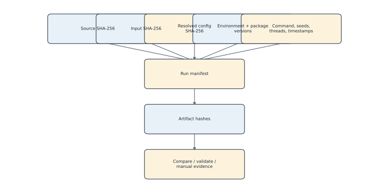

*Provenance and artifact lineage. Editable source: `assets/diagrams/diagram_09_provenance_lineage.mmd`.*

## Evidence-backed example

The executed Tutorial 2 manifest records package-source and input hashes, configuration hash, exact package versions, seeds 42/43, jobs, backend names, runtime, counts, selected ID, and artifact hashes.

## Outputs to inspect

Inspect runtime environment, resolved dependencies, source/input/artifact checksum registers, run/selection/tutorial manifests, logs, comparison and validation evidence.

## Common mistakes

Do not equate a pinned requirements file with a complete environment. Do not compare floating-point PNG bytes as scientific equality. Do not sanitize the only retained provenance copy.

## Scientific and operational limits

Provenance can contain protected paths and identifiers; maintain a private complete record and a deliberately sanitized publication record with linked hashes.

## Completion check

Using `assets/diagrams/diagram_09_provenance_lineage.mmd`, trace one plotted value back to its source table, configuration, input, source code, and execution log.

<p class="xref"><strong>Operational cross-reference:</strong> Chapter 37 covers commands, Chapter 38 configuration, Chapter 41 artifact schemas, Chapter 42 provenance, and Chapter 46 current limitations.</p>


# 43. Error messages, troubleshooting, and recovery

> **Release status.** DIMPLE-GWAS Freeze 3 RC1 (`3.0.0rc1`) is software-complete under local and fixed-fixture evidence. It is not yet scientifically frozen or cross-platform validated.

## Orientation

This chapter belongs to **Part VI — Operational reference**. It separates observed Freeze 3 behavior from scientific interpretation, historical evidence, and pending release work.

## Learning objectives

After this chapter, you can:

- Diagnose input, configuration, candidate, output-directory, and validation failures without deleting evidence.
- identify the evidence artifact that supports the behavior or boundary;
- describe one common misuse in language appropriate for a methods report.

Prerequisites: 9-23.

## Explanation and implementation

Troubleshoot by preserving evidence and narrowing the contract. Configuration errors include unknown keys, invalid metrics/ranges, custom mode without YAML, list values in fixed mode, min-dist greater than spread, invalid sizes, or a zero candidate job. Input errors include missing path, separator mistakes, nonnumeric analysis columns, wrong metadata-prefix count, duplicate/whitespace IDs, ambiguous orientation, missing labels, or undefined correlations. Execution issues include large candidate/repeat counts, backend errors, invalid topologies, optional Parquet failure, annotations skipped, and nonempty output roots for commands that require an absent/empty directory. Validation can flag missing files, unreadable schemas, count mismatch, or hash mismatch.

Recovery order: copy the exact error and command; inspect the log/manifest; run `inspect-config`; run `show-search-space`; verify input header/dimensions/IDs/checksum; reproduce on the fixed fixture; reduce only explicitly safe compute settings in a new config; create a new output root; and keep the failed candidate/run evidence. Use `--strict` when a workflow must abort on candidate failures, understanding the operational consequence.

A code defect should be documented with the smallest reproducer; do not edit scientific code just to make prose pass.

## Evidence-backed example

Tutorial 1's annotation warning was resolved by inspecting the annotation header (`index`), correcting YAML, and rerunning to a new directory. No historical output was overwritten.

## Outputs to inspect

Inspect stderr/stdout capture, `logs/run.log`, `model_failures.tsv`, status/error/warning columns, resolved config, input contract, issue register, and validation checks.

## Common mistakes

Do not delete a failed output before recording it. Do not set `undefined_correlation=zero` merely to suppress an unexplained constant vector. Do not increase parallelism as the first remedy for memory pressure.

## Scientific and operational limits

Not every warning invalidates clustering; not every exit-zero run is scientifically acceptable. Classify impact and resolution explicitly.

## Completion check

Diagnose: annotation skipped, candidate count unexpectedly 100× larger, duplicate ID, and validation hash mismatch. For each, name the first read-only check.

<p class="xref"><strong>Operational cross-reference:</strong> Chapter 37 covers commands, Chapter 38 configuration, Chapter 41 artifact schemas, Chapter 42 provenance, and Chapter 46 current limitations.</p>


# 44. Performance, memory, threading, and bounded-run guidance

> **Release status.** DIMPLE-GWAS Freeze 3 RC1 (`3.0.0rc1`) is software-complete under local and fixed-fixture evidence. It is not yet scientifically frozen or cross-platform validated.

## Orientation

This chapter belongs to **Part VI — Operational reference**. It separates observed Freeze 3 behavior from scientific interpretation, historical evidence, and pending release work.

## Learning objectives

After this chapter, you can:

- Estimate candidate/repeat scale and choose safe thread and smoke-test settings.
- identify the evidence artifact that supports the behavior or boundary;
- describe one common misuse in language appropriate for a methods report.

Prerequisites: 12, 17-18.

## Explanation and implementation

Workload has two nested scales: UMAP families × repeated seeds, then HDBSCAN candidates per family. Concatenated width is components × repeats; embedding storage in memory grows with vector count and that width. Original-space explanation may create a quadratic vector-by-vector similarity matrix and large heatmap. Candidate tables grow with the Cartesian product. JIT compilation makes first small runs slower than steady-state work.

Use `inspect-config`/`show-search-space` before execution. Start with the fixed fixture, then a bounded scientific pilot that preserves the intended method. Set `n_jobs` and `candidate_jobs` deliberately: when candidates run in parallel, Freeze 3 constrains HDBSCAN core-distance jobs to one to avoid nested oversubscription. Thread environment variables and numerical backends belong in provenance. Use the full-heatmap limit and avoid forcing large matrices without memory/privacy review.

The historical note records a 16-GB host caution. Current storage had ample space, but that is not a production resource recommendation. The executed 10.7-second/32-candidate and 273.47-second historical MNIST values are configuration-specific evidence, not scaling laws.

## Evidence-backed example

Estimate candidate count, UMAP-family count, concatenated width, model-table rows, and similarity-matrix cells for a proposed run. Then compare available memory/storage and choose one job setting before starting.

## Outputs to inspect

Inspect preflight counts, free storage, vector/input width, repeat/component counts, jobs/threads, UMAP/candidate runtimes, failure rates, Parquet status, and explanation matrix safeguards.

## Common mistakes

Do not run the 164 1,000-seed workflow as an undocumented first smoke test. Do not set both job layers to unrestricted parallelism. Do not infer linear runtime from tiny fixtures.

## Scientific and operational limits

No fresh full-IDP runtime/memory benchmark exists yet. Docker profiling must precede cloud sizing and preserve scientific settings.

## Completion check

Create a bounded-run worksheet with exact formulas and mark every quantity measured, configured, or still unknown.

<p class="xref"><strong>Operational cross-reference:</strong> Chapter 37 covers commands, Chapter 38 configuration, Chapter 41 artifact schemas, Chapter 42 provenance, and Chapter 46 current limitations.</p>


# 45. Migration from Dev and Freeze 2

> **Release status.** DIMPLE-GWAS Freeze 3 RC1 (`3.0.0rc1`) is software-complete under local and fixed-fixture evidence. It is not yet scientifically frozen or cross-platform validated.

## Orientation

This chapter belongs to **Part VI — Operational reference**. It separates observed Freeze 3 behavior from scientific interpretation, historical evidence, and pending release work.

## Learning objectives

After this chapter, you can:

- Map legacy flags/artifacts and distinguish compatibility aliases from new contracts.
- identify the evidence artifact that supports the behavior or boundary;
- describe one common misuse in language appropriate for a methods report.

Prerequisites: 14, 37-42.

## Explanation and implementation

Freeze 3 retains selected legacy CLI aliases and stage filenames so existing users can transition, but its native contracts are manifests, TSV/JSON model tables, stable IDs, per-model summaries, and explicit downstream utilities. Historical notebook columns such as `Silhouette_avg`, `Clusters`, `Noise_points`, `Epsilon`, `Min_samples`, and `Min_cluster_size` can be normalized by `score-existing`; source score columns are preserved with `source_` prefixes.

Migration should preserve the historical environment/configuration and labels before adaptation. Map old flags to canonical names, inspect the resolved Freeze 3 config, enumerate counts, rescore without refitting, compare exact IDs and permutation-invariant labels, and only then decide whether a fresh fixed/full run is authorized. Compatibility aliases do not prove that the new implementation recreated every intermediate byte.

The default path still matches the declared Dev-style standard search where verified, but Freeze 3 adds comprehensive manifests, failures, metrics/scopes, stable artifacts, explanation, comparison, and validation. Shipped extended count is 1,728, so older 5,184 planning statements must not migrate into new reports.

## Evidence-backed example

Use the historical 164 adapter as the pattern: immutable historical rows/labels are read, canonical score behavior is applied, manual row-16 status remains explicit, and fresh execution is not implied.

## Outputs to inspect

Inspect migration/backward-compatibility docs, alias help, schema-migration manifest, source-prefixed columns, historical checksums, comparison metrics, and new provenance.

## Common mistakes

Do not rewrite historical spreadsheets in place. Do not call an adapted table a fresh model fit. Do not assume stage aliases contain every new native field.

## Scientific and operational limits

Some original inputs/parameters remain missing or ambiguous; those migrations stay historical-only until authoritative evidence is supplied.

## Completion check

Build a two-column legacy-to-native map for one run and mark each item exact, adapted, deprecated alias, or unavailable.

<p class="xref"><strong>Operational cross-reference:</strong> Chapter 37 covers commands, Chapter 38 configuration, Chapter 41 artifact schemas, Chapter 42 provenance, and Chapter 46 current limitations.</p>


# 46. Known issues and scientific limitations

> **Release status.** DIMPLE-GWAS Freeze 3 RC1 (`3.0.0rc1`) is software-complete under local and fixed-fixture evidence. It is not yet scientifically frozen or cross-platform validated.

## Orientation

This chapter belongs to **Part VI — Operational reference**. It separates observed Freeze 3 behavior from scientific interpretation, historical evidence, and pending release work.

## Learning objectives

After this chapter, you can:

- Identify all open release gates and communicate limitations precisely.
- identify the evidence artifact that supports the behavior or boundary;
- describe one common misuse in language appropriate for a methods report.

Prerequisites: all.

## Explanation and implementation

Current open release issues are visible, not buried. There is no usable Git commit/tag identity; checksums substitute. The full fresh 164-IDP 1,000-seed run is deferred until Docker. Original 2,315-IDP and 459-IDP raw inputs/parameters are incomplete or unresolved. Docker/Linux/GCP/AWS execution and security validation are absent. Exact Yang/Zhao reviewer citations are unresolved in the supplied correspondence. Optional coordinate associations were not executed in the tutorials. Only macOS arm64 has fresh test/tutorial evidence.

Scientific limitations are equally important: nonlinear embeddings and density clusters are parameter dependent; repeated concatenation has no stated topology-recovery theorem; internal metrics are not biological validation; legacy scoring is candidate-population relative; selection can create circular inference; UMAP axes are not loadings; original-space correlations are conditional descriptors; noise is algorithmic; numerical determinism is platform dependent; and original-IDP interpretations may change with ongoing development.

Operational limitations include optional Parquet dependencies/failure handling, large similarity matrices, thread oversubscription, first-run JIT overhead, strict absent/empty output roots for safety, and manifests that can expose paths or identifiers. Use `evidence/03_missing_evidence_register.tsv`, `evidence/tutorial_issue_register.tsv`, and the Docker handoff as living registers.

## Evidence-backed example

The manual labels itself an RC1 first draft with named limitations rather than hiding Gate I/J dependencies. Appendix G shows which layers pass, are bounded, are historical, or are pending.

## Outputs to inspect

Inspect missing-evidence, authority/conflict, claim/correction, citation-gap, tutorial-issue, QA, build-report, and Docker-handoff records before release language changes.

## Common mistakes

Do not close an issue by changing prose alone. Do not infer missing reviewer references. Do not present original IDP material as final when development may change it.

## Scientific and operational limits

Some gates need new authority/data/compute rather than documentation. They remain named blockers with exact completion protocols.

## Completion check

Select one open software, scientific, historical, and platform limitation; state the artifact needed to close each.

<p class="xref"><strong>Operational cross-reference:</strong> Chapter 37 covers commands, Chapter 38 configuration, Chapter 41 artifact schemas, Chapter 42 provenance, and Chapter 46 current limitations.</p>


# Appendices

# Appendix A — Glossary

## GWAS

**genome-wide association study.** A study that tests associations between genetic variants and a phenotype. Do not confuse a GWAS association with causation.

## summary statistic

**statistical result for one variant–phenotype test.** In the input matrix, an analysis value indexed by a variant row and vector column. The exact measure and harmonization must be documented upstream.

## vector / IDP

**one phenotype-associated column across variants.** The unit clustered after the input matrix is prepared and transposed. IDP is a domain-specific vector label, not a generic feature.

## feature_id

**stable retained vector identifier.** Identifier written with labels and used for exact matching. Whitespace and duplicates are validation concerns.

## RINT

**rank inverse normal transformation.** Optional rank-based normalization applied before transpose as implemented. Off by default; it changes the analysis values.

## UMAP

**Uniform Manifold Approximation and Projection.** Nonlinear neighborhood-based embedding used by the pipeline. Axes are not biological loadings.

## densMAP

**density-augmented UMAP.** UMAP mode adding a density-correlation objective. Density preservation is not biological validation.

## seed

**pseudorandom initializer.** Base or derived integer controlling a repeated embedding. A fixed seed does not ensure cross-platform bitwise equality.

## concatenated embedding

**horizontal concatenation of repeated embeddings.** The high-dimensional representation supplied to HDBSCAN. An empirical stability strategy, not a true-topology estimator.

## HDBSCAN

**hierarchical density-based spatial clustering of applications with noise.** Density-clustering backend used to label vectors. Freeze 3 uses the contributed hdbscan package.

## candidate model

**one UMAP-family and HDBSCAN-parameter combination.** A complete enumerated configuration that produces a retained success, invalid topology, or failure row. A candidate is not necessarily eligible for ranking.

## selected model

**rank-one retained eligible candidate.** The candidate named in best_model.json and the selection manifest. Selection is heuristic and conditional on the searched population.

## noise label -1

**HDBSCAN noise/unassigned status.** Algorithmic non-membership under one representation and parameterization. Not biological irrelevance or absence of pleiotropy.

## silhouette

**within-versus-nearest-cluster separation diagnostic.** Metric-aware internal partition score used by legacy_dimple. Geometry dependent; not biological validation.

## DBCV

**density-based clustering validation.** Optional density-aware diagnostic recorded by Freeze 3. Not a legacy_dimple score component.

## ARI

**adjusted Rand index.** Permutation-invariant pairwise partition concordance metric. Does not test biological validity.

## NMI

**normalized mutual information.** Permutation-invariant information overlap between partitions. Numeric label values need not match.

## Procrustes disparity

**shape discrepancy after alignment.** Coordinate-only comparison diagnostic when both artifacts supply coordinates. Separate from membership concordance.

## structural concordance

**agreement in partition structure.** Comparison of labels/noise sets invariant to label renaming. Not exact computational reproduction.

## biological validation

**external evidence that a grouping reflects meaningful biology.** A later evidence layer beyond software and internal metrics. Not established by passing tests or MNIST.

## provenance

**record of source, inputs, settings, environment, commands, and artifacts.** Evidence required to interpret and reproduce a run. A dependency list alone is insufficient.


# Appendix B — Mathematical notation and equations

Let the prepared analysis matrix be \(X \in \mathbb{R}^{p \times v}\), with \(p\) vectors/IDPs and \(v\) input variables/variants after the declared metadata prefix is removed and the table is transposed. For repeated embeddings \(U_s \in \mathbb{R}^{p \times d}\), the HDBSCAN input is the horizontal concatenation \(Z=[U_1|\cdots|U_R] \in \mathbb{R}^{p \times dR}\). This is an implementation identity, not a theorem about true topology.

For an observation \(i\), silhouette is \(s(i)=(b(i)-a(i))/\max\{a(i),b(i)\}\), where \(a(i)\) is its mean within-cluster distance and \(b(i)\) is the smallest mean distance to another cluster under the configured metric. Freeze 3 summarizes eligible non-noise observations.

For each legacy-score component \(x\), Freeze 3 computes \(x'=x/\max(x)\) over the eligible candidate population. Component weights are their observed raw dynamic ranges divided by the sum of included ranges. The raw score is

\[S_{raw}=w_s s' + w_c c' - w_n n'.\]

Here \(s\) is silhouette, \(c\) is non-noise cluster count, and \(n\) is noise count. When `fit_include_noise=false`, \(w_n=0\). The final score rescales \(S_{raw}\) to [0,1] over the same candidate population; a zero range maps to 1. DBCV is not a term in this formula.

ARI and NMI compare partitions invariant to numeric label permutation. Noise-set Jaccard is \(|N_A \cap N_B|/|N_A \cup N_B|\), with the implementation-defined convention for two empty noise sets. These are concordance diagnostics, not tests of biological validity.


# Appendix C — Verified bibliography


This first-draft bibliography uses primary papers and official documentation. Each entry is bounded to the claim actually supported; none is treated as proof of DIMPLE-GWAS biological validity.

- **umap2018:** [McInnes et al. (2018), UMAP](https://joss.theoj.org/papers/10.21105/joss.00861). Identifier: `10.21105/joss.00861`.
- **densmap2021:** [Narayan, Berger & Cho (2021), densMAP](https://www.nature.com/articles/s41587-020-00801-7). Identifier: `10.1038/s41587-020-00801-7`.
- **hdbscan2015:** [Campello et al. (2015), HDBSCAN*](https://doi.org/10.1145/2733381). Identifier: `10.1145/2733381`.
- **hdbscan2017:** [McInnes, Healy & Astels (2017), hdbscan library](https://joss.theoj.org/papers/10.21105/joss.00205). Identifier: `10.21105/joss.00205`.
- **dbcv2014:** [Moulavi et al. (2014), DBCV](https://epubs.siam.org/doi/10.1137/1.9781611973440.96). Identifier: `10.1137/1.9781611973440.96`.
- **silhouette1987:** [Rousseeuw (1987), silhouettes](https://doi.org/10.1016/0377-0427(87)90125-7). Identifier: `10.1016/0377-0427(87)90125-7`.
- **selective2024:** [Gao, Bien & Witten (2024), selective inference for hierarchical clustering](https://pubmed.ncbi.nlm.nih.gov/38660582/). Identifier: `10.1080/01621459.2022.2116331`.
- **oblong2024:** [Oblong et al. (2024), genomic PCA/ICA](https://onlinelibrary.wiley.com/doi/10.1111/gbb.12876). Identifier: `10.1111/gbb.12876`.
- **genomicsem2019:** [Grotzinger et al. (2019), Genomic SEM](https://www.nature.com/articles/s41562-019-0566-x). Identifier: `10.1038/s41562-019-0566-x`.
- **mtag2018:** [Turley et al. (2018), MTAG](https://www.nature.com/articles/s41588-017-0009-4). Identifier: `10.1038/s41588-017-0009-4`.
- **mostest2020:** [van der Meer et al. (2020), MOSTest](https://www.nature.com/articles/s41467-020-17368-1). Identifier: `10.1038/s41467-020-17368-1`.
- **pleio2021:** [Lee et al. (2021), PLEIO](https://pmc.ncbi.nlm.nih.gov/articles/PMC7820744/). Identifier: `10.1016/j.ajhg.2020.11.017`.
- **zhang2023:** [Zhang et al. (2023), scalable pleiotropy characterization](https://pubmed.ncbi.nlm.nih.gov/37879338/). Identifier: `10.1016/j.ajhg.2023.09.015`.
- **hofer2020:** [Hofer et al. (2020), cortical structure genetics](https://www.nature.com/articles/s41467-020-18367-y). Identifier: `10.1038/s41467-020-18367-y`.
- **elliott2018:** [Elliott et al. (2018), UK Biobank imaging GWAS](https://www.nature.com/articles/s41586-018-0571-7). Identifier: `10.1038/s41586-018-0571-7`.
- **umapdocs:** [UMAP official parameter and API documentation](https://umap-learn.readthedocs.io/en/latest/parameters.html). Identifier: `official documentation`.
- **hdbscandocs:** [hdbscan official parameter/API documentation](https://hdbscan.readthedocs.io/en/latest/api.html). Identifier: `official documentation`.
- **sklearnsilhouette:** [scikit-learn silhouette_score documentation](https://scikit-learn.org/stable/modules/generated/sklearn.metrics.silhouette_score.html). Identifier: `official documentation`.

## Attribution correction

*Principal and independent genomic components of brain structure and function* is by Oblong et al. (2024), DOI `10.1111/gbb.12876`. Zhang et al. (2023), DOI `10.1016/j.ajhg.2023.09.015`, is a separate pleiotropy-characterization paper. No exact Yang/Zhao reviewer-cited paper is identifiable in the supplied Reviewer #2 action register; those attributions remain unresolved rather than guessed.


# Appendix D — Reviewer-method crosswalk

The machine-readable crosswalk is `evidence/reviewer_reference_crosswalk.tsv`. The draft adopts the reviewer requests for clearer method positioning, parameter guidance, a practical tutorial, cautious treatment of unassigned IDPs, and separation of technical from biological validation. The supplied action register does not identify exact Yang or Zhao works, so no paper is attributed to those reviewers by inference. The PCA/ICA paper named in the manuscript is correctly attributed to Oblong et al. (2024), while Zhang et al. (2023) is a different pleiotropy paper.


# Appendix E — Claim and evidence index

The authoritative first-draft index is `evidence/claim_evidence_register.tsv`. Each row records original wording, safe wording, implementation and internal evidence, external citations, strength, limitation, reviewer relevance, and resolution. The paired `gemini_claim_correction_ledger.tsv` isolates known high-risk corrections. These registers should be updated before prose whenever software or evidence changes.


# Appendix F — Tutorial checksums and environment

The canonical per-command record is `evidence/tutorial_execution_manifest.tsv`; each tutorial also contains `execution_manifest.json`. The isolated environment is described in `evidence/runtime_environment.md`, exact installed packages in `evidence/resolved_dependencies.txt`, and manual/tutorial artifact hashes in `evidence/artifact_checksums.tsv`. Tutorial 1's canonical output is `run_20260825_v2`; the earlier directory is retained to make the corrected annotation-join mistake auditable.


# Appendix G — Release-status and validation matrix

| Layer | Current evidence | Status |
| --- | --- | --- |
| Software | 45 tests pass in the isolated macOS environment | pass |
| Fixed-fixture technical rerun | ARI, NMI, noise Jaccard, and mapped membership are 1; Procrustes is near zero | pass, bounded |
| Artifact validation | 24/24 checks pass for Tutorial 1 v2 | pass, bounded |
| Historical 164-IDP reconstruction | Exact recorded counts, manual row-16 selection, historical adaptation/rescoring | historical only |
| Fresh 164-IDP 1,000-seed search | Not executed in this build | pending Docker phase |
| Statistical/biological validation | Not established by internal metrics or tutorials | pending external work |
| Docker/Linux/GCP/AWS | Not built or tested | pending |

No lower layer substitutes for a higher layer.


# Appendix H — Docker/cloud-stage handoff synopsis

Package source identified by `package_source_sha256` and the manual source checksum registers. Use the synthetic fixed configuration for the container smoke test and the authoritative `configs/original_idp_164_historical_search.yaml` for the later full scientific run after input and resource preflight. The complete handoff is `DOCKER_CLOUD_SUPPLEMENT_HANDOFF.md`; this documentation build creates no Dockerfile, image, registry, bucket, credential, or cloud resource.
