# 4. From input matrix to candidate partitions

> **Release status.** DIMPLE-GWAS Freeze 3 RC1 (`3.0.0rc1`) is software-complete under local and fixed-fixture evidence. It is not yet scientifically frozen or cross-platform validated.

## Orientation

This chapter belongs to **Part I — Orientation and conceptual foundations**. It separates observed Freeze 3 behavior from scientific interpretation, historical evidence, and pending release work.

## Learning objectives

After this chapter, you can:

- Trace data through preprocessing, embedding, clustering, scoring, and retained artifacts.
- identify the evidence artifact that supports the behavior or boundary;
- describe one common misuse in language appropriate for a methods report.

Prerequisites: 1-3.

## Explanation and implementation

The Stage 1 workflow is a producer–consumer chain. Freeze 3 reads the table, removes the declared leading metadata columns, optionally applies RINT to analysis columns, and transposes to vectors by input variables. For each UMAP parameter family it generates repeated seeded UMAP/densMAP embeddings and concatenates them horizontally. It then evaluates the complete declared HDBSCAN Cartesian product, retains success, invalid-topology, and failure rows, calculates diagnostics, applies the declared score, ranks eligible candidates, and refits retained models to preserve labels.

Downstream commands do different work. `reproduce-model` refits one retained parameterization. `explain` does not refit; it matches exact IDs and returns to original input-vector space. `compare` measures structural and optional coordinate concordance. `validate` checks files, schemas, counts, readability, and recorded hashes. No PCA, SVD, or ICA reducer is silently inserted before UMAP.

## Evidence diagram or figure

```mermaid

flowchart LR
  A["Variants × vectors input"] --> B["Drop declared metadata columns"]
  B --> C["Optional RINT"]
  C --> D["Transpose: vectors × variants"]
  D --> E["Repeated seeded UMAP / densMAP"]
  E --> F["Concatenated embedding"]
  F --> G["Enumerated HDBSCAN candidates"]
  G --> H["Metrics and declared score"]
  H --> I["Ranked and retained models"]
  I --> J["Explain / compare / validate"]

```

*Stage 1 producer–consumer workflow. Editable source: `assets/diagrams/diagram_01_stage1_workflow.mmd`.*

## Evidence-backed example

Follow `assets/diagrams/diagram_01_stage1_workflow.mmd` from input to downstream utilities. Each arrow corresponds to an implementation module named in `evidence/source_to_manual_traceability.tsv`.

## Outputs to inspect

At the run root, inspect `resolved_config.yaml`, the search-space manifests, `models/`, `run_manifest.json`, and `logs/run.log`. Chapter 41 maps every named output to its producer and consumer.

## Common mistakes

Do not treat `stage09_*` display coordinates as the full concatenated embedding. Do not expect cleaned inputs or individual repeated embeddings on disk; current Freeze 3 keeps them in memory.

## Scientific and operational limits

A workflow diagram explains control and data flow, not scientific validity. Every transformation can change geometry, and the selected model remains conditional on the declared search and score.

## Completion check

Given an artifact name, identify its producer and whether it refits data. Verify your answer in `output_producer_consumer_map.tsv`.

<strong>Operational cross-reference:</strong> Chapter 37 covers commands, Chapter 38 configuration, Chapter 41 artifact schemas, Chapter 42 provenance, and Chapter 46 current limitations.

