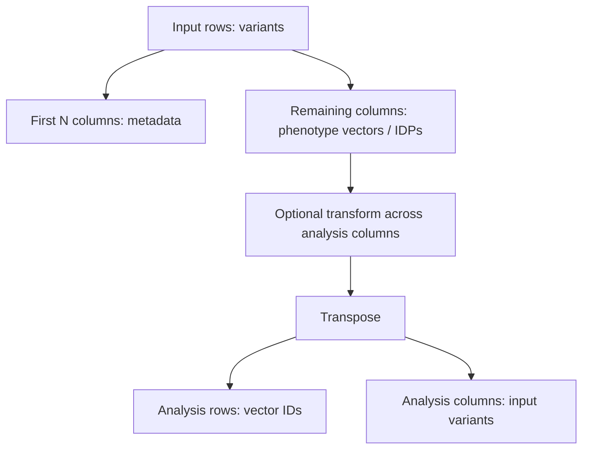

# 10. Input data contract, orientation, metadata columns, and missingness

> **Release status.** DIMPLE-GWAS Freeze 3 RC1 (`3.0.0rc1`) is software-complete under local and fixed-fixture evidence. It is not yet scientifically frozen or cross-platform validated.

## Orientation

This chapter belongs to **Part II — Installation, data preparation, and the first successful run**. It separates observed Freeze 3 behavior from scientific interpretation, historical evidence, and pending release work.

## Learning objectives

After this chapter, you can:

- Validate column roles, orientation, identifiers, numeric values, and missingness before a run.
- identify the evidence artifact that supports the behavior or boundary;
- describe one common misuse in language appropriate for a methods report.

Prerequisites: 2, 9.

## Explanation and implementation

The standard run contract is a CSV/TSV table with variants in rows, a declared leading metadata prefix, and vectors/IDPs in the remaining columns. The default `drop_first_n_cols` is 4. Analysis columns must be numeric after parsing. Their column names become `feature_id` values after transpose, so they must be stable and unique. The original row axis supplies the variables across which vectors are compared.

Freeze 3 reads the separator explicitly when configured or through its table reader, drops the prefix, optionally transforms analysis columns, and transposes. The native explanation path expects exact retained IDs and the original matrix. Legacy explanation can infer orientation only through exact overlap and should use explicit orientation/ID options when ambiguity exists. Missing, nonnumeric, constant, duplicate, or mismatched values can make preprocessing or correlations undefined.

The input-orientation diagram at `assets/diagrams/diagram_02_input_orientation.mmd` is the safest mental model.

## Evidence diagram or figure

*Input orientation and transposition. Editable source: `assets/diagrams/diagram_02_input_orientation.mmd`.*

## Evidence-backed example

The fixture `benchmarks/synthetic/synthetic_matrix.tsv` has 80 rows and 28 columns: four metadata plus 24 vectors. After the prefix is dropped and data are transposed, the analysis matrix is 24 vectors by 80 variables.

## Outputs to inspect

Before a run, inspect header uniqueness, first rows, dimensions, numeric conversion, missing counts, separator, and the annotation join column. After a run, confirm the manifest's `input_contract` and input SHA-256.

## Common mistakes

Do not set `drop_first_n_cols` by guessing. Do not use annotation row number as vector identity. Do not let spreadsheet software rewrite scientific notation or identifiers. Do not silently impute missing values outside an approved upstream protocol.

## Scientific and operational limits

Freeze 3 cannot determine whether upstream variants are allele-aligned, comparable across phenotypes, or scientifically eligible. Protected study matrices should not be copied into the manual or image.

## Completion check

For a prospective input, record row count, metadata columns, vector count, separator, missingness rule, upstream harmonization provenance, and the expected feature-ID set.

<strong>Operational cross-reference:</strong> Chapter 37 covers commands, Chapter 38 configuration, Chapter 41 artifact schemas, Chapter 42 provenance, and Chapter 46 current limitations.

