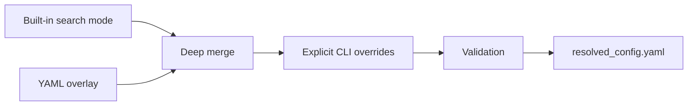

# 11. Configuration files and precedence

> **Release status.** DIMPLE-GWAS Freeze 3 RC1 (`3.0.0rc1`) is software-complete under local and fixed-fixture evidence. It is not yet scientifically frozen or cross-platform validated.

## Orientation

This chapter belongs to **Part II — Installation, data preparation, and the first successful run**. It separates observed Freeze 3 behavior from scientific interpretation, historical evidence, and pending release work.

## Learning objectives

After this chapter, you can:

- Resolve built-in, YAML, and CLI precedence; identify default versus tutorial values.
- identify the evidence artifact that supports the behavior or boundary;
- describe one common misuse in language appropriate for a methods report.

Prerequisites: 9-10.

## Explanation and implementation

Configuration resolution is deterministic: start with a built-in search mode, deep-merge a YAML mapping, then apply only explicit CLI values. The result is validated and written as `resolved_config.yaml`. Therefore a YAML value can differ from the run value when a CLI override is present; the resolved file, not memory or the source overlay alone, is authoritative for that run.

The four modes are `standard`, `extended`, `custom`, and `fixed`. `custom` requires a YAML file. `fixed` requires one value for every searched UMAP and HDBSCAN parameter. Scalar values produce one choice; lists produce choices; numeric `{start, stop, step}` mappings are stop-exclusive; supported CLI strings may also encode comma lists or ranges. Unknown top-level or interpretation keys and invalid combinations fail validation.

```bash
dimple-gwas inspect-config \
  --search-mode custom \
  --config docs/manual/tutorials/02_custom_search_space/tutorial_config.yaml
```

## Evidence diagram or figure




*Configuration precedence. Editable source: `assets/diagrams/diagram_03_config_precedence.mmd`.*

## Evidence-backed example

Tutorial 2 declares two values each for `umap.n_neighbors`, `umap.min_dist`, `hdbscan.min_cluster_size`, `hdbscan.min_samples`, and epsilon; other searched fields are scalar. The resolved file records two repeated states and one candidate job.

## Outputs to inspect

Compare the source YAML, captured `inspect-config` output, and run `resolved_config.yaml`. Use `evidence/configuration_key_reference.tsv` for every default and exposure.

## Common mistakes

Do not call a tutorial value a default. Do not edit a resolved output and assume the past run changed. Do not use a range's `stop` as though it were included. Do not mix `custom` with no YAML.

## Scientific and operational limits

Configuration validity means fields satisfy software constraints, not that the scientific search is appropriate. Candidate-count safety and parameter justification remain analyst responsibilities.

## Completion check

Predict the resolved value when built-in `n_jobs=-1`, YAML sets `n_jobs=2`, and CLI supplies `--n-jobs 1`. Confirm using `inspect-config`.

<p class="xref"><strong>Operational cross-reference:</strong> Chapter 37 covers commands, Chapter 38 configuration, Chapter 41 artifact schemas, Chapter 42 provenance, and Chapter 46 current limitations.</p>
