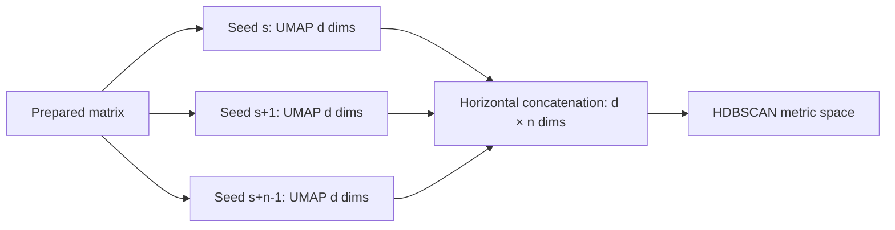

# 17. Repeated seeds, concatenated embeddings, determinism, and compute cost

> **Release status.** DIMPLE-GWAS Freeze 3 RC1 (`3.0.0rc1`) is software-complete under local and fixed-fixture evidence. It is not yet scientifically frozen or cross-platform validated.

## Orientation

This chapter belongs to **Part III — The complete DIMPLE-GWAS workflow**. It separates observed Freeze 3 behavior from scientific interpretation, historical evidence, and pending release work.

## Learning objectives

After this chapter, you can:

- Trace seed generation and concatenation; bound determinism and resource claims.
- identify the evidence artifact that supports the behavior or boundary;
- describe one common misuse in language appropriate for a methods report.

Prerequisites: 16.

## Explanation and implementation

For each UMAP family, Freeze 3 derives a deterministic sequence of integer seeds from the configured base state and repeat count. It executes one embedding per seed and horizontally concatenates the resulting `n_components` coordinates. With 1,000 repeats and three components, the HDBSCAN input has 3,000 coordinates per vector. A smaller display embedding is retained separately for selected-model visualization.

Repeats multiply UMAP work and concatenated-memory width. Standard mode uses the historical ensemble seed behavior and 1,000 repeats; the tutorials set one or two for bounded execution. `n_jobs`, Numba behavior, BLAS/OpenMP libraries, architecture, and thread scheduling can affect runtime and numerical detail. Reproducing seeds is necessary but not sufficient for bitwise cross-platform identity.

The representation is an empirical aggregation. It is not averaged coordinates, a formal consensus cluster, or a proof of expected-distance estimation.

## Evidence diagram or figure

*Repeated embeddings and concatenation. Editable source: `assets/diagrams/diagram_04_repeated_embeddings.mmd`.*

## Evidence-backed example

Tutorial 2's manifest lists seeds 42 and 43, three components per repeat, and four UMAP families. Each family therefore supplies a 24×6 concatenated matrix in memory; this matrix is not written to disk.

## Outputs to inspect

Inspect `random_seeds`, `umap_seeds`, `n_random_states`, `legacy_ensemble_seeds`, UMAP runtime, package versions, thread settings, and source hash.

## Common mistakes

Do not confuse the three display columns with all repeated coordinates. Do not publish a runtime estimate by linearly scaling a JIT-heavy smoke test without qualification. Do not promise identical floating-point embeddings across machines.

## Scientific and operational limits

The full 164-IDP 1,000-seed run is pending Docker. Cross-platform acceptance should use exact label/schema checks where appropriate and tolerances/alignment for floating-point coordinates.

## Completion check

Calculate concatenated width for 1, 2, 10, and 1,000 repeats at three dimensions; identify which output file does not exist in current Freeze 3.

<strong>Operational cross-reference:</strong> Chapter 37 covers commands, Chapter 38 configuration, Chapter 41 artifact schemas, Chapter 42 provenance, and Chapter 46 current limitations.

