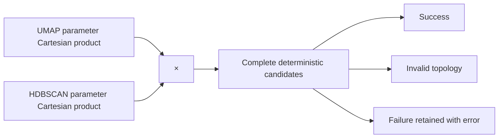

# 18. HDBSCAN concepts and the Freeze 3 search grid

> **Release status.** DIMPLE-GWAS Freeze 3 RC1 (`3.0.0rc1`) is software-complete under local and fixed-fixture evidence. It is not yet scientifically frozen or cross-platform validated.

## Orientation

This chapter belongs to **Part III — The complete DIMPLE-GWAS workflow**. It separates observed Freeze 3 behavior from scientific interpretation, historical evidence, and pending release work.

## Learning objectives

After this chapter, you can:

- Interpret density parameters and enumerate standard/custom grids.
- identify the evidence artifact that supports the behavior or boundary;
- describe one common misuse in language appropriate for a methods report.

Prerequisites: 5, 17.

## Explanation and implementation

Freeze 3 fits the contributed `hdbscan` package to each concatenated embedding. `min_cluster_size` sets the smallest extracted group, while `min_samples` affects core distances and conservativeness. `cluster_selection_epsilon` can merge fine structure below a distance threshold. `cluster_selection_method` is `eom` or `leaf`; `max_cluster_size` has no effect for leaf selection and is recorded with a parameter note when set. Other exposed controls are persistence, alpha, single-cluster permission, maximum cluster size, and metric.

The standard grid uses min-cluster-size 5 through 49, min-samples 2 through 19, and epsilon 0,1,2: 2,430 candidates. Candidate identity also includes UMAP family. Every evaluation becomes `success`, `invalid_topology` when fewer than two non-noise clusters are found, or `failed` with an error. Failure rows are retained, not removed.

## Evidence diagram or figure

*Complete search-space enumeration. Editable source: `assets/diagrams/diagram_05_search_space.mmd`.*

## Evidence-backed example

Tutorial 2 evaluates min-cluster-size 4/6, min-samples 2/4, epsilon 0/0.05, and scalar EOM/Euclidean settings across four UMAP families. All 32 candidates succeeded and produced three clusters with no noise.

## Outputs to inspect

Inspect `hdbscan_id`, flattened parameters, status, error message, cluster/noise counts, persistence summaries, metric warnings, candidate runtime, and `model_failures.tsv`.

## Common mistakes

Do not interpret increasing `min_samples` as universally better. Do not use numeric cluster labels as stable identity across fits. Do not call noise observations false or biologically irrelevant.

## Scientific and operational limits

Density structure depends on the concatenated representation and metric. A grid can expose sensitivity but does not identify a uniquely correct biological scale.

## Completion check

For a failed candidate, verify that its ordinal, model ID, parameters, status, and error remain present in `all_models.tsv`.

## Evidence and references

See Campello et al. (2015), DOI 10.1145/2733381; McInnes et al. (2017), DOI 10.21105/joss.00205; and official hdbscan API documentation.

<strong>Operational cross-reference:</strong> Chapter 37 covers commands, Chapter 38 configuration, Chapter 41 artifact schemas, Chapter 42 provenance, and Chapter 46 current limitations.

