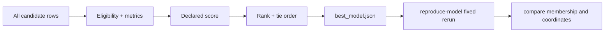

# 21. Ranking, summarising, and choosing a model

> **Release status.** DIMPLE-GWAS Freeze 3 RC1 (`3.0.0rc1`) is software-complete under local and fixed-fixture evidence. It is not yet scientifically frozen or cross-platform validated.

## Orientation

This chapter belongs to **Part III — The complete DIMPLE-GWAS workflow**. It separates observed Freeze 3 behavior from scientific interpretation, historical evidence, and pending release work.

## Learning objectives

After this chapter, you can:

- Audit eligibility, ranking, ties, Pareto summaries, and selection leakage.
- identify the evidence artifact that supports the behavior or boundary;
- describe one common misuse in language appropriate for a methods report.

Prerequisites: 18-20.

## Explanation and implementation

Ranking begins after statuses and scores exist. Eligible successful rows are ordered by final score descending, raw score descending, then stable `model_id` ascending. `top_models.tsv` retains the requested number; `best_model.json` and the selection manifest identify rank one. Pareto membership and family summaries are supplementary views, not alternate truth labels.

Choosing a model should be traceable to an objective declared before inspecting preferred biological labels. Review failure/invalid rates, parameter-family patterns, tied or near-tied solutions, noise and size trade-offs, stability checks, and domain-independent constraints. A rank-one row is the implementation's selected model under the declared rule, not proof that the cluster count is uniquely correct.

Target leakage includes choosing parameters because their labels resemble a published solution when those parameters were not recovered from the historical method. The 164-IDP manual row-16 selection is disclosed rather than retroactively portrayed as automatic rank one.

## Evidence diagram or figure

*Scoring, selection, and fixed reproduction. Editable source: `assets/diagrams/diagram_06_selection_reproduction.mmd`.*

## Evidence-backed example

Tutorial 2's first eight models tie at score 1 because their HDBSCAN choices yield the same metrics within the best UMAP family. Stable model ID breaks remaining ties; this is an engineering rule, not a biological preference.

## Outputs to inspect

Inspect ranked/all/top tables, family summaries, Pareto table, model selection manifest, best-model JSON, failures, and exact parameter records.

## Common mistakes

Do not hide ties or failed candidates. Do not select solely from a pretty plot. Do not use knowledge of desired labels to redefine the search or score and then call it replication.

## Scientific and operational limits

Internal selection uncertainty is not automatically quantified. Report sensitivity and the conditional nature of the chosen population.

## Completion check

Write a selection note for Tutorial 2 that names the rule, tie, selected ID, candidate population, and why no biological conclusion follows.

<strong>Operational cross-reference:</strong> Chapter 37 covers commands, Chapter 38 configuration, Chapter 41 artifact schemas, Chapter 42 provenance, and Chapter 46 current limitations.

