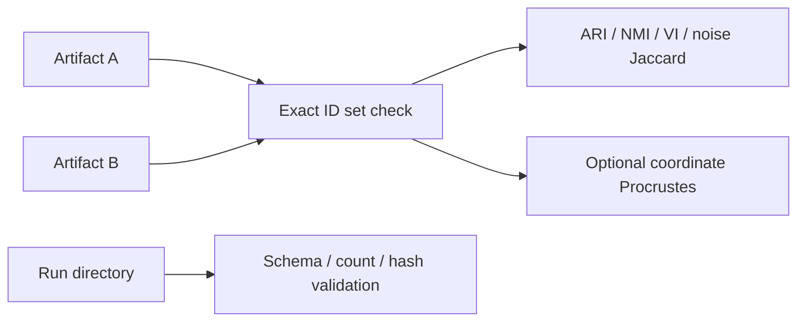

# 23. Comparing partitions and validating outputs

> **Release status.** DIMPLE-GWAS Freeze 3 RC1 (`3.0.0rc1`) is software-complete under local and fixed-fixture evidence. It is not yet scientifically frozen or cross-platform validated.

## Orientation

This chapter belongs to **Part III — The complete DIMPLE-GWAS workflow**. It separates observed Freeze 3 behavior from scientific interpretation, historical evidence, and pending release work.

## Learning objectives

After this chapter, you can:

- Use exact IDs, permutation-invariant metrics, and artifact validation correctly.
- identify the evidence artifact that supports the behavior or boundary;
- describe one common misuse in language appropriate for a methods report.

Prerequisites: 22.

## Explanation and implementation

`compare` accepts two native summaries or label tables, requires unique exact ID sets, and can require the same order. It reports adjusted Rand index, normalized mutual information, variation of information, noise-set Jaccard, optimal label mapping, mapped membership, changed noise status, cluster sizes, and optional Procrustes disparity. Numeric labels are local names, so structural metrics are primary.

`validate` inspects one run directory for required artifacts, readable JSON/YAML, enumeration counts, ranked schema, selected artifacts, and recorded hashes. It writes one pass/warn/fail row per check and returns exit code one on failure. Validation does not refit or compare biology.

```bash
dimple-gwas compare --left LEFT/summary.json --right RIGHT/summary.json --output-dir comparison_new
dimple-gwas validate --run-dir RUN --output-dir validation_new
```

## Evidence diagram or figure




*Comparison and validation paths. Editable source: `assets/diagrams/diagram_08_compare_validate.mmd`.*

## Evidence-backed example

Tutorial 3 comparison uses 24 IDs, three clusters, no noise, perfect structural metrics, zero variation of information, and near-zero aligned coordinate disparity. Validation reports 24/24 pass with no warnings or failures.

## Outputs to inspect

Inspect `comparison_summary.json`, membership table, size table, confusion, mapping, comparison manifest, `validation_checks.tsv`, report, and validation manifest.

## Common mistakes

Do not compare raw numeric labels across fits. Do not ignore changed noise status. Do not interpret Procrustes as membership agreement. Do not call hash/schema checks biological validation.

## Scientific and operational limits

Exact label equality is stringent and environment-sensitive; permutation-invariant equality is structural. Coordinate comparison needs alignment and tolerances. Scientific conclusions need higher-layer validation.

## Completion check

Describe a case with ARI=1 but different numeric labels, and a different case with similar coordinates but changed memberships.

<p class="xref"><strong>Operational cross-reference:</strong> Chapter 37 covers commands, Chapter 38 configuration, Chapter 41 artifact schemas, Chapter 42 provenance, and Chapter 46 current limitations.</p>
