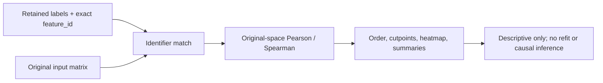

# 25. Returning to the original input-vector space

> **Release status.** DIMPLE-GWAS Freeze 3 RC1 (`3.0.0rc1`) is software-complete under local and fixed-fixture evidence. It is not yet scientifically frozen or cross-platform validated.

## Orientation

This chapter belongs to **Part IV — Explainability and responsible interpretation**. It separates observed Freeze 3 behavior from scientific interpretation, historical evidence, and pending release work.

## Learning objectives

After this chapter, you can:

- Explain a retained partition without refitting and audit ID matching.
- identify the evidence artifact that supports the behavior or boundary;
- describe one common misuse in language appropriate for a methods report.

Prerequisites: 10, 23-24.

## Explanation and implementation

`explain` returns to the original matrix after a partition has been retained. It loads native summary/labels or a legacy table, resolves input orientation, validates/strips identifiers, rejects duplicates, enforces complete matching by default, applies the recorded preprocessing contract, and computes original-space similarity without refitting UMAP or HDBSCAN.

Native mode usually needs only `--model-json`; `--input` can override a stale recorded path. Legacy mode requires a label table, original input, explicit output root, and often explicit orientation/ID/label/coordinate options. The noise policy can place unassigned vectors last, include them in ordering, or exclude them with a recorded reason.

```bash
dimple-gwas explain \
  --model-json RUN/models/top_model_artifacts/MODEL/summary.json \
  --output-dir explanation_new
```

## Evidence diagram or figure




*Original-space explanation without refitting. Editable source: `assets/diagrams/diagram_07_original_space_explanation.mmd`.*

## Evidence-backed example

Tutorial 3 matches all 24 synthetic feature IDs, excludes none, writes the complete similarity table, and produces ordered heatmap/summary/projection artifacts without changing labels.

## Outputs to inspect

Inspect interpretation manifest sources/hashes, orientation, ID counts, exclusions, `heatmap_order.tsv`, similarity table, summaries, projection quality, README, and figure sidecars.

## Common mistakes

Do not let auto-orientation replace an explicit contract when both axes could overlap. Do not accept incomplete matching silently. Do not describe explanation as a refit or independent validation.

## Scientific and operational limits

Original-space summaries remain conditional on a selected partition and input construction. They can reveal descriptive coherence or contradictions but cannot establish causal mechanism.

## Completion check

Given a legacy table with duplicate IDs and one unmatched ID, predict the default outcome and the effect of allowing incomplete matching.

<p class="xref"><strong>Operational cross-reference:</strong> Chapter 37 covers commands, Chapter 38 configuration, Chapter 41 artifact schemas, Chapter 42 provenance, and Chapter 46 current limitations.</p>
