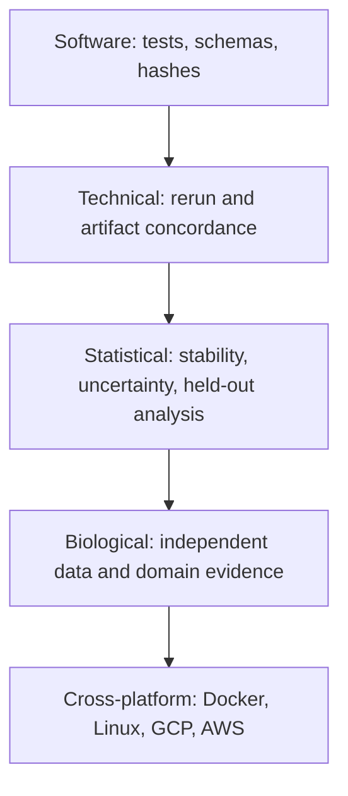

# 30. Technical, statistical, and biological validation

> **Release status.** DIMPLE-GWAS Freeze 3 RC1 (`3.0.0rc1`) is software-complete under local and fixed-fixture evidence. It is not yet scientifically frozen or cross-platform validated.

## Orientation

This chapter belongs to **Part IV — Explainability and responsible interpretation**. It separates observed Freeze 3 behavior from scientific interpretation, historical evidence, and pending release work.

## Learning objectives

After this chapter, you can:

- Place evidence on the correct validation layer and define pending release gates.
- identify the evidence artifact that supports the behavior or boundary;
- describe one common misuse in language appropriate for a methods report.

Prerequisites: 8, 23, 29.

## Explanation and implementation

Validation is layered. Software validation covers tests and schemas. Technical reproducibility covers source/input/configuration identity, reruns, hashes, labels, and numeric tolerance. Structural concordance uses ARI/NMI/noise/mapped membership. Statistical validation addresses parameter sensitivity, instability, selection, uncertainty, and multiplicity. Biological validation asks whether groupings recur or predict independent domain evidence. Cross-platform validation tests the claimed package on Docker/Linux/cloud environments.

A result should be reported at the strongest layer actually supported. Forty-five tests support software. Twenty-four artifact checks support one run contract. Perfect fixture concordance supports bounded same-platform technical structure. MNIST supports known-label engineering behavior. None proves the historical IDP clusters biologically distinct. The fresh 164-IDP and Docker/cloud layers remain pending.

## Evidence diagram or figure

*Validation ladder; each layer requires its own evidence. Editable source: `assets/diagrams/diagram_10_validation_ladder.mmd`.*

## Evidence-backed example

Use `assets/diagrams/diagram_10_validation_ladder.mmd` and Appendix G to classify every manual evidence item. No arrow can be skipped by renaming a lower layer.

## Outputs to inspect

Inspect test JUnit/logs, validation checks, comparison metrics, source/input/config hashes, historical evidence, external-study design, and platform matrices separately.

## Common mistakes

Do not write ‘validated’ without an object, method, dataset, platform, and criterion. Do not let a checksum pass stand in for scientific replication.

## Scientific and operational limits

Statistical and biological validation protocols are context dependent and may require data or governance outside this package. This manual does not invent those results.

## Completion check

Create a five-row validation table for your run with evidence path, criterion, result, and remaining uncertainty.

<strong>Operational cross-reference:</strong> Chapter 37 covers commands, Chapter 38 configuration, Chapter 41 artifact schemas, Chapter 42 provenance, and Chapter 46 current limitations.

