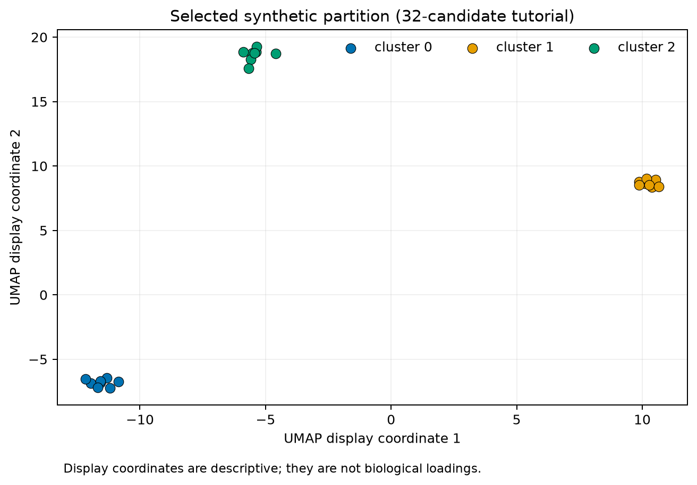

# 32. Fixed synthetic dataset case study

> **Release status.** DIMPLE-GWAS Freeze 3 RC1 (`3.0.0rc1`) is software-complete under local and fixed-fixture evidence. It is not yet scientifically frozen or cross-platform validated.

## Orientation

This chapter belongs to **Part V — Worked case studies**. It separates observed Freeze 3 behavior from scientific interpretation, historical evidence, and pending release work.

## Learning objectives

After this chapter, you can:

- Reproduce and interpret the verified one-candidate tutorial.
- identify the evidence artifact that supports the behavior or boundary;
- describe one common misuse in language appropriate for a methods report.

Prerequisites: 13-14.

## Explanation and implementation

Tutorial 1 is the canonical novice path. Its configuration fixes every searched field, uses the repository synthetic matrix and annotation table, one seed, three components, one HDBSCAN candidate, one job, and a new output root. The correct annotation join is `index`. Preflight proves one candidate before fitting.

The executed canonical directory is `tutorials/01_fixed_synthetic/run_20260825_v2`. It prepared 24 vectors by 80 variables, selected `model_060fac0208bb58e2`, and produced three clusters of eight with no unassigned observations. Parquet writing succeeded. The validation utility later passed all 24 run-contract checks.

The earlier `run_20260825` is intentionally retained: clustering succeeded, but the original join key was absent and annotations were skipped with a warning. The canonical rerun demonstrates the evidence-preserving response—correct source configuration, write a new output root, and retain the prior attempt.

## Evidence diagram or figure

*Figure 1. Selected synthetic display coordinates; axes are not biological loadings. Source and checksum: `evidence/figure_source_manifest.tsv`.*

## Evidence-backed example

Follow Chapters 11–14 using the actual YAML. Then use Chapter 22 to reproduce the selected summary, Chapter 23 to compare it, and Chapter 25 to explain it. The complete commands and timings are in `tutorial_execution_manifest.tsv`.

## Outputs to inspect

Inspect the config, preflight manifests, canonical run manifest, candidate tables, selection manifest, labels/annotations, logs, reproduction, comparison, explanation, and validation.

## Common mistakes

Do not delete the noncanonical first run. Do not call the designed grouping discovery evidence. Do not use the fixed quickstart to choose production parameters.

## Scientific and operational limits

This fixture is a smoke test with deliberately clear structure. Runtime and accuracy are not a guarantee for large correlated GWAS inputs.

## Completion check

From only the artifacts, reconstruct input shape, candidate count, selected ID, cluster sizes, noise count, annotation status, and validation result.

<strong>Operational cross-reference:</strong> Chapter 37 covers commands, Chapter 38 configuration, Chapter 41 artifact schemas, Chapter 42 provenance, and Chapter 46 current limitations.

