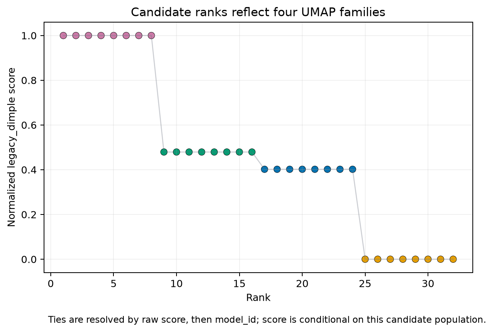

# 33. Custom bounded search-space case study

> **Release status.** DIMPLE-GWAS Freeze 3 RC1 (`3.0.0rc1`) is software-complete under local and fixed-fixture evidence. It is not yet scientifically frozen or cross-platform validated.

## Orientation

This chapter belongs to **Part V — Worked case studies**. It separates observed Freeze 3 behavior from scientific interpretation, historical evidence, and pending release work.

## Learning objectives

After this chapter, you can:

- Explain why 32 candidates are enumerated and compare families without target tuning.
- identify the evidence artifact that supports the behavior or boundary;
- describe one common misuse in language appropriate for a methods report.

Prerequisites: 18-21, 32.

## Explanation and implementation

Tutorial 2 teaches workload and family comparison without searching toward a biological target. Its custom YAML crosses two neighbor values, two minimum-distance values, two minimum-cluster sizes, two min-samples values, and two epsilon values; scalar fields contribute one. Four UMAP families × eight HDBSCAN configurations = 32 candidates. Two repeated seeds keep the example bounded.

All 32 completed successfully. The selected `model_241ad5e99af55074` has three equal clusters, no noise, silhouette about 0.970354, and DBCV about 0.976386. Eight candidates within its UMAP family tie at final score 1 because the designed fixture produces the same topology/score components for those HDBSCAN settings. The deterministic tie rule selects one ID. Figure 2 makes the four family-level score bands visible.

This is a tuning lesson about declared parameter families and compute; it is not permission to expand a grid until a desired label vector appears.

## Evidence diagram or figure

*Figure 2. Candidate score by deterministic rank in the 32-candidate tutorial. Source and checksum: `evidence/figure_source_manifest.tsv`.*

## Evidence-backed example

Compare `search_space_manifest.tsv` with `models/ranked_models.tsv`. Group by `umap_id`, inspect repeated embedding metrics, then compare HDBSCAN parameters within each group.

## Outputs to inspect

Inspect candidate count/family IDs, statuses, metrics and scopes, score ties, family summaries, Pareto table, selected parameters, runtime, seeds, and annotation output.

## Common mistakes

Do not report rank-one as unique when eight rows tie. Do not interpret DBCV as the selection term. Do not extrapolate a 10.7-second local runtime to the 1,000-seed production run.

## Scientific and operational limits

The fixture has no noise and strong designed clusters, so it does not exercise every failure or uncertainty mode. A real tuning plan needs preregistered objectives and resource pilots.

## Completion check

Calculate 32 candidates, explain why there are only four UMAP fits, and identify the exact field that breaks final ties.

<strong>Operational cross-reference:</strong> Chapter 37 covers commands, Chapter 38 configuration, Chapter 41 artifact schemas, Chapter 42 provenance, and Chapter 46 current limitations.

