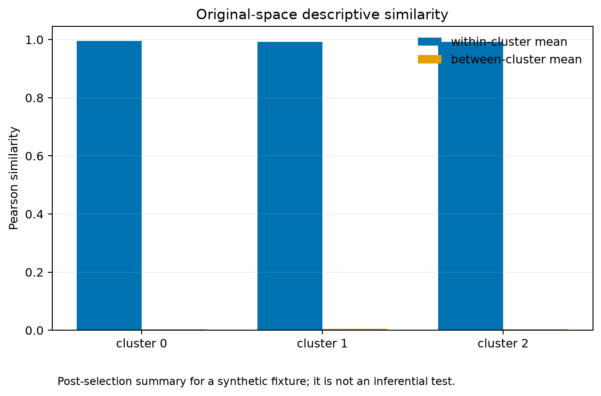
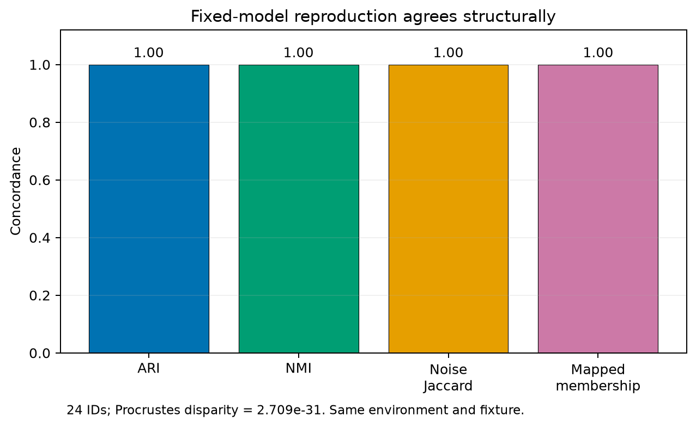

# 34. Explanation, comparison, and validation case study

> **Release status.** DIMPLE-GWAS Freeze 3 RC1 (`3.0.0rc1`) is software-complete under local and fixed-fixture evidence. It is not yet scientifically frozen or cross-platform validated.

## Orientation

This chapter belongs to **Part V — Worked case studies**. It separates observed Freeze 3 behavior from scientific interpretation, historical evidence, and pending release work.

## Learning objectives

After this chapter, you can:

- Execute and interpret all downstream Freeze 3 utilities.
- identify the evidence artifact that supports the behavior or boundary;
- describe one common misuse in language appropriate for a methods report.

Prerequisites: 22-30.

## Explanation and implementation

Tutorial 3 begins with real native outputs rather than rerunning the entire search. `score-existing` normalizes and ranks an existing model table while preserving a scoring manifest. `summarize-models` writes family, Pareto, top-model, and count summaries. `reproduce-model` performs one fixed refit. `explain` produces original-space descriptive artifacts without refitting. `compare` evaluates exact-ID structural and coordinate concordance. `validate` checks the original run contract.

All six executed commands exited zero. The same-environment fixed rerun has 24 exact IDs; ARI, NMI, noise Jaccard, and optimally mapped membership are 1; variation of information is zero; Procrustes disparity is 2.7088204667806472×10^-31. The canonical Tutorial 1 run passes 24/24 validation checks. Original-space within-cluster means are near 0.993–0.996 on the designed fixture.

Each result answers a different question. Scoring is not refitting; reproducing is not explaining; comparison is not schema validation; descriptive similarity is not biological inference.

## Evidence diagram or figure

*Figure 3. Post-selection descriptive within/between original-space similarity. Source and checksum: `evidence/figure_source_manifest.tsv`.*

*Figure 4. Same-environment structural comparison of the fixed reproduction. Source and checksum: `evidence/figure_source_manifest.tsv`.*

## Evidence-backed example

Run the six commands from the exact command JSON in `tutorial_execution_manifest.tsv`, substituting new output roots. Verify the generated file set against Chapter 41.

## Outputs to inspect

Inspect rescoring manifest, summary counts, fixed rerun manifest, explanation manifest/sidecars, all comparison files, all validation files, and command logs.

## Common mistakes

Do not overwrite the original run. Do not compare label integers directly. Do not treat an exit-zero command as sufficient without checking its semantic assertions.

## Scientific and operational limits

The tutorial uses a small, same-platform fixture and does not test legacy incomplete matching, large heatmap safeguards, cross-hardware numerics, or biological replication.

## Completion check

For each of the six commands, write ‘refits: yes/no’ and the scientific question it cannot answer.

<strong>Operational cross-reference:</strong> Chapter 37 covers commands, Chapter 38 configuration, Chapter 41 artifact schemas, Chapter 42 provenance, and Chapter 46 current limitations.

