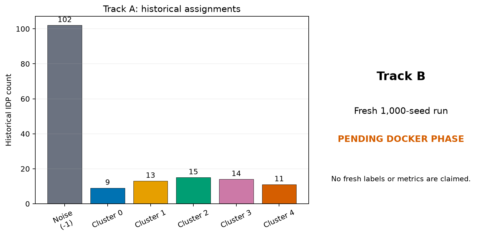

# 36. Original 164-IDP analysis

> **Release status.** DIMPLE-GWAS Freeze 3 RC1 (`3.0.0rc1`) is software-complete under local and fixed-fixture evidence. It is not yet scientifically frozen or cross-platform validated.

## Orientation

This chapter belongs to **Part V — Worked case studies**. It separates observed Freeze 3 behavior from scientific interpretation, historical evidence, and pending release work.

## Learning objectives

After this chapter, you can:

- Separate historical reconstruction from a future fresh 1,000-seed run protocol.
- identify the evidence artifact that supports the behavior or boundary;
- describe one common misuse in language appropriate for a methods report.

Prerequisites: 1-31.

## Explanation and implementation

The original 164-IDP case has two tracks. Track A is historical reconstruction: the authoritative record contains 164 IDPs, 102 HDBSCAN-noise assignments, and five assigned clusters of sizes 9, 13, 15, 14, and 11. The published historical solution used epsilon 0, min-samples 4, and min-cluster-size 6 and was manually selected from sorted row 16—not automatic rank one. One historical `UMAP_3` cell is missing, while labels are complete. Freeze 3 can adapt and rescore the immutable historical artifacts; that is not a new 1,000-seed fit.

Track B is the pending fresh protocol. Use the authoritative input checksum and `configs/original_idp_164_historical_search.yaml`, run `inspect-config` and complete enumeration, preflight storage/threads, then execute standard-scale 1,000 repeated seeds in a new mounted output root inside the later Docker workflow. Preserve source, input, resolved config, command, environment, seeds, thread settings, logs, failures, all candidate rows, retained artifacts, explanation, comparison to historical labels, and validation. Do not tune toward the published labels.

Original material is permitted in the project, but scientific content is provisional because development has advanced; this manual shows aggregate historical counts and protocols rather than claiming a final interpretation.

## Evidence diagram or figure

*Figure 5. Historical 164-IDP counts separated from the pending fresh-run track. Source and checksum: `evidence/figure_source_manifest.tsv`.*

## Evidence-backed example

Figure 5 separates the historical count panel from a prominent ‘fresh run pending’ panel. The protocol config and historical selected config are source artifacts; no fresh outputs are implied.

## Outputs to inspect

Track A: historical workbook/table, row-16 record, exact label vector, adaptation/rescoring manifests and counts. Track B: authoritative input/config hashes, preflight, complete run, comparison/validation, and Docker platform record.

## Common mistakes

Do not say ‘reproduced the 164 analysis’ when only labels were adapted/rescored. Do not choose a new candidate because it most resembles historical labels. Do not fill missing fresh metrics with historical numbers.

## Scientific and operational limits

The original raw 2,315- and 459-IDP inputs remain incomplete/unresolved in this workspace. Fresh 164 execution and cross-platform acceptance are named release gates.

## Completion check

Write two results paragraphs: one strictly historical and one future-tense protocol. Highlight every verb that distinguishes them.

<strong>Operational cross-reference:</strong> Chapter 37 covers commands, Chapter 38 configuration, Chapter 41 artifact schemas, Chapter 42 provenance, and Chapter 46 current limitations.

