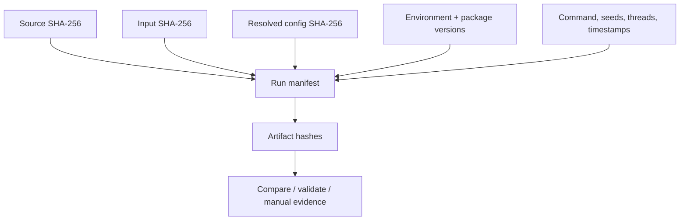

# 42. Provenance and reproducibility checklist

> **Release status.** DIMPLE-GWAS Freeze 3 RC1 (`3.0.0rc1`) is software-complete under local and fixed-fixture evidence. It is not yet scientifically frozen or cross-platform validated.

## Orientation

This chapter belongs to **Part VI — Operational reference**. It separates observed Freeze 3 behavior from scientific interpretation, historical evidence, and pending release work.

## Learning objectives

After this chapter, you can:

- Capture source, input, configuration, environment, seeds, commands, artifacts, and tolerances.
- identify the evidence artifact that supports the behavior or boundary;
- describe one common misuse in language appropriate for a methods report.

Prerequisites: 14, 17, 23.

## Explanation and implementation

A reproducible run is a chain of identities and decisions: source hash/version; input path/size/hash and upstream provenance; source and resolved configuration/hash; exact command; Python/platform/package versions; backends; seeds; threads; timestamps/runtime; candidate counts/statuses; selected model and formula; every artifact hash; warnings/exclusions/failures; and comparison criteria. `run_manifest.json` captures much of this; tutorial execution manifests and checksum tables close the documentation chain.

Exact comparison is appropriate for bytes, schemas, IDs, declared parameters, counts, and sometimes labels. Tolerances or invariant metrics are appropriate for floating-point metrics and aligned embeddings across platforms. Plots should be compared through source tables and structural/render checks, not byte identity alone. Dependency pinning improves traceability but cannot guarantee identical numerics across OS, architecture, hardware, BLAS/OpenMP, threads, or compiler/runtime versions.

With no Git metadata in this snapshot, use the package-source SHA-256 and complete file registers; the Docker stage should establish a versioned source identity.

## Evidence diagram or figure

*Provenance and artifact lineage. Editable source: `assets/diagrams/diagram_09_provenance_lineage.mmd`.*

## Evidence-backed example

The executed Tutorial 2 manifest records package-source and input hashes, configuration hash, exact package versions, seeds 42/43, jobs, backend names, runtime, counts, selected ID, and artifact hashes.

## Outputs to inspect

Inspect runtime environment, resolved dependencies, source/input/artifact checksum registers, run/selection/tutorial manifests, logs, comparison and validation evidence.

## Common mistakes

Do not equate a pinned requirements file with a complete environment. Do not compare floating-point PNG bytes as scientific equality. Do not sanitize the only retained provenance copy.

## Scientific and operational limits

Provenance can contain protected paths and identifiers; maintain a private complete record and a deliberately sanitized publication record with linked hashes.

## Completion check

Using `assets/diagrams/diagram_09_provenance_lineage.mmd`, trace one plotted value back to its source table, configuration, input, source code, and execution log.

<strong>Operational cross-reference:</strong> Chapter 37 covers commands, Chapter 38 configuration, Chapter 41 artifact schemas, Chapter 42 provenance, and Chapter 46 current limitations.

