# DIMPLE-GWAS Freeze 3 RC1

## Academic Textbook and Analyst Reference

### Edition 2

**Internal review draft — prepared to public-facing editorial standard, not for external release**

Upasana Bhattacharyya, PhD  
Jibin John, PhD  
Zhong, Yuanxin, PhD  
Michael Preuss, PhD  
Tian Ge, PhD  
Todd Lencz, PhD  
Max Lam, PhD

Software version: `3.0.0rc1`  
Documentation date: 26 August 2026

> DIMPLE-GWAS Freeze 3 RC1 is a software-complete release candidate under current local and fixed-fixture evidence. It is not yet a scientifically frozen or cross-platform validated release.

The author order and degree convention follow the current manuscript. Affiliations, contribution statements, licensing, publisher metadata, DOI/ISBN, Docker validation, and final team adjudication remain pending for a public edition.

<div class="title-page-break"></div>


# Contents

- [Editorial and evidence status](#editorial-status)
- [Preface and reader paths](#preface)
- [How to use this internal review edition](#how-to-use)
- [Part I: Evidence, phenotype-vector geometry, and validation boundaries](#part-i)
  - [1. The scientific problem, scope, and evidence boundary](#chapter-1)
  - [2. GWAS-derived phenotype vectors and high-dimensional geometry](#chapter-2)
  - [3. Similarity, distance, scaling, transformation, and uncertainty](#chapter-3)
  - [4. Dimension reduction: linear and nonlinear perspectives](#chapter-4)
  - [5. Density clustering, validation, and circular inference](#chapter-5)
- [Part II: The implemented representation, clustering, selection, and replay method](#part-ii)
  - [6. Data contract, preprocessing, RINT, and orientation](#chapter-6)
  - [7. UMAP and densMAP: from neighborhood graph to stochastic layout](#chapter-7)
  - [8. Repeated stochastic embeddings and concatenated geometry](#chapter-8)
  - [9. HDBSCAN hierarchy, density, selection, and noise](#chapter-9)
  - [10. Search-space enumeration and computational design](#chapter-10)
  - [11. Candidate diagnostics, legacy_dimple, ranking, ties, and sensitivity](#chapter-11)
  - [12. Selected-model reproduction, provenance, and comparison](#chapter-12)
- [Part III: The analyst workflow from installation to explanation](#part-iii)
  - [13. Installation, environment verification, and first run](#chapter-13)
  - [14. Configuration and search-space inspection](#chapter-14)
  - [15. Complete pipeline execution and monitoring](#chapter-15)
  - [16. Model summaries, selection, reproduction, comparison, and validation](#chapter-16)
  - [17. Original-space explanation, heatmaps, and responsible interpretation](#chapter-17)
- [Part IV: Worked and executable analyses](#part-iv)
  - [18. A hand-calculable toy analysis from matrix to score](#chapter-18)
  - [19. Fixed synthetic end-to-end analysis](#chapter-19)
  - [20. Custom bounded search, sensitivity, and selected-model replay](#chapter-20)
  - [21. Explanation, comparison, validation, and report generation](#chapter-21)
  - [22. MNIST benchmark and original 164-IDP reconstruction protocol](#chapter-22)
- [Part V: Validation, reporting, and responsible release](#part-v)
  - [23. Technical, statistical, biological, and cross-platform validation](#chapter-23)
  - [24. Reproducible reporting, limitations, migration, and reviewer-facing methods](#chapter-24)
- [Appendices](#appendices)
  - [Appendix A — Complete command-line reference](#appendix-a)
  - [Appendix B — Complete configuration reference](#appendix-b)
  - [Appendix C — Function atlas](#appendix-c)
  - [Appendix D — Output atlas and schemas](#appendix-d)
  - [Appendix E — Errors, troubleshooting, and recovery](#appendix-e)
  - [Appendix F — Performance, memory, and threading](#appendix-f)
  - [Appendix G — Migration from Dev and Freeze 2](#appendix-g)
  - [Appendix H — Mathematical notation](#appendix-h)
  - [Appendix I — Glossary](#appendix-i)
  - [Appendix J — Exercise solutions and adjudication guide](#appendix-j)
  - [Appendix K — Verified bibliography](#appendix-k)
  - [Appendix L — Claim and evidence index](#appendix-l)
  - [Appendix M — Sanitized reviewer-method crosswalk](#appendix-m)
  - [Appendix N — Release-status and validation matrix](#appendix-n)
  - [Appendix O — Docker and cloud handoff](#appendix-o)

<div class="title-page-break"></div>


<a id="editorial-status"></a>

# Editorial and evidence status

Edition 2 is a documentation edition, not Freeze 4. It preserves the software identity and rebuilds the educational treatment from the current source, tests, fresh bounded teaching runs, historical evidence, and verified primary literature. The document is internally reviewable as a near-public manuscript, but it must not be represented as a public release while Docker, team adjudication, and cross-platform validation remain open.

Fresh Edition 2 evidence was produced on macOS arm64 with Python 3.12.13. The isolated suite passed 45 tests. Labs 0–3 passed; the fixed fixture passed 24 of 24 artifact checks and reproduced its partition exactly under ARI, NMI, noise-set Jaccard, and mapped membership, with near-zero Procrustes disparity. MNIST remains a protocol-only engineering benchmark. The fresh original 164-IDP 1,000-seed run is deferred until Docker by coordinator decision.

Private reviewer correspondence informed a sanitized method crosswalk only. No confidential text, private contact, protected identifier, or guessed reviewer citation belongs in the publication artifact. The exact Yang- and Zhao-attributed papers remain unresolved because the supplied record does not identify them. The genomic-components paper is correctly attributed to Oblong et al. (2024).

## What the status permits

Readers may use this draft to test pedagogy, inspect the complete software and output contracts, rehearse the bounded labs, review methods wording, and adjudicate scientific caveats. The draft supports no claim that Docker/Linux/cloud work is complete, that historical evidence is a fresh result, or that internal clustering diagnostics establish biological validity.


<a id="preface"></a>

# Preface: four ways through the book

This book serves four readers without asking them to accept the same entry point. A newcomer should read Parts I and II before attempting Lab 1. An analyst familiar with statistical learning can begin with Chapters 6, 10, and 13–17, returning to the method chapters as questions arise. A statistics learner should follow the equations, hand calculations, and exercises through Chapters 3–12 and 18. A methods reviewer may begin with Chapters 1, 11, 12, 23, and 24, then use the function, output, claim, and reviewer crosswalk appendices.

The recurring movement is from question to geometry, from geometry to implementation, from implementation to retained output, and from output to a deliberately bounded statement. Commands are not isolated recipes. Each one sits in a provenance chain. Equations are not decoration. Each one is interpreted and connected to the behavior it helps explain. Figures are descriptive instruments whose captions state what not to infer.

## Conventions

`Freeze 3`, `Freeze 3 RC1`, and version `3.0.0rc1` refer to the software snapshot. `Edition 1` refers to the archived Analyst Manual. `Edition 2` or `TE2` refers to this textbook. “Current” means the checksummed source used for this build, not an unversioned online state. “Executed” means a retained local command record exists. “Historical” means the result was reconstructed from preserved artifacts rather than freshly fitted.

Paths in commands are relative to the Freeze 3 repository root. `<FREEZE3>` in an excerpt is an intentional sanitization token. Every example uses a new output directory because the software correctly refuses to overwrite a nonempty analytical result.


<a id="how-to-use"></a>

# How to use this internal review edition

This assembled source is the authoritative Edition 2 reading copy. The modular chapter, atlas, lab, and QA files remain the audit trail. Every displayed claim should be read at the layer named in its wording: implemented, freshly executed and bounded, historical, literature-supported, or pending. Figure captions state both the visible relationship and the inference that must not be made.

The HTML and PDF are deterministic presentation builds from this source. The source checksum inventory replaces unavailable Git metadata for this freeze. The Docker image, fresh original 164-IDP 1,000-seed execution, team adjudication, and public release metadata remain outside this documentation build.


<div class="part-break"></div>

# Part I

## Evidence, phenotype-vector geometry, and validation boundaries

Chapters 1–5

<div class="part-page-rule"></div>


<div class="chapter-break"></div>

<a id="chapter-1"></a>

# 1. The scientific problem, scope, and evidence boundary

*Guiding question:* **What can Stage 1 learn from a collection of GWAS-derived phenotype vectors, and what remains outside its reach?**

Prerequisites: none.

## Why the question matters

Exploratory structure is scientifically useful only when the unit of analysis and the validation layer remain explicit.

The present evidence establishes local software behavior and bounded fixtures; it does not establish causal pathways, biological truth, or cross-platform equivalence.

This chapter develops the question in the order needed for a reader to move from statistical principle to current implementation, retained evidence, and a defensible statement. Its central worked task is: Classify ten proposed conclusions as implemented behavior, statistical explanation, historical evidence, or unsupported biological inference.


<figure id="fig-f01">

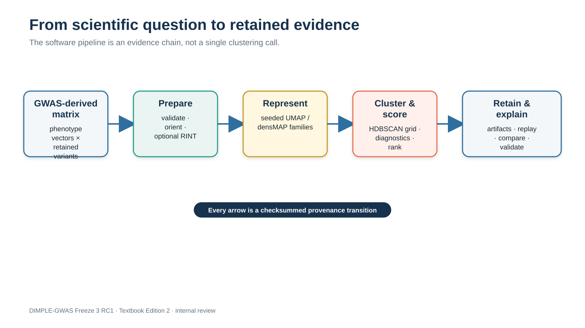{fig-alt="The end-to-end route shares prepared inputs and representations before retaining candidates, selected-model artifacts, explanations, comparisons, and validation records"}

<figcaption><strong>Figure 1.</strong> The end-to-end route shares prepared inputs and representations before retaining candidates, selected-model artifacts, explanations, comparisons, and validation records. <em>Interpretive boundary:</em> The chain establishes implemented behavior; it does not by itself establish biological validity.</figcaption>

</figure>

## Learning objectives

After completing Chapter 1, the reader can:

1. define GWAS-derived vector and explain its role without exceeding the stated caution;
2. define validation ladder and explain its role without exceeding the stated caution;
3. define floating-point reproducibility and explain its role without exceeding the stated caution;
4. trace the relevant package functions and generated artifacts;
5. complete the worked task and distinguish observation from interpretation.

## Conceptual and mathematical development

### GWAS-derived vector

Effect estimates or association statistics for one phenotype across matched variants. A compact notation is `X in R^(p x v)`. In practical terms, a vector is a statistical summary, not a person or causal mechanism. [[Elliott (2018)](#ref-elliott2018); [Bulik-Sullivan (2015)](#ref-buliksullivan2015)]

Within Freeze 3 RC1 the concept is connected to `prepare_analysis_matrix` and is visible through `input matrix`. This connection is narrower than the general statistical idea: software evidence establishes the implemented route, while the mapped primary or internal evidence supplies background authority. The distinction prevents a mathematical definition from being mistaken for proof that a particular scientific interpretation is correct.

### validation ladder

Separate software, technical, structural, statistical, biological, external, and cross-platform evidence. A compact notation is `E_software != E_biological`. In practical terms, passing tests or exact fixture replay cannot substitute for external biological validation.

Within Freeze 3 RC1 the concept is connected to `run_validation` and is visible through `validation_report.json`. This connection is narrower than the general statistical idea: software evidence establishes the implemented route, while the mapped primary or internal evidence supplies background authority. The distinction prevents a mathematical definition from being mistaken for proof that a particular scientific interpretation is correct.

### floating-point reproducibility

Dependence of finite-precision results on operation order and platform. A compact notation is `fl((a+b)+c) may differ from fl(a+(b+c))`. In practical terms, pinned dependencies improve control but do not guarantee universal bitwise equality. [[Collange et al. (2015)](#ref-reproduciblesum2015)]

Within Freeze 3 RC1 the concept is connected to `capture_environment` and is visible through `environment.json`. This connection is narrower than the general statistical idea: software evidence establishes the implemented route, while the mapped primary or internal evidence supplies background authority. The distinction prevents a mathematical definition from being mistaken for proof that a particular scientific interpretation is correct.

## Reconstructed operational foundation

Edition 1 contained the following verified operational material in separate short notes. Edition 2 consolidates it here and subjects it to the concept and evidence boundaries above.

### Evidence retained from former Chapter 1

### Operational foundation

DIMPLE-GWAS Stage 1 groups phenotype-associated vectors according to structure in their genetic association profiles. It accepts a variant-by-vector matrix, creates a nonlinear representation, fits density-based partitions, ranks declared candidates, and preserves selected labels and provenance. It does not run a GWAS, identify causal variants, perform enrichment, fine mapping, PRS, QTL analysis, Genomic SEM, genomic PCA/ICA, MTAG, PLEIO, or MOSTest. Those may be upstream, downstream, or comparator methods, but they are not hidden Freeze 3 features.

The unit clustered is a vector/IDP, not a person and not a variant. A cluster is an algorithmic grouping conditional on input construction, preprocessing, metric, embedding parameters, seeds, HDBSCAN settings, candidate population, and selection rule. Treat it as a testable descriptive structure rather than a biological truth label.

### Retained evidence

Read `pyproject.toml`, run `dimple-gwas --version`, and inspect `evidence/software_truth_report.md`. All identify package `3.0.0rc1`; the evidence report also names pending scientific and cross-platform gates.

### Output-reading checkpoint

Start with `run_manifest.json`, `models/model_selection_manifest.json`, retained `labels.tsv`, and the claim/evidence register. Together they answer what was run, what was selected, and how strongly it may be interpreted.

### Misinterpretations to avoid

Do not describe the software as a multivariate association test or an automatic biological-discovery engine. Do not collapse Stage 1 clustering and later scientific validation into one claim.

### Boundary inherited from Edition 1

The current build proves local software behavior and bounded fixture reproduction. It does not prove that any real-data cluster is stable, causal, clinically useful, or externally replicated.

### Evidence retained from former Chapter 2

### Operational foundation

Suppose each phenotype or imaging-derived phenotype (IDP) is represented by association values across a common set of variants. Two vectors can be near one another when their association profiles are similar under the chosen preprocessing and metric. DIMPLE-GWAS asks whether the collection contains density structure that can be summarized as clusters plus unassigned observations.

This framing is deliberately matrix-level. It does not require predefined phenotype groups, but it does require comparable columns: aligned variant rows, consistent alleles and scales upstream, stable identifiers, and an explicit metadata prefix. Shared structure may reflect biology, linkage disequilibrium, sample overlap, technical effects, phenotype construction, or combinations of these. The clustering result begins a scientific investigation; it does not identify which explanation is correct.

### Retained evidence

The synthetic fixture has 80 variant rows, four metadata columns, and 24 trait vectors arranged into three known generator groups. It is useful because shape and expected engineering structure are known, not because it imitates every property of GWAS data.

### Output-reading checkpoint

Inspect the input header and dimensions before any embedding. Later, inspect `labels.tsv` alongside the exact `feature_id` values rather than assuming spreadsheet column order remained unchanged.

### Misinterpretations to avoid

A high original-space correlation is not necessarily a shared mechanism; a visually close 2D point pair is not necessarily close in the full concatenated representation; a cluster is not a set of variants.

### Boundary inherited from Edition 1

Input provenance and upstream QC remain the analyst's responsibility. Freeze 3 verifies numeric shape and identifiers but cannot reconstruct omitted allele harmonization, population structure, covariate design, or study overlap.

### Evidence retained from former Chapter 3

### Operational foundation

Release language is an evidence statement. ‘Software-complete RC1’ means the intended commands and local contracts are present and the bounded test evidence passes. ‘Scientifically frozen’ would additionally require the agreed full scientific reconstruction and resolution of material scientific issues. ‘Cross-platform validated’ would require evidenced execution and comparison on the target Docker/Linux/cloud platforms.

Freeze 3 therefore has four evidence classes: fresh local evidence; historical-only evidence; protocol-only pending work; and out-of-scope methods. The 45-test result and synthetic tutorials are fresh local evidence. Historical 164-IDP counts and the manual row-16 selection are historical. The fresh 1,000-seed 164-IDP run and Docker/GCP/AWS work are pending. Stage 2 and other association tools are outside the executable core.

### Retained evidence

Use Appendix G as a validation matrix. Notice that a pass at the software layer does not change the pending status of biological or cross-platform validation.

### Output-reading checkpoint

The environment snapshot, missing-evidence register, test report, tutorial manifests, and Docker handoff are the release-status evidence set.

### Misinterpretations to avoid

Avoid ‘fully reproducible,’ ‘platform independent,’ ‘Freeze 3 final,’ or ‘validated’ without naming the validation layer and platform. Do not use historical adaptation as shorthand for a fresh rerun.

### Boundary inherited from Edition 1

This status can change only when new artifacts directly meet a named gate. Editorial confidence or dependency pinning cannot substitute for execution evidence.

### Evidence retained from former Chapter 46

### Operational foundation

Current open release issues are visible, not buried. There is no usable Git commit/tag identity; checksums substitute. The full fresh 164-IDP 1,000-seed run is deferred until Docker. Original 2,315-IDP and 459-IDP raw inputs/parameters are incomplete or unresolved. Docker/Linux/GCP/AWS execution and security validation are absent. Exact Yang/Zhao reviewer citations are unresolved in the supplied correspondence. Optional coordinate associations were not executed in the tutorials. Only macOS arm64 has fresh test/tutorial evidence.

Scientific limitations are equally important: nonlinear embeddings and density clusters are parameter dependent; repeated concatenation has no stated topology-recovery theorem; internal metrics are not biological validation; legacy scoring is candidate-population relative; selection can create circular inference; UMAP axes are not loadings; original-space correlations are conditional descriptors; noise is algorithmic; numerical determinism is platform dependent; and original-IDP interpretations may change with ongoing development.

Operational limitations include optional Parquet dependencies/failure handling, large similarity matrices, thread oversubscription, first-run JIT overhead, strict absent/empty output roots for safety, and manifests that can expose paths or identifiers. Use `evidence/03_missing_evidence_register.tsv`, `evidence/tutorial_issue_register.tsv`, and the Docker handoff as living registers.

### Retained evidence

The manual labels itself an RC1 first draft with named limitations rather than hiding Gate I/J dependencies. Appendix G shows which layers pass, are bounded, are historical, or are pending.

### Output-reading checkpoint

Inspect missing-evidence, authority/conflict, claim/correction, citation-gap, tutorial-issue, QA, build-report, and Docker-handoff records before release language changes.

### Misinterpretations to avoid

Do not close an issue by changing prose alone. Do not infer missing reviewer references. Do not present original IDP material as final when development may change it.

### Boundary inherited from Edition 1

Some gates need new authority/data/compute rather than documentation. They remain named blockers with exact completion protocols.

## Implementation trace

**`cli.build_parser`** is defined at `dimple_gwas/cli.py:146` with signature `class construction/data container`. Construct the complete user-facing command and flag grammar, including the interpret alias. It is reached from cli.main and connects to cli._add_config_source; cli._add_run_options. Its direct artifact contract is No direct canonical artifact; in-memory/supporting result; its explicit error surface is No explicit raise in this symbol; delegated calls may raise.. Test evidence is recorded as tests/test_freeze3_comparison_validation.py::test_cli_exposes_new_commands_and_alias. This is a A-tier contract, so the complete 20-field dossier is retained in the function atlas.

**`cli._inspect`** is defined at `dimple_gwas/cli.py:240` with signature `args: argparse.Namespace`. Implementation callable for inspect. It is reached from cli.main and connects to cli._resolved; search_space.count_candidates. Its direct artifact contract is No direct canonical artifact; in-memory/supporting result; its explicit error surface is No explicit raise in this symbol; delegated calls may raise.. Test evidence is recorded as No direct symbol-name test reference; assess through caller/integration coverage. This is a A-tier contract, so the complete 20-field dossier is retained in the function atlas.

**`cli._show`** is defined at `dimple_gwas/cli.py:254` with signature `args: argparse.Namespace`. Implementation callable for show. It is reached from cli.main and connects to cli._resolved; io.json_safe; reporting.write_search_space; search_space.count_candidates; search_space.enumerate_candidates; search_space.flatten_candidate. Its direct artifact contract is No direct canonical artifact; in-memory/supporting result; its explicit error surface is No explicit raise in this symbol; delegated calls may raise.. Test evidence is recorded as No direct symbol-name test reference; assess through caller/integration coverage. This is a A-tier contract, so the complete 20-field dossier is retained in the function atlas.

**`cli._score`** is defined at `dimple_gwas/cli.py:265` with signature `args: argparse.Namespace`. Implementation callable for score. It is reached from cli.main and connects to config.resolve_config; io.atomic_json_dump; io.json_safe; io.read_model_table; ranking.rank_models; scoring.apply_scoring; scoring.normalize_model_table_schema. Its direct artifact contract is rescored_table.tsv; rescored_table.tsv.manifest.json; its explicit error surface is No explicit raise in this symbol; delegated calls may raise.. Test evidence is recorded as No direct symbol-name test reference; assess through caller/integration coverage. This is a A-tier contract, so the complete 20-field dossier is retained in the function atlas.

**`cli._summarize`** is defined at `dimple_gwas/cli.py:284` with signature `args: argparse.Namespace`. Implementation callable for summarize. It is reached from cli.main and connects to io.atomic_json_dump; io.read_model_table; ranking.family_summaries; ranking.pareto_front; ranking.rank_models; ranking.top_models. Its direct artifact contract is family_summaries.tsv; pareto_front.tsv; top_models.tsv; summary.json; its explicit error surface is No explicit raise in this symbol; delegated calls may raise.. Test evidence is recorded as No direct symbol-name test reference; assess through caller/integration coverage. This is a A-tier contract, so the complete 20-field dossier is retained in the function atlas.

**`cli._reproduce`** is defined at `dimple_gwas/cli.py:301` with signature `args: argparse.Namespace`. Implementation callable for reproduce. It is reached from cli.main and connects to config.resolve_config; config.validate_config; pipeline.run_search. Its direct artifact contract is No direct canonical artifact; in-memory/supporting result; its explicit error surface is ValueError. Test evidence is recorded as No direct symbol-name test reference; assess through caller/integration coverage. This is a A-tier contract, so the complete 20-field dossier is retained in the function atlas.

**`cli._explain`** is defined at `dimple_gwas/cli.py:323` with signature `args: argparse.Namespace`. Implementation callable for explain. It is reached from cli.main and connects to config.resolve_config; config.validate_config; interpretation.run_explanation. Its direct artifact contract is No direct canonical artifact; in-memory/supporting result; its explicit error surface is ValueError. Test evidence is recorded as No direct symbol-name test reference; assess through caller/integration coverage. This is a A-tier contract, so the complete 20-field dossier is retained in the function atlas.

**`cli._compare`** is defined at `dimple_gwas/cli.py:376` with signature `args: argparse.Namespace`. Implementation callable for compare. It is reached from cli.main and connects to comparison.run_comparison. Its direct artifact contract is No direct canonical artifact; in-memory/supporting result; its explicit error surface is No explicit raise in this symbol; delegated calls may raise.. Test evidence is recorded as No direct symbol-name test reference; assess through caller/integration coverage. This is a A-tier contract, so the complete 20-field dossier is retained in the function atlas.

**`cli._validate`** is defined at `dimple_gwas/cli.py:391` with signature `args: argparse.Namespace`. Implementation callable for validate. It is reached from cli.main and connects to validation.run_validation. Its direct artifact contract is No direct canonical artifact; in-memory/supporting result; its explicit error surface is No explicit raise in this symbol; delegated calls may raise.. Test evidence is recorded as No direct symbol-name test reference; assess through caller/integration coverage. This is a A-tier contract, so the complete 20-field dossier is retained in the function atlas.

**`cli.main`** is defined at `dimple_gwas/cli.py:403` with signature `argv: list[str] | None=None`. Dispatch the command-line interface and return a process exit status. It is reached from CLI/import/direct caller or no package caller detected and connects to cli._compare; cli._explain; cli._inspect; cli._reproduce; cli._resolved; cli._score; cli._show; cli._summarize; cli._validate; cli.build_parser; pipeline.run_search. Its direct artifact contract is No direct canonical artifact; in-memory/supporting result; its explicit error surface is No explicit raise in this symbol; delegated calls may raise.. Test evidence is recorded as tests/test_freeze3_comparison_validation.py::test_cli_compare_end_to_end. This is a A-tier contract, so the complete 20-field dossier is retained in the function atlas.

**`pipeline.setup_logger`** is defined at `dimple_gwas/pipeline.py:25` with signature `output_dir: str | Path`. Implementation callable for setup logger. It is reached from pipeline.run_search and connects to No package-defined dependency detected. Its direct artifact contract is logs/run.log; its explicit error surface is No explicit raise in this symbol; delegated calls may raise.. Test evidence is recorded as No direct symbol-name test reference; assess through caller/integration coverage. This is a B-tier contract, so the complete 20-field dossier is retained in the function atlas.

**`pipeline.run_search`** is defined at `dimple_gwas/pipeline.py:130` with signature `config: Mapping[str, Any], output_dir: str | Path, command: list[str] | None=None`. Execute preprocessing, repeated embeddings, candidate evaluation, scoring, retention, reporting, and provenance for one run. It is reached from cli._reproduce; cli.main and connects to hdbscan_runner.fit_hdbscan; io.read_table; metrics.embedding_quality_metrics; pipeline._annotation_frame; pipeline._evaluate_one; pipeline._failed_row; pipeline.setup_logger; preprocessing.prepare_analysis_matrix; provenance.base_manifest; provenance.file_record; ranking.family_summaries; ranking.pareto_front; ranking.rank_models; ranking.top_models; reporting.write_model_outputs; reporting.write_resolved_config; reporting.write_search_space; scoring.apply_scoring; search_space.enumerate_candidates; search_space.stable_identifier; umap_runner.run_repeated_umap. Its direct artifact contract is No direct canonical artifact; in-memory/supporting result; its explicit error surface is RuntimeError; ValueError. Test evidence is recorded as tests/test_pipeline_integration.py::test_custom_leaf_eom_metric_and_max_size_run; tests/test_pipeline_integration.py::test_fixed_model_reproduction. This is a A-tier contract, so the complete 20-field dossier is retained in the function atlas.

## Claim adjudication notebook

The following statements are admitted to the draft only in their safe form:

- **REL-001 (verified_with_qualification):** Freeze 3 RC1 is a software-complete release candidate under current local and fixed-fixture evidence; it is not scientifically frozen or cross-platform validated. Limitation: Fresh 164-IDP and Docker/cloud gates remain pending. Implementation evidence: `pyproject.toml; source; tests`.

- **CMP-003 (verified_with_qualification):** These multivariate association tools and DIMPLE-GWAS have different inputs, objectives, and outputs; compare questions rather than a single rank. [[Turley (2018)](#ref-turley2018); [van der Meer (2020)](#ref-vandermeer2020); [Lee (2021)](#ref-lee2021)] Limitation: Workflows can be complementary. Implementation evidence: `scope docs`.

- **VAL-001 (verified_with_qualification):** The local suite's passing tests support bounded software contracts, not biological validity. Limitation: One environment cannot establish cross-platform behavior. Implementation evidence: `tests`.

## Worked reasoning and evidence exercise

Classify ten proposed conclusions as implemented behavior, statistical explanation, historical evidence, or unsupported biological inference.

A complete Chapter 1 answer must expose its intermediate reasoning, name the source or output used for `The scientific problem, scope, and evidence boundary`, and finish with separate support and non-support statements. Applying that discipline to the question “What can Stage 1 learn from a collection of GWAS-derived phenotype vectors, and what remains outside its reach?” prevents a calculation, a software observation, and a scientific interpretation from collapsing into one claim.

## Assumptions, diagnostics, and recovery

The Chapter 1 analysis assumes the stated unit and inputs, the recorded configuration and software identity, and a diagnostic that addresses the claimed property rather than a convenient surrogate. Its decisive boundary is: The present evidence establishes local software behavior and bounded fixtures; it does not establish causal pathways, biological truth, or cross-platform equivalence.

If the Chapter 1 route fails, retain its log and candidate status before deciding whether the cause is input, configuration, dependency, compute, identifier alignment, or output-root state. Correct an operational failure by writing a new result directory. Treat instability in `The scientific problem, scope, and evidence boundary` as sensitivity evidence: report it and identify the independent evidence needed instead of relabeling ambiguity as a software exception.

## Chapter synthesis

Exploratory structure is scientifically useful only when the unit of analysis and the validation layer remain explicit. The implementation trace makes the current behavior auditable, but the evidence boundary remains part of the result. Chapter 2 turns the unit-of-analysis boundary into matrix notation and geometry.

## Exercises

1. For `The scientific problem, scope, and evidence boundary`, name the unit of analysis and one plausible but invalid substitute.
2. Reconstruct the notation for GWAS-derived vector; define its dimensions or denominator and interpret every term.
3. Choose a Tier A function mapped to Chapter 1; identify its caller and direct output, then propose a topic-specific edge case.
4. Select one Chapter 1 artifact from the output atlas and state three integrity checks that must precede scientific reading.
5. Convert a tempting `The scientific problem, scope, and evidence boundary` overclaim into one observed statement followed by its limitation.
6. Classify ten proposed conclusions as implemented behavior, statistical explanation, historical evidence, or unsupported biological inference.

Appendix J gives the Chapter 1 adjudication guide. Its further-reading keys supply statistical context; no external paper is treated as automatic validation of the current software or dataset.


<div class="chapter-break"></div>

<a id="chapter-2"></a>

# 2. GWAS-derived phenotype vectors and high-dimensional geometry

*Guiding question:* **How does a table of association summaries become a geometry among phenotypes?**

Prerequisites: 1.

## Why the question matters

A vector can carry shared biological signal and shared technical or sampling structure at the same time.

DIMPLE-GWAS receives upstream summaries; it does not estimate LD, correct sample overlap, or rerun the contributing GWAS.

This chapter develops the question in the order needed for a reader to move from statistical principle to current implementation, retained evidence, and a defensible statement. Its central worked task is: Use three five-variant vectors to calculate two distances, then identify how a shared scale factor and one outlying variant alter the ordering.

## Learning objectives

After completing Chapter 2, the reader can:

1. define GWAS-derived vector and explain its role without exceeding the stated caution;
2. define identifier alignment and explain its role without exceeding the stated caution;
3. define distance and similarity and explain its role without exceeding the stated caution;
4. define high-dimensional concentration and explain its role without exceeding the stated caution;
5. trace the relevant package functions and generated artifacts;
6. complete the worked task and distinguish observation from interpretation.

## Conceptual and mathematical development

### GWAS-derived vector

Effect estimates or association statistics for one phenotype across matched variants. A compact notation is `X in R^(p x v)`. In practical terms, a vector is a statistical summary, not a person or causal mechanism. [[Elliott (2018)](#ref-elliott2018); [Bulik-Sullivan (2015)](#ref-buliksullivan2015)]

Within Freeze 3 RC1 the concept is connected to `prepare_analysis_matrix` and is visible through `input matrix`. This connection is narrower than the general statistical idea: software evidence establishes the implemented route, while the mapped primary or internal evidence supplies background authority. The distinction prevents a mathematical definition from being mistaken for proof that a particular scientific interpretation is correct.

### identifier alignment

A one-to-one correspondence between vector or feature identifiers across artifacts. A compact notation is `I_A = I_B`. In practical terms, order is not identity; normalize and validate keys before joining.

Within Freeze 3 RC1 the concept is connected to `validated_identifiers; align_rows` and is visible through `labels.tsv; coordinates.tsv`. This connection is narrower than the general statistical idea: software evidence establishes the implemented route, while the mapped primary or internal evidence supplies background authority. The distinction prevents a mathematical definition from being mistaken for proof that a particular scientific interpretation is correct.

### distance and similarity

Geometry chosen to compare vectors or embedded points. A compact notation is `d_2(x,y)=sqrt(sum_j (x_j-y_j)^2)`. In practical terms, the metric defines which differences count as close. [[Aggarwal et al. (2001)](#ref-aggarwal2001)]

Within Freeze 3 RC1 the concept is connected to `evaluate_candidate; compute_similarity` and is visible through `model_table.csv; similarity_matrix.csv`. This connection is narrower than the general statistical idea: software evidence establishes the implemented route, while the mapped primary or internal evidence supplies background authority. The distinction prevents a mathematical definition from being mistaken for proof that a particular scientific interpretation is correct.

### high-dimensional concentration

Relative contrast among common distances can weaken as dimension grows. A compact notation is `contrast=(d_max-d_min)/d_min`. In practical terms, the phenomenon depends on distribution and norm; it is not a universal collapse theorem. [[Aggarwal et al. (2001)](#ref-aggarwal2001)]

Within Freeze 3 RC1 the concept is connected to `run_repeated_umap` and is visible through `embedding.npy`. This connection is narrower than the general statistical idea: software evidence establishes the implemented route, while the mapped primary or internal evidence supplies background authority. The distinction prevents a mathematical definition from being mistaken for proof that a particular scientific interpretation is correct.

## Reconstructed operational foundation

Edition 1 contained the following verified operational material in separate short notes. Edition 2 consolidates it here and subjects it to the concept and evidence boundaries above.

### Evidence retained from former Chapter 2

### Operational foundation

Suppose each phenotype or imaging-derived phenotype (IDP) is represented by association values across a common set of variants. Two vectors can be near one another when their association profiles are similar under the chosen preprocessing and metric. DIMPLE-GWAS asks whether the collection contains density structure that can be summarized as clusters plus unassigned observations.

This framing is deliberately matrix-level. It does not require predefined phenotype groups, but it does require comparable columns: aligned variant rows, consistent alleles and scales upstream, stable identifiers, and an explicit metadata prefix. Shared structure may reflect biology, linkage disequilibrium, sample overlap, technical effects, phenotype construction, or combinations of these. The clustering result begins a scientific investigation; it does not identify which explanation is correct.

### Retained evidence

The synthetic fixture has 80 variant rows, four metadata columns, and 24 trait vectors arranged into three known generator groups. It is useful because shape and expected engineering structure are known, not because it imitates every property of GWAS data.

### Output-reading checkpoint

Inspect the input header and dimensions before any embedding. Later, inspect `labels.tsv` alongside the exact `feature_id` values rather than assuming spreadsheet column order remained unchanged.

### Misinterpretations to avoid

A high original-space correlation is not necessarily a shared mechanism; a visually close 2D point pair is not necessarily close in the full concatenated representation; a cluster is not a set of variants.

### Boundary inherited from Edition 1

Input provenance and upstream QC remain the analyst's responsibility. Freeze 3 verifies numeric shape and identifiers but cannot reconstruct omitted allele harmonization, population structure, covariate design, or study overlap.

### Evidence retained from former Chapter 4

### Operational foundation

The Stage 1 workflow is a producer–consumer chain. Freeze 3 reads the table, removes the declared leading metadata columns, optionally applies RINT to analysis columns, and transposes to vectors by input variables. For each UMAP parameter family it generates repeated seeded UMAP/densMAP embeddings and concatenates them horizontally. It then evaluates the complete declared HDBSCAN Cartesian product, retains success, invalid-topology, and failure rows, calculates diagnostics, applies the declared score, ranks eligible candidates, and refits retained models to preserve labels.

Downstream commands do different work. `reproduce-model` refits one retained parameterization. `explain` does not refit; it matches exact IDs and returns to original input-vector space. `compare` measures structural and optional coordinate concordance. `validate` checks files, schemas, counts, readability, and recorded hashes. No PCA, SVD, or ICA reducer is silently inserted before UMAP.

## Evidence diagram or figure


*Stage 1 producer–consumer workflow. Editable source: `assets/diagrams/diagram_01_stage1_workflow.mmd`.*

### Retained evidence

Follow `assets/diagrams/diagram_01_stage1_workflow.mmd` from input to downstream utilities. Each arrow corresponds to an implementation module named in `evidence/source_to_manual_traceability.tsv`.

### Output-reading checkpoint

At the run root, inspect `resolved_config.yaml`, the search-space manifests, `models/`, `run_manifest.json`, and `logs/run.log`. Appendix D maps every named output to its producer and consumer.

### Misinterpretations to avoid

Do not treat `stage09_*` display coordinates as the full concatenated embedding. Do not expect cleaned inputs or individual repeated embeddings on disk; current Freeze 3 keeps them in memory.

### Boundary inherited from Edition 1

A workflow diagram explains control and data flow, not scientific validity. Every transformation can change geometry, and the selected model remains conditional on the declared search and score.

### Evidence retained from former Chapter 5

### Operational foundation

A GWAS summary statistic is a result indexed by a genetic variant and phenotype. A vector is the ordered set of analysis values for one phenotype across the aligned variant rows. A distance metric maps two vectors—or two embedded observations—to a nonnegative dissimilarity. A partition assigns observations to groups; HDBSCAN may also leave observations unassigned with label `-1`.

Internal clustering metrics summarize geometric properties of the same representation used to fit or assess the partition. Silhouette contrasts an observation's mean within-cluster distance with its nearest other-cluster mean distance. DBCV evaluates density connectedness and separation. Neither asks whether a cluster is biologically meaningful. Projection metrics such as trustworthiness and continuity assess neighborhood preservation, not labels or mechanism.

Pleiotropy is a biological/statistical concept about genetic effects across traits. A density cluster among phenotype vectors can generate hypotheses about shared structure, but cluster membership is not itself proof of pleiotropy or its cause.

### Retained evidence

For three points, compute within- and between-cluster distances under two metrics. The exercise shows why a metric choice is part of the scientific definition of neighborhood rather than a cosmetic option.

### Output-reading checkpoint

Candidate tables contain topology counts, cluster-size summaries, silhouette, DBCV, Calinski–Harabasz, Davies–Bouldin, HDBSCAN persistence, projection metrics, status, warnings, and errors. Check each metric's scope and metric columns.

### Misinterpretations to avoid

Do not compare metric values calculated under undocumented metrics or representations. Do not treat a large score as an external p-value. Do not call every input column a ‘feature’ when the clustered observation is the vector/IDP.

### Boundary inherited from Edition 1

Distance concentration, correlations among variants, scaling, missingness, and finite sample size can alter geometry. Internal metrics can reward a representation-specific structure that fails to reproduce externally.


## Evidence and references

See Rousseeuw (1987), DOI 10.1016/0377-0427(87)90125-7, and Moulavi et al. (2014), DOI 10.1137/1.9781611973440.96.

## Implementation trace

**`io.resolve_separator`** is defined at `dimple_gwas/io.py:10` with signature `path: str | Path, override: str | None=None`. Implementation callable for resolve separator. It is reached from io.read_model_table; io.read_table and connects to No package-defined dependency detected. Its direct artifact contract is No direct canonical artifact; in-memory/supporting result; its explicit error surface is No explicit raise in this symbol; delegated calls may raise.. Test evidence is recorded as No direct symbol-name test reference; assess through caller/integration coverage. This is a B-tier contract, so the complete 20-field dossier is retained in the function atlas.

**`io.read_table`** is defined at `dimple_gwas/io.py:16` with signature `path: str | Path, sep: str | None=None, *, sheet: str | int=0, nrows: int | None=None`. Implementation callable for read table. It is reached from comparison._resolve_labels; interpretation.run_explanation; pipeline._annotation_frame; pipeline.run_search; validation.run_validation and connects to io.resolve_separator. Its direct artifact contract is No direct canonical artifact; in-memory/supporting result; its explicit error surface is FileNotFoundError; RuntimeError. Test evidence is recorded as tests/test_freeze3_interpretation.py::test_reader_supports_excel_sheet. This is a A-tier contract, so the complete 20-field dossier is retained in the function atlas.

**`io.read_model_table`** is defined at `dimple_gwas/io.py:45` with signature `path: str | Path`. Implementation callable for read model table. It is reached from cli._score; cli._summarize; validation.run_validation and connects to io.resolve_separator. Its direct artifact contract is No direct canonical artifact; in-memory/supporting result; its explicit error surface is No explicit raise in this symbol; delegated calls may raise.. Test evidence is recorded as No direct symbol-name test reference; assess through caller/integration coverage. This is a B-tier contract, so the complete 20-field dossier is retained in the function atlas.

**`io.ensure_empty_output_dir`** is defined at `dimple_gwas/io.py:54` with signature `path: str | Path`. Create an output directory, refusing to mix with existing artifacts. It is reached from comparison.run_comparison; interpretation.run_explanation; validation.run_validation and connects to No package-defined dependency detected. Its direct artifact contract is No direct canonical artifact; in-memory/supporting result; its explicit error surface is ValueError. Test evidence is recorded as tests/test_freeze3_interpretation.py::test_empty_output_directory_helper. This is a B-tier contract, so the complete 20-field dossier is retained in the function atlas.

**`io.normalize_identifier`** is defined at `dimple_gwas/io.py:68` with signature `value: Any`. Return the exact string identity after removing surrounding whitespace. It is reached from io.validated_identifiers; preprocessing._unique_feature_names; preprocessing.infer_explanation_orientation and connects to No package-defined dependency detected. Its direct artifact contract is No direct canonical artifact; in-memory/supporting result; its explicit error surface is No explicit raise in this symbol; delegated calls may raise.. Test evidence is recorded as No direct symbol-name test reference; assess through caller/integration coverage. This is a B-tier contract, so the complete 20-field dossier is retained in the function atlas.

**`io.validated_identifiers`** is defined at `dimple_gwas/io.py:81` with signature `values, *, context: str`. Normalize identifiers and reject missing or duplicate identities. It is reached from comparison.run_comparison; interpretation._align_inputs; interpretation.run_explanation; preprocessing.infer_explanation_orientation; preprocessing.prepare_explanation_matrix and connects to io.normalize_identifier. Its direct artifact contract is No direct canonical artifact; in-memory/supporting result; its explicit error surface is ValueError. Test evidence is recorded as tests/test_freeze3_interpretation.py::test_validated_identifiers_strip_but_reject_duplicates. This is a A-tier contract, so the complete 20-field dossier is retained in the function atlas.

**`io.atomic_json_dump`** is defined at `dimple_gwas/io.py:99` with signature `value: Any, path: str | Path`. Implementation callable for atomic json dump. It is reached from cli._score; cli._summarize; comparison.run_comparison; interpretation.run_explanation; reporting._top_artifact; reporting.write_model_outputs; reporting.write_search_space; validation.run_validation and connects to No package-defined dependency detected. Its direct artifact contract is No direct canonical artifact; in-memory/supporting result; its explicit error surface is No explicit raise in this symbol; delegated calls may raise.. Test evidence is recorded as No direct symbol-name test reference; assess through caller/integration coverage. This is a B-tier contract, so the complete 20-field dossier is retained in the function atlas.

**`io.json_safe`** is defined at `dimple_gwas/io.py:109` with signature `value: Any`. Implementation callable for json safe. It is reached from cli._score; cli._show; comparison.run_comparison; interpretation.run_explanation; reporting._top_artifact; reporting.write_model_outputs; reporting.write_search_space; validation.run_validation and connects to No package-defined dependency detected. Its direct artifact contract is No direct canonical artifact; in-memory/supporting result; its explicit error surface is No explicit raise in this symbol; delegated calls may raise.. Test evidence is recorded as No direct symbol-name test reference; assess through caller/integration coverage. This is a B-tier contract, so the complete 20-field dossier is retained in the function atlas.

**`preprocessing.ExplanationMatrix`** is defined at `dimple_gwas/preprocessing.py:12` with signature `class construction/data container`. Implementation callable for ExplanationMatrix. It is reached from preprocessing.prepare_explanation_matrix and connects to No package-defined dependency detected. Its direct artifact contract is No direct canonical artifact; in-memory/supporting result; its explicit error surface is No explicit raise in this symbol; delegated calls may raise.. Test evidence is recorded as No direct symbol-name test reference; assess through caller/integration coverage. This is a B-tier contract, so the complete 20-field dossier is retained in the function atlas.

**`preprocessing.rank_inverse_normal_transform`** is defined at `dimple_gwas/preprocessing.py:19` with signature `frame`. Apply the implementation's rank-based inverse-normal transform to numeric analysis columns. It is reached from preprocessing.prepare_analysis_matrix; preprocessing.prepare_explanation_matrix and connects to No package-defined dependency detected. Its direct artifact contract is No direct canonical artifact; in-memory/supporting result; its explicit error surface is ValueError. Test evidence is recorded as tests/test_preprocessing_metrics.py::test_rint_and_numeric_matrix. This is a A-tier contract, so the complete 20-field dossier is retained in the function atlas.

**`preprocessing.prepare_analysis_matrix`** is defined at `dimple_gwas/preprocessing.py:34` with signature `frame, config: Mapping[str, Any]`. Validate the input contract, remove metadata, transform if requested, transpose, and return vector-by-variant analysis data. It is reached from pipeline.run_search and connects to preprocessing.rank_inverse_normal_transform. Its direct artifact contract is No direct canonical artifact; in-memory/supporting result; its explicit error surface is ValueError. Test evidence is recorded as tests/test_preprocessing_metrics.py::test_rint_and_numeric_matrix. This is a A-tier contract, so the complete 20-field dossier is retained in the function atlas.

**`preprocessing.infer_explanation_orientation`** is defined at `dimple_gwas/preprocessing.py:67` with signature `frame, expected_vector_ids, *, drop_first_n_cols: int`. Infer orientation only when one exact ID source is uniquely supported. It is reached from interpretation.run_explanation and connects to io.normalize_identifier; io.validated_identifiers. Its direct artifact contract is No direct canonical artifact; in-memory/supporting result; its explicit error surface is ValueError. Test evidence is recorded as tests/test_freeze3_interpretation.py::test_orientation_inference_uses_exact_overlap. This is a B-tier contract, so the complete 20-field dossier is retained in the function atlas.

## Claim adjudication notebook

The following statements are admitted to the draft only in their safe form:

- **DATA-001 (implementation_specific):** Production input has variants in rows, four declared metadata columns by default, and vector/IDP columns; preprocessing drops the prefix and transposes to vectors by variants. Limitation: Explanation mode also permits an explicit vectors-by-variants orientation. Implementation evidence: `preprocessing.py; io.py`.

- **GWAS-001 (verified_with_qualification):** Vector geometry can reflect shared biology, LD structure, sample overlap, scale, confounding, and preprocessing; DIMPLE-GWAS does not separate these causes. [[Bulik-Sullivan (2015)](#ref-buliksullivan2015)] Limitation: Interpretation requires upstream harmonization and independent evidence. Implementation evidence: `scope and input only`.

## Worked reasoning and evidence exercise

Use three five-variant vectors to calculate two distances, then identify how a shared scale factor and one outlying variant alter the ordering.

A complete Chapter 2 answer must expose its intermediate reasoning, name the source or output used for `GWAS-derived phenotype vectors and high-dimensional geometry`, and finish with separate support and non-support statements. Applying that discipline to the question “How does a table of association summaries become a geometry among phenotypes?” prevents a calculation, a software observation, and a scientific interpretation from collapsing into one claim.

## Assumptions, diagnostics, and recovery

The Chapter 2 analysis assumes the stated unit and inputs, the recorded configuration and software identity, and a diagnostic that addresses the claimed property rather than a convenient surrogate. Its decisive boundary is: DIMPLE-GWAS receives upstream summaries; it does not estimate LD, correct sample overlap, or rerun the contributing GWAS.

If the Chapter 2 route fails, retain its log and candidate status before deciding whether the cause is input, configuration, dependency, compute, identifier alignment, or output-root state. Correct an operational failure by writing a new result directory. Treat instability in `GWAS-derived phenotype vectors and high-dimensional geometry` as sensitivity evidence: report it and identify the independent evidence needed instead of relabeling ambiguity as a software exception.

## Chapter synthesis

A vector can carry shared biological signal and shared technical or sampling structure at the same time. The implementation trace makes the current behavior auditable, but the evidence boundary remains part of the result. Chapter 3 makes the metric, scaling, and transformation choices explicit.

## Exercises

1. For `GWAS-derived phenotype vectors and high-dimensional geometry`, name the unit of analysis and one plausible but invalid substitute.
2. Reconstruct the notation for GWAS-derived vector; define its dimensions or denominator and interpret every term.
3. Choose a Tier A function mapped to Chapter 2; identify its caller and direct output, then propose a topic-specific edge case.
4. Select one Chapter 2 artifact from the output atlas and state three integrity checks that must precede scientific reading.
5. Convert a tempting `GWAS-derived phenotype vectors and high-dimensional geometry` overclaim into one observed statement followed by its limitation.
6. Use three five-variant vectors to calculate two distances, then identify how a shared scale factor and one outlying variant alter the ordering.

Appendix J gives the Chapter 2 adjudication guide. Its further-reading keys supply statistical context; no external paper is treated as automatic validation of the current software or dataset.


<div class="chapter-break"></div>

<a id="chapter-3"></a>

# 3. Similarity, distance, scaling, transformation, and uncertainty

*Guiding question:* **Which transformations and metrics make two phenotype vectors look close?**

Prerequisites: 2.

## Why the question matters

Geometry is chosen, not discovered in a parameter-free form; transformation can stabilize a marginal distribution while changing neighbors.

RINT and similarity are implemented precisely, but neither removes LD, measurement error, sample overlap, or post-selection dependence.

This chapter develops the question in the order needed for a reader to move from statistical principle to current implementation, retained evidence, and a defensible statement. Its central worked task is: Rank a tied six-value column by hand, apply (rank−0.5)/n, and compare Euclidean and correlation-based conclusions.


<figure id="fig-f19">

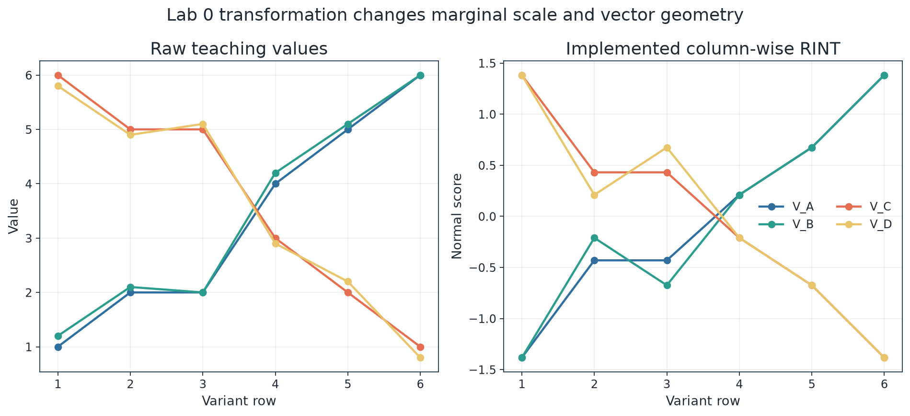{fig-alt="The hand-worked fixture shows the same four vectors before and after the implemented average-rank inverse-normal transformation; ties share scores and ordering remains column-specific"}

<figcaption><strong>Figure 2.</strong> The hand-worked fixture shows the same four vectors before and after the implemented average-rank inverse-normal transformation; ties share scores and ordering remains column-specific. <em>Interpretive boundary:</em> RINT changes geometry but does not remove dependence, uncertainty, confounding, or selection.</figcaption>

</figure>


<figure id="fig-f20">

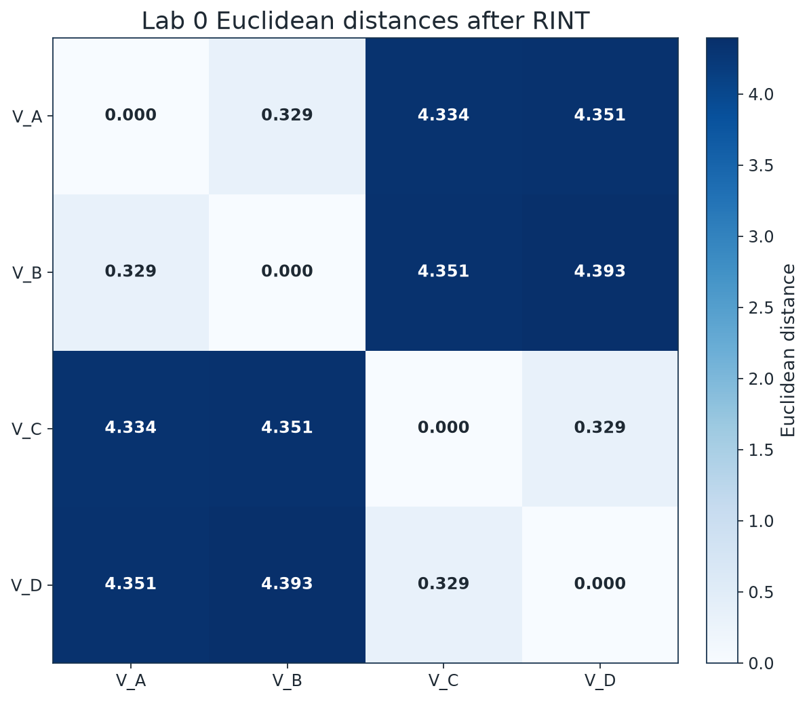{fig-alt="The post-RINT distance matrix makes the nearest-pair relation explicit: V_A and V_B are separated by 0.329, whereas V_A and V_C are separated by 4.334"}

<figcaption><strong>Figure 3.</strong> The post-RINT distance matrix makes the nearest-pair relation explicit: V_A and V_B are separated by 0.329, whereas V_A and V_C are separated by 4.334. <em>Interpretive boundary:</em> Distances are conditional on orientation, transformation, metric, and the six designed variant rows.</figcaption>

</figure>

## Learning objectives

After completing Chapter 3, the reader can:

1. define distance and similarity and explain its role without exceeding the stated caution;
2. define scaling and transformation and explain its role without exceeding the stated caution;
3. define RINT ties and missingness and explain its role without exceeding the stated caution;
4. define Pearson association and explain its role without exceeding the stated caution;
5. define Spearman association and explain its role without exceeding the stated caution;
6. trace the relevant package functions and generated artifacts;
7. complete the worked task and distinguish observation from interpretation.

## Conceptual and mathematical development

### distance and similarity

Geometry chosen to compare vectors or embedded points. A compact notation is `d_2(x,y)=sqrt(sum_j (x_j-y_j)^2)`. In practical terms, the metric defines which differences count as close. [[Aggarwal et al. (2001)](#ref-aggarwal2001)]

Within Freeze 3 RC1 the concept is connected to `evaluate_candidate; compute_similarity` and is visible through `model_table.csv; similarity_matrix.csv`. This connection is narrower than the general statistical idea: software evidence establishes the implemented route, while the mapped primary or internal evidence supplies background authority. The distinction prevents a mathematical definition from being mistaken for proof that a particular scientific interpretation is correct.

### scaling and transformation

Changes to marginal scale before geometric analysis. A compact notation is `z=(x-mu)/sigma; z_i=Phi^-1((r_i-0.5)/n)`. In practical terms, transformation changes geometry; it does not create independent evidence. [[Beasley et al. (2009)](#ref-beasley2009)]

Within Freeze 3 RC1 the concept is connected to `rank_inverse_normal_transform; prepare_analysis_matrix` and is visible through `resolved_config.yaml`. This connection is narrower than the general statistical idea: software evidence establishes the implemented route, while the mapped primary or internal evidence supplies background authority. The distinction prevents a mathematical definition from being mistaken for proof that a particular scientific interpretation is correct.

### RINT ties and missingness

Average ranks with missing values retained during ranking. A compact notation is `r_i=average tied rank`. In practical terms, freeze 3 rejects missing analysis cells before the pipeline and applies RINT column-wise before transpose. [[Beasley et al. (2009)](#ref-beasley2009)]

Within Freeze 3 RC1 the concept is connected to `rank_inverse_normal_transform` and is visible through `prepared matrix`. This connection is narrower than the general statistical idea: software evidence establishes the implemented route, while the mapped primary or internal evidence supplies background authority. The distinction prevents a mathematical definition from being mistaken for proof that a particular scientific interpretation is correct.

### Pearson association

Linear association in original input dimensions. A compact notation is `r=sum(x-xbar)(y-ybar)/sqrt(sum(x-xbar)^2 sum(y-ybar)^2)`. In practical terms, post-selection descriptive only; undefined constant vectors follow configured policy. [[Kriegeskorte et al. (2009)](#ref-kriegeskorte2009)]

Within Freeze 3 RC1 the concept is connected to `compute_similarity` and is visible through `similarity_matrix.csv`. This connection is narrower than the general statistical idea: software evidence establishes the implemented route, while the mapped primary or internal evidence supplies background authority. The distinction prevents a mathematical definition from being mistaken for proof that a particular scientific interpretation is correct.

### Spearman association

Pearson correlation of marginal ranks. A compact notation is `rho=cor(rank(x),rank(y))`. In practical terms, ties receive average ranks; monotonic association is not mechanism.

Within Freeze 3 RC1 the concept is connected to `compute_similarity` and is visible through `similarity_matrix.csv`. This connection is narrower than the general statistical idea: software evidence establishes the implemented route, while the mapped primary or internal evidence supplies background authority. The distinction prevents a mathematical definition from being mistaken for proof that a particular scientific interpretation is correct.

## Reconstructed operational foundation

Edition 1 contained the following verified operational material in separate short notes. Edition 2 consolidates it here and subjects it to the concept and evidence boundaries above.

### Evidence retained from former Chapter 5

### Operational foundation

A GWAS summary statistic is a result indexed by a genetic variant and phenotype. A vector is the ordered set of analysis values for one phenotype across the aligned variant rows. A distance metric maps two vectors—or two embedded observations—to a nonnegative dissimilarity. A partition assigns observations to groups; HDBSCAN may also leave observations unassigned with label `-1`.

Internal clustering metrics summarize geometric properties of the same representation used to fit or assess the partition. Silhouette contrasts an observation's mean within-cluster distance with its nearest other-cluster mean distance. DBCV evaluates density connectedness and separation. Neither asks whether a cluster is biologically meaningful. Projection metrics such as trustworthiness and continuity assess neighborhood preservation, not labels or mechanism.

Pleiotropy is a biological/statistical concept about genetic effects across traits. A density cluster among phenotype vectors can generate hypotheses about shared structure, but cluster membership is not itself proof of pleiotropy or its cause.

### Retained evidence

For three points, compute within- and between-cluster distances under two metrics. The exercise shows why a metric choice is part of the scientific definition of neighborhood rather than a cosmetic option.

### Output-reading checkpoint

Candidate tables contain topology counts, cluster-size summaries, silhouette, DBCV, Calinski–Harabasz, Davies–Bouldin, HDBSCAN persistence, projection metrics, status, warnings, and errors. Check each metric's scope and metric columns.

### Misinterpretations to avoid

Do not compare metric values calculated under undocumented metrics or representations. Do not treat a large score as an external p-value. Do not call every input column a ‘feature’ when the clustered observation is the vector/IDP.

### Boundary inherited from Edition 1

Distance concentration, correlations among variants, scaling, missingness, and finite sample size can alter geometry. Internal metrics can reward a representation-specific structure that fails to reproduce externally.


## Evidence and references

See Rousseeuw (1987), DOI 10.1016/0377-0427(87)90125-7, and Moulavi et al. (2014), DOI 10.1137/1.9781611973440.96.

### Evidence retained from former Chapter 15

### Operational foundation

Preprocessing defines the geometry presented to UMAP. Freeze 3 removes `input.drop_first_n_cols` leading columns, validates that analysis columns are numeric, optionally applies rank inverse normal transformation to each analysis column before transpose, and then transposes to vectors by input variables. With `zscore_transform=none`, values are not RINT-transformed. The historical option name is retained although the implemented alternative is `rint`.

For a column with ranks, RINT maps rank-based probabilities through the standard-normal quantile function. It can reduce marginal scale differences and the influence of extreme values, but it also changes the scientific quantity and does not repair upstream harmonization or dependence. The configuration default is `none`; enable RINT only with a documented rationale that matches the intended historical or prospective protocol.

### Retained evidence

The preprocessing tests cover RINT and numeric-matrix behavior. Both executed synthetic tutorials use `none`, so their values remain on the fixture's generated scale.

### Output-reading checkpoint

Inspect the input config, resolved transform, input-contract manifest, prepared-shape log line, identifier set, and any preprocessing warnings. Record upstream transformations separately.

### Misinterpretations to avoid

Do not describe RINT as row-wise without naming the table orientation: implementation applies it to analysis columns before transpose. Do not call it z-scoring or assume it creates independence.

### Boundary inherited from Edition 1

RINT can alter ties, correlations, distances, and downstream partitions. The manual makes no universal recommendation between transformed and untransformed analyses.

### Evidence retained from former Chapter 26

### Operational foundation

Pearson correlation summarizes linear association after centering/scaling; Spearman correlates ranks and summarizes monotone association. Freeze 3 uses the configured method to build a vector-by-vector similarity table in original input-variable space. It then summarizes within-block and between-block pairs after applying the declared order/noise policy.

Undefined correlation can arise from constant or insufficiently variable vectors. The safe default is `error`; the opt-in `zero` policy replaces undefined values and records the choice. This replacement is a computational convention, not evidence of no association. Coordinate associations, when enabled, are ranked descriptive correlations between original dimensions and supplied coordinates.

Neither correlation supplies a causal effect, an unbiased post-selection p-value, or independent replication.

### Retained evidence

Edition 2 Lab 3's three synthetic clusters have within-cluster Pearson means approximately 0.9963, 0.9930, and 0.9928; between-cluster means are about 0.0033–0.0047. The fresh Lab 3 treatment in Chapters 17 and 21 labels these as post-selection descriptive summaries.

### Output-reading checkpoint

Inspect similarity method, pair counts, means/medians, between summaries, exclusions, undefined-correlation policy, and optional association method/top-N settings.

### Misinterpretations to avoid

Do not attach naive p-values to the same selected pairs. Do not interpret zero replacement as observed zero correlation. Do not compare Pearson and Spearman without explaining the different question.

### Boundary inherited from Edition 1

Shared sample, LD, preprocessing, technical structure, and selection can drive correlations. Independent evidence is required for biological interpretation.

## Implementation trace

**`interpretation.is_noise_label`** is defined at `dimple_gwas/interpretation.py:30` with signature `value: Any`. Implementation callable for is noise label. It is reached from comparison.run_comparison; interpretation.calculate_cluster_summary; interpretation.label_sort_key; interpretation.run_explanation and connects to No package-defined dependency detected. Its direct artifact contract is No direct canonical artifact; in-memory/supporting result; its explicit error surface is No explicit raise in this symbol; delegated calls may raise.. Test evidence is recorded as No direct symbol-name test reference; assess through caller/integration coverage. This is a B-tier contract, so the complete 20-field dossier is retained in the function atlas.

**`interpretation.label_sort_key`** is defined at `dimple_gwas/interpretation.py:35` with signature `value: Any`. Implementation callable for label sort key. It is reached from comparison.run_comparison; interpretation.compute_order and connects to interpretation.is_noise_label. Its direct artifact contract is No direct canonical artifact; in-memory/supporting result; its explicit error surface is No explicit raise in this symbol; delegated calls may raise.. Test evidence is recorded as No direct symbol-name test reference; assess through caller/integration coverage. This is a B-tier contract, so the complete 20-field dossier is retained in the function atlas.

**`interpretation.detect_coordinate_columns`** is defined at `dimple_gwas/interpretation.py:44` with signature `frame, requested: Sequence[str] | str | None=None`. Implementation callable for detect coordinate columns. It is reached from comparison.run_comparison; interpretation.run_explanation and connects to No package-defined dependency detected. Its direct artifact contract is No direct canonical artifact; in-memory/supporting result; its explicit error surface is ValueError. Test evidence is recorded as tests/test_freeze3_interpretation.py::test_coordinate_detection_is_numeric_suffix_order. This is a B-tier contract, so the complete 20-field dossier is retained in the function atlas.

**`interpretation.compute_similarity`** is defined at `dimple_gwas/interpretation.py:145` with signature `analysis, *, method: str, undefined_policy: str`. Implementation callable for compute similarity. It is reached from interpretation.run_explanation and connects to No package-defined dependency detected. Its direct artifact contract is No direct canonical artifact; in-memory/supporting result; its explicit error surface is ValueError. Test evidence is recorded as tests/test_freeze3_interpretation.py::test_similarity_undefined_fails_by_default. This is a A-tier contract, so the complete 20-field dossier is retained in the function atlas.

**`interpretation.compute_order`** is defined at `dimple_gwas/interpretation.py:184` with signature `correlation, labels: Sequence[Any], *, method: str, noise_policy: str`. Implementation callable for compute order. It is reached from interpretation.run_explanation and connects to interpretation._hierarchical_order; interpretation.label_sort_key. Its direct artifact contract is No direct canonical artifact; in-memory/supporting result; its explicit error surface is No explicit raise in this symbol; delegated calls may raise.. Test evidence is recorded as tests/test_freeze3_interpretation.py::test_cluster_order_is_numeric_and_noise_last. This is a A-tier contract, so the complete 20-field dossier is retained in the function atlas.

**`interpretation.calculate_cutpoints`** is defined at `dimple_gwas/interpretation.py:209` with signature `labels: Sequence[Any]`. Implementation callable for calculate cutpoints. It is reached from interpretation.run_explanation and connects to No package-defined dependency detected. Its direct artifact contract is No direct canonical artifact; in-memory/supporting result; its explicit error surface is No explicit raise in this symbol; delegated calls may raise.. Test evidence is recorded as tests/test_freeze3_interpretation.py::test_cutpoint_indices_are_auditable. This is a B-tier contract, so the complete 20-field dossier is retained in the function atlas.

**`interpretation.calculate_cluster_summary`** is defined at `dimple_gwas/interpretation.py:233` with signature `correlation, labels: Sequence[Any]`. Implementation callable for calculate cluster summary. It is reached from interpretation.run_explanation and connects to interpretation.is_noise_label. Its direct artifact contract is No direct canonical artifact; in-memory/supporting result; its explicit error surface is No explicit raise in this symbol; delegated calls may raise.. Test evidence is recorded as No direct symbol-name test reference; assess through caller/integration coverage. This is a B-tier contract, so the complete 20-field dossier is retained in the function atlas.

**`interpretation.coordinate_association_table`** is defined at `dimple_gwas/interpretation.py:262` with signature `analysis, coordinates, *, methods: Sequence[str], top_n: int`. Implementation callable for coordinate association table. It is reached from interpretation.run_explanation and connects to No package-defined dependency detected. Its direct artifact contract is No direct canonical artifact; in-memory/supporting result; its explicit error surface is No explicit raise in this symbol; delegated calls may raise.. Test evidence is recorded as No direct symbol-name test reference; assess through caller/integration coverage. This is a A-tier contract, so the complete 20-field dossier is retained in the function atlas.

**`interpretation.run_explanation`** is defined at `dimple_gwas/interpretation.py:307` with signature `*, output_dir: str | Path, interpretation_config: Mapping[str, Any], model_json: str | Path | None=None, legacy_table: str | Path | None=None, input_path: str | Path | None=None, input_sep: str | None=None, input_sheet: str | int=0, legacy_sheet: str | int=0, matrix_orientation: str='auto', vector_id_source: str='auto', drop_first_n_cols: int | None=None, zscore_transform: str | None=None, id_column: str | None=None, label_column: str | None=None, coordinate_columns: Sequence[str] | str | None=None, command: list[str] | None=None`. Return to original input space, align IDs, calculate similarities/summaries, order a heatmap, and record a non-refitting explanation manifest. It is reached from cli._explain and connects to interpretation._align_inputs; interpretation._native_sources; interpretation._resolve_column; interpretation._write_readme; interpretation.calculate_cluster_summary; interpretation.calculate_cutpoints; interpretation.compute_order; interpretation.compute_similarity; interpretation.coordinate_association_table; interpretation.detect_coordinate_columns; interpretation.is_noise_label; io.atomic_json_dump; io.ensure_empty_output_dir; io.json_safe; io.read_table; io.validated_identifiers; metrics.embedding_quality_metrics; preprocessing.infer_explanation_orientation; preprocessing.prepare_explanation_matrix; provenance.base_manifest; provenance.file_record; provenance.utc_now; visualization.render_heatmap. Its direct artifact contract is original_space_similarity.tsv.gz; heatmap_order.tsv; cluster_cutpoints.tsv; cluster_summary.tsv; projection_quality.tsv; coordinate_associations.tsv; exclusions.tsv; original_space_heatmap.png; original_space_heatmap.html; interpretation_manifest.json; README.md; its explicit error surface is ValueError. Test evidence is recorded as tests/test_freeze3_interpretation.py::test_legacy_incomplete_matching_writes_exclusions; tests/test_freeze3_interpretation.py::test_native_explanation_end_to_end; tests/test_freeze3_interpretation.py::test_native_explanation_refuses_nonempty_output. This is a A-tier contract, so the complete 20-field dossier is retained in the function atlas.

**`metrics.effective_neighbor_count`** is defined at `dimple_gwas/metrics.py:9` with signature `n_samples: int, requested: int`. Implementation callable for effective neighbor count. It is reached from metrics.embedding_quality_metrics and connects to No package-defined dependency detected. Its direct artifact contract is No direct canonical artifact; in-memory/supporting result; its explicit error surface is No explicit raise in this symbol; delegated calls may raise.. Test evidence is recorded as tests/test_preprocessing_metrics.py::test_effective_neighbor_edge_cases. This is a B-tier contract, so the complete 20-field dossier is retained in the function atlas.

**`metrics.embedding_quality_metrics`** is defined at `dimple_gwas/metrics.py:15` with signature `original, embedding, requested_k: int, max_samples: int, seed: int`. Calculate bounded trustworthiness and continuity diagnostics for an embedding. It is reached from interpretation.run_explanation; pipeline.run_search and connects to metrics.effective_neighbor_count. Its direct artifact contract is No direct canonical artifact; in-memory/supporting result; its explicit error surface is No explicit raise in this symbol; delegated calls may raise.. Test evidence is recorded as tests/test_preprocessing_metrics.py::test_optimized_trustworthiness_and_continuity. This is a A-tier contract, so the complete 20-field dossier is retained in the function atlas.

**`metrics.evaluate_candidate`** is defined at `dimple_gwas/metrics.py:60` with signature `embedding, labels, clusterer, silhouette_metric: str, fit_include_noise: bool, compute_dbcv: bool, max_samples_silhouette: int=0, silhouette_seed: int=42`. Compute cluster counts, persistence, silhouette, CH, DB, optional DBCV, and validity status for one candidate. It is reached from pipeline._evaluate_one and connects to metrics._cluster_sizes. Its direct artifact contract is No direct canonical artifact; in-memory/supporting result; its explicit error surface is No explicit raise in this symbol; delegated calls may raise.. Test evidence is recorded as No direct symbol-name test reference; assess through caller/integration coverage. This is a A-tier contract, so the complete 20-field dossier is retained in the function atlas.

## Claim adjudication notebook

The following statements are admitted to the draft only in their safe form:

- **DATA-002 (implementation_specific):** RINT is optional, off by default, and applied column-wise to analysis columns before transpose using average ranks and (rank-0.5)/n. [[Beasley et al. (2009)](#ref-beasley2009)] Limitation: The post-transpose viewpoint reverses row/column language; always state the orientation. Implementation evidence: `preprocessing.rank_inverse_normal_transform`.

- **METH-001 (verified_with_qualification):** Freeze 3 maps observed marginal ranks to normal scores; that deterministic sample transformation does not validate downstream parametric assumptions or causal interpretation. [[Beasley et al. (2009)](#ref-beasley2009)] Limitation: Dependence, ties, and selection remain. Implementation evidence: `preprocessing.py`.

- **GWAS-001 (verified_with_qualification):** Vector geometry can reflect shared biology, LD structure, sample overlap, scale, confounding, and preprocessing; DIMPLE-GWAS does not separate these causes. [[Bulik-Sullivan (2015)](#ref-buliksullivan2015)] Limitation: Interpretation requires upstream harmonization and independent evidence. Implementation evidence: `scope and input only`.

## Worked reasoning and evidence exercise

Rank a tied six-value column by hand, apply (rank−0.5)/n, and compare Euclidean and correlation-based conclusions.

A complete Chapter 3 answer must expose its intermediate reasoning, name the source or output used for `Similarity, distance, scaling, transformation, and uncertainty`, and finish with separate support and non-support statements. Applying that discipline to the question “Which transformations and metrics make two phenotype vectors look close?” prevents a calculation, a software observation, and a scientific interpretation from collapsing into one claim.

## Assumptions, diagnostics, and recovery

The Chapter 3 analysis assumes the stated unit and inputs, the recorded configuration and software identity, and a diagnostic that addresses the claimed property rather than a convenient surrogate. Its decisive boundary is: RINT and similarity are implemented precisely, but neither removes LD, measurement error, sample overlap, or post-selection dependence.

If the Chapter 3 route fails, retain its log and candidate status before deciding whether the cause is input, configuration, dependency, compute, identifier alignment, or output-root state. Correct an operational failure by writing a new result directory. Treat instability in `Similarity, distance, scaling, transformation, and uncertainty` as sensitivity evidence: report it and identify the independent evidence needed instead of relabeling ambiguity as a software exception.

## Chapter synthesis

Geometry is chosen, not discovered in a parameter-free form; transformation can stabilize a marginal distribution while changing neighbors. The implementation trace makes the current behavior auditable, but the evidence boundary remains part of the result. Chapter 4 asks why and how a nonlinear representation is introduced.

## Exercises

1. For `Similarity, distance, scaling, transformation, and uncertainty`, name the unit of analysis and one plausible but invalid substitute.
2. Reconstruct the notation for distance and similarity; define its dimensions or denominator and interpret every term.
3. Choose a Tier A function mapped to Chapter 3; identify its caller and direct output, then propose a topic-specific edge case.
4. Select one Chapter 3 artifact from the output atlas and state three integrity checks that must precede scientific reading.
5. Convert a tempting `Similarity, distance, scaling, transformation, and uncertainty` overclaim into one observed statement followed by its limitation.
6. Rank a tied six-value column by hand, apply (rank−0.5)/n, and compare Euclidean and correlation-based conclusions.

Appendix J gives the Chapter 3 adjudication guide. Its further-reading keys supply statistical context; no external paper is treated as automatic validation of the current software or dataset.


<div class="chapter-break"></div>

<a id="chapter-4"></a>

# 4. Dimension reduction: linear and nonlinear perspectives

*Guiding question:* **What is gained and lost when a high-dimensional relationship is represented with fewer coordinates?**

Prerequisites: 2–3.

## Why the question matters

A low-dimensional display can clarify neighborhoods while obscuring global scale, uncertainty, and coordinate identity.

Freeze 3 has no user-visible PCA, SVD, or ICA pre-reducer; comparator methods answer different questions and are not implemented stages.

This chapter develops the question in the order needed for a reader to move from statistical principle to current implementation, retained evidence, and a defensible statement. Its central worked task is: Project a centered three-variable toy matrix onto one stated linear direction, then contrast that operation with neighborhood preservation.

## Learning objectives

After completing Chapter 4, the reader can:

1. define high-dimensional concentration and explain its role without exceeding the stated caution;
2. define linear dimension reduction and explain its role without exceeding the stated caution;
3. define nearest-neighbor graph and explain its role without exceeding the stated caution;
4. define UMAP cross-entropy and explain its role without exceeding the stated caution;
5. trace the relevant package functions and generated artifacts;
6. complete the worked task and distinguish observation from interpretation.

## Conceptual and mathematical development

### high-dimensional concentration

Relative contrast among common distances can weaken as dimension grows. A compact notation is `contrast=(d_max-d_min)/d_min`. In practical terms, the phenomenon depends on distribution and norm; it is not a universal collapse theorem. [[Aggarwal et al. (2001)](#ref-aggarwal2001)]

Within Freeze 3 RC1 the concept is connected to `run_repeated_umap` and is visible through `embedding.npy`. This connection is narrower than the general statistical idea: software evidence establishes the implemented route, while the mapped primary or internal evidence supplies background authority. The distinction prevents a mathematical definition from being mistaken for proof that a particular scientific interpretation is correct.

### linear dimension reduction

Projection onto directions satisfying a linear objective. A compact notation is `Z=XW`. In practical terms, pCA/ICA are comparators, not hidden Freeze 3 preprocessing. [[Oblong (2024)](#ref-oblong2024)]

Within Freeze 3 RC1 the concept is connected to `not implemented` and is visible through `none`. This connection is narrower than the general statistical idea: software evidence establishes the implemented route, while the mapped primary or internal evidence supplies background authority. The distinction prevents a mathematical definition from being mistaken for proof that a particular scientific interpretation is correct.

### nearest-neighbor graph

Local graph connecting points under an input-space metric. A compact notation is `N_k(i)`. In practical terms, neighbor identity depends on metric, scale, k, and ties. [[McInnes et al. (2018)](#ref-mcinnes2018umap)]

Within Freeze 3 RC1 the concept is connected to `_fit_one (umap-learn delegate)` and is visible through `embedding_manifest.json`. This connection is narrower than the general statistical idea: software evidence establishes the implemented route, while the mapped primary or internal evidence supplies background authority. The distinction prevents a mathematical definition from being mistaken for proof that a particular scientific interpretation is correct.

### UMAP cross-entropy

Low-dimensional layout objective balancing represented and absent fuzzy edges. A compact notation is `C=sum_ij [w_ij log(w_ij/v_ij)+(1-w_ij)log((1-w_ij)/(1-v_ij))]`. In practical terms, optimization is stochastic and coordinates are non-identifiable up to layout symmetries. [[McInnes et al. (2018)](#ref-mcinnes2018umap)]

Within Freeze 3 RC1 the concept is connected to `_fit_one` and is visible through `visualization_embedding.tsv`. This connection is narrower than the general statistical idea: software evidence establishes the implemented route, while the mapped primary or internal evidence supplies background authority. The distinction prevents a mathematical definition from being mistaken for proof that a particular scientific interpretation is correct.

## Reconstructed operational foundation

Edition 1 contained the following verified operational material in separate short notes. Edition 2 consolidates it here and subjects it to the concept and evidence boundaries above.

### Evidence retained from former Chapter 6

### Operational foundation

UMAP is a nonlinear neighborhood-based embedding method; densMAP augments its objective to encourage correspondence in local density. DIMPLE-GWAS repeats seeded embeddings because one stochastic optimization can be sensitive to initialization. It concatenates the repeated coordinates so HDBSCAN receives information from all executed repeats. Density clustering is attractive because it can represent irregular clusters and explicitly leave low-density observations unassigned.

The rationale is empirical, not a mathematical guarantee. Concatenation does not prove that stochasticity has vanished, that Euclidean distances estimate an exact expectation, that ‘true topology’ has been recovered, or that a formal consensus partition has been computed. Base parameters, number and sequence of seeds, implementation versions, numerical libraries, hardware, threads, and the input matrix all remain part of the result.

### Retained evidence

Edition 2 Lab 1 uses one repeated seed for speed; Edition 2 Lab 2 uses two. The production standard declares 1,000. These are tutorial value, tutorial value, and configuration default—not interchangeable recommendations.

### Output-reading checkpoint

Inspect the resolved UMAP parameters, `random_seeds`, package versions, thread settings, projection-quality fields, and HDBSCAN metric in the manifest/candidate table.

### Misinterpretations to avoid

Do not interpret a clean 2D plot as proof that the concatenated representation is stable. Do not increase repeats without estimating compute and storage consequences. Do not call label `-1` a failed phenotype.

### Boundary inherited from Edition 1

Nonlinear embeddings can distort global distances, and density clustering is parameter dependent. Empirical stability should be assessed across justified perturbations and, for scientific conclusions, external or held-out evidence.


## Evidence and references

See McInnes et al. (2018), DOI 10.21105/joss.00861; Narayan et al. (2021), DOI 10.1038/s41587-020-00801-7; and Campello et al. (2015), DOI 10.1145/2733381.

### Evidence retained from former Chapter 7

### Operational foundation

Methods are comparable only after their questions and outputs are aligned. PCA provides orthogonal linear variance components and loadings; ICA seeks statistically independent linear components; k-means creates exhaustive centroid-based groups; hierarchical clustering supplies a nested grouping; mixture models provide probabilistic components. UMAP is a representation method, while HDBSCAN is the clustering stage. DBCV is a diagnostic, not a clustering algorithm.

Genomic SEM models multivariate genetic covariance, MTAG estimates trait-specific multi-trait associations, PLEIO provides joint pleiotropic-locus tests, and MOSTest is an omnibus multivariate association approach. These methods do not all accept the same inputs or return the same scientific object as DIMPLE-GWAS. They may be alternatives for a different question or complementary stages, but they are not implemented by Freeze 3.

No method is universally ‘completely ineffective.’ PCA/ICA components can be useful and reproducible without becoming automatically causal biological mechanisms.

### Retained evidence

Use `evidence/comparator_matrix.tsv` to select a method for three questions: reduce a matrix linearly, identify omnibus associated loci, and cluster phenotype vectors with an unassigned-noise option.

### Output-reading checkpoint

The comparator matrix records purpose, input, output, assumptions, noise handling, interpretability, strengths, limitations, relationship to DIMPLE-GWAS, and implementation status.

### Misinterpretations to avoid

Do not rank unlike methods with a single ‘best’ score. Do not imply that the manual executed a comparator marked `implemented_in_freeze3=no`. Correctly attribute the genomic PCA/ICA paper to Oblong et al., not to an inferred reviewer author.

### Boundary inherited from Edition 1

Conceptual comparisons do not establish empirical superiority. A fair benchmark would need common data, preregistered objectives, suitable metrics, and evidence for each implementation.


## Evidence and references

See Oblong et al. (2024), DOI 10.1111/gbb.12876; Grotzinger et al. (2019), DOI 10.1038/s41562-019-0566-x; MTAG DOI 10.1038/s41588-017-0009-4; MOSTest DOI 10.1038/s41467-020-17368-1; and PLEIO DOI 10.1016/j.ajhg.2020.11.017.

### Evidence retained from former Chapter 24

### Operational foundation

A loading in a linear component model has a defined relationship to an observed variable and component. A UMAP coordinate instead comes from a nonlinear, stochastic neighborhood-preservation optimization. Axis orientation, sign, rotation, scale, and even apparent global layout can vary without changing the underlying scientific identity of points. Freeze 3's display columns are therefore descriptive coordinates, not effects, loadings, mechanisms, or causal axes.

Concatenated repeated coordinates are the density-clustering representation. Selected `UMAP_1`–`UMAP_3` columns are visualization coordinates and must not be substituted for the full concatenated matrix. Correlating input dimensions with a display coordinate can be a descriptive diagnostic when explicitly enabled, but it does not turn the coordinate into a biological component.

### Retained evidence

The fresh Lab 1 display in Chapter 19 shows three separated synthetic groups. Its axis titles deliberately say ‘display coordinate,’ and its caption states that axes are not biological loadings.

### Output-reading checkpoint

Inspect display-coordinate columns, parameter/seed manifest, projection-quality table, optional coordinate-association table, and interpretation warnings.

### Misinterpretations to avoid

Do not name a coordinate ‘brain-size axis’ or infer direction of effect from its sign. Do not compare unaligned coordinates across runs. Do not equate a 2D picture with the HDBSCAN fit space.

### Boundary inherited from Edition 1

Coordinates can still be useful for visualization and diagnosing local structure, but claims should be invariant to arbitrary orientation and supported in original space or independent evidence.


## Evidence and references

See McInnes et al. (2018), DOI 10.21105/joss.00861.

## Implementation trace

**`metrics.effective_neighbor_count`** is defined at `dimple_gwas/metrics.py:9` with signature `n_samples: int, requested: int`. Implementation callable for effective neighbor count. It is reached from metrics.embedding_quality_metrics and connects to No package-defined dependency detected. Its direct artifact contract is No direct canonical artifact; in-memory/supporting result; its explicit error surface is No explicit raise in this symbol; delegated calls may raise.. Test evidence is recorded as tests/test_preprocessing_metrics.py::test_effective_neighbor_edge_cases. This is a B-tier contract, so the complete 20-field dossier is retained in the function atlas.

**`metrics.embedding_quality_metrics`** is defined at `dimple_gwas/metrics.py:15` with signature `original, embedding, requested_k: int, max_samples: int, seed: int`. Calculate bounded trustworthiness and continuity diagnostics for an embedding. It is reached from interpretation.run_explanation; pipeline.run_search and connects to metrics.effective_neighbor_count. Its direct artifact contract is No direct canonical artifact; in-memory/supporting result; its explicit error surface is No explicit raise in this symbol; delegated calls may raise.. Test evidence is recorded as tests/test_preprocessing_metrics.py::test_optimized_trustworthiness_and_continuity. This is a A-tier contract, so the complete 20-field dossier is retained in the function atlas.

**`metrics.evaluate_candidate`** is defined at `dimple_gwas/metrics.py:60` with signature `embedding, labels, clusterer, silhouette_metric: str, fit_include_noise: bool, compute_dbcv: bool, max_samples_silhouette: int=0, silhouette_seed: int=42`. Compute cluster counts, persistence, silhouette, CH, DB, optional DBCV, and validity status for one candidate. It is reached from pipeline._evaluate_one and connects to metrics._cluster_sizes. Its direct artifact contract is No direct canonical artifact; in-memory/supporting result; its explicit error surface is No explicit raise in this symbol; delegated calls may raise.. Test evidence is recorded as No direct symbol-name test reference; assess through caller/integration coverage. This is a A-tier contract, so the complete 20-field dossier is retained in the function atlas.

**`metrics.is_finite_number`** is defined at `dimple_gwas/metrics.py:165` with signature `value: Any`. Implementation callable for is finite number. It is reached from CLI/import/direct caller or no package caller detected and connects to No package-defined dependency detected. Its direct artifact contract is No direct canonical artifact; in-memory/supporting result; its explicit error surface is No explicit raise in this symbol; delegated calls may raise.. Test evidence is recorded as No direct symbol-name test reference; assess through caller/integration coverage. This is a B-tier contract, so the complete 20-field dossier is retained in the function atlas.

**`umap_runner.ensemble_seeds`** is defined at `dimple_gwas/umap_runner.py:32` with signature `parameters: Mapping[str, Any], repeats: int, legacy_sequence: bool`. Generate the exact repeated-embedding seed sequence under current or legacy scheduling. It is reached from umap_runner.run_repeated_umap and connects to No package-defined dependency detected. Its direct artifact contract is No direct canonical artifact; in-memory/supporting result; its explicit error surface is No explicit raise in this symbol; delegated calls may raise.. Test evidence is recorded as No direct symbol-name test reference; assess through caller/integration coverage. This is a A-tier contract, so the complete 20-field dossier is retained in the function atlas.

**`umap_runner.run_repeated_umap`** is defined at `dimple_gwas/umap_runner.py:39` with signature `matrix, parameters: Mapping[str, Any], repeats: int, n_jobs: int, legacy_sequence: bool`. Fit repeated UMAP/densMAP representations and concatenate their coordinates. It is reached from pipeline.run_search and connects to umap_runner._fit_one; umap_runner.ensemble_seeds. Its direct artifact contract is No direct canonical artifact; in-memory/supporting result; its explicit error surface is ValueError. Test evidence is recorded as No direct symbol-name test reference; assess through caller/integration coverage. This is a A-tier contract, so the complete 20-field dossier is retained in the function atlas.

## Claim adjudication notebook

The following statements are admitted to the draft only in their safe form:

- **PIPE-001 (verified):** The current production path passes the prepared matrix directly to UMAP and has no user-visible PCA/SVD/ICA pre-reducer. [[Oblong (2024)](#ref-oblong2024)] Limitation: UMAP internals do not constitute a documented preprocessing reducer. Implementation evidence: `pipeline.py; umap_runner.py`.

- **CMP-001 (reject):** K-means targets centroid-based partitions and may mismatch irregular density structure; it is not universally ineffective. Limitation: Performance depends on representation and objective. Implementation evidence: `not implemented`.

- **CMP-002 (reject):** Genomic PCA/ICA provide linear components; reproducible components do not by themselves establish mechanisms or a gold standard. [[Oblong (2024)](#ref-oblong2024)] Limitation: These tools answer different questions from DIMPLE-GWAS Stage 1. Implementation evidence: `not implemented`.

## Worked reasoning and evidence exercise

Project a centered three-variable toy matrix onto one stated linear direction, then contrast that operation with neighborhood preservation.

A complete Chapter 4 answer must expose its intermediate reasoning, name the source or output used for `Dimension reduction: linear and nonlinear perspectives`, and finish with separate support and non-support statements. Applying that discipline to the question “What is gained and lost when a high-dimensional relationship is represented with fewer coordinates?” prevents a calculation, a software observation, and a scientific interpretation from collapsing into one claim.

## Assumptions, diagnostics, and recovery

The Chapter 4 analysis assumes the stated unit and inputs, the recorded configuration and software identity, and a diagnostic that addresses the claimed property rather than a convenient surrogate. Its decisive boundary is: Freeze 3 has no user-visible PCA, SVD, or ICA pre-reducer; comparator methods answer different questions and are not implemented stages.

If the Chapter 4 route fails, retain its log and candidate status before deciding whether the cause is input, configuration, dependency, compute, identifier alignment, or output-root state. Correct an operational failure by writing a new result directory. Treat instability in `Dimension reduction: linear and nonlinear perspectives` as sensitivity evidence: report it and identify the independent evidence needed instead of relabeling ambiguity as a software exception.

## Chapter synthesis

A low-dimensional display can clarify neighborhoods while obscuring global scale, uncertainty, and coordinate identity. The implementation trace makes the current behavior auditable, but the evidence boundary remains part of the result. Chapter 5 introduces the density and validation problems that arise after representation.

## Exercises

1. For `Dimension reduction: linear and nonlinear perspectives`, name the unit of analysis and one plausible but invalid substitute.
2. Reconstruct the notation for high-dimensional concentration; define its dimensions or denominator and interpret every term.
3. Choose a Tier A function mapped to Chapter 4; identify its caller and direct output, then propose a topic-specific edge case.
4. Select one Chapter 4 artifact from the output atlas and state three integrity checks that must precede scientific reading.
5. Convert a tempting `Dimension reduction: linear and nonlinear perspectives` overclaim into one observed statement followed by its limitation.
6. Project a centered three-variable toy matrix onto one stated linear direction, then contrast that operation with neighborhood preservation.

Appendix J gives the Chapter 4 adjudication guide. Its further-reading keys supply statistical context; no external paper is treated as automatic validation of the current software or dataset.


<div class="chapter-break"></div>

<a id="chapter-5"></a>

# 5. Density clustering, validation, and circular inference

*Guiding question:* **When does a dense region justify a cluster, and what evidence can validate it?**

Prerequisites: 3–4.

## Why the question matters

Internal diagnostics are computed on the same representation used to construct candidates, so they guide selection without becoming independent confirmation.

HDBSCAN labels are algorithmic; post-selection summaries are descriptive unless a valid independent or selective-inference design is supplied.

This chapter develops the question in the order needed for a reader to move from statistical principle to current implementation, retained evidence, and a defensible statement. Its central worked task is: Draw a five-point mutual-reachability graph, identify an unassigned point, and separate internal, structural, and external validation claims.

## Learning objectives

After completing Chapter 5, the reader can:

1. define core distance and explain its role without exceeding the stated caution;
2. define mutual reachability and explain its role without exceeding the stated caution;
3. define HDBSCAN stability and explain its role without exceeding the stated caution;
4. define noise label and explain its role without exceeding the stated caution;
5. define silhouette and explain its role without exceeding the stated caution;
6. trace the relevant package functions and generated artifacts;
7. complete the worked task and distinguish observation from interpretation.

## Conceptual and mathematical development

### core distance

Distance from a point to its min_samples-th neighbor. A compact notation is `core_k(x)`. In practical terms, larger min_samples changes the density scale and may increase unassigned points. [[Campello et al. (2015)](#ref-campello2015hdbscan)]

Within Freeze 3 RC1 the concept is connected to `fit_hdbscan (hdbscan delegate)` and is visible through `candidate labels`. This connection is narrower than the general statistical idea: software evidence establishes the implemented route, while the mapped primary or internal evidence supplies background authority. The distinction prevents a mathematical definition from being mistaken for proof that a particular scientific interpretation is correct.

### mutual reachability

Density-aware dissimilarity used by hdbscan. A compact notation is `d_mr(a,b)=max(core_k(a),core_k(b),d(a,b))`. In practical terms, it smooths single-linkage effects without removing parameter dependence. [[Campello et al. (2015)](#ref-campello2015hdbscan)]

Within Freeze 3 RC1 the concept is connected to `fit_hdbscan` and is visible through `condensed tree state`. This connection is narrower than the general statistical idea: software evidence establishes the implemented route, while the mapped primary or internal evidence supplies background authority. The distinction prevents a mathematical definition from being mistaken for proof that a particular scientific interpretation is correct.

### HDBSCAN stability

Persistence of a cluster through the density hierarchy. A compact notation is `Stability(C)=sum_(x in C)(lambda_x-lambda_birth)`. In practical terms, the library computes the hierarchy; Freeze 3 records persistence summaries. [[Campello et al. (2015)](#ref-campello2015hdbscan); [McInnes et al. (2017)](#ref-mcinnes2017hdbscan)]

Within Freeze 3 RC1 the concept is connected to `fit_hdbscan; evaluate_candidate` and is visible through `model_table.csv`. This connection is narrower than the general statistical idea: software evidence establishes the implemented route, while the mapped primary or internal evidence supplies background authority. The distinction prevents a mathematical definition from being mistaken for proof that a particular scientific interpretation is correct.

### noise label

Label -1 for points unassigned under a fitted density model. A compact notation is `label_i=-1`. In practical terms, noise is algorithmic and parameter-conditional, never a biological-null statement. [[Campello et al. (2015)](#ref-campello2015hdbscan)]

Within Freeze 3 RC1 the concept is connected to `fit_hdbscan` and is visible through `labels.tsv`. This connection is narrower than the general statistical idea: software evidence establishes the implemented route, while the mapped primary or internal evidence supplies background authority. The distinction prevents a mathematical definition from being mistaken for proof that a particular scientific interpretation is correct.

### silhouette

Within-versus-nearest-other-cluster separation under a configured metric. A compact notation is `s(i)=(b(i)-a(i))/max(a(i),b(i))`. In practical terms, freeze 3 can exclude noise and supplies the configured HDBSCAN metric. [[Rousseeuw (1987)](#ref-rousseeuw1987)]

Within Freeze 3 RC1 the concept is connected to `evaluate_candidate` and is visible through `model_table.csv`. This connection is narrower than the general statistical idea: software evidence establishes the implemented route, while the mapped primary or internal evidence supplies background authority. The distinction prevents a mathematical definition from being mistaken for proof that a particular scientific interpretation is correct.

### DBCV

Density-based validity index. A compact notation is `weighted cluster validity in [-1,1]`. In practical terms, it is optional and supplementary under legacy_dimple, not the default score component. [[Moulavi et al. (2014)](#ref-moulavi2014dbcv)]

Within Freeze 3 RC1 the concept is connected to `evaluate_candidate` and is visible through `model_table.csv`. This connection is narrower than the general statistical idea: software evidence establishes the implemented route, while the mapped primary or internal evidence supplies background authority. The distinction prevents a mathematical definition from being mistaken for proof that a particular scientific interpretation is correct.

### circular analysis

Reuse of discovery data for apparently confirmatory inference. A compact notation is `selection(Y) then test(Y) without adjustment`. In practical terms, same-data heatmaps and correlations are descriptive; independent or selective-inference designs are needed for confirmatory claims. [[Kriegeskorte et al. (2009)](#ref-kriegeskorte2009); [Gao et al. (2024)](#ref-gao2024)]

Within Freeze 3 RC1 the concept is connected to `run_explanation` and is visible through `explanation outputs`. This connection is narrower than the general statistical idea: software evidence establishes the implemented route, while the mapped primary or internal evidence supplies background authority. The distinction prevents a mathematical definition from being mistaken for proof that a particular scientific interpretation is correct.

### validation ladder

Separate software, technical, structural, statistical, biological, external, and cross-platform evidence. A compact notation is `E_software != E_biological`. In practical terms, passing tests or exact fixture replay cannot substitute for external biological validation.

Within Freeze 3 RC1 the concept is connected to `run_validation` and is visible through `validation_report.json`. This connection is narrower than the general statistical idea: software evidence establishes the implemented route, while the mapped primary or internal evidence supplies background authority. The distinction prevents a mathematical definition from being mistaken for proof that a particular scientific interpretation is correct.

## Reconstructed operational foundation

Edition 1 contained the following verified operational material in separate short notes. Edition 2 consolidates it here and subjects it to the concept and evidence boundaries above.

### Evidence retained from former Chapter 8

### Operational foundation

When the same data choose a representation, select a partition, and then supply the evidence used to declare that partition meaningful, naive inferential statements can be circular. Internal scores are useful for navigation within a declared candidate population, but they do not become independent hypothesis tests. Original-space correlations computed after selecting labels are descriptive conditional summaries.

A validation ladder keeps claims calibrated. Software validation checks code contracts. Technical validation checks whether an analysis and its artifacts can be rerun or compared under stated conditions. Statistical validation studies stability, uncertainty, multiplicity, and selection. Biological validation uses independent data, domain evidence, or an appropriately designed external analysis. Cross-platform validation tests the packaged workflow on the claimed systems.

The safe pattern is: describe what was selected and why, report sensitivity and uncertainty, reserve inferential claims for methods that address the selection process, and seek held-out or independent validation.

### Retained evidence

The synthetic comparison has ARI=NMI=noise Jaccard=mapped membership=1. That establishes bounded structural concordance for the fixture; it does not validate the biological interpretation of real IDPs.

### Output-reading checkpoint

Inspect the score/selection manifest, comparison summary, validation report, exclusions, and any independent validation artifacts. Record which validation layer each supports.

### Misinterpretations to avoid

Do not perform an ANOVA on the same matrix and labels and present the p-value as independent cluster confirmation. Do not turn an internal score into biological effect size or uncertainty.

### Boundary inherited from Edition 1

Selective-inference literature establishes the general problem, but the cited hierarchical-clustering procedure is not a turnkey inferential solution for the complete UMAP+HDBSCAN selection pipeline.


## Evidence and references

See Gao, Bien & Witten (2024), DOI 10.1080/01621459.2022.2116331. The scope difference from DIMPLE-GWAS is explicit.

### Evidence retained from former Chapter 18

### Operational foundation

Freeze 3 fits the contributed `hdbscan` package to each concatenated embedding. `min_cluster_size` sets the smallest extracted group, while `min_samples` affects core distances and conservativeness. `cluster_selection_epsilon` can merge fine structure below a distance threshold. `cluster_selection_method` is `eom` or `leaf`; `max_cluster_size` has no effect for leaf selection and is recorded with a parameter note when set. Other exposed controls are persistence, alpha, single-cluster permission, maximum cluster size, and metric.

The standard grid uses min-cluster-size 5 through 49, min-samples 2 through 19, and epsilon 0,1,2: 2,430 candidates. Candidate identity also includes UMAP family. Every evaluation becomes `success`, `invalid_topology` when fewer than two non-noise clusters are found, or `failed` with an error. Failure rows are retained, not removed.

## Evidence diagram or figure

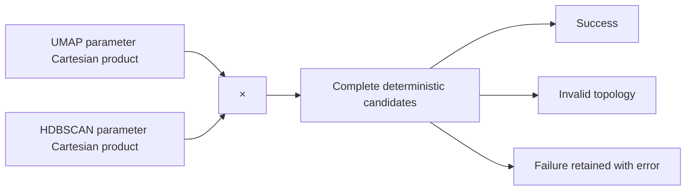


*Complete search-space enumeration. Editable source: `assets/diagrams/diagram_05_search_space.mmd`.*

### Retained evidence

Edition 2 Lab 2 evaluates min-cluster-size 4/6, min-samples 2/4, epsilon 0/0.05, and scalar EOM/Euclidean settings across four UMAP families. All 32 candidates succeeded and produced three clusters with no noise.

### Output-reading checkpoint

Inspect `hdbscan_id`, flattened parameters, status, error message, cluster/noise counts, persistence summaries, metric warnings, candidate runtime, and `model_failures.tsv`.

### Misinterpretations to avoid

Do not interpret increasing `min_samples` as universally better. Do not use numeric cluster labels as stable identity across fits. Do not call noise observations false or biologically irrelevant.

### Boundary inherited from Edition 1

Density structure depends on the concatenated representation and metric. A grid can expose sensitivity but does not identify a uniquely correct biological scale.


## Evidence and references

See Campello et al. (2015), DOI 10.1145/2733381; McInnes et al. (2017), DOI 10.21105/joss.00205; and official hdbscan API documentation.

### Evidence retained from former Chapter 19

### Operational foundation

Candidate metrics serve different purposes. Topology fields describe non-noise cluster count, noise count/fraction, and cluster sizes. Silhouette uses the configured HDBSCAN metric and the declared sampling scope. DBCV is optionally computed as a density-aware diagnostic. Calinski–Harabasz and Davies–Bouldin are supplied with explicit metric/context fields. HDBSCAN persistence summaries describe retained clusters. Trustworthiness and continuity belong to the embedding family, not to one HDBSCAN extraction.

Metrics can be missing when a topology is invalid, a calculation is undefined, a backend cannot support a metric, or a candidate fails. Read `status`, scope, sampled flags, sample sizes, and `metric_warnings` before comparing numbers. The candidate table is deliberately wide so these qualifications are not hidden.

### Retained evidence

The selected Edition 2 Lab 2 candidate has silhouette about 0.970354 and DBCV about 0.976386, with three equal clusters and no noise. These values describe the designed fixture under Euclidean geometry; they are not expected production targets.

### Output-reading checkpoint

Inspect metric value plus its metric/scope/sampled/sample-size columns, topology counts, persistence, warnings, and the run's compute flags.

### Misinterpretations to avoid

Do not call silhouette inherently Euclidean; Freeze 3 supplies the configured metric. Do not compare a sampled score with a full score without noting scope. Do not call DBCV the universal best metric.

### Boundary inherited from Edition 1

All internal metrics are conditional on representation and candidate population. They lack independent biological evidence and can disagree legitimately.


## Evidence and references

See Rousseeuw (1987), DOI 10.1016/0377-0427(87)90125-7, and Moulavi et al. (2014), DOI 10.1137/1.9781611973440.96.

### Evidence retained from former Chapter 28

### Operational foundation

HDBSCAN label `-1` means that the fitted hierarchy/extraction did not assign an observation to a retained cluster under the current representation, metric, density parameters, and selection method. It is an algorithmic status, not a biological category. Changing UMAP parameters, seed aggregation, min-cluster-size, min-samples, epsilon, metric, or selection method can change the noise set.

Inspect unassigned observations rather than discarding them rhetorically. Report count/fraction, exact IDs, probabilities/persistence when available, original-space relationships, stability across justified settings, and transitions in comparison outputs. Use ‘unassigned’ or ‘HDBSCAN noise’ with the condition attached. Avoid ‘non-pleiotropic,’ ‘failed IDP,’ ‘irrelevant,’ or ‘no shared structure.’

### Retained evidence

The synthetic tutorials have zero noise. The historical 164-IDP record has 102 unassigned and 62 assigned across five clusters; this is historical evidence and does not imply 102 biologically irrelevant IDPs.

### Output-reading checkpoint

Inspect label tables, noise count/fraction, candidate parameters, membership comparison, changed-noise status, exclusions under noise policy, and historical source status.

### Misinterpretations to avoid

Do not drop noise before reporting its magnitude. Do not compare noise labels without exact IDs. Do not treat absence of assigned cluster as absence of any genetic correlation.

### Boundary inherited from Edition 1

Freeze 3 does not provide a calibrated biological uncertainty interval for each label. Stability and external data must be studied separately.


## Evidence and references

See Campello et al. (2015), DOI 10.1145/2733381.

### Evidence retained from former Chapter 29

### Operational foundation

‘Double dipping’ occurs when data-dependent choices are ignored in a later inferential statement. DIMPLE-GWAS uses the matrix to create an embedding, enumerate/extract partitions, and select one using internal metrics. Testing separation or correlation on the same matrix as though the partition were fixed in advance can yield overconfident evidence. Multiple candidate models and analyst inspection add further selection.

Safe outputs in Freeze 3 are descriptive summaries with explicit conditioning. For inference, plan held-out variables, independent cohorts, preregistered replication, sample splitting, perturbation/stability designs, or a selective-inference method whose assumptions actually match the pipeline. Report effect sizes and uncertainty appropriate to the validation design. Never describe an omitted p-value as a flaw: the explanation utility intentionally avoids cluster ANOVA and post-selection significance.

### Retained evidence

Edition 2 Lab 3 reports within/between similarities and a heatmap but no ANOVA p-values. That is a deliberate boundary, not missing validation.

### Output-reading checkpoint

Inspect candidate population, selection rule, all exploratory views used, independent validation plan, comparison/stability evidence, and whether any test data were held out before selection.

### Misinterpretations to avoid

Do not call high within-cluster correlation a validation test. Do not choose external outcomes after seeing the partition without disclosure. Do not cite a general selective-inference paper as if it implemented this exact pipeline.

### Boundary inherited from Edition 1

Independent validation may still inherit sample overlap, ancestry, measurement, or harmonization biases. The design—not the word ‘replication’—determines evidential strength.


## Evidence and references

See Gao, Bien & Witten (2024), DOI 10.1080/01621459.2022.2116331, with the scope limitation stated above.

### Evidence retained from former Chapter 30

### Operational foundation

Validation is layered. Software validation covers tests and schemas. Technical reproducibility covers source/input/configuration identity, reruns, hashes, labels, and numeric tolerance. Structural concordance uses ARI/NMI/noise/mapped membership. Statistical validation addresses parameter sensitivity, instability, selection, uncertainty, and multiplicity. Biological validation asks whether groupings recur or predict independent domain evidence. Cross-platform validation tests the claimed package on Docker/Linux/cloud environments.

A result should be reported at the strongest layer actually supported. Forty-five tests support software. Twenty-four artifact checks support one run contract. Perfect fixture concordance supports bounded same-platform technical structure. MNIST supports known-label engineering behavior. None proves the historical IDP clusters biologically distinct. The fresh 164-IDP and Docker/cloud layers remain pending.

## Evidence diagram or figure

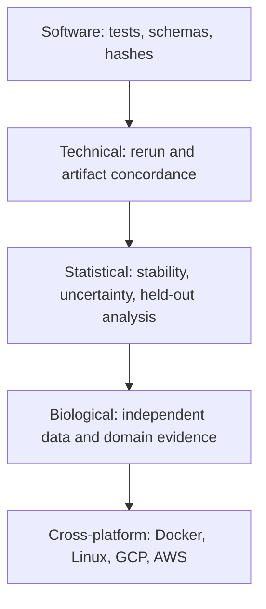


*Validation ladder; each layer requires its own evidence. Editable source: `assets/diagrams/diagram_10_validation_ladder.mmd`.*

### Retained evidence

Use `assets/diagrams/diagram_10_validation_ladder.mmd` and Appendix G to classify every manual evidence item. No arrow can be skipped by renaming a lower layer.

### Output-reading checkpoint

Inspect test JUnit/logs, validation checks, comparison metrics, source/input/config hashes, historical evidence, external-study design, and platform matrices separately.

### Misinterpretations to avoid

Do not write ‘validated’ without an object, method, dataset, platform, and criterion. Do not let a checksum pass stand in for scientific replication.

### Boundary inherited from Edition 1

Statistical and biological validation protocols are context dependent and may require data or governance outside this package. This manual does not invent those results.

## Implementation trace

**`hdbscan_runner.estimator_kwargs`** is defined at `dimple_gwas/hdbscan_runner.py:15` with signature `parameters: Mapping[str, Any], core_dist_n_jobs: int=1`. Implementation callable for estimator kwargs. It is reached from hdbscan_runner.fit_hdbscan and connects to No package-defined dependency detected. Its direct artifact contract is No direct canonical artifact; in-memory/supporting result; its explicit error surface is No explicit raise in this symbol; delegated calls may raise.. Test evidence is recorded as No direct symbol-name test reference; assess through caller/integration coverage. This is a B-tier contract, so the complete 20-field dossier is retained in the function atlas.

**`hdbscan_runner.fit_hdbscan`** is defined at `dimple_gwas/hdbscan_runner.py:34` with signature `embedding, parameters: Mapping[str, Any], core_dist_n_jobs: int=1`. Fit contributed HDBSCAN with normalized Freeze 3 parameters. It is reached from pipeline._evaluate_one; pipeline.run_search and connects to hdbscan_runner.estimator_kwargs. Its direct artifact contract is No direct canonical artifact; in-memory/supporting result; its explicit error surface is No explicit raise in this symbol; delegated calls may raise.. Test evidence is recorded as tests/test_failure_and_provenance.py::test_failed_candidate_is_retained. This is a A-tier contract, so the complete 20-field dossier is retained in the function atlas.

**`interpretation.is_noise_label`** is defined at `dimple_gwas/interpretation.py:30` with signature `value: Any`. Implementation callable for is noise label. It is reached from comparison.run_comparison; interpretation.calculate_cluster_summary; interpretation.label_sort_key; interpretation.run_explanation and connects to No package-defined dependency detected. Its direct artifact contract is No direct canonical artifact; in-memory/supporting result; its explicit error surface is No explicit raise in this symbol; delegated calls may raise.. Test evidence is recorded as No direct symbol-name test reference; assess through caller/integration coverage. This is a B-tier contract, so the complete 20-field dossier is retained in the function atlas.

**`interpretation.label_sort_key`** is defined at `dimple_gwas/interpretation.py:35` with signature `value: Any`. Implementation callable for label sort key. It is reached from comparison.run_comparison; interpretation.compute_order and connects to interpretation.is_noise_label. Its direct artifact contract is No direct canonical artifact; in-memory/supporting result; its explicit error surface is No explicit raise in this symbol; delegated calls may raise.. Test evidence is recorded as No direct symbol-name test reference; assess through caller/integration coverage. This is a B-tier contract, so the complete 20-field dossier is retained in the function atlas.

**`interpretation.detect_coordinate_columns`** is defined at `dimple_gwas/interpretation.py:44` with signature `frame, requested: Sequence[str] | str | None=None`. Implementation callable for detect coordinate columns. It is reached from comparison.run_comparison; interpretation.run_explanation and connects to No package-defined dependency detected. Its direct artifact contract is No direct canonical artifact; in-memory/supporting result; its explicit error surface is ValueError. Test evidence is recorded as tests/test_freeze3_interpretation.py::test_coordinate_detection_is_numeric_suffix_order. This is a B-tier contract, so the complete 20-field dossier is retained in the function atlas.

**`interpretation.compute_similarity`** is defined at `dimple_gwas/interpretation.py:145` with signature `analysis, *, method: str, undefined_policy: str`. Implementation callable for compute similarity. It is reached from interpretation.run_explanation and connects to No package-defined dependency detected. Its direct artifact contract is No direct canonical artifact; in-memory/supporting result; its explicit error surface is ValueError. Test evidence is recorded as tests/test_freeze3_interpretation.py::test_similarity_undefined_fails_by_default. This is a A-tier contract, so the complete 20-field dossier is retained in the function atlas.

**`interpretation.compute_order`** is defined at `dimple_gwas/interpretation.py:184` with signature `correlation, labels: Sequence[Any], *, method: str, noise_policy: str`. Implementation callable for compute order. It is reached from interpretation.run_explanation and connects to interpretation._hierarchical_order; interpretation.label_sort_key. Its direct artifact contract is No direct canonical artifact; in-memory/supporting result; its explicit error surface is No explicit raise in this symbol; delegated calls may raise.. Test evidence is recorded as tests/test_freeze3_interpretation.py::test_cluster_order_is_numeric_and_noise_last. This is a A-tier contract, so the complete 20-field dossier is retained in the function atlas.

**`interpretation.calculate_cutpoints`** is defined at `dimple_gwas/interpretation.py:209` with signature `labels: Sequence[Any]`. Implementation callable for calculate cutpoints. It is reached from interpretation.run_explanation and connects to No package-defined dependency detected. Its direct artifact contract is No direct canonical artifact; in-memory/supporting result; its explicit error surface is No explicit raise in this symbol; delegated calls may raise.. Test evidence is recorded as tests/test_freeze3_interpretation.py::test_cutpoint_indices_are_auditable. This is a B-tier contract, so the complete 20-field dossier is retained in the function atlas.

**`interpretation.calculate_cluster_summary`** is defined at `dimple_gwas/interpretation.py:233` with signature `correlation, labels: Sequence[Any]`. Implementation callable for calculate cluster summary. It is reached from interpretation.run_explanation and connects to interpretation.is_noise_label. Its direct artifact contract is No direct canonical artifact; in-memory/supporting result; its explicit error surface is No explicit raise in this symbol; delegated calls may raise.. Test evidence is recorded as No direct symbol-name test reference; assess through caller/integration coverage. This is a B-tier contract, so the complete 20-field dossier is retained in the function atlas.

**`interpretation.coordinate_association_table`** is defined at `dimple_gwas/interpretation.py:262` with signature `analysis, coordinates, *, methods: Sequence[str], top_n: int`. Implementation callable for coordinate association table. It is reached from interpretation.run_explanation and connects to No package-defined dependency detected. Its direct artifact contract is No direct canonical artifact; in-memory/supporting result; its explicit error surface is No explicit raise in this symbol; delegated calls may raise.. Test evidence is recorded as No direct symbol-name test reference; assess through caller/integration coverage. This is a A-tier contract, so the complete 20-field dossier is retained in the function atlas.

**`interpretation.run_explanation`** is defined at `dimple_gwas/interpretation.py:307` with signature `*, output_dir: str | Path, interpretation_config: Mapping[str, Any], model_json: str | Path | None=None, legacy_table: str | Path | None=None, input_path: str | Path | None=None, input_sep: str | None=None, input_sheet: str | int=0, legacy_sheet: str | int=0, matrix_orientation: str='auto', vector_id_source: str='auto', drop_first_n_cols: int | None=None, zscore_transform: str | None=None, id_column: str | None=None, label_column: str | None=None, coordinate_columns: Sequence[str] | str | None=None, command: list[str] | None=None`. Return to original input space, align IDs, calculate similarities/summaries, order a heatmap, and record a non-refitting explanation manifest. It is reached from cli._explain and connects to interpretation._align_inputs; interpretation._native_sources; interpretation._resolve_column; interpretation._write_readme; interpretation.calculate_cluster_summary; interpretation.calculate_cutpoints; interpretation.compute_order; interpretation.compute_similarity; interpretation.coordinate_association_table; interpretation.detect_coordinate_columns; interpretation.is_noise_label; io.atomic_json_dump; io.ensure_empty_output_dir; io.json_safe; io.read_table; io.validated_identifiers; metrics.embedding_quality_metrics; preprocessing.infer_explanation_orientation; preprocessing.prepare_explanation_matrix; provenance.base_manifest; provenance.file_record; provenance.utc_now; visualization.render_heatmap. Its direct artifact contract is original_space_similarity.tsv.gz; heatmap_order.tsv; cluster_cutpoints.tsv; cluster_summary.tsv; projection_quality.tsv; coordinate_associations.tsv; exclusions.tsv; original_space_heatmap.png; original_space_heatmap.html; interpretation_manifest.json; README.md; its explicit error surface is ValueError. Test evidence is recorded as tests/test_freeze3_interpretation.py::test_legacy_incomplete_matching_writes_exclusions; tests/test_freeze3_interpretation.py::test_native_explanation_end_to_end; tests/test_freeze3_interpretation.py::test_native_explanation_refuses_nonempty_output. This is a A-tier contract, so the complete 20-field dossier is retained in the function atlas.

**`metrics.effective_neighbor_count`** is defined at `dimple_gwas/metrics.py:9` with signature `n_samples: int, requested: int`. Implementation callable for effective neighbor count. It is reached from metrics.embedding_quality_metrics and connects to No package-defined dependency detected. Its direct artifact contract is No direct canonical artifact; in-memory/supporting result; its explicit error surface is No explicit raise in this symbol; delegated calls may raise.. Test evidence is recorded as tests/test_preprocessing_metrics.py::test_effective_neighbor_edge_cases. This is a B-tier contract, so the complete 20-field dossier is retained in the function atlas.

## Claim adjudication notebook

The following statements are admitted to the draft only in their safe form:

- **SCORE-002 (reject):** Silhouette is defined relative to a distance; Freeze 3 passes the configured HDBSCAN metric to scikit-learn. [[Rousseeuw (1987)](#ref-rousseeuw1987)] Limitation: Metric choice remains geometry-dependent; CH and DB use Euclidean centroid geometry. Implementation evidence: `metrics.evaluate_candidate`.

- **INT-003 (verified_with_qualification):** Pearson/Spearman summaries are post-selection descriptive diagnostics conditional on the retained partition. [[Kriegeskorte et al. (2009)](#ref-kriegeskorte2009); [Gao et al. (2024)](#ref-gao2024)] Limitation: They do not provide causal, replication, or unbiased significance evidence. Implementation evidence: `interpretation.py`.

- **INT-004 (verified_with_qualification):** Classical tests on the same data used for group discovery are vulnerable to circularity; Freeze 3 omits cluster ANOVA and post-selection p-values. [[Kriegeskorte et al. (2009)](#ref-kriegeskorte2009); [Gao et al. (2024)](#ref-gao2024)] Limitation: The cited selective method is not a turnkey HDBSCAN procedure. Implementation evidence: `interpretation.py; limitations docs`.

- **CMP-001 (reject):** K-means targets centroid-based partitions and may mismatch irregular density structure; it is not universally ineffective. Limitation: Performance depends on representation and objective. Implementation evidence: `not implemented`.

## Worked reasoning and evidence exercise

Draw a five-point mutual-reachability graph, identify an unassigned point, and separate internal, structural, and external validation claims.

A complete Chapter 5 answer must expose its intermediate reasoning, name the source or output used for `Density clustering, validation, and circular inference`, and finish with separate support and non-support statements. Applying that discipline to the question “When does a dense region justify a cluster, and what evidence can validate it?” prevents a calculation, a software observation, and a scientific interpretation from collapsing into one claim.

## Assumptions, diagnostics, and recovery

The Chapter 5 analysis assumes the stated unit and inputs, the recorded configuration and software identity, and a diagnostic that addresses the claimed property rather than a convenient surrogate. Its decisive boundary is: HDBSCAN labels are algorithmic; post-selection summaries are descriptive unless a valid independent or selective-inference design is supplied.

If the Chapter 5 route fails, retain its log and candidate status before deciding whether the cause is input, configuration, dependency, compute, identifier alignment, or output-root state. Correct an operational failure by writing a new result directory. Treat instability in `Density clustering, validation, and circular inference` as sensitivity evidence: report it and identify the independent evidence needed instead of relabeling ambiguity as a software exception.

## Chapter synthesis

Internal diagnostics are computed on the same representation used to construct candidates, so they guide selection without becoming independent confirmation. The implementation trace makes the current behavior auditable, but the evidence boundary remains part of the result. Chapter 6 returns to the exact data contract before the method is derived.

## Exercises

1. For `Density clustering, validation, and circular inference`, name the unit of analysis and one plausible but invalid substitute.
2. Reconstruct the notation for core distance; define its dimensions or denominator and interpret every term.
3. Choose a Tier A function mapped to Chapter 5; identify its caller and direct output, then propose a topic-specific edge case.
4. Select one Chapter 5 artifact from the output atlas and state three integrity checks that must precede scientific reading.
5. Convert a tempting `Density clustering, validation, and circular inference` overclaim into one observed statement followed by its limitation.
6. Draw a five-point mutual-reachability graph, identify an unassigned point, and separate internal, structural, and external validation claims.

Appendix J gives the Chapter 5 adjudication guide. Its further-reading keys supply statistical context; no external paper is treated as automatic validation of the current software or dataset.


<div class="part-break"></div>

# Part II

## The implemented representation, clustering, selection, and replay method

Chapters 6–12

<div class="part-page-rule"></div>


<div class="chapter-break"></div>

<a id="chapter-6"></a>

# 6. Data contract, preprocessing, RINT, and orientation

*Guiding question:* **Which cells become the vectors that UMAP actually sees?**

Prerequisites: 2–3.

## Why the question matters

Row and column language changes after transposition; an apparently small orientation mistake changes the unit being clustered.

Production `run` rejects missing or nonnumeric analysis cells; explanation mode supports two explicit orientations with identifier-based inference safeguards.

This chapter develops the question in the order needed for a reader to move from statistical principle to current implementation, retained evidence, and a defensible statement. Its central worked task is: Follow the Lab 0 six-by-eight table through metadata removal, average-rank RINT, transpose, and its final four-by-six analysis matrix.


<figure id="fig-f02">

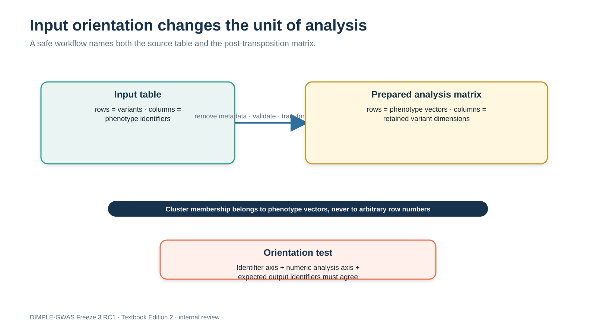{fig-alt="DIMPLE-GWAS validates a variant-by-phenotype table and constructs a phenotype-vector-by-variant analysis matrix for fitting"}

<figcaption><strong>Figure 4.</strong> DIMPLE-GWAS validates a variant-by-phenotype table and constructs a phenotype-vector-by-variant analysis matrix for fitting. <em>Interpretive boundary:</em> A transposition or identifier error changes what is clustered even when the numeric array remains rectangular.</figcaption>

</figure>

## Learning objectives

After completing Chapter 6, the reader can:

1. define GWAS-derived vector and explain its role without exceeding the stated caution;
2. define identifier alignment and explain its role without exceeding the stated caution;
3. define scaling and transformation and explain its role without exceeding the stated caution;
4. define RINT ties and missingness and explain its role without exceeding the stated caution;
5. trace the relevant package functions and generated artifacts;
6. complete the worked task and distinguish observation from interpretation.

## Conceptual and mathematical development

### GWAS-derived vector

Effect estimates or association statistics for one phenotype across matched variants. A compact notation is `X in R^(p x v)`. In practical terms, a vector is a statistical summary, not a person or causal mechanism. [[Elliott (2018)](#ref-elliott2018); [Bulik-Sullivan (2015)](#ref-buliksullivan2015)]

Within Freeze 3 RC1 the concept is connected to `prepare_analysis_matrix` and is visible through `input matrix`. This connection is narrower than the general statistical idea: software evidence establishes the implemented route, while the mapped primary or internal evidence supplies background authority. The distinction prevents a mathematical definition from being mistaken for proof that a particular scientific interpretation is correct.

### identifier alignment

A one-to-one correspondence between vector or feature identifiers across artifacts. A compact notation is `I_A = I_B`. In practical terms, order is not identity; normalize and validate keys before joining.

Within Freeze 3 RC1 the concept is connected to `validated_identifiers; align_rows` and is visible through `labels.tsv; coordinates.tsv`. This connection is narrower than the general statistical idea: software evidence establishes the implemented route, while the mapped primary or internal evidence supplies background authority. The distinction prevents a mathematical definition from being mistaken for proof that a particular scientific interpretation is correct.

### scaling and transformation

Changes to marginal scale before geometric analysis. A compact notation is `z=(x-mu)/sigma; z_i=Phi^-1((r_i-0.5)/n)`. In practical terms, transformation changes geometry; it does not create independent evidence. [[Beasley et al. (2009)](#ref-beasley2009)]

Within Freeze 3 RC1 the concept is connected to `rank_inverse_normal_transform; prepare_analysis_matrix` and is visible through `resolved_config.yaml`. This connection is narrower than the general statistical idea: software evidence establishes the implemented route, while the mapped primary or internal evidence supplies background authority. The distinction prevents a mathematical definition from being mistaken for proof that a particular scientific interpretation is correct.

### RINT ties and missingness

Average ranks with missing values retained during ranking. A compact notation is `r_i=average tied rank`. In practical terms, freeze 3 rejects missing analysis cells before the pipeline and applies RINT column-wise before transpose. [[Beasley et al. (2009)](#ref-beasley2009)]

Within Freeze 3 RC1 the concept is connected to `rank_inverse_normal_transform` and is visible through `prepared matrix`. This connection is narrower than the general statistical idea: software evidence establishes the implemented route, while the mapped primary or internal evidence supplies background authority. The distinction prevents a mathematical definition from being mistaken for proof that a particular scientific interpretation is correct.

## Reconstructed operational foundation

Edition 1 contained the following verified operational material in separate short notes. Edition 2 consolidates it here and subjects it to the concept and evidence boundaries above.

### Evidence retained from former Chapter 10

### Operational foundation

The standard run contract is a CSV/TSV table with variants in rows, a declared leading metadata prefix, and vectors/IDPs in the remaining columns. The default `drop_first_n_cols` is 4. Analysis columns must be numeric after parsing. Their column names become `feature_id` values after transpose, so they must be stable and unique. The original row axis supplies the variables across which vectors are compared.

Freeze 3 reads the separator explicitly when configured or through its table reader, drops the prefix, optionally transforms analysis columns, and transposes. The native explanation path expects exact retained IDs and the original matrix. Legacy explanation can infer orientation only through exact overlap and should use explicit orientation/ID options when ambiguity exists. Missing, nonnumeric, constant, duplicate, or mismatched values can make preprocessing or correlations undefined.

The input-orientation diagram at `assets/diagrams/diagram_02_input_orientation.mmd` is the safest mental model.

## Evidence diagram or figure

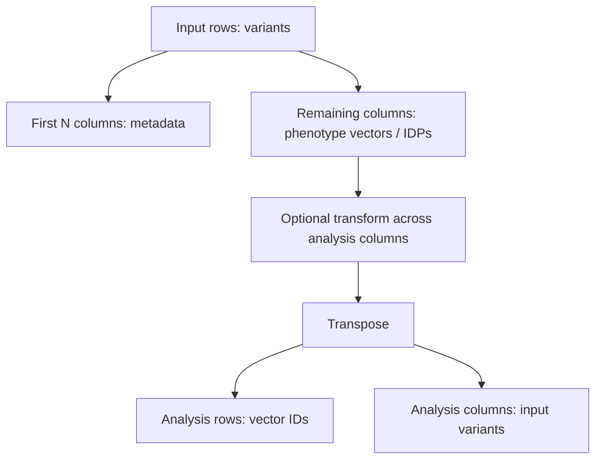


*Input orientation and transposition. Editable source: `assets/diagrams/diagram_02_input_orientation.mmd`.*

### Retained evidence

The fixture `benchmarks/synthetic/synthetic_matrix.tsv` has 80 rows and 28 columns: four metadata plus 24 vectors. After the prefix is dropped and data are transposed, the analysis matrix is 24 vectors by 80 variables.

### Output-reading checkpoint

Before a run, inspect header uniqueness, first rows, dimensions, numeric conversion, missing counts, separator, and the annotation join column. After a run, confirm the manifest's `input_contract` and input SHA-256.

### Misinterpretations to avoid

Do not set `drop_first_n_cols` by guessing. Do not use annotation row number as vector identity. Do not let spreadsheet software rewrite scientific notation or identifiers. Do not silently impute missing values outside an approved upstream protocol.

### Boundary inherited from Edition 1

Freeze 3 cannot determine whether upstream variants are allele-aligned, comparable across phenotypes, or scientifically eligible. Protected study matrices should not be copied into the manual or image.

### Evidence retained from former Chapter 15

### Operational foundation

Preprocessing defines the geometry presented to UMAP. Freeze 3 removes `input.drop_first_n_cols` leading columns, validates that analysis columns are numeric, optionally applies rank inverse normal transformation to each analysis column before transpose, and then transposes to vectors by input variables. With `zscore_transform=none`, values are not RINT-transformed. The historical option name is retained although the implemented alternative is `rint`.

For a column with ranks, RINT maps rank-based probabilities through the standard-normal quantile function. It can reduce marginal scale differences and the influence of extreme values, but it also changes the scientific quantity and does not repair upstream harmonization or dependence. The configuration default is `none`; enable RINT only with a documented rationale that matches the intended historical or prospective protocol.

### Retained evidence

The preprocessing tests cover RINT and numeric-matrix behavior. Both executed synthetic tutorials use `none`, so their values remain on the fixture's generated scale.

### Output-reading checkpoint

Inspect the input config, resolved transform, input-contract manifest, prepared-shape log line, identifier set, and any preprocessing warnings. Record upstream transformations separately.

### Misinterpretations to avoid

Do not describe RINT as row-wise without naming the table orientation: implementation applies it to analysis columns before transpose. Do not call it z-scoring or assume it creates independence.

### Boundary inherited from Edition 1

RINT can alter ties, correlations, distances, and downstream partitions. The manual makes no universal recommendation between transformed and untransformed analyses.

## Implementation trace

**`config.builtin_config`** is defined at `dimple_gwas/config.py:128` with signature `mode: str`. Implementation callable for builtin config. It is reached from config.resolve_config and connects to config._base_config. Its direct artifact contract is No direct canonical artifact; in-memory/supporting result; its explicit error surface is ValueError. Test evidence is recorded as No direct symbol-name test reference; assess through caller/integration coverage. This is a B-tier contract, so the complete 20-field dossier is retained in the function atlas.

**`config.deep_merge`** is defined at `dimple_gwas/config.py:164` with signature `base: Mapping[str, Any], overlay: Mapping[str, Any]`. Implementation callable for deep merge. It is reached from config.resolve_config and connects to No package-defined dependency detected. Its direct artifact contract is No direct canonical artifact; in-memory/supporting result; its explicit error surface is No explicit raise in this symbol; delegated calls may raise.. Test evidence is recorded as No direct symbol-name test reference; assess through caller/integration coverage. This is a B-tier contract, so the complete 20-field dossier is retained in the function atlas.

**`config.load_yaml`** is defined at `dimple_gwas/config.py:174` with signature `path: str | Path`. Implementation callable for load yaml. It is reached from config.resolve_config and connects to No package-defined dependency detected. Its direct artifact contract is No direct canonical artifact; in-memory/supporting result; its explicit error surface is FileNotFoundError; RuntimeError; ValueError. Test evidence is recorded as No direct symbol-name test reference; assess through caller/integration coverage. This is a B-tier contract, so the complete 20-field dossier is retained in the function atlas.

**`config.set_dotted`** is defined at `dimple_gwas/config.py:191` with signature `config: dict[str, Any], dotted: str, value: Any`. Implementation callable for set dotted. It is reached from config.resolve_config and connects to No package-defined dependency detected. Its direct artifact contract is No direct canonical artifact; in-memory/supporting result; its explicit error surface is No explicit raise in this symbol; delegated calls may raise.. Test evidence is recorded as No direct symbol-name test reference; assess through caller/integration coverage. This is a B-tier contract, so the complete 20-field dossier is retained in the function atlas.

**`config.resolve_config`** is defined at `dimple_gwas/config.py:203` with signature `mode: str, config_path: str | Path | None=None, overrides: Mapping[str, Any] | None=None`. Implementation callable for resolve config. It is reached from cli._explain; cli._reproduce; cli._resolved; cli._score and connects to config.builtin_config; config.deep_merge; config.load_yaml; config.set_dotted; config.validate_config. Its direct artifact contract is No direct canonical artifact; in-memory/supporting result; its explicit error surface is No explicit raise in this symbol; delegated calls may raise.. Test evidence is recorded as tests/test_config.py::test_cli_override_precedence; tests/test_config.py::test_fixed_mode_rejects_lists; tests/test_config.py::test_invalid_combinations_rejected; tests/test_config.py::test_standard_defaults_match_dev_declarations; tests/test_freeze3_interpretation.py::test_interpretation_defaults_are_additive; tests/test_freeze3_interpretation.py::test_invalid_interpretation_configuration_fails; tests/test_freeze3_interpretation.py::test_legacy_incomplete_matching_writes_exclusions; tests/test_freeze3_interpretation.py::test_native_explanation_end_to_end; tests/test_freeze3_interpretation.py::test_native_explanation_refuses_nonempty_output; tests/test_search_space.py::test_search_enumeration_and_stable_ids; tests/test_search_space.py::test_search_limit_never_silently_samples. This is a A-tier contract, so the complete 20-field dossier is retained in the function atlas.

**`config.as_list`** is defined at `dimple_gwas/config.py:277` with signature `value: Any, cast: type | None=None`. Implementation callable for as list. It is reached from config.normalized_parameter_space and connects to config._coerce_bool; config._range_values; config._string_sequence. Its direct artifact contract is No direct canonical artifact; in-memory/supporting result; its explicit error surface is ValueError. Test evidence is recorded as tests/test_config.py::test_scalar_list_and_range_handling. This is a B-tier contract, so the complete 20-field dossier is retained in the function atlas.

**`config.normalized_parameter_space`** is defined at `dimple_gwas/config.py:298` with signature `config: Mapping[str, Any]`. Implementation callable for normalized parameter space. It is reached from config.validate_config; search_space.count_candidates; search_space.enumerate_candidates and connects to config.as_list. Its direct artifact contract is No direct canonical artifact; in-memory/supporting result; its explicit error surface is ValueError. Test evidence is recorded as tests/test_config.py::test_cli_override_precedence. This is a A-tier contract, so the complete 20-field dossier is retained in the function atlas.

**`config.validate_config`** is defined at `dimple_gwas/config.py:343` with signature `config: Mapping[str, Any]`. Implementation callable for validate config. It is reached from cli._explain; cli._reproduce; config.resolve_config and connects to config._finite; config.normalized_parameter_space. Its direct artifact contract is No direct canonical artifact; in-memory/supporting result; its explicit error surface is ValueError. Test evidence is recorded as No direct symbol-name test reference; assess through caller/integration coverage. This is a A-tier contract, so the complete 20-field dossier is retained in the function atlas.

**`config.config_as_json`** is defined at `dimple_gwas/config.py:489` with signature `config: Mapping[str, Any]`. Implementation callable for config as json. It is reached from CLI/import/direct caller or no package caller detected and connects to No package-defined dependency detected. Its direct artifact contract is No direct canonical artifact; in-memory/supporting result; its explicit error surface is No explicit raise in this symbol; delegated calls may raise.. Test evidence is recorded as No direct symbol-name test reference; assess through caller/integration coverage. This is a B-tier contract, so the complete 20-field dossier is retained in the function atlas.

**`io.resolve_separator`** is defined at `dimple_gwas/io.py:10` with signature `path: str | Path, override: str | None=None`. Implementation callable for resolve separator. It is reached from io.read_model_table; io.read_table and connects to No package-defined dependency detected. Its direct artifact contract is No direct canonical artifact; in-memory/supporting result; its explicit error surface is No explicit raise in this symbol; delegated calls may raise.. Test evidence is recorded as No direct symbol-name test reference; assess through caller/integration coverage. This is a B-tier contract, so the complete 20-field dossier is retained in the function atlas.

**`io.read_table`** is defined at `dimple_gwas/io.py:16` with signature `path: str | Path, sep: str | None=None, *, sheet: str | int=0, nrows: int | None=None`. Implementation callable for read table. It is reached from comparison._resolve_labels; interpretation.run_explanation; pipeline._annotation_frame; pipeline.run_search; validation.run_validation and connects to io.resolve_separator. Its direct artifact contract is No direct canonical artifact; in-memory/supporting result; its explicit error surface is FileNotFoundError; RuntimeError. Test evidence is recorded as tests/test_freeze3_interpretation.py::test_reader_supports_excel_sheet. This is a A-tier contract, so the complete 20-field dossier is retained in the function atlas.

**`io.read_model_table`** is defined at `dimple_gwas/io.py:45` with signature `path: str | Path`. Implementation callable for read model table. It is reached from cli._score; cli._summarize; validation.run_validation and connects to io.resolve_separator. Its direct artifact contract is No direct canonical artifact; in-memory/supporting result; its explicit error surface is No explicit raise in this symbol; delegated calls may raise.. Test evidence is recorded as No direct symbol-name test reference; assess through caller/integration coverage. This is a B-tier contract, so the complete 20-field dossier is retained in the function atlas.

## Claim adjudication notebook

The following statements are admitted to the draft only in their safe form:

- **DATA-001 (implementation_specific):** Production input has variants in rows, four declared metadata columns by default, and vector/IDP columns; preprocessing drops the prefix and transposes to vectors by variants. Limitation: Explanation mode also permits an explicit vectors-by-variants orientation. Implementation evidence: `preprocessing.py; io.py`.

- **DATA-002 (implementation_specific):** RINT is optional, off by default, and applied column-wise to analysis columns before transpose using average ranks and (rank-0.5)/n. [[Beasley et al. (2009)](#ref-beasley2009)] Limitation: The post-transpose viewpoint reverses row/column language; always state the orientation. Implementation evidence: `preprocessing.rank_inverse_normal_transform`.

- **METH-001 (verified_with_qualification):** Freeze 3 maps observed marginal ranks to normal scores; that deterministic sample transformation does not validate downstream parametric assumptions or causal interpretation. [[Beasley et al. (2009)](#ref-beasley2009)] Limitation: Dependence, ties, and selection remain. Implementation evidence: `preprocessing.py`.

## Worked reasoning and evidence exercise

Follow the Lab 0 six-by-eight table through metadata removal, average-rank RINT, transpose, and its final four-by-six analysis matrix.

A complete Chapter 6 answer must expose its intermediate reasoning, name the source or output used for `Data contract, preprocessing, RINT, and orientation`, and finish with separate support and non-support statements. Applying that discipline to the question “Which cells become the vectors that UMAP actually sees?” prevents a calculation, a software observation, and a scientific interpretation from collapsing into one claim.

## Assumptions, diagnostics, and recovery

The Chapter 6 analysis assumes the stated unit and inputs, the recorded configuration and software identity, and a diagnostic that addresses the claimed property rather than a convenient surrogate. Its decisive boundary is: Production `run` rejects missing or nonnumeric analysis cells; explanation mode supports two explicit orientations with identifier-based inference safeguards.

If the Chapter 6 route fails, retain its log and candidate status before deciding whether the cause is input, configuration, dependency, compute, identifier alignment, or output-root state. Correct an operational failure by writing a new result directory. Treat instability in `Data contract, preprocessing, RINT, and orientation` as sensitivity evidence: report it and identify the independent evidence needed instead of relabeling ambiguity as a software exception.

## Chapter synthesis

Row and column language changes after transposition; an apparently small orientation mistake changes the unit being clustered. The implementation trace makes the current behavior auditable, but the evidence boundary remains part of the result. Chapter 7 derives the UMAP/densMAP representation built from that matrix.

## Exercises

1. For `Data contract, preprocessing, RINT, and orientation`, name the unit of analysis and one plausible but invalid substitute.
2. Reconstruct the notation for GWAS-derived vector; define its dimensions or denominator and interpret every term.
3. Choose a Tier A function mapped to Chapter 6; identify its caller and direct output, then propose a topic-specific edge case.
4. Select one Chapter 6 artifact from the output atlas and state three integrity checks that must precede scientific reading.
5. Convert a tempting `Data contract, preprocessing, RINT, and orientation` overclaim into one observed statement followed by its limitation.
6. Follow the Lab 0 six-by-eight table through metadata removal, average-rank RINT, transpose, and its final four-by-six analysis matrix.

Appendix J gives the Chapter 6 adjudication guide. Its further-reading keys supply statistical context; no external paper is treated as automatic validation of the current software or dataset.


<div class="chapter-break"></div>

<a id="chapter-7"></a>

# 7. UMAP and densMAP: from neighborhood graph to stochastic layout

## The question behind the embedding

After preprocessing, DIMPLE-GWAS represents each phenotype-associated vector as one point described by a very large number of variant-level values. The immediate difficulty is not simply that this matrix is wide. It is that no analyst can inspect thousands or millions of coordinates directly, and common distances may become hard to discriminate in high dimension. A useful representation must compress the matrix without pretending that compression is neutral.

This chapter asks a precise question: **what relationship does the DIMPLE-GWAS embedding try to preserve, how is that relationship encoded, and what uncertainty is introduced by the layout?** The answer matters because HDBSCAN operates on the resulting representation. An embedding is therefore not decoration added after clustering. It is part of the fitted analytical geometry.

By the end of the chapter, a reader should be able to:

1. explain how a metric and a neighbor count induce a local graph;
2. interpret UMAP's locally calibrated fuzzy memberships and low-dimensional cross-entropy objective;
3. distinguish ordinary UMAP from the density-regularized densMAP variant;
4. trace each configured parameter through DIMPLE-GWAS into `umap.UMAP`;
5. read the embedding-related output artifacts without assigning biological meaning to coordinate axes; and
6. diagnose parameter, scale, stochastic, and small-sample failure modes.

The prerequisites are the input orientation from Chapter 6 and the distance and scaling concepts from Chapter 3. Chapter 8 will use the present chapter's single-run representation as the building block for repeated seeded embeddings.


<figure id="fig-f04">

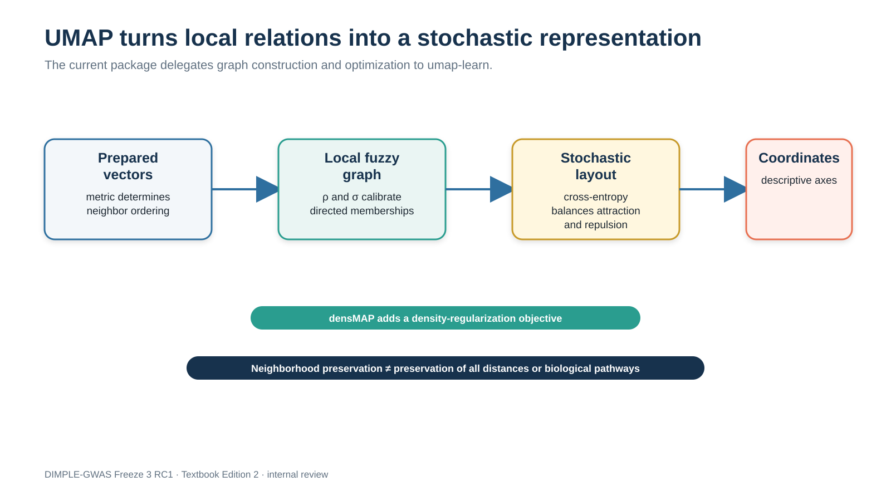{fig-alt="A metric and neighborhood scale create a locally calibrated fuzzy graph; stochastic optimization constructs coordinates, with densMAP optionally regularizing relative local density"}

<figcaption><strong>Figure 5.</strong> A metric and neighborhood scale create a locally calibrated fuzzy graph; stochastic optimization constructs coordinates, with densMAP optionally regularizing relative local density. <em>Interpretive boundary:</em> Coordinate axes, gaps, and apparent density are not calibrated biological effects.</figcaption>

</figure>

## From a matrix to a neighborhood question

Let (X\in\mathbb{R}^{p\times v}) denote the prepared DIMPLE-GWAS analysis matrix: (p) phenotype vectors in rows and (v) retained variant dimensions in columns. For two rows (x_i) and (x_j), a metric (d(x_i,x_j)) defines proximity. Under the default configuration this metric is Euclidean for UMAP, but the software accepts several alternatives after validation. Metric selection is substantive. Euclidean distance responds to absolute coordinate differences; cosine distance emphasizes direction; correlation distance removes location and scale in a different way. These choices can produce different neighbor sets even before optimization begins.

UMAP begins from local rather than global questions: Which points are among the nearest neighbors of (i)? At what distance does the local neighborhood around (i) become populated? How strongly should an edge from (i) to (j) be represented? The use of local neighborhoods is one response to the difficulty of global distance comparison in high dimensions, but it does not make the difficulty vanish. Neighbor sets still depend on the input scale, metric, sample size, ties, and approximate-neighbor implementation [[Aggarwal et al. (2001)](#ref-aggarwal2001); [McInnes et al. (2018)](#ref-mcinnes2018umap)].

The configured `n_neighbors` controls the size of this local lens. A smaller value emphasizes very local relations and can fragment broad structure. A larger value asks the graph to carry information across a wider region and may smooth narrow structures. It is tempting to equate this setting with a biological scale, but DIMPLE-GWAS has no evidence for that interpretation. It is an analytical resolution parameter.

### A four-point distance example

Consider four hypothetical vectors after preprocessing, shown here in only two dimensions so that the arithmetic is visible:

<p class="table-caption" id="table-1"><strong>Table 1.</strong> A four-point distance example.</p>

| Vector | (x_1) | (x_2) |
| --- | ---: | ---: |
| A | 0 | 0 |
| B | 1 | 0 |
| C | 0 | 2 |
| D | 4 | 3 |

The Euclidean distance from A to B is (1), from A to C is (2), and from A to D is (5). If `n_neighbors=2`, A's visible neighbor set is therefore ({B,C}). For B, the distances to C and D are (sqrt{5}\approx2.236) and (sqrt{18}\approx4.243), so B's set is ({A,C}). The neighbor relation is directed at this stage: if a sample were more crowded, (j) could be among the nearest neighbors of (i) without the reverse being true.

Now rescale the second dimension by a factor of one tenth. The A–C distance becomes (0.2), while A–B remains (1). The closest ordering around A changes. Nothing about the labels A–D changed; only the coordinate scale did. This tiny calculation explains why Chapter 3 treats scaling and transformation as geometry-changing decisions rather than clerical preprocessing.

The real DIMPLE-GWAS matrix has many more dimensions, and `umap-learn` performs the neighbor search. DIMPLE-GWAS does not reimplement nearest-neighbor search or expose the graph as a standalone primary output. The graph construction described here is delegated library behavior, while the exact parameters passed to that behavior are directly auditable in `dimple_gwas.umap_runner._fit_one`.

## Local calibration: ρ and σ

Raw neighbor distances are not directly used as globally comparable edge weights. UMAP assigns each point (i) a local connectivity offset ($\rho_i$) and a scale ($\sigma_i$). In a commonly used pedagogical form, the directed membership strength from (i) to a neighbor (j) is

\[
w_{i\mid j}=\exp\left[-\frac{\max(0,d(x_i,x_j)-\rho_i)}{\sigma_i}\right].
\]
<p class="equation-number" id="equation-1"><strong>Equation 1.</strong></p>

The offset ($\rho_i$) ensures a specified degree of local connectivity: at least the nearest relation can receive maximal strength rather than being attenuated merely because distances happen to be large in that region. The scale ($\sigma_i$) is chosen so that the effective membership mass matches the requested neighborhood scale. Consequently, the same raw distance can imply different membership strengths in a sparse and a crowded region.

This adaptive calibration is central to UMAP's local interpretation. It should not be paraphrased as “UMAP preserves all distances.” It deliberately replaces global raw distance with locally scaled fuzzy membership. The precise construction, treatment of ties, approximate search, and optimization details belong to the installed `umap-learn` implementation [[McInnes et al. (2018)](#ref-mcinnes2018umap)]. The equation above is a faithful learning device, not code copied from DIMPLE-GWAS.

Directed memberships are then combined into an undirected fuzzy graph. For the usual fuzzy union, an edge can be written

\[
w_{ij}=w_{i\mid j}+w_{j\mid i}-w_{i\mid j}w_{j\mid i}.
\]
<p class="equation-number" id="equation-2"><strong>Equation 2.</strong></p>

This is the probabilistic-sum form: an edge is strong when either direction supplies strong evidence, with the product preventing simple double counting. The `set_op_mix_ratio` parameter interpolates between union-like and intersection-like behavior in `umap-learn`. The default value passed by DIMPLE-GWAS is `1.0`, the union end of that interpolation. Lower values demand more reciprocal support and may disconnect marginal relations.

`local_connectivity`, also passed directly, controls the locally assumed connected neighborhood. Its default is `1.0`. The interaction between this value, duplicated observations, tied distances, and a small number of phenotype vectors deserves caution. When only a few vectors are available, a nominally modest `n_neighbors` may already involve a large fraction of the dataset. Parameters should therefore be interpreted relative to (p), not as context-free constants.

## Building a low-dimensional fuzzy graph

UMAP next constructs a membership model in an embedding with (q) components. Let (y_i\in\mathbb{R}^q) be the coordinate assigned to vector (i). A common description of low-dimensional membership is

\[
v_{ij}=\frac{1}{1+a\lVert y_i-y_j\rVert^{2b}},
\]
<p class="equation-number" id="equation-3"><strong>Equation 3.</strong></p>

where (a) and (b) are selected to approximate a curve governed by `min_dist` and `spread`. Nearby embedded points have membership near one; membership decays with separation. The layout seeks agreement between the high-dimensional fuzzy graph (W=(w_{ij})) and low-dimensional graph (V=(v_{ij})).

One way to express the fuzzy cross-entropy is

\[
\mathcal{C}(W,V)=\sum_{i<j}\left[
w_{ij}\log\frac{w_{ij}}{v_{ij}} +
(1-w_{ij})\log\frac{1-w_{ij}}{1-v_{ij}}
\right].
\]
<p class="equation-number" id="equation-4"><strong>Equation 4.</strong></p>

The first term penalizes representing a high-membership edge too weakly; it produces an attractive force for neighbors. The second penalizes placing absent or weak edges too close; it produces repulsion. Software minimizes a stochastic approximation to this objective rather than evaluating every non-edge on every step. Negative sampling, learning rate, initialization, epochs, and random state consequently influence the path to a layout [[McInnes et al. (2018)](#ref-mcinnes2018umap)].

Cross-entropy does not give each pairwise distance equal status. It prioritizes agreement in fuzzy adjacency. A visually large separation between two clusters is therefore not a calibrated effect size. Nor does axis 1 name a stable biological direction: rotations, reflections, translations, local compromises, and different stochastic trajectories can produce visually different coordinates that encode similar neighborhoods.

### Optimization is a route, not just an answer

The distinction between an objective and its numerical optimization is important. Two fits may nominally minimize the same loss yet follow different sequences of sampled edges and negative examples. An attractive update moves the endpoints of a represented edge toward one another, while a repulsive update discourages arbitrary non-neighbors from occupying the same region. `negative_sample_rate` controls how many repulsive examples accompany an attractive example; `repulsion_strength` changes their influence; and `learning_rate` changes update size. These parameters affect the compromise that the optimizer reaches, not merely how quickly an identical endpoint is found.

The installed library also selects initialization and epoch-related behavior not named in `_fit_one`. Because Freeze 3 does not pass `init` or `n_epochs`, those choices follow the installed `umap-learn` defaults. This is why the environment manifest is part of the scientific record. “We used DIMPLE-GWAS 3.0.0rc1” is incomplete if the report omits the resolved configuration and dependency versions that determine delegated behavior.

An optimizer can reach a low-dimensional layout in which a local relation is well represented while a distant relation is visually distorted. That is not necessarily a software error: the graph objective weights relations unevenly, and compression forces compromises. Conversely, an appealing layout is not evidence that the objective preserved the neighborhoods most relevant to the scientific question. Diagnostics must be connected to the intended use.

### A membership calculation

Suppose A has two neighbors at distances 1 and 2, and use the simplified local values ($\rho_A=1$) and ($\sigma_A=1.5$). The directed strength to the nearest neighbor is

\[
w_{A\mid B}=\exp[-\max(0,1-1)/1.5]=1,
\]
<p class="equation-number" id="equation-5"><strong>Equation 5.</strong></p>

whereas the strength to C is

\[
w_{A\mid C}=\exp[-(2-1)/1.5]\approx0.513.
\]
<p class="equation-number" id="equation-6"><strong>Equation 6.</strong></p>

If the reverse strength (w_{C\mid A}) were (0.30), fuzzy union would give

\[
w_{AC}=0.513+0.30-(0.513)(0.30)\approx0.659.
\]
<p class="equation-number" id="equation-7"><strong>Equation 7.</strong></p>

This example is intentionally not a manual reproduction of `umap-learn`: the library estimates local scales from the complete neighbor structure and has careful rules for connectivity and ties. The calculation isolates the logic that local calibration and symmetrization turn distance into edge strength. It also shows why reading a graph weight as a probability of shared biology would be a category error.

### `min_dist` and `spread`

`min_dist` controls how tightly points may be packed in the low-dimensional representation after their local relation is established. Smaller values permit compact groups; larger values keep nearby points more dispersed. DIMPLE-GWAS currently defaults to `0.0`, which permits tight local packing. That default can be useful for density separation, but it also makes the downstream density landscape conditional on a strong packing choice.

`spread` establishes the broader scale on which embedded distances decay and defaults to `1.0`. These two parameters interact through the curve used for low-dimensional membership. It is misleading to describe `min_dist` as a literal minimum Euclidean separation: it shapes the target curve rather than enforcing a hard constraint between every pair.

### Components and display coordinates

DIMPLE-GWAS defaults to `n_components=3`. A single fitted run therefore returns (p\times3) coordinates. The pipeline retains the first run as the visualization embedding, while Chapter 8 will show that the analytical embedding can concatenate multiple (p\times3) runs into (p\times(3S)). The first-run display coordinates are not a projection of the concatenated space and are not loadings from a linear model. They are a retained view for visualization.

Changing `n_components` changes both the capacity of each representation and, after concatenation, the dimensionality supplied to HDBSCAN. It can also change optimization behavior. A three-component default should therefore be reported as a verified software default, not a universal optimum.

## What densMAP adds

Ordinary UMAP focuses on neighborhood structure and may allocate display area in a way that does not reflect original local density. A dense input-space region and a diffuse region can receive visually similar area. densMAP augments the optimization with information about local radii, encouraging relative local density in the source data to be reflected in the embedding [[Narayan et al. (2021)](#ref-narayan2021densmap)]. At a schematic level,

\[
\mathcal{L}_{\text{densMAP}}
=\mathcal{L}_{\text{UMAP}}+\lambda\,\mathcal{L}_{\text{density}}.
\]
<p class="equation-number" id="equation-8"><strong>Equation 8.</strong></p>

The coefficient and library-specific construction create a trade-off: improving density agreement can make the neighborhood layout differ from ordinary UMAP. It is inaccurate to say that densMAP “preserves density exactly.” It regularizes toward a density relationship while still solving a stochastic, finite-sample optimization problem.

Freeze 3 RC1 passes `densmap=True` by default. This is a verified implementation fact from `_base_config` and `_fit_one`; it is not a general recommendation that every dataset use densMAP. The primary densMAP paper demonstrates the method in single-cell transcriptomic visualization. That paper supports the algorithmic background, not biological validation in GWAS-derived imaging vectors. DIMPLE-GWAS users must assess whether the induced geometry is stable and useful for their analysis rather than importing conclusions from a different domain.

One implementation nuance is especially important: DIMPLE-GWAS passes the boolean `densmap` option but does not currently expose every densMAP-specific tuning parameter in its configuration schema. The installed library therefore supplies its own defaults for parameters not named in `_fit_one`. The resolved environment and package versions are part of the method specification.

### Choosing between UMAP and densMAP as a sensitivity question

The boolean choice should be framed as a comparison of analytical objectives. With `densmap=false`, ask whether local-neighborhood representation supports a useful and stable clustering geometry. With `densmap=true`, ask how density regularization changes neighborhoods, cluster persistence, noise membership, diagnostic values, and the selected candidate. A fair comparison holds the input matrix, metric, seed schedule, and downstream candidate grid fixed. It reports both results rather than choosing the setting that best matches a desired label set.

If the two settings give different partitions, the discrepancy is information about method dependence. It is not automatically evidence that one setting failed. Investigate which vectors move, whether changes concentrate near cluster boundaries, whether original-space summaries differ, and whether conclusions survive independent data. If densMAP makes a visually sparse region occupy less area, the correct description is that the density-regularized layout changed the representation; the software has not estimated a biological abundance.

## The exact Freeze 3 RC1 call

The analytical route is deliberately thin. `run_repeated_umap` derives a seed list and calls the private helper `_fit_one` once per seed. `_fit_one` imports `umap.umap_` when available, constructs `umap.UMAP`, and passes these resolved values:

<p class="table-caption" id="table-2"><strong>Table 2.</strong> The exact Freeze 3 RC1 call.</p>

| Parameter | Freeze 3 standard default | Role in the delegated fit |
| --- | ---: | --- |
| `n_neighbors` | 30 | local neighborhood scale |
| `min_dist` | 0.0 | permitted local packing in the layout |
| `n_components` | 3 | coordinates per run |
| `metric` | `euclidean` | input-space neighbor distance |
| `spread` | 1.0 | broader embedded-distance scale |
| `learning_rate` | 1.0 | stochastic optimization step scale |
| `repulsion_strength` | 1.0 | strength of repulsive updates |
| `negative_sample_rate` | 5 | negative samples per positive update |
| `local_connectivity` | 1.0 | assumed local connectedness |
| `set_op_mix_ratio` | 1.0 | fuzzy union/intersection mix |
| `random_state` | seed supplied by the schedule | stochastic control per run |
| `densmap` | `true` | enable density-regularized UMAP |

The returned array is converted to `float32`. This reduces storage relative to 64-bit coordinates and fixes the representation passed onward, but it also means the pipeline does not promise infinite-precision preservation of library output. The seed records and environment manifest are needed to interpret repeatability.

A schematic call path is:

```text
prepared vectors × variants matrix
    → run_repeated_umap(matrix, umap_parameters, repeats, n_jobs, legacy_sequence)
        → ensemble_seeds(...)
        → _fit_one(matrix, umap_parameters, seed) for each seed
            → umap.UMAP(..., random_state=seed, densmap=...)
            → fit_transform(matrix)
        → concatenate all run coordinates for analysis
        → retain run 1 coordinates for display
```

This is a shape-changing path. If there are (p=164) vectors, (v) retained variants, (q=3) components, and (S=1000) repeats, each delegated fit returns (164\times3), while concatenation would produce (164\times3000). The example states dimensionality only; it is not evidence that the fresh 164-IDP run has been executed. That execution remains deferred until the Docker stage.

### Function dossier: `_fit_one`

<p class="table-caption" id="table-3"><strong>Table 3.</strong> Function dossier: _fit_one.</p>

| Field | Verified contract |
| --- | --- |
| Purpose | Fit one UMAP or densMAP representation for one seed. |
| Scientific role | Convert prepared phenotype-vector geometry to a low-dimensional local-graph representation. |
| Source | `dimple_gwas/umap_runner.py`. |
| Caller | `run_repeated_umap`. |
| Signature | `_fit_one(matrix, parameters, seed)`. |
| Arguments | Numeric two-dimensional matrix; resolved UMAP mapping; integer seed. |
| Defaults | No local defaults; all named values come from resolved configuration and seed schedule. |
| Accepted types | Array-like matrix accepted by `umap-learn`; mapping values coercible as shown in source; integer-coercible seed. |
| Input shape | (p\times v), phenotype vectors by retained variant dimensions. |
| Output | NumPy `float32` array with shape (p\times q). |
| Side effects | Imports and executes third-party UMAP; may use compiled numerical kernels and emit library warnings. |
| Files | Writes no files directly; the pipeline serializes returned arrays and manifests. |
| Exceptions | Dependency import errors and any validation/fitting error from `umap-learn` propagate to the caller. |
| Warnings | Library warnings are not transformed into scientific conclusions. |
| Deterministic controls | One explicit `random_state`; determinism remains conditional on environment and numerical execution. |
| Complexity | Dominated by delegated neighbor search and stochastic optimization; no universal exact bound is claimed for all metrics/backends. |
| Tests | Reached through pipeline and UMAP-runner tests; direct-name and integration status are recorded in the function atlas. |
| Executed evidence | Edition 1 fixed-synthetic output is retained; a fresh Edition 2 lab will supersede it for the final text. |
| Chapter and example | This chapter and Labs 1–2. |
| Limitations | No graph, fitted reducer, or densMAP radii are returned by this helper; coordinates are not biological loadings. |

This dossier shows why a private helper still matters pedagogically. It is the boundary where verified DIMPLE-GWAS configuration becomes delegated statistical behavior.

## Reading the embedding evidence

The embedding should be read together with its manifest rather than as a free-floating scatterplot. The relevant questions are:

1. How many phenotype vectors entered the fit, and in what order?
2. Which input checksum and preprocessing configuration produced the matrix?
3. Which UMAP parameters and library version were resolved?
4. Which seeds were fitted, and was the legacy sequence used?
5. How many components were produced per run?
6. Is a displayed coordinate file the first-run visualization or the concatenated analytical representation?
7. What warnings, runtime, sampling decisions, and downstream candidate failures occurred?

A plot can show neighborhood patterns, compact regions, isolated vectors, and algorithmic labels. It cannot, by itself, show that an axis is a genetic pathway, that a gap is statistically significant, or that a compact cluster is biologically homogeneous. Those conclusions require external evidence and an analysis design not supplied by the layout.

### A bounded executed example

Edition 2 Lab 1 freshly executed the fixed synthetic fixture in its isolated Python 3.12.13 environment. The configured route used `densmap=true`, `n_neighbors=10`, three components, and seed 42. It produced one successful candidate, `model_060fac0208bb58e2`, over a prepared matrix of 24 vectors by 80 variables. HDBSCAN retained three clusters of eight and assigned no vector to noise. The recorded trustworthiness was 0.8676, continuity was 0.8779, and DBCV was 0.9452; these are fixture-specific diagnostics, not general performance or biological claims. The full command took 12.22 seconds on the recorded macOS arm64 host, of which the UMAP stage recorded 9.97 seconds, and all publication-facing excerpts come from the lab's sanitized artifacts.

This bounded result establishes an executable chain from checksummed input through resolved parameters and software identity to retained numeric output. It does not establish scaling to 1,000 seeds or the original 164-IDP material, cross-platform equivalence, or external validity. The representative embedding later in the chapter therefore identifies the visible designed separation while its caption explicitly withholds pathway, significance, and biological-homogeneity interpretations.

## Diagnostics before trusting the representation

UMAP has no single diagnostic that certifies a correct embedding. DIMPLE-GWAS instead records evidence that addresses narrower questions.

**Trustworthiness** asks whether points shown as neighbors in the representation were also neighbors in the original prepared space. In one common form, unexpected embedded neighbors are penalized by their original-space rank:

\[
T(k)=1-\frac{2}{pk(2p-3k-1)}
\sum_{i=1}^{p}\sum_{j\in U_k(i)}(r_X(i,j)-k).
\]
<p class="equation-number" id="equation-9"><strong>Equation 9.</strong></p>

Here (U_k(i)) is the set of points that enter the embedded (k)-neighborhood of (i) but not its original (k)-neighborhood, and (r_X(i,j)) is the original-space rank. Values nearer one indicate fewer such intrusions.

**Continuity** reverses the direction: it asks whether original neighbors remain neighbors after projection. Freeze 3 implements the pair pragmatically by calling scikit-learn's trustworthiness calculation in each direction. Both calls use Euclidean geometry, regardless of the configured UMAP metric, and may use a deterministic subsample when `max_samples_trust` is exceeded. These are implementation-specific facts. The metrics illuminate different neighborhood errors; neither validates HDBSCAN labels or biological meaning [[Venna et al. (2010)](#ref-venna2010)].

Useful sensitivity analysis changes one decision family at a time and asks whether conclusions are structurally stable. Examples include comparing `n_neighbors`, `min_dist`, `metric`, `densmap`, or seed families; examining neighborhood diagnostics; comparing downstream partitions with permutation-invariant metrics; and checking whether a conclusion depends on a few borderline vectors. Settings must not be chosen merely because they recreate a desired historical label set.

## Common failures and their meaning

**Too few samples for the neighbor request.** A neighborhood of 30 has a different meaning for 40 phenotype vectors than for 4,000. The library may constrain behavior, warn, or fail. Reduce the request for a toy example and label that setting tutorial-specific.

**Non-finite or nonnumeric input.** Production preprocessing coerces analysis cells to numeric and rejects missingness before UMAP. A failure here is a data-contract failure, not an embedding result.

**Unsupported or mismatched metric.** Configuration validation restricts metric names. Some HDBSCAN metrics trigger the generic backend, and the UMAP and HDBSCAN metrics need not be the same. Report both; do not write “Euclidean pipeline” from only one setting.

**Disconnected or unstable neighborhoods.** Extreme local settings, duplicates, or sparse data can produce unstable layouts. Inspect warnings and sensitivity across seeds and parameter families. A stable-looking first-run plot is insufficient because downstream clustering uses the analytical embedding.

**Overinterpretation of layout scale.** Distances and areas in a nonlinear plot are not automatically calibrated. densMAP changes the density objective but does not turn area into a biological measurement.

**Apparent deterministic replay that fails elsewhere.** An explicit seed controls a stochastic input, but numerical libraries, operation ordering, thread scheduling, and hardware can affect finite-precision results. Exact equality is a local acceptance criterion only where the evidence supports it; elsewhere use named structural metrics and tolerances [[Collange et al. (2015)](#ref-reproduciblesum2015)].

**Attributing downstream clusters to UMAP alone.** The final partition reflects preprocessing, per-run UMAP parameters, seed schedule, concatenation, HDBSCAN parameters, candidate diagnostics, scoring, and selection. A causal statement about one stage requires a designed intervention, not inspection of a final plot.

## Why Chapter 8 follows

A single run exposes the stochastic and non-identifiable nature of nonlinear layout. DIMPLE-GWAS responds by fitting multiple seeded representations and horizontally concatenating them. This creates a new geometry whose squared Euclidean distance equals the sum of within-run squared distances. That identity is useful, but it also makes scale and alignment questions unavoidable. Chapter 8 derives the identity, verifies the exact seed schedules, and explains why concatenation is an empirical aggregate rather than formal consensus clustering.

## Summary

UMAP converts high-dimensional vector relationships into a fuzzy neighborhood graph and optimizes a low-dimensional graph to resemble it. densMAP adds a density-oriented regularization objective. DIMPLE-GWAS delegates both algorithms to `umap-learn`, but it controls and records the parameters, seeds, array precision, repetition, and downstream use. The representation is analytical infrastructure: important, inspectable, stochastic, and conditional. Its coordinates are not biological axes, and its plot is not validation.

## Exercises

1. Recalculate the four-point example after multiplying the first dimension by three. Which two neighbors does A retain, and what does the change imply about scaling?
2. Explain in words why fuzzy union can retain an edge that is strong in only one direction. Under what sampling pattern might that be useful or risky?
3. Compare the roles of `n_neighbors`, `min_dist`, and `local_connectivity`. Identify one interaction that cannot be understood by varying only a single setting.
4. A colleague writes, “densMAP preserves the true density of the phenotype landscape.” Rewrite the sentence so it is algorithmically and scientifically defensible.
5. Inspect `_fit_one` and the resolved standard configuration. Construct a parameter-to-source table and identify which densMAP-specific choices remain library defaults.
6. Suppose two seeded layouts differ only by rotation. What happens to within-run Euclidean distances? What happens after raw coordinate concatenation if another run differs by a scale factor of two?
7. Design a sensitivity analysis that separates seed sensitivity from metric sensitivity without selecting the result closest to a desired partition.
8. Read a retained embedding manifest and list the minimum evidence needed before its scatterplot can be used in a methods report.

Further reading begins with the UMAP software paper and algorithm description [[McInnes et al. (2018)](#ref-mcinnes2018umap)], the densMAP primary paper [[Narayan et al. (2021)](#ref-narayan2021densmap)], neighborhood-preservation work [[Venna et al. (2010)](#ref-venna2010)], and the high-dimensional distance analysis that motivates caution about geometry [[Aggarwal et al. (2001)](#ref-aggarwal2001)].


<div class="chapter-break"></div>

<a id="chapter-8"></a>

# 8. Repeated stochastic embeddings and concatenated geometry

*Guiding question:* **Why fit more than one seeded layout, and what geometry results from concatenating them?**

Prerequisites: 7.

## Why the question matters

Repeats expose and aggregate stochastic layouts, but raw concatenation does not align coordinate axes or prove consensus.

Freeze 3 records seed schedules and returns a raw horizontal concatenation; it does not persist per-seed or full concatenated arrays as files.

This chapter develops the question in the order needed for a reader to move from statistical principle to current implementation, retained evidence, and a defensible statement. Its central worked task is: Prove the squared-distance sum identity for two two-dimensional runs, then rescale one run and recalculate its contribution.


<figure id="fig-f05">

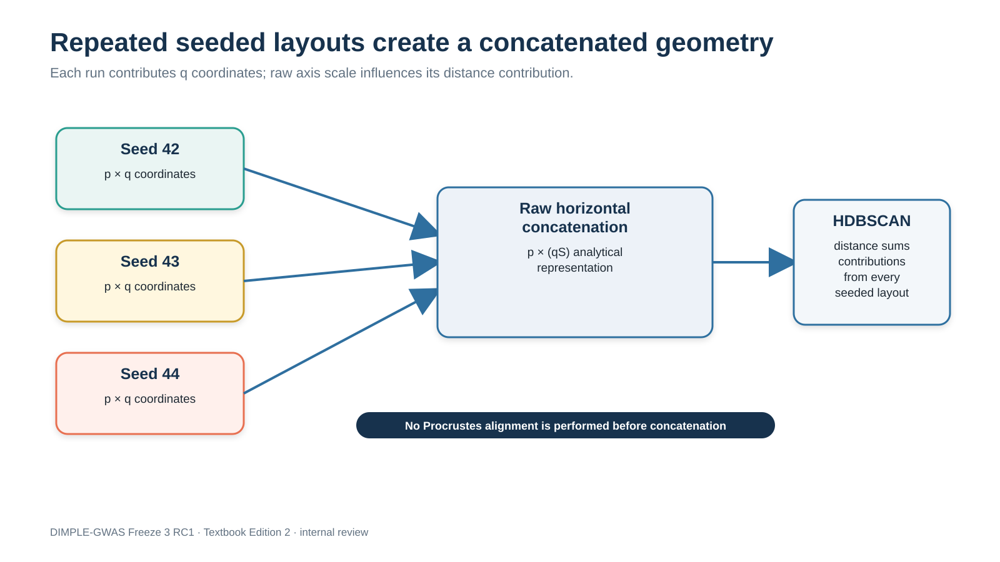{fig-alt="DIMPLE-GWAS derives a seed schedule, fits one representation per seed, and concatenates the coordinate blocks horizontally for clustering"}

<figcaption><strong>Figure 6.</strong> DIMPLE-GWAS derives a seed schedule, fits one representation per seed, and concatenates the coordinate blocks horizontally for clustering. <em>Interpretive boundary:</em> Repeats expose stochastic dependence but do not create an aligned consensus or independent replication.</figcaption>

</figure>

## Learning objectives

After completing Chapter 8, the reader can:

1. define UMAP cross-entropy and explain its role without exceeding the stated caution;
2. define seed schedule and explain its role without exceeding the stated caution;
3. define concatenated geometry and explain its role without exceeding the stated caution;
4. define floating-point reproducibility and explain its role without exceeding the stated caution;
5. trace the relevant package functions and generated artifacts;
6. complete the worked task and distinguish observation from interpretation.

## Conceptual and mathematical development

### UMAP cross-entropy

Low-dimensional layout objective balancing represented and absent fuzzy edges. A compact notation is `C=sum_ij [w_ij log(w_ij/v_ij)+(1-w_ij)log((1-w_ij)/(1-v_ij))]`. In practical terms, optimization is stochastic and coordinates are non-identifiable up to layout symmetries. [[McInnes et al. (2018)](#ref-mcinnes2018umap)]

Within Freeze 3 RC1 the concept is connected to `_fit_one` and is visible through `visualization_embedding.tsv`. This connection is narrower than the general statistical idea: software evidence establishes the implemented route, while the mapped primary or internal evidence supplies background authority. The distinction prevents a mathematical definition from being mistaken for proof that a particular scientific interpretation is correct.

### seed schedule

Deterministic list controlling repeated stochastic fits. A compact notation is `legacy: 1,...,S; current: r,...,r+S-1`. In practical terms, recorded seeds permit replay but do not guarantee cross-platform bitwise identity. [[Collange et al. (2015)](#ref-reproduciblesum2015)]

Within Freeze 3 RC1 the concept is connected to `ensemble_seeds` and is visible through `embedding_manifest.json`. This connection is narrower than the general statistical idea: software evidence establishes the implemented route, while the mapped primary or internal evidence supplies background authority. The distinction prevents a mathematical definition from being mistaken for proof that a particular scientific interpretation is correct.

### concatenated geometry

Horizontal concatenation of s embeddings with q components. A compact notation is `Y*=[Y^(1)|...|Y^(S)] in R^(p x Sq)`. In practical terms, squared Euclidean distances add across runs, so unaligned rotations/scales influence the aggregate.

Within Freeze 3 RC1 the concept is connected to `run_repeated_umap` and is visible through `embedding.npy`. This connection is narrower than the general statistical idea: software evidence establishes the implemented route, while the mapped primary or internal evidence supplies background authority. The distinction prevents a mathematical definition from being mistaken for proof that a particular scientific interpretation is correct.

### floating-point reproducibility

Dependence of finite-precision results on operation order and platform. A compact notation is `fl((a+b)+c) may differ from fl(a+(b+c))`. In practical terms, pinned dependencies improve control but do not guarantee universal bitwise equality. [[Collange et al. (2015)](#ref-reproduciblesum2015)]

Within Freeze 3 RC1 the concept is connected to `capture_environment` and is visible through `environment.json`. This connection is narrower than the general statistical idea: software evidence establishes the implemented route, while the mapped primary or internal evidence supplies background authority. The distinction prevents a mathematical definition from being mistaken for proof that a particular scientific interpretation is correct.

## Reconstructed operational foundation

Edition 1 contained the following verified operational material in separate short notes. Edition 2 consolidates it here and subjects it to the concept and evidence boundaries above.

### Evidence retained from former Chapter 6

### Operational foundation

UMAP is a nonlinear neighborhood-based embedding method; densMAP augments its objective to encourage correspondence in local density. DIMPLE-GWAS repeats seeded embeddings because one stochastic optimization can be sensitive to initialization. It concatenates the repeated coordinates so HDBSCAN receives information from all executed repeats. Density clustering is attractive because it can represent irregular clusters and explicitly leave low-density observations unassigned.

The rationale is empirical, not a mathematical guarantee. Concatenation does not prove that stochasticity has vanished, that Euclidean distances estimate an exact expectation, that ‘true topology’ has been recovered, or that a formal consensus partition has been computed. Base parameters, number and sequence of seeds, implementation versions, numerical libraries, hardware, threads, and the input matrix all remain part of the result.

### Retained evidence

Edition 2 Lab 1 uses one repeated seed for speed; Edition 2 Lab 2 uses two. The production standard declares 1,000. These are tutorial value, tutorial value, and configuration default—not interchangeable recommendations.

### Output-reading checkpoint

Inspect the resolved UMAP parameters, `random_seeds`, package versions, thread settings, projection-quality fields, and HDBSCAN metric in the manifest/candidate table.

### Misinterpretations to avoid

Do not interpret a clean 2D plot as proof that the concatenated representation is stable. Do not increase repeats without estimating compute and storage consequences. Do not call label `-1` a failed phenotype.

### Boundary inherited from Edition 1

Nonlinear embeddings can distort global distances, and density clustering is parameter dependent. Empirical stability should be assessed across justified perturbations and, for scientific conclusions, external or held-out evidence.


## Evidence and references

See McInnes et al. (2018), DOI 10.21105/joss.00861; Narayan et al. (2021), DOI 10.1038/s41587-020-00801-7; and Campello et al. (2015), DOI 10.1145/2733381.

### Evidence retained from former Chapter 17

### Operational foundation

For each UMAP family, Freeze 3 derives a deterministic sequence of integer seeds from the configured base state and repeat count. It executes one embedding per seed and horizontally concatenates the resulting `n_components` coordinates. With 1,000 repeats and three components, the HDBSCAN input has 3,000 coordinates per vector. A smaller display embedding is retained separately for selected-model visualization.

Repeats multiply UMAP work and concatenated-memory width. Standard mode uses the historical ensemble seed behavior and 1,000 repeats; the tutorials set one or two for bounded execution. `n_jobs`, Numba behavior, BLAS/OpenMP libraries, architecture, and thread scheduling can affect runtime and numerical detail. Reproducing seeds is necessary but not sufficient for bitwise cross-platform identity.

The representation is an empirical aggregation. It is not averaged coordinates, a formal consensus cluster, or a proof of expected-distance estimation.

## Evidence diagram or figure

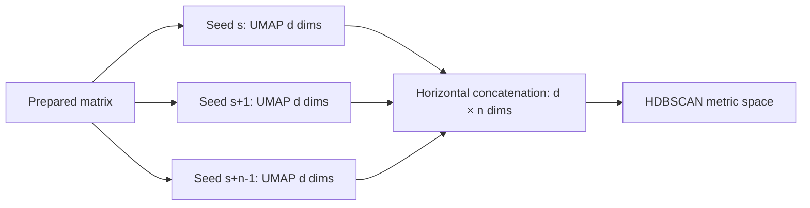


*Repeated embeddings and concatenation. Editable source: `assets/diagrams/diagram_04_repeated_embeddings.mmd`.*

### Retained evidence

Edition 2 Lab 2's manifest lists seeds 42 and 43, three components per repeat, and four UMAP families. Each family therefore supplies a 24×6 concatenated matrix in memory; this matrix is not written to disk.

### Output-reading checkpoint

Inspect `random_seeds`, `umap_seeds`, `n_random_states`, `legacy_ensemble_seeds`, UMAP runtime, package versions, thread settings, and source hash.

### Misinterpretations to avoid

Do not confuse the three display columns with all repeated coordinates. Do not publish a runtime estimate by linearly scaling a JIT-heavy smoke test without qualification. Do not promise identical floating-point embeddings across machines.

### Boundary inherited from Edition 1

The full 164-IDP 1,000-seed run is pending Docker. Cross-platform acceptance should use exact label/schema checks where appropriate and tolerances/alignment for floating-point coordinates.

## Implementation trace

**`pipeline.setup_logger`** is defined at `dimple_gwas/pipeline.py:25` with signature `output_dir: str | Path`. Implementation callable for setup logger. It is reached from pipeline.run_search and connects to No package-defined dependency detected. Its direct artifact contract is logs/run.log; its explicit error surface is No explicit raise in this symbol; delegated calls may raise.. Test evidence is recorded as No direct symbol-name test reference; assess through caller/integration coverage. This is a B-tier contract, so the complete 20-field dossier is retained in the function atlas.

**`pipeline.run_search`** is defined at `dimple_gwas/pipeline.py:130` with signature `config: Mapping[str, Any], output_dir: str | Path, command: list[str] | None=None`. Execute preprocessing, repeated embeddings, candidate evaluation, scoring, retention, reporting, and provenance for one run. It is reached from cli._reproduce; cli.main and connects to hdbscan_runner.fit_hdbscan; io.read_table; metrics.embedding_quality_metrics; pipeline._annotation_frame; pipeline._evaluate_one; pipeline._failed_row; pipeline.setup_logger; preprocessing.prepare_analysis_matrix; provenance.base_manifest; provenance.file_record; ranking.family_summaries; ranking.pareto_front; ranking.rank_models; ranking.top_models; reporting.write_model_outputs; reporting.write_resolved_config; reporting.write_search_space; scoring.apply_scoring; search_space.enumerate_candidates; search_space.stable_identifier; umap_runner.run_repeated_umap. Its direct artifact contract is No direct canonical artifact; in-memory/supporting result; its explicit error surface is RuntimeError; ValueError. Test evidence is recorded as tests/test_pipeline_integration.py::test_custom_leaf_eom_metric_and_max_size_run; tests/test_pipeline_integration.py::test_fixed_model_reproduction. This is a A-tier contract, so the complete 20-field dossier is retained in the function atlas.

**`provenance.sha256_file`** is defined at `dimple_gwas/provenance.py:17` with signature `path: str | Path`. Implementation callable for sha256 file. It is reached from interpretation._native_sources; provenance.file_record; reporting._top_artifact; validation.run_validation and connects to No package-defined dependency detected. Its direct artifact contract is No direct canonical artifact; in-memory/supporting result; its explicit error surface is No explicit raise in this symbol; delegated calls may raise.. Test evidence is recorded as tests/test_failure_and_provenance.py::test_authoritative_source_hash_unchanged. This is a B-tier contract, so the complete 20-field dossier is retained in the function atlas.

**`provenance.package_versions`** is defined at `dimple_gwas/provenance.py:25` with signature `names: Iterable[str] | None=None`. Implementation callable for package versions. It is reached from provenance.base_manifest and connects to No package-defined dependency detected. Its direct artifact contract is No direct canonical artifact; in-memory/supporting result; its explicit error surface is No explicit raise in this symbol; delegated calls may raise.. Test evidence is recorded as No direct symbol-name test reference; assess through caller/integration coverage. This is a B-tier contract, so the complete 20-field dossier is retained in the function atlas.

**`provenance.utc_now`** is defined at `dimple_gwas/provenance.py:40` with signature `class construction/data container`. Implementation callable for utc now. It is reached from comparison.run_comparison; interpretation.run_explanation; provenance.base_manifest; reporting.write_model_outputs; validation.run_validation and connects to No package-defined dependency detected. Its direct artifact contract is No direct canonical artifact; in-memory/supporting result; its explicit error surface is No explicit raise in this symbol; delegated calls may raise.. Test evidence is recorded as No direct symbol-name test reference; assess through caller/integration coverage. This is a B-tier contract, so the complete 20-field dossier is retained in the function atlas.

**`provenance.file_record`** is defined at `dimple_gwas/provenance.py:44` with signature `path: str | Path`. Implementation callable for file record. It is reached from comparison.run_comparison; interpretation.run_explanation; pipeline.run_search; reporting._top_artifact; reporting.write_model_outputs; validation.run_validation and connects to comparison._columns.<locals>.resolve; provenance.sha256_file. Its direct artifact contract is No direct canonical artifact; in-memory/supporting result; its explicit error surface is No explicit raise in this symbol; delegated calls may raise.. Test evidence is recorded as No direct symbol-name test reference; assess through caller/integration coverage. This is a B-tier contract, so the complete 20-field dossier is retained in the function atlas.

**`provenance.package_source_digest`** is defined at `dimple_gwas/provenance.py:53` with signature `class construction/data container`. Compute a stable hash over package source files for non-Git source identity. It is reached from provenance.base_manifest and connects to comparison._columns.<locals>.resolve. Its direct artifact contract is No direct canonical artifact; in-memory/supporting result; its explicit error surface is No explicit raise in this symbol; delegated calls may raise.. Test evidence is recorded as tests/test_freeze3_comparison_validation.py::test_package_source_digest_is_stable. This is a A-tier contract, so the complete 20-field dossier is retained in the function atlas.

**`provenance.base_manifest`** is defined at `dimple_gwas/provenance.py:66` with signature `command: list[str] | None=None`. Implementation callable for base manifest. It is reached from comparison.run_comparison; interpretation.run_explanation; pipeline.run_search; validation.run_validation and connects to provenance.package_source_digest; provenance.package_versions; provenance.utc_now. Its direct artifact contract is No direct canonical artifact; in-memory/supporting result; its explicit error surface is No explicit raise in this symbol; delegated calls may raise.. Test evidence is recorded as No direct symbol-name test reference; assess through caller/integration coverage. This is a A-tier contract, so the complete 20-field dossier is retained in the function atlas.

**`umap_runner.ensemble_seeds`** is defined at `dimple_gwas/umap_runner.py:32` with signature `parameters: Mapping[str, Any], repeats: int, legacy_sequence: bool`. Generate the exact repeated-embedding seed sequence under current or legacy scheduling. It is reached from umap_runner.run_repeated_umap and connects to No package-defined dependency detected. Its direct artifact contract is No direct canonical artifact; in-memory/supporting result; its explicit error surface is No explicit raise in this symbol; delegated calls may raise.. Test evidence is recorded as No direct symbol-name test reference; assess through caller/integration coverage. This is a A-tier contract, so the complete 20-field dossier is retained in the function atlas.

**`umap_runner.run_repeated_umap`** is defined at `dimple_gwas/umap_runner.py:39` with signature `matrix, parameters: Mapping[str, Any], repeats: int, n_jobs: int, legacy_sequence: bool`. Fit repeated UMAP/densMAP representations and concatenate their coordinates. It is reached from pipeline.run_search and connects to umap_runner._fit_one; umap_runner.ensemble_seeds. Its direct artifact contract is No direct canonical artifact; in-memory/supporting result; its explicit error surface is ValueError. Test evidence is recorded as No direct symbol-name test reference; assess through caller/integration coverage. This is a A-tier contract, so the complete 20-field dossier is retained in the function atlas.

## Claim adjudication notebook

The following statements are admitted to the draft only in their safe form:

- **PIPE-002 (reject):** Repeated seeded embeddings are concatenated as an empirical representation strategy; the implementation supplies no theorem that it eliminates stochasticity or recovers true topology. [[McInnes et al. (2018)](#ref-mcinnes2018umap)] Limitation: Parameters, layout symmetries, libraries, and hardware still matter. Implementation evidence: `umap_runner.py`.

- **METH-003 (implementation_specific):** Freeze 3 concatenates raw run coordinates without Procrustes alignment; squared Euclidean distances therefore sum run-specific distances but remain sensitive to run scale and layout. [[McInnes et al. (2018)](#ref-mcinnes2018umap); [Gower (1975)](#ref-gower1975)] Limitation: Rotation preserves within-run Euclidean distance; scale does not. Implementation evidence: `umap_runner.py`.

## Worked reasoning and evidence exercise

Prove the squared-distance sum identity for two two-dimensional runs, then rescale one run and recalculate its contribution.

A complete Chapter 8 answer must expose its intermediate reasoning, name the source or output used for `Repeated stochastic embeddings and concatenated geometry`, and finish with separate support and non-support statements. Applying that discipline to the question “Why fit more than one seeded layout, and what geometry results from concatenating them?” prevents a calculation, a software observation, and a scientific interpretation from collapsing into one claim.

## Assumptions, diagnostics, and recovery

The Chapter 8 analysis assumes the stated unit and inputs, the recorded configuration and software identity, and a diagnostic that addresses the claimed property rather than a convenient surrogate. Its decisive boundary is: Freeze 3 records seed schedules and returns a raw horizontal concatenation; it does not persist per-seed or full concatenated arrays as files.

If the Chapter 8 route fails, retain its log and candidate status before deciding whether the cause is input, configuration, dependency, compute, identifier alignment, or output-root state. Correct an operational failure by writing a new result directory. Treat instability in `Repeated stochastic embeddings and concatenated geometry` as sensitivity evidence: report it and identify the independent evidence needed instead of relabeling ambiguity as a software exception.

## Chapter synthesis

Repeats expose and aggregate stochastic layouts, but raw concatenation does not align coordinate axes or prove consensus. The implementation trace makes the current behavior auditable, but the evidence boundary remains part of the result. Chapter 9 places density clustering on the concatenated representation.

## Exercises

1. For `Repeated stochastic embeddings and concatenated geometry`, name the unit of analysis and one plausible but invalid substitute.
2. Reconstruct the notation for UMAP cross-entropy; define its dimensions or denominator and interpret every term.
3. Choose a Tier A function mapped to Chapter 8; identify its caller and direct output, then propose a topic-specific edge case.
4. Select one Chapter 8 artifact from the output atlas and state three integrity checks that must precede scientific reading.
5. Convert a tempting `Repeated stochastic embeddings and concatenated geometry` overclaim into one observed statement followed by its limitation.
6. Prove the squared-distance sum identity for two two-dimensional runs, then rescale one run and recalculate its contribution.

Appendix J gives the Chapter 8 adjudication guide. Its further-reading keys supply statistical context; no external paper is treated as automatic validation of the current software or dataset.


<div class="chapter-break"></div>

<a id="chapter-9"></a>

# 9. HDBSCAN hierarchy, density, selection, and noise

*Guiding question:* **How does HDBSCAN turn local density into a hierarchy and a flat partition?**

Prerequisites: 5,8.

## Why the question matters

A stable density branch can be useful without making every point belong to a cluster.

Freeze 3 delegates fitting to the contributed `hdbscan` package and records outputs; label −1 remains parameter-conditional unassignment.

This chapter develops the question in the order needed for a reader to move from statistical principle to current implementation, retained evidence, and a defensible statement. Its central worked task is: Calculate core distances and mutual reachability for a six-point line, then predict how raising `min_samples` changes the density scale.


<figure id="fig-f06">

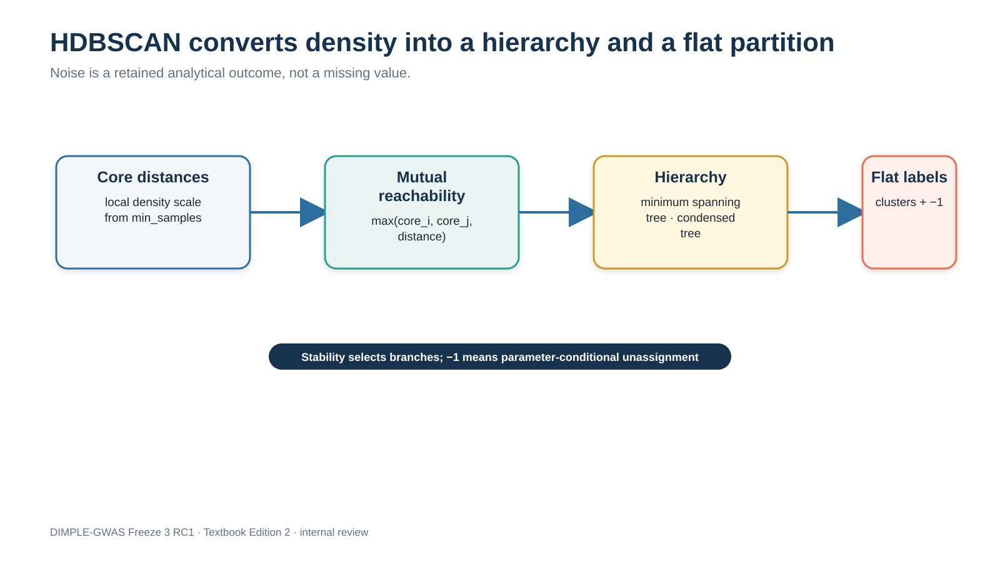{fig-alt="Core distances and mutual reachability define a density-sensitive hierarchy from which stable branches are selected as clusters"}

<figcaption><strong>Figure 7.</strong> Core distances and mutual reachability define a density-sensitive hierarchy from which stable branches are selected as clusters. <em>Interpretive boundary:</em> A label of −1 is not proof that a phenotype is scientifically anomalous.</figcaption>

</figure>

## Learning objectives

After completing Chapter 9, the reader can:

1. define core distance and explain its role without exceeding the stated caution;
2. define mutual reachability and explain its role without exceeding the stated caution;
3. define HDBSCAN stability and explain its role without exceeding the stated caution;
4. define noise label and explain its role without exceeding the stated caution;
5. trace the relevant package functions and generated artifacts;
6. complete the worked task and distinguish observation from interpretation.

## Conceptual and mathematical development

### core distance

Distance from a point to its min_samples-th neighbor. A compact notation is `core_k(x)`. In practical terms, larger min_samples changes the density scale and may increase unassigned points. [[Campello et al. (2015)](#ref-campello2015hdbscan)]

Within Freeze 3 RC1 the concept is connected to `fit_hdbscan (hdbscan delegate)` and is visible through `candidate labels`. This connection is narrower than the general statistical idea: software evidence establishes the implemented route, while the mapped primary or internal evidence supplies background authority. The distinction prevents a mathematical definition from being mistaken for proof that a particular scientific interpretation is correct.

### mutual reachability

Density-aware dissimilarity used by hdbscan. A compact notation is `d_mr(a,b)=max(core_k(a),core_k(b),d(a,b))`. In practical terms, it smooths single-linkage effects without removing parameter dependence. [[Campello et al. (2015)](#ref-campello2015hdbscan)]

Within Freeze 3 RC1 the concept is connected to `fit_hdbscan` and is visible through `condensed tree state`. This connection is narrower than the general statistical idea: software evidence establishes the implemented route, while the mapped primary or internal evidence supplies background authority. The distinction prevents a mathematical definition from being mistaken for proof that a particular scientific interpretation is correct.

### HDBSCAN stability

Persistence of a cluster through the density hierarchy. A compact notation is `Stability(C)=sum_(x in C)(lambda_x-lambda_birth)`. In practical terms, the library computes the hierarchy; Freeze 3 records persistence summaries. [[Campello et al. (2015)](#ref-campello2015hdbscan); [McInnes et al. (2017)](#ref-mcinnes2017hdbscan)]

Within Freeze 3 RC1 the concept is connected to `fit_hdbscan; evaluate_candidate` and is visible through `model_table.csv`. This connection is narrower than the general statistical idea: software evidence establishes the implemented route, while the mapped primary or internal evidence supplies background authority. The distinction prevents a mathematical definition from being mistaken for proof that a particular scientific interpretation is correct.

### noise label

Label -1 for points unassigned under a fitted density model. A compact notation is `label_i=-1`. In practical terms, noise is algorithmic and parameter-conditional, never a biological-null statement. [[Campello et al. (2015)](#ref-campello2015hdbscan)]

Within Freeze 3 RC1 the concept is connected to `fit_hdbscan` and is visible through `labels.tsv`. This connection is narrower than the general statistical idea: software evidence establishes the implemented route, while the mapped primary or internal evidence supplies background authority. The distinction prevents a mathematical definition from being mistaken for proof that a particular scientific interpretation is correct.

## Reconstructed operational foundation

Edition 1 contained the following verified operational material in separate short notes. Edition 2 consolidates it here and subjects it to the concept and evidence boundaries above.

### Evidence retained from former Chapter 18

### Operational foundation

Freeze 3 fits the contributed `hdbscan` package to each concatenated embedding. `min_cluster_size` sets the smallest extracted group, while `min_samples` affects core distances and conservativeness. `cluster_selection_epsilon` can merge fine structure below a distance threshold. `cluster_selection_method` is `eom` or `leaf`; `max_cluster_size` has no effect for leaf selection and is recorded with a parameter note when set. Other exposed controls are persistence, alpha, single-cluster permission, maximum cluster size, and metric.

The standard grid uses min-cluster-size 5 through 49, min-samples 2 through 19, and epsilon 0,1,2: 2,430 candidates. Candidate identity also includes UMAP family. Every evaluation becomes `success`, `invalid_topology` when fewer than two non-noise clusters are found, or `failed` with an error. Failure rows are retained, not removed.

## Evidence diagram or figure


*Complete search-space enumeration. Editable source: `assets/diagrams/diagram_05_search_space.mmd`.*

### Retained evidence

Edition 2 Lab 2 evaluates min-cluster-size 4/6, min-samples 2/4, epsilon 0/0.05, and scalar EOM/Euclidean settings across four UMAP families. All 32 candidates succeeded and produced three clusters with no noise.

### Output-reading checkpoint

Inspect `hdbscan_id`, flattened parameters, status, error message, cluster/noise counts, persistence summaries, metric warnings, candidate runtime, and `model_failures.tsv`.

### Misinterpretations to avoid

Do not interpret increasing `min_samples` as universally better. Do not use numeric cluster labels as stable identity across fits. Do not call noise observations false or biologically irrelevant.

### Boundary inherited from Edition 1

Density structure depends on the concatenated representation and metric. A grid can expose sensitivity but does not identify a uniquely correct biological scale.


## Evidence and references

See Campello et al. (2015), DOI 10.1145/2733381; McInnes et al. (2017), DOI 10.21105/joss.00205; and official hdbscan API documentation.

### Evidence retained from former Chapter 28

### Operational foundation

HDBSCAN label `-1` means that the fitted hierarchy/extraction did not assign an observation to a retained cluster under the current representation, metric, density parameters, and selection method. It is an algorithmic status, not a biological category. Changing UMAP parameters, seed aggregation, min-cluster-size, min-samples, epsilon, metric, or selection method can change the noise set.

Inspect unassigned observations rather than discarding them rhetorically. Report count/fraction, exact IDs, probabilities/persistence when available, original-space relationships, stability across justified settings, and transitions in comparison outputs. Use ‘unassigned’ or ‘HDBSCAN noise’ with the condition attached. Avoid ‘non-pleiotropic,’ ‘failed IDP,’ ‘irrelevant,’ or ‘no shared structure.’

### Retained evidence

The synthetic tutorials have zero noise. The historical 164-IDP record has 102 unassigned and 62 assigned across five clusters; this is historical evidence and does not imply 102 biologically irrelevant IDPs.

### Output-reading checkpoint

Inspect label tables, noise count/fraction, candidate parameters, membership comparison, changed-noise status, exclusions under noise policy, and historical source status.

### Misinterpretations to avoid

Do not drop noise before reporting its magnitude. Do not compare noise labels without exact IDs. Do not treat absence of assigned cluster as absence of any genetic correlation.

### Boundary inherited from Edition 1

Freeze 3 does not provide a calibrated biological uncertainty interval for each label. Stability and external data must be studied separately.


## Evidence and references

See Campello et al. (2015), DOI 10.1145/2733381.

## Implementation trace

**`hdbscan_runner.estimator_kwargs`** is defined at `dimple_gwas/hdbscan_runner.py:15` with signature `parameters: Mapping[str, Any], core_dist_n_jobs: int=1`. Implementation callable for estimator kwargs. It is reached from hdbscan_runner.fit_hdbscan and connects to No package-defined dependency detected. Its direct artifact contract is No direct canonical artifact; in-memory/supporting result; its explicit error surface is No explicit raise in this symbol; delegated calls may raise.. Test evidence is recorded as No direct symbol-name test reference; assess through caller/integration coverage. This is a B-tier contract, so the complete 20-field dossier is retained in the function atlas.

**`hdbscan_runner.fit_hdbscan`** is defined at `dimple_gwas/hdbscan_runner.py:34` with signature `embedding, parameters: Mapping[str, Any], core_dist_n_jobs: int=1`. Fit contributed HDBSCAN with normalized Freeze 3 parameters. It is reached from pipeline._evaluate_one; pipeline.run_search and connects to hdbscan_runner.estimator_kwargs. Its direct artifact contract is No direct canonical artifact; in-memory/supporting result; its explicit error surface is No explicit raise in this symbol; delegated calls may raise.. Test evidence is recorded as tests/test_failure_and_provenance.py::test_failed_candidate_is_retained. This is a A-tier contract, so the complete 20-field dossier is retained in the function atlas.

**`metrics.effective_neighbor_count`** is defined at `dimple_gwas/metrics.py:9` with signature `n_samples: int, requested: int`. Implementation callable for effective neighbor count. It is reached from metrics.embedding_quality_metrics and connects to No package-defined dependency detected. Its direct artifact contract is No direct canonical artifact; in-memory/supporting result; its explicit error surface is No explicit raise in this symbol; delegated calls may raise.. Test evidence is recorded as tests/test_preprocessing_metrics.py::test_effective_neighbor_edge_cases. This is a B-tier contract, so the complete 20-field dossier is retained in the function atlas.

**`metrics.embedding_quality_metrics`** is defined at `dimple_gwas/metrics.py:15` with signature `original, embedding, requested_k: int, max_samples: int, seed: int`. Calculate bounded trustworthiness and continuity diagnostics for an embedding. It is reached from interpretation.run_explanation; pipeline.run_search and connects to metrics.effective_neighbor_count. Its direct artifact contract is No direct canonical artifact; in-memory/supporting result; its explicit error surface is No explicit raise in this symbol; delegated calls may raise.. Test evidence is recorded as tests/test_preprocessing_metrics.py::test_optimized_trustworthiness_and_continuity. This is a A-tier contract, so the complete 20-field dossier is retained in the function atlas.

**`metrics.evaluate_candidate`** is defined at `dimple_gwas/metrics.py:60` with signature `embedding, labels, clusterer, silhouette_metric: str, fit_include_noise: bool, compute_dbcv: bool, max_samples_silhouette: int=0, silhouette_seed: int=42`. Compute cluster counts, persistence, silhouette, CH, DB, optional DBCV, and validity status for one candidate. It is reached from pipeline._evaluate_one and connects to metrics._cluster_sizes. Its direct artifact contract is No direct canonical artifact; in-memory/supporting result; its explicit error surface is No explicit raise in this symbol; delegated calls may raise.. Test evidence is recorded as No direct symbol-name test reference; assess through caller/integration coverage. This is a A-tier contract, so the complete 20-field dossier is retained in the function atlas.

**`metrics.is_finite_number`** is defined at `dimple_gwas/metrics.py:165` with signature `value: Any`. Implementation callable for is finite number. It is reached from CLI/import/direct caller or no package caller detected and connects to No package-defined dependency detected. Its direct artifact contract is No direct canonical artifact; in-memory/supporting result; its explicit error surface is No explicit raise in this symbol; delegated calls may raise.. Test evidence is recorded as No direct symbol-name test reference; assess through caller/integration coverage. This is a B-tier contract, so the complete 20-field dossier is retained in the function atlas.

**`pipeline.setup_logger`** is defined at `dimple_gwas/pipeline.py:25` with signature `output_dir: str | Path`. Implementation callable for setup logger. It is reached from pipeline.run_search and connects to No package-defined dependency detected. Its direct artifact contract is logs/run.log; its explicit error surface is No explicit raise in this symbol; delegated calls may raise.. Test evidence is recorded as No direct symbol-name test reference; assess through caller/integration coverage. This is a B-tier contract, so the complete 20-field dossier is retained in the function atlas.

**`pipeline.run_search`** is defined at `dimple_gwas/pipeline.py:130` with signature `config: Mapping[str, Any], output_dir: str | Path, command: list[str] | None=None`. Execute preprocessing, repeated embeddings, candidate evaluation, scoring, retention, reporting, and provenance for one run. It is reached from cli._reproduce; cli.main and connects to hdbscan_runner.fit_hdbscan; io.read_table; metrics.embedding_quality_metrics; pipeline._annotation_frame; pipeline._evaluate_one; pipeline._failed_row; pipeline.setup_logger; preprocessing.prepare_analysis_matrix; provenance.base_manifest; provenance.file_record; ranking.family_summaries; ranking.pareto_front; ranking.rank_models; ranking.top_models; reporting.write_model_outputs; reporting.write_resolved_config; reporting.write_search_space; scoring.apply_scoring; search_space.enumerate_candidates; search_space.stable_identifier; umap_runner.run_repeated_umap. Its direct artifact contract is No direct canonical artifact; in-memory/supporting result; its explicit error surface is RuntimeError; ValueError. Test evidence is recorded as tests/test_pipeline_integration.py::test_custom_leaf_eom_metric_and_max_size_run; tests/test_pipeline_integration.py::test_fixed_model_reproduction. This is a A-tier contract, so the complete 20-field dossier is retained in the function atlas.

## Claim adjudication notebook

The following statements are admitted to the draft only in their safe form:

- **PIPE-004 (implementation_specific):** Freeze 3 calls the contributed hdbscan package, not sklearn.cluster.HDBSCAN. [[Campello et al. (2015)](#ref-campello2015hdbscan); [McInnes et al. (2017)](#ref-mcinnes2017hdbscan)] Limitation: Backends with similar names can differ in semantics. Implementation evidence: `hdbscan_runner.py`.

- **INT-002 (reject):** Label -1 means unassigned under the fitted representation, metric, density assumptions, and parameters. [[Campello et al. (2015)](#ref-campello2015hdbscan)] Limitation: Noise status can change across candidate settings. Implementation evidence: `hdbscan_runner.py`.

## Worked reasoning and evidence exercise

Calculate core distances and mutual reachability for a six-point line, then predict how raising `min_samples` changes the density scale.

A complete Chapter 9 answer must expose its intermediate reasoning, name the source or output used for `HDBSCAN hierarchy, density, selection, and noise`, and finish with separate support and non-support statements. Applying that discipline to the question “How does HDBSCAN turn local density into a hierarchy and a flat partition?” prevents a calculation, a software observation, and a scientific interpretation from collapsing into one claim.

## Assumptions, diagnostics, and recovery

The Chapter 9 analysis assumes the stated unit and inputs, the recorded configuration and software identity, and a diagnostic that addresses the claimed property rather than a convenient surrogate. Its decisive boundary is: Freeze 3 delegates fitting to the contributed `hdbscan` package and records outputs; label −1 remains parameter-conditional unassignment.

If the Chapter 9 route fails, retain its log and candidate status before deciding whether the cause is input, configuration, dependency, compute, identifier alignment, or output-root state. Correct an operational failure by writing a new result directory. Treat instability in `HDBSCAN hierarchy, density, selection, and noise` as sensitivity evidence: report it and identify the independent evidence needed instead of relabeling ambiguity as a software exception.

## Chapter synthesis

A stable density branch can be useful without making every point belong to a cluster. The implementation trace makes the current behavior auditable, but the evidence boundary remains part of the result. Chapter 10 converts UMAP and HDBSCAN parameter families into auditable candidates.

## Exercises

1. For `HDBSCAN hierarchy, density, selection, and noise`, name the unit of analysis and one plausible but invalid substitute.
2. Reconstruct the notation for core distance; define its dimensions or denominator and interpret every term.
3. Choose a Tier A function mapped to Chapter 9; identify its caller and direct output, then propose a topic-specific edge case.
4. Select one Chapter 9 artifact from the output atlas and state three integrity checks that must precede scientific reading.
5. Convert a tempting `HDBSCAN hierarchy, density, selection, and noise` overclaim into one observed statement followed by its limitation.
6. Calculate core distances and mutual reachability for a six-point line, then predict how raising `min_samples` changes the density scale.

Appendix J gives the Chapter 9 adjudication guide. Its further-reading keys supply statistical context; no external paper is treated as automatic validation of the current software or dataset.


<div class="chapter-break"></div>

<a id="chapter-10"></a>

# 10. Search-space enumeration and computational design

*Guiding question:* **How many models will a configuration request, and which work is shared across them?**

Prerequisites: 8–9.

## Why the question matters

A Cartesian grid is transparent but can grow faster than intuition; deterministic enumeration does not make an oversized run wise.

The standard HDBSCAN grid is 2,430 candidates for one UMAP configuration; custom and extended modes have different, exactly enumerated counts.

This chapter develops the question in the order needed for a reader to move from statistical principle to current implementation, retained evidence, and a defensible statement. Its central worked task is: Calculate the 32 candidates in Lab 2, separate four UMAP families from eight HDBSCAN settings, and estimate the number of UMAP fits.


<figure id="fig-f07">

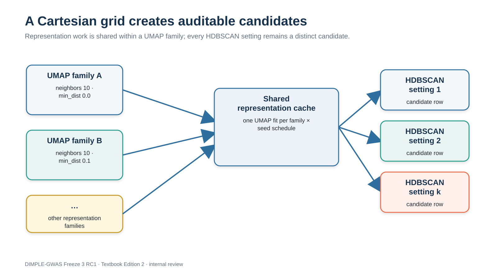{fig-alt="Search-space expansion defines UMAP families, reuses each family representation, and evaluates the Cartesian HDBSCAN settings into retained candidate rows"}

<figcaption><strong>Figure 8.</strong> Search-space expansion defines UMAP families, reuses each family representation, and evaluates the Cartesian HDBSCAN settings into retained candidate rows. <em>Interpretive boundary:</em> A deterministic denominator does not make an oversized or post hoc search scientifically appropriate.</figcaption>

</figure>

## Learning objectives

After completing Chapter 10, the reader can:

1. define seed schedule and explain its role without exceeding the stated caution;
2. define Cartesian search and explain its role without exceeding the stated caution;
3. define candidate identity and explain its role without exceeding the stated caution;
4. trace the relevant package functions and generated artifacts;
5. complete the worked task and distinguish observation from interpretation.

## Conceptual and mathematical development

### seed schedule

Deterministic list controlling repeated stochastic fits. A compact notation is `legacy: 1,...,S; current: r,...,r+S-1`. In practical terms, recorded seeds permit replay but do not guarantee cross-platform bitwise identity. [[Collange et al. (2015)](#ref-reproduciblesum2015)]

Within Freeze 3 RC1 the concept is connected to `ensemble_seeds` and is visible through `embedding_manifest.json`. This connection is narrower than the general statistical idea: software evidence establishes the implemented route, while the mapped primary or internal evidence supplies background authority. The distinction prevents a mathematical definition from being mistaken for proof that a particular scientific interpretation is correct.

### Cartesian search

Product of enumerated parameter families. A compact notation is `N_candidates=product_j |Theta_j|`. In practical terms, the standard grid is 45 x 18 x 3 = 2,430 for one UMAP family.

Within Freeze 3 RC1 the concept is connected to `enumerate_candidates` and is visible through `search_space.tsv`. This connection is narrower than the general statistical idea: software evidence establishes the implemented route, while the mapped primary or internal evidence supplies background authority. The distinction prevents a mathematical definition from being mistaken for proof that a particular scientific interpretation is correct.

### candidate identity

Deterministic hash and ordinal for a resolved parameter combination. A compact notation is `model_id=H(canonical parameters)`. In practical terms, identity supports replay; it is not a quality score.

Within Freeze 3 RC1 the concept is connected to `candidate_identity` and is visible through `search_space.tsv; model_table.csv`. This connection is narrower than the general statistical idea: software evidence establishes the implemented route, while the mapped primary or internal evidence supplies background authority. The distinction prevents a mathematical definition from being mistaken for proof that a particular scientific interpretation is correct.

## Reconstructed operational foundation

Edition 1 contained the following verified operational material in separate short notes. Edition 2 consolidates it here and subjects it to the concept and evidence boundaries above.

### Evidence retained from former Chapter 12

### Operational foundation

`inspect-config` resolves and validates configuration and prints candidate counts without fitting. `show-search-space` enumerates the complete deterministic Cartesian product and can retain full TSV/JSON manifests. These commands are mandatory preflight tools: they expose accidental explosions, invalid fields, and misunderstood ranges before UMAP consumes compute.

```bash
dimple-gwas show-search-space \
  --search-mode custom \
  --config docs/textbook/edition2/labs/02_custom_search_space/tutorial_config.yaml \
  --output-dir docs/textbook/edition2/labs/02_custom_search_space/search_space_new \
  --show-first 5
```

Choose a new output directory name; the manual's executed directory is evidence, not a scratch target. Standard mode proves 45 min-cluster-size choices × 18 min-samples choices × 3 epsilon choices = 2,430 candidates for one UMAP family. Shipped extended mode has 1,728 candidates, not the older provisional 5,184 number.

### Retained evidence

Executed Edition 2 Lab 1 enumerated one candidate; Edition 2 Lab 2 enumerated 32: four UMAP families times eight HDBSCAN configurations. Both counts appear in stdout and complete manifests.

### Output-reading checkpoint

Inspect `candidate_models`, UMAP/HDBSCAN family counts, candidate ordinals, stable IDs, and the first/last parameter rows. Retain config and manifest checksums together.

### Misinterpretations to avoid

Do not estimate workload from HDBSCAN choices alone when UMAP parameters also vary. Do not silently sample a large Cartesian product; Freeze 3's safety ceiling raises rather than sampling.

### Boundary inherited from Edition 1

Candidate count is not runtime by itself: repeated UMAP families dominate some workloads while HDBSCAN candidate fits dominate others. Pilot evidence is still needed.

### Evidence retained from former Chapter 17

### Operational foundation

For each UMAP family, Freeze 3 derives a deterministic sequence of integer seeds from the configured base state and repeat count. It executes one embedding per seed and horizontally concatenates the resulting `n_components` coordinates. With 1,000 repeats and three components, the HDBSCAN input has 3,000 coordinates per vector. A smaller display embedding is retained separately for selected-model visualization.

Repeats multiply UMAP work and concatenated-memory width. Standard mode uses the historical ensemble seed behavior and 1,000 repeats; the tutorials set one or two for bounded execution. `n_jobs`, Numba behavior, BLAS/OpenMP libraries, architecture, and thread scheduling can affect runtime and numerical detail. Reproducing seeds is necessary but not sufficient for bitwise cross-platform identity.

The representation is an empirical aggregation. It is not averaged coordinates, a formal consensus cluster, or a proof of expected-distance estimation.

## Evidence diagram or figure


*Repeated embeddings and concatenation. Editable source: `assets/diagrams/diagram_04_repeated_embeddings.mmd`.*

### Retained evidence

Edition 2 Lab 2's manifest lists seeds 42 and 43, three components per repeat, and four UMAP families. Each family therefore supplies a 24×6 concatenated matrix in memory; this matrix is not written to disk.

### Output-reading checkpoint

Inspect `random_seeds`, `umap_seeds`, `n_random_states`, `legacy_ensemble_seeds`, UMAP runtime, package versions, thread settings, and source hash.

### Misinterpretations to avoid

Do not confuse the three display columns with all repeated coordinates. Do not publish a runtime estimate by linearly scaling a JIT-heavy smoke test without qualification. Do not promise identical floating-point embeddings across machines.

### Boundary inherited from Edition 1

The full 164-IDP 1,000-seed run is pending Docker. Cross-platform acceptance should use exact label/schema checks where appropriate and tolerances/alignment for floating-point coordinates.

### Evidence retained from former Chapter 39

### Operational foundation

Freeze 3 enumerates the full Cartesian product of normalized UMAP and HDBSCAN parameter values. Candidate ordinals and stable hashes make enumeration auditable. It does not silently sample. `execution.max_candidate_models` is a hard safety ceiling; zero means unlimited. `warn_candidate_count` is a warning threshold.

Mode counts in this source are: standard 2,430 candidates (one UMAP family × 45 × 18 × 3 HDBSCAN values); fixed one candidate when all searched fields are scalar; Edition 2 Lab 2 custom 32; shipped extended 1,728. Extended crosses multiple UMAP and HDBSCAN fields, and its count must be derived from the current source rather than older planning documents.

Search work can reuse one repeated embedding across many HDBSCAN candidates sharing `umap_id`. Therefore candidate count, UMAP-family count, repeat count, sample/vector count, input width, metric, and thread settings all matter.

### Retained evidence

`show-search-space` writes the full flattened rows plus JSON counts. Compare the number of unique `umap_id` and `hdbscan_id` values with total candidate rows.

### Output-reading checkpoint

Inspect candidate ordinal/model/family IDs, every flattened parameter, declared enumeration note, safety settings, and checksum.

### Misinterpretations to avoid

Do not multiply only visibly changed YAML keys while ignoring inherited lists. Do not describe a truncated preview as the full manifest. Do not change the grid after examining desired labels without disclosure.

### Boundary inherited from Edition 1

Enumeration completeness is a software property, not a claim that the grid covers all meaningful models or that rank one is unique.

### Evidence retained from former Chapter 44

### Operational foundation

Workload has two nested scales: UMAP families × repeated seeds, then HDBSCAN candidates per family. Concatenated width is components × repeats; embedding storage in memory grows with vector count and that width. Original-space explanation may create a quadratic vector-by-vector similarity matrix and large heatmap. Candidate tables grow with the Cartesian product. JIT compilation makes first small runs slower than steady-state work.

Use `inspect-config`/`show-search-space` before execution. Start with the fixed fixture, then a bounded scientific pilot that preserves the intended method. Set `n_jobs` and `candidate_jobs` deliberately: when candidates run in parallel, Freeze 3 constrains HDBSCAN core-distance jobs to one to avoid nested oversubscription. Thread environment variables and numerical backends belong in provenance. Use the full-heatmap limit and avoid forcing large matrices without memory/privacy review.

The historical note records a 16-GB host caution. Current storage had ample space, but that is not a production resource recommendation. The executed 10.7-second/32-candidate and 273.47-second historical MNIST values are configuration-specific evidence, not scaling laws.

### Retained evidence

Estimate candidate count, UMAP-family count, concatenated width, model-table rows, and similarity-matrix cells for a proposed run. Then compare available memory/storage and choose one job setting before starting.

### Output-reading checkpoint

Inspect preflight counts, free storage, vector/input width, repeat/component counts, jobs/threads, UMAP/candidate runtimes, failure rates, Parquet status, and explanation matrix safeguards.

### Misinterpretations to avoid

Do not run the 164 1,000-seed workflow as an undocumented first smoke test. Do not set both job layers to unrestricted parallelism. Do not infer linear runtime from tiny fixtures.

### Boundary inherited from Edition 1

No fresh full-IDP runtime/memory benchmark exists yet. Docker profiling must precede cloud sizing and preserve scientific settings.

## Implementation trace

**`config.builtin_config`** is defined at `dimple_gwas/config.py:128` with signature `mode: str`. Implementation callable for builtin config. It is reached from config.resolve_config and connects to config._base_config. Its direct artifact contract is No direct canonical artifact; in-memory/supporting result; its explicit error surface is ValueError. Test evidence is recorded as No direct symbol-name test reference; assess through caller/integration coverage. This is a B-tier contract, so the complete 20-field dossier is retained in the function atlas.

**`config.deep_merge`** is defined at `dimple_gwas/config.py:164` with signature `base: Mapping[str, Any], overlay: Mapping[str, Any]`. Implementation callable for deep merge. It is reached from config.resolve_config and connects to No package-defined dependency detected. Its direct artifact contract is No direct canonical artifact; in-memory/supporting result; its explicit error surface is No explicit raise in this symbol; delegated calls may raise.. Test evidence is recorded as No direct symbol-name test reference; assess through caller/integration coverage. This is a B-tier contract, so the complete 20-field dossier is retained in the function atlas.

**`config.load_yaml`** is defined at `dimple_gwas/config.py:174` with signature `path: str | Path`. Implementation callable for load yaml. It is reached from config.resolve_config and connects to No package-defined dependency detected. Its direct artifact contract is No direct canonical artifact; in-memory/supporting result; its explicit error surface is FileNotFoundError; RuntimeError; ValueError. Test evidence is recorded as No direct symbol-name test reference; assess through caller/integration coverage. This is a B-tier contract, so the complete 20-field dossier is retained in the function atlas.

**`config.set_dotted`** is defined at `dimple_gwas/config.py:191` with signature `config: dict[str, Any], dotted: str, value: Any`. Implementation callable for set dotted. It is reached from config.resolve_config and connects to No package-defined dependency detected. Its direct artifact contract is No direct canonical artifact; in-memory/supporting result; its explicit error surface is No explicit raise in this symbol; delegated calls may raise.. Test evidence is recorded as No direct symbol-name test reference; assess through caller/integration coverage. This is a B-tier contract, so the complete 20-field dossier is retained in the function atlas.

**`config.resolve_config`** is defined at `dimple_gwas/config.py:203` with signature `mode: str, config_path: str | Path | None=None, overrides: Mapping[str, Any] | None=None`. Implementation callable for resolve config. It is reached from cli._explain; cli._reproduce; cli._resolved; cli._score and connects to config.builtin_config; config.deep_merge; config.load_yaml; config.set_dotted; config.validate_config. Its direct artifact contract is No direct canonical artifact; in-memory/supporting result; its explicit error surface is No explicit raise in this symbol; delegated calls may raise.. Test evidence is recorded as tests/test_config.py::test_cli_override_precedence; tests/test_config.py::test_fixed_mode_rejects_lists; tests/test_config.py::test_invalid_combinations_rejected; tests/test_config.py::test_standard_defaults_match_dev_declarations; tests/test_freeze3_interpretation.py::test_interpretation_defaults_are_additive; tests/test_freeze3_interpretation.py::test_invalid_interpretation_configuration_fails; tests/test_freeze3_interpretation.py::test_legacy_incomplete_matching_writes_exclusions; tests/test_freeze3_interpretation.py::test_native_explanation_end_to_end; tests/test_freeze3_interpretation.py::test_native_explanation_refuses_nonempty_output; tests/test_search_space.py::test_search_enumeration_and_stable_ids; tests/test_search_space.py::test_search_limit_never_silently_samples. This is a A-tier contract, so the complete 20-field dossier is retained in the function atlas.

**`config.as_list`** is defined at `dimple_gwas/config.py:277` with signature `value: Any, cast: type | None=None`. Implementation callable for as list. It is reached from config.normalized_parameter_space and connects to config._coerce_bool; config._range_values; config._string_sequence. Its direct artifact contract is No direct canonical artifact; in-memory/supporting result; its explicit error surface is ValueError. Test evidence is recorded as tests/test_config.py::test_scalar_list_and_range_handling. This is a B-tier contract, so the complete 20-field dossier is retained in the function atlas.

**`config.normalized_parameter_space`** is defined at `dimple_gwas/config.py:298` with signature `config: Mapping[str, Any]`. Implementation callable for normalized parameter space. It is reached from config.validate_config; search_space.count_candidates; search_space.enumerate_candidates and connects to config.as_list. Its direct artifact contract is No direct canonical artifact; in-memory/supporting result; its explicit error surface is ValueError. Test evidence is recorded as tests/test_config.py::test_cli_override_precedence. This is a A-tier contract, so the complete 20-field dossier is retained in the function atlas.

**`config.validate_config`** is defined at `dimple_gwas/config.py:343` with signature `config: Mapping[str, Any]`. Implementation callable for validate config. It is reached from cli._explain; cli._reproduce; config.resolve_config and connects to config._finite; config.normalized_parameter_space. Its direct artifact contract is No direct canonical artifact; in-memory/supporting result; its explicit error surface is ValueError. Test evidence is recorded as No direct symbol-name test reference; assess through caller/integration coverage. This is a A-tier contract, so the complete 20-field dossier is retained in the function atlas.

**`config.config_as_json`** is defined at `dimple_gwas/config.py:489` with signature `config: Mapping[str, Any]`. Implementation callable for config as json. It is reached from CLI/import/direct caller or no package caller detected and connects to No package-defined dependency detected. Its direct artifact contract is No direct canonical artifact; in-memory/supporting result; its explicit error surface is No explicit raise in this symbol; delegated calls may raise.. Test evidence is recorded as No direct symbol-name test reference; assess through caller/integration coverage. This is a B-tier contract, so the complete 20-field dossier is retained in the function atlas.

**`pipeline.setup_logger`** is defined at `dimple_gwas/pipeline.py:25` with signature `output_dir: str | Path`. Implementation callable for setup logger. It is reached from pipeline.run_search and connects to No package-defined dependency detected. Its direct artifact contract is logs/run.log; its explicit error surface is No explicit raise in this symbol; delegated calls may raise.. Test evidence is recorded as No direct symbol-name test reference; assess through caller/integration coverage. This is a B-tier contract, so the complete 20-field dossier is retained in the function atlas.

**`pipeline.run_search`** is defined at `dimple_gwas/pipeline.py:130` with signature `config: Mapping[str, Any], output_dir: str | Path, command: list[str] | None=None`. Execute preprocessing, repeated embeddings, candidate evaluation, scoring, retention, reporting, and provenance for one run. It is reached from cli._reproduce; cli.main and connects to hdbscan_runner.fit_hdbscan; io.read_table; metrics.embedding_quality_metrics; pipeline._annotation_frame; pipeline._evaluate_one; pipeline._failed_row; pipeline.setup_logger; preprocessing.prepare_analysis_matrix; provenance.base_manifest; provenance.file_record; ranking.family_summaries; ranking.pareto_front; ranking.rank_models; ranking.top_models; reporting.write_model_outputs; reporting.write_resolved_config; reporting.write_search_space; scoring.apply_scoring; search_space.enumerate_candidates; search_space.stable_identifier; umap_runner.run_repeated_umap. Its direct artifact contract is No direct canonical artifact; in-memory/supporting result; its explicit error surface is RuntimeError; ValueError. Test evidence is recorded as tests/test_pipeline_integration.py::test_custom_leaf_eom_metric_and_max_size_run; tests/test_pipeline_integration.py::test_fixed_model_reproduction. This is a A-tier contract, so the complete 20-field dossier is retained in the function atlas.

**`search_space.canonical_json`** is defined at `dimple_gwas/search_space.py:16` with signature `value: Any`. Implementation callable for canonical json. It is reached from search_space.stable_identifier and connects to No package-defined dependency detected. Its direct artifact contract is No direct canonical artifact; in-memory/supporting result; its explicit error surface is No explicit raise in this symbol; delegated calls may raise.. Test evidence is recorded as No direct symbol-name test reference; assess through caller/integration coverage. This is a B-tier contract, so the complete 20-field dossier is retained in the function atlas.

## Claim adjudication notebook

The following statements are admitted to the draft only in their safe form:

- **PIPE-003 (verified):** The standard grid enumerates 45 min_cluster_size values, 18 min_samples values, and 3 epsilon values: 2,430 HDBSCAN candidates for one UMAP configuration. Limitation: Custom and extended modes differ. Implementation evidence: `config.py; search_space.py`.

## Reading the generated evidence

For Chapter 10, the `Search-space enumeration and computational design` files are read as a provenance chain rather than as isolated results:

<p class="table-caption" id="table-4"><strong>Table 4.</strong> Reading the generated evidence.</p>

| Artifact | Producer | What to verify before interpretation |
| --- | --- | --- |
| `search_space_manifest.tsv/json` | `write_search_space` | Artifact exists under the new output root, is readable, and its checksum is recorded. |

The output atlas supplies the complete schemas, checksums, conditions, consumers, and privacy notes for this Chapter 10 route. Native manifests can contain machine paths; the assembled textbook uses sanitized excerpts while restricted evidence retains the original provenance chain.

## Worked reasoning and evidence exercise

Calculate the 32 candidates in Lab 2, separate four UMAP families from eight HDBSCAN settings, and estimate the number of UMAP fits.

A complete Chapter 10 answer must expose its intermediate reasoning, name the source or output used for `Search-space enumeration and computational design`, and finish with separate support and non-support statements. Applying that discipline to the question “How many models will a configuration request, and which work is shared across them?” prevents a calculation, a software observation, and a scientific interpretation from collapsing into one claim.

## Assumptions, diagnostics, and recovery

The Chapter 10 analysis assumes the stated unit and inputs, the recorded configuration and software identity, and a diagnostic that addresses the claimed property rather than a convenient surrogate. Its decisive boundary is: The standard HDBSCAN grid is 2,430 candidates for one UMAP configuration; custom and extended modes have different, exactly enumerated counts.

If the Chapter 10 route fails, retain its log and candidate status before deciding whether the cause is input, configuration, dependency, compute, identifier alignment, or output-root state. Correct an operational failure by writing a new result directory. Treat instability in `Search-space enumeration and computational design` as sensitivity evidence: report it and identify the independent evidence needed instead of relabeling ambiguity as a software exception.

## Chapter synthesis

A Cartesian grid is transparent but can grow faster than intuition; deterministic enumeration does not make an oversized run wise. The implementation trace makes the current behavior auditable, but the evidence boundary remains part of the result. Chapter 11 explains how each retained candidate is measured and ranked.

## Exercises

1. For `Search-space enumeration and computational design`, name the unit of analysis and one plausible but invalid substitute.
2. Reconstruct the notation for seed schedule; define its dimensions or denominator and interpret every term.
3. Choose a Tier A function mapped to Chapter 10; identify its caller and direct output, then propose a topic-specific edge case.
4. Select one Chapter 10 artifact from the output atlas and state three integrity checks that must precede scientific reading.
5. Convert a tempting `Search-space enumeration and computational design` overclaim into one observed statement followed by its limitation.
6. Calculate the 32 candidates in Lab 2, separate four UMAP families from eight HDBSCAN settings, and estimate the number of UMAP fits.

Appendix J gives the Chapter 10 adjudication guide. Its further-reading keys supply statistical context; no external paper is treated as automatic validation of the current software or dataset.


<div class="chapter-break"></div>

<a id="chapter-11"></a>

# 11. Candidate diagnostics, legacy_dimple, ranking, ties, and sensitivity

*Guiding question:* **How should heterogeneous diagnostics be combined without disguising their assumptions?**

Prerequisites: 5,9–10.

## Why the question matters

A deterministic score is reproducible yet remains population-relative and sensitive to component ranges and candidate composition.

`legacy_dimple` uses silhouette and cluster count plus an optional subtracted noise term; DBCV, CH, DB, persistence, and projection diagnostics are not default score components.

This chapter develops the question in the order needed for a reader to move from statistical principle to current implementation, retained evidence, and a defensible statement. Its central worked task is: Compute both Lab 0 score profiles from the three-row candidate table and explain why cluster count dominates when its raw range is larger.


<figure id="fig-f08">

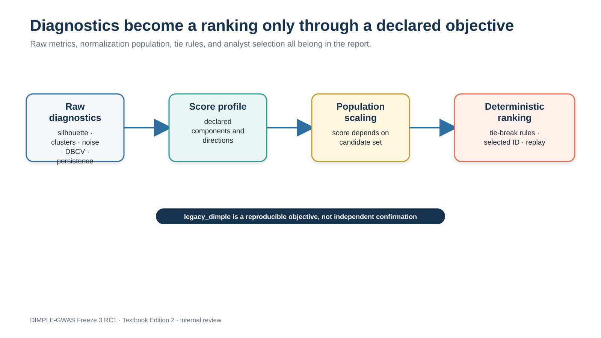{fig-alt="Candidate diagnostics feed a named score profile; normalized values are population-relative before deterministic ranking and exact model replay"}

<figcaption><strong>Figure 9.</strong> Candidate diagnostics feed a named score profile; normalized values are population-relative before deterministic ranking and exact model replay. <em>Interpretive boundary:</em> Rank 1 is conditional on the candidate population and objective, not a universal scientific optimum.</figcaption>

</figure>

## Learning objectives

After completing Chapter 11, the reader can:

1. define silhouette and explain its role without exceeding the stated caution;
2. define Calinski-Harabasz and explain its role without exceeding the stated caution;
3. define Davies-Bouldin and explain its role without exceeding the stated caution;
4. define DBCV and explain its role without exceeding the stated caution;
5. define trustworthiness and continuity and explain its role without exceeding the stated caution;
6. trace the relevant package functions and generated artifacts;
7. complete the worked task and distinguish observation from interpretation.

## Conceptual and mathematical development

### silhouette

Within-versus-nearest-other-cluster separation under a configured metric. A compact notation is `s(i)=(b(i)-a(i))/max(a(i),b(i))`. In practical terms, freeze 3 can exclude noise and supplies the configured HDBSCAN metric. [[Rousseeuw (1987)](#ref-rousseeuw1987)]

Within Freeze 3 RC1 the concept is connected to `evaluate_candidate` and is visible through `model_table.csv`. This connection is narrower than the general statistical idea: software evidence establishes the implemented route, while the mapped primary or internal evidence supplies background authority. The distinction prevents a mathematical definition from being mistaken for proof that a particular scientific interpretation is correct.

### Calinski-Harabasz

Between-cluster to within-cluster dispersion ratio. A compact notation is `CH=[tr(B)/(k-1)]/[tr(W)/(n-k)]`. In practical terms, the implementation uses non-noise embedded points and Euclidean centroid geometry. [[Calinski et al. (1974)](#ref-calinski1974)]

Within Freeze 3 RC1 the concept is connected to `evaluate_candidate` and is visible through `model_table.csv`. This connection is narrower than the general statistical idea: software evidence establishes the implemented route, while the mapped primary or internal evidence supplies background authority. The distinction prevents a mathematical definition from being mistaken for proof that a particular scientific interpretation is correct.

### Davies-Bouldin

Average worst within/between centroid scatter ratio. A compact notation is `DB=(1/k)sum_i max_(j!=i)(S_i+S_j)/M_ij`. In practical terms, lower is better; Euclidean centroid assumptions can mismatch density geometry. [[Davies et al. (1979)](#ref-davies1979)]

Within Freeze 3 RC1 the concept is connected to `evaluate_candidate` and is visible through `model_table.csv`. This connection is narrower than the general statistical idea: software evidence establishes the implemented route, while the mapped primary or internal evidence supplies background authority. The distinction prevents a mathematical definition from being mistaken for proof that a particular scientific interpretation is correct.

### DBCV

Density-based validity index. A compact notation is `weighted cluster validity in [-1,1]`. In practical terms, it is optional and supplementary under legacy_dimple, not the default score component. [[Moulavi et al. (2014)](#ref-moulavi2014dbcv)]

Within Freeze 3 RC1 the concept is connected to `evaluate_candidate` and is visible through `model_table.csv`. This connection is narrower than the general statistical idea: software evidence establishes the implemented route, while the mapped primary or internal evidence supplies background authority. The distinction prevents a mathematical definition from being mistaken for proof that a particular scientific interpretation is correct.

### trustworthiness and continuity

Directed neighborhood-retention diagnostics. A compact notation is `T(k)=1-c sum_i sum_(j in U_k(i))(r(i,j)-k)`. In practical terms, freeze 3 computes both through directed calls to sklearn trustworthiness under Euclidean geometry. [[Venna et al. (2010)](#ref-venna2010)]

Within Freeze 3 RC1 the concept is connected to `embedding_quality_metrics` and is visible through `run_summary.json`. This connection is narrower than the general statistical idea: software evidence establishes the implemented route, while the mapped primary or internal evidence supplies background authority. The distinction prevents a mathematical definition from being mistaken for proof that a particular scientific interpretation is correct.

### legacy_dimple score

Population-relative weighted combination of normalized silhouette, clusters, and optionally noise. A compact notation is `raw=w_s s/max(s)+w_k k/max(k)-w_n n/max(n)`. In practical terms, weights are raw dynamic ranges divided by their sum; final scores are min-max scaled.

Within Freeze 3 RC1 the concept is connected to `legacy_dimple_score` and is visible through `scoring_manifest.json; model_table.csv`. This connection is narrower than the general statistical idea: software evidence establishes the implemented route, while the mapped primary or internal evidence supplies background authority. The distinction prevents a mathematical definition from being mistaken for proof that a particular scientific interpretation is correct.

### eligibility and ties

Rules deciding which candidates receive scores and stable rank order. A compact notation is `eligible=(status=success) and finite silhouette`. In practical terms, ties resolve deterministically through configured sort keys and candidate identity.

Within Freeze 3 RC1 the concept is connected to `rank_models` and is visible through `ranked_models.csv`. This connection is narrower than the general statistical idea: software evidence establishes the implemented route, while the mapped primary or internal evidence supplies background authority. The distinction prevents a mathematical definition from being mistaken for proof that a particular scientific interpretation is correct.

## Reconstructed operational foundation

Edition 1 contained the following verified operational material in separate short notes. Edition 2 consolidates it here and subjects it to the concept and evidence boundaries above.

### Evidence retained from former Chapter 19

### Operational foundation

Candidate metrics serve different purposes. Topology fields describe non-noise cluster count, noise count/fraction, and cluster sizes. Silhouette uses the configured HDBSCAN metric and the declared sampling scope. DBCV is optionally computed as a density-aware diagnostic. Calinski–Harabasz and Davies–Bouldin are supplied with explicit metric/context fields. HDBSCAN persistence summaries describe retained clusters. Trustworthiness and continuity belong to the embedding family, not to one HDBSCAN extraction.

Metrics can be missing when a topology is invalid, a calculation is undefined, a backend cannot support a metric, or a candidate fails. Read `status`, scope, sampled flags, sample sizes, and `metric_warnings` before comparing numbers. The candidate table is deliberately wide so these qualifications are not hidden.

### Retained evidence

The selected Edition 2 Lab 2 candidate has silhouette about 0.970354 and DBCV about 0.976386, with three equal clusters and no noise. These values describe the designed fixture under Euclidean geometry; they are not expected production targets.

### Output-reading checkpoint

Inspect metric value plus its metric/scope/sampled/sample-size columns, topology counts, persistence, warnings, and the run's compute flags.

### Misinterpretations to avoid

Do not call silhouette inherently Euclidean; Freeze 3 supplies the configured metric. Do not compare a sampled score with a full score without noting scope. Do not call DBCV the universal best metric.

### Boundary inherited from Edition 1

All internal metrics are conditional on representation and candidate population. They lack independent biological evidence and can disagree legitimately.


## Evidence and references

See Rousseeuw (1987), DOI 10.1016/0377-0427(87)90125-7, and Moulavi et al. (2014), DOI 10.1137/1.9781611973440.96.

### Evidence retained from former Chapter 20

### Operational foundation

`legacy_dimple` is the default compatibility score. Among eligible candidates, each included component is divided by its maximum. Its weight is the component's raw observed range divided by the sum of included ranges. Raw score adds normalized silhouette and normalized non-noise cluster count and, only when `fit_include_noise=true`, subtracts normalized noise count. The raw score is finally scaled to [0,1] over the eligible candidate population; a zero range maps to 1.

This is population-relative: adding or removing candidates can change maxima, ranges, weights, and final scores even if an existing candidate's own metrics do not change. DBCV may be present in the table but is not a legacy-score term. No preferred cluster band, noise ceiling, largest-cluster target, or biological label is embedded.

The `custom` profile accepts explicitly declared metric weights and maximize/minimize directions. It should represent a preregistered analytic objective, not weights tuned after viewing a desired partition.

### Retained evidence

In Edition 2 Lab 2, all candidates have the same cluster count and no noise, so UMAP-family silhouette differences drive four score levels and eight-way ties within families. The selection manifest records realized formula and tie order.

### Output-reading checkpoint

Inspect `raw_score`, `score`, compatibility aliases, scoring profile, noise-fit flag, realized weights/ranges, eligible counts, and tie order in `model_selection_manifest.json`.

### Misinterpretations to avoid

Do not say DBCV selected the model when profile is legacy. Do not compare normalized scores across candidate populations as though absolute. Do not introduce outcome-informed custom weights.

### Boundary inherited from Edition 1

A heuristic rank is not a probability, confidence, p-value, or guarantee of stability. Scientific selection should combine transparent objectives, sensitivity, and external evidence.

### Evidence retained from former Chapter 21

### Operational foundation

Ranking begins after statuses and scores exist. Eligible successful rows are ordered by final score descending, raw score descending, then stable `model_id` ascending. `top_models.tsv` retains the requested number; `best_model.json` and the selection manifest identify rank one. Pareto membership and family summaries are supplementary views, not alternate truth labels.

Choosing a model should be traceable to an objective declared before inspecting preferred biological labels. Review failure/invalid rates, parameter-family patterns, tied or near-tied solutions, noise and size trade-offs, stability checks, and domain-independent constraints. A rank-one row is the implementation's selected model under the declared rule, not proof that the cluster count is uniquely correct.

Target leakage includes choosing parameters because their labels resemble a published solution when those parameters were not recovered from the historical method. The 164-IDP manual row-16 selection is disclosed rather than retroactively portrayed as automatic rank one.

## Evidence diagram or figure


*Scoring, selection, and fixed reproduction. Editable source: `assets/diagrams/diagram_06_selection_reproduction.mmd`.*

### Retained evidence

Edition 2 Lab 2's first eight models tie at score 1 because their HDBSCAN choices yield the same metrics within the best UMAP family. Stable model ID breaks remaining ties; this is an engineering rule, not a biological preference.

### Output-reading checkpoint

Inspect ranked/all/top tables, family summaries, Pareto table, model selection manifest, best-model JSON, failures, and exact parameter records.

### Misinterpretations to avoid

Do not hide ties or failed candidates. Do not select solely from a pretty plot. Do not use knowledge of desired labels to redefine the search or score and then call it replication.

### Boundary inherited from Edition 1

Internal selection uncertainty is not automatically quantified. Report sensitivity and the conditional nature of the chosen population.

### Evidence retained from former Chapter 40

### Operational foundation

The model table is the authoritative candidate ledger. It preserves parameter identity, embedding diagnostics, topology and size summaries, clustering metrics/scopes, persistence, status/errors/runtime/seeds, score values/profile, and rank. Scoring schema normalization supports historical notebook column names while preserving source columns with a `source_` prefix.

`legacy_dimple` uses normalized silhouette and cluster count and optionally subtracts normalized noise. `custom` applies declared weights/directions. Ranking uses score, raw score, and model ID. `family_summaries.tsv` aggregates parameter-family outcomes; `pareto_front.tsv` shows nondominated candidates; neither overrides the selected rule. `score-existing` can rescore a table but cannot recreate embeddings or labels absent from the source artifacts.

A selection audit reports the eligible population, exclusions, failures, metric ranges, realized weights, noise-term switch, ties, selected ID/parameters, and any manual decision.

### Retained evidence

Edition 2 Lab 3 rescored the fixed one-row table. Its zero score range maps the final score to 1 by definition. Edition 2 Lab 2 shows population-relative bands and ties.

### Output-reading checkpoint

Inspect all/ranked/top tables, scoring manifest, model-selection manifest, family/Pareto summaries, best model, source-column migration, and failure table.

### Misinterpretations to avoid

Do not treat one-row score 1 as superior performance. Do not remove failure rows before reporting denominator. Do not confuse Pareto inclusion with validation.

### Boundary inherited from Edition 1

Score normalization can change with the candidate population, and no formula encodes a universal biological optimum. Manual selections require an explicit rationale and status.

## Implementation trace

**`metrics.effective_neighbor_count`** is defined at `dimple_gwas/metrics.py:9` with signature `n_samples: int, requested: int`. Implementation callable for effective neighbor count. It is reached from metrics.embedding_quality_metrics and connects to No package-defined dependency detected. Its direct artifact contract is No direct canonical artifact; in-memory/supporting result; its explicit error surface is No explicit raise in this symbol; delegated calls may raise.. Test evidence is recorded as tests/test_preprocessing_metrics.py::test_effective_neighbor_edge_cases. This is a B-tier contract, so the complete 20-field dossier is retained in the function atlas.

**`metrics.embedding_quality_metrics`** is defined at `dimple_gwas/metrics.py:15` with signature `original, embedding, requested_k: int, max_samples: int, seed: int`. Calculate bounded trustworthiness and continuity diagnostics for an embedding. It is reached from interpretation.run_explanation; pipeline.run_search and connects to metrics.effective_neighbor_count. Its direct artifact contract is No direct canonical artifact; in-memory/supporting result; its explicit error surface is No explicit raise in this symbol; delegated calls may raise.. Test evidence is recorded as tests/test_preprocessing_metrics.py::test_optimized_trustworthiness_and_continuity. This is a A-tier contract, so the complete 20-field dossier is retained in the function atlas.

**`metrics.evaluate_candidate`** is defined at `dimple_gwas/metrics.py:60` with signature `embedding, labels, clusterer, silhouette_metric: str, fit_include_noise: bool, compute_dbcv: bool, max_samples_silhouette: int=0, silhouette_seed: int=42`. Compute cluster counts, persistence, silhouette, CH, DB, optional DBCV, and validity status for one candidate. It is reached from pipeline._evaluate_one and connects to metrics._cluster_sizes. Its direct artifact contract is No direct canonical artifact; in-memory/supporting result; its explicit error surface is No explicit raise in this symbol; delegated calls may raise.. Test evidence is recorded as No direct symbol-name test reference; assess through caller/integration coverage. This is a A-tier contract, so the complete 20-field dossier is retained in the function atlas.

**`metrics.is_finite_number`** is defined at `dimple_gwas/metrics.py:165` with signature `value: Any`. Implementation callable for is finite number. It is reached from CLI/import/direct caller or no package caller detected and connects to No package-defined dependency detected. Its direct artifact contract is No direct canonical artifact; in-memory/supporting result; its explicit error surface is No explicit raise in this symbol; delegated calls may raise.. Test evidence is recorded as No direct symbol-name test reference; assess through caller/integration coverage. This is a B-tier contract, so the complete 20-field dossier is retained in the function atlas.

**`pipeline.setup_logger`** is defined at `dimple_gwas/pipeline.py:25` with signature `output_dir: str | Path`. Implementation callable for setup logger. It is reached from pipeline.run_search and connects to No package-defined dependency detected. Its direct artifact contract is logs/run.log; its explicit error surface is No explicit raise in this symbol; delegated calls may raise.. Test evidence is recorded as No direct symbol-name test reference; assess through caller/integration coverage. This is a B-tier contract, so the complete 20-field dossier is retained in the function atlas.

**`pipeline.run_search`** is defined at `dimple_gwas/pipeline.py:130` with signature `config: Mapping[str, Any], output_dir: str | Path, command: list[str] | None=None`. Execute preprocessing, repeated embeddings, candidate evaluation, scoring, retention, reporting, and provenance for one run. It is reached from cli._reproduce; cli.main and connects to hdbscan_runner.fit_hdbscan; io.read_table; metrics.embedding_quality_metrics; pipeline._annotation_frame; pipeline._evaluate_one; pipeline._failed_row; pipeline.setup_logger; preprocessing.prepare_analysis_matrix; provenance.base_manifest; provenance.file_record; ranking.family_summaries; ranking.pareto_front; ranking.rank_models; ranking.top_models; reporting.write_model_outputs; reporting.write_resolved_config; reporting.write_search_space; scoring.apply_scoring; search_space.enumerate_candidates; search_space.stable_identifier; umap_runner.run_repeated_umap. Its direct artifact contract is No direct canonical artifact; in-memory/supporting result; its explicit error surface is RuntimeError; ValueError. Test evidence is recorded as tests/test_pipeline_integration.py::test_custom_leaf_eom_metric_and_max_size_run; tests/test_pipeline_integration.py::test_fixed_model_reproduction. This is a A-tier contract, so the complete 20-field dossier is retained in the function atlas.

**`ranking.rank_models`** is defined at `dimple_gwas/ranking.py:8` with signature `frame`. Apply deterministic eligibility, score, and tie ordering to candidate rows. It is reached from cli._score; cli._summarize; pipeline.run_search and connects to No package-defined dependency detected. Its direct artifact contract is No direct canonical artifact; in-memory/supporting result; its explicit error surface is No explicit raise in this symbol; delegated calls may raise.. Test evidence is recorded as tests/test_scoring_ranking.py::test_custom_scoring_ranking_top_n_and_pareto. This is a A-tier contract, so the complete 20-field dossier is retained in the function atlas.

**`ranking.top_models`** is defined at `dimple_gwas/ranking.py:23` with signature `frame, n: int`. Implementation callable for top models. It is reached from cli._summarize; pipeline.run_search and connects to No package-defined dependency detected. Its direct artifact contract is No direct canonical artifact; in-memory/supporting result; its explicit error surface is No explicit raise in this symbol; delegated calls may raise.. Test evidence is recorded as tests/test_scoring_ranking.py::test_custom_scoring_ranking_top_n_and_pareto. This is a B-tier contract, so the complete 20-field dossier is retained in the function atlas.

**`ranking.pareto_front`** is defined at `dimple_gwas/ranking.py:27` with signature `frame`. Implementation callable for pareto front. It is reached from cli._summarize; pipeline.run_search and connects to No package-defined dependency detected. Its direct artifact contract is No direct canonical artifact; in-memory/supporting result; its explicit error surface is No explicit raise in this symbol; delegated calls may raise.. Test evidence is recorded as tests/test_pipeline_integration.py::test_custom_leaf_eom_metric_and_max_size_run; tests/test_scoring_ranking.py::test_custom_scoring_ranking_top_n_and_pareto. This is a A-tier contract, so the complete 20-field dossier is retained in the function atlas.

**`ranking.family_summaries`** is defined at `dimple_gwas/ranking.py:71` with signature `frame, columns: Iterable[str]=DEFAULT_FAMILY_COLUMNS`. Implementation callable for family summaries. It is reached from cli._summarize; pipeline.run_search and connects to No package-defined dependency detected. Its direct artifact contract is No direct canonical artifact; in-memory/supporting result; its explicit error surface is No explicit raise in this symbol; delegated calls may raise.. Test evidence is recorded as tests/test_pipeline_integration.py::test_custom_leaf_eom_metric_and_max_size_run. This is a A-tier contract, so the complete 20-field dossier is retained in the function atlas.

**`scoring.normalize_model_table_schema`** is defined at `dimple_gwas/scoring.py:28` with signature `frame`. Adapt the historical notebook table schema without discarding source fields. It is reached from cli._score and connects to No package-defined dependency detected. Its direct artifact contract is No direct canonical artifact; in-memory/supporting result; its explicit error surface is ValueError. Test evidence is recorded as tests/test_freeze3_comparison_validation.py::test_historical_notebook_model_schema_is_adapted. This is a B-tier contract, so the complete 20-field dossier is retained in the function atlas.

**`scoring.legacy_dimple_score`** is defined at `dimple_gwas/scoring.py:80` with signature `frame, fit_include_noise: bool=False`. Reproduce the compatibility score using observed dynamic-range weights and population-dependent normalization. It is reached from scoring.apply_scoring and connects to scoring._safe_divide_by_max; scoring._scale_final. Its direct artifact contract is No direct canonical artifact; in-memory/supporting result; its explicit error surface is No explicit raise in this symbol; delegated calls may raise.. Test evidence is recorded as tests/test_scoring_ranking.py::test_legacy_formula_matches_literal_reference; tests/test_scoring_ranking.py::test_zero_variance_and_noise_exclusion. This is a A-tier contract, so the complete 20-field dossier is retained in the function atlas.

## Claim adjudication notebook

The following statements are admitted to the draft only in their safe form:

- **SCORE-001 (reject):** DBCV is an optional diagnostic; legacy_dimple ranks with normalized silhouette and cluster count and optionally subtracts a noise component. [[Moulavi et al. (2014)](#ref-moulavi2014dbcv)] Limitation: Computing a diagnostic does not make it part of the ranking objective. Implementation evidence: `metrics.py; scoring.py`.

- **SCORE-002 (reject):** Silhouette is defined relative to a distance; Freeze 3 passes the configured HDBSCAN metric to scikit-learn. [[Rousseeuw (1987)](#ref-rousseeuw1987)] Limitation: Metric choice remains geometry-dependent; CH and DB use Euclidean centroid geometry. Implementation evidence: `metrics.evaluate_candidate`.

- **SCORE-003 (verified):** The default score has no biological label, pQTL target, preferred cluster band, or noise ceiling. Limitation: The population-relative heuristic still embeds trade-offs via ranges. Implementation evidence: `scoring.py; config.py`.

- **HIST-001 (historical_only):** The historical five-cluster solution was manually selected from sorted row 16, not the top automatic score. Limitation: The historical retained table contains 333 successful rows from a theoretical 2,430-candidate grid. Implementation evidence: `historical adapter/docs`.

- **METH-004 (implementation_specific):** Freeze 3 calculates CH and DB on non-noise embedded points using Euclidean centroid geometry; they are supplementary views that may disagree with density-based criteria. [[Calinski et al. (1974)](#ref-calinski1974); [Davies et al. (1979)](#ref-davies1979)] Limitation: Do not treat agreement as independent evidence after selection. Implementation evidence: `metrics.py`.

- **METH-005 (implementation_specific):** Freeze 3 obtains two directed neighborhood diagnostics by swapping original and projected spaces in sklearn's trustworthiness function. [[Venna et al. (2010)](#ref-venna2010)] Limitation: Both are computed with Euclidean geometry and possible sampling. Implementation evidence: `metrics.embedding_quality_metrics`.

## Reading the generated evidence

For Chapter 11, the `Candidate diagnostics, legacy_dimple, ranking, ties, and sensitivity` files are read as a provenance chain rather than as isolated results:

<p class="table-caption" id="table-5"><strong>Table 5.</strong> Reading the generated evidence.</p>

| Artifact | Producer | What to verify before interpretation |
| --- | --- | --- |
| `resolved_config.yaml` | `write_resolved_config` | Artifact exists under the new output root, is readable, and its checksum is recorded. |
| `run_manifest.json` | `write_model_outputs` | status=complete; source/input hashes present; failed count understood; selected model and artifact records resolve. |
| `logs/run.log` | `setup_logger` | Artifact exists under the new output root, is readable, and its checksum is recorded. |
| `models/all_models.tsv` | `write_model_outputs` | Candidate count agrees with enumeration; failures remain; ranks and score eligibility are internally consistent. |
| `models/ranked_models.tsv` | `write_model_outputs` | Candidate count agrees with enumeration; failures remain; ranks and score eligibility are internally consistent. |
| `models/all_models.parquet` | `write_model_outputs` | Candidate count agrees with enumeration; failures remain; ranks and score eligibility are internally consistent. |
| `models/top_models.tsv` | `write_model_outputs` | Artifact exists under the new output root, is readable, and its checksum is recorded. |
| `models/best_model.json` | `write_model_outputs` | Artifact exists under the new output root, is readable, and its checksum is recorded. |
| `models/model_selection_manifest.json` | `write_model_outputs` | Artifact exists under the new output root, is readable, and its checksum is recorded. |
| `models/pareto_front.tsv` | `write_model_outputs` | Artifact exists under the new output root, is readable, and its checksum is recorded. |
| `models/family_summaries.tsv` | `write_model_outputs` | Artifact exists under the new output root, is readable, and its checksum is recorded. |
| `models/top_model_artifacts/<id>/labels.tsv` | `_top_artifact` | Identifiers are unique and exactly match the intended input; label -1 is treated as noise/unassigned. |
| `models/top_model_artifacts/<id>/summary.json` | `_top_artifact` | Artifact exists under the new output root, is readable, and its checksum is recorded. |
| `models/top_model_artifacts/<id>/reproduce.yaml` | `_top_artifact` | Artifact exists under the new output root, is readable, and its checksum is recorded. |

The output atlas supplies the complete schemas, checksums, conditions, consumers, and privacy notes for this Chapter 11 route. Native manifests can contain machine paths; the assembled textbook uses sanitized excerpts while restricted evidence retains the original provenance chain.

## Worked reasoning and evidence exercise

Compute both Lab 0 score profiles from the three-row candidate table and explain why cluster count dominates when its raw range is larger.

A complete Chapter 11 answer must expose its intermediate reasoning, name the source or output used for `Candidate diagnostics, legacy_dimple, ranking, ties, and sensitivity`, and finish with separate support and non-support statements. Applying that discipline to the question “How should heterogeneous diagnostics be combined without disguising their assumptions?” prevents a calculation, a software observation, and a scientific interpretation from collapsing into one claim.

## Assumptions, diagnostics, and recovery

The Chapter 11 analysis assumes the stated unit and inputs, the recorded configuration and software identity, and a diagnostic that addresses the claimed property rather than a convenient surrogate. Its decisive boundary is: `legacy_dimple` uses silhouette and cluster count plus an optional subtracted noise term; DBCV, CH, DB, persistence, and projection diagnostics are not default score components.

If the Chapter 11 route fails, retain its log and candidate status before deciding whether the cause is input, configuration, dependency, compute, identifier alignment, or output-root state. Correct an operational failure by writing a new result directory. Treat instability in `Candidate diagnostics, legacy_dimple, ranking, ties, and sensitivity` as sensitivity evidence: report it and identify the independent evidence needed instead of relabeling ambiguity as a software exception.

## Chapter synthesis

A deterministic score is reproducible yet remains population-relative and sensitive to component ranges and candidate composition. The implementation trace makes the current behavior auditable, but the evidence boundary remains part of the result. Chapter 12 freezes one selected model into a replayable artifact and compares results structurally.

## Exercises

1. For `Candidate diagnostics, legacy_dimple, ranking, ties, and sensitivity`, name the unit of analysis and one plausible but invalid substitute.
2. Reconstruct the notation for silhouette; define its dimensions or denominator and interpret every term.
3. Choose a Tier A function mapped to Chapter 11; identify its caller and direct output, then propose a topic-specific edge case.
4. Select one Chapter 11 artifact from the output atlas and state three integrity checks that must precede scientific reading.
5. Convert a tempting `Candidate diagnostics, legacy_dimple, ranking, ties, and sensitivity` overclaim into one observed statement followed by its limitation.
6. Compute both Lab 0 score profiles from the three-row candidate table and explain why cluster count dominates when its raw range is larger.

Appendix J gives the Chapter 11 adjudication guide. Its further-reading keys supply statistical context; no external paper is treated as automatic validation of the current software or dataset.


<div class="chapter-break"></div>

<a id="chapter-12"></a>

# 12. Selected-model reproduction, provenance, and comparison

*Guiding question:* **What must be retained to replay a model and decide whether two results agree?**

Prerequisites: 8–11.

## Why the question matters

Numeric labels and raw coordinates can differ while partitions agree, whereas identical labels without identifier checks can be meaningless.

Same-environment fixture concordance is technical evidence. It is not a guarantee across machines and not biological validation.

This chapter develops the question in the order needed for a reader to move from statistical principle to current implementation, retained evidence, and a defensible statement. Its central worked task is: Relabel a partition, calculate its noise Jaccard, and interpret why ARI=1 can coexist with nonidentical numeric labels.


<figure id="fig-f09">

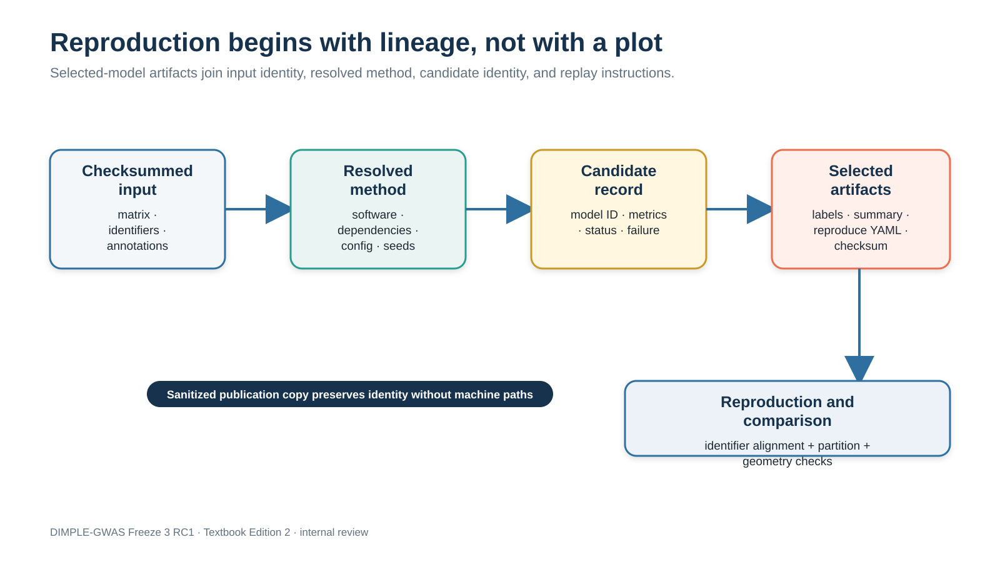{fig-alt="A selected model is replayable only when checksummed inputs, resolved configuration, seeds, software identity, candidate ID, and retained artifacts form one lineage"}

<figcaption><strong>Figure 10.</strong> A selected model is replayable only when checksummed inputs, resolved configuration, seeds, software identity, candidate ID, and retained artifacts form one lineage. <em>Interpretive boundary:</em> Same-environment replay is technical evidence and does not guarantee cross-platform or biological equivalence.</figcaption>

</figure>

## Learning objectives

After completing Chapter 12, the reader can:

1. define candidate identity and explain its role without exceeding the stated caution;
2. define adjusted Rand index and explain its role without exceeding the stated caution;
3. define normalized mutual information and explain its role without exceeding the stated caution;
4. define noise Jaccard and explain its role without exceeding the stated caution;
5. define Procrustes disparity and explain its role without exceeding the stated caution;
6. trace the relevant package functions and generated artifacts;
7. complete the worked task and distinguish observation from interpretation.

## Conceptual and mathematical development

### candidate identity

Deterministic hash and ordinal for a resolved parameter combination. A compact notation is `model_id=H(canonical parameters)`. In practical terms, identity supports replay; it is not a quality score.

Within Freeze 3 RC1 the concept is connected to `candidate_identity` and is visible through `search_space.tsv; model_table.csv`. This connection is narrower than the general statistical idea: software evidence establishes the implemented route, while the mapped primary or internal evidence supplies background authority. The distinction prevents a mathematical definition from being mistaken for proof that a particular scientific interpretation is correct.

### adjusted Rand index

Chance-adjusted pairwise partition agreement. A compact notation is `ARI=(RI-E[RI])/(max(RI)-E[RI])`. In practical terms, permutation invariant; a value of 1 does not imply coordinate identity. [[Hubert et al. (1985)](#ref-hubert1985)]

Within Freeze 3 RC1 the concept is connected to `compare_partitions` and is visible through `comparison_summary.json`. This connection is narrower than the general statistical idea: software evidence establishes the implemented route, while the mapped primary or internal evidence supplies background authority. The distinction prevents a mathematical definition from being mistaken for proof that a particular scientific interpretation is correct.

### normalized mutual information

Normalized information shared by two labelings. A compact notation is `NMI=2I(U;V)/(H(U)+H(V))`. In practical terms, normalization conventions matter; Freeze 3 uses the sklearn convention recorded in code. [[Vinh et al. (2010)](#ref-vinh2010)]

Within Freeze 3 RC1 the concept is connected to `compare_partitions` and is visible through `comparison_summary.json`. This connection is narrower than the general statistical idea: software evidence establishes the implemented route, while the mapped primary or internal evidence supplies background authority. The distinction prevents a mathematical definition from being mistaken for proof that a particular scientific interpretation is correct.

### noise Jaccard

Overlap of the two sets labeled -1. A compact notation is `J(A,B)=|A intersect B|/|A union B|`. In practical terms, it isolates agreement about unassigned membership, not all clusters.

Within Freeze 3 RC1 the concept is connected to `noise_jaccard` and is visible through `comparison_summary.json`. This connection is narrower than the general statistical idea: software evidence establishes the implemented route, while the mapped primary or internal evidence supplies background authority. The distinction prevents a mathematical definition from being mistaken for proof that a particular scientific interpretation is correct.

### Procrustes disparity

Residual after centering, scaling, and orthogonal alignment. A compact notation is `min_R ||X_c R-Y_c||_F^2`. In practical terms, low disparity supports aligned coordinate similarity under the chosen transformation, not biological replication. [[Gower (1975)](#ref-gower1975)]

Within Freeze 3 RC1 the concept is connected to `compare_coordinates` and is visible through `comparison_summary.json`. This connection is narrower than the general statistical idea: software evidence establishes the implemented route, while the mapped primary or internal evidence supplies background authority. The distinction prevents a mathematical definition from being mistaken for proof that a particular scientific interpretation is correct.

### validation ladder

Separate software, technical, structural, statistical, biological, external, and cross-platform evidence. A compact notation is `E_software != E_biological`. In practical terms, passing tests or exact fixture replay cannot substitute for external biological validation.

Within Freeze 3 RC1 the concept is connected to `run_validation` and is visible through `validation_report.json`. This connection is narrower than the general statistical idea: software evidence establishes the implemented route, while the mapped primary or internal evidence supplies background authority. The distinction prevents a mathematical definition from being mistaken for proof that a particular scientific interpretation is correct.

### floating-point reproducibility

Dependence of finite-precision results on operation order and platform. A compact notation is `fl((a+b)+c) may differ from fl(a+(b+c))`. In practical terms, pinned dependencies improve control but do not guarantee universal bitwise equality. [[Collange et al. (2015)](#ref-reproduciblesum2015)]

Within Freeze 3 RC1 the concept is connected to `capture_environment` and is visible through `environment.json`. This connection is narrower than the general statistical idea: software evidence establishes the implemented route, while the mapped primary or internal evidence supplies background authority. The distinction prevents a mathematical definition from being mistaken for proof that a particular scientific interpretation is correct.

## Reconstructed operational foundation

Edition 1 contained the following verified operational material in separate short notes. Edition 2 consolidates it here and subjects it to the concept and evidence boundaries above.

### Evidence retained from former Chapter 22

### Operational foundation

A retained native `summary.json` contains the exact UMAP/HDBSCAN parameters, resolved run configuration, label-file hash, input record when available, and feature count. `reproduce-model` converts that contract to fixed mode, optionally overrides a stale input path, and performs one new fit in a new output directory. It refits; it does not copy labels.

```bash
dimple-gwas reproduce-model \
  --model-json docs/textbook/edition2/labs/01_fixed_synthetic/run_20260826/models/top_model_artifacts/model_060fac0208bb58e2/summary.json \
  --input benchmarks/synthetic/synthetic_matrix.tsv \
  --output-dir docs/textbook/edition2/labs/03_explain_compare_validate/reproduced_new \
  --n-jobs 1
```

After the rerun, use `compare` rather than assuming numeric label equality or coordinate alignment.

### Retained evidence

The executed reproduction selected the same stable model ID on the same fixture and environment. Comparison found exact ID order/set, ARI/NMI/noise Jaccard/mapped membership 1, and Procrustes disparity 2.7088×10^-31.

### Output-reading checkpoint

Inspect source summary/hash, reproduced resolved config and run manifest, new labels, comparison outputs, and validation checks.

### Misinterpretations to avoid

Do not use the original output directory. Do not call label-number equality the only correctness measure. Do not claim cross-platform determinism from a same-platform fixture.

### Boundary inherited from Edition 1

One fixed rerun tests an already selected parameterization; it does not reproduce the uncertainty or selection process of a full search.

### Evidence retained from former Chapter 23

### Operational foundation

`compare` accepts two native summaries or label tables, requires unique exact ID sets, and can require the same order. It reports adjusted Rand index, normalized mutual information, variation of information, noise-set Jaccard, optimal label mapping, mapped membership, changed noise status, cluster sizes, and optional Procrustes disparity. Numeric labels are local names, so structural metrics are primary.

`validate` inspects one run directory for required artifacts, readable JSON/YAML, enumeration counts, ranked schema, selected artifacts, and recorded hashes. It writes one pass/warn/fail row per check and returns exit code one on failure. Validation does not refit or compare biology.

```bash
dimple-gwas compare --left LEFT/summary.json --right RIGHT/summary.json --output-dir comparison_new
dimple-gwas validate --run-dir RUN --output-dir validation_new
```

## Evidence diagram or figure

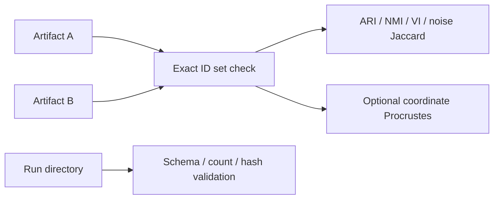


*Comparison and validation paths. Editable source: `assets/diagrams/diagram_08_compare_validate.mmd`.*

### Retained evidence

Edition 2 Lab 3 comparison uses 24 IDs, three clusters, no noise, perfect structural metrics, zero variation of information, and near-zero aligned coordinate disparity. Validation reports 24/24 pass with no warnings or failures.

### Output-reading checkpoint

Inspect `comparison_summary.json`, membership table, size table, confusion, mapping, comparison manifest, `validation_checks.tsv`, report, and validation manifest.

### Misinterpretations to avoid

Do not compare raw numeric labels across fits. Do not ignore changed noise status. Do not interpret Procrustes as membership agreement. Do not call hash/schema checks biological validation.

### Boundary inherited from Edition 1

Exact label equality is stringent and environment-sensitive; permutation-invariant equality is structural. Coordinate comparison needs alignment and tolerances. Scientific conclusions need higher-layer validation.

### Evidence retained from former Chapter 42

### Operational foundation

A reproducible run is a chain of identities and decisions: source hash/version; input path/size/hash and upstream provenance; source and resolved configuration/hash; exact command; Python/platform/package versions; backends; seeds; threads; timestamps/runtime; candidate counts/statuses; selected model and formula; every artifact hash; warnings/exclusions/failures; and comparison criteria. `run_manifest.json` captures much of this; tutorial execution manifests and checksum tables close the documentation chain.

Exact comparison is appropriate for bytes, schemas, IDs, declared parameters, counts, and sometimes labels. Tolerances or invariant metrics are appropriate for floating-point metrics and aligned embeddings across platforms. Plots should be compared through source tables and structural/render checks, not byte identity alone. Dependency pinning improves traceability but cannot guarantee identical numerics across OS, architecture, hardware, BLAS/OpenMP, threads, or compiler/runtime versions.

With no Git metadata in this snapshot, use the package-source SHA-256 and complete file registers; the Docker stage should establish a versioned source identity.

## Evidence diagram or figure

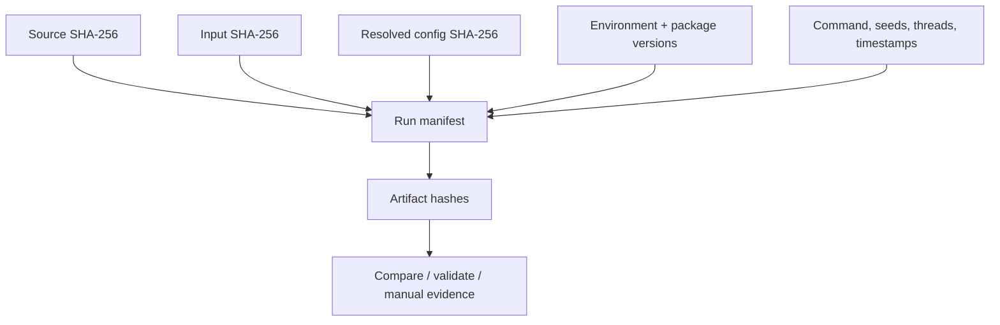


*Provenance and artifact lineage. Editable source: `assets/diagrams/diagram_09_provenance_lineage.mmd`.*

### Retained evidence

The executed Edition 2 Lab 2 manifest records package-source and input hashes, configuration hash, exact package versions, seeds 42/43, jobs, backend names, runtime, counts, selected ID, and artifact hashes.

### Output-reading checkpoint

Inspect runtime environment, resolved dependencies, source/input/artifact checksum registers, run/selection/tutorial manifests, logs, comparison and validation evidence.

### Misinterpretations to avoid

Do not equate a pinned requirements file with a complete environment. Do not compare floating-point PNG bytes as scientific equality. Do not sanitize the only retained provenance copy.

### Boundary inherited from Edition 1

Provenance can contain protected paths and identifiers; maintain a private complete record and a deliberately sanitized publication record with linked hashes.

## Implementation trace

**`comparison.run_comparison`** is defined at `dimple_gwas/comparison.py:65` with signature `left_source: str | Path, right_source: str | Path, output_dir: str | Path, *, id_column: str='feature_id', label_column: str='label', require_same_order: bool=False, command: list[str] | None=None`. Compare two label artifacts using exact IDs, permutation-invariant structure, noise sets, mapping, and optional coordinates. It is reached from cli._compare and connects to comparison._columns; comparison._resolve_labels; comparison._variation_of_information; interpretation.detect_coordinate_columns; interpretation.is_noise_label; interpretation.label_sort_key; io.atomic_json_dump; io.ensure_empty_output_dir; io.json_safe; io.validated_identifiers; provenance.base_manifest; provenance.file_record; provenance.utc_now. Its direct artifact contract is comparison_summary.json; membership_comparison.tsv; cluster_sizes.tsv; label_confusion.tsv; optimal_label_mapping.tsv; comparison_manifest.json; its explicit error surface is ValueError. Test evidence is recorded as tests/test_freeze3_comparison_validation.py::test_comparison_rejects_duplicate_ids; tests/test_freeze3_comparison_validation.py::test_comparison_requires_identical_id_sets; tests/test_freeze3_comparison_validation.py::test_label_permutation_comparison_is_structurally_equal. This is a A-tier contract, so the complete 20-field dossier is retained in the function atlas.

**`pipeline.setup_logger`** is defined at `dimple_gwas/pipeline.py:25` with signature `output_dir: str | Path`. Implementation callable for setup logger. It is reached from pipeline.run_search and connects to No package-defined dependency detected. Its direct artifact contract is logs/run.log; its explicit error surface is No explicit raise in this symbol; delegated calls may raise.. Test evidence is recorded as No direct symbol-name test reference; assess through caller/integration coverage. This is a B-tier contract, so the complete 20-field dossier is retained in the function atlas.

**`pipeline.run_search`** is defined at `dimple_gwas/pipeline.py:130` with signature `config: Mapping[str, Any], output_dir: str | Path, command: list[str] | None=None`. Execute preprocessing, repeated embeddings, candidate evaluation, scoring, retention, reporting, and provenance for one run. It is reached from cli._reproduce; cli.main and connects to hdbscan_runner.fit_hdbscan; io.read_table; metrics.embedding_quality_metrics; pipeline._annotation_frame; pipeline._evaluate_one; pipeline._failed_row; pipeline.setup_logger; preprocessing.prepare_analysis_matrix; provenance.base_manifest; provenance.file_record; ranking.family_summaries; ranking.pareto_front; ranking.rank_models; ranking.top_models; reporting.write_model_outputs; reporting.write_resolved_config; reporting.write_search_space; scoring.apply_scoring; search_space.enumerate_candidates; search_space.stable_identifier; umap_runner.run_repeated_umap. Its direct artifact contract is No direct canonical artifact; in-memory/supporting result; its explicit error surface is RuntimeError; ValueError. Test evidence is recorded as tests/test_pipeline_integration.py::test_custom_leaf_eom_metric_and_max_size_run; tests/test_pipeline_integration.py::test_fixed_model_reproduction. This is a A-tier contract, so the complete 20-field dossier is retained in the function atlas.

**`provenance.sha256_file`** is defined at `dimple_gwas/provenance.py:17` with signature `path: str | Path`. Implementation callable for sha256 file. It is reached from interpretation._native_sources; provenance.file_record; reporting._top_artifact; validation.run_validation and connects to No package-defined dependency detected. Its direct artifact contract is No direct canonical artifact; in-memory/supporting result; its explicit error surface is No explicit raise in this symbol; delegated calls may raise.. Test evidence is recorded as tests/test_failure_and_provenance.py::test_authoritative_source_hash_unchanged. This is a B-tier contract, so the complete 20-field dossier is retained in the function atlas.

**`provenance.package_versions`** is defined at `dimple_gwas/provenance.py:25` with signature `names: Iterable[str] | None=None`. Implementation callable for package versions. It is reached from provenance.base_manifest and connects to No package-defined dependency detected. Its direct artifact contract is No direct canonical artifact; in-memory/supporting result; its explicit error surface is No explicit raise in this symbol; delegated calls may raise.. Test evidence is recorded as No direct symbol-name test reference; assess through caller/integration coverage. This is a B-tier contract, so the complete 20-field dossier is retained in the function atlas.

**`provenance.utc_now`** is defined at `dimple_gwas/provenance.py:40` with signature `class construction/data container`. Implementation callable for utc now. It is reached from comparison.run_comparison; interpretation.run_explanation; provenance.base_manifest; reporting.write_model_outputs; validation.run_validation and connects to No package-defined dependency detected. Its direct artifact contract is No direct canonical artifact; in-memory/supporting result; its explicit error surface is No explicit raise in this symbol; delegated calls may raise.. Test evidence is recorded as No direct symbol-name test reference; assess through caller/integration coverage. This is a B-tier contract, so the complete 20-field dossier is retained in the function atlas.

**`provenance.file_record`** is defined at `dimple_gwas/provenance.py:44` with signature `path: str | Path`. Implementation callable for file record. It is reached from comparison.run_comparison; interpretation.run_explanation; pipeline.run_search; reporting._top_artifact; reporting.write_model_outputs; validation.run_validation and connects to comparison._columns.<locals>.resolve; provenance.sha256_file. Its direct artifact contract is No direct canonical artifact; in-memory/supporting result; its explicit error surface is No explicit raise in this symbol; delegated calls may raise.. Test evidence is recorded as No direct symbol-name test reference; assess through caller/integration coverage. This is a B-tier contract, so the complete 20-field dossier is retained in the function atlas.

**`provenance.package_source_digest`** is defined at `dimple_gwas/provenance.py:53` with signature `class construction/data container`. Compute a stable hash over package source files for non-Git source identity. It is reached from provenance.base_manifest and connects to comparison._columns.<locals>.resolve. Its direct artifact contract is No direct canonical artifact; in-memory/supporting result; its explicit error surface is No explicit raise in this symbol; delegated calls may raise.. Test evidence is recorded as tests/test_freeze3_comparison_validation.py::test_package_source_digest_is_stable. This is a A-tier contract, so the complete 20-field dossier is retained in the function atlas.

**`provenance.base_manifest`** is defined at `dimple_gwas/provenance.py:66` with signature `command: list[str] | None=None`. Implementation callable for base manifest. It is reached from comparison.run_comparison; interpretation.run_explanation; pipeline.run_search; validation.run_validation and connects to provenance.package_source_digest; provenance.package_versions; provenance.utc_now. Its direct artifact contract is No direct canonical artifact; in-memory/supporting result; its explicit error surface is No explicit raise in this symbol; delegated calls may raise.. Test evidence is recorded as No direct symbol-name test reference; assess through caller/integration coverage. This is a A-tier contract, so the complete 20-field dossier is retained in the function atlas.

**`reporting.write_resolved_config`** is defined at `dimple_gwas/reporting.py:18` with signature `config: Mapping[str, Any], output_dir: str | Path`. Implementation callable for write resolved config. It is reached from pipeline.run_search and connects to No package-defined dependency detected. Its direct artifact contract is resolved_config.yaml; its explicit error surface is No explicit raise in this symbol; delegated calls may raise.. Test evidence is recorded as No direct symbol-name test reference; assess through caller/integration coverage. This is a B-tier contract, so the complete 20-field dossier is retained in the function atlas.

**`reporting.write_search_space`** is defined at `dimple_gwas/reporting.py:28` with signature `candidates: list[Mapping[str, Any]], config: Mapping[str, Any], output_dir: str | Path`. Implementation callable for write search space. It is reached from cli._show; pipeline.run_search and connects to io.atomic_json_dump; io.json_safe; reporting._write_tsv; search_space.flatten_candidate. Its direct artifact contract is search_space_manifest.tsv; search_space_manifest.json; its explicit error surface is No explicit raise in this symbol; delegated calls may raise.. Test evidence is recorded as No direct symbol-name test reference; assess through caller/integration coverage. This is a B-tier contract, so the complete 20-field dossier is retained in the function atlas.

**`reporting.write_model_outputs`** is defined at `dimple_gwas/reporting.py:105` with signature `ranked, top, pareto, families, candidates_by_id: Mapping[str, Mapping[str, Any]], labels_by_id: Mapping[str, Any], visualizations_by_umap: Mapping[str, Any], feature_ids, annotation_frame, config: Mapping[str, Any], scoring_manifest: Mapping[str, Any], run_manifest: Mapping[str, Any], output_dir: str | Path`. Write the complete candidate, ranking, selection, retained-model, compatibility, and manifest artifact family. It is reached from pipeline.run_search and connects to io.atomic_json_dump; io.json_safe; provenance.file_record; provenance.utc_now; reporting._top_artifact; reporting._write_tsv. Its direct artifact contract is run_manifest.json; models/all_models.tsv; models/all_models.parquet; models/ranked_models.tsv; models/top_models.tsv; models/best_model.json; models/model_selection_manifest.json; models/pareto_front.tsv; models/family_summaries.tsv; stage02_hdbscan_gridsearch_results.csv; stage03_optimized_cluster_solutions.csv; stage09_umap_vizdata_with_clusters.csv; stage09b_umap_vizdata_with_annotations.csv; its explicit error surface is No explicit raise in this symbol; delegated calls may raise.. Test evidence is recorded as No direct symbol-name test reference; assess through caller/integration coverage. This is a A-tier contract, so the complete 20-field dossier is retained in the function atlas.

## Claim adjudication notebook

The following statements are admitted to the draft only in their safe form:

- **VAL-002 (verified_with_qualification):** Within the prior same-environment fixture comparison, ARI, NMI, noise Jaccard, and mapped membership were 1 with near-zero Procrustes disparity. [[Hubert et al. (1985)](#ref-hubert1985); [Vinh et al. (2010)](#ref-vinh2010); [Gower (1975)](#ref-gower1975)] Limitation: Does not generalize across platforms or all configurations. Implementation evidence: `comparison.py`.

- **REP-001 (reject):** Pinning improves traceability but cannot alone guarantee bitwise identity across architecture, hardware, numerical libraries, or thread schedules. [[Collange et al. (2015)](#ref-reproduciblesum2015)] Limitation: Docker/Linux/cloud validation remains pending. Implementation evidence: `provenance.py`.

## Reading the generated evidence

For Chapter 12, the `Selected-model reproduction, provenance, and comparison` files are read as a provenance chain rather than as isolated results:

<p class="table-caption" id="table-6"><strong>Table 6.</strong> Reading the generated evidence.</p>

| Artifact | Producer | What to verify before interpretation |
| --- | --- | --- |
| `comparison_summary.json` | `run_comparison` | Artifact exists under the new output root, is readable, and its checksum is recorded. |
| `membership_comparison.tsv, cluster_sizes.tsv, label_confusion.tsv, optimal_label_mapping.tsv` | `run_comparison` | Identifiers are unique and exactly match the intended input; label -1 is treated as noise/unassigned. |
| `comparison_manifest.json` | `run_comparison` | Artifact exists under the new output root, is readable, and its checksum is recorded. |
| `validation_checks.tsv` | `run_validation` | Every check is visible; aggregate status matches pass/warn/fail rows; a warning is not silently treated as a pass. |
| `validation_report.json + validation_manifest.json` | `run_validation` | Every check is visible; aggregate status matches pass/warn/fail rows; a warning is not silently treated as a pass. |

The output atlas supplies the complete schemas, checksums, conditions, consumers, and privacy notes for this Chapter 12 route. Native manifests can contain machine paths; the assembled textbook uses sanitized excerpts while restricted evidence retains the original provenance chain.

## Worked reasoning and evidence exercise

Relabel a partition, calculate its noise Jaccard, and interpret why ARI=1 can coexist with nonidentical numeric labels.

A complete Chapter 12 answer must expose its intermediate reasoning, name the source or output used for `Selected-model reproduction, provenance, and comparison`, and finish with separate support and non-support statements. Applying that discipline to the question “What must be retained to replay a model and decide whether two results agree?” prevents a calculation, a software observation, and a scientific interpretation from collapsing into one claim.

## Assumptions, diagnostics, and recovery

The Chapter 12 analysis assumes the stated unit and inputs, the recorded configuration and software identity, and a diagnostic that addresses the claimed property rather than a convenient surrogate. Its decisive boundary is: Same-environment fixture concordance is technical evidence. It is not a guarantee across machines and not biological validation.

If the Chapter 12 route fails, retain its log and candidate status before deciding whether the cause is input, configuration, dependency, compute, identifier alignment, or output-root state. Correct an operational failure by writing a new result directory. Treat instability in `Selected-model reproduction, provenance, and comparison` as sensitivity evidence: report it and identify the independent evidence needed instead of relabeling ambiguity as a software exception.

## Chapter synthesis

Numeric labels and raw coordinates can differ while partitions agree, whereas identical labels without identifier checks can be meaningless. The implementation trace makes the current behavior auditable, but the evidence boundary remains part of the result. Part III begins by turning these contracts into an installable, inspectable workflow.

## Exercises

1. For `Selected-model reproduction, provenance, and comparison`, name the unit of analysis and one plausible but invalid substitute.
2. Reconstruct the notation for candidate identity; define its dimensions or denominator and interpret every term.
3. Choose a Tier A function mapped to Chapter 12; identify its caller and direct output, then propose a topic-specific edge case.
4. Select one Chapter 12 artifact from the output atlas and state three integrity checks that must precede scientific reading.
5. Convert a tempting `Selected-model reproduction, provenance, and comparison` overclaim into one observed statement followed by its limitation.
6. Relabel a partition, calculate its noise Jaccard, and interpret why ARI=1 can coexist with nonidentical numeric labels.

Appendix J gives the Chapter 12 adjudication guide. Its further-reading keys supply statistical context; no external paper is treated as automatic validation of the current software or dataset.


<div class="part-break"></div>

# Part III

## The analyst workflow from installation to explanation

Chapters 13–17

<div class="part-page-rule"></div>


<div class="chapter-break"></div>

<a id="chapter-13"></a>

# 13. Installation, environment verification, and first run

*Guiding question:* **How does a newcomer establish that the intended RC1 is the code actually running?**

Prerequisites: 1,6.

## Why the question matters

An installed command can succeed while pointing to the wrong environment or an uncontrolled dependency set.

The fresh Edition 2 environment is macOS arm64 and passed 45 tests; Docker/Linux/cloud evidence remains pending.

This chapter develops the question in the order needed for a reader to move from statistical principle to current implementation, retained evidence, and a defensible statement. Its central worked task is: Create an isolated environment, verify `dimple-gwas --version`, capture help, run `pip check`, and distinguish installation from analytical validation.

## Learning objectives

After completing Chapter 13, the reader can:

1. define validation ladder and explain its role without exceeding the stated caution;
2. define floating-point reproducibility and explain its role without exceeding the stated caution;
3. trace the relevant package functions and generated artifacts;
4. complete the worked task and distinguish observation from interpretation.

## Conceptual and mathematical development

### validation ladder

Separate software, technical, structural, statistical, biological, external, and cross-platform evidence. A compact notation is `E_software != E_biological`. In practical terms, passing tests or exact fixture replay cannot substitute for external biological validation.

Within Freeze 3 RC1 the concept is connected to `run_validation` and is visible through `validation_report.json`. This connection is narrower than the general statistical idea: software evidence establishes the implemented route, while the mapped primary or internal evidence supplies background authority. The distinction prevents a mathematical definition from being mistaken for proof that a particular scientific interpretation is correct.

### floating-point reproducibility

Dependence of finite-precision results on operation order and platform. A compact notation is `fl((a+b)+c) may differ from fl(a+(b+c))`. In practical terms, pinned dependencies improve control but do not guarantee universal bitwise equality. [[Collange et al. (2015)](#ref-reproduciblesum2015)]

Within Freeze 3 RC1 the concept is connected to `capture_environment` and is visible through `environment.json`. This connection is narrower than the general statistical idea: software evidence establishes the implemented route, while the mapped primary or internal evidence supplies background authority. The distinction prevents a mathematical definition from being mistaken for proof that a particular scientific interpretation is correct.

## Reconstructed operational foundation

Edition 1 contained the following verified operational material in separate short notes. Edition 2 consolidates it here and subjects it to the concept and evidence boundaries above.

### Evidence retained from former Chapter 9

### Operational foundation

Use a supported Python in an isolated environment so package resolution is auditable and does not alter system Python. This manual build used Python 3.12.13 on macOS arm64 and installed the package editable with its `test` and `plots` extras. The exact resolved package list is retained in `evidence/resolved_dependencies.txt`; `pip check` reported no broken requirements.

From the Freeze 3 root, a portable setup pattern is:

```bash
python3 -m venv .venv
. .venv/bin/activate
python -m pip install --upgrade pip
python -m pip install -e '.[test,plots]'
dimple-gwas --version
python -m pip check
```

The `.venv` name is an example. Keep it out of release artifacts. On Windows, use the platform's activation command. For restricted networks, acquire dependencies through the institution's approved package process and record their hashes.

### Retained evidence

The documentation build used `docs/textbook/edition2/build/runtime_env`, then passed the absolute environment interpreter to every captured command. The runtime manifest reports exact scientific-library versions and a package-source SHA-256.

### Output-reading checkpoint

Check the printed version, `pip check`, `python -m pip freeze`, the CLI top-level help, and available storage before choosing a search scale.

### Misinterpretations to avoid

Do not install into macOS system Python; do not assume `python` and `pip` point to the same environment; do not commit the environment directory; do not publish manifests containing unnecessary private paths.

### Boundary inherited from Edition 1

A working local installation is not a Docker or security validation. Native build requirements and numerical backends can differ on Linux or x86_64.

### Evidence retained from former Chapter 13

### Operational foundation

The shortest verified run starts in the Freeze 3 repository root with the installed RC1 entry point. Inspect first, enumerate second, fit third, and use a new output root.

```bash
dimple-gwas inspect-config \
  --search-mode fixed \
  --config docs/textbook/edition2/labs/01_fixed_synthetic/tutorial_config.yaml

dimple-gwas show-search-space \
  --search-mode fixed \
  --config docs/textbook/edition2/labs/01_fixed_synthetic/tutorial_config.yaml \
  --output-dir docs/textbook/edition2/labs/01_fixed_synthetic/search_space_new

dimple-gwas run \
  --search-mode fixed \
  --config docs/textbook/edition2/labs/01_fixed_synthetic/tutorial_config.yaml \
  --output-dir docs/textbook/edition2/labs/01_fixed_synthetic/run_new
```

Replace `*_new` with unique names. The canonical documented output is `run_20260826`; do not overwrite it. The fixture is small and repository-owned. It demonstrates execution structure, not production adequacy.

### Retained evidence

The executed canonical run prepared 24 vectors by 80 variables, evaluated one candidate, selected `model_060fac0208bb58e2`, found three clusters of eight, and assigned no noise. Exit status was zero.

### Output-reading checkpoint

Confirm `run_manifest.json` status, one-row search manifest, one candidate table row, selected-model JSON, label row count/uniqueness, annotation join, log, and validation output when run.

### Misinterpretations to avoid

Do not copy an example output path unchanged. Do not jump directly to the plot before checking the manifest. Do not generalize ‘three clusters’ from the designed fixture to real data.

### Boundary inherited from Edition 1

One seed and one candidate make this a smoke test. They do not represent standard production compute or a robust model-selection study.

## Implementation trace

**`cli.build_parser`** is defined at `dimple_gwas/cli.py:146` with signature `class construction/data container`. Construct the complete user-facing command and flag grammar, including the interpret alias. It is reached from cli.main and connects to cli._add_config_source; cli._add_run_options. Its direct artifact contract is No direct canonical artifact; in-memory/supporting result; its explicit error surface is No explicit raise in this symbol; delegated calls may raise.. Test evidence is recorded as tests/test_freeze3_comparison_validation.py::test_cli_exposes_new_commands_and_alias. This is a A-tier contract, so the complete 20-field dossier is retained in the function atlas.

**`cli._inspect`** is defined at `dimple_gwas/cli.py:240` with signature `args: argparse.Namespace`. Implementation callable for inspect. It is reached from cli.main and connects to cli._resolved; search_space.count_candidates. Its direct artifact contract is No direct canonical artifact; in-memory/supporting result; its explicit error surface is No explicit raise in this symbol; delegated calls may raise.. Test evidence is recorded as No direct symbol-name test reference; assess through caller/integration coverage. This is a A-tier contract, so the complete 20-field dossier is retained in the function atlas.

**`cli._show`** is defined at `dimple_gwas/cli.py:254` with signature `args: argparse.Namespace`. Implementation callable for show. It is reached from cli.main and connects to cli._resolved; io.json_safe; reporting.write_search_space; search_space.count_candidates; search_space.enumerate_candidates; search_space.flatten_candidate. Its direct artifact contract is No direct canonical artifact; in-memory/supporting result; its explicit error surface is No explicit raise in this symbol; delegated calls may raise.. Test evidence is recorded as No direct symbol-name test reference; assess through caller/integration coverage. This is a A-tier contract, so the complete 20-field dossier is retained in the function atlas.

**`cli._score`** is defined at `dimple_gwas/cli.py:265` with signature `args: argparse.Namespace`. Implementation callable for score. It is reached from cli.main and connects to config.resolve_config; io.atomic_json_dump; io.json_safe; io.read_model_table; ranking.rank_models; scoring.apply_scoring; scoring.normalize_model_table_schema. Its direct artifact contract is rescored_table.tsv; rescored_table.tsv.manifest.json; its explicit error surface is No explicit raise in this symbol; delegated calls may raise.. Test evidence is recorded as No direct symbol-name test reference; assess through caller/integration coverage. This is a A-tier contract, so the complete 20-field dossier is retained in the function atlas.

**`cli._summarize`** is defined at `dimple_gwas/cli.py:284` with signature `args: argparse.Namespace`. Implementation callable for summarize. It is reached from cli.main and connects to io.atomic_json_dump; io.read_model_table; ranking.family_summaries; ranking.pareto_front; ranking.rank_models; ranking.top_models. Its direct artifact contract is family_summaries.tsv; pareto_front.tsv; top_models.tsv; summary.json; its explicit error surface is No explicit raise in this symbol; delegated calls may raise.. Test evidence is recorded as No direct symbol-name test reference; assess through caller/integration coverage. This is a A-tier contract, so the complete 20-field dossier is retained in the function atlas.

**`cli._reproduce`** is defined at `dimple_gwas/cli.py:301` with signature `args: argparse.Namespace`. Implementation callable for reproduce. It is reached from cli.main and connects to config.resolve_config; config.validate_config; pipeline.run_search. Its direct artifact contract is No direct canonical artifact; in-memory/supporting result; its explicit error surface is ValueError. Test evidence is recorded as No direct symbol-name test reference; assess through caller/integration coverage. This is a A-tier contract, so the complete 20-field dossier is retained in the function atlas.

**`cli._explain`** is defined at `dimple_gwas/cli.py:323` with signature `args: argparse.Namespace`. Implementation callable for explain. It is reached from cli.main and connects to config.resolve_config; config.validate_config; interpretation.run_explanation. Its direct artifact contract is No direct canonical artifact; in-memory/supporting result; its explicit error surface is ValueError. Test evidence is recorded as No direct symbol-name test reference; assess through caller/integration coverage. This is a A-tier contract, so the complete 20-field dossier is retained in the function atlas.

**`cli._compare`** is defined at `dimple_gwas/cli.py:376` with signature `args: argparse.Namespace`. Implementation callable for compare. It is reached from cli.main and connects to comparison.run_comparison. Its direct artifact contract is No direct canonical artifact; in-memory/supporting result; its explicit error surface is No explicit raise in this symbol; delegated calls may raise.. Test evidence is recorded as No direct symbol-name test reference; assess through caller/integration coverage. This is a A-tier contract, so the complete 20-field dossier is retained in the function atlas.

**`cli._validate`** is defined at `dimple_gwas/cli.py:391` with signature `args: argparse.Namespace`. Implementation callable for validate. It is reached from cli.main and connects to validation.run_validation. Its direct artifact contract is No direct canonical artifact; in-memory/supporting result; its explicit error surface is No explicit raise in this symbol; delegated calls may raise.. Test evidence is recorded as No direct symbol-name test reference; assess through caller/integration coverage. This is a A-tier contract, so the complete 20-field dossier is retained in the function atlas.

**`cli.main`** is defined at `dimple_gwas/cli.py:403` with signature `argv: list[str] | None=None`. Dispatch the command-line interface and return a process exit status. It is reached from CLI/import/direct caller or no package caller detected and connects to cli._compare; cli._explain; cli._inspect; cli._reproduce; cli._resolved; cli._score; cli._show; cli._summarize; cli._validate; cli.build_parser; pipeline.run_search. Its direct artifact contract is No direct canonical artifact; in-memory/supporting result; its explicit error surface is No explicit raise in this symbol; delegated calls may raise.. Test evidence is recorded as tests/test_freeze3_comparison_validation.py::test_cli_compare_end_to_end. This is a A-tier contract, so the complete 20-field dossier is retained in the function atlas.

**`io.resolve_separator`** is defined at `dimple_gwas/io.py:10` with signature `path: str | Path, override: str | None=None`. Implementation callable for resolve separator. It is reached from io.read_model_table; io.read_table and connects to No package-defined dependency detected. Its direct artifact contract is No direct canonical artifact; in-memory/supporting result; its explicit error surface is No explicit raise in this symbol; delegated calls may raise.. Test evidence is recorded as No direct symbol-name test reference; assess through caller/integration coverage. This is a B-tier contract, so the complete 20-field dossier is retained in the function atlas.

**`io.read_table`** is defined at `dimple_gwas/io.py:16` with signature `path: str | Path, sep: str | None=None, *, sheet: str | int=0, nrows: int | None=None`. Implementation callable for read table. It is reached from comparison._resolve_labels; interpretation.run_explanation; pipeline._annotation_frame; pipeline.run_search; validation.run_validation and connects to io.resolve_separator. Its direct artifact contract is No direct canonical artifact; in-memory/supporting result; its explicit error surface is FileNotFoundError; RuntimeError. Test evidence is recorded as tests/test_freeze3_interpretation.py::test_reader_supports_excel_sheet. This is a A-tier contract, so the complete 20-field dossier is retained in the function atlas.

## Claim adjudication notebook

The following statements are admitted to the draft only in their safe form:

- **PIPE-004 (implementation_specific):** Freeze 3 calls the contributed hdbscan package, not sklearn.cluster.HDBSCAN. [[Campello et al. (2015)](#ref-campello2015hdbscan); [McInnes et al. (2017)](#ref-mcinnes2017hdbscan)] Limitation: Backends with similar names can differ in semantics. Implementation evidence: `hdbscan_runner.py`.

## Reading the generated evidence

For Chapter 13, the `Installation, environment verification, and first run` files are read as a provenance chain rather than as isolated results:

<p class="table-caption" id="table-7"><strong>Table 7.</strong> Reading the generated evidence.</p>

| Artifact | Producer | What to verify before interpretation |
| --- | --- | --- |
| `resolved_config.yaml` | `write_resolved_config` | Artifact exists under the new output root, is readable, and its checksum is recorded. |
| `run_manifest.json` | `write_model_outputs` | status=complete; source/input hashes present; failed count understood; selected model and artifact records resolve. |
| `logs/run.log` | `setup_logger` | Artifact exists under the new output root, is readable, and its checksum is recorded. |
| `models/all_models.tsv` | `write_model_outputs` | Candidate count agrees with enumeration; failures remain; ranks and score eligibility are internally consistent. |
| `models/ranked_models.tsv` | `write_model_outputs` | Candidate count agrees with enumeration; failures remain; ranks and score eligibility are internally consistent. |
| `models/all_models.parquet` | `write_model_outputs` | Candidate count agrees with enumeration; failures remain; ranks and score eligibility are internally consistent. |
| `models/top_models.tsv` | `write_model_outputs` | Artifact exists under the new output root, is readable, and its checksum is recorded. |
| `models/best_model.json` | `write_model_outputs` | Artifact exists under the new output root, is readable, and its checksum is recorded. |
| `models/model_selection_manifest.json` | `write_model_outputs` | Artifact exists under the new output root, is readable, and its checksum is recorded. |
| `models/pareto_front.tsv` | `write_model_outputs` | Artifact exists under the new output root, is readable, and its checksum is recorded. |
| `models/family_summaries.tsv` | `write_model_outputs` | Artifact exists under the new output root, is readable, and its checksum is recorded. |
| `models/top_model_artifacts/<id>/labels.tsv` | `_top_artifact` | Identifiers are unique and exactly match the intended input; label -1 is treated as noise/unassigned. |
| `models/top_model_artifacts/<id>/summary.json` | `_top_artifact` | Artifact exists under the new output root, is readable, and its checksum is recorded. |
| `models/top_model_artifacts/<id>/reproduce.yaml` | `_top_artifact` | Artifact exists under the new output root, is readable, and its checksum is recorded. |

The output atlas supplies the complete schemas, checksums, conditions, consumers, and privacy notes for this Chapter 13 route. Native manifests can contain machine paths; the assembled textbook uses sanitized excerpts while restricted evidence retains the original provenance chain.

## Worked reasoning and evidence exercise

Create an isolated environment, verify `dimple-gwas --version`, capture help, run `pip check`, and distinguish installation from analytical validation.

A complete Chapter 13 answer must expose its intermediate reasoning, name the source or output used for `Installation, environment verification, and first run`, and finish with separate support and non-support statements. Applying that discipline to the question “How does a newcomer establish that the intended RC1 is the code actually running?” prevents a calculation, a software observation, and a scientific interpretation from collapsing into one claim.

## Assumptions, diagnostics, and recovery

The Chapter 13 analysis assumes the stated unit and inputs, the recorded configuration and software identity, and a diagnostic that addresses the claimed property rather than a convenient surrogate. Its decisive boundary is: The fresh Edition 2 environment is macOS arm64 and passed 45 tests; Docker/Linux/cloud evidence remains pending.

If the Chapter 13 route fails, retain its log and candidate status before deciding whether the cause is input, configuration, dependency, compute, identifier alignment, or output-root state. Correct an operational failure by writing a new result directory. Treat instability in `Installation, environment verification, and first run` as sensitivity evidence: report it and identify the independent evidence needed instead of relabeling ambiguity as a software exception.

## Chapter synthesis

An installed command can succeed while pointing to the wrong environment or an uncontrolled dependency set. The implementation trace makes the current behavior auditable, but the evidence boundary remains part of the result. Chapter 14 makes configuration precedence and candidate enumeration inspectable before compute begins.

## Exercises

1. For `Installation, environment verification, and first run`, name the unit of analysis and one plausible but invalid substitute.
2. Reconstruct the notation for validation ladder; define its dimensions or denominator and interpret every term.
3. Choose a Tier A function mapped to Chapter 13; identify its caller and direct output, then propose a topic-specific edge case.
4. Select one Chapter 13 artifact from the output atlas and state three integrity checks that must precede scientific reading.
5. Convert a tempting `Installation, environment verification, and first run` overclaim into one observed statement followed by its limitation.
6. Create an isolated environment, verify `dimple-gwas --version`, capture help, run `pip check`, and distinguish installation from analytical validation.

Appendix J gives the Chapter 13 adjudication guide. Its further-reading keys supply statistical context; no external paper is treated as automatic validation of the current software or dataset.


<div class="chapter-break"></div>

<a id="chapter-14"></a>

# 14. Configuration and search-space inspection

*Guiding question:* **Which values will the software actually use after built-ins, YAML, and CLI overrides are combined?**

Prerequisites: 6,10,13.

## Why the question matters

Readable YAML is not necessarily the resolved configuration, and a plausible range can still request unintended compute.

`inspect-config` and `show-search-space` are preflight tools; successful inspection does not validate the scientific suitability of settings.

This chapter develops the question in the order needed for a reader to move from statistical principle to current implementation, retained evidence, and a defensible statement. Its central worked task is: Predict one override result and the Lab 2 candidate count before comparing both with fresh command output.


<figure id="fig-f03">

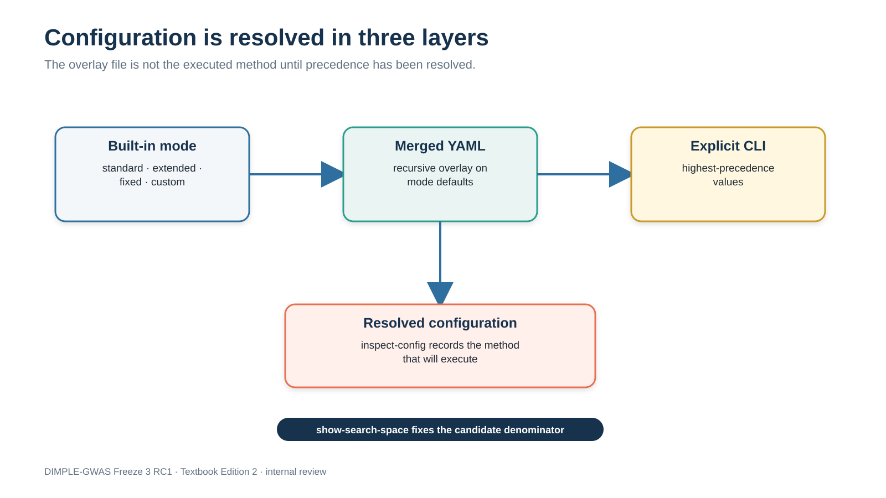{fig-alt="Built-in mode values are recursively merged with YAML and finally overridden by explicit command-line values"}

<figcaption><strong>Figure 11.</strong> Built-in mode values are recursively merged with YAML and finally overridden by explicit command-line values. <em>Interpretive boundary:</em> A valid configuration can still be scientifically unsuitable or computationally oversized.</figcaption>

</figure>

## Learning objectives

After completing Chapter 14, the reader can:

1. define Cartesian search and explain its role without exceeding the stated caution;
2. define candidate identity and explain its role without exceeding the stated caution;
3. trace the relevant package functions and generated artifacts;
4. complete the worked task and distinguish observation from interpretation.

## Conceptual and mathematical development

### Cartesian search

Product of enumerated parameter families. A compact notation is `N_candidates=product_j |Theta_j|`. In practical terms, the standard grid is 45 x 18 x 3 = 2,430 for one UMAP family.

Within Freeze 3 RC1 the concept is connected to `enumerate_candidates` and is visible through `search_space.tsv`. This connection is narrower than the general statistical idea: software evidence establishes the implemented route, while the mapped primary or internal evidence supplies background authority. The distinction prevents a mathematical definition from being mistaken for proof that a particular scientific interpretation is correct.

### candidate identity

Deterministic hash and ordinal for a resolved parameter combination. A compact notation is `model_id=H(canonical parameters)`. In practical terms, identity supports replay; it is not a quality score.

Within Freeze 3 RC1 the concept is connected to `candidate_identity` and is visible through `search_space.tsv; model_table.csv`. This connection is narrower than the general statistical idea: software evidence establishes the implemented route, while the mapped primary or internal evidence supplies background authority. The distinction prevents a mathematical definition from being mistaken for proof that a particular scientific interpretation is correct.

## Reconstructed operational foundation

Edition 1 contained the following verified operational material in separate short notes. Edition 2 consolidates it here and subjects it to the concept and evidence boundaries above.

### Evidence retained from former Chapter 11

### Operational foundation

Configuration resolution is deterministic: start with a built-in search mode, deep-merge a YAML mapping, then apply only explicit CLI values. The result is validated and written as `resolved_config.yaml`. Therefore a YAML value can differ from the run value when a CLI override is present; the resolved file, not memory or the source overlay alone, is authoritative for that run.

The four modes are `standard`, `extended`, `custom`, and `fixed`. `custom` requires a YAML file. `fixed` requires one value for every searched UMAP and HDBSCAN parameter. Scalar values produce one choice; lists produce choices; numeric `{start, stop, step}` mappings are stop-exclusive; supported CLI strings may also encode comma lists or ranges. Unknown top-level or interpretation keys and invalid combinations fail validation.

```bash
dimple-gwas inspect-config \
  --search-mode custom \
  --config docs/textbook/edition2/labs/02_custom_search_space/tutorial_config.yaml
```

## Evidence diagram or figure

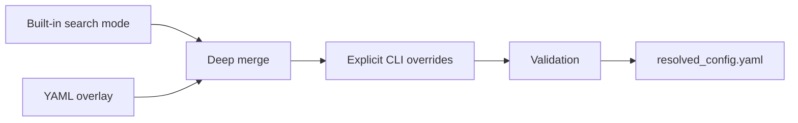


*Configuration precedence. Editable source: `assets/diagrams/diagram_03_config_precedence.mmd`.*

### Retained evidence

Edition 2 Lab 2 declares two values each for `umap.n_neighbors`, `umap.min_dist`, `hdbscan.min_cluster_size`, `hdbscan.min_samples`, and epsilon; other searched fields are scalar. The resolved file records two repeated states and one candidate job.

### Output-reading checkpoint

Compare the source YAML, captured `inspect-config` output, and run `resolved_config.yaml`. Use `evidence/configuration_key_reference.tsv` for every default and exposure.

### Misinterpretations to avoid

Do not call a tutorial value a default. Do not edit a resolved output and assume the past run changed. Do not use a range's `stop` as though it were included. Do not mix `custom` with no YAML.

### Boundary inherited from Edition 1

Configuration validity means fields satisfy software constraints, not that the scientific search is appropriate. Candidate-count safety and parameter justification remain analyst responsibilities.

### Evidence retained from former Chapter 12

### Operational foundation

`inspect-config` resolves and validates configuration and prints candidate counts without fitting. `show-search-space` enumerates the complete deterministic Cartesian product and can retain full TSV/JSON manifests. These commands are mandatory preflight tools: they expose accidental explosions, invalid fields, and misunderstood ranges before UMAP consumes compute.

```bash
dimple-gwas show-search-space \
  --search-mode custom \
  --config docs/textbook/edition2/labs/02_custom_search_space/tutorial_config.yaml \
  --output-dir docs/textbook/edition2/labs/02_custom_search_space/search_space_new \
  --show-first 5
```

Choose a new output directory name; the manual's executed directory is evidence, not a scratch target. Standard mode proves 45 min-cluster-size choices × 18 min-samples choices × 3 epsilon choices = 2,430 candidates for one UMAP family. Shipped extended mode has 1,728 candidates, not the older provisional 5,184 number.

### Retained evidence

Executed Edition 2 Lab 1 enumerated one candidate; Edition 2 Lab 2 enumerated 32: four UMAP families times eight HDBSCAN configurations. Both counts appear in stdout and complete manifests.

### Output-reading checkpoint

Inspect `candidate_models`, UMAP/HDBSCAN family counts, candidate ordinals, stable IDs, and the first/last parameter rows. Retain config and manifest checksums together.

### Misinterpretations to avoid

Do not estimate workload from HDBSCAN choices alone when UMAP parameters also vary. Do not silently sample a large Cartesian product; Freeze 3's safety ceiling raises rather than sampling.

### Boundary inherited from Edition 1

Candidate count is not runtime by itself: repeated UMAP families dominate some workloads while HDBSCAN candidate fits dominate others. Pilot evidence is still needed.

### Evidence retained from former Chapter 38

### Operational foundation

Configuration has seven top-level groups. `input` contains path, metadata-prefix count, separator, transform, and annotation join. `umap` contains twelve searchable embedding fields. `hdbscan` contains nine searchable density-clustering fields. `execution` contains repeats, threads, retention, safeguards, subsampling, seed, Parquet, DBCV, and strictness. `scoring` selects legacy/custom behavior. `interpretation` controls original-space similarity, order, noise, matching, figure safeguards, and optional coordinate associations. `search_mode` chooses the built-in base.

Standard defaults include four metadata columns, no transform, UMAP neighbors 30/min-dist 0/three components/Euclidean/densMAP true/base seed 42, HDBSCAN min-cluster-size 5:50, min-samples 2:20, epsilon 0:3, EOM/Euclidean, 1,000 repeats, `n_jobs=-1`, one candidate job, 20 retained models, DBCV and Parquet enabled, non-strict execution, legacy score excluding noise, and Pearson cluster-then-hclust explanation with exact matching. Stop values are exclusive.

Validation enforces finite values, supported metrics, min-dist≤spread, positive rates/sizes, EOM/leaf, valid maximum sizes, nonzero candidate jobs, valid score rules, and enumerated interpretation choices. The complete exact default/value reference is generated from source into `configuration_key_reference.tsv`.

### Retained evidence

Run `inspect-config` for standard, extended, fixed, and the tutorial custom YAML, then diff only the resolved values. This distinguishes mode defaults from overlays.

### Output-reading checkpoint

Inspect source YAML, resolved YAML, configuration hash, config-reference row, CLI exposure, validation errors, and search count.

### Misinterpretations to avoid

Do not infer a default from an example. Do not forget that `max_cluster_size` is EOM-specific. Do not enable coordinate associations or large matrices without acknowledging their output and privacy cost.

### Boundary inherited from Edition 1

The package validates syntax/ranges, not scientific choice. A permitted metric or parameter range may still be inappropriate for a specific data-generating process.

### Evidence retained from former Chapter 39

### Operational foundation

Freeze 3 enumerates the full Cartesian product of normalized UMAP and HDBSCAN parameter values. Candidate ordinals and stable hashes make enumeration auditable. It does not silently sample. `execution.max_candidate_models` is a hard safety ceiling; zero means unlimited. `warn_candidate_count` is a warning threshold.

Mode counts in this source are: standard 2,430 candidates (one UMAP family × 45 × 18 × 3 HDBSCAN values); fixed one candidate when all searched fields are scalar; Edition 2 Lab 2 custom 32; shipped extended 1,728. Extended crosses multiple UMAP and HDBSCAN fields, and its count must be derived from the current source rather than older planning documents.

Search work can reuse one repeated embedding across many HDBSCAN candidates sharing `umap_id`. Therefore candidate count, UMAP-family count, repeat count, sample/vector count, input width, metric, and thread settings all matter.

### Retained evidence

`show-search-space` writes the full flattened rows plus JSON counts. Compare the number of unique `umap_id` and `hdbscan_id` values with total candidate rows.

### Output-reading checkpoint

Inspect candidate ordinal/model/family IDs, every flattened parameter, declared enumeration note, safety settings, and checksum.

### Misinterpretations to avoid

Do not multiply only visibly changed YAML keys while ignoring inherited lists. Do not describe a truncated preview as the full manifest. Do not change the grid after examining desired labels without disclosure.

### Boundary inherited from Edition 1

Enumeration completeness is a software property, not a claim that the grid covers all meaningful models or that rank one is unique.

## Implementation trace

**`cli.build_parser`** is defined at `dimple_gwas/cli.py:146` with signature `class construction/data container`. Construct the complete user-facing command and flag grammar, including the interpret alias. It is reached from cli.main and connects to cli._add_config_source; cli._add_run_options. Its direct artifact contract is No direct canonical artifact; in-memory/supporting result; its explicit error surface is No explicit raise in this symbol; delegated calls may raise.. Test evidence is recorded as tests/test_freeze3_comparison_validation.py::test_cli_exposes_new_commands_and_alias. This is a A-tier contract, so the complete 20-field dossier is retained in the function atlas.

**`cli._inspect`** is defined at `dimple_gwas/cli.py:240` with signature `args: argparse.Namespace`. Implementation callable for inspect. It is reached from cli.main and connects to cli._resolved; search_space.count_candidates. Its direct artifact contract is No direct canonical artifact; in-memory/supporting result; its explicit error surface is No explicit raise in this symbol; delegated calls may raise.. Test evidence is recorded as No direct symbol-name test reference; assess through caller/integration coverage. This is a A-tier contract, so the complete 20-field dossier is retained in the function atlas.

**`cli._show`** is defined at `dimple_gwas/cli.py:254` with signature `args: argparse.Namespace`. Implementation callable for show. It is reached from cli.main and connects to cli._resolved; io.json_safe; reporting.write_search_space; search_space.count_candidates; search_space.enumerate_candidates; search_space.flatten_candidate. Its direct artifact contract is No direct canonical artifact; in-memory/supporting result; its explicit error surface is No explicit raise in this symbol; delegated calls may raise.. Test evidence is recorded as No direct symbol-name test reference; assess through caller/integration coverage. This is a A-tier contract, so the complete 20-field dossier is retained in the function atlas.

**`cli._score`** is defined at `dimple_gwas/cli.py:265` with signature `args: argparse.Namespace`. Implementation callable for score. It is reached from cli.main and connects to config.resolve_config; io.atomic_json_dump; io.json_safe; io.read_model_table; ranking.rank_models; scoring.apply_scoring; scoring.normalize_model_table_schema. Its direct artifact contract is rescored_table.tsv; rescored_table.tsv.manifest.json; its explicit error surface is No explicit raise in this symbol; delegated calls may raise.. Test evidence is recorded as No direct symbol-name test reference; assess through caller/integration coverage. This is a A-tier contract, so the complete 20-field dossier is retained in the function atlas.

**`cli._summarize`** is defined at `dimple_gwas/cli.py:284` with signature `args: argparse.Namespace`. Implementation callable for summarize. It is reached from cli.main and connects to io.atomic_json_dump; io.read_model_table; ranking.family_summaries; ranking.pareto_front; ranking.rank_models; ranking.top_models. Its direct artifact contract is family_summaries.tsv; pareto_front.tsv; top_models.tsv; summary.json; its explicit error surface is No explicit raise in this symbol; delegated calls may raise.. Test evidence is recorded as No direct symbol-name test reference; assess through caller/integration coverage. This is a A-tier contract, so the complete 20-field dossier is retained in the function atlas.

**`cli._reproduce`** is defined at `dimple_gwas/cli.py:301` with signature `args: argparse.Namespace`. Implementation callable for reproduce. It is reached from cli.main and connects to config.resolve_config; config.validate_config; pipeline.run_search. Its direct artifact contract is No direct canonical artifact; in-memory/supporting result; its explicit error surface is ValueError. Test evidence is recorded as No direct symbol-name test reference; assess through caller/integration coverage. This is a A-tier contract, so the complete 20-field dossier is retained in the function atlas.

**`cli._explain`** is defined at `dimple_gwas/cli.py:323` with signature `args: argparse.Namespace`. Implementation callable for explain. It is reached from cli.main and connects to config.resolve_config; config.validate_config; interpretation.run_explanation. Its direct artifact contract is No direct canonical artifact; in-memory/supporting result; its explicit error surface is ValueError. Test evidence is recorded as No direct symbol-name test reference; assess through caller/integration coverage. This is a A-tier contract, so the complete 20-field dossier is retained in the function atlas.

**`cli._compare`** is defined at `dimple_gwas/cli.py:376` with signature `args: argparse.Namespace`. Implementation callable for compare. It is reached from cli.main and connects to comparison.run_comparison. Its direct artifact contract is No direct canonical artifact; in-memory/supporting result; its explicit error surface is No explicit raise in this symbol; delegated calls may raise.. Test evidence is recorded as No direct symbol-name test reference; assess through caller/integration coverage. This is a A-tier contract, so the complete 20-field dossier is retained in the function atlas.

**`cli._validate`** is defined at `dimple_gwas/cli.py:391` with signature `args: argparse.Namespace`. Implementation callable for validate. It is reached from cli.main and connects to validation.run_validation. Its direct artifact contract is No direct canonical artifact; in-memory/supporting result; its explicit error surface is No explicit raise in this symbol; delegated calls may raise.. Test evidence is recorded as No direct symbol-name test reference; assess through caller/integration coverage. This is a A-tier contract, so the complete 20-field dossier is retained in the function atlas.

**`cli.main`** is defined at `dimple_gwas/cli.py:403` with signature `argv: list[str] | None=None`. Dispatch the command-line interface and return a process exit status. It is reached from CLI/import/direct caller or no package caller detected and connects to cli._compare; cli._explain; cli._inspect; cli._reproduce; cli._resolved; cli._score; cli._show; cli._summarize; cli._validate; cli.build_parser; pipeline.run_search. Its direct artifact contract is No direct canonical artifact; in-memory/supporting result; its explicit error surface is No explicit raise in this symbol; delegated calls may raise.. Test evidence is recorded as tests/test_freeze3_comparison_validation.py::test_cli_compare_end_to_end. This is a A-tier contract, so the complete 20-field dossier is retained in the function atlas.

**`config.builtin_config`** is defined at `dimple_gwas/config.py:128` with signature `mode: str`. Implementation callable for builtin config. It is reached from config.resolve_config and connects to config._base_config. Its direct artifact contract is No direct canonical artifact; in-memory/supporting result; its explicit error surface is ValueError. Test evidence is recorded as No direct symbol-name test reference; assess through caller/integration coverage. This is a B-tier contract, so the complete 20-field dossier is retained in the function atlas.

**`config.deep_merge`** is defined at `dimple_gwas/config.py:164` with signature `base: Mapping[str, Any], overlay: Mapping[str, Any]`. Implementation callable for deep merge. It is reached from config.resolve_config and connects to No package-defined dependency detected. Its direct artifact contract is No direct canonical artifact; in-memory/supporting result; its explicit error surface is No explicit raise in this symbol; delegated calls may raise.. Test evidence is recorded as No direct symbol-name test reference; assess through caller/integration coverage. This is a B-tier contract, so the complete 20-field dossier is retained in the function atlas.

## Claim adjudication notebook

The following statements are admitted to the draft only in their safe form:

- **PIPE-003 (verified):** The standard grid enumerates 45 min_cluster_size values, 18 min_samples values, and 3 epsilon values: 2,430 HDBSCAN candidates for one UMAP configuration. Limitation: Custom and extended modes differ. Implementation evidence: `config.py; search_space.py`.

## Reading the generated evidence

For Chapter 14, the `Configuration and search-space inspection` files are read as a provenance chain rather than as isolated results:

<p class="table-caption" id="table-8"><strong>Table 8.</strong> Reading the generated evidence.</p>

| Artifact | Producer | What to verify before interpretation |
| --- | --- | --- |
| `search_space_manifest.tsv/json` | `write_search_space` | Artifact exists under the new output root, is readable, and its checksum is recorded. |

The output atlas supplies the complete schemas, checksums, conditions, consumers, and privacy notes for this Chapter 14 route. Native manifests can contain machine paths; the assembled textbook uses sanitized excerpts while restricted evidence retains the original provenance chain.

## Worked reasoning and evidence exercise

Predict one override result and the Lab 2 candidate count before comparing both with fresh command output.

A complete Chapter 14 answer must expose its intermediate reasoning, name the source or output used for `Configuration and search-space inspection`, and finish with separate support and non-support statements. Applying that discipline to the question “Which values will the software actually use after built-ins, YAML, and CLI overrides are combined?” prevents a calculation, a software observation, and a scientific interpretation from collapsing into one claim.

## Assumptions, diagnostics, and recovery

The Chapter 14 analysis assumes the stated unit and inputs, the recorded configuration and software identity, and a diagnostic that addresses the claimed property rather than a convenient surrogate. Its decisive boundary is: `inspect-config` and `show-search-space` are preflight tools; successful inspection does not validate the scientific suitability of settings.

If the Chapter 14 route fails, retain its log and candidate status before deciding whether the cause is input, configuration, dependency, compute, identifier alignment, or output-root state. Correct an operational failure by writing a new result directory. Treat instability in `Configuration and search-space inspection` as sensitivity evidence: report it and identify the independent evidence needed instead of relabeling ambiguity as a software exception.

## Chapter synthesis

Readable YAML is not necessarily the resolved configuration, and a plausible range can still request unintended compute. The implementation trace makes the current behavior auditable, but the evidence boundary remains part of the result. Chapter 15 executes the resolved plan and teaches the run manifest as the primary narrative.

## Exercises

1. For `Configuration and search-space inspection`, name the unit of analysis and one plausible but invalid substitute.
2. Reconstruct the notation for Cartesian search; define its dimensions or denominator and interpret every term.
3. Choose a Tier A function mapped to Chapter 14; identify its caller and direct output, then propose a topic-specific edge case.
4. Select one Chapter 14 artifact from the output atlas and state three integrity checks that must precede scientific reading.
5. Convert a tempting `Configuration and search-space inspection` overclaim into one observed statement followed by its limitation.
6. Predict one override result and the Lab 2 candidate count before comparing both with fresh command output.

Appendix J gives the Chapter 14 adjudication guide. Its further-reading keys supply statistical context; no external paper is treated as automatic validation of the current software or dataset.


<div class="chapter-break"></div>

<a id="chapter-15"></a>

# 15. Complete pipeline execution and monitoring

*Guiding question:* **What happens between pressing return and receiving a selected model?**

Prerequisites: 7–14.

## Why the question matters

The pipeline shares each UMAP representation across a family of HDBSCAN candidates while retaining invalid and failed models instead of silently dropping them.

A complete run reports software and artifact status; it does not imply that the selected model is scientifically preferred outside the declared score and candidate set.

This chapter develops the question in the order needed for a reader to move from statistical principle to current implementation, retained evidence, and a defensible statement. Its central worked task is: Trace one Lab 1 candidate through resolved configuration, prepared shape, UMAP family, candidate evaluation, scoring, refit, and manifest entries.

## Learning objectives

After completing Chapter 15, the reader can:

1. define identifier alignment and explain its role without exceeding the stated caution;
2. define seed schedule and explain its role without exceeding the stated caution;
3. define Cartesian search and explain its role without exceeding the stated caution;
4. define candidate identity and explain its role without exceeding the stated caution;
5. define legacy_dimple score and explain its role without exceeding the stated caution;
6. trace the relevant package functions and generated artifacts;
7. complete the worked task and distinguish observation from interpretation.

## Conceptual and mathematical development

### identifier alignment

A one-to-one correspondence between vector or feature identifiers across artifacts. A compact notation is `I_A = I_B`. In practical terms, order is not identity; normalize and validate keys before joining.

Within Freeze 3 RC1 the concept is connected to `validated_identifiers; align_rows` and is visible through `labels.tsv; coordinates.tsv`. This connection is narrower than the general statistical idea: software evidence establishes the implemented route, while the mapped primary or internal evidence supplies background authority. The distinction prevents a mathematical definition from being mistaken for proof that a particular scientific interpretation is correct.

### seed schedule

Deterministic list controlling repeated stochastic fits. A compact notation is `legacy: 1,...,S; current: r,...,r+S-1`. In practical terms, recorded seeds permit replay but do not guarantee cross-platform bitwise identity. [[Collange et al. (2015)](#ref-reproduciblesum2015)]

Within Freeze 3 RC1 the concept is connected to `ensemble_seeds` and is visible through `embedding_manifest.json`. This connection is narrower than the general statistical idea: software evidence establishes the implemented route, while the mapped primary or internal evidence supplies background authority. The distinction prevents a mathematical definition from being mistaken for proof that a particular scientific interpretation is correct.

### Cartesian search

Product of enumerated parameter families. A compact notation is `N_candidates=product_j |Theta_j|`. In practical terms, the standard grid is 45 x 18 x 3 = 2,430 for one UMAP family.

Within Freeze 3 RC1 the concept is connected to `enumerate_candidates` and is visible through `search_space.tsv`. This connection is narrower than the general statistical idea: software evidence establishes the implemented route, while the mapped primary or internal evidence supplies background authority. The distinction prevents a mathematical definition from being mistaken for proof that a particular scientific interpretation is correct.

### candidate identity

Deterministic hash and ordinal for a resolved parameter combination. A compact notation is `model_id=H(canonical parameters)`. In practical terms, identity supports replay; it is not a quality score.

Within Freeze 3 RC1 the concept is connected to `candidate_identity` and is visible through `search_space.tsv; model_table.csv`. This connection is narrower than the general statistical idea: software evidence establishes the implemented route, while the mapped primary or internal evidence supplies background authority. The distinction prevents a mathematical definition from being mistaken for proof that a particular scientific interpretation is correct.

### legacy_dimple score

Population-relative weighted combination of normalized silhouette, clusters, and optionally noise. A compact notation is `raw=w_s s/max(s)+w_k k/max(k)-w_n n/max(n)`. In practical terms, weights are raw dynamic ranges divided by their sum; final scores are min-max scaled.

Within Freeze 3 RC1 the concept is connected to `legacy_dimple_score` and is visible through `scoring_manifest.json; model_table.csv`. This connection is narrower than the general statistical idea: software evidence establishes the implemented route, while the mapped primary or internal evidence supplies background authority. The distinction prevents a mathematical definition from being mistaken for proof that a particular scientific interpretation is correct.

### floating-point reproducibility

Dependence of finite-precision results on operation order and platform. A compact notation is `fl((a+b)+c) may differ from fl(a+(b+c))`. In practical terms, pinned dependencies improve control but do not guarantee universal bitwise equality. [[Collange et al. (2015)](#ref-reproduciblesum2015)]

Within Freeze 3 RC1 the concept is connected to `capture_environment` and is visible through `environment.json`. This connection is narrower than the general statistical idea: software evidence establishes the implemented route, while the mapped primary or internal evidence supplies background authority. The distinction prevents a mathematical definition from being mistaken for proof that a particular scientific interpretation is correct.

## Reconstructed operational foundation

Edition 1 contained the following verified operational material in separate short notes. Edition 2 consolidates it here and subjects it to the concept and evidence boundaries above.

### Evidence retained from former Chapter 4

### Operational foundation

The Stage 1 workflow is a producer–consumer chain. Freeze 3 reads the table, removes the declared leading metadata columns, optionally applies RINT to analysis columns, and transposes to vectors by input variables. For each UMAP parameter family it generates repeated seeded UMAP/densMAP embeddings and concatenates them horizontally. It then evaluates the complete declared HDBSCAN Cartesian product, retains success, invalid-topology, and failure rows, calculates diagnostics, applies the declared score, ranks eligible candidates, and refits retained models to preserve labels.

Downstream commands do different work. `reproduce-model` refits one retained parameterization. `explain` does not refit; it matches exact IDs and returns to original input-vector space. `compare` measures structural and optional coordinate concordance. `validate` checks files, schemas, counts, readability, and recorded hashes. No PCA, SVD, or ICA reducer is silently inserted before UMAP.

## Evidence diagram or figure


*Stage 1 producer–consumer workflow. Editable source: `assets/diagrams/diagram_01_stage1_workflow.mmd`.*

### Retained evidence

Follow `assets/diagrams/diagram_01_stage1_workflow.mmd` from input to downstream utilities. Each arrow corresponds to an implementation module named in `evidence/source_to_manual_traceability.tsv`.

### Output-reading checkpoint

At the run root, inspect `resolved_config.yaml`, the search-space manifests, `models/`, `run_manifest.json`, and `logs/run.log`. Appendix D maps every named output to its producer and consumer.

### Misinterpretations to avoid

Do not treat `stage09_*` display coordinates as the full concatenated embedding. Do not expect cleaned inputs or individual repeated embeddings on disk; current Freeze 3 keeps them in memory.

### Boundary inherited from Edition 1

A workflow diagram explains control and data flow, not scientific validity. Every transformation can change geometry, and the selected model remains conditional on the declared search and score.

### Evidence retained from former Chapter 13

### Operational foundation

The shortest verified run starts in the Freeze 3 repository root with the installed RC1 entry point. Inspect first, enumerate second, fit third, and use a new output root.

```bash
dimple-gwas inspect-config \
  --search-mode fixed \
  --config docs/textbook/edition2/labs/01_fixed_synthetic/tutorial_config.yaml

dimple-gwas show-search-space \
  --search-mode fixed \
  --config docs/textbook/edition2/labs/01_fixed_synthetic/tutorial_config.yaml \
  --output-dir docs/textbook/edition2/labs/01_fixed_synthetic/search_space_new

dimple-gwas run \
  --search-mode fixed \
  --config docs/textbook/edition2/labs/01_fixed_synthetic/tutorial_config.yaml \
  --output-dir docs/textbook/edition2/labs/01_fixed_synthetic/run_new
```

Replace `*_new` with unique names. The canonical documented output is `run_20260826`; do not overwrite it. The fixture is small and repository-owned. It demonstrates execution structure, not production adequacy.

### Retained evidence

The executed canonical run prepared 24 vectors by 80 variables, evaluated one candidate, selected `model_060fac0208bb58e2`, found three clusters of eight, and assigned no noise. Exit status was zero.

### Output-reading checkpoint

Confirm `run_manifest.json` status, one-row search manifest, one candidate table row, selected-model JSON, label row count/uniqueness, annotation join, log, and validation output when run.

### Misinterpretations to avoid

Do not copy an example output path unchanged. Do not jump directly to the plot before checking the manifest. Do not generalize ‘three clusters’ from the designed fixture to real data.

### Boundary inherited from Edition 1

One seed and one candidate make this a smoke test. They do not represent standard production compute or a robust model-selection study.

### Evidence retained from former Chapter 14

### Operational foundation

`run_manifest.json` is the primary run-level audit record. It names the schema, software/version, command, start/finish status, platform, architecture, Python and package versions, package-source hash, input record, resolved configuration and its hash, input contract, seeds, threads, backends, search size, runtime, selected model, scoring formula/profile, artifacts, Parquet outcome, warnings, exclusions, and failures.

A healthy manifest has `status=complete`, but completion alone is not enough. Reconcile candidate counts with search manifests, failed counts with `logs/model_failures.tsv`, selected model with `model_selection_manifest.json` and `best_model.json`, and artifact hashes with files. `git_commit` is null in this source snapshot; the package-source SHA-256 and file registers substitute for build identity in this draft.

### Retained evidence

Edition 2 Lab 2 records 32 search candidates, 32 completed models, zero failed models, four UMAP configurations, two random seeds (42,43), contrib HDBSCAN and umap-learn backends, and an approximately 10.713-second manifest runtime in its local environment.

### Output-reading checkpoint

Inspect `run_manifest.json`, `resolved_config.yaml`, both search-space manifests, `models/model_selection_manifest.json`, `logs/run.log`, and `logs/model_failures.tsv` as a set.

### Misinterpretations to avoid

Do not interpret a null Git commit as a random run; use the source hash. Do not ignore a recorded optional-Parquet failure. Do not assume a complete run had no invalid topologies.

### Boundary inherited from Edition 1

Manifests can disclose local paths, input hashes, platform information, and commands. Sanitize public copies without changing the retained private audit record.

### Evidence retained from former Chapter 43

### Operational foundation

Troubleshoot by preserving evidence and narrowing the contract. Configuration errors include unknown keys, invalid metrics/ranges, custom mode without YAML, list values in fixed mode, min-dist greater than spread, invalid sizes, or a zero candidate job. Input errors include missing path, separator mistakes, nonnumeric analysis columns, wrong metadata-prefix count, duplicate/whitespace IDs, ambiguous orientation, missing labels, or undefined correlations. Execution issues include large candidate/repeat counts, backend errors, invalid topologies, optional Parquet failure, annotations skipped, and nonempty output roots for commands that require an absent/empty directory. Validation can flag missing files, unreadable schemas, count mismatch, or hash mismatch.

Recovery order: copy the exact error and command; inspect the log/manifest; run `inspect-config`; run `show-search-space`; verify input header/dimensions/IDs/checksum; reproduce on the fixed fixture; reduce only explicitly safe compute settings in a new config; create a new output root; and keep the failed candidate/run evidence. Use `--strict` when a workflow must abort on candidate failures, understanding the operational consequence.

A code defect should be documented with the smallest reproducer; do not edit scientific code just to make prose pass.

### Retained evidence

Edition 2 Lab 1's annotation warning was resolved by inspecting the annotation header (`index`), correcting YAML, and rerunning to a new directory. No historical output was overwritten.

### Output-reading checkpoint

Inspect stderr/stdout capture, `logs/run.log`, `model_failures.tsv`, status/error/warning columns, resolved config, input contract, issue register, and validation checks.

### Misinterpretations to avoid

Do not delete a failed output before recording it. Do not set `undefined_correlation=zero` merely to suppress an unexplained constant vector. Do not increase parallelism as the first remedy for memory pressure.

### Boundary inherited from Edition 1

Not every warning invalidates clustering; not every exit-zero run is scientifically acceptable. Classify impact and resolution explicitly.

### Evidence retained from former Chapter 44

### Operational foundation

Workload has two nested scales: UMAP families × repeated seeds, then HDBSCAN candidates per family. Concatenated width is components × repeats; embedding storage in memory grows with vector count and that width. Original-space explanation may create a quadratic vector-by-vector similarity matrix and large heatmap. Candidate tables grow with the Cartesian product. JIT compilation makes first small runs slower than steady-state work.

Use `inspect-config`/`show-search-space` before execution. Start with the fixed fixture, then a bounded scientific pilot that preserves the intended method. Set `n_jobs` and `candidate_jobs` deliberately: when candidates run in parallel, Freeze 3 constrains HDBSCAN core-distance jobs to one to avoid nested oversubscription. Thread environment variables and numerical backends belong in provenance. Use the full-heatmap limit and avoid forcing large matrices without memory/privacy review.

The historical note records a 16-GB host caution. Current storage had ample space, but that is not a production resource recommendation. The executed 10.7-second/32-candidate and 273.47-second historical MNIST values are configuration-specific evidence, not scaling laws.

### Retained evidence

Estimate candidate count, UMAP-family count, concatenated width, model-table rows, and similarity-matrix cells for a proposed run. Then compare available memory/storage and choose one job setting before starting.

### Output-reading checkpoint

Inspect preflight counts, free storage, vector/input width, repeat/component counts, jobs/threads, UMAP/candidate runtimes, failure rates, Parquet status, and explanation matrix safeguards.

### Misinterpretations to avoid

Do not run the 164 1,000-seed workflow as an undocumented first smoke test. Do not set both job layers to unrestricted parallelism. Do not infer linear runtime from tiny fixtures.

### Boundary inherited from Edition 1

No fresh full-IDP runtime/memory benchmark exists yet. Docker profiling must precede cloud sizing and preserve scientific settings.

## Implementation trace

**`cli.build_parser`** is defined at `dimple_gwas/cli.py:146` with signature `class construction/data container`. Construct the complete user-facing command and flag grammar, including the interpret alias. It is reached from cli.main and connects to cli._add_config_source; cli._add_run_options. Its direct artifact contract is No direct canonical artifact; in-memory/supporting result; its explicit error surface is No explicit raise in this symbol; delegated calls may raise.. Test evidence is recorded as tests/test_freeze3_comparison_validation.py::test_cli_exposes_new_commands_and_alias. This is a A-tier contract, so the complete 20-field dossier is retained in the function atlas.

**`cli._inspect`** is defined at `dimple_gwas/cli.py:240` with signature `args: argparse.Namespace`. Implementation callable for inspect. It is reached from cli.main and connects to cli._resolved; search_space.count_candidates. Its direct artifact contract is No direct canonical artifact; in-memory/supporting result; its explicit error surface is No explicit raise in this symbol; delegated calls may raise.. Test evidence is recorded as No direct symbol-name test reference; assess through caller/integration coverage. This is a A-tier contract, so the complete 20-field dossier is retained in the function atlas.

**`cli._show`** is defined at `dimple_gwas/cli.py:254` with signature `args: argparse.Namespace`. Implementation callable for show. It is reached from cli.main and connects to cli._resolved; io.json_safe; reporting.write_search_space; search_space.count_candidates; search_space.enumerate_candidates; search_space.flatten_candidate. Its direct artifact contract is No direct canonical artifact; in-memory/supporting result; its explicit error surface is No explicit raise in this symbol; delegated calls may raise.. Test evidence is recorded as No direct symbol-name test reference; assess through caller/integration coverage. This is a A-tier contract, so the complete 20-field dossier is retained in the function atlas.

**`cli._score`** is defined at `dimple_gwas/cli.py:265` with signature `args: argparse.Namespace`. Implementation callable for score. It is reached from cli.main and connects to config.resolve_config; io.atomic_json_dump; io.json_safe; io.read_model_table; ranking.rank_models; scoring.apply_scoring; scoring.normalize_model_table_schema. Its direct artifact contract is rescored_table.tsv; rescored_table.tsv.manifest.json; its explicit error surface is No explicit raise in this symbol; delegated calls may raise.. Test evidence is recorded as No direct symbol-name test reference; assess through caller/integration coverage. This is a A-tier contract, so the complete 20-field dossier is retained in the function atlas.

**`cli._summarize`** is defined at `dimple_gwas/cli.py:284` with signature `args: argparse.Namespace`. Implementation callable for summarize. It is reached from cli.main and connects to io.atomic_json_dump; io.read_model_table; ranking.family_summaries; ranking.pareto_front; ranking.rank_models; ranking.top_models. Its direct artifact contract is family_summaries.tsv; pareto_front.tsv; top_models.tsv; summary.json; its explicit error surface is No explicit raise in this symbol; delegated calls may raise.. Test evidence is recorded as No direct symbol-name test reference; assess through caller/integration coverage. This is a A-tier contract, so the complete 20-field dossier is retained in the function atlas.

**`cli._reproduce`** is defined at `dimple_gwas/cli.py:301` with signature `args: argparse.Namespace`. Implementation callable for reproduce. It is reached from cli.main and connects to config.resolve_config; config.validate_config; pipeline.run_search. Its direct artifact contract is No direct canonical artifact; in-memory/supporting result; its explicit error surface is ValueError. Test evidence is recorded as No direct symbol-name test reference; assess through caller/integration coverage. This is a A-tier contract, so the complete 20-field dossier is retained in the function atlas.

**`cli._explain`** is defined at `dimple_gwas/cli.py:323` with signature `args: argparse.Namespace`. Implementation callable for explain. It is reached from cli.main and connects to config.resolve_config; config.validate_config; interpretation.run_explanation. Its direct artifact contract is No direct canonical artifact; in-memory/supporting result; its explicit error surface is ValueError. Test evidence is recorded as No direct symbol-name test reference; assess through caller/integration coverage. This is a A-tier contract, so the complete 20-field dossier is retained in the function atlas.

**`cli._compare`** is defined at `dimple_gwas/cli.py:376` with signature `args: argparse.Namespace`. Implementation callable for compare. It is reached from cli.main and connects to comparison.run_comparison. Its direct artifact contract is No direct canonical artifact; in-memory/supporting result; its explicit error surface is No explicit raise in this symbol; delegated calls may raise.. Test evidence is recorded as No direct symbol-name test reference; assess through caller/integration coverage. This is a A-tier contract, so the complete 20-field dossier is retained in the function atlas.

**`cli._validate`** is defined at `dimple_gwas/cli.py:391` with signature `args: argparse.Namespace`. Implementation callable for validate. It is reached from cli.main and connects to validation.run_validation. Its direct artifact contract is No direct canonical artifact; in-memory/supporting result; its explicit error surface is No explicit raise in this symbol; delegated calls may raise.. Test evidence is recorded as No direct symbol-name test reference; assess through caller/integration coverage. This is a A-tier contract, so the complete 20-field dossier is retained in the function atlas.

**`cli.main`** is defined at `dimple_gwas/cli.py:403` with signature `argv: list[str] | None=None`. Dispatch the command-line interface and return a process exit status. It is reached from CLI/import/direct caller or no package caller detected and connects to cli._compare; cli._explain; cli._inspect; cli._reproduce; cli._resolved; cli._score; cli._show; cli._summarize; cli._validate; cli.build_parser; pipeline.run_search. Its direct artifact contract is No direct canonical artifact; in-memory/supporting result; its explicit error surface is No explicit raise in this symbol; delegated calls may raise.. Test evidence is recorded as tests/test_freeze3_comparison_validation.py::test_cli_compare_end_to_end. This is a A-tier contract, so the complete 20-field dossier is retained in the function atlas.

**`io.resolve_separator`** is defined at `dimple_gwas/io.py:10` with signature `path: str | Path, override: str | None=None`. Implementation callable for resolve separator. It is reached from io.read_model_table; io.read_table and connects to No package-defined dependency detected. Its direct artifact contract is No direct canonical artifact; in-memory/supporting result; its explicit error surface is No explicit raise in this symbol; delegated calls may raise.. Test evidence is recorded as No direct symbol-name test reference; assess through caller/integration coverage. This is a B-tier contract, so the complete 20-field dossier is retained in the function atlas.

**`io.read_table`** is defined at `dimple_gwas/io.py:16` with signature `path: str | Path, sep: str | None=None, *, sheet: str | int=0, nrows: int | None=None`. Implementation callable for read table. It is reached from comparison._resolve_labels; interpretation.run_explanation; pipeline._annotation_frame; pipeline.run_search; validation.run_validation and connects to io.resolve_separator. Its direct artifact contract is No direct canonical artifact; in-memory/supporting result; its explicit error surface is FileNotFoundError; RuntimeError. Test evidence is recorded as tests/test_freeze3_interpretation.py::test_reader_supports_excel_sheet. This is a A-tier contract, so the complete 20-field dossier is retained in the function atlas.

## Reading the generated evidence

For Chapter 15, the `Complete pipeline execution and monitoring` files are read as a provenance chain rather than as isolated results:

<p class="table-caption" id="table-9"><strong>Table 9.</strong> Reading the generated evidence.</p>

| Artifact | Producer | What to verify before interpretation |
| --- | --- | --- |
| `resolved_config.yaml` | `write_resolved_config` | Artifact exists under the new output root, is readable, and its checksum is recorded. |
| `run_manifest.json` | `write_model_outputs` | status=complete; source/input hashes present; failed count understood; selected model and artifact records resolve. |
| `logs/run.log` | `setup_logger` | Artifact exists under the new output root, is readable, and its checksum is recorded. |
| `models/all_models.tsv` | `write_model_outputs` | Candidate count agrees with enumeration; failures remain; ranks and score eligibility are internally consistent. |
| `models/ranked_models.tsv` | `write_model_outputs` | Candidate count agrees with enumeration; failures remain; ranks and score eligibility are internally consistent. |
| `models/all_models.parquet` | `write_model_outputs` | Candidate count agrees with enumeration; failures remain; ranks and score eligibility are internally consistent. |
| `models/top_models.tsv` | `write_model_outputs` | Artifact exists under the new output root, is readable, and its checksum is recorded. |
| `models/best_model.json` | `write_model_outputs` | Artifact exists under the new output root, is readable, and its checksum is recorded. |
| `models/model_selection_manifest.json` | `write_model_outputs` | Artifact exists under the new output root, is readable, and its checksum is recorded. |
| `models/pareto_front.tsv` | `write_model_outputs` | Artifact exists under the new output root, is readable, and its checksum is recorded. |
| `models/family_summaries.tsv` | `write_model_outputs` | Artifact exists under the new output root, is readable, and its checksum is recorded. |
| `models/top_model_artifacts/<id>/labels.tsv` | `_top_artifact` | Identifiers are unique and exactly match the intended input; label -1 is treated as noise/unassigned. |
| `models/top_model_artifacts/<id>/summary.json` | `_top_artifact` | Artifact exists under the new output root, is readable, and its checksum is recorded. |
| `models/top_model_artifacts/<id>/reproduce.yaml` | `_top_artifact` | Artifact exists under the new output root, is readable, and its checksum is recorded. |

The output atlas supplies the complete schemas, checksums, conditions, consumers, and privacy notes for this Chapter 15 route. Native manifests can contain machine paths; the assembled textbook uses sanitized excerpts while restricted evidence retains the original provenance chain.

## Worked reasoning and evidence exercise

Trace one Lab 1 candidate through resolved configuration, prepared shape, UMAP family, candidate evaluation, scoring, refit, and manifest entries.

A complete Chapter 15 answer must expose its intermediate reasoning, name the source or output used for `Complete pipeline execution and monitoring`, and finish with separate support and non-support statements. Applying that discipline to the question “What happens between pressing return and receiving a selected model?” prevents a calculation, a software observation, and a scientific interpretation from collapsing into one claim.

## Assumptions, diagnostics, and recovery

The Chapter 15 analysis assumes the stated unit and inputs, the recorded configuration and software identity, and a diagnostic that addresses the claimed property rather than a convenient surrogate. Its decisive boundary is: A complete run reports software and artifact status; it does not imply that the selected model is scientifically preferred outside the declared score and candidate set.

If the Chapter 15 route fails, retain its log and candidate status before deciding whether the cause is input, configuration, dependency, compute, identifier alignment, or output-root state. Correct an operational failure by writing a new result directory. Treat instability in `Complete pipeline execution and monitoring` as sensitivity evidence: report it and identify the independent evidence needed instead of relabeling ambiguity as a software exception.

## Chapter synthesis

The pipeline shares each UMAP representation across a family of HDBSCAN candidates while retaining invalid and failed models instead of silently dropping them. The implementation trace makes the current behavior auditable, but the evidence boundary remains part of the result. Chapter 16 starts from the retained tables and performs the post-run command sequence.

## Exercises

1. For `Complete pipeline execution and monitoring`, name the unit of analysis and one plausible but invalid substitute.
2. Reconstruct the notation for identifier alignment; define its dimensions or denominator and interpret every term.
3. Choose a Tier A function mapped to Chapter 15; identify its caller and direct output, then propose a topic-specific edge case.
4. Select one Chapter 15 artifact from the output atlas and state three integrity checks that must precede scientific reading.
5. Convert a tempting `Complete pipeline execution and monitoring` overclaim into one observed statement followed by its limitation.
6. Trace one Lab 1 candidate through resolved configuration, prepared shape, UMAP family, candidate evaluation, scoring, refit, and manifest entries.

Appendix J gives the Chapter 15 adjudication guide. Its further-reading keys supply statistical context; no external paper is treated as automatic validation of the current software or dataset.


<div class="chapter-break"></div>

<a id="chapter-16"></a>

# 16. Model summaries, selection, reproduction, comparison, and validation

*Guiding question:* **How does an analyst move from a ranked table to a defensible retained model?**

Prerequisites: 11–15.

## Why the question matters

The highest score is a reproducible ordering under one objective, not an instruction to skip sensitivity, failure review, or scientific adjudication.

Commands operate on retained artifacts and exact IDs. Historical manual selection must remain disclosed when it differs from automatic rank.

This chapter develops the question in the order needed for a reader to move from statistical principle to current implementation, retained evidence, and a defensible statement. Its central worked task is: Use the tied Lab 2 top rows to explain deterministic tie ordering and write a selection note that distinguishes automatic rank from analyst choice.

## Learning objectives

After completing Chapter 16, the reader can:

1. define legacy_dimple score and explain its role without exceeding the stated caution;
2. define eligibility and ties and explain its role without exceeding the stated caution;
3. define adjusted Rand index and explain its role without exceeding the stated caution;
4. define normalized mutual information and explain its role without exceeding the stated caution;
5. define noise Jaccard and explain its role without exceeding the stated caution;
6. trace the relevant package functions and generated artifacts;
7. complete the worked task and distinguish observation from interpretation.

## Conceptual and mathematical development

### legacy_dimple score

Population-relative weighted combination of normalized silhouette, clusters, and optionally noise. A compact notation is `raw=w_s s/max(s)+w_k k/max(k)-w_n n/max(n)`. In practical terms, weights are raw dynamic ranges divided by their sum; final scores are min-max scaled.

Within Freeze 3 RC1 the concept is connected to `legacy_dimple_score` and is visible through `scoring_manifest.json; model_table.csv`. This connection is narrower than the general statistical idea: software evidence establishes the implemented route, while the mapped primary or internal evidence supplies background authority. The distinction prevents a mathematical definition from being mistaken for proof that a particular scientific interpretation is correct.

### eligibility and ties

Rules deciding which candidates receive scores and stable rank order. A compact notation is `eligible=(status=success) and finite silhouette`. In practical terms, ties resolve deterministically through configured sort keys and candidate identity.

Within Freeze 3 RC1 the concept is connected to `rank_models` and is visible through `ranked_models.csv`. This connection is narrower than the general statistical idea: software evidence establishes the implemented route, while the mapped primary or internal evidence supplies background authority. The distinction prevents a mathematical definition from being mistaken for proof that a particular scientific interpretation is correct.

### adjusted Rand index

Chance-adjusted pairwise partition agreement. A compact notation is `ARI=(RI-E[RI])/(max(RI)-E[RI])`. In practical terms, permutation invariant; a value of 1 does not imply coordinate identity. [[Hubert et al. (1985)](#ref-hubert1985)]

Within Freeze 3 RC1 the concept is connected to `compare_partitions` and is visible through `comparison_summary.json`. This connection is narrower than the general statistical idea: software evidence establishes the implemented route, while the mapped primary or internal evidence supplies background authority. The distinction prevents a mathematical definition from being mistaken for proof that a particular scientific interpretation is correct.

### normalized mutual information

Normalized information shared by two labelings. A compact notation is `NMI=2I(U;V)/(H(U)+H(V))`. In practical terms, normalization conventions matter; Freeze 3 uses the sklearn convention recorded in code. [[Vinh et al. (2010)](#ref-vinh2010)]

Within Freeze 3 RC1 the concept is connected to `compare_partitions` and is visible through `comparison_summary.json`. This connection is narrower than the general statistical idea: software evidence establishes the implemented route, while the mapped primary or internal evidence supplies background authority. The distinction prevents a mathematical definition from being mistaken for proof that a particular scientific interpretation is correct.

### noise Jaccard

Overlap of the two sets labeled -1. A compact notation is `J(A,B)=|A intersect B|/|A union B|`. In practical terms, it isolates agreement about unassigned membership, not all clusters.

Within Freeze 3 RC1 the concept is connected to `noise_jaccard` and is visible through `comparison_summary.json`. This connection is narrower than the general statistical idea: software evidence establishes the implemented route, while the mapped primary or internal evidence supplies background authority. The distinction prevents a mathematical definition from being mistaken for proof that a particular scientific interpretation is correct.

### Procrustes disparity

Residual after centering, scaling, and orthogonal alignment. A compact notation is `min_R ||X_c R-Y_c||_F^2`. In practical terms, low disparity supports aligned coordinate similarity under the chosen transformation, not biological replication. [[Gower (1975)](#ref-gower1975)]

Within Freeze 3 RC1 the concept is connected to `compare_coordinates` and is visible through `comparison_summary.json`. This connection is narrower than the general statistical idea: software evidence establishes the implemented route, while the mapped primary or internal evidence supplies background authority. The distinction prevents a mathematical definition from being mistaken for proof that a particular scientific interpretation is correct.

### validation ladder

Separate software, technical, structural, statistical, biological, external, and cross-platform evidence. A compact notation is `E_software != E_biological`. In practical terms, passing tests or exact fixture replay cannot substitute for external biological validation.

Within Freeze 3 RC1 the concept is connected to `run_validation` and is visible through `validation_report.json`. This connection is narrower than the general statistical idea: software evidence establishes the implemented route, while the mapped primary or internal evidence supplies background authority. The distinction prevents a mathematical definition from being mistaken for proof that a particular scientific interpretation is correct.

## Reconstructed operational foundation

Edition 1 contained the following verified operational material in separate short notes. Edition 2 consolidates it here and subjects it to the concept and evidence boundaries above.

### Evidence retained from former Chapter 20

### Operational foundation

`legacy_dimple` is the default compatibility score. Among eligible candidates, each included component is divided by its maximum. Its weight is the component's raw observed range divided by the sum of included ranges. Raw score adds normalized silhouette and normalized non-noise cluster count and, only when `fit_include_noise=true`, subtracts normalized noise count. The raw score is finally scaled to [0,1] over the eligible candidate population; a zero range maps to 1.

This is population-relative: adding or removing candidates can change maxima, ranges, weights, and final scores even if an existing candidate's own metrics do not change. DBCV may be present in the table but is not a legacy-score term. No preferred cluster band, noise ceiling, largest-cluster target, or biological label is embedded.

The `custom` profile accepts explicitly declared metric weights and maximize/minimize directions. It should represent a preregistered analytic objective, not weights tuned after viewing a desired partition.

### Retained evidence

In Edition 2 Lab 2, all candidates have the same cluster count and no noise, so UMAP-family silhouette differences drive four score levels and eight-way ties within families. The selection manifest records realized formula and tie order.

### Output-reading checkpoint

Inspect `raw_score`, `score`, compatibility aliases, scoring profile, noise-fit flag, realized weights/ranges, eligible counts, and tie order in `model_selection_manifest.json`.

### Misinterpretations to avoid

Do not say DBCV selected the model when profile is legacy. Do not compare normalized scores across candidate populations as though absolute. Do not introduce outcome-informed custom weights.

### Boundary inherited from Edition 1

A heuristic rank is not a probability, confidence, p-value, or guarantee of stability. Scientific selection should combine transparent objectives, sensitivity, and external evidence.

### Evidence retained from former Chapter 21

### Operational foundation

Ranking begins after statuses and scores exist. Eligible successful rows are ordered by final score descending, raw score descending, then stable `model_id` ascending. `top_models.tsv` retains the requested number; `best_model.json` and the selection manifest identify rank one. Pareto membership and family summaries are supplementary views, not alternate truth labels.

Choosing a model should be traceable to an objective declared before inspecting preferred biological labels. Review failure/invalid rates, parameter-family patterns, tied or near-tied solutions, noise and size trade-offs, stability checks, and domain-independent constraints. A rank-one row is the implementation's selected model under the declared rule, not proof that the cluster count is uniquely correct.

Target leakage includes choosing parameters because their labels resemble a published solution when those parameters were not recovered from the historical method. The 164-IDP manual row-16 selection is disclosed rather than retroactively portrayed as automatic rank one.

## Evidence diagram or figure


*Scoring, selection, and fixed reproduction. Editable source: `assets/diagrams/diagram_06_selection_reproduction.mmd`.*

### Retained evidence

Edition 2 Lab 2's first eight models tie at score 1 because their HDBSCAN choices yield the same metrics within the best UMAP family. Stable model ID breaks remaining ties; this is an engineering rule, not a biological preference.

### Output-reading checkpoint

Inspect ranked/all/top tables, family summaries, Pareto table, model selection manifest, best-model JSON, failures, and exact parameter records.

### Misinterpretations to avoid

Do not hide ties or failed candidates. Do not select solely from a pretty plot. Do not use knowledge of desired labels to redefine the search or score and then call it replication.

### Boundary inherited from Edition 1

Internal selection uncertainty is not automatically quantified. Report sensitivity and the conditional nature of the chosen population.

### Evidence retained from former Chapter 22

### Operational foundation

A retained native `summary.json` contains the exact UMAP/HDBSCAN parameters, resolved run configuration, label-file hash, input record when available, and feature count. `reproduce-model` converts that contract to fixed mode, optionally overrides a stale input path, and performs one new fit in a new output directory. It refits; it does not copy labels.

```bash
dimple-gwas reproduce-model \
  --model-json docs/textbook/edition2/labs/01_fixed_synthetic/run_20260826/models/top_model_artifacts/model_060fac0208bb58e2/summary.json \
  --input benchmarks/synthetic/synthetic_matrix.tsv \
  --output-dir docs/textbook/edition2/labs/03_explain_compare_validate/reproduced_new \
  --n-jobs 1
```

After the rerun, use `compare` rather than assuming numeric label equality or coordinate alignment.

### Retained evidence

The executed reproduction selected the same stable model ID on the same fixture and environment. Comparison found exact ID order/set, ARI/NMI/noise Jaccard/mapped membership 1, and Procrustes disparity 2.7088×10^-31.

### Output-reading checkpoint

Inspect source summary/hash, reproduced resolved config and run manifest, new labels, comparison outputs, and validation checks.

### Misinterpretations to avoid

Do not use the original output directory. Do not call label-number equality the only correctness measure. Do not claim cross-platform determinism from a same-platform fixture.

### Boundary inherited from Edition 1

One fixed rerun tests an already selected parameterization; it does not reproduce the uncertainty or selection process of a full search.

### Evidence retained from former Chapter 23

### Operational foundation

`compare` accepts two native summaries or label tables, requires unique exact ID sets, and can require the same order. It reports adjusted Rand index, normalized mutual information, variation of information, noise-set Jaccard, optimal label mapping, mapped membership, changed noise status, cluster sizes, and optional Procrustes disparity. Numeric labels are local names, so structural metrics are primary.

`validate` inspects one run directory for required artifacts, readable JSON/YAML, enumeration counts, ranked schema, selected artifacts, and recorded hashes. It writes one pass/warn/fail row per check and returns exit code one on failure. Validation does not refit or compare biology.

```bash
dimple-gwas compare --left LEFT/summary.json --right RIGHT/summary.json --output-dir comparison_new
dimple-gwas validate --run-dir RUN --output-dir validation_new
```

## Evidence diagram or figure


*Comparison and validation paths. Editable source: `assets/diagrams/diagram_08_compare_validate.mmd`.*

### Retained evidence

Edition 2 Lab 3 comparison uses 24 IDs, three clusters, no noise, perfect structural metrics, zero variation of information, and near-zero aligned coordinate disparity. Validation reports 24/24 pass with no warnings or failures.

### Output-reading checkpoint

Inspect `comparison_summary.json`, membership table, size table, confusion, mapping, comparison manifest, `validation_checks.tsv`, report, and validation manifest.

### Misinterpretations to avoid

Do not compare raw numeric labels across fits. Do not ignore changed noise status. Do not interpret Procrustes as membership agreement. Do not call hash/schema checks biological validation.

### Boundary inherited from Edition 1

Exact label equality is stringent and environment-sensitive; permutation-invariant equality is structural. Coordinate comparison needs alignment and tolerances. Scientific conclusions need higher-layer validation.

## Implementation trace

**`cli.build_parser`** is defined at `dimple_gwas/cli.py:146` with signature `class construction/data container`. Construct the complete user-facing command and flag grammar, including the interpret alias. It is reached from cli.main and connects to cli._add_config_source; cli._add_run_options. Its direct artifact contract is No direct canonical artifact; in-memory/supporting result; its explicit error surface is No explicit raise in this symbol; delegated calls may raise.. Test evidence is recorded as tests/test_freeze3_comparison_validation.py::test_cli_exposes_new_commands_and_alias. This is a A-tier contract, so the complete 20-field dossier is retained in the function atlas.

**`cli._inspect`** is defined at `dimple_gwas/cli.py:240` with signature `args: argparse.Namespace`. Implementation callable for inspect. It is reached from cli.main and connects to cli._resolved; search_space.count_candidates. Its direct artifact contract is No direct canonical artifact; in-memory/supporting result; its explicit error surface is No explicit raise in this symbol; delegated calls may raise.. Test evidence is recorded as No direct symbol-name test reference; assess through caller/integration coverage. This is a A-tier contract, so the complete 20-field dossier is retained in the function atlas.

**`cli._show`** is defined at `dimple_gwas/cli.py:254` with signature `args: argparse.Namespace`. Implementation callable for show. It is reached from cli.main and connects to cli._resolved; io.json_safe; reporting.write_search_space; search_space.count_candidates; search_space.enumerate_candidates; search_space.flatten_candidate. Its direct artifact contract is No direct canonical artifact; in-memory/supporting result; its explicit error surface is No explicit raise in this symbol; delegated calls may raise.. Test evidence is recorded as No direct symbol-name test reference; assess through caller/integration coverage. This is a A-tier contract, so the complete 20-field dossier is retained in the function atlas.

**`cli._score`** is defined at `dimple_gwas/cli.py:265` with signature `args: argparse.Namespace`. Implementation callable for score. It is reached from cli.main and connects to config.resolve_config; io.atomic_json_dump; io.json_safe; io.read_model_table; ranking.rank_models; scoring.apply_scoring; scoring.normalize_model_table_schema. Its direct artifact contract is rescored_table.tsv; rescored_table.tsv.manifest.json; its explicit error surface is No explicit raise in this symbol; delegated calls may raise.. Test evidence is recorded as No direct symbol-name test reference; assess through caller/integration coverage. This is a A-tier contract, so the complete 20-field dossier is retained in the function atlas.

**`cli._summarize`** is defined at `dimple_gwas/cli.py:284` with signature `args: argparse.Namespace`. Implementation callable for summarize. It is reached from cli.main and connects to io.atomic_json_dump; io.read_model_table; ranking.family_summaries; ranking.pareto_front; ranking.rank_models; ranking.top_models. Its direct artifact contract is family_summaries.tsv; pareto_front.tsv; top_models.tsv; summary.json; its explicit error surface is No explicit raise in this symbol; delegated calls may raise.. Test evidence is recorded as No direct symbol-name test reference; assess through caller/integration coverage. This is a A-tier contract, so the complete 20-field dossier is retained in the function atlas.

**`cli._reproduce`** is defined at `dimple_gwas/cli.py:301` with signature `args: argparse.Namespace`. Implementation callable for reproduce. It is reached from cli.main and connects to config.resolve_config; config.validate_config; pipeline.run_search. Its direct artifact contract is No direct canonical artifact; in-memory/supporting result; its explicit error surface is ValueError. Test evidence is recorded as No direct symbol-name test reference; assess through caller/integration coverage. This is a A-tier contract, so the complete 20-field dossier is retained in the function atlas.

**`cli._explain`** is defined at `dimple_gwas/cli.py:323` with signature `args: argparse.Namespace`. Implementation callable for explain. It is reached from cli.main and connects to config.resolve_config; config.validate_config; interpretation.run_explanation. Its direct artifact contract is No direct canonical artifact; in-memory/supporting result; its explicit error surface is ValueError. Test evidence is recorded as No direct symbol-name test reference; assess through caller/integration coverage. This is a A-tier contract, so the complete 20-field dossier is retained in the function atlas.

**`cli._compare`** is defined at `dimple_gwas/cli.py:376` with signature `args: argparse.Namespace`. Implementation callable for compare. It is reached from cli.main and connects to comparison.run_comparison. Its direct artifact contract is No direct canonical artifact; in-memory/supporting result; its explicit error surface is No explicit raise in this symbol; delegated calls may raise.. Test evidence is recorded as No direct symbol-name test reference; assess through caller/integration coverage. This is a A-tier contract, so the complete 20-field dossier is retained in the function atlas.

**`cli._validate`** is defined at `dimple_gwas/cli.py:391` with signature `args: argparse.Namespace`. Implementation callable for validate. It is reached from cli.main and connects to validation.run_validation. Its direct artifact contract is No direct canonical artifact; in-memory/supporting result; its explicit error surface is No explicit raise in this symbol; delegated calls may raise.. Test evidence is recorded as No direct symbol-name test reference; assess through caller/integration coverage. This is a A-tier contract, so the complete 20-field dossier is retained in the function atlas.

**`cli.main`** is defined at `dimple_gwas/cli.py:403` with signature `argv: list[str] | None=None`. Dispatch the command-line interface and return a process exit status. It is reached from CLI/import/direct caller or no package caller detected and connects to cli._compare; cli._explain; cli._inspect; cli._reproduce; cli._resolved; cli._score; cli._show; cli._summarize; cli._validate; cli.build_parser; pipeline.run_search. Its direct artifact contract is No direct canonical artifact; in-memory/supporting result; its explicit error surface is No explicit raise in this symbol; delegated calls may raise.. Test evidence is recorded as tests/test_freeze3_comparison_validation.py::test_cli_compare_end_to_end. This is a A-tier contract, so the complete 20-field dossier is retained in the function atlas.

**`comparison.run_comparison`** is defined at `dimple_gwas/comparison.py:65` with signature `left_source: str | Path, right_source: str | Path, output_dir: str | Path, *, id_column: str='feature_id', label_column: str='label', require_same_order: bool=False, command: list[str] | None=None`. Compare two label artifacts using exact IDs, permutation-invariant structure, noise sets, mapping, and optional coordinates. It is reached from cli._compare and connects to comparison._columns; comparison._resolve_labels; comparison._variation_of_information; interpretation.detect_coordinate_columns; interpretation.is_noise_label; interpretation.label_sort_key; io.atomic_json_dump; io.ensure_empty_output_dir; io.json_safe; io.validated_identifiers; provenance.base_manifest; provenance.file_record; provenance.utc_now. Its direct artifact contract is comparison_summary.json; membership_comparison.tsv; cluster_sizes.tsv; label_confusion.tsv; optimal_label_mapping.tsv; comparison_manifest.json; its explicit error surface is ValueError. Test evidence is recorded as tests/test_freeze3_comparison_validation.py::test_comparison_rejects_duplicate_ids; tests/test_freeze3_comparison_validation.py::test_comparison_requires_identical_id_sets; tests/test_freeze3_comparison_validation.py::test_label_permutation_comparison_is_structurally_equal. This is a A-tier contract, so the complete 20-field dossier is retained in the function atlas.

**`io.resolve_separator`** is defined at `dimple_gwas/io.py:10` with signature `path: str | Path, override: str | None=None`. Implementation callable for resolve separator. It is reached from io.read_model_table; io.read_table and connects to No package-defined dependency detected. Its direct artifact contract is No direct canonical artifact; in-memory/supporting result; its explicit error surface is No explicit raise in this symbol; delegated calls may raise.. Test evidence is recorded as No direct symbol-name test reference; assess through caller/integration coverage. This is a B-tier contract, so the complete 20-field dossier is retained in the function atlas.

## Reading the generated evidence

For Chapter 16, the `Model summaries, selection, reproduction, comparison, and validation` files are read as a provenance chain rather than as isolated results:

<p class="table-caption" id="table-10"><strong>Table 10.</strong> Reading the generated evidence.</p>

| Artifact | Producer | What to verify before interpretation |
| --- | --- | --- |
| `resolved_config.yaml` | `write_resolved_config` | Artifact exists under the new output root, is readable, and its checksum is recorded. |
| `run_manifest.json` | `write_model_outputs` | status=complete; source/input hashes present; failed count understood; selected model and artifact records resolve. |
| `logs/run.log` | `setup_logger` | Artifact exists under the new output root, is readable, and its checksum is recorded. |
| `models/all_models.tsv` | `write_model_outputs` | Candidate count agrees with enumeration; failures remain; ranks and score eligibility are internally consistent. |
| `models/ranked_models.tsv` | `write_model_outputs` | Candidate count agrees with enumeration; failures remain; ranks and score eligibility are internally consistent. |
| `models/all_models.parquet` | `write_model_outputs` | Candidate count agrees with enumeration; failures remain; ranks and score eligibility are internally consistent. |
| `models/top_models.tsv` | `write_model_outputs` | Artifact exists under the new output root, is readable, and its checksum is recorded. |
| `models/best_model.json` | `write_model_outputs` | Artifact exists under the new output root, is readable, and its checksum is recorded. |
| `models/model_selection_manifest.json` | `write_model_outputs` | Artifact exists under the new output root, is readable, and its checksum is recorded. |
| `models/pareto_front.tsv` | `write_model_outputs` | Artifact exists under the new output root, is readable, and its checksum is recorded. |
| `models/family_summaries.tsv` | `write_model_outputs` | Artifact exists under the new output root, is readable, and its checksum is recorded. |
| `models/top_model_artifacts/<id>/labels.tsv` | `_top_artifact` | Identifiers are unique and exactly match the intended input; label -1 is treated as noise/unassigned. |
| `models/top_model_artifacts/<id>/summary.json` | `_top_artifact` | Artifact exists under the new output root, is readable, and its checksum is recorded. |
| `models/top_model_artifacts/<id>/reproduce.yaml` | `_top_artifact` | Artifact exists under the new output root, is readable, and its checksum is recorded. |

The output atlas supplies the complete schemas, checksums, conditions, consumers, and privacy notes for this Chapter 16 route. Native manifests can contain machine paths; the assembled textbook uses sanitized excerpts while restricted evidence retains the original provenance chain.

## Worked reasoning and evidence exercise

Use the tied Lab 2 top rows to explain deterministic tie ordering and write a selection note that distinguishes automatic rank from analyst choice.

A complete Chapter 16 answer must expose its intermediate reasoning, name the source or output used for `Model summaries, selection, reproduction, comparison, and validation`, and finish with separate support and non-support statements. Applying that discipline to the question “How does an analyst move from a ranked table to a defensible retained model?” prevents a calculation, a software observation, and a scientific interpretation from collapsing into one claim.

## Assumptions, diagnostics, and recovery

The Chapter 16 analysis assumes the stated unit and inputs, the recorded configuration and software identity, and a diagnostic that addresses the claimed property rather than a convenient surrogate. Its decisive boundary is: Commands operate on retained artifacts and exact IDs. Historical manual selection must remain disclosed when it differs from automatic rank.

If the Chapter 16 route fails, retain its log and candidate status before deciding whether the cause is input, configuration, dependency, compute, identifier alignment, or output-root state. Correct an operational failure by writing a new result directory. Treat instability in `Model summaries, selection, reproduction, comparison, and validation` as sensitivity evidence: report it and identify the independent evidence needed instead of relabeling ambiguity as a software exception.

## Chapter synthesis

The highest score is a reproducible ordering under one objective, not an instruction to skip sensitivity, failure review, or scientific adjudication. The implementation trace makes the current behavior auditable, but the evidence boundary remains part of the result. Chapter 17 returns to original input space without refitting the selected partition.

## Exercises

1. For `Model summaries, selection, reproduction, comparison, and validation`, name the unit of analysis and one plausible but invalid substitute.
2. Reconstruct the notation for legacy_dimple score; define its dimensions or denominator and interpret every term.
3. Choose a Tier A function mapped to Chapter 16; identify its caller and direct output, then propose a topic-specific edge case.
4. Select one Chapter 16 artifact from the output atlas and state three integrity checks that must precede scientific reading.
5. Convert a tempting `Model summaries, selection, reproduction, comparison, and validation` overclaim into one observed statement followed by its limitation.
6. Use the tied Lab 2 top rows to explain deterministic tie ordering and write a selection note that distinguishes automatic rank from analyst choice.

Appendix J gives the Chapter 16 adjudication guide. Its further-reading keys supply statistical context; no external paper is treated as automatic validation of the current software or dataset.


<div class="chapter-break"></div>

<a id="chapter-17"></a>

# 17. Original-space explanation, heatmaps, and responsible interpretation

*Guiding question:* **What structure do retained labels describe in the original variant dimensions?**

Prerequisites: 3,5,12,16.

## Why the question matters

A heatmap can make a selected partition intelligible while also inviting circular biological claims.

Freeze 3 reports descriptive Pearson/Spearman summaries, order and cutpoint sidecars, exclusions, and optional coordinate associations; it emits no post-selection p-values.

This chapter develops the question in the order needed for a reader to move from statistical principle to current implementation, retained evidence, and a defensible statement. Its central worked task is: Follow Lab 3 from exact ID matching through similarity, ordering, cutpoints, cluster summaries, and the rendered heatmap; state three conclusions the image cannot support.


<figure id="fig-f10">

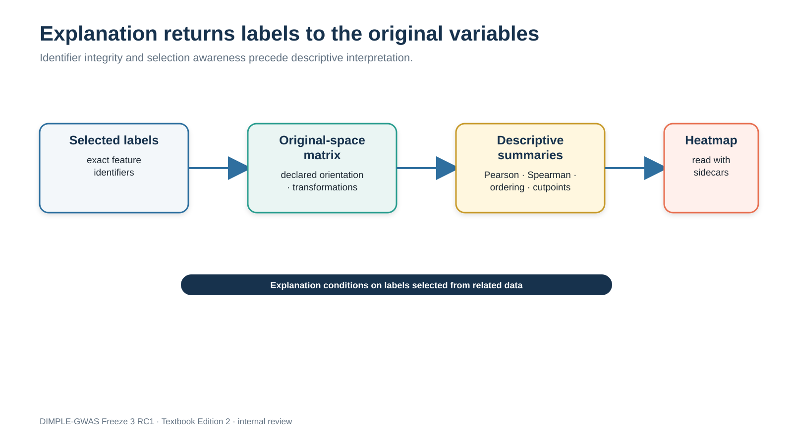{fig-alt="The explanation route aligns selected labels with the original-space matrix before computing summaries, ordering, cutpoints, and a heatmap"}

<figcaption><strong>Figure 12.</strong> The explanation route aligns selected labels with the original-space matrix before computing summaries, ordering, cutpoints, and a heatmap. <em>Interpretive boundary:</em> The heatmap contains no post-selection p-values and cannot establish independent biological enrichment.</figcaption>

</figure>

## Learning objectives

After completing Chapter 17, the reader can:

1. define identifier alignment and explain its role without exceeding the stated caution;
2. define noise label and explain its role without exceeding the stated caution;
3. define trustworthiness and continuity and explain its role without exceeding the stated caution;
4. define Pearson association and explain its role without exceeding the stated caution;
5. define Spearman association and explain its role without exceeding the stated caution;
6. trace the relevant package functions and generated artifacts;
7. complete the worked task and distinguish observation from interpretation.

## Conceptual and mathematical development

### identifier alignment

A one-to-one correspondence between vector or feature identifiers across artifacts. A compact notation is `I_A = I_B`. In practical terms, order is not identity; normalize and validate keys before joining.

Within Freeze 3 RC1 the concept is connected to `validated_identifiers; align_rows` and is visible through `labels.tsv; coordinates.tsv`. This connection is narrower than the general statistical idea: software evidence establishes the implemented route, while the mapped primary or internal evidence supplies background authority. The distinction prevents a mathematical definition from being mistaken for proof that a particular scientific interpretation is correct.

### noise label

Label -1 for points unassigned under a fitted density model. A compact notation is `label_i=-1`. In practical terms, noise is algorithmic and parameter-conditional, never a biological-null statement. [[Campello et al. (2015)](#ref-campello2015hdbscan)]

Within Freeze 3 RC1 the concept is connected to `fit_hdbscan` and is visible through `labels.tsv`. This connection is narrower than the general statistical idea: software evidence establishes the implemented route, while the mapped primary or internal evidence supplies background authority. The distinction prevents a mathematical definition from being mistaken for proof that a particular scientific interpretation is correct.

### trustworthiness and continuity

Directed neighborhood-retention diagnostics. A compact notation is `T(k)=1-c sum_i sum_(j in U_k(i))(r(i,j)-k)`. In practical terms, freeze 3 computes both through directed calls to sklearn trustworthiness under Euclidean geometry. [[Venna et al. (2010)](#ref-venna2010)]

Within Freeze 3 RC1 the concept is connected to `embedding_quality_metrics` and is visible through `run_summary.json`. This connection is narrower than the general statistical idea: software evidence establishes the implemented route, while the mapped primary or internal evidence supplies background authority. The distinction prevents a mathematical definition from being mistaken for proof that a particular scientific interpretation is correct.

### Pearson association

Linear association in original input dimensions. A compact notation is `r=sum(x-xbar)(y-ybar)/sqrt(sum(x-xbar)^2 sum(y-ybar)^2)`. In practical terms, post-selection descriptive only; undefined constant vectors follow configured policy. [[Kriegeskorte et al. (2009)](#ref-kriegeskorte2009)]

Within Freeze 3 RC1 the concept is connected to `compute_similarity` and is visible through `similarity_matrix.csv`. This connection is narrower than the general statistical idea: software evidence establishes the implemented route, while the mapped primary or internal evidence supplies background authority. The distinction prevents a mathematical definition from being mistaken for proof that a particular scientific interpretation is correct.

### Spearman association

Pearson correlation of marginal ranks. A compact notation is `rho=cor(rank(x),rank(y))`. In practical terms, ties receive average ranks; monotonic association is not mechanism.

Within Freeze 3 RC1 the concept is connected to `compute_similarity` and is visible through `similarity_matrix.csv`. This connection is narrower than the general statistical idea: software evidence establishes the implemented route, while the mapped primary or internal evidence supplies background authority. The distinction prevents a mathematical definition from being mistaken for proof that a particular scientific interpretation is correct.

### circular analysis

Reuse of discovery data for apparently confirmatory inference. A compact notation is `selection(Y) then test(Y) without adjustment`. In practical terms, same-data heatmaps and correlations are descriptive; independent or selective-inference designs are needed for confirmatory claims. [[Kriegeskorte et al. (2009)](#ref-kriegeskorte2009); [Gao et al. (2024)](#ref-gao2024)]

Within Freeze 3 RC1 the concept is connected to `run_explanation` and is visible through `explanation outputs`. This connection is narrower than the general statistical idea: software evidence establishes the implemented route, while the mapped primary or internal evidence supplies background authority. The distinction prevents a mathematical definition from being mistaken for proof that a particular scientific interpretation is correct.

## Reconstructed operational foundation

Edition 1 contained the following verified operational material in separate short notes. Edition 2 consolidates it here and subjects it to the concept and evidence boundaries above.

### Evidence retained from former Chapter 24

### Operational foundation

A loading in a linear component model has a defined relationship to an observed variable and component. A UMAP coordinate instead comes from a nonlinear, stochastic neighborhood-preservation optimization. Axis orientation, sign, rotation, scale, and even apparent global layout can vary without changing the underlying scientific identity of points. Freeze 3's display columns are therefore descriptive coordinates, not effects, loadings, mechanisms, or causal axes.

Concatenated repeated coordinates are the density-clustering representation. Selected `UMAP_1`–`UMAP_3` columns are visualization coordinates and must not be substituted for the full concatenated matrix. Correlating input dimensions with a display coordinate can be a descriptive diagnostic when explicitly enabled, but it does not turn the coordinate into a biological component.

### Retained evidence

The fresh Lab 1 display in Chapter 19 shows three separated synthetic groups. Its axis titles deliberately say ‘display coordinate,’ and its caption states that axes are not biological loadings.

### Output-reading checkpoint

Inspect display-coordinate columns, parameter/seed manifest, projection-quality table, optional coordinate-association table, and interpretation warnings.

### Misinterpretations to avoid

Do not name a coordinate ‘brain-size axis’ or infer direction of effect from its sign. Do not compare unaligned coordinates across runs. Do not equate a 2D picture with the HDBSCAN fit space.

### Boundary inherited from Edition 1

Coordinates can still be useful for visualization and diagnosing local structure, but claims should be invariant to arbitrary orientation and supported in original space or independent evidence.


## Evidence and references

See McInnes et al. (2018), DOI 10.21105/joss.00861.

### Evidence retained from former Chapter 25

### Operational foundation

`explain` returns to the original matrix after a partition has been retained. It loads native summary/labels or a legacy table, resolves input orientation, validates/strips identifiers, rejects duplicates, enforces complete matching by default, applies the recorded preprocessing contract, and computes original-space similarity without refitting UMAP or HDBSCAN.

Native mode usually needs only `--model-json`; `--input` can override a stale recorded path. Legacy mode requires a label table, original input, explicit output root, and often explicit orientation/ID/label/coordinate options. The noise policy can place unassigned vectors last, include them in ordering, or exclude them with a recorded reason.

```bash
dimple-gwas explain \
  --model-json RUN/models/top_model_artifacts/MODEL/summary.json \
  --output-dir explanation_new
```

## Evidence diagram or figure

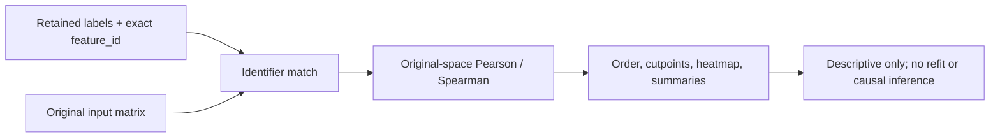


*Original-space explanation without refitting. Editable source: `assets/diagrams/diagram_07_original_space_explanation.mmd`.*

### Retained evidence

Edition 2 Lab 3 matches all 24 synthetic feature IDs, excludes none, writes the complete similarity table, and produces ordered heatmap/summary/projection artifacts without changing labels.

### Output-reading checkpoint

Inspect interpretation manifest sources/hashes, orientation, ID counts, exclusions, `heatmap_order.tsv`, similarity table, summaries, projection quality, README, and figure sidecars.

### Misinterpretations to avoid

Do not let auto-orientation replace an explicit contract when both axes could overlap. Do not accept incomplete matching silently. Do not describe explanation as a refit or independent validation.

### Boundary inherited from Edition 1

Original-space summaries remain conditional on a selected partition and input construction. They can reveal descriptive coherence or contradictions but cannot establish causal mechanism.

### Evidence retained from former Chapter 26

### Operational foundation

Pearson correlation summarizes linear association after centering/scaling; Spearman correlates ranks and summarizes monotone association. Freeze 3 uses the configured method to build a vector-by-vector similarity table in original input-variable space. It then summarizes within-block and between-block pairs after applying the declared order/noise policy.

Undefined correlation can arise from constant or insufficiently variable vectors. The safe default is `error`; the opt-in `zero` policy replaces undefined values and records the choice. This replacement is a computational convention, not evidence of no association. Coordinate associations, when enabled, are ranked descriptive correlations between original dimensions and supplied coordinates.

Neither correlation supplies a causal effect, an unbiased post-selection p-value, or independent replication.

### Retained evidence

Edition 2 Lab 3's three synthetic clusters have within-cluster Pearson means approximately 0.9963, 0.9930, and 0.9928; between-cluster means are about 0.0033–0.0047. The fresh Lab 3 treatment in Chapters 17 and 21 labels these as post-selection descriptive summaries.

### Output-reading checkpoint

Inspect similarity method, pair counts, means/medians, between summaries, exclusions, undefined-correlation policy, and optional association method/top-N settings.

### Misinterpretations to avoid

Do not attach naive p-values to the same selected pairs. Do not interpret zero replacement as observed zero correlation. Do not compare Pearson and Spearman without explaining the different question.

### Boundary inherited from Edition 1

Shared sample, LD, preprocessing, technical structure, and selection can drive correlations. Independent evidence is required for biological interpretation.

### Evidence retained from former Chapter 27

### Operational foundation

The explanation heatmap is a rendered view of an auditable order. `heatmap_order.tsv` records 1-based display order, exact feature ID, cluster label/noise flag, and supplied coordinates. `cluster_cutpoints.tsv` records zero- and one-based inclusive block boundaries and sizes. Within a cluster, `cluster_then_hclust` applies hierarchical ordering to the original-space similarity-derived distance; other choices are cluster, hclust, or input order.

Annotations come from an optional table joined by the declared index column. The initial tutorial configuration used the wrong join key and produced a warning; the source YAML was corrected to `index` and Edition 2 Lab 1 rerun as `run_20260826`. The earlier output remains as evidence of the mistake. Figure interpretation should always use sidecars, not inferred pixel positions.

## Evidence diagram or figure


### Retained evidence

The Edition 2 Lab 3 heatmap is regenerated at publication resolution from the freshly retained similarity matrix; its source and generation record are in `qa/figure_inventory.tsv`. The synthetic groups are designed, and the image is unrestricted fixture evidence.

### Output-reading checkpoint

Inspect heatmap PNG/HTML, exact order, cutpoints, cluster summary, exclusions, annotations, manifest hash, and README caveats.

### Misinterpretations to avoid

Do not reorder the image manually and leave sidecars unchanged. Do not assume coloured blocks are statistically significant. Do not publish annotations without checking privacy/access status.

### Boundary inherited from Edition 1

Large matrices are protected by thresholds and optional forcing. A full-resolution heatmap can be unreadable or disclose identifiers; use aggregate summaries and controlled access when appropriate.

### Evidence retained from former Chapter 28

### Operational foundation

HDBSCAN label `-1` means that the fitted hierarchy/extraction did not assign an observation to a retained cluster under the current representation, metric, density parameters, and selection method. It is an algorithmic status, not a biological category. Changing UMAP parameters, seed aggregation, min-cluster-size, min-samples, epsilon, metric, or selection method can change the noise set.

Inspect unassigned observations rather than discarding them rhetorically. Report count/fraction, exact IDs, probabilities/persistence when available, original-space relationships, stability across justified settings, and transitions in comparison outputs. Use ‘unassigned’ or ‘HDBSCAN noise’ with the condition attached. Avoid ‘non-pleiotropic,’ ‘failed IDP,’ ‘irrelevant,’ or ‘no shared structure.’

### Retained evidence

The synthetic tutorials have zero noise. The historical 164-IDP record has 102 unassigned and 62 assigned across five clusters; this is historical evidence and does not imply 102 biologically irrelevant IDPs.

### Output-reading checkpoint

Inspect label tables, noise count/fraction, candidate parameters, membership comparison, changed-noise status, exclusions under noise policy, and historical source status.

### Misinterpretations to avoid

Do not drop noise before reporting its magnitude. Do not compare noise labels without exact IDs. Do not treat absence of assigned cluster as absence of any genetic correlation.

### Boundary inherited from Edition 1

Freeze 3 does not provide a calibrated biological uncertainty interval for each label. Stability and external data must be studied separately.


## Evidence and references

See Campello et al. (2015), DOI 10.1145/2733381.

### Evidence retained from former Chapter 29

### Operational foundation

‘Double dipping’ occurs when data-dependent choices are ignored in a later inferential statement. DIMPLE-GWAS uses the matrix to create an embedding, enumerate/extract partitions, and select one using internal metrics. Testing separation or correlation on the same matrix as though the partition were fixed in advance can yield overconfident evidence. Multiple candidate models and analyst inspection add further selection.

Safe outputs in Freeze 3 are descriptive summaries with explicit conditioning. For inference, plan held-out variables, independent cohorts, preregistered replication, sample splitting, perturbation/stability designs, or a selective-inference method whose assumptions actually match the pipeline. Report effect sizes and uncertainty appropriate to the validation design. Never describe an omitted p-value as a flaw: the explanation utility intentionally avoids cluster ANOVA and post-selection significance.

### Retained evidence

Edition 2 Lab 3 reports within/between similarities and a heatmap but no ANOVA p-values. That is a deliberate boundary, not missing validation.

### Output-reading checkpoint

Inspect candidate population, selection rule, all exploratory views used, independent validation plan, comparison/stability evidence, and whether any test data were held out before selection.

### Misinterpretations to avoid

Do not call high within-cluster correlation a validation test. Do not choose external outcomes after seeing the partition without disclosure. Do not cite a general selective-inference paper as if it implemented this exact pipeline.

### Boundary inherited from Edition 1

Independent validation may still inherit sample overlap, ancestry, measurement, or harmonization biases. The design—not the word ‘replication’—determines evidential strength.


## Evidence and references

See Gao, Bien & Witten (2024), DOI 10.1080/01621459.2022.2116331, with the scope limitation stated above.

## Implementation trace

**`cli.build_parser`** is defined at `dimple_gwas/cli.py:146` with signature `class construction/data container`. Construct the complete user-facing command and flag grammar, including the interpret alias. It is reached from cli.main and connects to cli._add_config_source; cli._add_run_options. Its direct artifact contract is No direct canonical artifact; in-memory/supporting result; its explicit error surface is No explicit raise in this symbol; delegated calls may raise.. Test evidence is recorded as tests/test_freeze3_comparison_validation.py::test_cli_exposes_new_commands_and_alias. This is a A-tier contract, so the complete 20-field dossier is retained in the function atlas.

**`cli._inspect`** is defined at `dimple_gwas/cli.py:240` with signature `args: argparse.Namespace`. Implementation callable for inspect. It is reached from cli.main and connects to cli._resolved; search_space.count_candidates. Its direct artifact contract is No direct canonical artifact; in-memory/supporting result; its explicit error surface is No explicit raise in this symbol; delegated calls may raise.. Test evidence is recorded as No direct symbol-name test reference; assess through caller/integration coverage. This is a A-tier contract, so the complete 20-field dossier is retained in the function atlas.

**`cli._show`** is defined at `dimple_gwas/cli.py:254` with signature `args: argparse.Namespace`. Implementation callable for show. It is reached from cli.main and connects to cli._resolved; io.json_safe; reporting.write_search_space; search_space.count_candidates; search_space.enumerate_candidates; search_space.flatten_candidate. Its direct artifact contract is No direct canonical artifact; in-memory/supporting result; its explicit error surface is No explicit raise in this symbol; delegated calls may raise.. Test evidence is recorded as No direct symbol-name test reference; assess through caller/integration coverage. This is a A-tier contract, so the complete 20-field dossier is retained in the function atlas.

**`cli._score`** is defined at `dimple_gwas/cli.py:265` with signature `args: argparse.Namespace`. Implementation callable for score. It is reached from cli.main and connects to config.resolve_config; io.atomic_json_dump; io.json_safe; io.read_model_table; ranking.rank_models; scoring.apply_scoring; scoring.normalize_model_table_schema. Its direct artifact contract is rescored_table.tsv; rescored_table.tsv.manifest.json; its explicit error surface is No explicit raise in this symbol; delegated calls may raise.. Test evidence is recorded as No direct symbol-name test reference; assess through caller/integration coverage. This is a A-tier contract, so the complete 20-field dossier is retained in the function atlas.

**`cli._summarize`** is defined at `dimple_gwas/cli.py:284` with signature `args: argparse.Namespace`. Implementation callable for summarize. It is reached from cli.main and connects to io.atomic_json_dump; io.read_model_table; ranking.family_summaries; ranking.pareto_front; ranking.rank_models; ranking.top_models. Its direct artifact contract is family_summaries.tsv; pareto_front.tsv; top_models.tsv; summary.json; its explicit error surface is No explicit raise in this symbol; delegated calls may raise.. Test evidence is recorded as No direct symbol-name test reference; assess through caller/integration coverage. This is a A-tier contract, so the complete 20-field dossier is retained in the function atlas.

**`cli._reproduce`** is defined at `dimple_gwas/cli.py:301` with signature `args: argparse.Namespace`. Implementation callable for reproduce. It is reached from cli.main and connects to config.resolve_config; config.validate_config; pipeline.run_search. Its direct artifact contract is No direct canonical artifact; in-memory/supporting result; its explicit error surface is ValueError. Test evidence is recorded as No direct symbol-name test reference; assess through caller/integration coverage. This is a A-tier contract, so the complete 20-field dossier is retained in the function atlas.

**`cli._explain`** is defined at `dimple_gwas/cli.py:323` with signature `args: argparse.Namespace`. Implementation callable for explain. It is reached from cli.main and connects to config.resolve_config; config.validate_config; interpretation.run_explanation. Its direct artifact contract is No direct canonical artifact; in-memory/supporting result; its explicit error surface is ValueError. Test evidence is recorded as No direct symbol-name test reference; assess through caller/integration coverage. This is a A-tier contract, so the complete 20-field dossier is retained in the function atlas.

**`cli._compare`** is defined at `dimple_gwas/cli.py:376` with signature `args: argparse.Namespace`. Implementation callable for compare. It is reached from cli.main and connects to comparison.run_comparison. Its direct artifact contract is No direct canonical artifact; in-memory/supporting result; its explicit error surface is No explicit raise in this symbol; delegated calls may raise.. Test evidence is recorded as No direct symbol-name test reference; assess through caller/integration coverage. This is a A-tier contract, so the complete 20-field dossier is retained in the function atlas.

**`cli._validate`** is defined at `dimple_gwas/cli.py:391` with signature `args: argparse.Namespace`. Implementation callable for validate. It is reached from cli.main and connects to validation.run_validation. Its direct artifact contract is No direct canonical artifact; in-memory/supporting result; its explicit error surface is No explicit raise in this symbol; delegated calls may raise.. Test evidence is recorded as No direct symbol-name test reference; assess through caller/integration coverage. This is a A-tier contract, so the complete 20-field dossier is retained in the function atlas.

**`cli.main`** is defined at `dimple_gwas/cli.py:403` with signature `argv: list[str] | None=None`. Dispatch the command-line interface and return a process exit status. It is reached from CLI/import/direct caller or no package caller detected and connects to cli._compare; cli._explain; cli._inspect; cli._reproduce; cli._resolved; cli._score; cli._show; cli._summarize; cli._validate; cli.build_parser; pipeline.run_search. Its direct artifact contract is No direct canonical artifact; in-memory/supporting result; its explicit error surface is No explicit raise in this symbol; delegated calls may raise.. Test evidence is recorded as tests/test_freeze3_comparison_validation.py::test_cli_compare_end_to_end. This is a A-tier contract, so the complete 20-field dossier is retained in the function atlas.

**`interpretation.is_noise_label`** is defined at `dimple_gwas/interpretation.py:30` with signature `value: Any`. Implementation callable for is noise label. It is reached from comparison.run_comparison; interpretation.calculate_cluster_summary; interpretation.label_sort_key; interpretation.run_explanation and connects to No package-defined dependency detected. Its direct artifact contract is No direct canonical artifact; in-memory/supporting result; its explicit error surface is No explicit raise in this symbol; delegated calls may raise.. Test evidence is recorded as No direct symbol-name test reference; assess through caller/integration coverage. This is a B-tier contract, so the complete 20-field dossier is retained in the function atlas.

**`interpretation.label_sort_key`** is defined at `dimple_gwas/interpretation.py:35` with signature `value: Any`. Implementation callable for label sort key. It is reached from comparison.run_comparison; interpretation.compute_order and connects to interpretation.is_noise_label. Its direct artifact contract is No direct canonical artifact; in-memory/supporting result; its explicit error surface is No explicit raise in this symbol; delegated calls may raise.. Test evidence is recorded as No direct symbol-name test reference; assess through caller/integration coverage. This is a B-tier contract, so the complete 20-field dossier is retained in the function atlas.

## Claim adjudication notebook

The following statements are admitted to the draft only in their safe form:

- **INT-001 (reject):** UMAP coordinates are descriptive latent coordinates, not biological loadings, effects, mechanisms, or causal axes. [[McInnes et al. (2018)](#ref-mcinnes2018umap)] Limitation: Optional coordinate correlations remain descriptive. Implementation evidence: `interpretation.py; EXPLAINABILITY.md`.

- **INT-002 (reject):** Label -1 means unassigned under the fitted representation, metric, density assumptions, and parameters. [[Campello et al. (2015)](#ref-campello2015hdbscan)] Limitation: Noise status can change across candidate settings. Implementation evidence: `hdbscan_runner.py`.

- **INT-003 (verified_with_qualification):** Pearson/Spearman summaries are post-selection descriptive diagnostics conditional on the retained partition. [[Kriegeskorte et al. (2009)](#ref-kriegeskorte2009); [Gao et al. (2024)](#ref-gao2024)] Limitation: They do not provide causal, replication, or unbiased significance evidence. Implementation evidence: `interpretation.py`.

- **INT-004 (verified_with_qualification):** Classical tests on the same data used for group discovery are vulnerable to circularity; Freeze 3 omits cluster ANOVA and post-selection p-values. [[Kriegeskorte et al. (2009)](#ref-kriegeskorte2009); [Gao et al. (2024)](#ref-gao2024)] Limitation: The cited selective method is not a turnkey HDBSCAN procedure. Implementation evidence: `interpretation.py; limitations docs`.


<figure id="fig-f17">

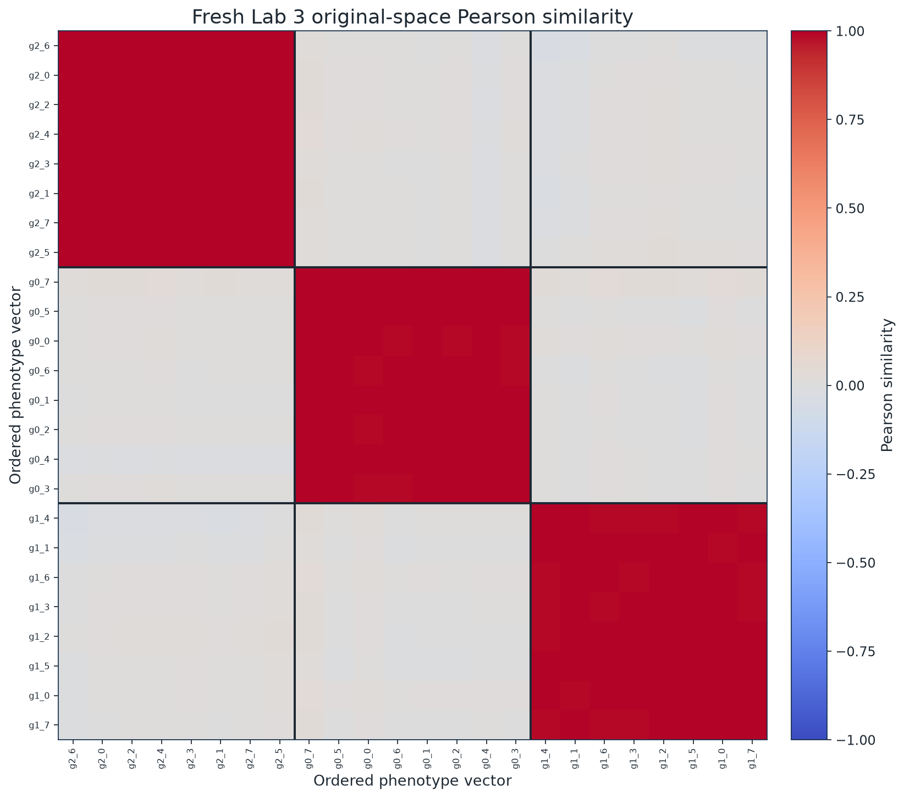{fig-alt="The fresh explanation route orders the original-space similarity matrix by retained labels and writes sidecars for the order and cluster cutpoints"}

<figcaption><strong>Figure 13.</strong> The fresh explanation route orders the original-space similarity matrix by retained labels and writes sidecars for the order and cluster cutpoints. <em>Interpretive boundary:</em> The display is descriptive and conditional on the selected labels; it supplies no independent post-selection p-values.</figcaption>

</figure>

## Reading the generated evidence

For Chapter 17, the `Original-space explanation, heatmaps, and responsible interpretation` files are read as a provenance chain rather than as isolated results:

<p class="table-caption" id="table-11"><strong>Table 11.</strong> Reading the generated evidence.</p>

| Artifact | Producer | What to verify before interpretation |
| --- | --- | --- |
| `original_space_similarity.tsv.gz` | `run_explanation` | Artifact exists under the new output root, is readable, and its checksum is recorded. |
| `heatmap_order.tsv` | `run_explanation` | Image dimensions are nonzero; order and cutpoints match sidecars; no inferential claim is attached. |
| `cluster_cutpoints.tsv` | `run_explanation` | Artifact exists under the new output root, is readable, and its checksum is recorded. |
| `cluster_summary.tsv` | `run_explanation` | Artifact exists under the new output root, is readable, and its checksum is recorded. |
| `projection_quality.tsv` | `run_explanation` | Artifact exists under the new output root, is readable, and its checksum is recorded. |
| `coordinate_associations.tsv` | `run_explanation` | Artifact exists under the new output root, is readable, and its checksum is recorded. |
| `exclusions.tsv` | `run_explanation` | Artifact exists under the new output root, is readable, and its checksum is recorded. |
| `original_space_heatmap.png/html` | `run_explanation` | Image dimensions are nonzero; order and cutpoints match sidecars; no inferential claim is attached. |
| `interpretation_manifest.json + README.md` | `run_explanation` | Artifact exists under the new output root, is readable, and its checksum is recorded. |

The output atlas supplies the complete schemas, checksums, conditions, consumers, and privacy notes for this Chapter 17 route. Native manifests can contain machine paths; the assembled textbook uses sanitized excerpts while restricted evidence retains the original provenance chain.

## Worked reasoning and evidence exercise

Follow Lab 3 from exact ID matching through similarity, ordering, cutpoints, cluster summaries, and the rendered heatmap; state three conclusions the image cannot support.

A complete Chapter 17 answer must expose its intermediate reasoning, name the source or output used for `Original-space explanation, heatmaps, and responsible interpretation`, and finish with separate support and non-support statements. Applying that discipline to the question “What structure do retained labels describe in the original variant dimensions?” prevents a calculation, a software observation, and a scientific interpretation from collapsing into one claim.

## Assumptions, diagnostics, and recovery

The Chapter 17 analysis assumes the stated unit and inputs, the recorded configuration and software identity, and a diagnostic that addresses the claimed property rather than a convenient surrogate. Its decisive boundary is: Freeze 3 reports descriptive Pearson/Spearman summaries, order and cutpoint sidecars, exclusions, and optional coordinate associations; it emits no post-selection p-values.

If the Chapter 17 route fails, retain its log and candidate status before deciding whether the cause is input, configuration, dependency, compute, identifier alignment, or output-root state. Correct an operational failure by writing a new result directory. Treat instability in `Original-space explanation, heatmaps, and responsible interpretation` as sensitivity evidence: report it and identify the independent evidence needed instead of relabeling ambiguity as a software exception.

## Chapter synthesis

A heatmap can make a selected partition intelligible while also inviting circular biological claims. The implementation trace makes the current behavior auditable, but the evidence boundary remains part of the result. Part IV begins with a hand-calculable integration of the method.

## Exercises

1. For `Original-space explanation, heatmaps, and responsible interpretation`, name the unit of analysis and one plausible but invalid substitute.
2. Reconstruct the notation for identifier alignment; define its dimensions or denominator and interpret every term.
3. Choose a Tier A function mapped to Chapter 17; identify its caller and direct output, then propose a topic-specific edge case.
4. Select one Chapter 17 artifact from the output atlas and state three integrity checks that must precede scientific reading.
5. Convert a tempting `Original-space explanation, heatmaps, and responsible interpretation` overclaim into one observed statement followed by its limitation.
6. Follow Lab 3 from exact ID matching through similarity, ordering, cutpoints, cluster summaries, and the rendered heatmap; state three conclusions the image cannot support.

Appendix J gives the Chapter 17 adjudication guide. Its further-reading keys supply statistical context; no external paper is treated as automatic validation of the current software or dataset.


<div class="part-break"></div>

# Part IV

## Worked and executable analyses

Chapters 18–22

<div class="part-page-rule"></div>


<div class="chapter-break"></div>

<a id="chapter-18"></a>

# 18. A hand-calculable toy analysis from matrix to score

*Guiding question:* **Can the essential contracts be understood without hiding behind a large run?**

Prerequisites: 6–11.

## Why the question matters

A toy must simplify UMAP while remaining literal about implemented preprocessing, diagnostics, scoring, and comparison.

Lab 0 executes valid code paths but does not claim a hand reconstruction of stochastic UMAP or HDBSCAN hierarchy.

This chapter develops the question in the order needed for a reader to move from statistical principle to current implementation, retained evidence, and a defensible statement. Its central worked task is: Reproduce every retained Lab 0 number and reconcile exact numeric inequality with permutation-invariant agreement.

## Learning objectives

After completing Chapter 18, the reader can:

1. define identifier alignment and explain its role without exceeding the stated caution;
2. define distance and similarity and explain its role without exceeding the stated caution;
3. define scaling and transformation and explain its role without exceeding the stated caution;
4. define RINT ties and missingness and explain its role without exceeding the stated caution;
5. define silhouette and explain its role without exceeding the stated caution;
6. trace the relevant package functions and generated artifacts;
7. complete the worked task and distinguish observation from interpretation.

## Conceptual and mathematical development

### identifier alignment

A one-to-one correspondence between vector or feature identifiers across artifacts. A compact notation is `I_A = I_B`. In practical terms, order is not identity; normalize and validate keys before joining.

Within Freeze 3 RC1 the concept is connected to `validated_identifiers; align_rows` and is visible through `labels.tsv; coordinates.tsv`. This connection is narrower than the general statistical idea: software evidence establishes the implemented route, while the mapped primary or internal evidence supplies background authority. The distinction prevents a mathematical definition from being mistaken for proof that a particular scientific interpretation is correct.

### distance and similarity

Geometry chosen to compare vectors or embedded points. A compact notation is `d_2(x,y)=sqrt(sum_j (x_j-y_j)^2)`. In practical terms, the metric defines which differences count as close. [[Aggarwal et al. (2001)](#ref-aggarwal2001)]

Within Freeze 3 RC1 the concept is connected to `evaluate_candidate; compute_similarity` and is visible through `model_table.csv; similarity_matrix.csv`. This connection is narrower than the general statistical idea: software evidence establishes the implemented route, while the mapped primary or internal evidence supplies background authority. The distinction prevents a mathematical definition from being mistaken for proof that a particular scientific interpretation is correct.

### scaling and transformation

Changes to marginal scale before geometric analysis. A compact notation is `z=(x-mu)/sigma; z_i=Phi^-1((r_i-0.5)/n)`. In practical terms, transformation changes geometry; it does not create independent evidence. [[Beasley et al. (2009)](#ref-beasley2009)]

Within Freeze 3 RC1 the concept is connected to `rank_inverse_normal_transform; prepare_analysis_matrix` and is visible through `resolved_config.yaml`. This connection is narrower than the general statistical idea: software evidence establishes the implemented route, while the mapped primary or internal evidence supplies background authority. The distinction prevents a mathematical definition from being mistaken for proof that a particular scientific interpretation is correct.

### RINT ties and missingness

Average ranks with missing values retained during ranking. A compact notation is `r_i=average tied rank`. In practical terms, freeze 3 rejects missing analysis cells before the pipeline and applies RINT column-wise before transpose. [[Beasley et al. (2009)](#ref-beasley2009)]

Within Freeze 3 RC1 the concept is connected to `rank_inverse_normal_transform` and is visible through `prepared matrix`. This connection is narrower than the general statistical idea: software evidence establishes the implemented route, while the mapped primary or internal evidence supplies background authority. The distinction prevents a mathematical definition from being mistaken for proof that a particular scientific interpretation is correct.

### silhouette

Within-versus-nearest-other-cluster separation under a configured metric. A compact notation is `s(i)=(b(i)-a(i))/max(a(i),b(i))`. In practical terms, freeze 3 can exclude noise and supplies the configured HDBSCAN metric. [[Rousseeuw (1987)](#ref-rousseeuw1987)]

Within Freeze 3 RC1 the concept is connected to `evaluate_candidate` and is visible through `model_table.csv`. This connection is narrower than the general statistical idea: software evidence establishes the implemented route, while the mapped primary or internal evidence supplies background authority. The distinction prevents a mathematical definition from being mistaken for proof that a particular scientific interpretation is correct.

### legacy_dimple score

Population-relative weighted combination of normalized silhouette, clusters, and optionally noise. A compact notation is `raw=w_s s/max(s)+w_k k/max(k)-w_n n/max(n)`. In practical terms, weights are raw dynamic ranges divided by their sum; final scores are min-max scaled.

Within Freeze 3 RC1 the concept is connected to `legacy_dimple_score` and is visible through `scoring_manifest.json; model_table.csv`. This connection is narrower than the general statistical idea: software evidence establishes the implemented route, while the mapped primary or internal evidence supplies background authority. The distinction prevents a mathematical definition from being mistaken for proof that a particular scientific interpretation is correct.

### adjusted Rand index

Chance-adjusted pairwise partition agreement. A compact notation is `ARI=(RI-E[RI])/(max(RI)-E[RI])`. In practical terms, permutation invariant; a value of 1 does not imply coordinate identity. [[Hubert et al. (1985)](#ref-hubert1985)]

Within Freeze 3 RC1 the concept is connected to `compare_partitions` and is visible through `comparison_summary.json`. This connection is narrower than the general statistical idea: software evidence establishes the implemented route, while the mapped primary or internal evidence supplies background authority. The distinction prevents a mathematical definition from being mistaken for proof that a particular scientific interpretation is correct.

### normalized mutual information

Normalized information shared by two labelings. A compact notation is `NMI=2I(U;V)/(H(U)+H(V))`. In practical terms, normalization conventions matter; Freeze 3 uses the sklearn convention recorded in code. [[Vinh et al. (2010)](#ref-vinh2010)]

Within Freeze 3 RC1 the concept is connected to `compare_partitions` and is visible through `comparison_summary.json`. This connection is narrower than the general statistical idea: software evidence establishes the implemented route, while the mapped primary or internal evidence supplies background authority. The distinction prevents a mathematical definition from being mistaken for proof that a particular scientific interpretation is correct.

### noise Jaccard

Overlap of the two sets labeled -1. A compact notation is `J(A,B)=|A intersect B|/|A union B|`. In practical terms, it isolates agreement about unassigned membership, not all clusters.

Within Freeze 3 RC1 the concept is connected to `noise_jaccard` and is visible through `comparison_summary.json`. This connection is narrower than the general statistical idea: software evidence establishes the implemented route, while the mapped primary or internal evidence supplies background authority. The distinction prevents a mathematical definition from being mistaken for proof that a particular scientific interpretation is correct.

## Reconstructed operational foundation

Edition 1 contained the following verified operational material in separate short notes. Edition 2 consolidates it here and subjects it to the concept and evidence boundaries above.

### Evidence retained from former Chapter 4

### Operational foundation

The Stage 1 workflow is a producer–consumer chain. Freeze 3 reads the table, removes the declared leading metadata columns, optionally applies RINT to analysis columns, and transposes to vectors by input variables. For each UMAP parameter family it generates repeated seeded UMAP/densMAP embeddings and concatenates them horizontally. It then evaluates the complete declared HDBSCAN Cartesian product, retains success, invalid-topology, and failure rows, calculates diagnostics, applies the declared score, ranks eligible candidates, and refits retained models to preserve labels.

Downstream commands do different work. `reproduce-model` refits one retained parameterization. `explain` does not refit; it matches exact IDs and returns to original input-vector space. `compare` measures structural and optional coordinate concordance. `validate` checks files, schemas, counts, readability, and recorded hashes. No PCA, SVD, or ICA reducer is silently inserted before UMAP.

## Evidence diagram or figure


*Stage 1 producer–consumer workflow. Editable source: `assets/diagrams/diagram_01_stage1_workflow.mmd`.*

### Retained evidence

Follow `assets/diagrams/diagram_01_stage1_workflow.mmd` from input to downstream utilities. Each arrow corresponds to an implementation module named in `evidence/source_to_manual_traceability.tsv`.

### Output-reading checkpoint

At the run root, inspect `resolved_config.yaml`, the search-space manifests, `models/`, `run_manifest.json`, and `logs/run.log`. Appendix D maps every named output to its producer and consumer.

### Misinterpretations to avoid

Do not treat `stage09_*` display coordinates as the full concatenated embedding. Do not expect cleaned inputs or individual repeated embeddings on disk; current Freeze 3 keeps them in memory.

### Boundary inherited from Edition 1

A workflow diagram explains control and data flow, not scientific validity. Every transformation can change geometry, and the selected model remains conditional on the declared search and score.

### Evidence retained from former Chapter 5

### Operational foundation

A GWAS summary statistic is a result indexed by a genetic variant and phenotype. A vector is the ordered set of analysis values for one phenotype across the aligned variant rows. A distance metric maps two vectors—or two embedded observations—to a nonnegative dissimilarity. A partition assigns observations to groups; HDBSCAN may also leave observations unassigned with label `-1`.

Internal clustering metrics summarize geometric properties of the same representation used to fit or assess the partition. Silhouette contrasts an observation's mean within-cluster distance with its nearest other-cluster mean distance. DBCV evaluates density connectedness and separation. Neither asks whether a cluster is biologically meaningful. Projection metrics such as trustworthiness and continuity assess neighborhood preservation, not labels or mechanism.

Pleiotropy is a biological/statistical concept about genetic effects across traits. A density cluster among phenotype vectors can generate hypotheses about shared structure, but cluster membership is not itself proof of pleiotropy or its cause.

### Retained evidence

For three points, compute within- and between-cluster distances under two metrics. The exercise shows why a metric choice is part of the scientific definition of neighborhood rather than a cosmetic option.

### Output-reading checkpoint

Candidate tables contain topology counts, cluster-size summaries, silhouette, DBCV, Calinski–Harabasz, Davies–Bouldin, HDBSCAN persistence, projection metrics, status, warnings, and errors. Check each metric's scope and metric columns.

### Misinterpretations to avoid

Do not compare metric values calculated under undocumented metrics or representations. Do not treat a large score as an external p-value. Do not call every input column a ‘feature’ when the clustered observation is the vector/IDP.

### Boundary inherited from Edition 1

Distance concentration, correlations among variants, scaling, missingness, and finite sample size can alter geometry. Internal metrics can reward a representation-specific structure that fails to reproduce externally.


## Evidence and references

See Rousseeuw (1987), DOI 10.1016/0377-0427(87)90125-7, and Moulavi et al. (2014), DOI 10.1137/1.9781611973440.96.

### Evidence retained from former Chapter 15

### Operational foundation

Preprocessing defines the geometry presented to UMAP. Freeze 3 removes `input.drop_first_n_cols` leading columns, validates that analysis columns are numeric, optionally applies rank inverse normal transformation to each analysis column before transpose, and then transposes to vectors by input variables. With `zscore_transform=none`, values are not RINT-transformed. The historical option name is retained although the implemented alternative is `rint`.

For a column with ranks, RINT maps rank-based probabilities through the standard-normal quantile function. It can reduce marginal scale differences and the influence of extreme values, but it also changes the scientific quantity and does not repair upstream harmonization or dependence. The configuration default is `none`; enable RINT only with a documented rationale that matches the intended historical or prospective protocol.

### Retained evidence

The preprocessing tests cover RINT and numeric-matrix behavior. Both executed synthetic tutorials use `none`, so their values remain on the fixture's generated scale.

### Output-reading checkpoint

Inspect the input config, resolved transform, input-contract manifest, prepared-shape log line, identifier set, and any preprocessing warnings. Record upstream transformations separately.

### Misinterpretations to avoid

Do not describe RINT as row-wise without naming the table orientation: implementation applies it to analysis columns before transpose. Do not call it z-scoring or assume it creates independence.

### Boundary inherited from Edition 1

RINT can alter ties, correlations, distances, and downstream partitions. The manual makes no universal recommendation between transformed and untransformed analyses.

### Evidence retained from former Chapter 19

### Operational foundation

Candidate metrics serve different purposes. Topology fields describe non-noise cluster count, noise count/fraction, and cluster sizes. Silhouette uses the configured HDBSCAN metric and the declared sampling scope. DBCV is optionally computed as a density-aware diagnostic. Calinski–Harabasz and Davies–Bouldin are supplied with explicit metric/context fields. HDBSCAN persistence summaries describe retained clusters. Trustworthiness and continuity belong to the embedding family, not to one HDBSCAN extraction.

Metrics can be missing when a topology is invalid, a calculation is undefined, a backend cannot support a metric, or a candidate fails. Read `status`, scope, sampled flags, sample sizes, and `metric_warnings` before comparing numbers. The candidate table is deliberately wide so these qualifications are not hidden.

### Retained evidence

The selected Edition 2 Lab 2 candidate has silhouette about 0.970354 and DBCV about 0.976386, with three equal clusters and no noise. These values describe the designed fixture under Euclidean geometry; they are not expected production targets.

### Output-reading checkpoint

Inspect metric value plus its metric/scope/sampled/sample-size columns, topology counts, persistence, warnings, and the run's compute flags.

### Misinterpretations to avoid

Do not call silhouette inherently Euclidean; Freeze 3 supplies the configured metric. Do not compare a sampled score with a full score without noting scope. Do not call DBCV the universal best metric.

### Boundary inherited from Edition 1

All internal metrics are conditional on representation and candidate population. They lack independent biological evidence and can disagree legitimately.


## Evidence and references

See Rousseeuw (1987), DOI 10.1016/0377-0427(87)90125-7, and Moulavi et al. (2014), DOI 10.1137/1.9781611973440.96.

### Evidence retained from former Chapter 20

### Operational foundation

`legacy_dimple` is the default compatibility score. Among eligible candidates, each included component is divided by its maximum. Its weight is the component's raw observed range divided by the sum of included ranges. Raw score adds normalized silhouette and normalized non-noise cluster count and, only when `fit_include_noise=true`, subtracts normalized noise count. The raw score is finally scaled to [0,1] over the eligible candidate population; a zero range maps to 1.

This is population-relative: adding or removing candidates can change maxima, ranges, weights, and final scores even if an existing candidate's own metrics do not change. DBCV may be present in the table but is not a legacy-score term. No preferred cluster band, noise ceiling, largest-cluster target, or biological label is embedded.

The `custom` profile accepts explicitly declared metric weights and maximize/minimize directions. It should represent a preregistered analytic objective, not weights tuned after viewing a desired partition.

### Retained evidence

In Edition 2 Lab 2, all candidates have the same cluster count and no noise, so UMAP-family silhouette differences drive four score levels and eight-way ties within families. The selection manifest records realized formula and tie order.

### Output-reading checkpoint

Inspect `raw_score`, `score`, compatibility aliases, scoring profile, noise-fit flag, realized weights/ranges, eligible counts, and tie order in `model_selection_manifest.json`.

### Misinterpretations to avoid

Do not say DBCV selected the model when profile is legacy. Do not compare normalized scores across candidate populations as though absolute. Do not introduce outcome-informed custom weights.

### Boundary inherited from Edition 1

A heuristic rank is not a probability, confidence, p-value, or guarantee of stability. Scientific selection should combine transparent objectives, sensitivity, and external evidence.

### Evidence retained from former Chapter 23

### Operational foundation

`compare` accepts two native summaries or label tables, requires unique exact ID sets, and can require the same order. It reports adjusted Rand index, normalized mutual information, variation of information, noise-set Jaccard, optimal label mapping, mapped membership, changed noise status, cluster sizes, and optional Procrustes disparity. Numeric labels are local names, so structural metrics are primary.

`validate` inspects one run directory for required artifacts, readable JSON/YAML, enumeration counts, ranked schema, selected artifacts, and recorded hashes. It writes one pass/warn/fail row per check and returns exit code one on failure. Validation does not refit or compare biology.

```bash
dimple-gwas compare --left LEFT/summary.json --right RIGHT/summary.json --output-dir comparison_new
dimple-gwas validate --run-dir RUN --output-dir validation_new
```

## Evidence diagram or figure


*Comparison and validation paths. Editable source: `assets/diagrams/diagram_08_compare_validate.mmd`.*

### Retained evidence

Edition 2 Lab 3 comparison uses 24 IDs, three clusters, no noise, perfect structural metrics, zero variation of information, and near-zero aligned coordinate disparity. Validation reports 24/24 pass with no warnings or failures.

### Output-reading checkpoint

Inspect `comparison_summary.json`, membership table, size table, confusion, mapping, comparison manifest, `validation_checks.tsv`, report, and validation manifest.

### Misinterpretations to avoid

Do not compare raw numeric labels across fits. Do not ignore changed noise status. Do not interpret Procrustes as membership agreement. Do not call hash/schema checks biological validation.

### Boundary inherited from Edition 1

Exact label equality is stringent and environment-sensitive; permutation-invariant equality is structural. Coordinate comparison needs alignment and tolerances. Scientific conclusions need higher-layer validation.

## Implementation trace

**`comparison.run_comparison`** is defined at `dimple_gwas/comparison.py:65` with signature `left_source: str | Path, right_source: str | Path, output_dir: str | Path, *, id_column: str='feature_id', label_column: str='label', require_same_order: bool=False, command: list[str] | None=None`. Compare two label artifacts using exact IDs, permutation-invariant structure, noise sets, mapping, and optional coordinates. It is reached from cli._compare and connects to comparison._columns; comparison._resolve_labels; comparison._variation_of_information; interpretation.detect_coordinate_columns; interpretation.is_noise_label; interpretation.label_sort_key; io.atomic_json_dump; io.ensure_empty_output_dir; io.json_safe; io.validated_identifiers; provenance.base_manifest; provenance.file_record; provenance.utc_now. Its direct artifact contract is comparison_summary.json; membership_comparison.tsv; cluster_sizes.tsv; label_confusion.tsv; optimal_label_mapping.tsv; comparison_manifest.json; its explicit error surface is ValueError. Test evidence is recorded as tests/test_freeze3_comparison_validation.py::test_comparison_rejects_duplicate_ids; tests/test_freeze3_comparison_validation.py::test_comparison_requires_identical_id_sets; tests/test_freeze3_comparison_validation.py::test_label_permutation_comparison_is_structurally_equal. This is a A-tier contract, so the complete 20-field dossier is retained in the function atlas.

**`metrics.effective_neighbor_count`** is defined at `dimple_gwas/metrics.py:9` with signature `n_samples: int, requested: int`. Implementation callable for effective neighbor count. It is reached from metrics.embedding_quality_metrics and connects to No package-defined dependency detected. Its direct artifact contract is No direct canonical artifact; in-memory/supporting result; its explicit error surface is No explicit raise in this symbol; delegated calls may raise.. Test evidence is recorded as tests/test_preprocessing_metrics.py::test_effective_neighbor_edge_cases. This is a B-tier contract, so the complete 20-field dossier is retained in the function atlas.

**`metrics.embedding_quality_metrics`** is defined at `dimple_gwas/metrics.py:15` with signature `original, embedding, requested_k: int, max_samples: int, seed: int`. Calculate bounded trustworthiness and continuity diagnostics for an embedding. It is reached from interpretation.run_explanation; pipeline.run_search and connects to metrics.effective_neighbor_count. Its direct artifact contract is No direct canonical artifact; in-memory/supporting result; its explicit error surface is No explicit raise in this symbol; delegated calls may raise.. Test evidence is recorded as tests/test_preprocessing_metrics.py::test_optimized_trustworthiness_and_continuity. This is a A-tier contract, so the complete 20-field dossier is retained in the function atlas.

**`metrics.evaluate_candidate`** is defined at `dimple_gwas/metrics.py:60` with signature `embedding, labels, clusterer, silhouette_metric: str, fit_include_noise: bool, compute_dbcv: bool, max_samples_silhouette: int=0, silhouette_seed: int=42`. Compute cluster counts, persistence, silhouette, CH, DB, optional DBCV, and validity status for one candidate. It is reached from pipeline._evaluate_one and connects to metrics._cluster_sizes. Its direct artifact contract is No direct canonical artifact; in-memory/supporting result; its explicit error surface is No explicit raise in this symbol; delegated calls may raise.. Test evidence is recorded as No direct symbol-name test reference; assess through caller/integration coverage. This is a A-tier contract, so the complete 20-field dossier is retained in the function atlas.

**`metrics.is_finite_number`** is defined at `dimple_gwas/metrics.py:165` with signature `value: Any`. Implementation callable for is finite number. It is reached from CLI/import/direct caller or no package caller detected and connects to No package-defined dependency detected. Its direct artifact contract is No direct canonical artifact; in-memory/supporting result; its explicit error surface is No explicit raise in this symbol; delegated calls may raise.. Test evidence is recorded as No direct symbol-name test reference; assess through caller/integration coverage. This is a B-tier contract, so the complete 20-field dossier is retained in the function atlas.

**`preprocessing.ExplanationMatrix`** is defined at `dimple_gwas/preprocessing.py:12` with signature `class construction/data container`. Implementation callable for ExplanationMatrix. It is reached from preprocessing.prepare_explanation_matrix and connects to No package-defined dependency detected. Its direct artifact contract is No direct canonical artifact; in-memory/supporting result; its explicit error surface is No explicit raise in this symbol; delegated calls may raise.. Test evidence is recorded as No direct symbol-name test reference; assess through caller/integration coverage. This is a B-tier contract, so the complete 20-field dossier is retained in the function atlas.

**`preprocessing.rank_inverse_normal_transform`** is defined at `dimple_gwas/preprocessing.py:19` with signature `frame`. Apply the implementation's rank-based inverse-normal transform to numeric analysis columns. It is reached from preprocessing.prepare_analysis_matrix; preprocessing.prepare_explanation_matrix and connects to No package-defined dependency detected. Its direct artifact contract is No direct canonical artifact; in-memory/supporting result; its explicit error surface is ValueError. Test evidence is recorded as tests/test_preprocessing_metrics.py::test_rint_and_numeric_matrix. This is a A-tier contract, so the complete 20-field dossier is retained in the function atlas.

**`preprocessing.prepare_analysis_matrix`** is defined at `dimple_gwas/preprocessing.py:34` with signature `frame, config: Mapping[str, Any]`. Validate the input contract, remove metadata, transform if requested, transpose, and return vector-by-variant analysis data. It is reached from pipeline.run_search and connects to preprocessing.rank_inverse_normal_transform. Its direct artifact contract is No direct canonical artifact; in-memory/supporting result; its explicit error surface is ValueError. Test evidence is recorded as tests/test_preprocessing_metrics.py::test_rint_and_numeric_matrix. This is a A-tier contract, so the complete 20-field dossier is retained in the function atlas.

**`preprocessing.infer_explanation_orientation`** is defined at `dimple_gwas/preprocessing.py:67` with signature `frame, expected_vector_ids, *, drop_first_n_cols: int`. Infer orientation only when one exact ID source is uniquely supported. It is reached from interpretation.run_explanation and connects to io.normalize_identifier; io.validated_identifiers. Its direct artifact contract is No direct canonical artifact; in-memory/supporting result; its explicit error surface is ValueError. Test evidence is recorded as tests/test_freeze3_interpretation.py::test_orientation_inference_uses_exact_overlap. This is a B-tier contract, so the complete 20-field dossier is retained in the function atlas.

**`preprocessing.prepare_explanation_matrix`** is defined at `dimple_gwas/preprocessing.py:112` with signature `frame, *, orientation: str, drop_first_n_cols: int, vector_id_source: str='matrix_columns', zscore_transform: str='none'`. Prepare vectors × original dimensions for post-run interpretation. It is reached from interpretation.run_explanation and connects to io.validated_identifiers; preprocessing.ExplanationMatrix; preprocessing._unique_feature_names; preprocessing.rank_inverse_normal_transform. Its direct artifact contract is No direct canonical artifact; in-memory/supporting result; its explicit error surface is ValueError. Test evidence is recorded as tests/test_freeze3_interpretation.py::test_variants_by_vectors_preserves_vector_ids; tests/test_freeze3_interpretation.py::test_vectors_by_variants_explicit_id_column. This is a A-tier contract, so the complete 20-field dossier is retained in the function atlas.

**`ranking.rank_models`** is defined at `dimple_gwas/ranking.py:8` with signature `frame`. Apply deterministic eligibility, score, and tie ordering to candidate rows. It is reached from cli._score; cli._summarize; pipeline.run_search and connects to No package-defined dependency detected. Its direct artifact contract is No direct canonical artifact; in-memory/supporting result; its explicit error surface is No explicit raise in this symbol; delegated calls may raise.. Test evidence is recorded as tests/test_scoring_ranking.py::test_custom_scoring_ranking_top_n_and_pareto. This is a A-tier contract, so the complete 20-field dossier is retained in the function atlas.

**`ranking.top_models`** is defined at `dimple_gwas/ranking.py:23` with signature `frame, n: int`. Implementation callable for top models. It is reached from cli._summarize; pipeline.run_search and connects to No package-defined dependency detected. Its direct artifact contract is No direct canonical artifact; in-memory/supporting result; its explicit error surface is No explicit raise in this symbol; delegated calls may raise.. Test evidence is recorded as tests/test_scoring_ranking.py::test_custom_scoring_ranking_top_n_and_pareto. This is a B-tier contract, so the complete 20-field dossier is retained in the function atlas.

## Claim adjudication notebook

The following statements are admitted to the draft only in their safe form:

- **DATA-002 (implementation_specific):** RINT is optional, off by default, and applied column-wise to analysis columns before transpose using average ranks and (rank-0.5)/n. [[Beasley et al. (2009)](#ref-beasley2009)] Limitation: The post-transpose viewpoint reverses row/column language; always state the orientation. Implementation evidence: `preprocessing.rank_inverse_normal_transform`.

- **SCORE-001 (reject):** DBCV is an optional diagnostic; legacy_dimple ranks with normalized silhouette and cluster count and optionally subtracts a noise component. [[Moulavi et al. (2014)](#ref-moulavi2014dbcv)] Limitation: Computing a diagnostic does not make it part of the ranking objective. Implementation evidence: `metrics.py; scoring.py`.

- **METH-001 (verified_with_qualification):** Freeze 3 maps observed marginal ranks to normal scores; that deterministic sample transformation does not validate downstream parametric assumptions or causal interpretation. [[Beasley et al. (2009)](#ref-beasley2009)] Limitation: Dependence, ties, and selection remain. Implementation evidence: `preprocessing.py`.

## Reading the generated evidence

For Chapter 18, the `A hand-calculable toy analysis from matrix to score` files are read as a provenance chain rather than as isolated results:

<p class="table-caption" id="table-12"><strong>Table 12.</strong> Reading the generated evidence.</p>

| Artifact | Producer | What to verify before interpretation |
| --- | --- | --- |
| `resolved_config.yaml` | `write_resolved_config` | Artifact exists under the new output root, is readable, and its checksum is recorded. |
| `run_manifest.json` | `write_model_outputs` | status=complete; source/input hashes present; failed count understood; selected model and artifact records resolve. |
| `logs/run.log` | `setup_logger` | Artifact exists under the new output root, is readable, and its checksum is recorded. |
| `models/all_models.tsv` | `write_model_outputs` | Candidate count agrees with enumeration; failures remain; ranks and score eligibility are internally consistent. |
| `models/ranked_models.tsv` | `write_model_outputs` | Candidate count agrees with enumeration; failures remain; ranks and score eligibility are internally consistent. |
| `models/all_models.parquet` | `write_model_outputs` | Candidate count agrees with enumeration; failures remain; ranks and score eligibility are internally consistent. |
| `models/top_models.tsv` | `write_model_outputs` | Artifact exists under the new output root, is readable, and its checksum is recorded. |
| `models/best_model.json` | `write_model_outputs` | Artifact exists under the new output root, is readable, and its checksum is recorded. |
| `models/model_selection_manifest.json` | `write_model_outputs` | Artifact exists under the new output root, is readable, and its checksum is recorded. |
| `models/pareto_front.tsv` | `write_model_outputs` | Artifact exists under the new output root, is readable, and its checksum is recorded. |
| `models/family_summaries.tsv` | `write_model_outputs` | Artifact exists under the new output root, is readable, and its checksum is recorded. |
| `models/top_model_artifacts/<id>/labels.tsv` | `_top_artifact` | Identifiers are unique and exactly match the intended input; label -1 is treated as noise/unassigned. |
| `models/top_model_artifacts/<id>/summary.json` | `_top_artifact` | Artifact exists under the new output root, is readable, and its checksum is recorded. |
| `models/top_model_artifacts/<id>/reproduce.yaml` | `_top_artifact` | Artifact exists under the new output root, is readable, and its checksum is recorded. |

The output atlas supplies the complete schemas, checksums, conditions, consumers, and privacy notes for this Chapter 18 route. Native manifests can contain machine paths; the assembled textbook uses sanitized excerpts while restricted evidence retains the original provenance chain.

## Worked reasoning and evidence exercise

Reproduce every retained Lab 0 number and reconcile exact numeric inequality with permutation-invariant agreement.

A complete Chapter 18 answer must expose its intermediate reasoning, name the source or output used for `A hand-calculable toy analysis from matrix to score`, and finish with separate support and non-support statements. Applying that discipline to the question “Can the essential contracts be understood without hiding behind a large run?” prevents a calculation, a software observation, and a scientific interpretation from collapsing into one claim.

## Assumptions, diagnostics, and recovery

The Chapter 18 analysis assumes the stated unit and inputs, the recorded configuration and software identity, and a diagnostic that addresses the claimed property rather than a convenient surrogate. Its decisive boundary is: Lab 0 executes valid code paths but does not claim a hand reconstruction of stochastic UMAP or HDBSCAN hierarchy.

If the Chapter 18 route fails, retain its log and candidate status before deciding whether the cause is input, configuration, dependency, compute, identifier alignment, or output-root state. Correct an operational failure by writing a new result directory. Treat instability in `A hand-calculable toy analysis from matrix to score` as sensitivity evidence: report it and identify the independent evidence needed instead of relabeling ambiguity as a software exception.

## Chapter synthesis

A toy must simplify UMAP while remaining literal about implemented preprocessing, diagnostics, scoring, and comparison. The implementation trace makes the current behavior auditable, but the evidence boundary remains part of the result. Chapter 19 increases realism by running the packaged fixed synthetic fixture end to end.

## Exercises

1. For `A hand-calculable toy analysis from matrix to score`, name the unit of analysis and one plausible but invalid substitute.
2. Reconstruct the notation for identifier alignment; define its dimensions or denominator and interpret every term.
3. Choose a Tier A function mapped to Chapter 18; identify its caller and direct output, then propose a topic-specific edge case.
4. Select one Chapter 18 artifact from the output atlas and state three integrity checks that must precede scientific reading.
5. Convert a tempting `A hand-calculable toy analysis from matrix to score` overclaim into one observed statement followed by its limitation.
6. Reproduce every retained Lab 0 number and reconcile exact numeric inequality with permutation-invariant agreement.

Appendix J gives the Chapter 18 adjudication guide. Its further-reading keys supply statistical context; no external paper is treated as automatic validation of the current software or dataset.


<div class="chapter-break"></div>

<a id="chapter-19"></a>

# 19. Fixed synthetic end-to-end analysis

*Guiding question:* **Can a fresh user complete the entire software path and account for every output?**

Prerequisites: 13–17.

## Why the question matters

A designed fixture can verify contracts quickly but cannot estimate production robustness or biological validity.

The fresh Edition 2 run uses one seed and one candidate, producing three designed groups of eight with no noise.

This chapter develops the question in the order needed for a reader to move from statistical principle to current implementation, retained evidence, and a defensible statement. Its central worked task is: Audit the 24-by-80 prepared shape, the selected model, its metric values, the output inventory, and all 24 validation checks.


<figure id="fig-f13">

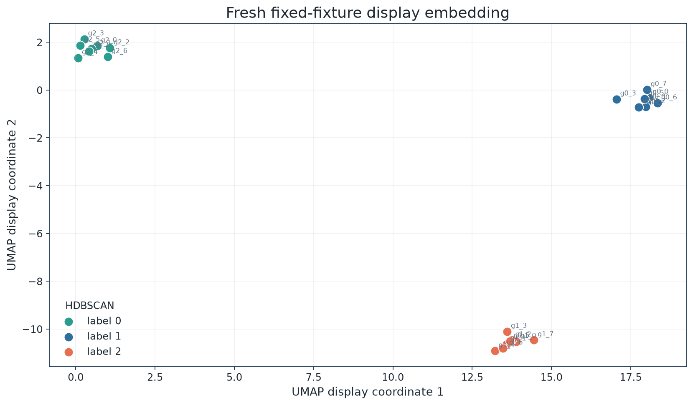{fig-alt="The fresh fixed fixture produced three designed groups of eight with no noise assignment in the first-run display coordinates"}

<figcaption><strong>Figure 14.</strong> The fresh fixed fixture produced three designed groups of eight with no noise assignment in the first-run display coordinates. <em>Interpretive boundary:</em> Coordinate axes and visual separation are fixture-specific and carry no pathway or significance interpretation.</figcaption>

</figure>

## Learning objectives

After completing Chapter 19, the reader can:

1. define seed schedule and explain its role without exceeding the stated caution;
2. define noise label and explain its role without exceeding the stated caution;
3. define candidate identity and explain its role without exceeding the stated caution;
4. define silhouette and explain its role without exceeding the stated caution;
5. define trustworthiness and continuity and explain its role without exceeding the stated caution;
6. trace the relevant package functions and generated artifacts;
7. complete the worked task and distinguish observation from interpretation.

## Conceptual and mathematical development

### seed schedule

Deterministic list controlling repeated stochastic fits. A compact notation is `legacy: 1,...,S; current: r,...,r+S-1`. In practical terms, recorded seeds permit replay but do not guarantee cross-platform bitwise identity. [[Collange et al. (2015)](#ref-reproduciblesum2015)]

Within Freeze 3 RC1 the concept is connected to `ensemble_seeds` and is visible through `embedding_manifest.json`. This connection is narrower than the general statistical idea: software evidence establishes the implemented route, while the mapped primary or internal evidence supplies background authority. The distinction prevents a mathematical definition from being mistaken for proof that a particular scientific interpretation is correct.

### noise label

Label -1 for points unassigned under a fitted density model. A compact notation is `label_i=-1`. In practical terms, noise is algorithmic and parameter-conditional, never a biological-null statement. [[Campello et al. (2015)](#ref-campello2015hdbscan)]

Within Freeze 3 RC1 the concept is connected to `fit_hdbscan` and is visible through `labels.tsv`. This connection is narrower than the general statistical idea: software evidence establishes the implemented route, while the mapped primary or internal evidence supplies background authority. The distinction prevents a mathematical definition from being mistaken for proof that a particular scientific interpretation is correct.

### candidate identity

Deterministic hash and ordinal for a resolved parameter combination. A compact notation is `model_id=H(canonical parameters)`. In practical terms, identity supports replay; it is not a quality score.

Within Freeze 3 RC1 the concept is connected to `candidate_identity` and is visible through `search_space.tsv; model_table.csv`. This connection is narrower than the general statistical idea: software evidence establishes the implemented route, while the mapped primary or internal evidence supplies background authority. The distinction prevents a mathematical definition from being mistaken for proof that a particular scientific interpretation is correct.

### silhouette

Within-versus-nearest-other-cluster separation under a configured metric. A compact notation is `s(i)=(b(i)-a(i))/max(a(i),b(i))`. In practical terms, freeze 3 can exclude noise and supplies the configured HDBSCAN metric. [[Rousseeuw (1987)](#ref-rousseeuw1987)]

Within Freeze 3 RC1 the concept is connected to `evaluate_candidate` and is visible through `model_table.csv`. This connection is narrower than the general statistical idea: software evidence establishes the implemented route, while the mapped primary or internal evidence supplies background authority. The distinction prevents a mathematical definition from being mistaken for proof that a particular scientific interpretation is correct.

### trustworthiness and continuity

Directed neighborhood-retention diagnostics. A compact notation is `T(k)=1-c sum_i sum_(j in U_k(i))(r(i,j)-k)`. In practical terms, freeze 3 computes both through directed calls to sklearn trustworthiness under Euclidean geometry. [[Venna et al. (2010)](#ref-venna2010)]

Within Freeze 3 RC1 the concept is connected to `embedding_quality_metrics` and is visible through `run_summary.json`. This connection is narrower than the general statistical idea: software evidence establishes the implemented route, while the mapped primary or internal evidence supplies background authority. The distinction prevents a mathematical definition from being mistaken for proof that a particular scientific interpretation is correct.

### legacy_dimple score

Population-relative weighted combination of normalized silhouette, clusters, and optionally noise. A compact notation is `raw=w_s s/max(s)+w_k k/max(k)-w_n n/max(n)`. In practical terms, weights are raw dynamic ranges divided by their sum; final scores are min-max scaled.

Within Freeze 3 RC1 the concept is connected to `legacy_dimple_score` and is visible through `scoring_manifest.json; model_table.csv`. This connection is narrower than the general statistical idea: software evidence establishes the implemented route, while the mapped primary or internal evidence supplies background authority. The distinction prevents a mathematical definition from being mistaken for proof that a particular scientific interpretation is correct.

### validation ladder

Separate software, technical, structural, statistical, biological, external, and cross-platform evidence. A compact notation is `E_software != E_biological`. In practical terms, passing tests or exact fixture replay cannot substitute for external biological validation.

Within Freeze 3 RC1 the concept is connected to `run_validation` and is visible through `validation_report.json`. This connection is narrower than the general statistical idea: software evidence establishes the implemented route, while the mapped primary or internal evidence supplies background authority. The distinction prevents a mathematical definition from being mistaken for proof that a particular scientific interpretation is correct.

## Reconstructed operational foundation

Edition 1 contained the following verified operational material in separate short notes. Edition 2 consolidates it here and subjects it to the concept and evidence boundaries above.

### Evidence retained from former Chapter 13

### Operational foundation

The shortest verified run starts in the Freeze 3 repository root with the installed RC1 entry point. Inspect first, enumerate second, fit third, and use a new output root.

```bash
dimple-gwas inspect-config \
  --search-mode fixed \
  --config docs/textbook/edition2/labs/01_fixed_synthetic/tutorial_config.yaml

dimple-gwas show-search-space \
  --search-mode fixed \
  --config docs/textbook/edition2/labs/01_fixed_synthetic/tutorial_config.yaml \
  --output-dir docs/textbook/edition2/labs/01_fixed_synthetic/search_space_new

dimple-gwas run \
  --search-mode fixed \
  --config docs/textbook/edition2/labs/01_fixed_synthetic/tutorial_config.yaml \
  --output-dir docs/textbook/edition2/labs/01_fixed_synthetic/run_new
```

Replace `*_new` with unique names. The canonical documented output is `run_20260826`; do not overwrite it. The fixture is small and repository-owned. It demonstrates execution structure, not production adequacy.

### Retained evidence

The executed canonical run prepared 24 vectors by 80 variables, evaluated one candidate, selected `model_060fac0208bb58e2`, found three clusters of eight, and assigned no noise. Exit status was zero.

### Output-reading checkpoint

Confirm `run_manifest.json` status, one-row search manifest, one candidate table row, selected-model JSON, label row count/uniqueness, annotation join, log, and validation output when run.

### Misinterpretations to avoid

Do not copy an example output path unchanged. Do not jump directly to the plot before checking the manifest. Do not generalize ‘three clusters’ from the designed fixture to real data.

### Boundary inherited from Edition 1

One seed and one candidate make this a smoke test. They do not represent standard production compute or a robust model-selection study.

### Evidence retained from former Chapter 14

### Operational foundation

`run_manifest.json` is the primary run-level audit record. It names the schema, software/version, command, start/finish status, platform, architecture, Python and package versions, package-source hash, input record, resolved configuration and its hash, input contract, seeds, threads, backends, search size, runtime, selected model, scoring formula/profile, artifacts, Parquet outcome, warnings, exclusions, and failures.

A healthy manifest has `status=complete`, but completion alone is not enough. Reconcile candidate counts with search manifests, failed counts with `logs/model_failures.tsv`, selected model with `model_selection_manifest.json` and `best_model.json`, and artifact hashes with files. `git_commit` is null in this source snapshot; the package-source SHA-256 and file registers substitute for build identity in this draft.

### Retained evidence

Edition 2 Lab 2 records 32 search candidates, 32 completed models, zero failed models, four UMAP configurations, two random seeds (42,43), contrib HDBSCAN and umap-learn backends, and an approximately 10.713-second manifest runtime in its local environment.

### Output-reading checkpoint

Inspect `run_manifest.json`, `resolved_config.yaml`, both search-space manifests, `models/model_selection_manifest.json`, `logs/run.log`, and `logs/model_failures.tsv` as a set.

### Misinterpretations to avoid

Do not interpret a null Git commit as a random run; use the source hash. Do not ignore a recorded optional-Parquet failure. Do not assume a complete run had no invalid topologies.

### Boundary inherited from Edition 1

Manifests can disclose local paths, input hashes, platform information, and commands. Sanitize public copies without changing the retained private audit record.

### Evidence retained from former Chapter 32

### Operational foundation

Edition 2 Lab 1 is the canonical novice path. Its configuration fixes every searched field, uses the repository synthetic matrix and annotation table, one seed, three components, one HDBSCAN candidate, one job, and a new output root. The correct annotation join is `index`. Preflight proves one candidate before fitting.

The executed canonical directory is `tutorials/01_fixed_synthetic/run_20260826`. It prepared 24 vectors by 80 variables, selected `model_060fac0208bb58e2`, and produced three clusters of eight with no unassigned observations. Parquet writing succeeded. The validation utility later passed all 24 run-contract checks.

The earlier `run_20260825` is intentionally retained: clustering succeeded, but the original join key was absent and annotations were skipped with a warning. The canonical rerun demonstrates the evidence-preserving response—correct source configuration, write a new output root, and retain the prior attempt.

## Evidence diagram or figure


### Retained evidence

Use Chapters 14–15 with the actual YAML, Chapter 16 to reproduce the selected summary, Chapter 21 to compare it, and Chapter 17 to explain it. The complete commands and timings are in `docs/textbook/edition2/labs/execution_manifest.json`.

### Output-reading checkpoint

Inspect the config, preflight manifests, canonical run manifest, candidate tables, selection manifest, labels/annotations, logs, reproduction, comparison, explanation, and validation.

### Misinterpretations to avoid

Do not delete the noncanonical first run. Do not call the designed grouping discovery evidence. Do not use the fixed quickstart to choose production parameters.

### Boundary inherited from Edition 1

This fixture is a smoke test with deliberately clear structure. Runtime and accuracy are not a guarantee for large correlated GWAS inputs.

### Evidence retained from former Chapter 41

### Operational foundation

The output atlas classifies 35 produced artifact patterns plus three important non-artifacts. Run-root contracts are `resolved_config.yaml`, search manifests, `run_manifest.json`, and logs. Candidate/model contracts live in `models/`: all/ranked/top tables, optional Parquet, best/selection JSON, Pareto/family summaries, and per-retained-model labels/summary/reproduction YAML. Compatibility aliases use `stage02`, `stage03`, and `stage09` names.

Downstream families are separate: scoring creates a table plus manifest; summarization creates family/Pareto/top/count files; explanation creates similarity/order/cutpoint/summary/projection/association/exclusion/heatmap/manifest/README artifacts; comparison creates summary, membership, sizes, confusion, mapping, and manifest; validation creates check rows, report, and manifest.

Current Freeze 3 does **not** write the cleaned/transformed input, individual repeated embeddings, or full concatenated embedding. They are in-memory intermediates. Selected display coordinates are not the full concatenated representation. The machine-readable `output_atlas.tsv` records producer, condition, format, schema excerpt, identifiers, label convention, ordering, safe inspection, health checks, consumers, authority, privacy, example, checksum, and verification status for every item.

### Retained evidence

Use Edition 2 Lab 2 for run artifacts and Edition 2 Lab 3 for downstream artifacts. Each verified atlas example has a SHA-256 and software version. Optional coordinate associations are correctly marked not executed.

### Output-reading checkpoint

For every artifact: confirm producer, creation condition, encoding, row/key schema, identifier uniqueness, label `-1`, rank/order semantics, status/missingness, consumer, privacy, and checksum.

### Misinterpretations to avoid

Do not hunt for nonexistent embedding files. Do not read CSV aliases when the native TSV/JSON contract is needed. Do not publish logs/manifests without reviewing paths and study identifiers.

### Boundary inherited from Edition 1

Exact candidate-table columns are authoritative in the actual header. Future source changes require regenerating the atlas before updating prose.

## Implementation trace

**`pipeline.setup_logger`** is defined at `dimple_gwas/pipeline.py:25` with signature `output_dir: str | Path`. Implementation callable for setup logger. It is reached from pipeline.run_search and connects to No package-defined dependency detected. Its direct artifact contract is logs/run.log; its explicit error surface is No explicit raise in this symbol; delegated calls may raise.. Test evidence is recorded as No direct symbol-name test reference; assess through caller/integration coverage. This is a B-tier contract, so the complete 20-field dossier is retained in the function atlas.

**`pipeline.run_search`** is defined at `dimple_gwas/pipeline.py:130` with signature `config: Mapping[str, Any], output_dir: str | Path, command: list[str] | None=None`. Execute preprocessing, repeated embeddings, candidate evaluation, scoring, retention, reporting, and provenance for one run. It is reached from cli._reproduce; cli.main and connects to hdbscan_runner.fit_hdbscan; io.read_table; metrics.embedding_quality_metrics; pipeline._annotation_frame; pipeline._evaluate_one; pipeline._failed_row; pipeline.setup_logger; preprocessing.prepare_analysis_matrix; provenance.base_manifest; provenance.file_record; ranking.family_summaries; ranking.pareto_front; ranking.rank_models; ranking.top_models; reporting.write_model_outputs; reporting.write_resolved_config; reporting.write_search_space; scoring.apply_scoring; search_space.enumerate_candidates; search_space.stable_identifier; umap_runner.run_repeated_umap. Its direct artifact contract is No direct canonical artifact; in-memory/supporting result; its explicit error surface is RuntimeError; ValueError. Test evidence is recorded as tests/test_pipeline_integration.py::test_custom_leaf_eom_metric_and_max_size_run; tests/test_pipeline_integration.py::test_fixed_model_reproduction. This is a A-tier contract, so the complete 20-field dossier is retained in the function atlas.

**`reporting.write_resolved_config`** is defined at `dimple_gwas/reporting.py:18` with signature `config: Mapping[str, Any], output_dir: str | Path`. Implementation callable for write resolved config. It is reached from pipeline.run_search and connects to No package-defined dependency detected. Its direct artifact contract is resolved_config.yaml; its explicit error surface is No explicit raise in this symbol; delegated calls may raise.. Test evidence is recorded as No direct symbol-name test reference; assess through caller/integration coverage. This is a B-tier contract, so the complete 20-field dossier is retained in the function atlas.

**`reporting.write_search_space`** is defined at `dimple_gwas/reporting.py:28` with signature `candidates: list[Mapping[str, Any]], config: Mapping[str, Any], output_dir: str | Path`. Implementation callable for write search space. It is reached from cli._show; pipeline.run_search and connects to io.atomic_json_dump; io.json_safe; reporting._write_tsv; search_space.flatten_candidate. Its direct artifact contract is search_space_manifest.tsv; search_space_manifest.json; its explicit error surface is No explicit raise in this symbol; delegated calls may raise.. Test evidence is recorded as No direct symbol-name test reference; assess through caller/integration coverage. This is a B-tier contract, so the complete 20-field dossier is retained in the function atlas.

**`reporting.write_model_outputs`** is defined at `dimple_gwas/reporting.py:105` with signature `ranked, top, pareto, families, candidates_by_id: Mapping[str, Mapping[str, Any]], labels_by_id: Mapping[str, Any], visualizations_by_umap: Mapping[str, Any], feature_ids, annotation_frame, config: Mapping[str, Any], scoring_manifest: Mapping[str, Any], run_manifest: Mapping[str, Any], output_dir: str | Path`. Write the complete candidate, ranking, selection, retained-model, compatibility, and manifest artifact family. It is reached from pipeline.run_search and connects to io.atomic_json_dump; io.json_safe; provenance.file_record; provenance.utc_now; reporting._top_artifact; reporting._write_tsv. Its direct artifact contract is run_manifest.json; models/all_models.tsv; models/all_models.parquet; models/ranked_models.tsv; models/top_models.tsv; models/best_model.json; models/model_selection_manifest.json; models/pareto_front.tsv; models/family_summaries.tsv; stage02_hdbscan_gridsearch_results.csv; stage03_optimized_cluster_solutions.csv; stage09_umap_vizdata_with_clusters.csv; stage09b_umap_vizdata_with_annotations.csv; its explicit error surface is No explicit raise in this symbol; delegated calls may raise.. Test evidence is recorded as No direct symbol-name test reference; assess through caller/integration coverage. This is a A-tier contract, so the complete 20-field dossier is retained in the function atlas.

**`validation.run_validation`** is defined at `dimple_gwas/validation.py:15` with signature `run_dir: str | Path, output_dir: str | Path | None=None, *, command: list[str] | None=None`. Audit a run directory against required files, schemas, counts, identities, hashes, and manifest contracts. It is reached from cli._validate and connects to comparison._columns.<locals>.resolve; io.atomic_json_dump; io.ensure_empty_output_dir; io.json_safe; io.read_model_table; io.read_table; provenance.base_manifest; provenance.file_record; provenance.sha256_file; provenance.utc_now; validation.run_validation.<locals>.record. Its direct artifact contract is validation_checks.tsv; validation_report.json; validation_manifest.json; its explicit error surface is FileNotFoundError. Test evidence is recorded as tests/test_freeze3_comparison_validation.py::test_validation_detects_hash_mismatch; tests/test_freeze3_comparison_validation.py::test_validation_passes_complete_contract. This is a A-tier contract, so the complete 20-field dossier is retained in the function atlas.

## Claim adjudication notebook

The following statements are admitted to the draft only in their safe form:

- **VAL-002 (verified_with_qualification):** Within the prior same-environment fixture comparison, ARI, NMI, noise Jaccard, and mapped membership were 1 with near-zero Procrustes disparity. [[Hubert et al. (1985)](#ref-hubert1985); [Vinh et al. (2010)](#ref-vinh2010); [Gower (1975)](#ref-gower1975)] Limitation: Does not generalize across platforms or all configurations. Implementation evidence: `comparison.py`.


<figure id="fig-f21">

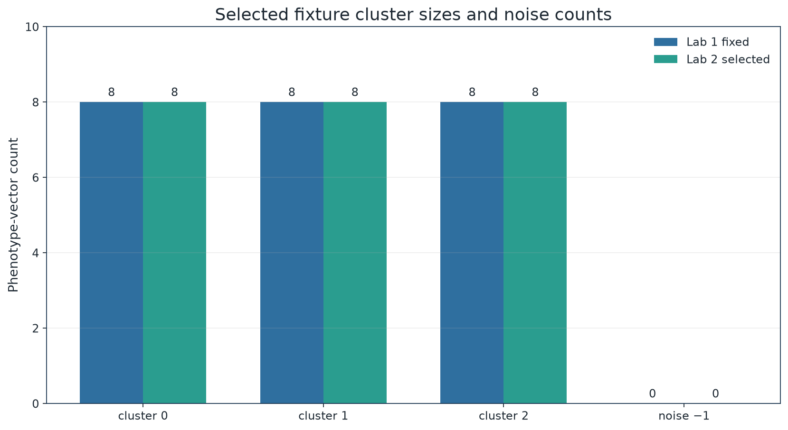{fig-alt="The fresh fixed run and the selected bounded-search model each retained three clusters of eight phenotype vectors and zero noise assignments"}

<figcaption><strong>Figure 15.</strong> The fresh fixed run and the selected bounded-search model each retained three clusters of eight phenotype vectors and zero noise assignments. <em>Interpretive boundary:</em> The equality reflects a designed fixture and does not predict production cluster balance or absence of unassigned IDPs.</figcaption>

</figure>

## Reading the generated evidence

For Chapter 19, the `Fixed synthetic end-to-end analysis` files are read as a provenance chain rather than as isolated results:

<p class="table-caption" id="table-13"><strong>Table 13.</strong> Reading the generated evidence.</p>

| Artifact | Producer | What to verify before interpretation |
| --- | --- | --- |
| `resolved_config.yaml` | `write_resolved_config` | Artifact exists under the new output root, is readable, and its checksum is recorded. |
| `run_manifest.json` | `write_model_outputs` | status=complete; source/input hashes present; failed count understood; selected model and artifact records resolve. |
| `logs/run.log` | `setup_logger` | Artifact exists under the new output root, is readable, and its checksum is recorded. |
| `models/all_models.tsv` | `write_model_outputs` | Candidate count agrees with enumeration; failures remain; ranks and score eligibility are internally consistent. |
| `models/ranked_models.tsv` | `write_model_outputs` | Candidate count agrees with enumeration; failures remain; ranks and score eligibility are internally consistent. |
| `models/all_models.parquet` | `write_model_outputs` | Candidate count agrees with enumeration; failures remain; ranks and score eligibility are internally consistent. |
| `models/top_models.tsv` | `write_model_outputs` | Artifact exists under the new output root, is readable, and its checksum is recorded. |
| `models/best_model.json` | `write_model_outputs` | Artifact exists under the new output root, is readable, and its checksum is recorded. |
| `models/model_selection_manifest.json` | `write_model_outputs` | Artifact exists under the new output root, is readable, and its checksum is recorded. |
| `models/pareto_front.tsv` | `write_model_outputs` | Artifact exists under the new output root, is readable, and its checksum is recorded. |
| `models/family_summaries.tsv` | `write_model_outputs` | Artifact exists under the new output root, is readable, and its checksum is recorded. |
| `models/top_model_artifacts/<id>/labels.tsv` | `_top_artifact` | Identifiers are unique and exactly match the intended input; label -1 is treated as noise/unassigned. |
| `models/top_model_artifacts/<id>/summary.json` | `_top_artifact` | Artifact exists under the new output root, is readable, and its checksum is recorded. |
| `models/top_model_artifacts/<id>/reproduce.yaml` | `_top_artifact` | Artifact exists under the new output root, is readable, and its checksum is recorded. |

The output atlas supplies the complete schemas, checksums, conditions, consumers, and privacy notes for this Chapter 19 route. Native manifests can contain machine paths; the assembled textbook uses sanitized excerpts while restricted evidence retains the original provenance chain.

## Worked reasoning and evidence exercise

Audit the 24-by-80 prepared shape, the selected model, its metric values, the output inventory, and all 24 validation checks.

A complete Chapter 19 answer must expose its intermediate reasoning, name the source or output used for `Fixed synthetic end-to-end analysis`, and finish with separate support and non-support statements. Applying that discipline to the question “Can a fresh user complete the entire software path and account for every output?” prevents a calculation, a software observation, and a scientific interpretation from collapsing into one claim.

## Assumptions, diagnostics, and recovery

The Chapter 19 analysis assumes the stated unit and inputs, the recorded configuration and software identity, and a diagnostic that addresses the claimed property rather than a convenient surrogate. Its decisive boundary is: The fresh Edition 2 run uses one seed and one candidate, producing three designed groups of eight with no noise.

If the Chapter 19 route fails, retain its log and candidate status before deciding whether the cause is input, configuration, dependency, compute, identifier alignment, or output-root state. Correct an operational failure by writing a new result directory. Treat instability in `Fixed synthetic end-to-end analysis` as sensitivity evidence: report it and identify the independent evidence needed instead of relabeling ambiguity as a software exception.

## Chapter synthesis

A designed fixture can verify contracts quickly but cannot estimate production robustness or biological validity. The implementation trace makes the current behavior auditable, but the evidence boundary remains part of the result. Chapter 20 expands the candidate population to reveal ranking and sensitivity behavior.

## Exercises

1. For `Fixed synthetic end-to-end analysis`, name the unit of analysis and one plausible but invalid substitute.
2. Reconstruct the notation for seed schedule; define its dimensions or denominator and interpret every term.
3. Choose a Tier A function mapped to Chapter 19; identify its caller and direct output, then propose a topic-specific edge case.
4. Select one Chapter 19 artifact from the output atlas and state three integrity checks that must precede scientific reading.
5. Convert a tempting `Fixed synthetic end-to-end analysis` overclaim into one observed statement followed by its limitation.
6. Audit the 24-by-80 prepared shape, the selected model, its metric values, the output inventory, and all 24 validation checks.

Appendix J gives the Chapter 19 adjudication guide. Its further-reading keys supply statistical context; no external paper is treated as automatic validation of the current software or dataset.


<div class="chapter-break"></div>

<a id="chapter-20"></a>

# 20. Custom bounded search, sensitivity, and selected-model replay

*Guiding question:* **How can an analyst learn about parameter dependence without turning sensitivity analysis into target matching?**

Prerequisites: 10–16,19.

## Why the question matters

Changing the candidate population can alter normalized scores even when a candidate's raw diagnostics do not change.

Lab 2 is a designed 32-candidate example; identical fixture labels across settings do not imply universal insensitivity.

This chapter develops the question in the order needed for a reader to move from statistical principle to current implementation, retained evidence, and a defensible statement. Its central worked task is: Group the 32 candidates by UMAP family, compare diagnostic shifts, identify top-score ties, and write a preregistered sensitivity conclusion.


<figure id="fig-f14">

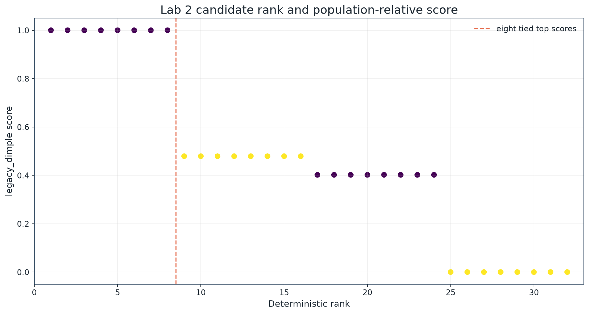{fig-alt="All 32 bounded-search candidates completed; the leading score was shared by eight rows and deterministic tie rules selected one model ID"}

<figcaption><strong>Figure 16.</strong> All 32 bounded-search candidates completed; the leading score was shared by eight rows and deterministic tie rules selected one model ID. <em>Interpretive boundary:</em> The score changes with its candidate population and is not an independent validation statistic.</figcaption>

</figure>

## Learning objectives

After completing Chapter 20, the reader can:

1. define seed schedule and explain its role without exceeding the stated caution;
2. define Cartesian search and explain its role without exceeding the stated caution;
3. define candidate identity and explain its role without exceeding the stated caution;
4. define DBCV and explain its role without exceeding the stated caution;
5. define trustworthiness and continuity and explain its role without exceeding the stated caution;
6. trace the relevant package functions and generated artifacts;
7. complete the worked task and distinguish observation from interpretation.

## Conceptual and mathematical development

### seed schedule

Deterministic list controlling repeated stochastic fits. A compact notation is `legacy: 1,...,S; current: r,...,r+S-1`. In practical terms, recorded seeds permit replay but do not guarantee cross-platform bitwise identity. [[Collange et al. (2015)](#ref-reproduciblesum2015)]

Within Freeze 3 RC1 the concept is connected to `ensemble_seeds` and is visible through `embedding_manifest.json`. This connection is narrower than the general statistical idea: software evidence establishes the implemented route, while the mapped primary or internal evidence supplies background authority. The distinction prevents a mathematical definition from being mistaken for proof that a particular scientific interpretation is correct.

### Cartesian search

Product of enumerated parameter families. A compact notation is `N_candidates=product_j |Theta_j|`. In practical terms, the standard grid is 45 x 18 x 3 = 2,430 for one UMAP family.

Within Freeze 3 RC1 the concept is connected to `enumerate_candidates` and is visible through `search_space.tsv`. This connection is narrower than the general statistical idea: software evidence establishes the implemented route, while the mapped primary or internal evidence supplies background authority. The distinction prevents a mathematical definition from being mistaken for proof that a particular scientific interpretation is correct.

### candidate identity

Deterministic hash and ordinal for a resolved parameter combination. A compact notation is `model_id=H(canonical parameters)`. In practical terms, identity supports replay; it is not a quality score.

Within Freeze 3 RC1 the concept is connected to `candidate_identity` and is visible through `search_space.tsv; model_table.csv`. This connection is narrower than the general statistical idea: software evidence establishes the implemented route, while the mapped primary or internal evidence supplies background authority. The distinction prevents a mathematical definition from being mistaken for proof that a particular scientific interpretation is correct.

### DBCV

Density-based validity index. A compact notation is `weighted cluster validity in [-1,1]`. In practical terms, it is optional and supplementary under legacy_dimple, not the default score component. [[Moulavi et al. (2014)](#ref-moulavi2014dbcv)]

Within Freeze 3 RC1 the concept is connected to `evaluate_candidate` and is visible through `model_table.csv`. This connection is narrower than the general statistical idea: software evidence establishes the implemented route, while the mapped primary or internal evidence supplies background authority. The distinction prevents a mathematical definition from being mistaken for proof that a particular scientific interpretation is correct.

### trustworthiness and continuity

Directed neighborhood-retention diagnostics. A compact notation is `T(k)=1-c sum_i sum_(j in U_k(i))(r(i,j)-k)`. In practical terms, freeze 3 computes both through directed calls to sklearn trustworthiness under Euclidean geometry. [[Venna et al. (2010)](#ref-venna2010)]

Within Freeze 3 RC1 the concept is connected to `embedding_quality_metrics` and is visible through `run_summary.json`. This connection is narrower than the general statistical idea: software evidence establishes the implemented route, while the mapped primary or internal evidence supplies background authority. The distinction prevents a mathematical definition from being mistaken for proof that a particular scientific interpretation is correct.

### legacy_dimple score

Population-relative weighted combination of normalized silhouette, clusters, and optionally noise. A compact notation is `raw=w_s s/max(s)+w_k k/max(k)-w_n n/max(n)`. In practical terms, weights are raw dynamic ranges divided by their sum; final scores are min-max scaled.

Within Freeze 3 RC1 the concept is connected to `legacy_dimple_score` and is visible through `scoring_manifest.json; model_table.csv`. This connection is narrower than the general statistical idea: software evidence establishes the implemented route, while the mapped primary or internal evidence supplies background authority. The distinction prevents a mathematical definition from being mistaken for proof that a particular scientific interpretation is correct.

### eligibility and ties

Rules deciding which candidates receive scores and stable rank order. A compact notation is `eligible=(status=success) and finite silhouette`. In practical terms, ties resolve deterministically through configured sort keys and candidate identity.

Within Freeze 3 RC1 the concept is connected to `rank_models` and is visible through `ranked_models.csv`. This connection is narrower than the general statistical idea: software evidence establishes the implemented route, while the mapped primary or internal evidence supplies background authority. The distinction prevents a mathematical definition from being mistaken for proof that a particular scientific interpretation is correct.

## Reconstructed operational foundation

Edition 1 contained the following verified operational material in separate short notes. Edition 2 consolidates it here and subjects it to the concept and evidence boundaries above.

### Evidence retained from former Chapter 12

### Operational foundation

`inspect-config` resolves and validates configuration and prints candidate counts without fitting. `show-search-space` enumerates the complete deterministic Cartesian product and can retain full TSV/JSON manifests. These commands are mandatory preflight tools: they expose accidental explosions, invalid fields, and misunderstood ranges before UMAP consumes compute.

```bash
dimple-gwas show-search-space \
  --search-mode custom \
  --config docs/textbook/edition2/labs/02_custom_search_space/tutorial_config.yaml \
  --output-dir docs/textbook/edition2/labs/02_custom_search_space/search_space_new \
  --show-first 5
```

Choose a new output directory name; the manual's executed directory is evidence, not a scratch target. Standard mode proves 45 min-cluster-size choices × 18 min-samples choices × 3 epsilon choices = 2,430 candidates for one UMAP family. Shipped extended mode has 1,728 candidates, not the older provisional 5,184 number.

### Retained evidence

Executed Edition 2 Lab 1 enumerated one candidate; Edition 2 Lab 2 enumerated 32: four UMAP families times eight HDBSCAN configurations. Both counts appear in stdout and complete manifests.

### Output-reading checkpoint

Inspect `candidate_models`, UMAP/HDBSCAN family counts, candidate ordinals, stable IDs, and the first/last parameter rows. Retain config and manifest checksums together.

### Misinterpretations to avoid

Do not estimate workload from HDBSCAN choices alone when UMAP parameters also vary. Do not silently sample a large Cartesian product; Freeze 3's safety ceiling raises rather than sampling.

### Boundary inherited from Edition 1

Candidate count is not runtime by itself: repeated UMAP families dominate some workloads while HDBSCAN candidate fits dominate others. Pilot evidence is still needed.

### Evidence retained from former Chapter 21

### Operational foundation

Ranking begins after statuses and scores exist. Eligible successful rows are ordered by final score descending, raw score descending, then stable `model_id` ascending. `top_models.tsv` retains the requested number; `best_model.json` and the selection manifest identify rank one. Pareto membership and family summaries are supplementary views, not alternate truth labels.

Choosing a model should be traceable to an objective declared before inspecting preferred biological labels. Review failure/invalid rates, parameter-family patterns, tied or near-tied solutions, noise and size trade-offs, stability checks, and domain-independent constraints. A rank-one row is the implementation's selected model under the declared rule, not proof that the cluster count is uniquely correct.

Target leakage includes choosing parameters because their labels resemble a published solution when those parameters were not recovered from the historical method. The 164-IDP manual row-16 selection is disclosed rather than retroactively portrayed as automatic rank one.

## Evidence diagram or figure


*Scoring, selection, and fixed reproduction. Editable source: `assets/diagrams/diagram_06_selection_reproduction.mmd`.*

### Retained evidence

Edition 2 Lab 2's first eight models tie at score 1 because their HDBSCAN choices yield the same metrics within the best UMAP family. Stable model ID breaks remaining ties; this is an engineering rule, not a biological preference.

### Output-reading checkpoint

Inspect ranked/all/top tables, family summaries, Pareto table, model selection manifest, best-model JSON, failures, and exact parameter records.

### Misinterpretations to avoid

Do not hide ties or failed candidates. Do not select solely from a pretty plot. Do not use knowledge of desired labels to redefine the search or score and then call it replication.

### Boundary inherited from Edition 1

Internal selection uncertainty is not automatically quantified. Report sensitivity and the conditional nature of the chosen population.

### Evidence retained from former Chapter 33

### Operational foundation

Edition 2 Lab 2 teaches workload and family comparison without searching toward a biological target. Its custom YAML crosses two neighbor values, two minimum-distance values, two minimum-cluster sizes, two min-samples values, and two epsilon values; scalar fields contribute one. Four UMAP families × eight HDBSCAN configurations = 32 candidates. Two repeated seeds keep the example bounded.

All 32 completed successfully. The selected `model_241ad5e99af55074` has three equal clusters, no noise, silhouette about 0.970354, and DBCV about 0.976386. Eight candidates within its UMAP family tie at final score 1 because the designed fixture produces the same topology/score components for those HDBSCAN settings. The deterministic tie rule selects one ID. The fresh Lab 2 rank plot in Chapter 20 makes the four family-level score bands visible.

This is a tuning lesson about declared parameter families and compute; it is not permission to expand a grid until a desired label vector appears.

## Evidence diagram or figure


### Retained evidence

Compare `search_space_manifest.tsv` with `models/ranked_models.tsv`. Group by `umap_id`, inspect repeated embedding metrics, then compare HDBSCAN parameters within each group.

### Output-reading checkpoint

Inspect candidate count/family IDs, statuses, metrics and scopes, score ties, family summaries, Pareto table, selected parameters, runtime, seeds, and annotation output.

### Misinterpretations to avoid

Do not report rank-one as unique when eight rows tie. Do not interpret DBCV as the selection term. Do not extrapolate a 10.7-second local runtime to the 1,000-seed production run.

### Boundary inherited from Edition 1

The fixture has no noise and strong designed clusters, so it does not exercise every failure or uncertainty mode. A real tuning plan needs preregistered objectives and resource pilots.

### Evidence retained from former Chapter 44

### Operational foundation

Workload has two nested scales: UMAP families × repeated seeds, then HDBSCAN candidates per family. Concatenated width is components × repeats; embedding storage in memory grows with vector count and that width. Original-space explanation may create a quadratic vector-by-vector similarity matrix and large heatmap. Candidate tables grow with the Cartesian product. JIT compilation makes first small runs slower than steady-state work.

Use `inspect-config`/`show-search-space` before execution. Start with the fixed fixture, then a bounded scientific pilot that preserves the intended method. Set `n_jobs` and `candidate_jobs` deliberately: when candidates run in parallel, Freeze 3 constrains HDBSCAN core-distance jobs to one to avoid nested oversubscription. Thread environment variables and numerical backends belong in provenance. Use the full-heatmap limit and avoid forcing large matrices without memory/privacy review.

The historical note records a 16-GB host caution. Current storage had ample space, but that is not a production resource recommendation. The executed 10.7-second/32-candidate and 273.47-second historical MNIST values are configuration-specific evidence, not scaling laws.

### Retained evidence

Estimate candidate count, UMAP-family count, concatenated width, model-table rows, and similarity-matrix cells for a proposed run. Then compare available memory/storage and choose one job setting before starting.

### Output-reading checkpoint

Inspect preflight counts, free storage, vector/input width, repeat/component counts, jobs/threads, UMAP/candidate runtimes, failure rates, Parquet status, and explanation matrix safeguards.

### Misinterpretations to avoid

Do not run the 164 1,000-seed workflow as an undocumented first smoke test. Do not set both job layers to unrestricted parallelism. Do not infer linear runtime from tiny fixtures.

### Boundary inherited from Edition 1

No fresh full-IDP runtime/memory benchmark exists yet. Docker profiling must precede cloud sizing and preserve scientific settings.

## Implementation trace

**`pipeline.setup_logger`** is defined at `dimple_gwas/pipeline.py:25` with signature `output_dir: str | Path`. Implementation callable for setup logger. It is reached from pipeline.run_search and connects to No package-defined dependency detected. Its direct artifact contract is logs/run.log; its explicit error surface is No explicit raise in this symbol; delegated calls may raise.. Test evidence is recorded as No direct symbol-name test reference; assess through caller/integration coverage. This is a B-tier contract, so the complete 20-field dossier is retained in the function atlas.

**`pipeline.run_search`** is defined at `dimple_gwas/pipeline.py:130` with signature `config: Mapping[str, Any], output_dir: str | Path, command: list[str] | None=None`. Execute preprocessing, repeated embeddings, candidate evaluation, scoring, retention, reporting, and provenance for one run. It is reached from cli._reproduce; cli.main and connects to hdbscan_runner.fit_hdbscan; io.read_table; metrics.embedding_quality_metrics; pipeline._annotation_frame; pipeline._evaluate_one; pipeline._failed_row; pipeline.setup_logger; preprocessing.prepare_analysis_matrix; provenance.base_manifest; provenance.file_record; ranking.family_summaries; ranking.pareto_front; ranking.rank_models; ranking.top_models; reporting.write_model_outputs; reporting.write_resolved_config; reporting.write_search_space; scoring.apply_scoring; search_space.enumerate_candidates; search_space.stable_identifier; umap_runner.run_repeated_umap. Its direct artifact contract is No direct canonical artifact; in-memory/supporting result; its explicit error surface is RuntimeError; ValueError. Test evidence is recorded as tests/test_pipeline_integration.py::test_custom_leaf_eom_metric_and_max_size_run; tests/test_pipeline_integration.py::test_fixed_model_reproduction. This is a A-tier contract, so the complete 20-field dossier is retained in the function atlas.

**`ranking.rank_models`** is defined at `dimple_gwas/ranking.py:8` with signature `frame`. Apply deterministic eligibility, score, and tie ordering to candidate rows. It is reached from cli._score; cli._summarize; pipeline.run_search and connects to No package-defined dependency detected. Its direct artifact contract is No direct canonical artifact; in-memory/supporting result; its explicit error surface is No explicit raise in this symbol; delegated calls may raise.. Test evidence is recorded as tests/test_scoring_ranking.py::test_custom_scoring_ranking_top_n_and_pareto. This is a A-tier contract, so the complete 20-field dossier is retained in the function atlas.

**`ranking.top_models`** is defined at `dimple_gwas/ranking.py:23` with signature `frame, n: int`. Implementation callable for top models. It is reached from cli._summarize; pipeline.run_search and connects to No package-defined dependency detected. Its direct artifact contract is No direct canonical artifact; in-memory/supporting result; its explicit error surface is No explicit raise in this symbol; delegated calls may raise.. Test evidence is recorded as tests/test_scoring_ranking.py::test_custom_scoring_ranking_top_n_and_pareto. This is a B-tier contract, so the complete 20-field dossier is retained in the function atlas.

**`ranking.pareto_front`** is defined at `dimple_gwas/ranking.py:27` with signature `frame`. Implementation callable for pareto front. It is reached from cli._summarize; pipeline.run_search and connects to No package-defined dependency detected. Its direct artifact contract is No direct canonical artifact; in-memory/supporting result; its explicit error surface is No explicit raise in this symbol; delegated calls may raise.. Test evidence is recorded as tests/test_pipeline_integration.py::test_custom_leaf_eom_metric_and_max_size_run; tests/test_scoring_ranking.py::test_custom_scoring_ranking_top_n_and_pareto. This is a A-tier contract, so the complete 20-field dossier is retained in the function atlas.

**`ranking.family_summaries`** is defined at `dimple_gwas/ranking.py:71` with signature `frame, columns: Iterable[str]=DEFAULT_FAMILY_COLUMNS`. Implementation callable for family summaries. It is reached from cli._summarize; pipeline.run_search and connects to No package-defined dependency detected. Its direct artifact contract is No direct canonical artifact; in-memory/supporting result; its explicit error surface is No explicit raise in this symbol; delegated calls may raise.. Test evidence is recorded as tests/test_pipeline_integration.py::test_custom_leaf_eom_metric_and_max_size_run. This is a A-tier contract, so the complete 20-field dossier is retained in the function atlas.

**`scoring.normalize_model_table_schema`** is defined at `dimple_gwas/scoring.py:28` with signature `frame`. Adapt the historical notebook table schema without discarding source fields. It is reached from cli._score and connects to No package-defined dependency detected. Its direct artifact contract is No direct canonical artifact; in-memory/supporting result; its explicit error surface is ValueError. Test evidence is recorded as tests/test_freeze3_comparison_validation.py::test_historical_notebook_model_schema_is_adapted. This is a B-tier contract, so the complete 20-field dossier is retained in the function atlas.

**`scoring.legacy_dimple_score`** is defined at `dimple_gwas/scoring.py:80` with signature `frame, fit_include_noise: bool=False`. Reproduce the compatibility score using observed dynamic-range weights and population-dependent normalization. It is reached from scoring.apply_scoring and connects to scoring._safe_divide_by_max; scoring._scale_final. Its direct artifact contract is No direct canonical artifact; in-memory/supporting result; its explicit error surface is No explicit raise in this symbol; delegated calls may raise.. Test evidence is recorded as tests/test_scoring_ranking.py::test_legacy_formula_matches_literal_reference; tests/test_scoring_ranking.py::test_zero_variance_and_noise_exclusion. This is a A-tier contract, so the complete 20-field dossier is retained in the function atlas.

**`scoring.custom_score`** is defined at `dimple_gwas/scoring.py:146` with signature `frame, rules: Mapping[str, Mapping[str, Any]]`. Apply a user-declared multi-component scoring profile with orientations and weights. It is reached from scoring.apply_scoring and connects to scoring._scale_final. Its direct artifact contract is No direct canonical artifact; in-memory/supporting result; its explicit error surface is ValueError. Test evidence is recorded as tests/test_scoring_ranking.py::test_custom_scoring_ranking_top_n_and_pareto. This is a A-tier contract, so the complete 20-field dossier is retained in the function atlas.

**`scoring.apply_scoring`** is defined at `dimple_gwas/scoring.py:195` with signature `frame, scoring_config: Mapping[str, Any]`. Implementation callable for apply scoring. It is reached from cli._score; pipeline.run_search and connects to scoring.custom_score; scoring.legacy_dimple_score. Its direct artifact contract is No direct canonical artifact; in-memory/supporting result; its explicit error surface is ValueError. Test evidence is recorded as No direct symbol-name test reference; assess through caller/integration coverage. This is a A-tier contract, so the complete 20-field dossier is retained in the function atlas.

**`search_space.canonical_json`** is defined at `dimple_gwas/search_space.py:16` with signature `value: Any`. Implementation callable for canonical json. It is reached from search_space.stable_identifier and connects to No package-defined dependency detected. Its direct artifact contract is No direct canonical artifact; in-memory/supporting result; its explicit error surface is No explicit raise in this symbol; delegated calls may raise.. Test evidence is recorded as No direct symbol-name test reference; assess through caller/integration coverage. This is a B-tier contract, so the complete 20-field dossier is retained in the function atlas.

**`search_space.stable_identifier`** is defined at `dimple_gwas/search_space.py:20` with signature `prefix: str, value: Any, length: int=16`. Implementation callable for stable identifier. It is reached from pipeline.run_search; search_space.enumerate_candidates and connects to search_space.canonical_json. Its direct artifact contract is No direct canonical artifact; in-memory/supporting result; its explicit error surface is No explicit raise in this symbol; delegated calls may raise.. Test evidence is recorded as No direct symbol-name test reference; assess through caller/integration coverage. This is a B-tier contract, so the complete 20-field dossier is retained in the function atlas.


<figure id="fig-f15">

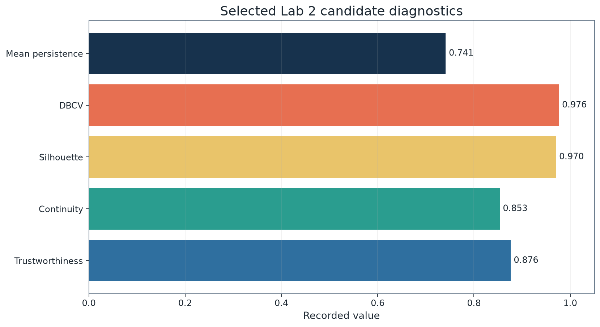{fig-alt="The selected bounded-search candidate has five separately interpreted diagnostics; no single bar certifies a correct cluster solution"}

<figcaption><strong>Figure 17.</strong> The selected bounded-search candidate has five separately interpreted diagnostics; no single bar certifies a correct cluster solution. <em>Interpretive boundary:</em> Values are calculated on a designed fixture and are partly dependent on the same representation used for fitting.</figcaption>

</figure>

## Reading the generated evidence

For Chapter 20, the `Custom bounded search, sensitivity, and selected-model replay` files are read as a provenance chain rather than as isolated results:

<p class="table-caption" id="table-14"><strong>Table 14.</strong> Reading the generated evidence.</p>

| Artifact | Producer | What to verify before interpretation |
| --- | --- | --- |
| `resolved_config.yaml` | `write_resolved_config` | Artifact exists under the new output root, is readable, and its checksum is recorded. |
| `search_space_manifest.tsv/json` | `write_search_space` | Artifact exists under the new output root, is readable, and its checksum is recorded. |
| `run_manifest.json` | `write_model_outputs` | status=complete; source/input hashes present; failed count understood; selected model and artifact records resolve. |
| `logs/run.log` | `setup_logger` | Artifact exists under the new output root, is readable, and its checksum is recorded. |
| `models/all_models.tsv` | `write_model_outputs` | Candidate count agrees with enumeration; failures remain; ranks and score eligibility are internally consistent. |
| `models/ranked_models.tsv` | `write_model_outputs` | Candidate count agrees with enumeration; failures remain; ranks and score eligibility are internally consistent. |
| `models/all_models.parquet` | `write_model_outputs` | Candidate count agrees with enumeration; failures remain; ranks and score eligibility are internally consistent. |
| `models/top_models.tsv` | `write_model_outputs` | Artifact exists under the new output root, is readable, and its checksum is recorded. |
| `models/best_model.json` | `write_model_outputs` | Artifact exists under the new output root, is readable, and its checksum is recorded. |
| `models/model_selection_manifest.json` | `write_model_outputs` | Artifact exists under the new output root, is readable, and its checksum is recorded. |
| `models/pareto_front.tsv` | `write_model_outputs` | Artifact exists under the new output root, is readable, and its checksum is recorded. |
| `models/family_summaries.tsv` | `write_model_outputs` | Artifact exists under the new output root, is readable, and its checksum is recorded. |
| `models/top_model_artifacts/<id>/labels.tsv` | `_top_artifact` | Identifiers are unique and exactly match the intended input; label -1 is treated as noise/unassigned. |
| `models/top_model_artifacts/<id>/summary.json` | `_top_artifact` | Artifact exists under the new output root, is readable, and its checksum is recorded. |

The output atlas supplies the complete schemas, checksums, conditions, consumers, and privacy notes for this Chapter 20 route. Native manifests can contain machine paths; the assembled textbook uses sanitized excerpts while restricted evidence retains the original provenance chain.

## Worked reasoning and evidence exercise

Group the 32 candidates by UMAP family, compare diagnostic shifts, identify top-score ties, and write a preregistered sensitivity conclusion.

A complete Chapter 20 answer must expose its intermediate reasoning, name the source or output used for `Custom bounded search, sensitivity, and selected-model replay`, and finish with separate support and non-support statements. Applying that discipline to the question “How can an analyst learn about parameter dependence without turning sensitivity analysis into target matching?” prevents a calculation, a software observation, and a scientific interpretation from collapsing into one claim.

## Assumptions, diagnostics, and recovery

The Chapter 20 analysis assumes the stated unit and inputs, the recorded configuration and software identity, and a diagnostic that addresses the claimed property rather than a convenient surrogate. Its decisive boundary is: Lab 2 is a designed 32-candidate example; identical fixture labels across settings do not imply universal insensitivity.

If the Chapter 20 route fails, retain its log and candidate status before deciding whether the cause is input, configuration, dependency, compute, identifier alignment, or output-root state. Correct an operational failure by writing a new result directory. Treat instability in `Custom bounded search, sensitivity, and selected-model replay` as sensitivity evidence: report it and identify the independent evidence needed instead of relabeling ambiguity as a software exception.

## Chapter synthesis

Changing the candidate population can alter normalized scores even when a candidate's raw diagnostics do not change. The implementation trace makes the current behavior auditable, but the evidence boundary remains part of the result. Chapter 21 exercises every post-run explanation, comparison, and validation route.

## Exercises

1. For `Custom bounded search, sensitivity, and selected-model replay`, name the unit of analysis and one plausible but invalid substitute.
2. Reconstruct the notation for seed schedule; define its dimensions or denominator and interpret every term.
3. Choose a Tier A function mapped to Chapter 20; identify its caller and direct output, then propose a topic-specific edge case.
4. Select one Chapter 20 artifact from the output atlas and state three integrity checks that must precede scientific reading.
5. Convert a tempting `Custom bounded search, sensitivity, and selected-model replay` overclaim into one observed statement followed by its limitation.
6. Group the 32 candidates by UMAP family, compare diagnostic shifts, identify top-score ties, and write a preregistered sensitivity conclusion.

Appendix J gives the Chapter 20 adjudication guide. Its further-reading keys supply statistical context; no external paper is treated as automatic validation of the current software or dataset.


<div class="chapter-break"></div>

<a id="chapter-21"></a>

# 21. Explanation, comparison, validation, and report generation

*Guiding question:* **Can retained outputs be interpreted and compared without rerunning discovery or losing identifier integrity?**

Prerequisites: 16–17,19.

## Why the question matters

Post-run tooling increases auditability but does not convert same-data summaries into confirmatory inference.

Lab 3 is exact same-environment fixture evidence; publishable reporting must use sanitized paths and preserve conditional language.

This chapter develops the question in the order needed for a reader to move from statistical principle to current implementation, retained evidence, and a defensible statement. Its central worked task is: Reproduce, explain, compare, and validate Lab 1; then write one technical result paragraph and one separate scientific-limitations paragraph.


<figure id="fig-f11">

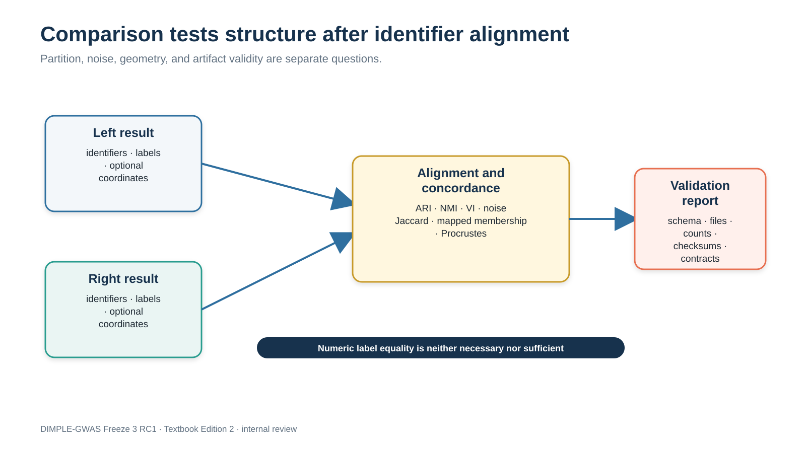{fig-alt="Two results are aligned by identifiers and compared with permutation-invariant partition metrics, noise overlap, mapped membership, and optional aligned geometry before artifact validation"}

<figcaption><strong>Figure 18.</strong> Two results are aligned by identifiers and compared with permutation-invariant partition metrics, noise overlap, mapped membership, and optional aligned geometry before artifact validation. <em>Interpretive boundary:</em> Perfect same-environment fixture concordance is not evidence of external or biological validity.</figcaption>

</figure>

## Learning objectives

After completing Chapter 21, the reader can:

1. define identifier alignment and explain its role without exceeding the stated caution;
2. define trustworthiness and continuity and explain its role without exceeding the stated caution;
3. define adjusted Rand index and explain its role without exceeding the stated caution;
4. define normalized mutual information and explain its role without exceeding the stated caution;
5. define noise Jaccard and explain its role without exceeding the stated caution;
6. trace the relevant package functions and generated artifacts;
7. complete the worked task and distinguish observation from interpretation.

## Conceptual and mathematical development

### identifier alignment

A one-to-one correspondence between vector or feature identifiers across artifacts. A compact notation is `I_A = I_B`. In practical terms, order is not identity; normalize and validate keys before joining.

Within Freeze 3 RC1 the concept is connected to `validated_identifiers; align_rows` and is visible through `labels.tsv; coordinates.tsv`. This connection is narrower than the general statistical idea: software evidence establishes the implemented route, while the mapped primary or internal evidence supplies background authority. The distinction prevents a mathematical definition from being mistaken for proof that a particular scientific interpretation is correct.

### trustworthiness and continuity

Directed neighborhood-retention diagnostics. A compact notation is `T(k)=1-c sum_i sum_(j in U_k(i))(r(i,j)-k)`. In practical terms, freeze 3 computes both through directed calls to sklearn trustworthiness under Euclidean geometry. [[Venna et al. (2010)](#ref-venna2010)]

Within Freeze 3 RC1 the concept is connected to `embedding_quality_metrics` and is visible through `run_summary.json`. This connection is narrower than the general statistical idea: software evidence establishes the implemented route, while the mapped primary or internal evidence supplies background authority. The distinction prevents a mathematical definition from being mistaken for proof that a particular scientific interpretation is correct.

### adjusted Rand index

Chance-adjusted pairwise partition agreement. A compact notation is `ARI=(RI-E[RI])/(max(RI)-E[RI])`. In practical terms, permutation invariant; a value of 1 does not imply coordinate identity. [[Hubert et al. (1985)](#ref-hubert1985)]

Within Freeze 3 RC1 the concept is connected to `compare_partitions` and is visible through `comparison_summary.json`. This connection is narrower than the general statistical idea: software evidence establishes the implemented route, while the mapped primary or internal evidence supplies background authority. The distinction prevents a mathematical definition from being mistaken for proof that a particular scientific interpretation is correct.

### normalized mutual information

Normalized information shared by two labelings. A compact notation is `NMI=2I(U;V)/(H(U)+H(V))`. In practical terms, normalization conventions matter; Freeze 3 uses the sklearn convention recorded in code. [[Vinh et al. (2010)](#ref-vinh2010)]

Within Freeze 3 RC1 the concept is connected to `compare_partitions` and is visible through `comparison_summary.json`. This connection is narrower than the general statistical idea: software evidence establishes the implemented route, while the mapped primary or internal evidence supplies background authority. The distinction prevents a mathematical definition from being mistaken for proof that a particular scientific interpretation is correct.

### noise Jaccard

Overlap of the two sets labeled -1. A compact notation is `J(A,B)=|A intersect B|/|A union B|`. In practical terms, it isolates agreement about unassigned membership, not all clusters.

Within Freeze 3 RC1 the concept is connected to `noise_jaccard` and is visible through `comparison_summary.json`. This connection is narrower than the general statistical idea: software evidence establishes the implemented route, while the mapped primary or internal evidence supplies background authority. The distinction prevents a mathematical definition from being mistaken for proof that a particular scientific interpretation is correct.

### Procrustes disparity

Residual after centering, scaling, and orthogonal alignment. A compact notation is `min_R ||X_c R-Y_c||_F^2`. In practical terms, low disparity supports aligned coordinate similarity under the chosen transformation, not biological replication. [[Gower (1975)](#ref-gower1975)]

Within Freeze 3 RC1 the concept is connected to `compare_coordinates` and is visible through `comparison_summary.json`. This connection is narrower than the general statistical idea: software evidence establishes the implemented route, while the mapped primary or internal evidence supplies background authority. The distinction prevents a mathematical definition from being mistaken for proof that a particular scientific interpretation is correct.

### Pearson association

Linear association in original input dimensions. A compact notation is `r=sum(x-xbar)(y-ybar)/sqrt(sum(x-xbar)^2 sum(y-ybar)^2)`. In practical terms, post-selection descriptive only; undefined constant vectors follow configured policy. [[Kriegeskorte et al. (2009)](#ref-kriegeskorte2009)]

Within Freeze 3 RC1 the concept is connected to `compute_similarity` and is visible through `similarity_matrix.csv`. This connection is narrower than the general statistical idea: software evidence establishes the implemented route, while the mapped primary or internal evidence supplies background authority. The distinction prevents a mathematical definition from being mistaken for proof that a particular scientific interpretation is correct.

### Spearman association

Pearson correlation of marginal ranks. A compact notation is `rho=cor(rank(x),rank(y))`. In practical terms, ties receive average ranks; monotonic association is not mechanism.

Within Freeze 3 RC1 the concept is connected to `compute_similarity` and is visible through `similarity_matrix.csv`. This connection is narrower than the general statistical idea: software evidence establishes the implemented route, while the mapped primary or internal evidence supplies background authority. The distinction prevents a mathematical definition from being mistaken for proof that a particular scientific interpretation is correct.

### circular analysis

Reuse of discovery data for apparently confirmatory inference. A compact notation is `selection(Y) then test(Y) without adjustment`. In practical terms, same-data heatmaps and correlations are descriptive; independent or selective-inference designs are needed for confirmatory claims. [[Kriegeskorte et al. (2009)](#ref-kriegeskorte2009); [Gao et al. (2024)](#ref-gao2024)]

Within Freeze 3 RC1 the concept is connected to `run_explanation` and is visible through `explanation outputs`. This connection is narrower than the general statistical idea: software evidence establishes the implemented route, while the mapped primary or internal evidence supplies background authority. The distinction prevents a mathematical definition from being mistaken for proof that a particular scientific interpretation is correct.

### validation ladder

Separate software, technical, structural, statistical, biological, external, and cross-platform evidence. A compact notation is `E_software != E_biological`. In practical terms, passing tests or exact fixture replay cannot substitute for external biological validation.

Within Freeze 3 RC1 the concept is connected to `run_validation` and is visible through `validation_report.json`. This connection is narrower than the general statistical idea: software evidence establishes the implemented route, while the mapped primary or internal evidence supplies background authority. The distinction prevents a mathematical definition from being mistaken for proof that a particular scientific interpretation is correct.

## Reconstructed operational foundation

Edition 1 contained the following verified operational material in separate short notes. Edition 2 consolidates it here and subjects it to the concept and evidence boundaries above.

### Evidence retained from former Chapter 23

### Operational foundation

`compare` accepts two native summaries or label tables, requires unique exact ID sets, and can require the same order. It reports adjusted Rand index, normalized mutual information, variation of information, noise-set Jaccard, optimal label mapping, mapped membership, changed noise status, cluster sizes, and optional Procrustes disparity. Numeric labels are local names, so structural metrics are primary.

`validate` inspects one run directory for required artifacts, readable JSON/YAML, enumeration counts, ranked schema, selected artifacts, and recorded hashes. It writes one pass/warn/fail row per check and returns exit code one on failure. Validation does not refit or compare biology.

```bash
dimple-gwas compare --left LEFT/summary.json --right RIGHT/summary.json --output-dir comparison_new
dimple-gwas validate --run-dir RUN --output-dir validation_new
```

## Evidence diagram or figure


*Comparison and validation paths. Editable source: `assets/diagrams/diagram_08_compare_validate.mmd`.*

### Retained evidence

Edition 2 Lab 3 comparison uses 24 IDs, three clusters, no noise, perfect structural metrics, zero variation of information, and near-zero aligned coordinate disparity. Validation reports 24/24 pass with no warnings or failures.

### Output-reading checkpoint

Inspect `comparison_summary.json`, membership table, size table, confusion, mapping, comparison manifest, `validation_checks.tsv`, report, and validation manifest.

### Misinterpretations to avoid

Do not compare raw numeric labels across fits. Do not ignore changed noise status. Do not interpret Procrustes as membership agreement. Do not call hash/schema checks biological validation.

### Boundary inherited from Edition 1

Exact label equality is stringent and environment-sensitive; permutation-invariant equality is structural. Coordinate comparison needs alignment and tolerances. Scientific conclusions need higher-layer validation.

### Evidence retained from former Chapter 25

### Operational foundation

`explain` returns to the original matrix after a partition has been retained. It loads native summary/labels or a legacy table, resolves input orientation, validates/strips identifiers, rejects duplicates, enforces complete matching by default, applies the recorded preprocessing contract, and computes original-space similarity without refitting UMAP or HDBSCAN.

Native mode usually needs only `--model-json`; `--input` can override a stale recorded path. Legacy mode requires a label table, original input, explicit output root, and often explicit orientation/ID/label/coordinate options. The noise policy can place unassigned vectors last, include them in ordering, or exclude them with a recorded reason.

```bash
dimple-gwas explain \
  --model-json RUN/models/top_model_artifacts/MODEL/summary.json \
  --output-dir explanation_new
```

## Evidence diagram or figure


*Original-space explanation without refitting. Editable source: `assets/diagrams/diagram_07_original_space_explanation.mmd`.*

### Retained evidence

Edition 2 Lab 3 matches all 24 synthetic feature IDs, excludes none, writes the complete similarity table, and produces ordered heatmap/summary/projection artifacts without changing labels.

### Output-reading checkpoint

Inspect interpretation manifest sources/hashes, orientation, ID counts, exclusions, `heatmap_order.tsv`, similarity table, summaries, projection quality, README, and figure sidecars.

### Misinterpretations to avoid

Do not let auto-orientation replace an explicit contract when both axes could overlap. Do not accept incomplete matching silently. Do not describe explanation as a refit or independent validation.

### Boundary inherited from Edition 1

Original-space summaries remain conditional on a selected partition and input construction. They can reveal descriptive coherence or contradictions but cannot establish causal mechanism.

### Evidence retained from former Chapter 26

### Operational foundation

Pearson correlation summarizes linear association after centering/scaling; Spearman correlates ranks and summarizes monotone association. Freeze 3 uses the configured method to build a vector-by-vector similarity table in original input-variable space. It then summarizes within-block and between-block pairs after applying the declared order/noise policy.

Undefined correlation can arise from constant or insufficiently variable vectors. The safe default is `error`; the opt-in `zero` policy replaces undefined values and records the choice. This replacement is a computational convention, not evidence of no association. Coordinate associations, when enabled, are ranked descriptive correlations between original dimensions and supplied coordinates.

Neither correlation supplies a causal effect, an unbiased post-selection p-value, or independent replication.

### Retained evidence

Edition 2 Lab 3's three synthetic clusters have within-cluster Pearson means approximately 0.9963, 0.9930, and 0.9928; between-cluster means are about 0.0033–0.0047. The fresh Lab 3 treatment in Chapters 17 and 21 labels these as post-selection descriptive summaries.

### Output-reading checkpoint

Inspect similarity method, pair counts, means/medians, between summaries, exclusions, undefined-correlation policy, and optional association method/top-N settings.

### Misinterpretations to avoid

Do not attach naive p-values to the same selected pairs. Do not interpret zero replacement as observed zero correlation. Do not compare Pearson and Spearman without explaining the different question.

### Boundary inherited from Edition 1

Shared sample, LD, preprocessing, technical structure, and selection can drive correlations. Independent evidence is required for biological interpretation.

### Evidence retained from former Chapter 27

### Operational foundation

The explanation heatmap is a rendered view of an auditable order. `heatmap_order.tsv` records 1-based display order, exact feature ID, cluster label/noise flag, and supplied coordinates. `cluster_cutpoints.tsv` records zero- and one-based inclusive block boundaries and sizes. Within a cluster, `cluster_then_hclust` applies hierarchical ordering to the original-space similarity-derived distance; other choices are cluster, hclust, or input order.

Annotations come from an optional table joined by the declared index column. The initial tutorial configuration used the wrong join key and produced a warning; the source YAML was corrected to `index` and Edition 2 Lab 1 rerun as `run_20260826`. The earlier output remains as evidence of the mistake. Figure interpretation should always use sidecars, not inferred pixel positions.

## Evidence diagram or figure


### Retained evidence

The Edition 2 Lab 3 heatmap is regenerated at publication resolution from the freshly retained similarity matrix; its source and generation record are in `qa/figure_inventory.tsv`. The synthetic groups are designed, and the image is unrestricted fixture evidence.

### Output-reading checkpoint

Inspect heatmap PNG/HTML, exact order, cutpoints, cluster summary, exclusions, annotations, manifest hash, and README caveats.

### Misinterpretations to avoid

Do not reorder the image manually and leave sidecars unchanged. Do not assume coloured blocks are statistically significant. Do not publish annotations without checking privacy/access status.

### Boundary inherited from Edition 1

Large matrices are protected by thresholds and optional forcing. A full-resolution heatmap can be unreadable or disclose identifiers; use aggregate summaries and controlled access when appropriate.

### Evidence retained from former Chapter 34

### Operational foundation

Edition 2 Lab 3 begins with real native outputs rather than rerunning the entire search. `score-existing` normalizes and ranks an existing model table while preserving a scoring manifest. `summarize-models` writes family, Pareto, top-model, and count summaries. `reproduce-model` performs one fixed refit. `explain` produces original-space descriptive artifacts without refitting. `compare` evaluates exact-ID structural and coordinate concordance. `validate` checks the original run contract.

All six executed commands exited zero. The same-environment fixed rerun has 24 exact IDs; ARI, NMI, noise Jaccard, and optimally mapped membership are 1; variation of information is zero; Procrustes disparity is 2.7088204667806472×10^-31. The canonical Edition 2 Lab 1 run passes 24/24 validation checks. Original-space within-cluster means are near 0.993–0.996 on the designed fixture.

Each result answers a different question. Scoring is not refitting; reproducing is not explaining; comparison is not schema validation; descriptive similarity is not biological inference.

## Evidence diagram or figure


### Retained evidence

Run the six commands from the exact command JSON in `docs/textbook/edition2/labs/execution_manifest.json`, substituting new output roots. Verify the generated file set against Appendix D.

### Output-reading checkpoint

Inspect rescoring manifest, summary counts, fixed rerun manifest, explanation manifest/sidecars, all comparison files, all validation files, and command logs.

### Misinterpretations to avoid

Do not overwrite the original run. Do not compare label integers directly. Do not treat an exit-zero command as sufficient without checking its semantic assertions.

### Boundary inherited from Edition 1

The tutorial uses a small, same-platform fixture and does not test legacy incomplete matching, large heatmap safeguards, cross-hardware numerics, or biological replication.

## Implementation trace

**`comparison.run_comparison`** is defined at `dimple_gwas/comparison.py:65` with signature `left_source: str | Path, right_source: str | Path, output_dir: str | Path, *, id_column: str='feature_id', label_column: str='label', require_same_order: bool=False, command: list[str] | None=None`. Compare two label artifacts using exact IDs, permutation-invariant structure, noise sets, mapping, and optional coordinates. It is reached from cli._compare and connects to comparison._columns; comparison._resolve_labels; comparison._variation_of_information; interpretation.detect_coordinate_columns; interpretation.is_noise_label; interpretation.label_sort_key; io.atomic_json_dump; io.ensure_empty_output_dir; io.json_safe; io.validated_identifiers; provenance.base_manifest; provenance.file_record; provenance.utc_now. Its direct artifact contract is comparison_summary.json; membership_comparison.tsv; cluster_sizes.tsv; label_confusion.tsv; optimal_label_mapping.tsv; comparison_manifest.json; its explicit error surface is ValueError. Test evidence is recorded as tests/test_freeze3_comparison_validation.py::test_comparison_rejects_duplicate_ids; tests/test_freeze3_comparison_validation.py::test_comparison_requires_identical_id_sets; tests/test_freeze3_comparison_validation.py::test_label_permutation_comparison_is_structurally_equal. This is a A-tier contract, so the complete 20-field dossier is retained in the function atlas.

**`interpretation.is_noise_label`** is defined at `dimple_gwas/interpretation.py:30` with signature `value: Any`. Implementation callable for is noise label. It is reached from comparison.run_comparison; interpretation.calculate_cluster_summary; interpretation.label_sort_key; interpretation.run_explanation and connects to No package-defined dependency detected. Its direct artifact contract is No direct canonical artifact; in-memory/supporting result; its explicit error surface is No explicit raise in this symbol; delegated calls may raise.. Test evidence is recorded as No direct symbol-name test reference; assess through caller/integration coverage. This is a B-tier contract, so the complete 20-field dossier is retained in the function atlas.

**`interpretation.label_sort_key`** is defined at `dimple_gwas/interpretation.py:35` with signature `value: Any`. Implementation callable for label sort key. It is reached from comparison.run_comparison; interpretation.compute_order and connects to interpretation.is_noise_label. Its direct artifact contract is No direct canonical artifact; in-memory/supporting result; its explicit error surface is No explicit raise in this symbol; delegated calls may raise.. Test evidence is recorded as No direct symbol-name test reference; assess through caller/integration coverage. This is a B-tier contract, so the complete 20-field dossier is retained in the function atlas.

**`interpretation.detect_coordinate_columns`** is defined at `dimple_gwas/interpretation.py:44` with signature `frame, requested: Sequence[str] | str | None=None`. Implementation callable for detect coordinate columns. It is reached from comparison.run_comparison; interpretation.run_explanation and connects to No package-defined dependency detected. Its direct artifact contract is No direct canonical artifact; in-memory/supporting result; its explicit error surface is ValueError. Test evidence is recorded as tests/test_freeze3_interpretation.py::test_coordinate_detection_is_numeric_suffix_order. This is a B-tier contract, so the complete 20-field dossier is retained in the function atlas.

**`interpretation.compute_similarity`** is defined at `dimple_gwas/interpretation.py:145` with signature `analysis, *, method: str, undefined_policy: str`. Implementation callable for compute similarity. It is reached from interpretation.run_explanation and connects to No package-defined dependency detected. Its direct artifact contract is No direct canonical artifact; in-memory/supporting result; its explicit error surface is ValueError. Test evidence is recorded as tests/test_freeze3_interpretation.py::test_similarity_undefined_fails_by_default. This is a A-tier contract, so the complete 20-field dossier is retained in the function atlas.

**`interpretation.compute_order`** is defined at `dimple_gwas/interpretation.py:184` with signature `correlation, labels: Sequence[Any], *, method: str, noise_policy: str`. Implementation callable for compute order. It is reached from interpretation.run_explanation and connects to interpretation._hierarchical_order; interpretation.label_sort_key. Its direct artifact contract is No direct canonical artifact; in-memory/supporting result; its explicit error surface is No explicit raise in this symbol; delegated calls may raise.. Test evidence is recorded as tests/test_freeze3_interpretation.py::test_cluster_order_is_numeric_and_noise_last. This is a A-tier contract, so the complete 20-field dossier is retained in the function atlas.

**`interpretation.calculate_cutpoints`** is defined at `dimple_gwas/interpretation.py:209` with signature `labels: Sequence[Any]`. Implementation callable for calculate cutpoints. It is reached from interpretation.run_explanation and connects to No package-defined dependency detected. Its direct artifact contract is No direct canonical artifact; in-memory/supporting result; its explicit error surface is No explicit raise in this symbol; delegated calls may raise.. Test evidence is recorded as tests/test_freeze3_interpretation.py::test_cutpoint_indices_are_auditable. This is a B-tier contract, so the complete 20-field dossier is retained in the function atlas.

**`interpretation.calculate_cluster_summary`** is defined at `dimple_gwas/interpretation.py:233` with signature `correlation, labels: Sequence[Any]`. Implementation callable for calculate cluster summary. It is reached from interpretation.run_explanation and connects to interpretation.is_noise_label. Its direct artifact contract is No direct canonical artifact; in-memory/supporting result; its explicit error surface is No explicit raise in this symbol; delegated calls may raise.. Test evidence is recorded as No direct symbol-name test reference; assess through caller/integration coverage. This is a B-tier contract, so the complete 20-field dossier is retained in the function atlas.

**`interpretation.coordinate_association_table`** is defined at `dimple_gwas/interpretation.py:262` with signature `analysis, coordinates, *, methods: Sequence[str], top_n: int`. Implementation callable for coordinate association table. It is reached from interpretation.run_explanation and connects to No package-defined dependency detected. Its direct artifact contract is No direct canonical artifact; in-memory/supporting result; its explicit error surface is No explicit raise in this symbol; delegated calls may raise.. Test evidence is recorded as No direct symbol-name test reference; assess through caller/integration coverage. This is a A-tier contract, so the complete 20-field dossier is retained in the function atlas.

**`interpretation.run_explanation`** is defined at `dimple_gwas/interpretation.py:307` with signature `*, output_dir: str | Path, interpretation_config: Mapping[str, Any], model_json: str | Path | None=None, legacy_table: str | Path | None=None, input_path: str | Path | None=None, input_sep: str | None=None, input_sheet: str | int=0, legacy_sheet: str | int=0, matrix_orientation: str='auto', vector_id_source: str='auto', drop_first_n_cols: int | None=None, zscore_transform: str | None=None, id_column: str | None=None, label_column: str | None=None, coordinate_columns: Sequence[str] | str | None=None, command: list[str] | None=None`. Return to original input space, align IDs, calculate similarities/summaries, order a heatmap, and record a non-refitting explanation manifest. It is reached from cli._explain and connects to interpretation._align_inputs; interpretation._native_sources; interpretation._resolve_column; interpretation._write_readme; interpretation.calculate_cluster_summary; interpretation.calculate_cutpoints; interpretation.compute_order; interpretation.compute_similarity; interpretation.coordinate_association_table; interpretation.detect_coordinate_columns; interpretation.is_noise_label; io.atomic_json_dump; io.ensure_empty_output_dir; io.json_safe; io.read_table; io.validated_identifiers; metrics.embedding_quality_metrics; preprocessing.infer_explanation_orientation; preprocessing.prepare_explanation_matrix; provenance.base_manifest; provenance.file_record; provenance.utc_now; visualization.render_heatmap. Its direct artifact contract is original_space_similarity.tsv.gz; heatmap_order.tsv; cluster_cutpoints.tsv; cluster_summary.tsv; projection_quality.tsv; coordinate_associations.tsv; exclusions.tsv; original_space_heatmap.png; original_space_heatmap.html; interpretation_manifest.json; README.md; its explicit error surface is ValueError. Test evidence is recorded as tests/test_freeze3_interpretation.py::test_legacy_incomplete_matching_writes_exclusions; tests/test_freeze3_interpretation.py::test_native_explanation_end_to_end; tests/test_freeze3_interpretation.py::test_native_explanation_refuses_nonempty_output. This is a A-tier contract, so the complete 20-field dossier is retained in the function atlas.

**`reporting.write_resolved_config`** is defined at `dimple_gwas/reporting.py:18` with signature `config: Mapping[str, Any], output_dir: str | Path`. Implementation callable for write resolved config. It is reached from pipeline.run_search and connects to No package-defined dependency detected. Its direct artifact contract is resolved_config.yaml; its explicit error surface is No explicit raise in this symbol; delegated calls may raise.. Test evidence is recorded as No direct symbol-name test reference; assess through caller/integration coverage. This is a B-tier contract, so the complete 20-field dossier is retained in the function atlas.

**`reporting.write_search_space`** is defined at `dimple_gwas/reporting.py:28` with signature `candidates: list[Mapping[str, Any]], config: Mapping[str, Any], output_dir: str | Path`. Implementation callable for write search space. It is reached from cli._show; pipeline.run_search and connects to io.atomic_json_dump; io.json_safe; reporting._write_tsv; search_space.flatten_candidate. Its direct artifact contract is search_space_manifest.tsv; search_space_manifest.json; its explicit error surface is No explicit raise in this symbol; delegated calls may raise.. Test evidence is recorded as No direct symbol-name test reference; assess through caller/integration coverage. This is a B-tier contract, so the complete 20-field dossier is retained in the function atlas.

## Claim adjudication notebook

The following statements are admitted to the draft only in their safe form:

- **INT-003 (verified_with_qualification):** Pearson/Spearman summaries are post-selection descriptive diagnostics conditional on the retained partition. [[Kriegeskorte et al. (2009)](#ref-kriegeskorte2009); [Gao et al. (2024)](#ref-gao2024)] Limitation: They do not provide causal, replication, or unbiased significance evidence. Implementation evidence: `interpretation.py`.


<figure id="fig-f16">

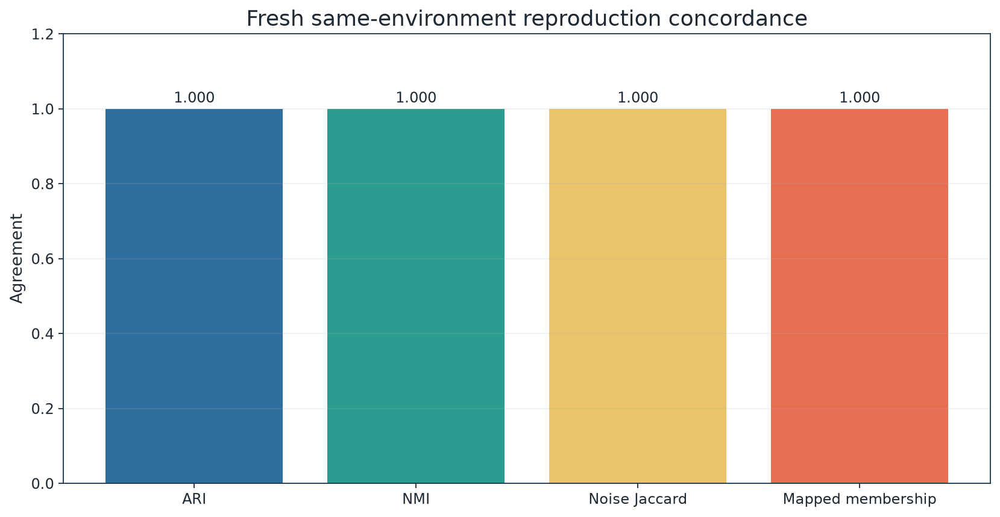{fig-alt="The fixed fixture and its fresh reproduction agree exactly on four partition and noise metrics; variation of information was 0 and Procrustes disparity was approximately 2.7×10⁻³¹"}

<figcaption><strong>Figure 19.</strong> The fixed fixture and its fresh reproduction agree exactly on four partition and noise metrics; variation of information was 0 and Procrustes disparity was approximately 2.7×10⁻³¹. <em>Interpretive boundary:</em> This is same-environment technical concordance, not a cross-platform or biological result.</figcaption>

</figure>

## Reading the generated evidence

For Chapter 21, the `Explanation, comparison, validation, and report generation` files are read as a provenance chain rather than as isolated results:

<p class="table-caption" id="table-15"><strong>Table 15.</strong> Reading the generated evidence.</p>

| Artifact | Producer | What to verify before interpretation |
| --- | --- | --- |
| `original_space_similarity.tsv.gz` | `run_explanation` | Artifact exists under the new output root, is readable, and its checksum is recorded. |
| `heatmap_order.tsv` | `run_explanation` | Image dimensions are nonzero; order and cutpoints match sidecars; no inferential claim is attached. |
| `cluster_cutpoints.tsv` | `run_explanation` | Artifact exists under the new output root, is readable, and its checksum is recorded. |
| `cluster_summary.tsv` | `run_explanation` | Artifact exists under the new output root, is readable, and its checksum is recorded. |
| `projection_quality.tsv` | `run_explanation` | Artifact exists under the new output root, is readable, and its checksum is recorded. |
| `coordinate_associations.tsv` | `run_explanation` | Artifact exists under the new output root, is readable, and its checksum is recorded. |
| `exclusions.tsv` | `run_explanation` | Artifact exists under the new output root, is readable, and its checksum is recorded. |
| `original_space_heatmap.png/html` | `run_explanation` | Image dimensions are nonzero; order and cutpoints match sidecars; no inferential claim is attached. |
| `interpretation_manifest.json + README.md` | `run_explanation` | Artifact exists under the new output root, is readable, and its checksum is recorded. |
| `comparison_summary.json` | `run_comparison` | Artifact exists under the new output root, is readable, and its checksum is recorded. |
| `membership_comparison.tsv, cluster_sizes.tsv, label_confusion.tsv, optimal_label_mapping.tsv` | `run_comparison` | Identifiers are unique and exactly match the intended input; label -1 is treated as noise/unassigned. |
| `comparison_manifest.json` | `run_comparison` | Artifact exists under the new output root, is readable, and its checksum is recorded. |
| `validation_checks.tsv` | `run_validation` | Every check is visible; aggregate status matches pass/warn/fail rows; a warning is not silently treated as a pass. |
| `validation_report.json + validation_manifest.json` | `run_validation` | Every check is visible; aggregate status matches pass/warn/fail rows; a warning is not silently treated as a pass. |

The output atlas supplies the complete schemas, checksums, conditions, consumers, and privacy notes for this Chapter 21 route. Native manifests can contain machine paths; the assembled textbook uses sanitized excerpts while restricted evidence retains the original provenance chain.

## Worked reasoning and evidence exercise

Reproduce, explain, compare, and validate Lab 1; then write one technical result paragraph and one separate scientific-limitations paragraph.

A complete Chapter 21 answer must expose its intermediate reasoning, name the source or output used for `Explanation, comparison, validation, and report generation`, and finish with separate support and non-support statements. Applying that discipline to the question “Can retained outputs be interpreted and compared without rerunning discovery or losing identifier integrity?” prevents a calculation, a software observation, and a scientific interpretation from collapsing into one claim.

## Assumptions, diagnostics, and recovery

The Chapter 21 analysis assumes the stated unit and inputs, the recorded configuration and software identity, and a diagnostic that addresses the claimed property rather than a convenient surrogate. Its decisive boundary is: Lab 3 is exact same-environment fixture evidence; publishable reporting must use sanitized paths and preserve conditional language.

If the Chapter 21 route fails, retain its log and candidate status before deciding whether the cause is input, configuration, dependency, compute, identifier alignment, or output-root state. Correct an operational failure by writing a new result directory. Treat instability in `Explanation, comparison, validation, and report generation` as sensitivity evidence: report it and identify the independent evidence needed instead of relabeling ambiguity as a software exception.

## Chapter synthesis

Post-run tooling increases auditability but does not convert same-data summaries into confirmatory inference. The implementation trace makes the current behavior auditable, but the evidence boundary remains part of the result. Chapter 22 contrasts a public benchmark with the historically important 164-IDP workflow.

## Exercises

1. For `Explanation, comparison, validation, and report generation`, name the unit of analysis and one plausible but invalid substitute.
2. Reconstruct the notation for identifier alignment; define its dimensions or denominator and interpret every term.
3. Choose a Tier A function mapped to Chapter 21; identify its caller and direct output, then propose a topic-specific edge case.
4. Select one Chapter 21 artifact from the output atlas and state three integrity checks that must precede scientific reading.
5. Convert a tempting `Explanation, comparison, validation, and report generation` overclaim into one observed statement followed by its limitation.
6. Reproduce, explain, compare, and validate Lab 1; then write one technical result paragraph and one separate scientific-limitations paragraph.

Appendix J gives the Chapter 21 adjudication guide. Its further-reading keys supply statistical context; no external paper is treated as automatic validation of the current software or dataset.


<div class="chapter-break"></div>

<a id="chapter-22"></a>

# 22. MNIST benchmark and original 164-IDP reconstruction protocol

*Guiding question:* **How should public engineering evidence and protected historical scientific evidence coexist in one validation program?**

Prerequisites: 12–21.

## Why the question matters

MNIST can stress software without validating genetics; historical reconstruction can preserve provenance without becoming a fresh run.

MNIST remains protocol-only here. The fresh 164-IDP 1,000-seed run is explicitly deferred until Docker; only historical outputs and acceptance criteria are described.

This chapter develops the question in the order needed for a reader to move from statistical principle to current implementation, retained evidence, and a defensible statement. Its central worked task is: Build a two-column evidence table separating historical reconstruction from fresh computation, including the disclosed row-16 selection and pending Docker requirements.


<figure id="fig-f18">

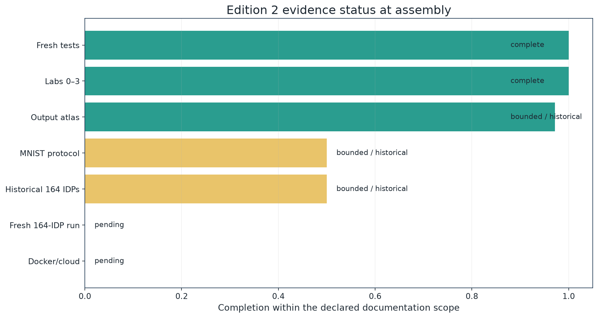{fig-alt="Fresh bounded software evidence is complete for tests and Labs 0–3; the original 164-IDP run and Docker/cloud validation remain explicitly pending"}

<figcaption><strong>Figure 20.</strong> Fresh bounded software evidence is complete for tests and Labs 0–3; the original 164-IDP run and Docker/cloud validation remain explicitly pending. <em>Interpretive boundary:</em> Bars show documentation-scope status, not a scientific-quality score.</figcaption>

</figure>

## Learning objectives

After completing Chapter 22, the reader can:

1. define seed schedule and explain its role without exceeding the stated caution;
2. define adjusted Rand index and explain its role without exceeding the stated caution;
3. define normalized mutual information and explain its role without exceeding the stated caution;
4. define noise Jaccard and explain its role without exceeding the stated caution;
5. define Procrustes disparity and explain its role without exceeding the stated caution;
6. trace the relevant package functions and generated artifacts;
7. complete the worked task and distinguish observation from interpretation.

## Conceptual and mathematical development

### seed schedule

Deterministic list controlling repeated stochastic fits. A compact notation is `legacy: 1,...,S; current: r,...,r+S-1`. In practical terms, recorded seeds permit replay but do not guarantee cross-platform bitwise identity. [[Collange et al. (2015)](#ref-reproduciblesum2015)]

Within Freeze 3 RC1 the concept is connected to `ensemble_seeds` and is visible through `embedding_manifest.json`. This connection is narrower than the general statistical idea: software evidence establishes the implemented route, while the mapped primary or internal evidence supplies background authority. The distinction prevents a mathematical definition from being mistaken for proof that a particular scientific interpretation is correct.

### adjusted Rand index

Chance-adjusted pairwise partition agreement. A compact notation is `ARI=(RI-E[RI])/(max(RI)-E[RI])`. In practical terms, permutation invariant; a value of 1 does not imply coordinate identity. [[Hubert et al. (1985)](#ref-hubert1985)]

Within Freeze 3 RC1 the concept is connected to `compare_partitions` and is visible through `comparison_summary.json`. This connection is narrower than the general statistical idea: software evidence establishes the implemented route, while the mapped primary or internal evidence supplies background authority. The distinction prevents a mathematical definition from being mistaken for proof that a particular scientific interpretation is correct.

### normalized mutual information

Normalized information shared by two labelings. A compact notation is `NMI=2I(U;V)/(H(U)+H(V))`. In practical terms, normalization conventions matter; Freeze 3 uses the sklearn convention recorded in code. [[Vinh et al. (2010)](#ref-vinh2010)]

Within Freeze 3 RC1 the concept is connected to `compare_partitions` and is visible through `comparison_summary.json`. This connection is narrower than the general statistical idea: software evidence establishes the implemented route, while the mapped primary or internal evidence supplies background authority. The distinction prevents a mathematical definition from being mistaken for proof that a particular scientific interpretation is correct.

### noise Jaccard

Overlap of the two sets labeled -1. A compact notation is `J(A,B)=|A intersect B|/|A union B|`. In practical terms, it isolates agreement about unassigned membership, not all clusters.

Within Freeze 3 RC1 the concept is connected to `noise_jaccard` and is visible through `comparison_summary.json`. This connection is narrower than the general statistical idea: software evidence establishes the implemented route, while the mapped primary or internal evidence supplies background authority. The distinction prevents a mathematical definition from being mistaken for proof that a particular scientific interpretation is correct.

### Procrustes disparity

Residual after centering, scaling, and orthogonal alignment. A compact notation is `min_R ||X_c R-Y_c||_F^2`. In practical terms, low disparity supports aligned coordinate similarity under the chosen transformation, not biological replication. [[Gower (1975)](#ref-gower1975)]

Within Freeze 3 RC1 the concept is connected to `compare_coordinates` and is visible through `comparison_summary.json`. This connection is narrower than the general statistical idea: software evidence establishes the implemented route, while the mapped primary or internal evidence supplies background authority. The distinction prevents a mathematical definition from being mistaken for proof that a particular scientific interpretation is correct.

### validation ladder

Separate software, technical, structural, statistical, biological, external, and cross-platform evidence. A compact notation is `E_software != E_biological`. In practical terms, passing tests or exact fixture replay cannot substitute for external biological validation.

Within Freeze 3 RC1 the concept is connected to `run_validation` and is visible through `validation_report.json`. This connection is narrower than the general statistical idea: software evidence establishes the implemented route, while the mapped primary or internal evidence supplies background authority. The distinction prevents a mathematical definition from being mistaken for proof that a particular scientific interpretation is correct.

### floating-point reproducibility

Dependence of finite-precision results on operation order and platform. A compact notation is `fl((a+b)+c) may differ from fl(a+(b+c))`. In practical terms, pinned dependencies improve control but do not guarantee universal bitwise equality. [[Collange et al. (2015)](#ref-reproduciblesum2015)]

Within Freeze 3 RC1 the concept is connected to `capture_environment` and is visible through `environment.json`. This connection is narrower than the general statistical idea: software evidence establishes the implemented route, while the mapped primary or internal evidence supplies background authority. The distinction prevents a mathematical definition from being mistaken for proof that a particular scientific interpretation is correct.

## Reconstructed operational foundation

Edition 1 contained the following verified operational material in separate short notes. Edition 2 consolidates it here and subjects it to the concept and evidence boundaries above.

### Evidence retained from former Chapter 35

### Operational foundation

MNIST is a known-label image dataset used here as historical software-benchmark evidence. It tests whether a pipeline can produce and compare structure when class labels exist and inputs are unrelated to GWAS biology. The verified prior benchmark artifacts are retained under the Freeze 3 evidence/quarantine workspace; this manual build did not redownload data or rerun the benchmark. The historical full runtime was 273.47 seconds under its recorded environment and configuration.

A benchmark may report engineering measures such as cluster/label concordance, noise, or runtime. It does not show that genetic association vectors have the same geometry, that IDP clusters are biologically meaningful, or that production resources match. Dataset licensing/acquisition, preprocessing, and environment must travel with any rerun.

Edition 2 Lab 4 is therefore evidence-backed but bounded: it documents the existing verified outputs and the approved rerun path without fabricating fresh results.

### Retained evidence

Read `benchmarks/mnist/MNIST_BENCHMARK_REPORT.md` and `docs/MNIST_BENCHMARK.md`, then locate the historical output checksums in the broader Freeze 3 evidence inventory. Compare every benchmark claim to its manifest.

### Output-reading checkpoint

Inspect acquisition/source note, input shape, known-label mapping, configuration, seeds/threads, cluster/noise metrics, runtime, environment, and artifact hashes.

### Misinterpretations to avoid

Do not present MNIST accuracy as biological validation, a universal runtime, or a production default. Do not fetch new data silently during a reproducibility build.

### Boundary inherited from Edition 1

The benchmark is historical prior evidence in this manual edition. A fresh container benchmark belongs to the Docker stage and must record dataset identity and license.

### Evidence retained from former Chapter 36

### Operational foundation

The original 164-IDP case has two tracks. Track A is historical reconstruction: the authoritative record contains 164 IDPs, 102 HDBSCAN-noise assignments, and five assigned clusters of sizes 9, 13, 15, 14, and 11. The published historical solution used epsilon 0, min-samples 4, and min-cluster-size 6 and was manually selected from sorted row 16—not automatic rank one. One historical `UMAP_3` cell is missing, while labels are complete. Freeze 3 can adapt and rescore the immutable historical artifacts; that is not a new 1,000-seed fit.

Track B is the pending fresh protocol. Use the authoritative input checksum and `configs/original_idp_164_historical_search.yaml`, run `inspect-config` and complete enumeration, preflight storage/threads, then execute standard-scale 1,000 repeated seeds in a new mounted output root inside the later Docker workflow. Preserve source, input, resolved config, command, environment, seeds, thread settings, logs, failures, all candidate rows, retained artifacts, explanation, comparison to historical labels, and validation. Do not tune toward the published labels.

Original material is permitted in the project, but scientific content is provisional because development has advanced; this manual shows aggregate historical counts and protocols rather than claiming a final interpretation.

## Evidence diagram or figure


### Retained evidence

The Edition 2 evidence-status graphic in Chapter 22 separates historical evidence from a prominent fresh-run-pending status. The protocol config and historical selected config are source artifacts; no fresh outputs are implied.

### Output-reading checkpoint

Track A: historical workbook/table, row-16 record, exact label vector, adaptation/rescoring manifests and counts. Track B: authoritative input/config hashes, preflight, complete run, comparison/validation, and Docker platform record.

### Misinterpretations to avoid

Do not say ‘reproduced the 164 analysis’ when only labels were adapted/rescored. Do not choose a new candidate because it most resembles historical labels. Do not fill missing fresh metrics with historical numbers.

### Boundary inherited from Edition 1

The original raw 2,315- and 459-IDP inputs remain incomplete/unresolved in this workspace. Fresh 164 execution and cross-platform acceptance are named release gates.

## Implementation trace

**`comparison.run_comparison`** is defined at `dimple_gwas/comparison.py:65` with signature `left_source: str | Path, right_source: str | Path, output_dir: str | Path, *, id_column: str='feature_id', label_column: str='label', require_same_order: bool=False, command: list[str] | None=None`. Compare two label artifacts using exact IDs, permutation-invariant structure, noise sets, mapping, and optional coordinates. It is reached from cli._compare and connects to comparison._columns; comparison._resolve_labels; comparison._variation_of_information; interpretation.detect_coordinate_columns; interpretation.is_noise_label; interpretation.label_sort_key; io.atomic_json_dump; io.ensure_empty_output_dir; io.json_safe; io.validated_identifiers; provenance.base_manifest; provenance.file_record; provenance.utc_now. Its direct artifact contract is comparison_summary.json; membership_comparison.tsv; cluster_sizes.tsv; label_confusion.tsv; optimal_label_mapping.tsv; comparison_manifest.json; its explicit error surface is ValueError. Test evidence is recorded as tests/test_freeze3_comparison_validation.py::test_comparison_rejects_duplicate_ids; tests/test_freeze3_comparison_validation.py::test_comparison_requires_identical_id_sets; tests/test_freeze3_comparison_validation.py::test_label_permutation_comparison_is_structurally_equal. This is a A-tier contract, so the complete 20-field dossier is retained in the function atlas.

**`pipeline.setup_logger`** is defined at `dimple_gwas/pipeline.py:25` with signature `output_dir: str | Path`. Implementation callable for setup logger. It is reached from pipeline.run_search and connects to No package-defined dependency detected. Its direct artifact contract is logs/run.log; its explicit error surface is No explicit raise in this symbol; delegated calls may raise.. Test evidence is recorded as No direct symbol-name test reference; assess through caller/integration coverage. This is a B-tier contract, so the complete 20-field dossier is retained in the function atlas.

**`pipeline.run_search`** is defined at `dimple_gwas/pipeline.py:130` with signature `config: Mapping[str, Any], output_dir: str | Path, command: list[str] | None=None`. Execute preprocessing, repeated embeddings, candidate evaluation, scoring, retention, reporting, and provenance for one run. It is reached from cli._reproduce; cli.main and connects to hdbscan_runner.fit_hdbscan; io.read_table; metrics.embedding_quality_metrics; pipeline._annotation_frame; pipeline._evaluate_one; pipeline._failed_row; pipeline.setup_logger; preprocessing.prepare_analysis_matrix; provenance.base_manifest; provenance.file_record; ranking.family_summaries; ranking.pareto_front; ranking.rank_models; ranking.top_models; reporting.write_model_outputs; reporting.write_resolved_config; reporting.write_search_space; scoring.apply_scoring; search_space.enumerate_candidates; search_space.stable_identifier; umap_runner.run_repeated_umap. Its direct artifact contract is No direct canonical artifact; in-memory/supporting result; its explicit error surface is RuntimeError; ValueError. Test evidence is recorded as tests/test_pipeline_integration.py::test_custom_leaf_eom_metric_and_max_size_run; tests/test_pipeline_integration.py::test_fixed_model_reproduction. This is a A-tier contract, so the complete 20-field dossier is retained in the function atlas.

**`provenance.sha256_file`** is defined at `dimple_gwas/provenance.py:17` with signature `path: str | Path`. Implementation callable for sha256 file. It is reached from interpretation._native_sources; provenance.file_record; reporting._top_artifact; validation.run_validation and connects to No package-defined dependency detected. Its direct artifact contract is No direct canonical artifact; in-memory/supporting result; its explicit error surface is No explicit raise in this symbol; delegated calls may raise.. Test evidence is recorded as tests/test_failure_and_provenance.py::test_authoritative_source_hash_unchanged. This is a B-tier contract, so the complete 20-field dossier is retained in the function atlas.

**`provenance.package_versions`** is defined at `dimple_gwas/provenance.py:25` with signature `names: Iterable[str] | None=None`. Implementation callable for package versions. It is reached from provenance.base_manifest and connects to No package-defined dependency detected. Its direct artifact contract is No direct canonical artifact; in-memory/supporting result; its explicit error surface is No explicit raise in this symbol; delegated calls may raise.. Test evidence is recorded as No direct symbol-name test reference; assess through caller/integration coverage. This is a B-tier contract, so the complete 20-field dossier is retained in the function atlas.

**`provenance.utc_now`** is defined at `dimple_gwas/provenance.py:40` with signature `class construction/data container`. Implementation callable for utc now. It is reached from comparison.run_comparison; interpretation.run_explanation; provenance.base_manifest; reporting.write_model_outputs; validation.run_validation and connects to No package-defined dependency detected. Its direct artifact contract is No direct canonical artifact; in-memory/supporting result; its explicit error surface is No explicit raise in this symbol; delegated calls may raise.. Test evidence is recorded as No direct symbol-name test reference; assess through caller/integration coverage. This is a B-tier contract, so the complete 20-field dossier is retained in the function atlas.

**`provenance.file_record`** is defined at `dimple_gwas/provenance.py:44` with signature `path: str | Path`. Implementation callable for file record. It is reached from comparison.run_comparison; interpretation.run_explanation; pipeline.run_search; reporting._top_artifact; reporting.write_model_outputs; validation.run_validation and connects to comparison._columns.<locals>.resolve; provenance.sha256_file. Its direct artifact contract is No direct canonical artifact; in-memory/supporting result; its explicit error surface is No explicit raise in this symbol; delegated calls may raise.. Test evidence is recorded as No direct symbol-name test reference; assess through caller/integration coverage. This is a B-tier contract, so the complete 20-field dossier is retained in the function atlas.

**`provenance.package_source_digest`** is defined at `dimple_gwas/provenance.py:53` with signature `class construction/data container`. Compute a stable hash over package source files for non-Git source identity. It is reached from provenance.base_manifest and connects to comparison._columns.<locals>.resolve. Its direct artifact contract is No direct canonical artifact; in-memory/supporting result; its explicit error surface is No explicit raise in this symbol; delegated calls may raise.. Test evidence is recorded as tests/test_freeze3_comparison_validation.py::test_package_source_digest_is_stable. This is a A-tier contract, so the complete 20-field dossier is retained in the function atlas.

**`provenance.base_manifest`** is defined at `dimple_gwas/provenance.py:66` with signature `command: list[str] | None=None`. Implementation callable for base manifest. It is reached from comparison.run_comparison; interpretation.run_explanation; pipeline.run_search; validation.run_validation and connects to provenance.package_source_digest; provenance.package_versions; provenance.utc_now. Its direct artifact contract is No direct canonical artifact; in-memory/supporting result; its explicit error surface is No explicit raise in this symbol; delegated calls may raise.. Test evidence is recorded as No direct symbol-name test reference; assess through caller/integration coverage. This is a A-tier contract, so the complete 20-field dossier is retained in the function atlas.

**`validation.run_validation`** is defined at `dimple_gwas/validation.py:15` with signature `run_dir: str | Path, output_dir: str | Path | None=None, *, command: list[str] | None=None`. Audit a run directory against required files, schemas, counts, identities, hashes, and manifest contracts. It is reached from cli._validate and connects to comparison._columns.<locals>.resolve; io.atomic_json_dump; io.ensure_empty_output_dir; io.json_safe; io.read_model_table; io.read_table; provenance.base_manifest; provenance.file_record; provenance.sha256_file; provenance.utc_now; validation.run_validation.<locals>.record. Its direct artifact contract is validation_checks.tsv; validation_report.json; validation_manifest.json; its explicit error surface is FileNotFoundError. Test evidence is recorded as tests/test_freeze3_comparison_validation.py::test_validation_detects_hash_mismatch; tests/test_freeze3_comparison_validation.py::test_validation_passes_complete_contract. This is a A-tier contract, so the complete 20-field dossier is retained in the function atlas.

## Claim adjudication notebook

The following statements are admitted to the draft only in their safe form:

- **HIST-001 (historical_only):** The historical five-cluster solution was manually selected from sorted row 16, not the top automatic score. Limitation: The historical retained table contains 333 successful rows from a theoretical 2,430-candidate grid. Implementation evidence: `historical adapter/docs`.

- **HIST-002 (reject):** Freeze 3 adapted and rescored immutable historical outputs, but a fresh 1,000-seed 164-IDP fit remains deferred until Docker. Limitation: The book supplies a protocol and acceptance criteria, not fabricated results. Implementation evidence: `original-IDP configs`.

- **HIST-003 (historical_only):** The historical record contains 164 IDPs: 102 noise and five non-noise clusters of 9, 13, 15, 14, and 11. Limitation: Original material may change after current-development adjudication. Implementation evidence: `historical labels`.

## Reading the generated evidence

For Chapter 22, the `MNIST benchmark and original 164-IDP reconstruction protocol` files are read as a provenance chain rather than as isolated results:

<p class="table-caption" id="table-16"><strong>Table 16.</strong> Reading the generated evidence.</p>

| Artifact | Producer | What to verify before interpretation |
| --- | --- | --- |
| `comparison_summary.json` | `run_comparison` | Artifact exists under the new output root, is readable, and its checksum is recorded. |
| `membership_comparison.tsv, cluster_sizes.tsv, label_confusion.tsv, optimal_label_mapping.tsv` | `run_comparison` | Identifiers are unique and exactly match the intended input; label -1 is treated as noise/unassigned. |
| `comparison_manifest.json` | `run_comparison` | Artifact exists under the new output root, is readable, and its checksum is recorded. |
| `validation_checks.tsv` | `run_validation` | Every check is visible; aggregate status matches pass/warn/fail rows; a warning is not silently treated as a pass. |
| `validation_report.json + validation_manifest.json` | `run_validation` | Every check is visible; aggregate status matches pass/warn/fail rows; a warning is not silently treated as a pass. |

The output atlas supplies the complete schemas, checksums, conditions, consumers, and privacy notes for this Chapter 22 route. Native manifests can contain machine paths; the assembled textbook uses sanitized excerpts while restricted evidence retains the original provenance chain.

## Worked reasoning and evidence exercise

Build a two-column evidence table separating historical reconstruction from fresh computation, including the disclosed row-16 selection and pending Docker requirements.

A complete Chapter 22 answer must expose its intermediate reasoning, name the source or output used for `MNIST benchmark and original 164-IDP reconstruction protocol`, and finish with separate support and non-support statements. Applying that discipline to the question “How should public engineering evidence and protected historical scientific evidence coexist in one validation program?” prevents a calculation, a software observation, and a scientific interpretation from collapsing into one claim.

## Assumptions, diagnostics, and recovery

The Chapter 22 analysis assumes the stated unit and inputs, the recorded configuration and software identity, and a diagnostic that addresses the claimed property rather than a convenient surrogate. Its decisive boundary is: MNIST remains protocol-only here. The fresh 164-IDP 1,000-seed run is explicitly deferred until Docker; only historical outputs and acceptance criteria are described.

If the Chapter 22 route fails, retain its log and candidate status before deciding whether the cause is input, configuration, dependency, compute, identifier alignment, or output-root state. Correct an operational failure by writing a new result directory. Treat instability in `MNIST benchmark and original 164-IDP reconstruction protocol` as sensitivity evidence: report it and identify the independent evidence needed instead of relabeling ambiguity as a software exception.

## Chapter synthesis

MNIST can stress software without validating genetics; historical reconstruction can preserve provenance without becoming a fresh run. The implementation trace makes the current behavior auditable, but the evidence boundary remains part of the result. Part V generalizes these examples into a layered validation strategy.

## Exercises

1. For `MNIST benchmark and original 164-IDP reconstruction protocol`, name the unit of analysis and one plausible but invalid substitute.
2. Reconstruct the notation for seed schedule; define its dimensions or denominator and interpret every term.
3. Choose a Tier A function mapped to Chapter 22; identify its caller and direct output, then propose a topic-specific edge case.
4. Select one Chapter 22 artifact from the output atlas and state three integrity checks that must precede scientific reading.
5. Convert a tempting `MNIST benchmark and original 164-IDP reconstruction protocol` overclaim into one observed statement followed by its limitation.
6. Build a two-column evidence table separating historical reconstruction from fresh computation, including the disclosed row-16 selection and pending Docker requirements.

Appendix J gives the Chapter 22 adjudication guide. Its further-reading keys supply statistical context; no external paper is treated as automatic validation of the current software or dataset.


<div class="part-break"></div>

# Part V

## Validation, reporting, and responsible release

Chapters 23–24

<div class="part-page-rule"></div>


<div class="chapter-break"></div>

<a id="chapter-23"></a>

# 23. Technical, statistical, biological, and cross-platform validation

*Guiding question:* **What evidence would justify each kind of claim an analyst might want to make?**

Prerequisites: 5,12,19–22.

## Why the question matters

One impressive metric cannot stand in for software, structural, statistical, biological, external, and platform evidence simultaneously.

Current evidence supports local contracts and fixed fixtures; external biological and Docker/Linux/cloud layers remain incomplete.

This chapter develops the question in the order needed for a reader to move from statistical principle to current implementation, retained evidence, and a defensible statement. Its central worked task is: Assign twelve checks to the validation ladder, choose exact or tolerance-based acceptance, and identify which layers remain unanswered.


<figure id="fig-f12">

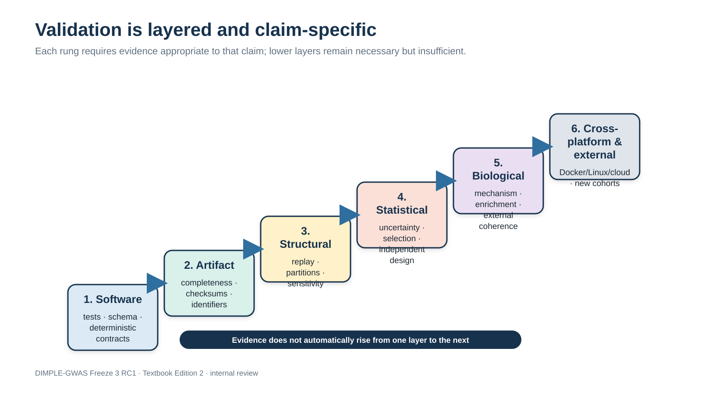{fig-alt="The validation ladder separates software, artifact, structural, statistical, biological, and cross-platform/external evidence"}

<figcaption><strong>Figure 21.</strong> The validation ladder separates software, artifact, structural, statistical, biological, and cross-platform/external evidence. <em>Interpretive boundary:</em> A successful lower layer never substitutes for an untested higher layer.</figcaption>

</figure>

## Learning objectives

After completing Chapter 23, the reader can:

1. define adjusted Rand index and explain its role without exceeding the stated caution;
2. define normalized mutual information and explain its role without exceeding the stated caution;
3. define noise Jaccard and explain its role without exceeding the stated caution;
4. define Procrustes disparity and explain its role without exceeding the stated caution;
5. define circular analysis and explain its role without exceeding the stated caution;
6. trace the relevant package functions and generated artifacts;
7. complete the worked task and distinguish observation from interpretation.

## Conceptual and mathematical development

### adjusted Rand index

Chance-adjusted pairwise partition agreement. A compact notation is `ARI=(RI-E[RI])/(max(RI)-E[RI])`. In practical terms, permutation invariant; a value of 1 does not imply coordinate identity. [[Hubert et al. (1985)](#ref-hubert1985)]

Within Freeze 3 RC1 the concept is connected to `compare_partitions` and is visible through `comparison_summary.json`. This connection is narrower than the general statistical idea: software evidence establishes the implemented route, while the mapped primary or internal evidence supplies background authority. The distinction prevents a mathematical definition from being mistaken for proof that a particular scientific interpretation is correct.

### normalized mutual information

Normalized information shared by two labelings. A compact notation is `NMI=2I(U;V)/(H(U)+H(V))`. In practical terms, normalization conventions matter; Freeze 3 uses the sklearn convention recorded in code. [[Vinh et al. (2010)](#ref-vinh2010)]

Within Freeze 3 RC1 the concept is connected to `compare_partitions` and is visible through `comparison_summary.json`. This connection is narrower than the general statistical idea: software evidence establishes the implemented route, while the mapped primary or internal evidence supplies background authority. The distinction prevents a mathematical definition from being mistaken for proof that a particular scientific interpretation is correct.

### noise Jaccard

Overlap of the two sets labeled -1. A compact notation is `J(A,B)=|A intersect B|/|A union B|`. In practical terms, it isolates agreement about unassigned membership, not all clusters.

Within Freeze 3 RC1 the concept is connected to `noise_jaccard` and is visible through `comparison_summary.json`. This connection is narrower than the general statistical idea: software evidence establishes the implemented route, while the mapped primary or internal evidence supplies background authority. The distinction prevents a mathematical definition from being mistaken for proof that a particular scientific interpretation is correct.

### Procrustes disparity

Residual after centering, scaling, and orthogonal alignment. A compact notation is `min_R ||X_c R-Y_c||_F^2`. In practical terms, low disparity supports aligned coordinate similarity under the chosen transformation, not biological replication. [[Gower (1975)](#ref-gower1975)]

Within Freeze 3 RC1 the concept is connected to `compare_coordinates` and is visible through `comparison_summary.json`. This connection is narrower than the general statistical idea: software evidence establishes the implemented route, while the mapped primary or internal evidence supplies background authority. The distinction prevents a mathematical definition from being mistaken for proof that a particular scientific interpretation is correct.

### circular analysis

Reuse of discovery data for apparently confirmatory inference. A compact notation is `selection(Y) then test(Y) without adjustment`. In practical terms, same-data heatmaps and correlations are descriptive; independent or selective-inference designs are needed for confirmatory claims. [[Kriegeskorte et al. (2009)](#ref-kriegeskorte2009); [Gao et al. (2024)](#ref-gao2024)]

Within Freeze 3 RC1 the concept is connected to `run_explanation` and is visible through `explanation outputs`. This connection is narrower than the general statistical idea: software evidence establishes the implemented route, while the mapped primary or internal evidence supplies background authority. The distinction prevents a mathematical definition from being mistaken for proof that a particular scientific interpretation is correct.

### validation ladder

Separate software, technical, structural, statistical, biological, external, and cross-platform evidence. A compact notation is `E_software != E_biological`. In practical terms, passing tests or exact fixture replay cannot substitute for external biological validation.

Within Freeze 3 RC1 the concept is connected to `run_validation` and is visible through `validation_report.json`. This connection is narrower than the general statistical idea: software evidence establishes the implemented route, while the mapped primary or internal evidence supplies background authority. The distinction prevents a mathematical definition from being mistaken for proof that a particular scientific interpretation is correct.

### floating-point reproducibility

Dependence of finite-precision results on operation order and platform. A compact notation is `fl((a+b)+c) may differ from fl(a+(b+c))`. In practical terms, pinned dependencies improve control but do not guarantee universal bitwise equality. [[Collange et al. (2015)](#ref-reproduciblesum2015)]

Within Freeze 3 RC1 the concept is connected to `capture_environment` and is visible through `environment.json`. This connection is narrower than the general statistical idea: software evidence establishes the implemented route, while the mapped primary or internal evidence supplies background authority. The distinction prevents a mathematical definition from being mistaken for proof that a particular scientific interpretation is correct.

## Reconstructed operational foundation

Edition 1 contained the following verified operational material in separate short notes. Edition 2 consolidates it here and subjects it to the concept and evidence boundaries above.

### Evidence retained from former Chapter 8

### Operational foundation

When the same data choose a representation, select a partition, and then supply the evidence used to declare that partition meaningful, naive inferential statements can be circular. Internal scores are useful for navigation within a declared candidate population, but they do not become independent hypothesis tests. Original-space correlations computed after selecting labels are descriptive conditional summaries.

A validation ladder keeps claims calibrated. Software validation checks code contracts. Technical validation checks whether an analysis and its artifacts can be rerun or compared under stated conditions. Statistical validation studies stability, uncertainty, multiplicity, and selection. Biological validation uses independent data, domain evidence, or an appropriately designed external analysis. Cross-platform validation tests the packaged workflow on the claimed systems.

The safe pattern is: describe what was selected and why, report sensitivity and uncertainty, reserve inferential claims for methods that address the selection process, and seek held-out or independent validation.

### Retained evidence

The synthetic comparison has ARI=NMI=noise Jaccard=mapped membership=1. That establishes bounded structural concordance for the fixture; it does not validate the biological interpretation of real IDPs.

### Output-reading checkpoint

Inspect the score/selection manifest, comparison summary, validation report, exclusions, and any independent validation artifacts. Record which validation layer each supports.

### Misinterpretations to avoid

Do not perform an ANOVA on the same matrix and labels and present the p-value as independent cluster confirmation. Do not turn an internal score into biological effect size or uncertainty.

### Boundary inherited from Edition 1

Selective-inference literature establishes the general problem, but the cited hierarchical-clustering procedure is not a turnkey inferential solution for the complete UMAP+HDBSCAN selection pipeline.


## Evidence and references

See Gao, Bien & Witten (2024), DOI 10.1080/01621459.2022.2116331. The scope difference from DIMPLE-GWAS is explicit.

### Evidence retained from former Chapter 23

### Operational foundation

`compare` accepts two native summaries or label tables, requires unique exact ID sets, and can require the same order. It reports adjusted Rand index, normalized mutual information, variation of information, noise-set Jaccard, optimal label mapping, mapped membership, changed noise status, cluster sizes, and optional Procrustes disparity. Numeric labels are local names, so structural metrics are primary.

`validate` inspects one run directory for required artifacts, readable JSON/YAML, enumeration counts, ranked schema, selected artifacts, and recorded hashes. It writes one pass/warn/fail row per check and returns exit code one on failure. Validation does not refit or compare biology.

```bash
dimple-gwas compare --left LEFT/summary.json --right RIGHT/summary.json --output-dir comparison_new
dimple-gwas validate --run-dir RUN --output-dir validation_new
```

## Evidence diagram or figure

```mermaid

flowchart LR
  A["Artifact A"] --> I["Exact ID set check"]
  B["Artifact B"] --> I
  I --> C["ARI / NMI / VI / noise Jaccard"]
  I --> P["Optional coordinate Procrustes"]
  R["Run directory"] --> V["Schema / count / hash validation"]

```


*Comparison and validation paths. Editable source: `assets/diagrams/diagram_08_compare_validate.mmd`.*

### Retained evidence

Edition 2 Lab 3 comparison uses 24 IDs, three clusters, no noise, perfect structural metrics, zero variation of information, and near-zero aligned coordinate disparity. Validation reports 24/24 pass with no warnings or failures.

### Output-reading checkpoint

Inspect `comparison_summary.json`, membership table, size table, confusion, mapping, comparison manifest, `validation_checks.tsv`, report, and validation manifest.

### Misinterpretations to avoid

Do not compare raw numeric labels across fits. Do not ignore changed noise status. Do not interpret Procrustes as membership agreement. Do not call hash/schema checks biological validation.

### Boundary inherited from Edition 1

Exact label equality is stringent and environment-sensitive; permutation-invariant equality is structural. Coordinate comparison needs alignment and tolerances. Scientific conclusions need higher-layer validation.

### Evidence retained from former Chapter 29

### Operational foundation

‘Double dipping’ occurs when data-dependent choices are ignored in a later inferential statement. DIMPLE-GWAS uses the matrix to create an embedding, enumerate/extract partitions, and select one using internal metrics. Testing separation or correlation on the same matrix as though the partition were fixed in advance can yield overconfident evidence. Multiple candidate models and analyst inspection add further selection.

Safe outputs in Freeze 3 are descriptive summaries with explicit conditioning. For inference, plan held-out variables, independent cohorts, preregistered replication, sample splitting, perturbation/stability designs, or a selective-inference method whose assumptions actually match the pipeline. Report effect sizes and uncertainty appropriate to the validation design. Never describe an omitted p-value as a flaw: the explanation utility intentionally avoids cluster ANOVA and post-selection significance.

### Retained evidence

Edition 2 Lab 3 reports within/between similarities and a heatmap but no ANOVA p-values. That is a deliberate boundary, not missing validation.

### Output-reading checkpoint

Inspect candidate population, selection rule, all exploratory views used, independent validation plan, comparison/stability evidence, and whether any test data were held out before selection.

### Misinterpretations to avoid

Do not call high within-cluster correlation a validation test. Do not choose external outcomes after seeing the partition without disclosure. Do not cite a general selective-inference paper as if it implemented this exact pipeline.

### Boundary inherited from Edition 1

Independent validation may still inherit sample overlap, ancestry, measurement, or harmonization biases. The design—not the word ‘replication’—determines evidential strength.


## Evidence and references

See Gao, Bien & Witten (2024), DOI 10.1080/01621459.2022.2116331, with the scope limitation stated above.

### Evidence retained from former Chapter 30

### Operational foundation

Validation is layered. Software validation covers tests and schemas. Technical reproducibility covers source/input/configuration identity, reruns, hashes, labels, and numeric tolerance. Structural concordance uses ARI/NMI/noise/mapped membership. Statistical validation addresses parameter sensitivity, instability, selection, uncertainty, and multiplicity. Biological validation asks whether groupings recur or predict independent domain evidence. Cross-platform validation tests the claimed package on Docker/Linux/cloud environments.

A result should be reported at the strongest layer actually supported. Forty-five tests support software. Twenty-four artifact checks support one run contract. Perfect fixture concordance supports bounded same-platform technical structure. MNIST supports known-label engineering behavior. None proves the historical IDP clusters biologically distinct. The fresh 164-IDP and Docker/cloud layers remain pending.

## Evidence diagram or figure

```mermaid

flowchart TB
  A["Software: tests, schemas, hashes"] --> B["Technical: rerun and artifact concordance"]
  B --> C["Statistical: stability, uncertainty, held-out analysis"]
  C --> D["Biological: independent data and domain evidence"]
  D --> E["Cross-platform: Docker, Linux, GCP, AWS"]

```


*Validation ladder; each layer requires its own evidence. Editable source: `assets/diagrams/diagram_10_validation_ladder.mmd`.*

### Retained evidence

Use `assets/diagrams/diagram_10_validation_ladder.mmd` and Appendix G to classify every manual evidence item. No arrow can be skipped by renaming a lower layer.

### Output-reading checkpoint

Inspect test JUnit/logs, validation checks, comparison metrics, source/input/config hashes, historical evidence, external-study design, and platform matrices separately.

### Misinterpretations to avoid

Do not write ‘validated’ without an object, method, dataset, platform, and criterion. Do not let a checksum pass stand in for scientific replication.

### Boundary inherited from Edition 1

Statistical and biological validation protocols are context dependent and may require data or governance outside this package. This manual does not invent those results.

### Evidence retained from former Chapter 42

### Operational foundation

A reproducible run is a chain of identities and decisions: source hash/version; input path/size/hash and upstream provenance; source and resolved configuration/hash; exact command; Python/platform/package versions; backends; seeds; threads; timestamps/runtime; candidate counts/statuses; selected model and formula; every artifact hash; warnings/exclusions/failures; and comparison criteria. `run_manifest.json` captures much of this; tutorial execution manifests and checksum tables close the documentation chain.

Exact comparison is appropriate for bytes, schemas, IDs, declared parameters, counts, and sometimes labels. Tolerances or invariant metrics are appropriate for floating-point metrics and aligned embeddings across platforms. Plots should be compared through source tables and structural/render checks, not byte identity alone. Dependency pinning improves traceability but cannot guarantee identical numerics across OS, architecture, hardware, BLAS/OpenMP, threads, or compiler/runtime versions.

With no Git metadata in this snapshot, use the package-source SHA-256 and complete file registers; the Docker stage should establish a versioned source identity.

## Evidence diagram or figure

```mermaid

flowchart TB
  S["Source SHA-256"] --> R["Run manifest"]
  I["Input SHA-256"] --> R
  C["Resolved config SHA-256"] --> R
  E["Environment + package versions"] --> R
  X["Command, seeds, threads, timestamps"] --> R
  R --> A["Artifact hashes"]
  A --> Q["Compare / validate / manual evidence"]

```


*Provenance and artifact lineage. Editable source: `assets/diagrams/diagram_09_provenance_lineage.mmd`.*

### Retained evidence

The executed Edition 2 Lab 2 manifest records package-source and input hashes, configuration hash, exact package versions, seeds 42/43, jobs, backend names, runtime, counts, selected ID, and artifact hashes.

### Output-reading checkpoint

Inspect runtime environment, resolved dependencies, source/input/artifact checksum registers, run/selection/tutorial manifests, logs, comparison and validation evidence.

### Misinterpretations to avoid

Do not equate a pinned requirements file with a complete environment. Do not compare floating-point PNG bytes as scientific equality. Do not sanitize the only retained provenance copy.

### Boundary inherited from Edition 1

Provenance can contain protected paths and identifiers; maintain a private complete record and a deliberately sanitized publication record with linked hashes.

### Evidence retained from former Chapter 46

### Operational foundation

Current open release issues are visible, not buried. There is no usable Git commit/tag identity; checksums substitute. The full fresh 164-IDP 1,000-seed run is deferred until Docker. Original 2,315-IDP and 459-IDP raw inputs/parameters are incomplete or unresolved. Docker/Linux/GCP/AWS execution and security validation are absent. Exact Yang/Zhao reviewer citations are unresolved in the supplied correspondence. Optional coordinate associations were not executed in the tutorials. Only macOS arm64 has fresh test/tutorial evidence.

Scientific limitations are equally important: nonlinear embeddings and density clusters are parameter dependent; repeated concatenation has no stated topology-recovery theorem; internal metrics are not biological validation; legacy scoring is candidate-population relative; selection can create circular inference; UMAP axes are not loadings; original-space correlations are conditional descriptors; noise is algorithmic; numerical determinism is platform dependent; and original-IDP interpretations may change with ongoing development.

Operational limitations include optional Parquet dependencies/failure handling, large similarity matrices, thread oversubscription, first-run JIT overhead, strict absent/empty output roots for safety, and manifests that can expose paths or identifiers. Use `evidence/03_missing_evidence_register.tsv`, `evidence/tutorial_issue_register.tsv`, and the Docker handoff as living registers.

### Retained evidence

The manual labels itself an RC1 first draft with named limitations rather than hiding Gate I/J dependencies. Appendix G shows which layers pass, are bounded, are historical, or are pending.

### Output-reading checkpoint

Inspect missing-evidence, authority/conflict, claim/correction, citation-gap, tutorial-issue, QA, build-report, and Docker-handoff records before release language changes.

### Misinterpretations to avoid

Do not close an issue by changing prose alone. Do not infer missing reviewer references. Do not present original IDP material as final when development may change it.

### Boundary inherited from Edition 1

Some gates need new authority/data/compute rather than documentation. They remain named blockers with exact completion protocols.

## Implementation trace

**`comparison.run_comparison`** is defined at `dimple_gwas/comparison.py:65` with signature `left_source: str | Path, right_source: str | Path, output_dir: str | Path, *, id_column: str='feature_id', label_column: str='label', require_same_order: bool=False, command: list[str] | None=None`. Compare two label artifacts using exact IDs, permutation-invariant structure, noise sets, mapping, and optional coordinates. It is reached from cli._compare and connects to comparison._columns; comparison._resolve_labels; comparison._variation_of_information; interpretation.detect_coordinate_columns; interpretation.is_noise_label; interpretation.label_sort_key; io.atomic_json_dump; io.ensure_empty_output_dir; io.json_safe; io.validated_identifiers; provenance.base_manifest; provenance.file_record; provenance.utc_now. Its direct artifact contract is comparison_summary.json; membership_comparison.tsv; cluster_sizes.tsv; label_confusion.tsv; optimal_label_mapping.tsv; comparison_manifest.json; its explicit error surface is ValueError. Test evidence is recorded as tests/test_freeze3_comparison_validation.py::test_comparison_rejects_duplicate_ids; tests/test_freeze3_comparison_validation.py::test_comparison_requires_identical_id_sets; tests/test_freeze3_comparison_validation.py::test_label_permutation_comparison_is_structurally_equal. This is a A-tier contract, so the complete 20-field dossier is retained in the function atlas.

**`metrics.effective_neighbor_count`** is defined at `dimple_gwas/metrics.py:9` with signature `n_samples: int, requested: int`. Implementation callable for effective neighbor count. It is reached from metrics.embedding_quality_metrics and connects to No package-defined dependency detected. Its direct artifact contract is No direct canonical artifact; in-memory/supporting result; its explicit error surface is No explicit raise in this symbol; delegated calls may raise.. Test evidence is recorded as tests/test_preprocessing_metrics.py::test_effective_neighbor_edge_cases. This is a B-tier contract, so the complete 20-field dossier is retained in the function atlas.

**`metrics.embedding_quality_metrics`** is defined at `dimple_gwas/metrics.py:15` with signature `original, embedding, requested_k: int, max_samples: int, seed: int`. Calculate bounded trustworthiness and continuity diagnostics for an embedding. It is reached from interpretation.run_explanation; pipeline.run_search and connects to metrics.effective_neighbor_count. Its direct artifact contract is No direct canonical artifact; in-memory/supporting result; its explicit error surface is No explicit raise in this symbol; delegated calls may raise.. Test evidence is recorded as tests/test_preprocessing_metrics.py::test_optimized_trustworthiness_and_continuity. This is a A-tier contract, so the complete 20-field dossier is retained in the function atlas.

**`metrics.evaluate_candidate`** is defined at `dimple_gwas/metrics.py:60` with signature `embedding, labels, clusterer, silhouette_metric: str, fit_include_noise: bool, compute_dbcv: bool, max_samples_silhouette: int=0, silhouette_seed: int=42`. Compute cluster counts, persistence, silhouette, CH, DB, optional DBCV, and validity status for one candidate. It is reached from pipeline._evaluate_one and connects to metrics._cluster_sizes. Its direct artifact contract is No direct canonical artifact; in-memory/supporting result; its explicit error surface is No explicit raise in this symbol; delegated calls may raise.. Test evidence is recorded as No direct symbol-name test reference; assess through caller/integration coverage. This is a A-tier contract, so the complete 20-field dossier is retained in the function atlas.

**`metrics.is_finite_number`** is defined at `dimple_gwas/metrics.py:165` with signature `value: Any`. Implementation callable for is finite number. It is reached from CLI/import/direct caller or no package caller detected and connects to No package-defined dependency detected. Its direct artifact contract is No direct canonical artifact; in-memory/supporting result; its explicit error surface is No explicit raise in this symbol; delegated calls may raise.. Test evidence is recorded as No direct symbol-name test reference; assess through caller/integration coverage. This is a B-tier contract, so the complete 20-field dossier is retained in the function atlas.

**`provenance.sha256_file`** is defined at `dimple_gwas/provenance.py:17` with signature `path: str | Path`. Implementation callable for sha256 file. It is reached from interpretation._native_sources; provenance.file_record; reporting._top_artifact; validation.run_validation and connects to No package-defined dependency detected. Its direct artifact contract is No direct canonical artifact; in-memory/supporting result; its explicit error surface is No explicit raise in this symbol; delegated calls may raise.. Test evidence is recorded as tests/test_failure_and_provenance.py::test_authoritative_source_hash_unchanged. This is a B-tier contract, so the complete 20-field dossier is retained in the function atlas.

**`provenance.package_versions`** is defined at `dimple_gwas/provenance.py:25` with signature `names: Iterable[str] | None=None`. Implementation callable for package versions. It is reached from provenance.base_manifest and connects to No package-defined dependency detected. Its direct artifact contract is No direct canonical artifact; in-memory/supporting result; its explicit error surface is No explicit raise in this symbol; delegated calls may raise.. Test evidence is recorded as No direct symbol-name test reference; assess through caller/integration coverage. This is a B-tier contract, so the complete 20-field dossier is retained in the function atlas.

**`provenance.utc_now`** is defined at `dimple_gwas/provenance.py:40` with signature `class construction/data container`. Implementation callable for utc now. It is reached from comparison.run_comparison; interpretation.run_explanation; provenance.base_manifest; reporting.write_model_outputs; validation.run_validation and connects to No package-defined dependency detected. Its direct artifact contract is No direct canonical artifact; in-memory/supporting result; its explicit error surface is No explicit raise in this symbol; delegated calls may raise.. Test evidence is recorded as No direct symbol-name test reference; assess through caller/integration coverage. This is a B-tier contract, so the complete 20-field dossier is retained in the function atlas.

**`provenance.file_record`** is defined at `dimple_gwas/provenance.py:44` with signature `path: str | Path`. Implementation callable for file record. It is reached from comparison.run_comparison; interpretation.run_explanation; pipeline.run_search; reporting._top_artifact; reporting.write_model_outputs; validation.run_validation and connects to comparison._columns.<locals>.resolve; provenance.sha256_file. Its direct artifact contract is No direct canonical artifact; in-memory/supporting result; its explicit error surface is No explicit raise in this symbol; delegated calls may raise.. Test evidence is recorded as No direct symbol-name test reference; assess through caller/integration coverage. This is a B-tier contract, so the complete 20-field dossier is retained in the function atlas.

**`provenance.package_source_digest`** is defined at `dimple_gwas/provenance.py:53` with signature `class construction/data container`. Compute a stable hash over package source files for non-Git source identity. It is reached from provenance.base_manifest and connects to comparison._columns.<locals>.resolve. Its direct artifact contract is No direct canonical artifact; in-memory/supporting result; its explicit error surface is No explicit raise in this symbol; delegated calls may raise.. Test evidence is recorded as tests/test_freeze3_comparison_validation.py::test_package_source_digest_is_stable. This is a A-tier contract, so the complete 20-field dossier is retained in the function atlas.

**`provenance.base_manifest`** is defined at `dimple_gwas/provenance.py:66` with signature `command: list[str] | None=None`. Implementation callable for base manifest. It is reached from comparison.run_comparison; interpretation.run_explanation; pipeline.run_search; validation.run_validation and connects to provenance.package_source_digest; provenance.package_versions; provenance.utc_now. Its direct artifact contract is No direct canonical artifact; in-memory/supporting result; its explicit error surface is No explicit raise in this symbol; delegated calls may raise.. Test evidence is recorded as No direct symbol-name test reference; assess through caller/integration coverage. This is a A-tier contract, so the complete 20-field dossier is retained in the function atlas.

**`validation.run_validation`** is defined at `dimple_gwas/validation.py:15` with signature `run_dir: str | Path, output_dir: str | Path | None=None, *, command: list[str] | None=None`. Audit a run directory against required files, schemas, counts, identities, hashes, and manifest contracts. It is reached from cli._validate and connects to comparison._columns.<locals>.resolve; io.atomic_json_dump; io.ensure_empty_output_dir; io.json_safe; io.read_model_table; io.read_table; provenance.base_manifest; provenance.file_record; provenance.sha256_file; provenance.utc_now; validation.run_validation.<locals>.record. Its direct artifact contract is validation_checks.tsv; validation_report.json; validation_manifest.json; its explicit error surface is FileNotFoundError. Test evidence is recorded as tests/test_freeze3_comparison_validation.py::test_validation_detects_hash_mismatch; tests/test_freeze3_comparison_validation.py::test_validation_passes_complete_contract. This is a A-tier contract, so the complete 20-field dossier is retained in the function atlas.

## Claim adjudication notebook

The following statements are admitted to the draft only in their safe form:

- **REL-001 (verified_with_qualification):** Freeze 3 RC1 is a software-complete release candidate under current local and fixed-fixture evidence; it is not scientifically frozen or cross-platform validated. Limitation: Fresh 164-IDP and Docker/cloud gates remain pending. Implementation evidence: `pyproject.toml; source; tests`.

- **PIPE-002 (reject):** Repeated seeded embeddings are concatenated as an empirical representation strategy; the implementation supplies no theorem that it eliminates stochasticity or recovers true topology. [[McInnes et al. (2018)](#ref-mcinnes2018umap)] Limitation: Parameters, layout symmetries, libraries, and hardware still matter. Implementation evidence: `umap_runner.py`.

- **INT-004 (verified_with_qualification):** Classical tests on the same data used for group discovery are vulnerable to circularity; Freeze 3 omits cluster ANOVA and post-selection p-values. [[Kriegeskorte et al. (2009)](#ref-kriegeskorte2009); [Gao et al. (2024)](#ref-gao2024)] Limitation: The cited selective method is not a turnkey HDBSCAN procedure. Implementation evidence: `interpretation.py; limitations docs`.

- **VAL-001 (verified_with_qualification):** The local suite's passing tests support bounded software contracts, not biological validity. Limitation: One environment cannot establish cross-platform behavior. Implementation evidence: `tests`.

- **VAL-002 (verified_with_qualification):** Within the prior same-environment fixture comparison, ARI, NMI, noise Jaccard, and mapped membership were 1 with near-zero Procrustes disparity. [[Hubert et al. (1985)](#ref-hubert1985); [Vinh et al. (2010)](#ref-vinh2010); [Gower (1975)](#ref-gower1975)] Limitation: Does not generalize across platforms or all configurations. Implementation evidence: `comparison.py`.

- **HIST-002 (reject):** Freeze 3 adapted and rescored immutable historical outputs, but a fresh 1,000-seed 164-IDP fit remains deferred until Docker. Limitation: The book supplies a protocol and acceptance criteria, not fabricated results. Implementation evidence: `original-IDP configs`.

- **REP-001 (reject):** Pinning improves traceability but cannot alone guarantee bitwise identity across architecture, hardware, numerical libraries, or thread schedules. [[Collange et al. (2015)](#ref-reproduciblesum2015)] Limitation: Docker/Linux/cloud validation remains pending. Implementation evidence: `provenance.py`.

- **GWAS-001 (verified_with_qualification):** Vector geometry can reflect shared biology, LD structure, sample overlap, scale, confounding, and preprocessing; DIMPLE-GWAS does not separate these causes. [[Bulik-Sullivan (2015)](#ref-buliksullivan2015)] Limitation: Interpretation requires upstream harmonization and independent evidence. Implementation evidence: `scope and input only`.

## Reading the generated evidence

For Chapter 23, the `Technical, statistical, biological, and cross-platform validation` files are read as a provenance chain rather than as isolated results:

<p class="table-caption" id="table-17"><strong>Table 17.</strong> Reading the generated evidence.</p>

| Artifact | Producer | What to verify before interpretation |
| --- | --- | --- |
| `comparison_summary.json` | `run_comparison` | Artifact exists under the new output root, is readable, and its checksum is recorded. |
| `membership_comparison.tsv, cluster_sizes.tsv, label_confusion.tsv, optimal_label_mapping.tsv` | `run_comparison` | Identifiers are unique and exactly match the intended input; label -1 is treated as noise/unassigned. |
| `comparison_manifest.json` | `run_comparison` | Artifact exists under the new output root, is readable, and its checksum is recorded. |
| `validation_checks.tsv` | `run_validation` | Every check is visible; aggregate status matches pass/warn/fail rows; a warning is not silently treated as a pass. |
| `validation_report.json + validation_manifest.json` | `run_validation` | Every check is visible; aggregate status matches pass/warn/fail rows; a warning is not silently treated as a pass. |

The output atlas supplies the complete schemas, checksums, conditions, consumers, and privacy notes for this Chapter 23 route. Native manifests can contain machine paths; the assembled textbook uses sanitized excerpts while restricted evidence retains the original provenance chain.

## Worked reasoning and evidence exercise

Assign twelve checks to the validation ladder, choose exact or tolerance-based acceptance, and identify which layers remain unanswered.

A complete Chapter 23 answer must expose its intermediate reasoning, name the source or output used for `Technical, statistical, biological, and cross-platform validation`, and finish with separate support and non-support statements. Applying that discipline to the question “What evidence would justify each kind of claim an analyst might want to make?” prevents a calculation, a software observation, and a scientific interpretation from collapsing into one claim.

## Assumptions, diagnostics, and recovery

The Chapter 23 analysis assumes the stated unit and inputs, the recorded configuration and software identity, and a diagnostic that addresses the claimed property rather than a convenient surrogate. Its decisive boundary is: Current evidence supports local contracts and fixed fixtures; external biological and Docker/Linux/cloud layers remain incomplete.

If the Chapter 23 route fails, retain its log and candidate status before deciding whether the cause is input, configuration, dependency, compute, identifier alignment, or output-root state. Correct an operational failure by writing a new result directory. Treat instability in `Technical, statistical, biological, and cross-platform validation` as sensitivity evidence: report it and identify the independent evidence needed instead of relabeling ambiguity as a software exception.

## Chapter synthesis

One impressive metric cannot stand in for software, structural, statistical, biological, external, and platform evidence simultaneously. The implementation trace makes the current behavior auditable, but the evidence boundary remains part of the result. Chapter 24 turns the full evidence chain into reporting, migration, and reviewer-facing documentation.

## Exercises

1. For `Technical, statistical, biological, and cross-platform validation`, name the unit of analysis and one plausible but invalid substitute.
2. Reconstruct the notation for adjusted Rand index; define its dimensions or denominator and interpret every term.
3. Choose a Tier A function mapped to Chapter 23; identify its caller and direct output, then propose a topic-specific edge case.
4. Select one Chapter 23 artifact from the output atlas and state three integrity checks that must precede scientific reading.
5. Convert a tempting `Technical, statistical, biological, and cross-platform validation` overclaim into one observed statement followed by its limitation.
6. Assign twelve checks to the validation ladder, choose exact or tolerance-based acceptance, and identify which layers remain unanswered.

Appendix J gives the Chapter 23 adjudication guide. Its further-reading keys supply statistical context; no external paper is treated as automatic validation of the current software or dataset.


<div class="chapter-break"></div>

<a id="chapter-24"></a>

# 24. Reproducible reporting, limitations, migration, and reviewer-facing methods

*Guiding question:* **How can a methods section be exact about software while remaining modest about scientific inference?**

Prerequisites: 1–23.

## Why the question matters

A polished narrative can conceal unresolved evidence unless every claim is connected to manifests, code, literature, and named limitations.

This internal-review edition preserves unresolved Yang/Zhao attribution as a gap, keeps reviewer correspondence private, and leaves public release, Docker, and team adjudication pending.

This chapter develops the question in the order needed for a reader to move from statistical principle to current implementation, retained evidence, and a defensible statement. Its central worked task is: Draft a methods paragraph from the Lab 2 manifest, a limitations paragraph from the claim register, and a Docker handoff acceptance block.

## Learning objectives

After completing Chapter 24, the reader can:

1. define GWAS-derived vector and explain its role without exceeding the stated caution;
2. define identifier alignment and explain its role without exceeding the stated caution;
3. define candidate identity and explain its role without exceeding the stated caution;
4. define circular analysis and explain its role without exceeding the stated caution;
5. define validation ladder and explain its role without exceeding the stated caution;
6. trace the relevant package functions and generated artifacts;
7. complete the worked task and distinguish observation from interpretation.

## Conceptual and mathematical development

### GWAS-derived vector

Effect estimates or association statistics for one phenotype across matched variants. A compact notation is `X in R^(p x v)`. In practical terms, a vector is a statistical summary, not a person or causal mechanism. [[Elliott (2018)](#ref-elliott2018); [Bulik-Sullivan (2015)](#ref-buliksullivan2015)]

Within Freeze 3 RC1 the concept is connected to `prepare_analysis_matrix` and is visible through `input matrix`. This connection is narrower than the general statistical idea: software evidence establishes the implemented route, while the mapped primary or internal evidence supplies background authority. The distinction prevents a mathematical definition from being mistaken for proof that a particular scientific interpretation is correct.

### identifier alignment

A one-to-one correspondence between vector or feature identifiers across artifacts. A compact notation is `I_A = I_B`. In practical terms, order is not identity; normalize and validate keys before joining.

Within Freeze 3 RC1 the concept is connected to `validated_identifiers; align_rows` and is visible through `labels.tsv; coordinates.tsv`. This connection is narrower than the general statistical idea: software evidence establishes the implemented route, while the mapped primary or internal evidence supplies background authority. The distinction prevents a mathematical definition from being mistaken for proof that a particular scientific interpretation is correct.

### candidate identity

Deterministic hash and ordinal for a resolved parameter combination. A compact notation is `model_id=H(canonical parameters)`. In practical terms, identity supports replay; it is not a quality score.

Within Freeze 3 RC1 the concept is connected to `candidate_identity` and is visible through `search_space.tsv; model_table.csv`. This connection is narrower than the general statistical idea: software evidence establishes the implemented route, while the mapped primary or internal evidence supplies background authority. The distinction prevents a mathematical definition from being mistaken for proof that a particular scientific interpretation is correct.

### circular analysis

Reuse of discovery data for apparently confirmatory inference. A compact notation is `selection(Y) then test(Y) without adjustment`. In practical terms, same-data heatmaps and correlations are descriptive; independent or selective-inference designs are needed for confirmatory claims. [[Kriegeskorte et al. (2009)](#ref-kriegeskorte2009); [Gao et al. (2024)](#ref-gao2024)]

Within Freeze 3 RC1 the concept is connected to `run_explanation` and is visible through `explanation outputs`. This connection is narrower than the general statistical idea: software evidence establishes the implemented route, while the mapped primary or internal evidence supplies background authority. The distinction prevents a mathematical definition from being mistaken for proof that a particular scientific interpretation is correct.

### validation ladder

Separate software, technical, structural, statistical, biological, external, and cross-platform evidence. A compact notation is `E_software != E_biological`. In practical terms, passing tests or exact fixture replay cannot substitute for external biological validation.

Within Freeze 3 RC1 the concept is connected to `run_validation` and is visible through `validation_report.json`. This connection is narrower than the general statistical idea: software evidence establishes the implemented route, while the mapped primary or internal evidence supplies background authority. The distinction prevents a mathematical definition from being mistaken for proof that a particular scientific interpretation is correct.

### floating-point reproducibility

Dependence of finite-precision results on operation order and platform. A compact notation is `fl((a+b)+c) may differ from fl(a+(b+c))`. In practical terms, pinned dependencies improve control but do not guarantee universal bitwise equality. [[Collange et al. (2015)](#ref-reproduciblesum2015)]

Within Freeze 3 RC1 the concept is connected to `capture_environment` and is visible through `environment.json`. This connection is narrower than the general statistical idea: software evidence establishes the implemented route, while the mapped primary or internal evidence supplies background authority. The distinction prevents a mathematical definition from being mistaken for proof that a particular scientific interpretation is correct.

## Reconstructed operational foundation

Edition 1 contained the following verified operational material in separate short notes. Edition 2 consolidates it here and subjects it to the concept and evidence boundaries above.

### Evidence retained from former Chapter 3

### Operational foundation

Release language is an evidence statement. ‘Software-complete RC1’ means the intended commands and local contracts are present and the bounded test evidence passes. ‘Scientifically frozen’ would additionally require the agreed full scientific reconstruction and resolution of material scientific issues. ‘Cross-platform validated’ would require evidenced execution and comparison on the target Docker/Linux/cloud platforms.

Freeze 3 therefore has four evidence classes: fresh local evidence; historical-only evidence; protocol-only pending work; and out-of-scope methods. The 45-test result and synthetic tutorials are fresh local evidence. Historical 164-IDP counts and the manual row-16 selection are historical. The fresh 1,000-seed 164-IDP run and Docker/GCP/AWS work are pending. Stage 2 and other association tools are outside the executable core.

### Retained evidence

Use Appendix G as a validation matrix. Notice that a pass at the software layer does not change the pending status of biological or cross-platform validation.

### Output-reading checkpoint

The environment snapshot, missing-evidence register, test report, tutorial manifests, and Docker handoff are the release-status evidence set.

### Misinterpretations to avoid

Avoid ‘fully reproducible,’ ‘platform independent,’ ‘Freeze 3 final,’ or ‘validated’ without naming the validation layer and platform. Do not use historical adaptation as shorthand for a fresh rerun.

### Boundary inherited from Edition 1

This status can change only when new artifacts directly meet a named gate. Editorial confidence or dependency pinning cannot substitute for execution evidence.

### Evidence retained from former Chapter 7

### Operational foundation

Methods are comparable only after their questions and outputs are aligned. PCA provides orthogonal linear variance components and loadings; ICA seeks statistically independent linear components; k-means creates exhaustive centroid-based groups; hierarchical clustering supplies a nested grouping; mixture models provide probabilistic components. UMAP is a representation method, while HDBSCAN is the clustering stage. DBCV is a diagnostic, not a clustering algorithm.

Genomic SEM models multivariate genetic covariance, MTAG estimates trait-specific multi-trait associations, PLEIO provides joint pleiotropic-locus tests, and MOSTest is an omnibus multivariate association approach. These methods do not all accept the same inputs or return the same scientific object as DIMPLE-GWAS. They may be alternatives for a different question or complementary stages, but they are not implemented by Freeze 3.

No method is universally ‘completely ineffective.’ PCA/ICA components can be useful and reproducible without becoming automatically causal biological mechanisms.

### Retained evidence

Use `evidence/comparator_matrix.tsv` to select a method for three questions: reduce a matrix linearly, identify omnibus associated loci, and cluster phenotype vectors with an unassigned-noise option.

### Output-reading checkpoint

The comparator matrix records purpose, input, output, assumptions, noise handling, interpretability, strengths, limitations, relationship to DIMPLE-GWAS, and implementation status.

### Misinterpretations to avoid

Do not rank unlike methods with a single ‘best’ score. Do not imply that the manual executed a comparator marked `implemented_in_freeze3=no`. Correctly attribute the genomic PCA/ICA paper to Oblong et al., not to an inferred reviewer author.

### Boundary inherited from Edition 1

Conceptual comparisons do not establish empirical superiority. A fair benchmark would need common data, preregistered objectives, suitable metrics, and evidence for each implementation.


## Evidence and references

See Oblong et al. (2024), DOI 10.1111/gbb.12876; Grotzinger et al. (2019), DOI 10.1038/s41562-019-0566-x; MTAG DOI 10.1038/s41588-017-0009-4; MOSTest DOI 10.1038/s41467-020-17368-1; and PLEIO DOI 10.1016/j.ajhg.2020.11.017.

### Evidence retained from former Chapter 31

### Operational foundation

A complete report states: software/version/source identity; input cohort and upstream GWAS construction; matrix shape/orientation/metadata prefix; preprocessing; UMAP/densMAP parameters, repeat/seed sequence, and metric; HDBSCAN search space and backend; candidate counts/failures; all calculated metrics; scoring formula/profile/noise term; selection/ties/manual decisions; retained cluster/noise counts; original-space descriptive summaries; sensitivity/comparison evidence; validation layer; and limitations.

Use conditional language: ‘under the specified representation and HDBSCAN parameters, the selected model assigned…’. Separate implementation results from interpretation and hypotheses. Disclose the historical manual row-16 choice. Name unassigned observations neutrally. If results come from adapted historical labels, say so. Include exact artifact identifiers/checksums in supplements or repositories permitted by data policy.

Methods should be reproducible without claiming bitwise platform independence; results should be readable without turning internal scores into biological proof.

### Retained evidence

A safe synthetic sentence is: ‘In the 24-vector fixed fixture, the one-candidate RC1 run assigned three clusters of eight and no noise; a same-environment fixed rerun had ARI and NMI 1. These engineering checks do not establish biological validity.’

### Output-reading checkpoint

Report from resolved config, run/selection manifests, all/ranked models, retained summary/labels, explanation/comparison/validation manifests, source/input hashes, and issue register.

### Misinterpretations to avoid

Do not omit failed candidates, ties, noise, manual selection, or pending gates. Do not present display axes as biological components. Do not claim causal mechanisms from correlations.

### Boundary inherited from Edition 1

Journal word limits may require a concise main text; place complete contracts and machine-readable evidence in a suitable supplement without exposing restricted data.

### Evidence retained from former Chapter 36

### Operational foundation

The original 164-IDP case has two tracks. Track A is historical reconstruction: the authoritative record contains 164 IDPs, 102 HDBSCAN-noise assignments, and five assigned clusters of sizes 9, 13, 15, 14, and 11. The published historical solution used epsilon 0, min-samples 4, and min-cluster-size 6 and was manually selected from sorted row 16—not automatic rank one. One historical `UMAP_3` cell is missing, while labels are complete. Freeze 3 can adapt and rescore the immutable historical artifacts; that is not a new 1,000-seed fit.

Track B is the pending fresh protocol. Use the authoritative input checksum and `configs/original_idp_164_historical_search.yaml`, run `inspect-config` and complete enumeration, preflight storage/threads, then execute standard-scale 1,000 repeated seeds in a new mounted output root inside the later Docker workflow. Preserve source, input, resolved config, command, environment, seeds, thread settings, logs, failures, all candidate rows, retained artifacts, explanation, comparison to historical labels, and validation. Do not tune toward the published labels.

Original material is permitted in the project, but scientific content is provisional because development has advanced; this manual shows aggregate historical counts and protocols rather than claiming a final interpretation.

## Evidence diagram or figure


### Retained evidence

The Edition 2 evidence-status graphic in Chapter 22 separates historical evidence from a prominent fresh-run-pending status. The protocol config and historical selected config are source artifacts; no fresh outputs are implied.

### Output-reading checkpoint

Track A: historical workbook/table, row-16 record, exact label vector, adaptation/rescoring manifests and counts. Track B: authoritative input/config hashes, preflight, complete run, comparison/validation, and Docker platform record.

### Misinterpretations to avoid

Do not say ‘reproduced the 164 analysis’ when only labels were adapted/rescored. Do not choose a new candidate because it most resembles historical labels. Do not fill missing fresh metrics with historical numbers.

### Boundary inherited from Edition 1

The original raw 2,315- and 459-IDP inputs remain incomplete/unresolved in this workspace. Fresh 164 execution and cross-platform acceptance are named release gates.

### Evidence retained from former Chapter 42

### Operational foundation

A reproducible run is a chain of identities and decisions: source hash/version; input path/size/hash and upstream provenance; source and resolved configuration/hash; exact command; Python/platform/package versions; backends; seeds; threads; timestamps/runtime; candidate counts/statuses; selected model and formula; every artifact hash; warnings/exclusions/failures; and comparison criteria. `run_manifest.json` captures much of this; tutorial execution manifests and checksum tables close the documentation chain.

Exact comparison is appropriate for bytes, schemas, IDs, declared parameters, counts, and sometimes labels. Tolerances or invariant metrics are appropriate for floating-point metrics and aligned embeddings across platforms. Plots should be compared through source tables and structural/render checks, not byte identity alone. Dependency pinning improves traceability but cannot guarantee identical numerics across OS, architecture, hardware, BLAS/OpenMP, threads, or compiler/runtime versions.

With no Git metadata in this snapshot, use the package-source SHA-256 and complete file registers; the Docker stage should establish a versioned source identity.

## Evidence diagram or figure

```mermaid

flowchart TB
  S["Source SHA-256"] --> R["Run manifest"]
  I["Input SHA-256"] --> R
  C["Resolved config SHA-256"] --> R
  E["Environment + package versions"] --> R
  X["Command, seeds, threads, timestamps"] --> R
  R --> A["Artifact hashes"]
  A --> Q["Compare / validate / manual evidence"]

```


*Provenance and artifact lineage. Editable source: `assets/diagrams/diagram_09_provenance_lineage.mmd`.*

### Retained evidence

The executed Edition 2 Lab 2 manifest records package-source and input hashes, configuration hash, exact package versions, seeds 42/43, jobs, backend names, runtime, counts, selected ID, and artifact hashes.

### Output-reading checkpoint

Inspect runtime environment, resolved dependencies, source/input/artifact checksum registers, run/selection/tutorial manifests, logs, comparison and validation evidence.

### Misinterpretations to avoid

Do not equate a pinned requirements file with a complete environment. Do not compare floating-point PNG bytes as scientific equality. Do not sanitize the only retained provenance copy.

### Boundary inherited from Edition 1

Provenance can contain protected paths and identifiers; maintain a private complete record and a deliberately sanitized publication record with linked hashes.

### Evidence retained from former Chapter 45

### Operational foundation

Freeze 3 retains selected legacy CLI aliases and stage filenames so existing users can transition, but its native contracts are manifests, TSV/JSON model tables, stable IDs, per-model summaries, and explicit downstream utilities. Historical notebook columns such as `Silhouette_avg`, `Clusters`, `Noise_points`, `Epsilon`, `Min_samples`, and `Min_cluster_size` can be normalized by `score-existing`; source score columns are preserved with `source_` prefixes.

Migration should preserve the historical environment/configuration and labels before adaptation. Map old flags to canonical names, inspect the resolved Freeze 3 config, enumerate counts, rescore without refitting, compare exact IDs and permutation-invariant labels, and only then decide whether a fresh fixed/full run is authorized. Compatibility aliases do not prove that the new implementation recreated every intermediate byte.

The default path still matches the declared Dev-style standard search where verified, but Freeze 3 adds comprehensive manifests, failures, metrics/scopes, stable artifacts, explanation, comparison, and validation. Shipped extended count is 1,728, so older 5,184 planning statements must not migrate into new reports.

### Retained evidence

Use the historical 164 adapter as the pattern: immutable historical rows/labels are read, canonical score behavior is applied, manual row-16 status remains explicit, and fresh execution is not implied.

### Output-reading checkpoint

Inspect migration/backward-compatibility docs, alias help, schema-migration manifest, source-prefixed columns, historical checksums, comparison metrics, and new provenance.

### Misinterpretations to avoid

Do not rewrite historical spreadsheets in place. Do not call an adapted table a fresh model fit. Do not assume stage aliases contain every new native field.

### Boundary inherited from Edition 1

Some original inputs/parameters remain missing or ambiguous; those migrations stay historical-only until authoritative evidence is supplied.

### Evidence retained from former Chapter 46

### Operational foundation

Current open release issues are visible, not buried. There is no usable Git commit/tag identity; checksums substitute. The full fresh 164-IDP 1,000-seed run is deferred until Docker. Original 2,315-IDP and 459-IDP raw inputs/parameters are incomplete or unresolved. Docker/Linux/GCP/AWS execution and security validation are absent. Exact Yang/Zhao reviewer citations are unresolved in the supplied correspondence. Optional coordinate associations were not executed in the tutorials. Only macOS arm64 has fresh test/tutorial evidence.

Scientific limitations are equally important: nonlinear embeddings and density clusters are parameter dependent; repeated concatenation has no stated topology-recovery theorem; internal metrics are not biological validation; legacy scoring is candidate-population relative; selection can create circular inference; UMAP axes are not loadings; original-space correlations are conditional descriptors; noise is algorithmic; numerical determinism is platform dependent; and original-IDP interpretations may change with ongoing development.

Operational limitations include optional Parquet dependencies/failure handling, large similarity matrices, thread oversubscription, first-run JIT overhead, strict absent/empty output roots for safety, and manifests that can expose paths or identifiers. Use `evidence/03_missing_evidence_register.tsv`, `evidence/tutorial_issue_register.tsv`, and the Docker handoff as living registers.

### Retained evidence

The manual labels itself an RC1 first draft with named limitations rather than hiding Gate I/J dependencies. Appendix G shows which layers pass, are bounded, are historical, or are pending.

### Output-reading checkpoint

Inspect missing-evidence, authority/conflict, claim/correction, citation-gap, tutorial-issue, QA, build-report, and Docker-handoff records before release language changes.

### Misinterpretations to avoid

Do not close an issue by changing prose alone. Do not infer missing reviewer references. Do not present original IDP material as final when development may change it.

### Boundary inherited from Edition 1

Some gates need new authority/data/compute rather than documentation. They remain named blockers with exact completion protocols.

## Implementation trace

**`cli.build_parser`** is defined at `dimple_gwas/cli.py:146` with signature `class construction/data container`. Construct the complete user-facing command and flag grammar, including the interpret alias. It is reached from cli.main and connects to cli._add_config_source; cli._add_run_options. Its direct artifact contract is No direct canonical artifact; in-memory/supporting result; its explicit error surface is No explicit raise in this symbol; delegated calls may raise.. Test evidence is recorded as tests/test_freeze3_comparison_validation.py::test_cli_exposes_new_commands_and_alias. This is a A-tier contract, so the complete 20-field dossier is retained in the function atlas.

**`cli._inspect`** is defined at `dimple_gwas/cli.py:240` with signature `args: argparse.Namespace`. Implementation callable for inspect. It is reached from cli.main and connects to cli._resolved; search_space.count_candidates. Its direct artifact contract is No direct canonical artifact; in-memory/supporting result; its explicit error surface is No explicit raise in this symbol; delegated calls may raise.. Test evidence is recorded as No direct symbol-name test reference; assess through caller/integration coverage. This is a A-tier contract, so the complete 20-field dossier is retained in the function atlas.

**`cli._show`** is defined at `dimple_gwas/cli.py:254` with signature `args: argparse.Namespace`. Implementation callable for show. It is reached from cli.main and connects to cli._resolved; io.json_safe; reporting.write_search_space; search_space.count_candidates; search_space.enumerate_candidates; search_space.flatten_candidate. Its direct artifact contract is No direct canonical artifact; in-memory/supporting result; its explicit error surface is No explicit raise in this symbol; delegated calls may raise.. Test evidence is recorded as No direct symbol-name test reference; assess through caller/integration coverage. This is a A-tier contract, so the complete 20-field dossier is retained in the function atlas.

**`cli._score`** is defined at `dimple_gwas/cli.py:265` with signature `args: argparse.Namespace`. Implementation callable for score. It is reached from cli.main and connects to config.resolve_config; io.atomic_json_dump; io.json_safe; io.read_model_table; ranking.rank_models; scoring.apply_scoring; scoring.normalize_model_table_schema. Its direct artifact contract is rescored_table.tsv; rescored_table.tsv.manifest.json; its explicit error surface is No explicit raise in this symbol; delegated calls may raise.. Test evidence is recorded as No direct symbol-name test reference; assess through caller/integration coverage. This is a A-tier contract, so the complete 20-field dossier is retained in the function atlas.

**`cli._summarize`** is defined at `dimple_gwas/cli.py:284` with signature `args: argparse.Namespace`. Implementation callable for summarize. It is reached from cli.main and connects to io.atomic_json_dump; io.read_model_table; ranking.family_summaries; ranking.pareto_front; ranking.rank_models; ranking.top_models. Its direct artifact contract is family_summaries.tsv; pareto_front.tsv; top_models.tsv; summary.json; its explicit error surface is No explicit raise in this symbol; delegated calls may raise.. Test evidence is recorded as No direct symbol-name test reference; assess through caller/integration coverage. This is a A-tier contract, so the complete 20-field dossier is retained in the function atlas.

**`cli._reproduce`** is defined at `dimple_gwas/cli.py:301` with signature `args: argparse.Namespace`. Implementation callable for reproduce. It is reached from cli.main and connects to config.resolve_config; config.validate_config; pipeline.run_search. Its direct artifact contract is No direct canonical artifact; in-memory/supporting result; its explicit error surface is ValueError. Test evidence is recorded as No direct symbol-name test reference; assess through caller/integration coverage. This is a A-tier contract, so the complete 20-field dossier is retained in the function atlas.

**`cli._explain`** is defined at `dimple_gwas/cli.py:323` with signature `args: argparse.Namespace`. Implementation callable for explain. It is reached from cli.main and connects to config.resolve_config; config.validate_config; interpretation.run_explanation. Its direct artifact contract is No direct canonical artifact; in-memory/supporting result; its explicit error surface is ValueError. Test evidence is recorded as No direct symbol-name test reference; assess through caller/integration coverage. This is a A-tier contract, so the complete 20-field dossier is retained in the function atlas.

**`cli._compare`** is defined at `dimple_gwas/cli.py:376` with signature `args: argparse.Namespace`. Implementation callable for compare. It is reached from cli.main and connects to comparison.run_comparison. Its direct artifact contract is No direct canonical artifact; in-memory/supporting result; its explicit error surface is No explicit raise in this symbol; delegated calls may raise.. Test evidence is recorded as No direct symbol-name test reference; assess through caller/integration coverage. This is a A-tier contract, so the complete 20-field dossier is retained in the function atlas.

**`cli._validate`** is defined at `dimple_gwas/cli.py:391` with signature `args: argparse.Namespace`. Implementation callable for validate. It is reached from cli.main and connects to validation.run_validation. Its direct artifact contract is No direct canonical artifact; in-memory/supporting result; its explicit error surface is No explicit raise in this symbol; delegated calls may raise.. Test evidence is recorded as No direct symbol-name test reference; assess through caller/integration coverage. This is a A-tier contract, so the complete 20-field dossier is retained in the function atlas.

**`cli.main`** is defined at `dimple_gwas/cli.py:403` with signature `argv: list[str] | None=None`. Dispatch the command-line interface and return a process exit status. It is reached from CLI/import/direct caller or no package caller detected and connects to cli._compare; cli._explain; cli._inspect; cli._reproduce; cli._resolved; cli._score; cli._show; cli._summarize; cli._validate; cli.build_parser; pipeline.run_search. Its direct artifact contract is No direct canonical artifact; in-memory/supporting result; its explicit error surface is No explicit raise in this symbol; delegated calls may raise.. Test evidence is recorded as tests/test_freeze3_comparison_validation.py::test_cli_compare_end_to_end. This is a A-tier contract, so the complete 20-field dossier is retained in the function atlas.

**`provenance.sha256_file`** is defined at `dimple_gwas/provenance.py:17` with signature `path: str | Path`. Implementation callable for sha256 file. It is reached from interpretation._native_sources; provenance.file_record; reporting._top_artifact; validation.run_validation and connects to No package-defined dependency detected. Its direct artifact contract is No direct canonical artifact; in-memory/supporting result; its explicit error surface is No explicit raise in this symbol; delegated calls may raise.. Test evidence is recorded as tests/test_failure_and_provenance.py::test_authoritative_source_hash_unchanged. This is a B-tier contract, so the complete 20-field dossier is retained in the function atlas.

**`provenance.package_versions`** is defined at `dimple_gwas/provenance.py:25` with signature `names: Iterable[str] | None=None`. Implementation callable for package versions. It is reached from provenance.base_manifest and connects to No package-defined dependency detected. Its direct artifact contract is No direct canonical artifact; in-memory/supporting result; its explicit error surface is No explicit raise in this symbol; delegated calls may raise.. Test evidence is recorded as No direct symbol-name test reference; assess through caller/integration coverage. This is a B-tier contract, so the complete 20-field dossier is retained in the function atlas.

## Claim adjudication notebook

The following statements are admitted to the draft only in their safe form:

- **REL-001 (verified_with_qualification):** Freeze 3 RC1 is a software-complete release candidate under current local and fixed-fixture evidence; it is not scientifically frozen or cross-platform validated. Limitation: Fresh 164-IDP and Docker/cloud gates remain pending. Implementation evidence: `pyproject.toml; source; tests`.

- **SCORE-003 (verified):** The default score has no biological label, pQTL target, preferred cluster band, or noise ceiling. Limitation: The population-relative heuristic still embeds trade-offs via ranges. Implementation evidence: `scoring.py; config.py`.

- **CMP-001 (reject):** K-means targets centroid-based partitions and may mismatch irregular density structure; it is not universally ineffective. Limitation: Performance depends on representation and objective. Implementation evidence: `not implemented`.

- **CMP-002 (reject):** Genomic PCA/ICA provide linear components; reproducible components do not by themselves establish mechanisms or a gold standard. [[Oblong (2024)](#ref-oblong2024)] Limitation: These tools answer different questions from DIMPLE-GWAS Stage 1. Implementation evidence: `not implemented`.

- **CMP-003 (verified_with_qualification):** These multivariate association tools and DIMPLE-GWAS have different inputs, objectives, and outputs; compare questions rather than a single rank. [[Turley (2018)](#ref-turley2018); [van der Meer (2020)](#ref-vandermeer2020); [Lee (2021)](#ref-lee2021)] Limitation: Workflows can be complementary. Implementation evidence: `scope docs`.

- **HIST-001 (historical_only):** The historical five-cluster solution was manually selected from sorted row 16, not the top automatic score. Limitation: The historical retained table contains 333 successful rows from a theoretical 2,430-candidate grid. Implementation evidence: `historical adapter/docs`.

- **REP-001 (reject):** Pinning improves traceability but cannot alone guarantee bitwise identity across architecture, hardware, numerical libraries, or thread schedules. [[Collange et al. (2015)](#ref-reproduciblesum2015)] Limitation: Docker/Linux/cloud validation remains pending. Implementation evidence: `provenance.py`.

- **REV-001 (reject):** Principal and independent genomic components of brain structure and function is by Oblong et al. (2024), DOI 10.1111/gbb.12876. [[Oblong (2024)](#ref-oblong2024)] Limitation: No exact Yang/Zhao reviewer paper is identifiable; do not guess. Implementation evidence: `manuscript bibliography`.

## Reading the generated evidence

For Chapter 24, the `Reproducible reporting, limitations, migration, and reviewer-facing methods` files are read as a provenance chain rather than as isolated results:

<p class="table-caption" id="table-18"><strong>Table 18.</strong> Reading the generated evidence.</p>

| Artifact | Producer | What to verify before interpretation |
| --- | --- | --- |
| `resolved_config.yaml` | `write_resolved_config` | Artifact exists under the new output root, is readable, and its checksum is recorded. |
| `run_manifest.json` | `write_model_outputs` | status=complete; source/input hashes present; failed count understood; selected model and artifact records resolve. |
| `logs/run.log` | `setup_logger` | Artifact exists under the new output root, is readable, and its checksum is recorded. |
| `models/all_models.tsv` | `write_model_outputs` | Candidate count agrees with enumeration; failures remain; ranks and score eligibility are internally consistent. |
| `models/ranked_models.tsv` | `write_model_outputs` | Candidate count agrees with enumeration; failures remain; ranks and score eligibility are internally consistent. |
| `models/all_models.parquet` | `write_model_outputs` | Candidate count agrees with enumeration; failures remain; ranks and score eligibility are internally consistent. |
| `models/top_models.tsv` | `write_model_outputs` | Artifact exists under the new output root, is readable, and its checksum is recorded. |
| `models/best_model.json` | `write_model_outputs` | Artifact exists under the new output root, is readable, and its checksum is recorded. |
| `models/model_selection_manifest.json` | `write_model_outputs` | Artifact exists under the new output root, is readable, and its checksum is recorded. |
| `models/pareto_front.tsv` | `write_model_outputs` | Artifact exists under the new output root, is readable, and its checksum is recorded. |
| `models/family_summaries.tsv` | `write_model_outputs` | Artifact exists under the new output root, is readable, and its checksum is recorded. |
| `models/top_model_artifacts/<id>/labels.tsv` | `_top_artifact` | Identifiers are unique and exactly match the intended input; label -1 is treated as noise/unassigned. |
| `models/top_model_artifacts/<id>/summary.json` | `_top_artifact` | Artifact exists under the new output root, is readable, and its checksum is recorded. |
| `models/top_model_artifacts/<id>/reproduce.yaml` | `_top_artifact` | Artifact exists under the new output root, is readable, and its checksum is recorded. |

The output atlas supplies the complete schemas, checksums, conditions, consumers, and privacy notes for this Chapter 24 route. Native manifests can contain machine paths; the assembled textbook uses sanitized excerpts while restricted evidence retains the original provenance chain.

## Worked reasoning and evidence exercise

Draft a methods paragraph from the Lab 2 manifest, a limitations paragraph from the claim register, and a Docker handoff acceptance block.

A complete Chapter 24 answer must expose its intermediate reasoning, name the source or output used for `Reproducible reporting, limitations, migration, and reviewer-facing methods`, and finish with separate support and non-support statements. Applying that discipline to the question “How can a methods section be exact about software while remaining modest about scientific inference?” prevents a calculation, a software observation, and a scientific interpretation from collapsing into one claim.

## Assumptions, diagnostics, and recovery

The Chapter 24 analysis assumes the stated unit and inputs, the recorded configuration and software identity, and a diagnostic that addresses the claimed property rather than a convenient surrogate. Its decisive boundary is: This internal-review edition preserves unresolved Yang/Zhao attribution as a gap, keeps reviewer correspondence private, and leaves public release, Docker, and team adjudication pending.

If the Chapter 24 route fails, retain its log and candidate status before deciding whether the cause is input, configuration, dependency, compute, identifier alignment, or output-root state. Correct an operational failure by writing a new result directory. Treat instability in `Reproducible reporting, limitations, migration, and reviewer-facing methods` as sensitivity evidence: report it and identify the independent evidence needed instead of relabeling ambiguity as a software exception.

## Chapter synthesis

A polished narrative can conceal unresolved evidence unless every claim is connected to manifests, code, literature, and named limitations. The implementation trace makes the current behavior auditable, but the evidence boundary remains part of the result. The appendices provide the exact CLI, configuration, function, output, migration, solution, and evidence references.

## Exercises

1. For `Reproducible reporting, limitations, migration, and reviewer-facing methods`, name the unit of analysis and one plausible but invalid substitute.
2. Reconstruct the notation for GWAS-derived vector; define its dimensions or denominator and interpret every term.
3. Choose a Tier A function mapped to Chapter 24; identify its caller and direct output, then propose a topic-specific edge case.
4. Select one Chapter 24 artifact from the output atlas and state three integrity checks that must precede scientific reading.
5. Convert a tempting `Reproducible reporting, limitations, migration, and reviewer-facing methods` overclaim into one observed statement followed by its limitation.
6. Draft a methods paragraph from the Lab 2 manifest, a limitations paragraph from the claim register, and a Docker handoff acceptance block.

Appendix J gives the Chapter 24 adjudication guide. Its further-reading keys supply statistical context; no external paper is treated as automatic validation of the current software or dataset.


<div class="part-break"></div>

# Appendices


<div class="appendix-break"></div>

<a id="appendix-a"></a>

# Appendix A — Complete command-line reference

The following grammar was captured from the fresh Edition 2 environment. `interpret` is a compatibility alias for `explain`; both were executed in Lab 3. `python -m dimple_gwas` reaches the same dispatcher.

## Top-level dispatcher

```text
usage: dimple-gwas [-h] [--version]
                   {run,inspect-config,show-search-space,score-existing,summarize-models,reproduce-model,explain,interpret,compare,validate}
                   ...

DIMPLE-GWAS Freeze 3 topology search and original-space interpretation

positional arguments:
  {run,inspect-config,show-search-space,score-existing,summarize-models,reproduce-model,explain,interpret,compare,validate}
    run                 Run UMAP/HDBSCAN topology search
    inspect-config      Resolve and validate configuration
    show-search-space   Enumerate candidate models without fitting
    score-existing      Apply a declared score to an existing model table
    summarize-models    Create family and Pareto summaries
    reproduce-model     Re-run a retained model artifact
    explain (interpret)
                        Explain retained labels in the original input space
                        without refitting
    compare             Compare two retained clustering artifacts by exact IDs
    validate            Validate run schemas, artifacts, and recorded hashes

options:
  -h, --help            show this help message and exit
  --version             show program's version number and exit
```

## `inspect-config`

```text
usage: dimple-gwas inspect-config [-h]
                                  [--search-mode {standard,extended,custom,fixed}]
                                  [--config CONFIG] [--input INPUT_PATH]
                                  [--drop-first-n-cols DROP_FIRST_N_COLS]
                                  [--sep SEP] [--zscore-transform {none,rint}]
                                  [--annotation-file ANNOTATION_FILE]
                                  [--annotation-index-col ANNOTATION_INDEX_COL]
                                  [--umap-n-neighbors UMAP_N_NEIGHBORS]
                                  [--umap-min-dist UMAP_MIN_DIST]
                                  [--umap-n-components UMAP_N_COMPONENTS]
                                  [--umap-metric UMAP_METRIC]
                                  [--umap-spread UMAP_SPREAD]
                                  [--umap-learning-rate UMAP_LEARNING_RATE]
                                  [--umap-repulsion-strength UMAP_REPULSION_STRENGTH]
                                  [--umap-negative-sample-rate UMAP_NEGATIVE_SAMPLE_RATE]
                                  [--umap-local-connectivity UMAP_LOCAL_CONNECTIVITY]
                                  [--umap-set-op-mix-ratio UMAP_SET_OP_MIX_RATIO]
                                  [--random-state UMAP_RANDOM_STATE]
                                  [--densmap] [--no-densmap]
                                  [--hdbscan-min-cluster-size HDBSCAN_MIN_CLUSTER_SIZE]
                                  [--hdbscan-min-samples HDBSCAN_MIN_SAMPLES]
                                  [--hdbscan-cluster-selection-epsilon HDBSCAN_CLUSTER_SELECTION_EPSILON]
                                  [--hdbscan-cluster-selection-persistence HDBSCAN_CLUSTER_SELECTION_PERSISTENCE]
                                  [--hdbscan-cluster-selection-method HDBSCAN_CLUSTER_SELECTION_METHOD]
                                  [--hdbscan-alpha HDBSCAN_ALPHA]
                                  [--hdbscan-allow-single-cluster HDBSCAN_ALLOW_SINGLE_CLUSTER]
                                  [--hdbscan-max-cluster-size HDBSCAN_MAX_CLUSTER_SIZE]
                                  [--hdbscan-metric HDBSCAN_METRIC]
                                  [--n-random-states N_RANDOM_STATES]
                                  [--n-jobs N_JOBS]
                                  [--candidate-jobs CANDIDATE_JOBS]
                                  [--top-n-models TOP_N_MODELS]
                                  [--warn-candidate-count WARN_CANDIDATE_COUNT]
                                  [--max-candidate-models MAX_CANDIDATE_MODELS]
                                  [--max-samples-trust MAX_SAMPLES_TRUST]
                                  [--max-samples-silhouette MAX_SAMPLES_SILHOUETTE]
                                  [--trust-k TRUST_K]
                                  [--trust-seed TRUST_SEED]
                                  [--silhouette-seed SILHOUETTE_SEED]
                                  [--legacy-ensemble-seeds]
                                  [--no-legacy-ensemble-seeds]
                                  [--compute-dbcv] [--no-compute-dbcv]
                                  [--write-parquet] [--no-write-parquet]
                                  [--strict]
                                  [--scoring-profile {legacy_dimple,custom}]
                                  [--fit-include-noise] [--fit-exclude-noise]
                                  [--output OUTPUT]

options:
  -h, --help            show this help message and exit
  --search-mode {standard,extended,custom,fixed}
  --config CONFIG       YAML configuration; explicit CLI values override it
  --input INPUT_PATH, --datainput INPUT_PATH
                        GWAS summary-statistics matrix (CSV/TSV)
  --drop-first-n-cols DROP_FIRST_N_COLS, --drop_first_n_cols DROP_FIRST_N_COLS
  --sep SEP
  --zscore-transform {none,rint}, --zscore_transform {none,rint}
  --annotation-file ANNOTATION_FILE, --annotation_file ANNOTATION_FILE, --idp_key ANNOTATION_FILE
  --annotation-index-col ANNOTATION_INDEX_COL, --annotation_index_col ANNOTATION_INDEX_COL
  --umap-n-neighbors UMAP_N_NEIGHBORS, --n-neighbors UMAP_N_NEIGHBORS, --n_neighbors UMAP_N_NEIGHBORS
  --umap-min-dist UMAP_MIN_DIST, --min-dist UMAP_MIN_DIST, --min_dist UMAP_MIN_DIST
  --umap-n-components UMAP_N_COMPONENTS, --n-components UMAP_N_COMPONENTS, --n_components UMAP_N_COMPONENTS
  --umap-metric UMAP_METRIC, --umap_metric UMAP_METRIC
  --umap-spread UMAP_SPREAD
  --umap-learning-rate UMAP_LEARNING_RATE
  --umap-repulsion-strength UMAP_REPULSION_STRENGTH
  --umap-negative-sample-rate UMAP_NEGATIVE_SAMPLE_RATE
  --umap-local-connectivity UMAP_LOCAL_CONNECTIVITY
  --umap-set-op-mix-ratio UMAP_SET_OP_MIX_RATIO
  --random-state UMAP_RANDOM_STATE, --random_state UMAP_RANDOM_STATE
  --densmap
  --no-densmap
  --hdbscan-min-cluster-size HDBSCAN_MIN_CLUSTER_SIZE, --grid-min-cluster-size HDBSCAN_MIN_CLUSTER_SIZE, --grid_min_cluster_size HDBSCAN_MIN_CLUSTER_SIZE
  --hdbscan-min-samples HDBSCAN_MIN_SAMPLES, --grid-min-samples HDBSCAN_MIN_SAMPLES, --grid_min_samples HDBSCAN_MIN_SAMPLES
  --hdbscan-cluster-selection-epsilon HDBSCAN_CLUSTER_SELECTION_EPSILON, --grid-eps HDBSCAN_CLUSTER_SELECTION_EPSILON, --grid_eps HDBSCAN_CLUSTER_SELECTION_EPSILON
  --hdbscan-cluster-selection-persistence HDBSCAN_CLUSTER_SELECTION_PERSISTENCE, --grid-cluster-selection-persistence HDBSCAN_CLUSTER_SELECTION_PERSISTENCE, --grid_cluster_selection_persistence HDBSCAN_CLUSTER_SELECTION_PERSISTENCE
  --hdbscan-cluster-selection-method HDBSCAN_CLUSTER_SELECTION_METHOD, --grid-cluster-selection-method HDBSCAN_CLUSTER_SELECTION_METHOD, --grid_cluster_selection_method HDBSCAN_CLUSTER_SELECTION_METHOD, --cluster_selection_method HDBSCAN_CLUSTER_SELECTION_METHOD
  --hdbscan-alpha HDBSCAN_ALPHA, --grid-alpha HDBSCAN_ALPHA, --grid_alpha HDBSCAN_ALPHA
  --hdbscan-allow-single-cluster HDBSCAN_ALLOW_SINGLE_CLUSTER, --grid-allow-single-cluster HDBSCAN_ALLOW_SINGLE_CLUSTER, --grid_allow_single_cluster HDBSCAN_ALLOW_SINGLE_CLUSTER
  --hdbscan-max-cluster-size HDBSCAN_MAX_CLUSTER_SIZE, --max-cluster-size HDBSCAN_MAX_CLUSTER_SIZE, --max_cluster_size HDBSCAN_MAX_CLUSTER_SIZE
  --hdbscan-metric HDBSCAN_METRIC, --hdbscan_metric HDBSCAN_METRIC
  --n-random-states N_RANDOM_STATES, --n_random_states N_RANDOM_STATES
  --n-jobs N_JOBS, --n_jobs N_JOBS
  --candidate-jobs CANDIDATE_JOBS
  --top-n-models TOP_N_MODELS
  --warn-candidate-count WARN_CANDIDATE_COUNT
  --max-candidate-models MAX_CANDIDATE_MODELS
  --max-samples-trust MAX_SAMPLES_TRUST, --max_samples_trust MAX_SAMPLES_TRUST
  --max-samples-silhouette MAX_SAMPLES_SILHOUETTE
  --trust-k TRUST_K, --trust_k TRUST_K
  --trust-seed TRUST_SEED, --trust_seed TRUST_SEED
  --silhouette-seed SILHOUETTE_SEED
  --legacy-ensemble-seeds
  --no-legacy-ensemble-seeds
  --compute-dbcv
  --no-compute-dbcv
  --write-parquet
  --no-write-parquet
  --strict
  --scoring-profile {legacy_dimple,custom}
  --fit-include-noise
  --fit-exclude-noise
  --output OUTPUT       Optional resolved YAML path
```

## `show-search-space`

```text
usage: dimple-gwas show-search-space [-h]
                                     [--search-mode {standard,extended,custom,fixed}]
                                     [--config CONFIG] [--input INPUT_PATH]
                                     [--drop-first-n-cols DROP_FIRST_N_COLS]
                                     [--sep SEP]
                                     [--zscore-transform {none,rint}]
                                     [--annotation-file ANNOTATION_FILE]
                                     [--annotation-index-col ANNOTATION_INDEX_COL]
                                     [--umap-n-neighbors UMAP_N_NEIGHBORS]
                                     [--umap-min-dist UMAP_MIN_DIST]
                                     [--umap-n-components UMAP_N_COMPONENTS]
                                     [--umap-metric UMAP_METRIC]
                                     [--umap-spread UMAP_SPREAD]
                                     [--umap-learning-rate UMAP_LEARNING_RATE]
                                     [--umap-repulsion-strength UMAP_REPULSION_STRENGTH]
                                     [--umap-negative-sample-rate UMAP_NEGATIVE_SAMPLE_RATE]
                                     [--umap-local-connectivity UMAP_LOCAL_CONNECTIVITY]
                                     [--umap-set-op-mix-ratio UMAP_SET_OP_MIX_RATIO]
                                     [--random-state UMAP_RANDOM_STATE]
                                     [--densmap] [--no-densmap]
                                     [--hdbscan-min-cluster-size HDBSCAN_MIN_CLUSTER_SIZE]
                                     [--hdbscan-min-samples HDBSCAN_MIN_SAMPLES]
                                     [--hdbscan-cluster-selection-epsilon HDBSCAN_CLUSTER_SELECTION_EPSILON]
                                     [--hdbscan-cluster-selection-persistence HDBSCAN_CLUSTER_SELECTION_PERSISTENCE]
                                     [--hdbscan-cluster-selection-method HDBSCAN_CLUSTER_SELECTION_METHOD]
                                     [--hdbscan-alpha HDBSCAN_ALPHA]
                                     [--hdbscan-allow-single-cluster HDBSCAN_ALLOW_SINGLE_CLUSTER]
                                     [--hdbscan-max-cluster-size HDBSCAN_MAX_CLUSTER_SIZE]
                                     [--hdbscan-metric HDBSCAN_METRIC]
                                     [--n-random-states N_RANDOM_STATES]
                                     [--n-jobs N_JOBS]
                                     [--candidate-jobs CANDIDATE_JOBS]
                                     [--top-n-models TOP_N_MODELS]
                                     [--warn-candidate-count WARN_CANDIDATE_COUNT]
                                     [--max-candidate-models MAX_CANDIDATE_MODELS]
                                     [--max-samples-trust MAX_SAMPLES_TRUST]
                                     [--max-samples-silhouette MAX_SAMPLES_SILHOUETTE]
                                     [--trust-k TRUST_K]
                                     [--trust-seed TRUST_SEED]
                                     [--silhouette-seed SILHOUETTE_SEED]
                                     [--legacy-ensemble-seeds]
                                     [--no-legacy-ensemble-seeds]
                                     [--compute-dbcv] [--no-compute-dbcv]
                                     [--write-parquet] [--no-write-parquet]
                                     [--strict]
                                     [--scoring-profile {legacy_dimple,custom}]
                                     [--fit-include-noise]
                                     [--fit-exclude-noise]
                                     [--output-dir OUTPUT_DIR]
                                     [--show-first SHOW_FIRST]

options:
  -h, --help            show this help message and exit
  --search-mode {standard,extended,custom,fixed}
  --config CONFIG       YAML configuration; explicit CLI values override it
  --input INPUT_PATH, --datainput INPUT_PATH
                        GWAS summary-statistics matrix (CSV/TSV)
  --drop-first-n-cols DROP_FIRST_N_COLS, --drop_first_n_cols DROP_FIRST_N_COLS
  --sep SEP
  --zscore-transform {none,rint}, --zscore_transform {none,rint}
  --annotation-file ANNOTATION_FILE, --annotation_file ANNOTATION_FILE, --idp_key ANNOTATION_FILE
  --annotation-index-col ANNOTATION_INDEX_COL, --annotation_index_col ANNOTATION_INDEX_COL
  --umap-n-neighbors UMAP_N_NEIGHBORS, --n-neighbors UMAP_N_NEIGHBORS, --n_neighbors UMAP_N_NEIGHBORS
  --umap-min-dist UMAP_MIN_DIST, --min-dist UMAP_MIN_DIST, --min_dist UMAP_MIN_DIST
  --umap-n-components UMAP_N_COMPONENTS, --n-components UMAP_N_COMPONENTS, --n_components UMAP_N_COMPONENTS
  --umap-metric UMAP_METRIC, --umap_metric UMAP_METRIC
  --umap-spread UMAP_SPREAD
  --umap-learning-rate UMAP_LEARNING_RATE
  --umap-repulsion-strength UMAP_REPULSION_STRENGTH
  --umap-negative-sample-rate UMAP_NEGATIVE_SAMPLE_RATE
  --umap-local-connectivity UMAP_LOCAL_CONNECTIVITY
  --umap-set-op-mix-ratio UMAP_SET_OP_MIX_RATIO
  --random-state UMAP_RANDOM_STATE, --random_state UMAP_RANDOM_STATE
  --densmap
  --no-densmap
  --hdbscan-min-cluster-size HDBSCAN_MIN_CLUSTER_SIZE, --grid-min-cluster-size HDBSCAN_MIN_CLUSTER_SIZE, --grid_min_cluster_size HDBSCAN_MIN_CLUSTER_SIZE
  --hdbscan-min-samples HDBSCAN_MIN_SAMPLES, --grid-min-samples HDBSCAN_MIN_SAMPLES, --grid_min_samples HDBSCAN_MIN_SAMPLES
  --hdbscan-cluster-selection-epsilon HDBSCAN_CLUSTER_SELECTION_EPSILON, --grid-eps HDBSCAN_CLUSTER_SELECTION_EPSILON, --grid_eps HDBSCAN_CLUSTER_SELECTION_EPSILON
  --hdbscan-cluster-selection-persistence HDBSCAN_CLUSTER_SELECTION_PERSISTENCE, --grid-cluster-selection-persistence HDBSCAN_CLUSTER_SELECTION_PERSISTENCE, --grid_cluster_selection_persistence HDBSCAN_CLUSTER_SELECTION_PERSISTENCE
  --hdbscan-cluster-selection-method HDBSCAN_CLUSTER_SELECTION_METHOD, --grid-cluster-selection-method HDBSCAN_CLUSTER_SELECTION_METHOD, --grid_cluster_selection_method HDBSCAN_CLUSTER_SELECTION_METHOD, --cluster_selection_method HDBSCAN_CLUSTER_SELECTION_METHOD
  --hdbscan-alpha HDBSCAN_ALPHA, --grid-alpha HDBSCAN_ALPHA, --grid_alpha HDBSCAN_ALPHA
  --hdbscan-allow-single-cluster HDBSCAN_ALLOW_SINGLE_CLUSTER, --grid-allow-single-cluster HDBSCAN_ALLOW_SINGLE_CLUSTER, --grid_allow_single_cluster HDBSCAN_ALLOW_SINGLE_CLUSTER
  --hdbscan-max-cluster-size HDBSCAN_MAX_CLUSTER_SIZE, --max-cluster-size HDBSCAN_MAX_CLUSTER_SIZE, --max_cluster_size HDBSCAN_MAX_CLUSTER_SIZE
  --hdbscan-metric HDBSCAN_METRIC, --hdbscan_metric HDBSCAN_METRIC
  --n-random-states N_RANDOM_STATES, --n_random_states N_RANDOM_STATES
  --n-jobs N_JOBS, --n_jobs N_JOBS
  --candidate-jobs CANDIDATE_JOBS
  --top-n-models TOP_N_MODELS
  --warn-candidate-count WARN_CANDIDATE_COUNT
  --max-candidate-models MAX_CANDIDATE_MODELS
  --max-samples-trust MAX_SAMPLES_TRUST, --max_samples_trust MAX_SAMPLES_TRUST
  --max-samples-silhouette MAX_SAMPLES_SILHOUETTE
  --trust-k TRUST_K, --trust_k TRUST_K
  --trust-seed TRUST_SEED, --trust_seed TRUST_SEED
  --silhouette-seed SILHOUETTE_SEED
  --legacy-ensemble-seeds
  --no-legacy-ensemble-seeds
  --compute-dbcv
  --no-compute-dbcv
  --write-parquet
  --no-write-parquet
  --strict
  --scoring-profile {legacy_dimple,custom}
  --fit-include-noise
  --fit-exclude-noise
  --output-dir OUTPUT_DIR
                        Write complete TSV/JSON manifests here
  --show-first SHOW_FIRST
```

## `run`

```text
usage: dimple-gwas run [-h] [--search-mode {standard,extended,custom,fixed}]
                       [--config CONFIG] [--input INPUT_PATH]
                       [--output-dir OUTPUT_DIR]
                       [--drop-first-n-cols DROP_FIRST_N_COLS] [--sep SEP]
                       [--zscore-transform {none,rint}]
                       [--annotation-file ANNOTATION_FILE]
                       [--annotation-index-col ANNOTATION_INDEX_COL]
                       [--umap-n-neighbors UMAP_N_NEIGHBORS]
                       [--umap-min-dist UMAP_MIN_DIST]
                       [--umap-n-components UMAP_N_COMPONENTS]
                       [--umap-metric UMAP_METRIC] [--umap-spread UMAP_SPREAD]
                       [--umap-learning-rate UMAP_LEARNING_RATE]
                       [--umap-repulsion-strength UMAP_REPULSION_STRENGTH]
                       [--umap-negative-sample-rate UMAP_NEGATIVE_SAMPLE_RATE]
                       [--umap-local-connectivity UMAP_LOCAL_CONNECTIVITY]
                       [--umap-set-op-mix-ratio UMAP_SET_OP_MIX_RATIO]
                       [--random-state UMAP_RANDOM_STATE] [--densmap]
                       [--no-densmap]
                       [--hdbscan-min-cluster-size HDBSCAN_MIN_CLUSTER_SIZE]
                       [--hdbscan-min-samples HDBSCAN_MIN_SAMPLES]
                       [--hdbscan-cluster-selection-epsilon HDBSCAN_CLUSTER_SELECTION_EPSILON]
                       [--hdbscan-cluster-selection-persistence HDBSCAN_CLUSTER_SELECTION_PERSISTENCE]
                       [--hdbscan-cluster-selection-method HDBSCAN_CLUSTER_SELECTION_METHOD]
                       [--hdbscan-alpha HDBSCAN_ALPHA]
                       [--hdbscan-allow-single-cluster HDBSCAN_ALLOW_SINGLE_CLUSTER]
                       [--hdbscan-max-cluster-size HDBSCAN_MAX_CLUSTER_SIZE]
                       [--hdbscan-metric HDBSCAN_METRIC]
                       [--n-random-states N_RANDOM_STATES] [--n-jobs N_JOBS]
                       [--candidate-jobs CANDIDATE_JOBS]
                       [--top-n-models TOP_N_MODELS]
                       [--warn-candidate-count WARN_CANDIDATE_COUNT]
                       [--max-candidate-models MAX_CANDIDATE_MODELS]
                       [--max-samples-trust MAX_SAMPLES_TRUST]
                       [--max-samples-silhouette MAX_SAMPLES_SILHOUETTE]
                       [--trust-k TRUST_K] [--trust-seed TRUST_SEED]
                       [--silhouette-seed SILHOUETTE_SEED]
                       [--legacy-ensemble-seeds] [--no-legacy-ensemble-seeds]
                       [--compute-dbcv] [--no-compute-dbcv] [--write-parquet]
                       [--no-write-parquet] [--strict]
                       [--scoring-profile {legacy_dimple,custom}]
                       [--fit-include-noise] [--fit-exclude-noise]

options:
  -h, --help            show this help message and exit
  --search-mode {standard,extended,custom,fixed}
  --config CONFIG       YAML configuration; explicit CLI values override it
  --input INPUT_PATH, --datainput INPUT_PATH
                        GWAS summary-statistics matrix (CSV/TSV)
  --output-dir OUTPUT_DIR, --outdir OUTPUT_DIR
  --drop-first-n-cols DROP_FIRST_N_COLS, --drop_first_n_cols DROP_FIRST_N_COLS
  --sep SEP
  --zscore-transform {none,rint}, --zscore_transform {none,rint}
  --annotation-file ANNOTATION_FILE, --annotation_file ANNOTATION_FILE, --idp_key ANNOTATION_FILE
  --annotation-index-col ANNOTATION_INDEX_COL, --annotation_index_col ANNOTATION_INDEX_COL
  --umap-n-neighbors UMAP_N_NEIGHBORS, --n-neighbors UMAP_N_NEIGHBORS, --n_neighbors UMAP_N_NEIGHBORS
  --umap-min-dist UMAP_MIN_DIST, --min-dist UMAP_MIN_DIST, --min_dist UMAP_MIN_DIST
  --umap-n-components UMAP_N_COMPONENTS, --n-components UMAP_N_COMPONENTS, --n_components UMAP_N_COMPONENTS
  --umap-metric UMAP_METRIC, --umap_metric UMAP_METRIC
  --umap-spread UMAP_SPREAD
  --umap-learning-rate UMAP_LEARNING_RATE
  --umap-repulsion-strength UMAP_REPULSION_STRENGTH
  --umap-negative-sample-rate UMAP_NEGATIVE_SAMPLE_RATE
  --umap-local-connectivity UMAP_LOCAL_CONNECTIVITY
  --umap-set-op-mix-ratio UMAP_SET_OP_MIX_RATIO
  --random-state UMAP_RANDOM_STATE, --random_state UMAP_RANDOM_STATE
  --densmap
  --no-densmap
  --hdbscan-min-cluster-size HDBSCAN_MIN_CLUSTER_SIZE, --grid-min-cluster-size HDBSCAN_MIN_CLUSTER_SIZE, --grid_min_cluster_size HDBSCAN_MIN_CLUSTER_SIZE
  --hdbscan-min-samples HDBSCAN_MIN_SAMPLES, --grid-min-samples HDBSCAN_MIN_SAMPLES, --grid_min_samples HDBSCAN_MIN_SAMPLES
  --hdbscan-cluster-selection-epsilon HDBSCAN_CLUSTER_SELECTION_EPSILON, --grid-eps HDBSCAN_CLUSTER_SELECTION_EPSILON, --grid_eps HDBSCAN_CLUSTER_SELECTION_EPSILON
  --hdbscan-cluster-selection-persistence HDBSCAN_CLUSTER_SELECTION_PERSISTENCE, --grid-cluster-selection-persistence HDBSCAN_CLUSTER_SELECTION_PERSISTENCE, --grid_cluster_selection_persistence HDBSCAN_CLUSTER_SELECTION_PERSISTENCE
  --hdbscan-cluster-selection-method HDBSCAN_CLUSTER_SELECTION_METHOD, --grid-cluster-selection-method HDBSCAN_CLUSTER_SELECTION_METHOD, --grid_cluster_selection_method HDBSCAN_CLUSTER_SELECTION_METHOD, --cluster_selection_method HDBSCAN_CLUSTER_SELECTION_METHOD
  --hdbscan-alpha HDBSCAN_ALPHA, --grid-alpha HDBSCAN_ALPHA, --grid_alpha HDBSCAN_ALPHA
  --hdbscan-allow-single-cluster HDBSCAN_ALLOW_SINGLE_CLUSTER, --grid-allow-single-cluster HDBSCAN_ALLOW_SINGLE_CLUSTER, --grid_allow_single_cluster HDBSCAN_ALLOW_SINGLE_CLUSTER
  --hdbscan-max-cluster-size HDBSCAN_MAX_CLUSTER_SIZE, --max-cluster-size HDBSCAN_MAX_CLUSTER_SIZE, --max_cluster_size HDBSCAN_MAX_CLUSTER_SIZE
  --hdbscan-metric HDBSCAN_METRIC, --hdbscan_metric HDBSCAN_METRIC
  --n-random-states N_RANDOM_STATES, --n_random_states N_RANDOM_STATES
  --n-jobs N_JOBS, --n_jobs N_JOBS
  --candidate-jobs CANDIDATE_JOBS
  --top-n-models TOP_N_MODELS
  --warn-candidate-count WARN_CANDIDATE_COUNT
  --max-candidate-models MAX_CANDIDATE_MODELS
  --max-samples-trust MAX_SAMPLES_TRUST, --max_samples_trust MAX_SAMPLES_TRUST
  --max-samples-silhouette MAX_SAMPLES_SILHOUETTE
  --trust-k TRUST_K, --trust_k TRUST_K
  --trust-seed TRUST_SEED, --trust_seed TRUST_SEED
  --silhouette-seed SILHOUETTE_SEED
  --legacy-ensemble-seeds
  --no-legacy-ensemble-seeds
  --compute-dbcv
  --no-compute-dbcv
  --write-parquet
  --no-write-parquet
  --strict
  --scoring-profile {legacy_dimple,custom}
  --fit-include-noise
  --fit-exclude-noise
```

## `score-existing`

```text
usage: dimple-gwas score-existing [-h] --models MODELS [--config CONFIG]
                                  [--scoring-profile {legacy_dimple,custom}]
                                  [--fit-include-noise] --output OUTPUT

options:
  -h, --help            show this help message and exit
  --models MODELS
  --config CONFIG
  --scoring-profile {legacy_dimple,custom}
  --fit-include-noise
  --output OUTPUT
```

## `summarize-models`

```text
usage: dimple-gwas summarize-models [-h] --models MODELS --output-dir
                                    OUTPUT_DIR [--top-n-models TOP_N_MODELS]

options:
  -h, --help            show this help message and exit
  --models MODELS
  --output-dir OUTPUT_DIR
  --top-n-models TOP_N_MODELS
```

## `reproduce-model`

```text
usage: dimple-gwas reproduce-model [-h] --model-json MODEL_JSON
                                   [--input INPUT_PATH] --output-dir
                                   OUTPUT_DIR [--n-jobs N_JOBS]

options:
  -h, --help            show this help message and exit
  --model-json MODEL_JSON
                        best_model.json or top-model summary.json
  --input INPUT_PATH
  --output-dir OUTPUT_DIR
  --n-jobs N_JOBS
```

## `explain`

```text
usage: dimple-gwas explain [-h]
                           (--model-json MODEL_JSON | --legacy-table LEGACY_TABLE)
                           [--input INPUT_PATH] [--outdir OUTPUT_DIR]
                           [--config CONFIG] [--input-sep INPUT_SEP]
                           [--input-sheet INPUT_SHEET]
                           [--legacy-sheet LEGACY_SHEET]
                           [--matrix-orientation {auto,variants_by_vectors,vectors_by_variants}]
                           [--vector-id-source VECTOR_ID_SOURCE]
                           [--drop-first-n-cols DROP_FIRST_N_COLS]
                           [--zscore-transform {none,rint}]
                           [--id-column ID_COLUMN]
                           [--label-column LABEL_COLUMN]
                           [--coordinate-columns COORDINATE_COLUMNS]
                           [--similarity-metric {pearson,spearman}]
                           [--order {cluster_then_hclust,cluster,hclust,input}]
                           [--noise-policy {separate_last,include,exclude}]
                           [--undefined-correlation {error,zero}]
                           [--require-complete-match]
                           [--allow-incomplete-match]
                           [--max-full-heatmap MAX_FULL_HEATMAP]
                           [--write-similarity] [--no-write-similarity]
                           [--force-large-matrix] [--coordinate-associations]
                           [--coordinate-methods COORDINATE_METHODS]
                           [--top-n-associations TOP_N_ASSOCIATIONS]

options:
  -h, --help            show this help message and exit
  --model-json MODEL_JSON
                        Native top-model summary.json
  --legacy-table LEGACY_TABLE
                        Legacy label/UMAP table (CSV/TSV/XLSX)
  --input INPUT_PATH    Original matrix; optional native path override
  --outdir OUTPUT_DIR, --output-dir OUTPUT_DIR
  --config CONFIG       Optional Freeze 3 YAML providing interpretation
                        defaults
  --input-sep INPUT_SEP
  --input-sheet INPUT_SHEET
  --legacy-sheet LEGACY_SHEET
  --matrix-orientation {auto,variants_by_vectors,vectors_by_variants}
  --vector-id-source VECTOR_ID_SOURCE
  --drop-first-n-cols DROP_FIRST_N_COLS
  --zscore-transform {none,rint}
  --id-column ID_COLUMN
  --label-column LABEL_COLUMN
  --coordinate-columns COORDINATE_COLUMNS
                        Comma-separated supplied UMAP columns
  --similarity-metric {pearson,spearman}
  --order {cluster_then_hclust,cluster,hclust,input}
  --noise-policy {separate_last,include,exclude}
  --undefined-correlation {error,zero}
  --require-complete-match
  --allow-incomplete-match
  --max-full-heatmap MAX_FULL_HEATMAP
  --write-similarity
  --no-write-similarity
  --force-large-matrix
  --coordinate-associations
  --coordinate-methods COORDINATE_METHODS
  --top-n-associations TOP_N_ASSOCIATIONS
```

## `interpret`

```text
usage: dimple-gwas explain [-h]
                           (--model-json MODEL_JSON | --legacy-table LEGACY_TABLE)
                           [--input INPUT_PATH] [--outdir OUTPUT_DIR]
                           [--config CONFIG] [--input-sep INPUT_SEP]
                           [--input-sheet INPUT_SHEET]
                           [--legacy-sheet LEGACY_SHEET]
                           [--matrix-orientation {auto,variants_by_vectors,vectors_by_variants}]
                           [--vector-id-source VECTOR_ID_SOURCE]
                           [--drop-first-n-cols DROP_FIRST_N_COLS]
                           [--zscore-transform {none,rint}]
                           [--id-column ID_COLUMN]
                           [--label-column LABEL_COLUMN]
                           [--coordinate-columns COORDINATE_COLUMNS]
                           [--similarity-metric {pearson,spearman}]
                           [--order {cluster_then_hclust,cluster,hclust,input}]
                           [--noise-policy {separate_last,include,exclude}]
                           [--undefined-correlation {error,zero}]
                           [--require-complete-match]
                           [--allow-incomplete-match]
                           [--max-full-heatmap MAX_FULL_HEATMAP]
                           [--write-similarity] [--no-write-similarity]
                           [--force-large-matrix] [--coordinate-associations]
                           [--coordinate-methods COORDINATE_METHODS]
                           [--top-n-associations TOP_N_ASSOCIATIONS]

options:
  -h, --help            show this help message and exit
  --model-json MODEL_JSON
                        Native top-model summary.json
  --legacy-table LEGACY_TABLE
                        Legacy label/UMAP table (CSV/TSV/XLSX)
  --input INPUT_PATH    Original matrix; optional native path override
  --outdir OUTPUT_DIR, --output-dir OUTPUT_DIR
  --config CONFIG       Optional Freeze 3 YAML providing interpretation
                        defaults
  --input-sep INPUT_SEP
  --input-sheet INPUT_SHEET
  --legacy-sheet LEGACY_SHEET
  --matrix-orientation {auto,variants_by_vectors,vectors_by_variants}
  --vector-id-source VECTOR_ID_SOURCE
  --drop-first-n-cols DROP_FIRST_N_COLS
  --zscore-transform {none,rint}
  --id-column ID_COLUMN
  --label-column LABEL_COLUMN
  --coordinate-columns COORDINATE_COLUMNS
                        Comma-separated supplied UMAP columns
  --similarity-metric {pearson,spearman}
  --order {cluster_then_hclust,cluster,hclust,input}
  --noise-policy {separate_last,include,exclude}
  --undefined-correlation {error,zero}
  --require-complete-match
  --allow-incomplete-match
  --max-full-heatmap MAX_FULL_HEATMAP
  --write-similarity
  --no-write-similarity
  --force-large-matrix
  --coordinate-associations
  --coordinate-methods COORDINATE_METHODS
  --top-n-associations TOP_N_ASSOCIATIONS
```

## `compare`

```text
usage: dimple-gwas compare [-h] --left LEFT --right RIGHT --output-dir
                           OUTPUT_DIR [--id-column ID_COLUMN]
                           [--label-column LABEL_COLUMN]
                           [--require-same-order]

options:
  -h, --help            show this help message and exit
  --left LEFT           Left summary JSON or label table
  --right RIGHT         Right summary JSON or label table
  --output-dir OUTPUT_DIR
  --id-column ID_COLUMN
  --label-column LABEL_COLUMN
  --require-same-order
```

## `validate`

```text
usage: dimple-gwas validate [-h] --run-dir RUN_DIR [--output-dir OUTPUT_DIR]

options:
  -h, --help            show this help message and exit
  --run-dir RUN_DIR
  --output-dir OUTPUT_DIR
```


<div class="appendix-break"></div>

<a id="appendix-b"></a>

# Appendix B — Complete configuration reference

Precedence is built-in mode, then recursively merged YAML, then explicit CLI values. The resolved configuration—not the overlay alone—is the executed method. Numeric ranges are half-open in the implemented expansion (`start` included, `stop` excluded).

<p class="table-caption" id="table-19"><strong>Table 19.</strong> Appendix B — Complete configuration reference.</p>

| Key | Standard | Extended | Fixed | Custom | Meaning | CLI |
| --- | --- | --- | --- | --- | --- | :---: |
| `execution.candidate_jobs` | `1` | `1` | `1` | `1` | Parallel HDBSCAN candidates; core-distance jobs become one when parallelized. | yes |
| `execution.compute_dbcv` | `true` | `true` | `true` | `true` | Compute DBCV diagnostic when possible. | yes |
| `execution.legacy_ensemble_seeds` | `true` | `false` | `false` | `false` | Use historical repeated-seed sequence. | yes |
| `execution.max_candidate_models` | `0` | `0` | `0` | `0` | Hard safety ceiling; zero means unlimited. | yes |
| `execution.max_samples_silhouette` | `0` | `0` | `0` | `0` | Maximum samples used for silhouette; zero means all. | yes |
| `execution.max_samples_trust` | `3000` | `3000` | `3000` | `3000` | Maximum samples used for embedding trust/continuity; zero means all. | yes |
| `execution.n_jobs` | `-1` | `-1` | `-1` | `-1` | Parallel jobs for repeated UMAP and HDBSCAN core distances. | yes |
| `execution.n_random_states` | `1000` | `10` | `1` | `1000` | Number of repeated seeded embeddings per UMAP family. | yes |
| `execution.silhouette_seed` | `42` | `42` | `42` | `42` | Subsampling seed for silhouette. | yes |
| `execution.strict` | `false` | `false` | `false` | `false` | Abort when a UMAP family or candidate fails. | yes |
| `execution.top_n_models` | `20` | `20` | `20` | `20` | Number of eligible ranked models retained. | yes |
| `execution.trust_k` | `30` | `30` | `30` | `30` | Requested neighborhood size for trustworthiness/continuity. | yes |
| `execution.trust_seed` | `42` | `42` | `42` | `42` | Subsampling seed for embedding-quality metrics. | yes |
| `execution.warn_candidate_count` | `5000` | `5000` | `5000` | `5000` | Candidate-count warning threshold. | yes |
| `execution.write_parquet` | `true` | `true` | `true` | `true` | Attempt supplementary Parquet model table. | yes |
| `hdbscan.allow_single_cluster` | `false` | `false` | `false` | `false` | Permit a one-cluster result. | yes |
| `hdbscan.alpha` | `1.0` | `1.0` | `1.0` | `1.0` | Robust single-linkage scaling parameter. | yes |
| `hdbscan.cluster_selection_epsilon` | `{"start": 0, "step": 1, "stop": 3}` | `[0.0, 0.05]` | `0.0` | `{"start": 0, "step": 1, "stop": 3}` | Distance threshold used when extracting clusters. | yes |
| `hdbscan.cluster_selection_method` | `"eom"` | `["eom", "leaf"]` | `"eom"` | `"eom"` | EOM or leaf extraction. | yes |
| `hdbscan.cluster_selection_persistence` | `0.0` | `0.0` | `0.0` | `0.0` | Minimum persistence threshold. | yes |
| `hdbscan.max_cluster_size` | `0` | `[0, 100]` | `0` | `0` | EOM-only maximum size; zero means unlimited. | yes |
| `hdbscan.metric` | `"euclidean"` | `["euclidean", "cosine"]` | `"euclidean"` | `"euclidean"` | Distance metric supplied to contrib hdbscan and silhouette. | yes |
| `hdbscan.min_cluster_size` | `{"start": 5, "step": 1, "stop": 50}` | `[5, 10, 20]` | `5` | `{"start": 5, "step": 1, "stop": 50}` | Smallest permitted cluster size. | yes |
| `hdbscan.min_samples` | `{"start": 2, "step": 1, "stop": 20}` | `[2, 5, 10]` | `5` | `{"start": 2, "step": 1, "stop": 20}` | Density conservativeness/core-distance neighborhood. | yes |
| `input.annotation_file` | `null` | `null` | `null` | `null` | Optional vector annotation table. | yes |
| `input.annotation_index_col` | `"index"` | `"index"` | `"index"` | `"index"` | Annotation join column matched to retained feature_id. | yes |
| `input.drop_first_n_cols` | `4` | `4` | `4` | `4` | Leading metadata columns excluded before transpose. | yes |
| `input.path` | `null` | `null` | `null` | `null` | Variants-by-vectors CSV/TSV input path. | yes |
| `input.sep` | `null` | `null` | `null` | `null` | Optional explicit input separator; otherwise inferred. | yes |
| `input.zscore_transform` | `"none"` | `"none"` | `"none"` | `"none"` | Optional column-wise rank inverse normal transformation before transpose. | yes |
| `interpretation.coordinate_associations` | `false` | `false` | `false` | `false` | Opt in to descriptive coordinate associations. | yes |
| `interpretation.coordinate_methods` | `["pearson"]` | `["pearson"]` | `["pearson"]` | `["pearson"]` | Pearson and/or Spearman coordinate association methods. | yes |
| `interpretation.force_large_matrix` | `false` | `false` | `false` | `false` | Override large-matrix protection. | yes |
| `interpretation.max_full_heatmap` | `1200` | `1200` | `1200` | `1200` | Full heatmap size threshold. | yes |
| `interpretation.noise_policy` | `"separate_last"` | `"separate_last"` | `"separate_last"` | `"separate_last"` | Place noise last, include it in ordering, or exclude it. | yes |
| `interpretation.order` | `"cluster_then_hclust"` | `"cluster_then_hclust"` | `"cluster_then_hclust"` | `"cluster_then_hclust"` | Heatmap ordering: cluster_then_hclust, cluster, hclust, or input. | yes |
| `interpretation.require_complete_match` | `true` | `true` | `true` | `true` | Require exact source/label identifier sets. | yes |
| `interpretation.similarity_metric` | `"pearson"` | `"pearson"` | `"pearson"` | `"pearson"` | Pearson or Spearman similarity in the original variable space. | yes |
| `interpretation.top_n_associations` | `100` | `100` | `100` | `100` | Maximum retained coordinate associations. | yes |
| `interpretation.undefined_correlation` | `"error"` | `"error"` | `"error"` | `"error"` | Fail or replace undefined correlation with zero. | yes |
| `interpretation.write_similarity` | `true` | `true` | `true` | `true` | Write the complete original-space similarity table. | yes |
| `scoring.custom` | `{}` | `{}` | `{}` | `{}` | Metric rules with weight and maximize/minimize direction. | YAML only |
| `scoring.fit_include_noise` | `false` | `false` | `false` | `false` | Include noise count in legacy dynamic-range fitting. | yes |
| `scoring.profile` | `"legacy_dimple"` | `"legacy_dimple"` | `"legacy_dimple"` | `"legacy_dimple"` | legacy_dimple or explicit custom weighted score. | yes |
| `search_mode` | `"standard"` | `"extended"` | `"fixed"` | `"custom"` | Built-in enumeration family: standard, extended, custom, or fixed. | yes |
| `umap.densmap` | `true` | `true` | `true` | `true` | Enable density-augmented UMAP objective. | yes |
| `umap.learning_rate` | `1.0` | `1.0` | `1.0` | `1.0` | UMAP optimizer initial learning rate. | yes |
| `umap.local_connectivity` | `1.0` | `1.0` | `1.0` | `1.0` | Expected locally connected nearest neighbors. | yes |
| `umap.metric` | `"euclidean"` | `["euclidean", "cosine"]` | `"euclidean"` | `"euclidean"` | Metric used by UMAP to construct the neighbor graph. | yes |
| `umap.min_dist` | `0.0` | `[0.0, 0.1]` | `0.0` | `0.0` | UMAP minimum embedding distance; searchable. | yes |
| `umap.n_components` | `3` | `3` | `3` | `3` | Dimensions per repeated embedding; concatenated across repeats. | yes |
| `umap.n_neighbors` | `30` | `[15, 30, 50]` | `30` | `30` | UMAP neighborhood size; searchable scalar/list/range. | yes |
| `umap.negative_sample_rate` | `5` | `5` | `5` | `5` | Negative samples per positive optimization sample. | yes |
| `umap.random_state` | `42` | `42` | `42` | `42` | Base seed used to derive repeated embedding seeds. | yes |
| `umap.repulsion_strength` | `1.0` | `1.0` | `1.0` | `1.0` | UMAP negative-sample repulsion weight. | yes |
| `umap.set_op_mix_ratio` | `1.0` | `1.0` | `1.0` | `1.0` | Fuzzy-set union/intersection interpolation. | yes |
| `umap.spread` | `1.0` | `1.0` | `1.0` | `1.0` | Scale parameter paired with min_dist. | yes |

Configuration validation checks modes, types, ranges, metrics, search ceilings, interpretation options, and incompatible settings. `inspect-config` is the authoritative preflight; `show-search-space` establishes candidate identity before fitting.


<div class="appendix-break"></div>

<a id="appendix-c"></a>

# Appendix C — Function atlas

The audited denominator is 110 package-defined symbols: 42 Tier A, 36 Tier B, and 32 Tier C. Every Tier A/B symbol has a complete 20-field dossier in `function_atlas/FUNCTION_DOSSIERS.md`; every Tier C symbol has a concise source/caller/input/output/error/test contract here and in the machine-readable table.

<p class="table-caption" id="table-20"><strong>Table 20.</strong> Appendix C — Function atlas.</p>

| Symbol | Tier | Source | Purpose | Signature | Direct output |
| --- | :---: | --- | --- | --- | --- |
| `cli._add_config_source` | C | `dimple_gwas/cli.py:21` | Implementation callable for add config source. | `parser: argparse.ArgumentParser` | No direct canonical artifact; in-memory/supporting result |
| `cli._add_run_options` | C | `dimple_gwas/cli.py:26` | Implementation callable for add run options. | `parser: argparse.ArgumentParser, include_output: bool=True` | No direct canonical artifact; in-memory/supporting result |
| `cli._overrides` | C | `dimple_gwas/cli.py:132` | Implementation callable for overrides. | `args: argparse.Namespace` | No direct canonical artifact; in-memory/supporting result |
| `cli._resolved` | C | `dimple_gwas/cli.py:140` | Implementation callable for resolved. | `args: argparse.Namespace` | No direct canonical artifact; in-memory/supporting result |
| `cli.build_parser` | A | `dimple_gwas/cli.py:146` | Construct the complete user-facing command and flag grammar, including the interpret alias. | `class construction/data container` | No direct canonical artifact; in-memory/supporting result |
| `cli._inspect` | A | `dimple_gwas/cli.py:240` | Implementation callable for inspect. | `args: argparse.Namespace` | No direct canonical artifact; in-memory/supporting result |
| `cli._show` | A | `dimple_gwas/cli.py:254` | Implementation callable for show. | `args: argparse.Namespace` | No direct canonical artifact; in-memory/supporting result |
| `cli._score` | A | `dimple_gwas/cli.py:265` | Implementation callable for score. | `args: argparse.Namespace` | rescored_table.tsv; rescored_table.tsv.manifest.json |
| `cli._summarize` | A | `dimple_gwas/cli.py:284` | Implementation callable for summarize. | `args: argparse.Namespace` | family_summaries.tsv; pareto_front.tsv; top_models.tsv; summary.json |
| `cli._reproduce` | A | `dimple_gwas/cli.py:301` | Implementation callable for reproduce. | `args: argparse.Namespace` | No direct canonical artifact; in-memory/supporting result |
| `cli._explain` | A | `dimple_gwas/cli.py:323` | Implementation callable for explain. | `args: argparse.Namespace` | No direct canonical artifact; in-memory/supporting result |
| `cli._compare` | A | `dimple_gwas/cli.py:376` | Implementation callable for compare. | `args: argparse.Namespace` | No direct canonical artifact; in-memory/supporting result |
| `cli._validate` | A | `dimple_gwas/cli.py:391` | Implementation callable for validate. | `args: argparse.Namespace` | No direct canonical artifact; in-memory/supporting result |
| `cli.main` | A | `dimple_gwas/cli.py:403` | Dispatch the command-line interface and return a process exit status. | `argv: list[str] | None=None` | No direct canonical artifact; in-memory/supporting result |
| `comparison._resolve_labels` | C | `dimple_gwas/comparison.py:17` | Implementation callable for resolve labels. | `source_value: str | Path` | No direct canonical artifact; in-memory/supporting result |
| `comparison._columns` | C | `dimple_gwas/comparison.py:35` | Implementation callable for columns. | `frame, id_column: str, label_column: str` | No direct canonical artifact; in-memory/supporting result |
| `comparison._columns.<locals>.resolve` | C | `dimple_gwas/comparison.py:36` | Local helper for resolve. | `requested: str` | No direct canonical artifact; in-memory/supporting result |
| `comparison._variation_of_information` | C | `dimple_gwas/comparison.py:44` | Implementation callable for variation of information. | `left, right` | No direct canonical artifact; in-memory/supporting result |
| `comparison.run_comparison` | A | `dimple_gwas/comparison.py:65` | Compare two label artifacts using exact IDs, permutation-invariant structure, noise sets, mapping, and optional coordinates. | `left_source: str | Path, right_source: str | Path, output_dir: str | Path, *, id_column: str='feature_id', label_column: str='label', require_same_order: bool=False, command: list[str] | None=None` | comparison_summary.json; membership_comparison.tsv; cluster_sizes.tsv; label_confusion.tsv; optimal_label_mapping.tsv; comparison_manifest.json |
| `config._base_config` | C | `dimple_gwas/config.py:54` | Implementation callable for base config. | `class construction/data container` | No direct canonical artifact; in-memory/supporting result |
| `config.builtin_config` | B | `dimple_gwas/config.py:128` | Implementation callable for builtin config. | `mode: str` | No direct canonical artifact; in-memory/supporting result |
| `config.deep_merge` | B | `dimple_gwas/config.py:164` | Implementation callable for deep merge. | `base: Mapping[str, Any], overlay: Mapping[str, Any]` | No direct canonical artifact; in-memory/supporting result |
| `config.load_yaml` | B | `dimple_gwas/config.py:174` | Implementation callable for load yaml. | `path: str | Path` | No direct canonical artifact; in-memory/supporting result |
| `config.set_dotted` | B | `dimple_gwas/config.py:191` | Implementation callable for set dotted. | `config: dict[str, Any], dotted: str, value: Any` | No direct canonical artifact; in-memory/supporting result |
| `config.resolve_config` | A | `dimple_gwas/config.py:203` | Implementation callable for resolve config. | `mode: str, config_path: str | Path | None=None, overrides: Mapping[str, Any] | None=None` | No direct canonical artifact; in-memory/supporting result |
| `config._coerce_bool` | C | `dimple_gwas/config.py:219` | Implementation callable for coerce bool. | `value: Any` | No direct canonical artifact; in-memory/supporting result |
| `config._range_values` | C | `dimple_gwas/config.py:232` | Implementation callable for range values. | `spec: Mapping[str, Any], cast: type` | No direct canonical artifact; in-memory/supporting result |
| `config._string_sequence` | C | `dimple_gwas/config.py:256` | Implementation callable for string sequence. | `value: str, cast: type` | No direct canonical artifact; in-memory/supporting result |
| `config.as_list` | B | `dimple_gwas/config.py:277` | Implementation callable for as list. | `value: Any, cast: type | None=None` | No direct canonical artifact; in-memory/supporting result |
| `config.normalized_parameter_space` | A | `dimple_gwas/config.py:298` | Implementation callable for normalized parameter space. | `config: Mapping[str, Any]` | No direct canonical artifact; in-memory/supporting result |
| `config._finite` | C | `dimple_gwas/config.py:338` | Implementation callable for finite. | `values: list[float], name: str` | No direct canonical artifact; in-memory/supporting result |
| `config.validate_config` | A | `dimple_gwas/config.py:343` | Implementation callable for validate config. | `config: Mapping[str, Any]` | No direct canonical artifact; in-memory/supporting result |
| `config.config_as_json` | B | `dimple_gwas/config.py:489` | Implementation callable for config as json. | `config: Mapping[str, Any]` | No direct canonical artifact; in-memory/supporting result |
| `hdbscan_runner.estimator_kwargs` | B | `dimple_gwas/hdbscan_runner.py:15` | Implementation callable for estimator kwargs. | `parameters: Mapping[str, Any], core_dist_n_jobs: int=1` | No direct canonical artifact; in-memory/supporting result |
| `hdbscan_runner.fit_hdbscan` | A | `dimple_gwas/hdbscan_runner.py:34` | Fit contributed HDBSCAN with normalized Freeze 3 parameters. | `embedding, parameters: Mapping[str, Any], core_dist_n_jobs: int=1` | No direct canonical artifact; in-memory/supporting result |
| `interpretation.is_noise_label` | B | `dimple_gwas/interpretation.py:30` | Implementation callable for is noise label. | `value: Any` | No direct canonical artifact; in-memory/supporting result |
| `interpretation.label_sort_key` | B | `dimple_gwas/interpretation.py:35` | Implementation callable for label sort key. | `value: Any` | No direct canonical artifact; in-memory/supporting result |
| `interpretation.detect_coordinate_columns` | B | `dimple_gwas/interpretation.py:44` | Implementation callable for detect coordinate columns. | `frame, requested: Sequence[str] | str | None=None` | No direct canonical artifact; in-memory/supporting result |
| `interpretation._resolve_column` | C | `dimple_gwas/interpretation.py:65` | Implementation callable for resolve column. | `frame, requested: str | None, candidates: Sequence[str], purpose: str` | No direct canonical artifact; in-memory/supporting result |
| `interpretation._native_sources` | C | `dimple_gwas/interpretation.py:84` | Implementation callable for native sources. | `model_json: str | Path, input_override: str | Path | None` | No direct canonical artifact; in-memory/supporting result |
| `interpretation._align_inputs` | C | `dimple_gwas/interpretation.py:111` | Implementation callable for align inputs. | `analysis, labels, *, id_column: str, require_complete: bool` | No direct canonical artifact; in-memory/supporting result |
| `interpretation.compute_similarity` | A | `dimple_gwas/interpretation.py:145` | Implementation callable for compute similarity. | `analysis, *, method: str, undefined_policy: str` | No direct canonical artifact; in-memory/supporting result |
| `interpretation._hierarchical_order` | C | `dimple_gwas/interpretation.py:168` | Implementation callable for hierarchical order. | `correlation` | No direct canonical artifact; in-memory/supporting result |
| `interpretation.compute_order` | A | `dimple_gwas/interpretation.py:184` | Implementation callable for compute order. | `correlation, labels: Sequence[Any], *, method: str, noise_policy: str` | No direct canonical artifact; in-memory/supporting result |
| `interpretation.calculate_cutpoints` | B | `dimple_gwas/interpretation.py:209` | Implementation callable for calculate cutpoints. | `labels: Sequence[Any]` | No direct canonical artifact; in-memory/supporting result |
| `interpretation.calculate_cluster_summary` | B | `dimple_gwas/interpretation.py:233` | Implementation callable for calculate cluster summary. | `correlation, labels: Sequence[Any]` | No direct canonical artifact; in-memory/supporting result |
| `interpretation.coordinate_association_table` | A | `dimple_gwas/interpretation.py:262` | Implementation callable for coordinate association table. | `analysis, coordinates, *, methods: Sequence[str], top_n: int` | No direct canonical artifact; in-memory/supporting result |
| `interpretation._write_readme` | C | `dimple_gwas/interpretation.py:291` | Implementation callable for write readme. | `root: Path, *, mode: str, metric: str, rendered: Mapping[str, Any]` | No direct canonical artifact; in-memory/supporting result |
| `interpretation.run_explanation` | A | `dimple_gwas/interpretation.py:307` | Return to original input space, align IDs, calculate similarities/summaries, order a heatmap, and record a non-refitting explanation manifest. | `*, output_dir: str | Path, interpretation_config: Mapping[str, Any], model_json: str | Path | None=None, legacy_table: str | Path | None=None, input_path: str | Path | None=None, input_sep: str | None=None, input_sheet: str | int=0, legacy_sheet: str | int=0, matrix_orientation: str='auto', vector_id_source: str='auto', drop_first_n_cols: int | None=None, zscore_transform: str | None=None, id_column: str | None=None, label_column: str | None=None, coordinate_columns: Sequence[str] | str | None=None, command: list[str] | None=None` | original_space_similarity.tsv.gz; heatmap_order.tsv; cluster_cutpoints.tsv; cluster_summary.tsv; projection_quality.tsv; coordinate_associations.tsv; exclusions.tsv; original_space_heatmap.png; original_space_heatmap.html; interpretation_manifest.json; README.md |
| `io.resolve_separator` | B | `dimple_gwas/io.py:10` | Implementation callable for resolve separator. | `path: str | Path, override: str | None=None` | No direct canonical artifact; in-memory/supporting result |
| `io.read_table` | A | `dimple_gwas/io.py:16` | Implementation callable for read table. | `path: str | Path, sep: str | None=None, *, sheet: str | int=0, nrows: int | None=None` | No direct canonical artifact; in-memory/supporting result |
| `io.read_model_table` | B | `dimple_gwas/io.py:45` | Implementation callable for read model table. | `path: str | Path` | No direct canonical artifact; in-memory/supporting result |
| `io.ensure_empty_output_dir` | B | `dimple_gwas/io.py:54` | Create an output directory, refusing to mix with existing artifacts. | `path: str | Path` | No direct canonical artifact; in-memory/supporting result |
| `io.normalize_identifier` | B | `dimple_gwas/io.py:68` | Return the exact string identity after removing surrounding whitespace. | `value: Any` | No direct canonical artifact; in-memory/supporting result |
| `io.validated_identifiers` | A | `dimple_gwas/io.py:81` | Normalize identifiers and reject missing or duplicate identities. | `values, *, context: str` | No direct canonical artifact; in-memory/supporting result |
| `io.atomic_json_dump` | B | `dimple_gwas/io.py:99` | Implementation callable for atomic json dump. | `value: Any, path: str | Path` | No direct canonical artifact; in-memory/supporting result |
| `io.json_safe` | B | `dimple_gwas/io.py:109` | Implementation callable for json safe. | `value: Any` | No direct canonical artifact; in-memory/supporting result |
| `metrics.effective_neighbor_count` | B | `dimple_gwas/metrics.py:9` | Implementation callable for effective neighbor count. | `n_samples: int, requested: int` | No direct canonical artifact; in-memory/supporting result |
| `metrics.embedding_quality_metrics` | A | `dimple_gwas/metrics.py:15` | Calculate bounded trustworthiness and continuity diagnostics for an embedding. | `original, embedding, requested_k: int, max_samples: int, seed: int` | No direct canonical artifact; in-memory/supporting result |
| `metrics._cluster_sizes` | C | `dimple_gwas/metrics.py:53` | Implementation callable for cluster sizes. | `labels` | No direct canonical artifact; in-memory/supporting result |
| `metrics.evaluate_candidate` | A | `dimple_gwas/metrics.py:60` | Compute cluster counts, persistence, silhouette, CH, DB, optional DBCV, and validity status for one candidate. | `embedding, labels, clusterer, silhouette_metric: str, fit_include_noise: bool, compute_dbcv: bool, max_samples_silhouette: int=0, silhouette_seed: int=42` | No direct canonical artifact; in-memory/supporting result |
| `metrics.is_finite_number` | B | `dimple_gwas/metrics.py:165` | Implementation callable for is finite number. | `value: Any` | No direct canonical artifact; in-memory/supporting result |
| `pipeline.setup_logger` | B | `dimple_gwas/pipeline.py:25` | Implementation callable for setup logger. | `output_dir: str | Path` | logs/run.log |
| `pipeline._failed_row` | C | `dimple_gwas/pipeline.py:42` | Implementation callable for failed row. | `candidate: Mapping[str, Any], error: Exception | str, umap_runtime: float=0.0` | No direct canonical artifact; in-memory/supporting result |
| `pipeline._evaluate_one` | C | `dimple_gwas/pipeline.py:67` | Implementation callable for evaluate one. | `candidate: Mapping[str, Any], embedding, embedding_metrics: Mapping[str, Any], umap_runtime: float, seeds: list[int], fit_include_noise: bool, compute_dbcv: bool, core_dist_n_jobs: int, max_samples_silhouette: int, silhouette_seed: int` | No direct canonical artifact; in-memory/supporting result |
| `pipeline._annotation_frame` | C | `dimple_gwas/pipeline.py:114` | Implementation callable for annotation frame. | `config: Mapping[str, Any], logger: logging.Logger` | No direct canonical artifact; in-memory/supporting result |
| `pipeline.run_search` | A | `dimple_gwas/pipeline.py:130` | Execute preprocessing, repeated embeddings, candidate evaluation, scoring, retention, reporting, and provenance for one run. | `config: Mapping[str, Any], output_dir: str | Path, command: list[str] | None=None` | No direct canonical artifact; in-memory/supporting result |
| `preprocessing.ExplanationMatrix` | B | `dimple_gwas/preprocessing.py:12` | Implementation callable for ExplanationMatrix. | `class construction/data container` | No direct canonical artifact; in-memory/supporting result |
| `preprocessing.rank_inverse_normal_transform` | A | `dimple_gwas/preprocessing.py:19` | Apply the implementation's rank-based inverse-normal transform to numeric analysis columns. | `frame` | No direct canonical artifact; in-memory/supporting result |
| `preprocessing.prepare_analysis_matrix` | A | `dimple_gwas/preprocessing.py:34` | Validate the input contract, remove metadata, transform if requested, transpose, and return vector-by-variant analysis data. | `frame, config: Mapping[str, Any]` | No direct canonical artifact; in-memory/supporting result |
| `preprocessing._unique_feature_names` | C | `dimple_gwas/preprocessing.py:55` | Create stable, nonempty names for original-space dimensions. | `values` | No direct canonical artifact; in-memory/supporting result |
| `preprocessing.infer_explanation_orientation` | B | `dimple_gwas/preprocessing.py:67` | Infer orientation only when one exact ID source is uniquely supported. | `frame, expected_vector_ids, *, drop_first_n_cols: int` | No direct canonical artifact; in-memory/supporting result |
| `preprocessing.prepare_explanation_matrix` | A | `dimple_gwas/preprocessing.py:112` | Prepare vectors × original dimensions for post-run interpretation. | `frame, *, orientation: str, drop_first_n_cols: int, vector_id_source: str='matrix_columns', zscore_transform: str='none'` | No direct canonical artifact; in-memory/supporting result |
| `provenance.sha256_file` | B | `dimple_gwas/provenance.py:17` | Implementation callable for sha256 file. | `path: str | Path` | No direct canonical artifact; in-memory/supporting result |
| `provenance.package_versions` | B | `dimple_gwas/provenance.py:25` | Implementation callable for package versions. | `names: Iterable[str] | None=None` | No direct canonical artifact; in-memory/supporting result |
| `provenance.utc_now` | B | `dimple_gwas/provenance.py:40` | Implementation callable for utc now. | `class construction/data container` | No direct canonical artifact; in-memory/supporting result |
| `provenance.file_record` | B | `dimple_gwas/provenance.py:44` | Implementation callable for file record. | `path: str | Path` | No direct canonical artifact; in-memory/supporting result |
| `provenance.package_source_digest` | A | `dimple_gwas/provenance.py:53` | Compute a stable hash over package source files for non-Git source identity. | `class construction/data container` | No direct canonical artifact; in-memory/supporting result |
| `provenance.base_manifest` | A | `dimple_gwas/provenance.py:66` | Implementation callable for base manifest. | `command: list[str] | None=None` | No direct canonical artifact; in-memory/supporting result |
| `ranking.rank_models` | A | `dimple_gwas/ranking.py:8` | Apply deterministic eligibility, score, and tie ordering to candidate rows. | `frame` | No direct canonical artifact; in-memory/supporting result |
| `ranking.top_models` | B | `dimple_gwas/ranking.py:23` | Implementation callable for top models. | `frame, n: int` | No direct canonical artifact; in-memory/supporting result |
| `ranking.pareto_front` | A | `dimple_gwas/ranking.py:27` | Implementation callable for pareto front. | `frame` | No direct canonical artifact; in-memory/supporting result |
| `ranking.family_summaries` | A | `dimple_gwas/ranking.py:71` | Implementation callable for family summaries. | `frame, columns: Iterable[str]=DEFAULT_FAMILY_COLUMNS` | No direct canonical artifact; in-memory/supporting result |
| `reporting._write_tsv` | C | `dimple_gwas/reporting.py:13` | Implementation callable for write tsv. | `frame, path: Path` | No direct canonical artifact; in-memory/supporting result |
| `reporting.write_resolved_config` | B | `dimple_gwas/reporting.py:18` | Implementation callable for write resolved config. | `config: Mapping[str, Any], output_dir: str | Path` | resolved_config.yaml |
| `reporting.write_search_space` | B | `dimple_gwas/reporting.py:28` | Implementation callable for write search space. | `candidates: list[Mapping[str, Any]], config: Mapping[str, Any], output_dir: str | Path` | search_space_manifest.tsv; search_space_manifest.json |
| `reporting._top_artifact` | C | `dimple_gwas/reporting.py:53` | Implementation callable for top artifact. | `row, labels, feature_ids, candidate: Mapping[str, Any], config: Mapping[str, Any], root: Path, visualization=None, annotation_frame=None` | labels.tsv; summary.json; reproduce.yaml |
| `reporting.write_model_outputs` | A | `dimple_gwas/reporting.py:105` | Write the complete candidate, ranking, selection, retained-model, compatibility, and manifest artifact family. | `ranked, top, pareto, families, candidates_by_id: Mapping[str, Mapping[str, Any]], labels_by_id: Mapping[str, Any], visualizations_by_umap: Mapping[str, Any], feature_ids, annotation_frame, config: Mapping[str, Any], scoring_manifest: Mapping[str, Any], run_manifest: Mapping[str, Any], output_dir: str | Path` | run_manifest.json; models/all_models.tsv; models/all_models.parquet; models/ranked_models.tsv; models/top_models.tsv; models/best_model.json; models/model_selection_manifest.json; models/pareto_front.tsv; models/family_summaries.tsv; stage02_hdbscan_gridsearch_results.csv; stage03_optimized_cluster_solutions.csv; stage09_umap_vizdata_with_clusters.csv; stage09b_umap_vizdata_with_annotations.csv |
| `scoring.normalize_model_table_schema` | B | `dimple_gwas/scoring.py:28` | Adapt the historical notebook table schema without discarding source fields. | `frame` | No direct canonical artifact; in-memory/supporting result |
| `scoring._safe_divide_by_max` | C | `dimple_gwas/scoring.py:60` | Implementation callable for safe divide by max. | `series` | No direct canonical artifact; in-memory/supporting result |
| `scoring._scale_final` | C | `dimple_gwas/scoring.py:69` | Implementation callable for scale final. | `raw` | No direct canonical artifact; in-memory/supporting result |
| `scoring.legacy_dimple_score` | A | `dimple_gwas/scoring.py:80` | Reproduce the compatibility score using observed dynamic-range weights and population-dependent normalization. | `frame, fit_include_noise: bool=False` | No direct canonical artifact; in-memory/supporting result |
| `scoring.custom_score` | A | `dimple_gwas/scoring.py:146` | Apply a user-declared multi-component scoring profile with orientations and weights. | `frame, rules: Mapping[str, Mapping[str, Any]]` | No direct canonical artifact; in-memory/supporting result |
| `scoring.apply_scoring` | A | `dimple_gwas/scoring.py:195` | Implementation callable for apply scoring. | `frame, scoring_config: Mapping[str, Any]` | No direct canonical artifact; in-memory/supporting result |
| `search_space.canonical_json` | B | `dimple_gwas/search_space.py:16` | Implementation callable for canonical json. | `value: Any` | No direct canonical artifact; in-memory/supporting result |
| `search_space.stable_identifier` | B | `dimple_gwas/search_space.py:20` | Implementation callable for stable identifier. | `prefix: str, value: Any, length: int=16` | No direct canonical artifact; in-memory/supporting result |
| `search_space.count_candidates` | A | `dimple_gwas/search_space.py:25` | Implementation callable for count candidates. | `config: Mapping[str, Any]` | No direct canonical artifact; in-memory/supporting result |
| `search_space._dict_product` | C | `dimple_gwas/search_space.py:36` | Implementation callable for dict product. | `space: Mapping[str, list[Any]], keys: Iterable[str]` | No direct canonical artifact; in-memory/supporting result |
| `search_space.model_family` | B | `dimple_gwas/search_space.py:42` | Implementation callable for model family. | `umap_params: Mapping[str, Any], hdbscan_params: Mapping[str, Any]` | No direct canonical artifact; in-memory/supporting result |
| `search_space.enumerate_candidates` | A | `dimple_gwas/search_space.py:53` | Expand the declared UMAP-family and HDBSCAN Cartesian product into deterministically identified candidates. | `config: Mapping[str, Any]` | No direct canonical artifact; in-memory/supporting result |
| `search_space.flatten_candidate` | B | `dimple_gwas/search_space.py:103` | Implementation callable for flatten candidate. | `candidate: Mapping[str, Any]` | No direct canonical artifact; in-memory/supporting result |
| `umap_runner._fit_one` | C | `dimple_gwas/umap_runner.py:9` | Implementation callable for fit one. | `matrix, parameters: Mapping[str, Any], seed: int` | No direct canonical artifact; in-memory/supporting result |
| `umap_runner.ensemble_seeds` | A | `dimple_gwas/umap_runner.py:32` | Generate the exact repeated-embedding seed sequence under current or legacy scheduling. | `parameters: Mapping[str, Any], repeats: int, legacy_sequence: bool` | No direct canonical artifact; in-memory/supporting result |
| `umap_runner.run_repeated_umap` | A | `dimple_gwas/umap_runner.py:39` | Fit repeated UMAP/densMAP representations and concatenate their coordinates. | `matrix, parameters: Mapping[str, Any], repeats: int, n_jobs: int, legacy_sequence: bool` | No direct canonical artifact; in-memory/supporting result |
| `validation.run_validation` | A | `dimple_gwas/validation.py:15` | Audit a run directory against required files, schemas, counts, identities, hashes, and manifest contracts. | `run_dir: str | Path, output_dir: str | Path | None=None, *, command: list[str] | None=None` | validation_checks.tsv; validation_report.json; validation_manifest.json |
| `validation.run_validation.<locals>.record` | C | `dimple_gwas/validation.py:31` | Local helper for record. | `check: str, status: str, detail: str` | No direct canonical artifact; in-memory/supporting result |
| `visualization._label_key` | C | `dimple_gwas/visualization.py:12` | Implementation callable for label key. | `value` | No direct canonical artifact; in-memory/supporting result |
| `visualization.sample_block_preserving` | B | `dimple_gwas/visualization.py:22` | Return ordered indices, retaining every consecutive label block. | `labels: Sequence, maximum: int` | No direct canonical artifact; in-memory/supporting result |
| `visualization._correlation_rgb` | C | `dimple_gwas/visualization.py:61` | Implementation callable for correlation rgb. | `values` | No direct canonical artifact; in-memory/supporting result |
| `visualization.render_heatmap` | A | `dimple_gwas/visualization.py:71` | Render static and interactive original-space similarity heatmaps with block-preserving sampling. | `correlation, labels: Sequence, vector_ids: Sequence[str], *, png_path: str | Path, html_path: str | Path, maximum: int` | original_space_heatmap.png; original_space_heatmap.html |

Imported third-party callables are excluded from the denominator. Delegated behavior remains described in the statistical chapters and pinned environment. Zero direct symbol-name matches in tests are not automatically untested because integration routes can reach helpers through public callers.


<div class="appendix-break"></div>

<a id="appendix-d"></a>

# Appendix D — Output atlas and schemas

This atlas contains **35 produced artifact patterns** and **3 important non-artifacts**. Fresh Edition 2 Labs 1–3 verify 34 patterns; 1 optional pattern remains unexecuted and is labeled accordingly. The machine-readable contract is `output_atlas.tsv`.

An output is meaningful only with its producer, creation condition, schema, identifier rules, ordering, checksum, and evidence status. Native manifests may contain absolute paths and host details; publish only sanitized excerpts.

## `run` artifacts

<p class="table-caption" id="table-21"><strong>Table 21.</strong> run artifacts.</p>

| Pattern | Purpose | Condition | Verification |
| --- | --- | --- | --- |
| `resolved_config.yaml` | resolved configuration | always | verified |
| `run_manifest.json` | software/input/config/runtime/artifact provenance | complete run | verified |
| `logs/run.log` | execution narrative | always | verified |
| `models/all_models.tsv` | all candidates in candidate order | always | verified |
| `models/ranked_models.tsv` | eligible candidates ranked with failures retained | always | verified |
| `models/all_models.parquet` | supplementary columnar candidate table | optional; failure recorded | verified |
| `models/top_models.tsv` | retained top-N eligible models | always; may be empty | verified |
| `models/best_model.json` | selected row, parameters, resolved config | always; null model possible | verified |
| `models/model_selection_manifest.json` | formula, realized weights, counts, tie ordering | always | verified |
| `models/pareto_front.tsv` | supplementary non-dominated candidate set | always | verified |
| `models/family_summaries.tsv` | parameter-family success/failure/metric summaries | always | verified |
| `models/top_model_artifacts/<id>/labels.tsv` | exact IDs, labels, display coordinates | successful retained refit | verified |
| `models/top_model_artifacts/<id>/summary.json` | native retained-model contract and label hash | successful retained refit | verified |
| `models/top_model_artifacts/<id>/reproduce.yaml` | one-model fixed configuration | successful retained refit | verified |
| `stage02_hdbscan_gridsearch_results.csv` | legacy-compatible all-candidate alias | always | verified |
| `stage03_optimized_cluster_solutions.csv` | legacy-compatible ranked alias | always | verified |
| `stage09_umap_vizdata_with_clusters.csv` | selected labels and display coordinates | selected retained refit | verified |
| `stage09b_umap_vizdata_with_annotations.csv` | selected labels joined to annotations | valid annotation join | verified |

## `run/show-search-space` artifacts

<p class="table-caption" id="table-22"><strong>Table 22.</strong> run/show-search-space artifacts.</p>

| Pattern | Purpose | Condition | Verification |
| --- | --- | --- | --- |
| `search_space_manifest.tsv/json` | complete deterministic enumeration | always when command succeeds | verified |

## `score-existing` artifacts

<p class="table-caption" id="table-23"><strong>Table 23.</strong> score-existing artifacts.</p>

| Pattern | Purpose | Condition | Verification |
| --- | --- | --- | --- |
| `<output> + <output>.manifest.json` | rescored/ranked table and scoring schema record | always | verified |

## `summarize-models` artifacts

<p class="table-caption" id="table-24"><strong>Table 24.</strong> summarize-models artifacts.</p>

| Pattern | Purpose | Condition | Verification |
| --- | --- | --- | --- |
| `family_summaries.tsv, pareto_front.tsv, top_models.tsv, summary.json` | post hoc model summaries | always | verified |

## `explain` artifacts

<p class="table-caption" id="table-25"><strong>Table 25.</strong> explain artifacts.</p>

| Pattern | Purpose | Condition | Verification |
| --- | --- | --- | --- |
| `original_space_similarity.tsv.gz` | ordered full similarity matrix | when enabled | verified |
| `heatmap_order.tsv` | exact plotted order, label, noise flag, coordinates | always | verified |
| `cluster_cutpoints.tsv` | zero/one-based block boundaries | always | verified |
| `cluster_summary.tsv` | within/between descriptive similarity summaries | always | verified |
| `projection_quality.tsv` | trustworthiness/continuity of supplied coordinates | when coordinates are usable | verified |
| `coordinate_associations.tsv` | opt-in descriptive coordinate correlations | opt-in only | optional_not_executed |
| `exclusions.tsv` | unmatched/noise-policy exclusions | always, header when empty | verified |
| `original_space_heatmap.png/html` | static and interactive ordered heatmaps | always within safeguards | verified |
| `interpretation_manifest.json + README.md` | scope, hashes, options, caveats | always | verified |

## `compare` artifacts

<p class="table-caption" id="table-26"><strong>Table 26.</strong> compare artifacts.</p>

| Pattern | Purpose | Condition | Verification |
| --- | --- | --- | --- |
| `comparison_summary.json` | ARI/NMI/VI/noise/membership/coordinate metrics | always | verified |
| `membership_comparison.tsv, cluster_sizes.tsv, label_confusion.tsv, optimal_label_mapping.tsv` | ID-level and cluster-level concordance | always | verified |
| `comparison_manifest.json` | sources/options/output hashes | always | verified |

## `validate` artifacts

<p class="table-caption" id="table-27"><strong>Table 27.</strong> validate artifacts.</p>

| Pattern | Purpose | Condition | Verification |
| --- | --- | --- | --- |
| `validation_checks.tsv` | one pass/warn/fail row per contract check | always | verified |
| `validation_report.json + validation_manifest.json` | aggregate status and provenance | always | verified |

## Important non-artifacts

- **cleaned/transformed input matrix:** Prepared in memory. Do not assume the original input was rewritten.
- **individual repeated UMAP embeddings:** Computed and cached in memory by UMAP family. Do not invent per-seed embedding files.
- **concatenated embedding matrix:** Computed and cached in memory for HDBSCAN. Visualization coordinates are not the full concatenated embedding.

## Reading rules

A `model_id` is a deterministic candidate identity, not a scientific label. Candidate tables retain failed and invalid candidates. Rank is descending score, then descending raw score, then ascending model ID. HDBSCAN label `-1` is unassigned under a fitted representation and parameter set. The selected display coordinates are not the full repeated concatenated embedding. Original-space similarities are descriptive and conditional on the selected partition.


<div class="appendix-break"></div>

<a id="appendix-e"></a>

# Appendix E — Errors, troubleshooting, and recovery

> **Release status.** DIMPLE-GWAS Freeze 3 RC1 (`3.0.0rc1`) is software-complete under local and fixed-fixture evidence. It is not yet scientifically frozen or cross-platform validated.

## Orientation

This chapter belongs to **Part VI — Operational reference**. It separates observed Freeze 3 behavior from scientific interpretation, historical evidence, and pending release work.

## Learning objectives

After this chapter, you can:

- Diagnose input, configuration, candidate, output-directory, and validation failures without deleting evidence.
- identify the evidence artifact that supports the behavior or boundary;
- describe one common misuse in language appropriate for a methods report.

Prerequisites: 9-23.

## Explanation and implementation

Troubleshoot by preserving evidence and narrowing the contract. Configuration errors include unknown keys, invalid metrics/ranges, custom mode without YAML, list values in fixed mode, min-dist greater than spread, invalid sizes, or a zero candidate job. Input errors include missing path, separator mistakes, nonnumeric analysis columns, wrong metadata-prefix count, duplicate/whitespace IDs, ambiguous orientation, missing labels, or undefined correlations. Execution issues include large candidate/repeat counts, backend errors, invalid topologies, optional Parquet failure, annotations skipped, and nonempty output roots for commands that require an absent/empty directory. Validation can flag missing files, unreadable schemas, count mismatch, or hash mismatch.

Recovery order: copy the exact error and command; inspect the log/manifest; run `inspect-config`; run `show-search-space`; verify input header/dimensions/IDs/checksum; reproduce on the fixed fixture; reduce only explicitly safe compute settings in a new config; create a new output root; and keep the failed candidate/run evidence. Use `--strict` when a workflow must abort on candidate failures, understanding the operational consequence.

A code defect should be documented with the smallest reproducer; do not edit scientific code just to make prose pass.

## Evidence-backed example

Tutorial 1's annotation warning was resolved by inspecting the annotation header (`index`), correcting YAML, and rerunning to a new directory. No historical output was overwritten.

## Outputs to inspect

Inspect stderr/stdout capture, `logs/run.log`, `model_failures.tsv`, status/error/warning columns, resolved config, input contract, issue register, and validation checks.

## Common mistakes

Do not delete a failed output before recording it. Do not set `undefined_correlation=zero` merely to suppress an unexplained constant vector. Do not increase parallelism as the first remedy for memory pressure.

## Scientific and operational limits

Not every warning invalidates clustering; not every exit-zero run is scientifically acceptable. Classify impact and resolution explicitly.

## Completion check

Diagnose: annotation skipped, candidate count unexpectedly 100× larger, duplicate ID, and validation hash mismatch. For each, name the first read-only check.

<p class="xref"><strong>Operational cross-reference:</strong> Chapter 37 covers commands, Chapter 38 configuration, Chapter 41 artifact schemas, Chapter 42 provenance, and Chapter 46 current limitations.</p>

## Recovery principle

Never erase a failed run to make the record look clean. Preserve logs and failed candidate rows, correct the cause, and write to a new output directory. A statistical sensitivity is reported; it is not repaired as though it were a software exception.


<div class="appendix-break"></div>

<a id="appendix-f"></a>

# Appendix F — Performance, memory, and threading

> **Release status.** DIMPLE-GWAS Freeze 3 RC1 (`3.0.0rc1`) is software-complete under local and fixed-fixture evidence. It is not yet scientifically frozen or cross-platform validated.

## Orientation

This chapter belongs to **Part VI — Operational reference**. It separates observed Freeze 3 behavior from scientific interpretation, historical evidence, and pending release work.

## Learning objectives

After this chapter, you can:

- Estimate candidate/repeat scale and choose safe thread and smoke-test settings.
- identify the evidence artifact that supports the behavior or boundary;
- describe one common misuse in language appropriate for a methods report.

Prerequisites: 12, 17-18.

## Explanation and implementation

Workload has two nested scales: UMAP families × repeated seeds, then HDBSCAN candidates per family. Concatenated width is components × repeats; embedding storage in memory grows with vector count and that width. Original-space explanation may create a quadratic vector-by-vector similarity matrix and large heatmap. Candidate tables grow with the Cartesian product. JIT compilation makes first small runs slower than steady-state work.

Use `inspect-config`/`show-search-space` before execution. Start with the fixed fixture, then a bounded scientific pilot that preserves the intended method. Set `n_jobs` and `candidate_jobs` deliberately: when candidates run in parallel, Freeze 3 constrains HDBSCAN core-distance jobs to one to avoid nested oversubscription. Thread environment variables and numerical backends belong in provenance. Use the full-heatmap limit and avoid forcing large matrices without memory/privacy review.

The historical note records a 16-GB host caution. Current storage had ample space, but that is not a production resource recommendation. The executed 10.7-second/32-candidate and 273.47-second historical MNIST values are configuration-specific evidence, not scaling laws.

## Evidence-backed example

Estimate candidate count, UMAP-family count, concatenated width, model-table rows, and similarity-matrix cells for a proposed run. Then compare available memory/storage and choose one job setting before starting.

## Outputs to inspect

Inspect preflight counts, free storage, vector/input width, repeat/component counts, jobs/threads, UMAP/candidate runtimes, failure rates, Parquet status, and explanation matrix safeguards.

## Common mistakes

Do not run the 164 1,000-seed workflow as an undocumented first smoke test. Do not set both job layers to unrestricted parallelism. Do not infer linear runtime from tiny fixtures.

## Scientific and operational limits

No fresh full-IDP runtime/memory benchmark exists yet. Docker profiling must precede cloud sizing and preserve scientific settings.

## Completion check

Create a bounded-run worksheet with exact formulas and mark every quantity measured, configured, or still unknown.

<p class="xref"><strong>Operational cross-reference:</strong> Chapter 37 covers commands, Chapter 38 configuration, Chapter 41 artifact schemas, Chapter 42 provenance, and Chapter 46 current limitations.</p>

## Edition 2 measured teaching runs

The fixed one-candidate run and 32-candidate custom run both completed in under one minute on the recorded macOS arm64 host, but first-call JIT and library initialization dominated the tiny workload. Those runtimes cannot be linearly extrapolated to a 1,000-seed 164-IDP analysis. Preflight, bounded pilots, and explicit nested-thread controls are required before Docker sizing.


<div class="appendix-break"></div>

<a id="appendix-g"></a>

# Appendix G — Migration from Dev and Freeze 2

## From Dev

Use `dimple-gwas`, not `DIMPLEGWAS.py`. The Dev defaults are represented by `standard`/`legacy_dimple`; legacy flag aliases such as `--datainput`, `--drop_first_n_cols`, and `--idp_key` remain accepted. `--idp_key` maps to generic annotation input and does not impose IDP-specific semantics.

Dev candidate outputs remain available as stage-number aliases, while native model tables add explicit status, parameter identity, metric scope, raw/final score, and provenance fields.

## From Freeze 2

All Freeze 2 commands and configuration sections remain. Version changes from `2.0.0` to `3.0.0rc1`. The additive `interpretation` section does not affect model IDs, topology fitting, or ranking.

New commands are `explain` (`interpret` alias), `compare`, and `validate`. Run manifests use schema `dimple-gwas.provenance.v3`; top summaries bind `labels.tsv` by SHA-256.

Freeze 3 corrects the documented extended-search count from 5,184 to the enumerated 1,728. No candidate definition changed to make this correction.

## From the standalone explanation prototype

<p class="table-caption" id="table-28"><strong>Table 28.</strong> From the standalone explanation prototype.</p>

| Prototype concept | Freeze 3 | Decision |
| --- | --- | --- |
| `--matrix` | `--input` | One package input spelling. |
| `--umap` | native `--model-json` or `--legacy-table` | Native retained artifacts preferred. |
| `--corr-method` | `--similarity-metric` | Original-space diagnostic naming. |
| `--include-noise` | `--noise-policy` | Separate/include/exclude semantics. |
| `--write-correlation-matrix` | `--write-similarity` | Complete table optional, default on. |
| `--methods` | `--coordinate-associations` | Coordinate correlations only; ANOVA deferred. |
| duplicate fit-score command | `score-existing` | Canonical package score only. |

The prototype CLI, its manifest schema, and its parallel reader/scoring implementation are not shipped.

## Historical model tables

`score-existing` recognizes notebook columns `Silhouette_avg`, `Clusters`, `Noise_points`, `Epsilon`, `Min_samples`, and `Min_cluster_size`. It preserves input score fields with `source_` prefixes and records migrations in the scoring manifest.

## Deliberately excluded

The historical monolith, Modded scikit-learn-HDBSCAN/soft-target experiment, Dockerfile, prior outputs, virtual environments, caches, egg metadata, and cluster prototype are preserved outside the Freeze 3 source tree. They are not production entry points.


# Migration from Dev

## Minimal migration

Historical execution remains available only from the preserved Dev/Freeze 2 evidence tree:

```bash
python DIMPLEGWAS.py --datainput matrix.tsv --outdir outputs/legacy ...
```

The supported Freeze 3 starting point is:

```bash
python -m dimple_gwas run \
  --input matrix.tsv \
  --search-mode standard \
  --scoring-profile legacy_dimple \
  --output-dir outputs/freeze3
```

Standard mode is intentionally large: 2,430 HDBSCAN candidates after a 1,000-run UMAP ensemble. Inspect first with `show-search-space`, and use fixed/custom settings for smoke tests.

## Move parameters into YAML

Start from `configs/legacy_dev.yaml`, then convert a fixed value to a list only when that dimension belongs in the scientific search. For example:

```yaml
umap:
  metric: [euclidean, cosine]
hdbscan:
  cluster_selection_method: [eom, leaf]
  max_cluster_size: [0, 100]
```

Run `inspect-config` to verify precedence and `show-search-space` to see the complete product before computing.

## Output migration

Use `models/ranked_models.tsv` rather than assuming stage03 contains the only meaningful solution. Use `models/best_model.json` for the declared winner, `models/top_models.tsv` for alternatives, and per-model `reproduce.yaml` files for exact reruns. Failed candidates are data, not lost exceptions.

The stage09 best-model table names remain available. Annotation columns now use generic feature IDs and are also retained within each top-model artifact.

## Reproduction

```bash
python -m dimple_gwas reproduce-model \
  --model-json outputs/freeze3/models/best_model.json \
  --output-dir outputs/reproduced
```

Pass `--input` if the recorded path is no longer valid.

## Deprecated terminology

`--idp_key` is accepted as an alias but new workflows should use `--annotation-file` and `--annotation-index-col`. No pQTL, IDP, imaging, or modality name appears in default topology selection.


# Backward Compatibility

## Compatibility boundary

The authoritative dev script remains preserved in the upstream Dev/Freeze 2 evidence trees; it is intentionally excluded from the clean Freeze 3 source. The supported Freeze 3 interface is `python -m dimple_gwas` or the installed `dimple-gwas` command.

`standard` mode reproduces the dev declarations:

- drop four metadata columns;
- no RINT unless requested;
- densMAP on;
- UMAP neighbors 30, minimum distance 0, three components, Euclidean metric;
- 1,000 repeated embeddings with seeds 1 through 1,000;
- HDBSCAN epsilon `0,1,2`, minimum samples `2..19`, minimum cluster size `5..49`;
- EOM, persistence 0, alpha 1, no single cluster, unlimited maximum size, Euclidean metric;
- legacy DIMPLE scoring with default noise exclusion.

## Regression result

The copied dev script and Freeze 2 were previously run on the same deterministic 80-variant × 24-feature GWAS-shaped matrix with one UMAP/HDBSCAN configuration. Freeze 3 retains those inherited tests and adds a fresh Freeze 2 versus Freeze 3 fixed-run comparison.

<p class="table-caption" id="table-29"><strong>Table 29.</strong> Regression result.</p>

| Quantity | Dev | Freeze 2 | Status |
|---|---:|---:|---|
| Clusters | 3 | 3 | exact |
| Noise points | 0 | 0 | exact |
| Labels | — | — | exactly equal |
| Silhouette | 0.9585651253 | 0.9585650563 | absolute difference `6.90e-08` |

The declared tolerance is `1e-6`. The small silhouette difference comes from dev writing the float32 repeated embedding to CSV and re-reading it before grid scoring, whereas Freeze 2 evaluates the in-memory float32 array. Labels are exact.

The Freeze 3 evidence bundle is outside the source tree at `freeze3_workspace/`; its fixed-run comparison reports exact labels, ARI/NMI/noise Jaccard of 1.0, and effectively zero Procrustes disparity.

## CLI mappings

<p class="table-caption" id="table-30"><strong>Table 30.</strong> CLI mappings.</p>

| Dev spelling | Freeze 3 spelling | Notes |
|---|---|---|
| `--datainput` | `run --input` | old alias accepted |
| `--outdir` | `--output-dir` | old alias accepted |
| `--n_neighbors` | `--umap-n-neighbors` | underscore alias accepted |
| `--min_dist` | `--umap-min-dist` | underscore alias accepted |
| `--n_components` | `--umap-n-components` | underscore alias accepted |
| `--grid_eps` | `--hdbscan-cluster-selection-epsilon` | old alias accepted |
| `--grid_min_samples` | `--hdbscan-min-samples` | old alias accepted |
| `--grid_min_cluster_size` | `--hdbscan-min-cluster-size` | old alias accepted |
| `--idp_key` | `--annotation-file` | deprecated generic alias accepted |
| `--fit_include_noise` | `--fit-include-noise` | semantics preserved |

Old per-stage output path overrides remain features of the archived `DIMPLEGWAS.py`; Freeze 3 uses a structured output contract. `stage02` and `stage03` CSV aliases plus best-model stage09 tables are written where practical.

## Intentional additions

UMAP/HDBSCAN metrics, maximum cluster size, and the remaining scientifically meaningful parameters can be searched. All candidate rows are retained, statuses are explicit, formula manifests are written, top-N labels are reproducible, and grouped/Pareto summaries are added. These additions do not change standard-mode parameter defaults.


<div class="appendix-break"></div>

<a id="appendix-h"></a>

# Appendix H — Mathematical notation

The main chapters derive the core expressions; this appendix provides a compact index.

<p class="table-caption" id="table-31"><strong>Table 31.</strong> Appendix H — Mathematical notation.</p>

| Concept | Notation or equation | Interpretation boundary |
| --- | --- | --- |
| GWAS-derived vector | `X in R^(p x v)` | A vector is a statistical summary, not a person or causal mechanism. |
| identifier alignment | `I_A = I_B` | Order is not identity; normalize and validate keys before joining. |
| distance and similarity | `d_2(x,y)=sqrt(sum_j (x_j-y_j)^2)` | The metric defines which differences count as close. |
| scaling and transformation | `z=(x-mu)/sigma; z_i=Phi^-1((r_i-0.5)/n)` | Transformation changes geometry; it does not create independent evidence. |
| RINT ties and missingness | `r_i=average tied rank` | Freeze 3 rejects missing analysis cells before the pipeline and applies RINT column-wise before transpose. |
| high-dimensional concentration | `contrast=(d_max-d_min)/d_min` | The phenomenon depends on distribution and norm; it is not a universal collapse theorem. |
| linear dimension reduction | `Z=XW` | PCA/ICA are comparators, not hidden Freeze 3 preprocessing. |
| nearest-neighbor graph | `N_k(i)` | Neighbor identity depends on metric, scale, k, and ties. |
| UMAP fuzzy membership | `w_ij=exp(-(d_ij-rho_i)/sigma_i)` | This is an educational form of delegated UMAP behavior, not reimplemented code. |
| UMAP cross-entropy | `C=sum_ij [w_ij log(w_ij/v_ij)+(1-w_ij)log((1-w_ij)/(1-v_ij))]` | Optimization is stochastic and coordinates are non-identifiable up to layout symmetries. |
| densMAP regularization | `L=L_UMAP+lambda L_density` | Density preservation trades against the base layout objective and does not make density biologically true. |
| seed schedule | `legacy: 1,...,S; current: r,...,r+S-1` | Recorded seeds permit replay but do not guarantee cross-platform bitwise identity. |
| concatenated geometry | `Y*=[Y^(1)|...|Y^(S)] in R^(p x Sq)` | Squared Euclidean distances add across runs, so unaligned rotations/scales influence the aggregate. |
| core distance | `core_k(x)` | Larger min_samples changes the density scale and may increase unassigned points. |
| mutual reachability | `d_mr(a,b)=max(core_k(a),core_k(b),d(a,b))` | It smooths single-linkage effects without removing parameter dependence. |
| HDBSCAN stability | `Stability(C)=sum_(x in C)(lambda_x-lambda_birth)` | The library computes the hierarchy; Freeze 3 records persistence summaries. |
| noise label | `label_i=-1` | Noise is algorithmic and parameter-conditional, never a biological-null statement. |
| Cartesian search | `N_candidates=product_j |Theta_j|` | The standard grid is 45 x 18 x 3 = 2,430 for one UMAP family. |
| candidate identity | `model_id=H(canonical parameters)` | Identity supports replay; it is not a quality score. |
| silhouette | `s(i)=(b(i)-a(i))/max(a(i),b(i))` | Freeze 3 can exclude noise and supplies the configured HDBSCAN metric. |
| Calinski-Harabasz | `CH=[tr(B)/(k-1)]/[tr(W)/(n-k)]` | The implementation uses non-noise embedded points and Euclidean centroid geometry. |
| Davies-Bouldin | `DB=(1/k)sum_i max_(j!=i)(S_i+S_j)/M_ij` | Lower is better; Euclidean centroid assumptions can mismatch density geometry. |
| DBCV | `weighted cluster validity in [-1,1]` | It is optional and supplementary under legacy_dimple, not the default score component. |
| trustworthiness and continuity | `T(k)=1-c sum_i sum_(j in U_k(i))(r(i,j)-k)` | Freeze 3 computes both through directed calls to sklearn trustworthiness under Euclidean geometry. |
| legacy_dimple score | `raw=w_s s/max(s)+w_k k/max(k)-w_n n/max(n)` | Weights are raw dynamic ranges divided by their sum; final scores are min-max scaled. |
| eligibility and ties | `eligible=(status=success) and finite silhouette` | Ties resolve deterministically through configured sort keys and candidate identity. |
| adjusted Rand index | `ARI=(RI-E[RI])/(max(RI)-E[RI])` | Permutation invariant; a value of 1 does not imply coordinate identity. |
| normalized mutual information | `NMI=2I(U;V)/(H(U)+H(V))` | Normalization conventions matter; Freeze 3 uses the sklearn convention recorded in code. |
| noise Jaccard | `J(A,B)=|A intersect B|/|A union B|` | It isolates agreement about unassigned membership, not all clusters. |
| Procrustes disparity | `min_R ||X_c R-Y_c||_F^2` | Low disparity supports aligned coordinate similarity under the chosen transformation, not biological replication. |
| Pearson association | `r=sum(x-xbar)(y-ybar)/sqrt(sum(x-xbar)^2 sum(y-ybar)^2)` | Post-selection descriptive only; undefined constant vectors follow configured policy. |
| Spearman association | `rho=cor(rank(x),rank(y))` | Ties receive average ranks; monotonic association is not mechanism. |
| circular analysis | `selection(Y) then test(Y) without adjustment` | Same-data heatmaps and correlations are descriptive; independent or selective-inference designs are needed for confirmatory claims. |
| validation ladder | `E_software != E_biological` | Passing tests or exact fixture replay cannot substitute for external biological validation. |
| floating-point reproducibility | `fl((a+b)+c) may differ from fl(a+(b+c))` | Pinned dependencies improve control but do not guarantee universal bitwise equality. |


<div class="appendix-break"></div>

<a id="appendix-i"></a>

# Appendix I — Glossary

## GWAS

**genome-wide association study.** A study that tests associations between genetic variants and a phenotype. Do not confuse a GWAS association with causation.

## summary statistic

**statistical result for one variant–phenotype test.** In the input matrix, an analysis value indexed by a variant row and vector column. The exact measure and harmonization must be documented upstream.

## vector / IDP

**one phenotype-associated column across variants.** The unit clustered after the input matrix is prepared and transposed. IDP is a domain-specific vector label, not a generic feature.

## feature_id

**stable retained vector identifier.** Identifier written with labels and used for exact matching. Whitespace and duplicates are validation concerns.

## RINT

**rank inverse normal transformation.** Optional rank-based normalization applied before transpose as implemented. Off by default; it changes the analysis values.

## UMAP

**Uniform Manifold Approximation and Projection.** Nonlinear neighborhood-based embedding used by the pipeline. Axes are not biological loadings.

## densMAP

**density-augmented UMAP.** UMAP mode adding a density-correlation objective. Density preservation is not biological validation.

## seed

**pseudorandom initializer.** Base or derived integer controlling a repeated embedding. A fixed seed does not ensure cross-platform bitwise equality.

## concatenated embedding

**horizontal concatenation of repeated embeddings.** The high-dimensional representation supplied to HDBSCAN. An empirical stability strategy, not a true-topology estimator.

## HDBSCAN

**hierarchical density-based spatial clustering of applications with noise.** Density-clustering backend used to label vectors. Freeze 3 uses the contributed hdbscan package.

## candidate model

**one UMAP-family and HDBSCAN-parameter combination.** A complete enumerated configuration that produces a retained success, invalid topology, or failure row. A candidate is not necessarily eligible for ranking.

## selected model

**rank-one retained eligible candidate.** The candidate named in best_model.json and the selection manifest. Selection is heuristic and conditional on the searched population.

## noise label -1

**HDBSCAN noise/unassigned status.** Algorithmic non-membership under one representation and parameterization. Not biological irrelevance or absence of pleiotropy.

## silhouette

**within-versus-nearest-cluster separation diagnostic.** Metric-aware internal partition score used by legacy_dimple. Geometry dependent; not biological validation.

## DBCV

**density-based clustering validation.** Optional density-aware diagnostic recorded by Freeze 3. Not a legacy_dimple score component.

## ARI

**adjusted Rand index.** Permutation-invariant pairwise partition concordance metric. Does not test biological validity.

## NMI

**normalized mutual information.** Permutation-invariant information overlap between partitions. Numeric label values need not match.

## Procrustes disparity

**shape discrepancy after alignment.** Coordinate-only comparison diagnostic when both artifacts supply coordinates. Separate from membership concordance.

## structural concordance

**agreement in partition structure.** Comparison of labels/noise sets invariant to label renaming. Not exact computational reproduction.

## biological validation

**external evidence that a grouping reflects meaningful biology.** A later evidence layer beyond software and internal metrics. Not established by passing tests or MNIST.

## provenance

**record of source, inputs, settings, environment, commands, and artifacts.** Evidence required to interpret and reproduce a run. A dependency list alone is insufficient.

## GWAS-derived vector

**effect estimates or association statistics for one phenotype across matched variants.** A vector is a statistical summary, not a person or causal mechanism.

## identifier alignment

**a one-to-one correspondence between vector or feature identifiers across artifacts.** Order is not identity; normalize and validate keys before joining.

## distance and similarity

**geometry chosen to compare vectors or embedded points.** The metric defines which differences count as close.

## scaling and transformation

**changes to marginal scale before geometric analysis.** Transformation changes geometry; it does not create independent evidence.

## RINT ties and missingness

**average ranks with missing values retained during ranking.** Freeze 3 rejects missing analysis cells before the pipeline and applies RINT column-wise before transpose.

## high-dimensional concentration

**relative contrast among common distances can weaken as dimension grows.** The phenomenon depends on distribution and norm; it is not a universal collapse theorem.

## linear dimension reduction

**projection onto directions satisfying a linear objective.** PCA/ICA are comparators, not hidden Freeze 3 preprocessing.

## nearest-neighbor graph

**local graph connecting points under an input-space metric.** Neighbor identity depends on metric, scale, k, and ties.

## UMAP fuzzy membership

**locally calibrated edge strength in a fuzzy graph.** This is an educational form of delegated UMAP behavior, not reimplemented code.

## UMAP cross-entropy

**low-dimensional layout objective balancing represented and absent fuzzy edges.** Optimization is stochastic and coordinates are non-identifiable up to layout symmetries.

## densMAP regularization

**additional objective encouraging agreement of local density radii.** Density preservation trades against the base layout objective and does not make density biologically true.

## seed schedule

**deterministic list controlling repeated stochastic fits.** Recorded seeds permit replay but do not guarantee cross-platform bitwise identity.

## concatenated geometry

**horizontal concatenation of S embeddings with q components.** Squared Euclidean distances add across runs, so unaligned rotations/scales influence the aggregate.

## core distance

**distance from a point to its min_samples-th neighbor.** Larger min_samples changes the density scale and may increase unassigned points.

## mutual reachability

**density-aware dissimilarity used by HDBSCAN.** It smooths single-linkage effects without removing parameter dependence.

## HDBSCAN stability

**persistence of a cluster through the density hierarchy.** The library computes the hierarchy; Freeze 3 records persistence summaries.

## noise label

**label -1 for points unassigned under a fitted density model.** Noise is algorithmic and parameter-conditional, never a biological-null statement.

## Cartesian search

**product of enumerated parameter families.** The standard grid is 45 x 18 x 3 = 2,430 for one UMAP family.

## candidate identity

**deterministic hash and ordinal for a resolved parameter combination.** Identity supports replay; it is not a quality score.

## Calinski-Harabasz

**between-cluster to within-cluster dispersion ratio.** The implementation uses non-noise embedded points and Euclidean centroid geometry.

## Davies-Bouldin

**average worst within/between centroid scatter ratio.** Lower is better; Euclidean centroid assumptions can mismatch density geometry.

## trustworthiness and continuity

**directed neighborhood-retention diagnostics.** Freeze 3 computes both through directed calls to sklearn trustworthiness under Euclidean geometry.

## legacy_dimple score

**population-relative weighted combination of normalized silhouette, clusters, and optionally noise.** Weights are raw dynamic ranges divided by their sum; final scores are min-max scaled.

## eligibility and ties

**rules deciding which candidates receive scores and stable rank order.** Ties resolve deterministically through configured sort keys and candidate identity.

## adjusted Rand index

**chance-adjusted pairwise partition agreement.** Permutation invariant; a value of 1 does not imply coordinate identity.

## normalized mutual information

**normalized information shared by two labelings.** Normalization conventions matter; Freeze 3 uses the sklearn convention recorded in code.

## noise Jaccard

**overlap of the two sets labeled -1.** It isolates agreement about unassigned membership, not all clusters.

## Pearson association

**linear association in original input dimensions.** Post-selection descriptive only; undefined constant vectors follow configured policy.

## Spearman association

**Pearson correlation of marginal ranks.** Ties receive average ranks; monotonic association is not mechanism.

## circular analysis

**reuse of discovery data for apparently confirmatory inference.** Same-data heatmaps and correlations are descriptive; independent or selective-inference designs are needed for confirmatory claims.

## validation ladder

**separate software, technical, structural, statistical, biological, external, and cross-platform evidence.** Passing tests or exact fixture replay cannot substitute for external biological validation.

## floating-point reproducibility

**dependence of finite-precision results on operation order and platform.** Pinned dependencies improve control but do not guarantee universal bitwise equality.


<div class="appendix-break"></div>

<a id="appendix-j"></a>

# Appendix J — Exercise solutions and adjudication guide

Solutions emphasize reasoning and evidence boundaries. Equivalent calculations or commands are acceptable when they preserve the declared contract and reach the same defensible interpretation.

## Chapter 1: The scientific problem, scope, and evidence boundary

1. The unit must match the chapter definition; substituting people, variants, axes, or numeric label values for phenotype vectors is invalid unless the exercise explicitly changes scope.

2. The notation answer must define every symbol for `C01` and state dimensions or denominators. Algebra without an interpretation earns incomplete credit.

3. The source-trace answer names the exact callable, source location, caller, output, explicit/delegated error surface, and one edge-case test. Consult the function atlas rather than guessing.

4. A correct artifact audit checks schema/version, row and identifier integrity, creation condition, status/failures, checksum/provenance, and privacy before reading substantive values.

5. A defensible rewrite separates observed behavior from interpretation and includes this boundary: The present evidence establishes local software behavior and bounded fixtures; it does not establish causal pathways, biological truth, or cross-platform equivalence.

6. Worked task: Classify ten proposed conclusions as implemented behavior, statistical explanation, historical evidence, or unsupported biological inference. The solution must show intermediate values or retained command evidence and end with separate support and non-support statements.

## Chapter 2: GWAS-derived phenotype vectors and high-dimensional geometry

1. The unit must match the chapter definition; substituting people, variants, axes, or numeric label values for phenotype vectors is invalid unless the exercise explicitly changes scope.

2. The notation answer must define every symbol for `C01` and state dimensions or denominators. Algebra without an interpretation earns incomplete credit.

3. The source-trace answer names the exact callable, source location, caller, output, explicit/delegated error surface, and one edge-case test. Consult the function atlas rather than guessing.

4. A correct artifact audit checks schema/version, row and identifier integrity, creation condition, status/failures, checksum/provenance, and privacy before reading substantive values.

5. A defensible rewrite separates observed behavior from interpretation and includes this boundary: DIMPLE-GWAS receives upstream summaries; it does not estimate LD, correct sample overlap, or rerun the contributing GWAS.

6. Worked task: Use three five-variant vectors to calculate two distances, then identify how a shared scale factor and one outlying variant alter the ordering. The solution must show intermediate values or retained command evidence and end with separate support and non-support statements.

## Chapter 3: Similarity, distance, scaling, transformation, and uncertainty

1. The unit must match the chapter definition; substituting people, variants, axes, or numeric label values for phenotype vectors is invalid unless the exercise explicitly changes scope.

2. The notation answer must define every symbol for `C03` and state dimensions or denominators. Algebra without an interpretation earns incomplete credit.

3. The source-trace answer names the exact callable, source location, caller, output, explicit/delegated error surface, and one edge-case test. Consult the function atlas rather than guessing.

4. A correct artifact audit checks schema/version, row and identifier integrity, creation condition, status/failures, checksum/provenance, and privacy before reading substantive values.

5. A defensible rewrite separates observed behavior from interpretation and includes this boundary: RINT and similarity are implemented precisely, but neither removes LD, measurement error, sample overlap, or post-selection dependence.

6. Worked task: Rank a tied six-value column by hand, apply (rank−0.5)/n, and compare Euclidean and correlation-based conclusions. The solution must show intermediate values or retained command evidence and end with separate support and non-support statements.

## Chapter 4: Dimension reduction: linear and nonlinear perspectives

1. The unit must match the chapter definition; substituting people, variants, axes, or numeric label values for phenotype vectors is invalid unless the exercise explicitly changes scope.

2. The notation answer must define every symbol for `C06` and state dimensions or denominators. Algebra without an interpretation earns incomplete credit.

3. The source-trace answer names the exact callable, source location, caller, output, explicit/delegated error surface, and one edge-case test. Consult the function atlas rather than guessing.

4. A correct artifact audit checks schema/version, row and identifier integrity, creation condition, status/failures, checksum/provenance, and privacy before reading substantive values.

5. A defensible rewrite separates observed behavior from interpretation and includes this boundary: Freeze 3 has no user-visible PCA, SVD, or ICA pre-reducer; comparator methods answer different questions and are not implemented stages.

6. Worked task: Project a centered three-variable toy matrix onto one stated linear direction, then contrast that operation with neighborhood preservation. The solution must show intermediate values or retained command evidence and end with separate support and non-support statements.

## Chapter 5: Density clustering, validation, and circular inference

1. The unit must match the chapter definition; substituting people, variants, axes, or numeric label values for phenotype vectors is invalid unless the exercise explicitly changes scope.

2. The notation answer must define every symbol for `C14` and state dimensions or denominators. Algebra without an interpretation earns incomplete credit.

3. The source-trace answer names the exact callable, source location, caller, output, explicit/delegated error surface, and one edge-case test. Consult the function atlas rather than guessing.

4. A correct artifact audit checks schema/version, row and identifier integrity, creation condition, status/failures, checksum/provenance, and privacy before reading substantive values.

5. A defensible rewrite separates observed behavior from interpretation and includes this boundary: HDBSCAN labels are algorithmic; post-selection summaries are descriptive unless a valid independent or selective-inference design is supplied.

6. Worked task: Draw a five-point mutual-reachability graph, identify an unassigned point, and separate internal, structural, and external validation claims. The solution must show intermediate values or retained command evidence and end with separate support and non-support statements.

## Chapter 6: Data contract, preprocessing, RINT, and orientation

1. The unit must match the chapter definition; substituting people, variants, axes, or numeric label values for phenotype vectors is invalid unless the exercise explicitly changes scope.

2. The notation answer must define every symbol for `C01` and state dimensions or denominators. Algebra without an interpretation earns incomplete credit.

3. The source-trace answer names the exact callable, source location, caller, output, explicit/delegated error surface, and one edge-case test. Consult the function atlas rather than guessing.

4. A correct artifact audit checks schema/version, row and identifier integrity, creation condition, status/failures, checksum/provenance, and privacy before reading substantive values.

5. A defensible rewrite separates observed behavior from interpretation and includes this boundary: Production `run` rejects missing or nonnumeric analysis cells; explanation mode supports two explicit orientations with identifier-based inference safeguards.

6. Worked task: Follow the Lab 0 six-by-eight table through metadata removal, average-rank RINT, transpose, and its final four-by-six analysis matrix. The solution must show intermediate values or retained command evidence and end with separate support and non-support statements.

## Chapter 7: UMAP and densMAP

1. The unit must match the chapter definition; substituting people, variants, axes, or numeric label values for phenotype vectors is invalid unless the exercise explicitly changes scope.

2. The notation answer must define every symbol for `fuzzy neighborhood graph` and state dimensions or denominators. Algebra without an interpretation earns incomplete credit.

3. The source-trace answer names the exact callable, source location, caller, output, explicit/delegated error surface, and one edge-case test. Consult the function atlas rather than guessing.

4. A correct artifact audit checks schema/version, row and identifier integrity, creation condition, status/failures, checksum/provenance, and privacy before reading substantive values.

5. A defensible rewrite separates observed behavior from interpretation and includes this boundary: Coordinates remain descriptive, stochastic, and non-identifiable; densMAP regularizes density rather than proving biological density.

6. Worked task: A valid answer recalculates distances or memberships, distinguishes delegated library behavior, and proposes a sensitivity design with fixed inputs and predeclared comparisons. The solution must show intermediate values or retained command evidence and end with separate support and non-support statements.

## Chapter 8: Repeated stochastic embeddings and concatenated geometry

1. The unit must match the chapter definition; substituting people, variants, axes, or numeric label values for phenotype vectors is invalid unless the exercise explicitly changes scope.

2. The notation answer must define every symbol for `C10` and state dimensions or denominators. Algebra without an interpretation earns incomplete credit.

3. The source-trace answer names the exact callable, source location, caller, output, explicit/delegated error surface, and one edge-case test. Consult the function atlas rather than guessing.

4. A correct artifact audit checks schema/version, row and identifier integrity, creation condition, status/failures, checksum/provenance, and privacy before reading substantive values.

5. A defensible rewrite separates observed behavior from interpretation and includes this boundary: Freeze 3 records seed schedules and returns a raw horizontal concatenation; it does not persist per-seed or full concatenated arrays as files.

6. Worked task: Prove the squared-distance sum identity for two two-dimensional runs, then rescale one run and recalculate its contribution. The solution must show intermediate values or retained command evidence and end with separate support and non-support statements.

## Chapter 9: HDBSCAN hierarchy, density, selection, and noise

1. The unit must match the chapter definition; substituting people, variants, axes, or numeric label values for phenotype vectors is invalid unless the exercise explicitly changes scope.

2. The notation answer must define every symbol for `C14` and state dimensions or denominators. Algebra without an interpretation earns incomplete credit.

3. The source-trace answer names the exact callable, source location, caller, output, explicit/delegated error surface, and one edge-case test. Consult the function atlas rather than guessing.

4. A correct artifact audit checks schema/version, row and identifier integrity, creation condition, status/failures, checksum/provenance, and privacy before reading substantive values.

5. A defensible rewrite separates observed behavior from interpretation and includes this boundary: Freeze 3 delegates fitting to the contributed `hdbscan` package and records outputs; label −1 remains parameter-conditional unassignment.

6. Worked task: Calculate core distances and mutual reachability for a six-point line, then predict how raising `min_samples` changes the density scale. The solution must show intermediate values or retained command evidence and end with separate support and non-support statements.

## Chapter 10: Search-space enumeration and computational design

1. The unit must match the chapter definition; substituting people, variants, axes, or numeric label values for phenotype vectors is invalid unless the exercise explicitly changes scope.

2. The notation answer must define every symbol for `C12` and state dimensions or denominators. Algebra without an interpretation earns incomplete credit.

3. The source-trace answer names the exact callable, source location, caller, output, explicit/delegated error surface, and one edge-case test. Consult the function atlas rather than guessing.

4. A correct artifact audit checks schema/version, row and identifier integrity, creation condition, status/failures, checksum/provenance, and privacy before reading substantive values.

5. A defensible rewrite separates observed behavior from interpretation and includes this boundary: The standard HDBSCAN grid is 2,430 candidates for one UMAP configuration; custom and extended modes have different, exactly enumerated counts.

6. Worked task: Calculate the 32 candidates in Lab 2, separate four UMAP families from eight HDBSCAN settings, and estimate the number of UMAP fits. The solution must show intermediate values or retained command evidence and end with separate support and non-support statements.

## Chapter 11: Candidate diagnostics, legacy_dimple, ranking, ties, and sensitivity

1. The unit must match the chapter definition; substituting people, variants, axes, or numeric label values for phenotype vectors is invalid unless the exercise explicitly changes scope.

2. The notation answer must define every symbol for `C20` and state dimensions or denominators. Algebra without an interpretation earns incomplete credit.

3. The source-trace answer names the exact callable, source location, caller, output, explicit/delegated error surface, and one edge-case test. Consult the function atlas rather than guessing.

4. A correct artifact audit checks schema/version, row and identifier integrity, creation condition, status/failures, checksum/provenance, and privacy before reading substantive values.

5. A defensible rewrite separates observed behavior from interpretation and includes this boundary: `legacy_dimple` uses silhouette and cluster count plus an optional subtracted noise term; DBCV, CH, DB, persistence, and projection diagnostics are not default score components.

6. Worked task: Compute both Lab 0 score profiles from the three-row candidate table and explain why cluster count dominates when its raw range is larger. The solution must show intermediate values or retained command evidence and end with separate support and non-support statements.

## Chapter 12: Selected-model reproduction, provenance, and comparison

1. The unit must match the chapter definition; substituting people, variants, axes, or numeric label values for phenotype vectors is invalid unless the exercise explicitly changes scope.

2. The notation answer must define every symbol for `C19` and state dimensions or denominators. Algebra without an interpretation earns incomplete credit.

3. The source-trace answer names the exact callable, source location, caller, output, explicit/delegated error surface, and one edge-case test. Consult the function atlas rather than guessing.

4. A correct artifact audit checks schema/version, row and identifier integrity, creation condition, status/failures, checksum/provenance, and privacy before reading substantive values.

5. A defensible rewrite separates observed behavior from interpretation and includes this boundary: Same-environment fixture concordance is technical evidence. It is not a guarantee across machines and not biological validation.

6. Worked task: Relabel a partition, calculate its noise Jaccard, and interpret why ARI=1 can coexist with nonidentical numeric labels. The solution must show intermediate values or retained command evidence and end with separate support and non-support statements.

## Chapter 13: Installation, environment verification, and first run

1. The unit must match the chapter definition; substituting people, variants, axes, or numeric label values for phenotype vectors is invalid unless the exercise explicitly changes scope.

2. The notation answer must define every symbol for `C34` and state dimensions or denominators. Algebra without an interpretation earns incomplete credit.

3. The source-trace answer names the exact callable, source location, caller, output, explicit/delegated error surface, and one edge-case test. Consult the function atlas rather than guessing.

4. A correct artifact audit checks schema/version, row and identifier integrity, creation condition, status/failures, checksum/provenance, and privacy before reading substantive values.

5. A defensible rewrite separates observed behavior from interpretation and includes this boundary: The fresh Edition 2 environment is macOS arm64 and passed 45 tests; Docker/Linux/cloud evidence remains pending.

6. Worked task: Create an isolated environment, verify `dimple-gwas --version`, capture help, run `pip check`, and distinguish installation from analytical validation. The solution must show intermediate values or retained command evidence and end with separate support and non-support statements.

## Chapter 14: Configuration and search-space inspection

1. The unit must match the chapter definition; substituting people, variants, axes, or numeric label values for phenotype vectors is invalid unless the exercise explicitly changes scope.

2. The notation answer must define every symbol for `C18` and state dimensions or denominators. Algebra without an interpretation earns incomplete credit.

3. The source-trace answer names the exact callable, source location, caller, output, explicit/delegated error surface, and one edge-case test. Consult the function atlas rather than guessing.

4. A correct artifact audit checks schema/version, row and identifier integrity, creation condition, status/failures, checksum/provenance, and privacy before reading substantive values.

5. A defensible rewrite separates observed behavior from interpretation and includes this boundary: `inspect-config` and `show-search-space` are preflight tools; successful inspection does not validate the scientific suitability of settings.

6. Worked task: Predict one override result and the Lab 2 candidate count before comparing both with fresh command output. The solution must show intermediate values or retained command evidence and end with separate support and non-support statements.

## Chapter 15: Complete pipeline execution and monitoring

1. The unit must match the chapter definition; substituting people, variants, axes, or numeric label values for phenotype vectors is invalid unless the exercise explicitly changes scope.

2. The notation answer must define every symbol for `C02` and state dimensions or denominators. Algebra without an interpretation earns incomplete credit.

3. The source-trace answer names the exact callable, source location, caller, output, explicit/delegated error surface, and one edge-case test. Consult the function atlas rather than guessing.

4. A correct artifact audit checks schema/version, row and identifier integrity, creation condition, status/failures, checksum/provenance, and privacy before reading substantive values.

5. A defensible rewrite separates observed behavior from interpretation and includes this boundary: A complete run reports software and artifact status; it does not imply that the selected model is scientifically preferred outside the declared score and candidate set.

6. Worked task: Trace one Lab 1 candidate through resolved configuration, prepared shape, UMAP family, candidate evaluation, scoring, refit, and manifest entries. The solution must show intermediate values or retained command evidence and end with separate support and non-support statements.

## Chapter 16: Model summaries, selection, reproduction, comparison, and validation

1. The unit must match the chapter definition; substituting people, variants, axes, or numeric label values for phenotype vectors is invalid unless the exercise explicitly changes scope.

2. The notation answer must define every symbol for `C25` and state dimensions or denominators. Algebra without an interpretation earns incomplete credit.

3. The source-trace answer names the exact callable, source location, caller, output, explicit/delegated error surface, and one edge-case test. Consult the function atlas rather than guessing.

4. A correct artifact audit checks schema/version, row and identifier integrity, creation condition, status/failures, checksum/provenance, and privacy before reading substantive values.

5. A defensible rewrite separates observed behavior from interpretation and includes this boundary: Commands operate on retained artifacts and exact IDs. Historical manual selection must remain disclosed when it differs from automatic rank.

6. Worked task: Use the tied Lab 2 top rows to explain deterministic tie ordering and write a selection note that distinguishes automatic rank from analyst choice. The solution must show intermediate values or retained command evidence and end with separate support and non-support statements.

## Chapter 17: Original-space explanation, heatmaps, and responsible interpretation

1. The unit must match the chapter definition; substituting people, variants, axes, or numeric label values for phenotype vectors is invalid unless the exercise explicitly changes scope.

2. The notation answer must define every symbol for `C02` and state dimensions or denominators. Algebra without an interpretation earns incomplete credit.

3. The source-trace answer names the exact callable, source location, caller, output, explicit/delegated error surface, and one edge-case test. Consult the function atlas rather than guessing.

4. A correct artifact audit checks schema/version, row and identifier integrity, creation condition, status/failures, checksum/provenance, and privacy before reading substantive values.

5. A defensible rewrite separates observed behavior from interpretation and includes this boundary: Freeze 3 reports descriptive Pearson/Spearman summaries, order and cutpoint sidecars, exclusions, and optional coordinate associations; it emits no post-selection p-values.

6. Worked task: Follow Lab 3 from exact ID matching through similarity, ordering, cutpoints, cluster summaries, and the rendered heatmap; state three conclusions the image cannot support. The solution must show intermediate values or retained command evidence and end with separate support and non-support statements.

## Chapter 18: A hand-calculable toy analysis from matrix to score

1. The unit must match the chapter definition; substituting people, variants, axes, or numeric label values for phenotype vectors is invalid unless the exercise explicitly changes scope.

2. The notation answer must define every symbol for `C02` and state dimensions or denominators. Algebra without an interpretation earns incomplete credit.

3. The source-trace answer names the exact callable, source location, caller, output, explicit/delegated error surface, and one edge-case test. Consult the function atlas rather than guessing.

4. A correct artifact audit checks schema/version, row and identifier integrity, creation condition, status/failures, checksum/provenance, and privacy before reading substantive values.

5. A defensible rewrite separates observed behavior from interpretation and includes this boundary: Lab 0 executes valid code paths but does not claim a hand reconstruction of stochastic UMAP or HDBSCAN hierarchy.

6. Worked task: Reproduce every retained Lab 0 number and reconcile exact numeric inequality with permutation-invariant agreement. The solution must show intermediate values or retained command evidence and end with separate support and non-support statements.

## Chapter 19: Fixed synthetic end-to-end analysis

1. The unit must match the chapter definition; substituting people, variants, axes, or numeric label values for phenotype vectors is invalid unless the exercise explicitly changes scope.

2. The notation answer must define every symbol for `C12` and state dimensions or denominators. Algebra without an interpretation earns incomplete credit.

3. The source-trace answer names the exact callable, source location, caller, output, explicit/delegated error surface, and one edge-case test. Consult the function atlas rather than guessing.

4. A correct artifact audit checks schema/version, row and identifier integrity, creation condition, status/failures, checksum/provenance, and privacy before reading substantive values.

5. A defensible rewrite separates observed behavior from interpretation and includes this boundary: The fresh Edition 2 run uses one seed and one candidate, producing three designed groups of eight with no noise.

6. Worked task: Audit the 24-by-80 prepared shape, the selected model, its metric values, the output inventory, and all 24 validation checks. The solution must show intermediate values or retained command evidence and end with separate support and non-support statements.

## Chapter 20: Custom bounded search, sensitivity, and selected-model replay

1. The unit must match the chapter definition; substituting people, variants, axes, or numeric label values for phenotype vectors is invalid unless the exercise explicitly changes scope.

2. The notation answer must define every symbol for `C12` and state dimensions or denominators. Algebra without an interpretation earns incomplete credit.

3. The source-trace answer names the exact callable, source location, caller, output, explicit/delegated error surface, and one edge-case test. Consult the function atlas rather than guessing.

4. A correct artifact audit checks schema/version, row and identifier integrity, creation condition, status/failures, checksum/provenance, and privacy before reading substantive values.

5. A defensible rewrite separates observed behavior from interpretation and includes this boundary: Lab 2 is a designed 32-candidate example; identical fixture labels across settings do not imply universal insensitivity.

6. Worked task: Group the 32 candidates by UMAP family, compare diagnostic shifts, identify top-score ties, and write a preregistered sensitivity conclusion. The solution must show intermediate values or retained command evidence and end with separate support and non-support statements.

## Chapter 21: Explanation, comparison, validation, and report generation

1. The unit must match the chapter definition; substituting people, variants, axes, or numeric label values for phenotype vectors is invalid unless the exercise explicitly changes scope.

2. The notation answer must define every symbol for `C02` and state dimensions or denominators. Algebra without an interpretation earns incomplete credit.

3. The source-trace answer names the exact callable, source location, caller, output, explicit/delegated error surface, and one edge-case test. Consult the function atlas rather than guessing.

4. A correct artifact audit checks schema/version, row and identifier integrity, creation condition, status/failures, checksum/provenance, and privacy before reading substantive values.

5. A defensible rewrite separates observed behavior from interpretation and includes this boundary: Lab 3 is exact same-environment fixture evidence; publishable reporting must use sanitized paths and preserve conditional language.

6. Worked task: Reproduce, explain, compare, and validate Lab 1; then write one technical result paragraph and one separate scientific-limitations paragraph. The solution must show intermediate values or retained command evidence and end with separate support and non-support statements.

## Chapter 22: MNIST benchmark and original 164-IDP reconstruction protocol

1. The unit must match the chapter definition; substituting people, variants, axes, or numeric label values for phenotype vectors is invalid unless the exercise explicitly changes scope.

2. The notation answer must define every symbol for `C12` and state dimensions or denominators. Algebra without an interpretation earns incomplete credit.

3. The source-trace answer names the exact callable, source location, caller, output, explicit/delegated error surface, and one edge-case test. Consult the function atlas rather than guessing.

4. A correct artifact audit checks schema/version, row and identifier integrity, creation condition, status/failures, checksum/provenance, and privacy before reading substantive values.

5. A defensible rewrite separates observed behavior from interpretation and includes this boundary: MNIST remains protocol-only here. The fresh 164-IDP 1,000-seed run is explicitly deferred until Docker; only historical outputs and acceptance criteria are described.

6. Worked task: Build a two-column evidence table separating historical reconstruction from fresh computation, including the disclosed row-16 selection and pending Docker requirements. The solution must show intermediate values or retained command evidence and end with separate support and non-support statements.

## Chapter 23: Technical, statistical, biological, and cross-platform validation

1. The unit must match the chapter definition; substituting people, variants, axes, or numeric label values for phenotype vectors is invalid unless the exercise explicitly changes scope.

2. The notation answer must define every symbol for `C27` and state dimensions or denominators. Algebra without an interpretation earns incomplete credit.

3. The source-trace answer names the exact callable, source location, caller, output, explicit/delegated error surface, and one edge-case test. Consult the function atlas rather than guessing.

4. A correct artifact audit checks schema/version, row and identifier integrity, creation condition, status/failures, checksum/provenance, and privacy before reading substantive values.

5. A defensible rewrite separates observed behavior from interpretation and includes this boundary: Current evidence supports local contracts and fixed fixtures; external biological and Docker/Linux/cloud layers remain incomplete.

6. Worked task: Assign twelve checks to the validation ladder, choose exact or tolerance-based acceptance, and identify which layers remain unanswered. The solution must show intermediate values or retained command evidence and end with separate support and non-support statements.

## Chapter 24: Reproducible reporting, limitations, migration, and reviewer-facing methods

1. The unit must match the chapter definition; substituting people, variants, axes, or numeric label values for phenotype vectors is invalid unless the exercise explicitly changes scope.

2. The notation answer must define every symbol for `C01` and state dimensions or denominators. Algebra without an interpretation earns incomplete credit.

3. The source-trace answer names the exact callable, source location, caller, output, explicit/delegated error surface, and one edge-case test. Consult the function atlas rather than guessing.

4. A correct artifact audit checks schema/version, row and identifier integrity, creation condition, status/failures, checksum/provenance, and privacy before reading substantive values.

5. A defensible rewrite separates observed behavior from interpretation and includes this boundary: This internal-review edition preserves unresolved Yang/Zhao attribution as a gap, keeps reviewer correspondence private, and leaves public release, Docker, and team adjudication pending.

6. Worked task: Draft a methods paragraph from the Lab 2 manifest, a limitations paragraph from the claim register, and a Docker handoff acceptance block. The solution must show intermediate values or retained command evidence and end with separate support and non-support statements.


<div class="appendix-break"></div>

<a id="appendix-k"></a>

# Appendix K — Verified bibliography

Metadata and relevance were checked against primary publisher, PubMed/PMC, JMLR/JOSS, or DOI records. Citation does not imply validation of DIMPLE-GWAS beyond the nearby claim.

<a id="ref-mcinnes2018umap"></a>

- **mcinnes2018umap.** McInnes, L.; Healy, J.; Saul, N.; Grossberger, L. (2018). *UMAP: Uniform Manifold Approximation and Projection*. Journal of Open Source Software. [10.21105/joss.00861](https://joss.theoj.org/papers/10.21105/joss.00861). Supports: UMAP algorithm and software.
<a id="ref-narayan2021densmap"></a>

- **narayan2021densmap.** Narayan, A.; Berger, B.; Cho, H. (2021). *Assessing single-cell transcriptomic variability through density-preserving data visualization*. Nature Biotechnology. [10.1038/s41587-020-00801-7](https://pmc.ncbi.nlm.nih.gov/articles/PMC8195812/). Supports: densMAP density objective.
<a id="ref-campello2015hdbscan"></a>

- **campello2015hdbscan.** Campello, R. J. G. B.; Moulavi, D.; Zimek, A.; Sander, J. (2015). *Hierarchical Density Estimates for Data Clustering, Visualization, and Outlier Detection*. ACM Transactions on Knowledge Discovery from Data. [10.1145/2733381](https://doi.org/10.1145/2733381). Supports: HDBSCAN hierarchy and stability.
<a id="ref-mcinnes2017hdbscan"></a>

- **mcinnes2017hdbscan.** McInnes, L.; Healy, J.; Astels, S. (2017). *hdbscan: Hierarchical density based clustering*. Journal of Open Source Software. [10.21105/joss.00205](https://joss.theoj.org/papers/10.21105/joss.00205). Supports: contributed Python implementation.
<a id="ref-rousseeuw1987"></a>

- **rousseeuw1987.** Rousseeuw, P. J. (1987). *Silhouettes: A graphical aid to the interpretation and validation of cluster analysis*. Journal of Computational and Applied Mathematics. [10.1016/0377-0427(87)90125-7](https://doi.org/10.1016/0377-0427(87)90125-7). Supports: silhouette definition.
<a id="ref-calinski1974"></a>

- **calinski1974.** Calinski, T.; Harabasz, J. (1974). *A dendrite method for cluster analysis*. Communications in Statistics. [10.1080/03610927408827101](https://www.tandfonline.com/doi/abs/10.1080/03610927408827101). Supports: variance-ratio criterion.
<a id="ref-davies1979"></a>

- **davies1979.** Davies, D. L.; Bouldin, D. W. (1979). *A Cluster Separation Measure*. IEEE Transactions on Pattern Analysis and Machine Intelligence. [10.1109/TPAMI.1979.4766909](https://doi.org/10.1109/TPAMI.1979.4766909). Supports: Davies-Bouldin index.
<a id="ref-moulavi2014dbcv"></a>

- **moulavi2014dbcv.** Moulavi, D.; Jaskowiak, P. A.; Campello, R. J. G. B.; Zimek, A.; Sander, J. (2014). *Density-Based Clustering Validation*. SIAM International Conference on Data Mining. [10.1137/1.9781611973440.96](https://doi.org/10.1137/1.9781611973440.96). Supports: DBCV.
<a id="ref-beasley2009"></a>

- **beasley2009.** Beasley, T. M.; Erickson, S.; Allison, D. B. (2009). *Rank-Based Inverse Normal Transformations Are Increasingly Used, But Are They Merited?*. Behavior Genetics. [10.1007/s10519-009-9281-0](https://pmc.ncbi.nlm.nih.gov/articles/PMC2921808/). Supports: RINT benefits and limitations.
<a id="ref-hubert1985"></a>

- **hubert1985.** Hubert, L.; Arabie, P. (1985). *Comparing partitions*. Journal of Classification. [10.1007/BF01908075](https://doi.org/10.1007/BF01908075). Supports: adjusted Rand index.
<a id="ref-vinh2010"></a>

- **vinh2010.** Vinh, N. X.; Epps, J.; Bailey, J. (2010). *Information Theoretic Measures for Clusterings Comparison: Variants, Properties, Normalization and Correction for Chance*. Journal of Machine Learning Research. [JMLR 11:2837-2854](https://jmlr.org/papers/v11/vinh10a.html). Supports: NMI and information-theoretic comparison.
<a id="ref-gower1975"></a>

- **gower1975.** Gower, J. C. (1975). *Generalized Procrustes Analysis*. Psychometrika. [10.1007/BF02291478](https://doi.org/10.1007/BF02291478). Supports: configuration alignment.
<a id="ref-venna2010"></a>

- **venna2010.** Venna, J.; Peltonen, J.; Nybo, K.; Aidos, H.; Kaski, S. (2010). *Information Retrieval Perspective to Nonlinear Dimensionality Reduction for Data Visualization*. Journal of Machine Learning Research. [JMLR 11:451-490](https://jmlr.org/papers/v11/venna10a.html). Supports: neighborhood preservation, trustworthiness/continuity context.
<a id="ref-aggarwal2001"></a>

- **aggarwal2001.** Aggarwal, C. C.; Hinneburg, A.; Keim, D. A. (2001). *On the Surprising Behavior of Distance Metrics in High Dimensional Spaces*. ICDT 2001. [10.1007/3-540-44503-X_27](https://doi.org/10.1007/3-540-44503-X_27). Supports: high-dimensional distance behavior.
<a id="ref-kriegeskorte2009"></a>

- **kriegeskorte2009.** Kriegeskorte, N.; Simmons, W. K.; Bellgowan, P. S. F.; Baker, C. I. (2009). *Circular analysis in systems neuroscience: the dangers of double dipping*. Nature Neuroscience. [10.1038/nn.2303](https://www.nature.com/articles/nn.2303). Supports: circular selection and analysis.
<a id="ref-gao2024"></a>

- **gao2024.** Gao, L. L.; Bien, J.; Witten, D. (2024). *Selective Inference for Hierarchical Clustering*. Journal of the American Statistical Association. [10.1080/01621459.2022.2116331](https://doi.org/10.1080/01621459.2022.2116331). Supports: bounded selective-inference context.
<a id="ref-reproduciblesum2015"></a>

- **reproduciblesum2015.** Collange, S.; Defour, D.; Graillat, S.; Iakymchuk, R. (2015). *Numerical reproducibility for the parallel reduction on multi- and many-core architectures*. Parallel Computing. [10.1016/j.parco.2015.09.001](https://doi.org/10.1016/j.parco.2015.09.001). Supports: floating-point parallel reproducibility.
<a id="ref-buliksullivan2015"></a>

- **buliksullivan2015.** Bulik-Sullivan, B. K. et al. (2015). *LD Score regression distinguishes confounding from polygenicity in genome-wide association studies*. Nature Genetics. [10.1038/ng.3211](https://www.nature.com/articles/ng.3211). Supports: LD and confounding context.
<a id="ref-elliott2018"></a>

- **elliott2018.** Elliott, L. T. et al. (2018). *Genome-wide association studies of brain imaging phenotypes in UK Biobank*. Nature. [10.1038/s41586-018-0571-7](https://doi.org/10.1038/s41586-018-0571-7). Supports: imaging-derived phenotype GWAS context.
<a id="ref-oblong2024"></a>

- **oblong2024.** Oblong, L. M. et al. (2024). *Principal and independent genomic components of brain structure and function*. Genes, Brain and Behavior. [10.1111/gbb.12876](https://doi.org/10.1111/gbb.12876). Supports: genomic PCA/ICA comparator; corrected attribution.
<a id="ref-grotzinger2019"></a>

- **grotzinger2019.** Grotzinger, A. D. et al. (2019). *Genomic structural equation modelling provides insights into the multivariate genetic architecture of complex traits*. Nature Human Behaviour. [10.1038/s41562-019-0566-x](https://doi.org/10.1038/s41562-019-0566-x). Supports: Genomic SEM comparator.
<a id="ref-turley2018"></a>

- **turley2018.** Turley, P. et al. (2018). *Multi-trait analysis of genome-wide association summary statistics using MTAG*. Nature Genetics. [10.1038/s41588-017-0009-4](https://doi.org/10.1038/s41588-017-0009-4). Supports: MTAG comparator.
<a id="ref-vandermeer2020"></a>

- **vandermeer2020.** van der Meer, D. et al. (2020). *Understanding the genetic determinants of the brain with MOSTest*. Nature Communications. [10.1038/s41467-020-17368-1](https://doi.org/10.1038/s41467-020-17368-1). Supports: MOSTest comparator.
<a id="ref-lee2021"></a>

- **lee2021.** Lee, C. H. et al. (2021). *PLEIO: a method to map and interpret pleiotropic loci with GWAS summary statistics*. American Journal of Human Genetics. [10.1016/j.ajhg.2020.11.017](https://pmc.ncbi.nlm.nih.gov/articles/PMC7820744/). Supports: PLEIO comparator.
<a id="ref-zhang2023"></a>

- **zhang2023.** Zhang, Z. et al. (2023). *A scalable approach to characterize pleiotropy across thousands of human diseases and complex traits using GWAS summary statistics*. American Journal of Human Genetics. [10.1016/j.ajhg.2023.09.015](https://doi.org/10.1016/j.ajhg.2023.09.015). Supports: distinct Zhang pleiotropy paper, not reviewer attribution.

## Attribution and unresolved records

The genomic-components paper is Oblong et al. (2024), DOI `10.1111/gbb.12876`. Zhang et al. (2023), DOI `10.1016/j.ajhg.2023.09.015`, is a separate paper. The supplied reviewer record does not identify an exact Yang- or Zhao-attributed paper; those proposed attributions remain unresolved and are not cited as facts.


<div class="appendix-break"></div>

<a id="appendix-l"></a>

# Appendix L — Claim and evidence index

The TSV register is authoritative. Rejected wording appears here only so reviewers can see its disposition.

<p class="table-caption" id="table-32"><strong>Table 32.</strong> Appendix L — Claim and evidence index.</p>

| Claim | Classification | Safe wording | Limitation | Location | Status |
| --- | --- | --- | --- | --- | --- |
| REL-001 | verified_with_qualification | Freeze 3 RC1 is a software-complete release candidate under current local and fixed-fixture evidence; it is not scientifically frozen or cross-platform validated. | Fresh 164-IDP and Docker/cloud gates remain pending. | 1,23,24 | verified |
| DATA-001 | implementation_specific | Production input has variants in rows, four declared metadata columns by default, and vector/IDP columns; preprocessing drops the prefix and transposes to vectors by variants. | Explanation mode also permits an explicit vectors-by-variants orientation. | 2,6 | verified |
| DATA-002 | implementation_specific | RINT is optional, off by default, and applied column-wise to analysis columns before transpose using average ranks and (rank-0.5)/n. | The post-transpose viewpoint reverses row/column language; always state the orientation. | 3,6,18 | verified |
| PIPE-001 | verified | The current production path passes the prepared matrix directly to UMAP and has no user-visible PCA/SVD/ICA pre-reducer. | UMAP internals do not constitute a documented preprocessing reducer. | 4,7 | verified |
| PIPE-002 | reject | Repeated seeded embeddings are concatenated as an empirical representation strategy; the implementation supplies no theorem that it eliminates stochasticity or recovers true topology. | Parameters, layout symmetries, libraries, and hardware still matter. | 7,8,23 | resolved |
| PIPE-003 | verified | The standard grid enumerates 45 min_cluster_size values, 18 min_samples values, and 3 epsilon values: 2,430 HDBSCAN candidates for one UMAP configuration. | Custom and extended modes differ. | 10,14 | verified |
| PIPE-004 | implementation_specific | Freeze 3 calls the contributed hdbscan package, not sklearn.cluster.HDBSCAN. | Backends with similar names can differ in semantics. | 9,13 | verified |
| SCORE-001 | reject | DBCV is an optional diagnostic; legacy_dimple ranks with normalized silhouette and cluster count and optionally subtracts a noise component. | Computing a diagnostic does not make it part of the ranking objective. | 11,18 | resolved |
| SCORE-002 | reject | Silhouette is defined relative to a distance; Freeze 3 passes the configured HDBSCAN metric to scikit-learn. | Metric choice remains geometry-dependent; CH and DB use Euclidean centroid geometry. | 5,11 | resolved |
| SCORE-003 | verified | The default score has no biological label, pQTL target, preferred cluster band, or noise ceiling. | The population-relative heuristic still embeds trade-offs via ranges. | 11,24 | verified |
| INT-001 | reject | UMAP coordinates are descriptive latent coordinates, not biological loadings, effects, mechanisms, or causal axes. | Optional coordinate correlations remain descriptive. | 7,17 | resolved |
| INT-002 | reject | Label -1 means unassigned under the fitted representation, metric, density assumptions, and parameters. | Noise status can change across candidate settings. | 9,17 | resolved |
| INT-003 | verified_with_qualification | Pearson/Spearman summaries are post-selection descriptive diagnostics conditional on the retained partition. | They do not provide causal, replication, or unbiased significance evidence. | 5,17,21 | resolved |
| INT-004 | verified_with_qualification | Classical tests on the same data used for group discovery are vulnerable to circularity; Freeze 3 omits cluster ANOVA and post-selection p-values. | The cited selective method is not a turnkey HDBSCAN procedure. | 5,17,23 | resolved |
| CMP-001 | reject | K-means targets centroid-based partitions and may mismatch irregular density structure; it is not universally ineffective. | Performance depends on representation and objective. | 4,5,24 | resolved |
| CMP-002 | reject | Genomic PCA/ICA provide linear components; reproducible components do not by themselves establish mechanisms or a gold standard. | These tools answer different questions from DIMPLE-GWAS Stage 1. | 4,24 | resolved |
| CMP-003 | verified_with_qualification | These multivariate association tools and DIMPLE-GWAS have different inputs, objectives, and outputs; compare questions rather than a single rank. | Workflows can be complementary. | 1,24 | resolved |
| VAL-001 | verified_with_qualification | The local suite's passing tests support bounded software contracts, not biological validity. | One environment cannot establish cross-platform behavior. | 1,23 | verified |
| VAL-002 | verified_with_qualification | Within the prior same-environment fixture comparison, ARI, NMI, noise Jaccard, and mapped membership were 1 with near-zero Procrustes disparity. | Does not generalize across platforms or all configurations. | 12,19,23 | verified |
| HIST-001 | historical_only | The historical five-cluster solution was manually selected from sorted row 16, not the top automatic score. | The historical retained table contains 333 successful rows from a theoretical 2,430-candidate grid. | 11,22,24 | verified |
| HIST-002 | reject | Freeze 3 adapted and rescored immutable historical outputs, but a fresh 1,000-seed 164-IDP fit remains deferred until Docker. | The book supplies a protocol and acceptance criteria, not fabricated results. | 22,23 | deferred |
| HIST-003 | historical_only | The historical record contains 164 IDPs: 102 noise and five non-noise clusters of 9, 13, 15, 14, and 11. | Original material may change after current-development adjudication. | 22 | verified |
| REP-001 | reject | Pinning improves traceability but cannot alone guarantee bitwise identity across architecture, hardware, numerical libraries, or thread schedules. | Docker/Linux/cloud validation remains pending. | 12,23,24 | resolved |
| REV-001 | reject | Principal and independent genomic components of brain structure and function is by Oblong et al. (2024), DOI 10.1111/gbb.12876. | No exact Yang/Zhao reviewer paper is identifiable; do not guess. | 24 | resolved_with_gap |
| METH-001 | verified_with_qualification | Freeze 3 maps observed marginal ranks to normal scores; that deterministic sample transformation does not validate downstream parametric assumptions or causal interpretation. | Dependence, ties, and selection remain. | 3,6,18 | verified |
| METH-002 | verified_with_qualification | densMAP adds a density-preservation term to the UMAP objective; it balances objectives and does not guarantee exact preservation. | Domain evidence comes from another application area. | 7 | verified |
| METH-003 | implementation_specific | Freeze 3 concatenates raw run coordinates without Procrustes alignment; squared Euclidean distances therefore sum run-specific distances but remain sensitive to run scale and layout. | Rotation preserves within-run Euclidean distance; scale does not. | 8 | verified |
| METH-004 | implementation_specific | Freeze 3 calculates CH and DB on non-noise embedded points using Euclidean centroid geometry; they are supplementary views that may disagree with density-based criteria. | Do not treat agreement as independent evidence after selection. | 11 | verified |
| METH-005 | implementation_specific | Freeze 3 obtains two directed neighborhood diagnostics by swapping original and projected spaces in sklearn's trustworthiness function. | Both are computed with Euclidean geometry and possible sampling. | 7,11 | verified |
| GWAS-001 | verified_with_qualification | Vector geometry can reflect shared biology, LD structure, sample overlap, scale, confounding, and preprocessing; DIMPLE-GWAS does not separate these causes. | Interpretation requires upstream harmonization and independent evidence. | 2,3,23 | verified |


<div class="appendix-break"></div>

<a id="appendix-m"></a>

# Appendix M — Sanitized reviewer-method crosswalk

The private reviewer record is evidence, not publishable correspondence. This crosswalk states only the method changes needed for team adjudication.

<p class="table-caption" id="table-33"><strong>Table 33.</strong> Appendix M — Sanitized reviewer-method crosswalk.</p>

| Method issue | Edition 2 response | Evidence location | Remaining decision |
| --- | --- | --- | --- |
| Position Stage 1 among multivariate methods | Chapters 1, 4, and 24 compare questions and outputs without universal rankings. | Claim CMP-002/003; verified comparator papers | Team wording for manuscript alignment |
| Explain UMAP repetition and coordinate dependence | Chapters 7–8 derive the delegated objective, seed schedule, raw concatenation, distance identity, and limitations. | Source `umap_runner.py`; Labs 1–2 | Fresh 164-IDP sensitivity after Docker |
| Justify HDBSCAN settings and unassigned IDPs | Chapters 9–11 separate hierarchy, parameters, diagnostics, score, and `-1` interpretation. | Source/tests; output atlas | Scientific characterization in external data |
| Disclose selection | Chapters 11, 22, and 24 state that the historical solution was manually selected at sorted row 16, not automatic rank 1. | Checksummed historical reconstruction | Team adjudication of final language |
| Add practical workflow | Chapters 13–21 and Labs 0–3 provide executed commands, outputs, checksums, and interpretation. | Lab execution manifest | Cross-platform rerun |
| Separate technical and biological validation | Chapters 5 and 23 use a layered ladder and circularity safeguards. | Claim/validation registers | External biological design |
| Correct citations | Oblong et al. (2024) is correctly attributed; Zhang et al. (2023) is distinct. Yang/Zhao attributions remain unresolved and uncited. | Citation log and missing-evidence register | Exact papers, if intended, from team/reviewer record |

No confidential quotation, email address, reviewer identity, or private attachment path is reproduced.


<div class="appendix-break"></div>

<a id="appendix-n"></a>

# Appendix N — Release-status and validation matrix

<p class="table-caption" id="table-34"><strong>Table 34.</strong> Appendix N — Release-status and validation matrix.</p>

| Layer | Edition 2 evidence | Status |
| --- | --- | --- |
| Source identity | Package version and source/checksum inventory; Git metadata absent | pass with checksum fallback |
| Unit/integration tests | Fresh isolated run: 45 passed, five retained warnings | pass |
| Hand-worked implementation paths | Lab 0 preprocessing, RINT, silhouette, score, label comparison | pass |
| Fixed-fixture execution | One candidate, 24 vectors, three groups of eight, no candidate failure | pass, bounded |
| Bounded sensitivity | 32 candidates across four UMAP and eight HDBSCAN settings; all retained | pass, bounded |
| Reproduction/comparison | ARI/NMI/noise Jaccard/mapped membership 1; VI 0; Procrustes ~2.7e-31 | pass, same environment |
| Artifact validation | 24/24 checks | pass, bounded |
| Output atlas | 34/35 patterns freshly verified; opt-in coordinate associations not executed | pass with limitation |
| MNIST | Public engineering protocol only | bounded |
| Historical 164 IDPs | Counts and manual row-16 selection reconstructed | historical only |
| Fresh 164-IDP 1,000-seed run | Deferred until Docker by coordinator | pending |
| Docker/Linux/GCP/AWS | Not built or executed in this documentation task | pending |
| Statistical/biological/external validation | Not established by internal metrics/tutorials | pending external work |

No lower layer substitutes for a higher layer.


<div class="appendix-break"></div>

<a id="appendix-o"></a>

# Appendix O — Docker and cloud handoff

Status: protocol for the next authorised stage. This manual build did **not** create a Dockerfile, image, registry, cloud resource, bucket, credential, or deployment workflow.

## Package identity

- Software: DIMPLE-GWAS Freeze 3 RC1 `3.0.0rc1`.
- Package-source SHA-256 observed in the executed manifests: `df87825992ab51dc016c673cf420a978ba5c161bd6c755e00a5199ead310e65b`.
- Git commit/tag: unavailable in the supplied snapshot. Establish a versioned source identity before packaging and reconcile it byte-for-byte with `evidence/04_source_checksums.tsv`.
- Dependency inputs: `pyproject.toml`, `requirements.txt`, and the executed `evidence/resolved_dependencies.txt`. The latter is an environment record, not by itself a portable lockfile.
- Entry point: `dimple-gwas`; module equivalent: `python -m dimple_gwas`.

## Image design constraints

- Use a minimal supported Python base and a non-root runtime user.
- Install from the versioned source identity; do not embed research inputs, historical workbooks, tutorial outputs, credentials, or secrets.
- Use read-only source/input/config mounts and a separate writable output mount.
- Set a predictable working directory and preserve CLI exit status.
- Record OS/base digest, architecture, Python, resolved packages, numerical libraries, BLAS/OpenMP/Numba settings, CPU/memory limits, and package-source hash.
- Produce an SBOM, vulnerability-scan result, image digest, and later signature/attestation under the organisation's approved process. A clean scan is a separate gate from scientific validation.

## Smoke-test fixture

Use the repository-owned synthetic fixture:

- input: `benchmarks/synthetic/synthetic_matrix.tsv`;
- annotations: `benchmarks/synthetic/synthetic_annotations.csv`;
- config: `docs/textbook/edition2/labs/01_fixed_synthetic/tutorial_config.yaml`;
- expected enumeration: one candidate;
- expected structural result: 24 unique IDs, three non-noise clusters of eight, zero failed candidates, complete manifest, present annotation join;
- expected validation: all run-contract checks pass.

Use a new container output mount. Run `inspect-config`, `show-search-space`, `run`, `validate`, `reproduce-model`, `compare`, and `explain`. Compare exact schemas/IDs/parameters/counts and permutation-invariant labels; use tolerances/alignment for floating-point values and coordinates.

## Full 164-IDP contract

- Search protocol: `configs/original_idp_164_historical_search.yaml`.
- Selected historical parameters: `configs/original_idp_164_selected.yaml`.
- Repeats: verified configuration value of 1,000, with three components per repeat and the historical seed-sequence setting.
- The authoritative raw matrix must be selected and SHA-256-verified before launch; mount it read-only and do not copy it into the image or logs.
- Preflight must record matrix dimensions/metadata prefix/ID set, candidate count (theoretical standard HDBSCAN grid 2,430), free storage, memory limit, CPUs, threads, and output permissions.
- Use a new output directory. No parameter may be tuned after viewing resemblance to the historical labels.
- Preserve every candidate row, failure/invalid row, resolved configuration, run/model-selection manifests, retained labels/summaries, logs, environment, and hashes.

Track A historical expectations are comparison targets, not fresh-run promises: 164 IDs, 102 historical noise assignments, five clusters of 9/13/15/14/11, and the disclosed manual sorted-row-16 selection (epsilon 0, min-samples 4, min-cluster-size 6). Report exact label equality separately from ARI, NMI, noise-set Jaccard, mapped membership, and coordinate comparison. One historical `UMAP_3` value is missing; labels are complete.

## Resource and threading evidence

- Current fresh tutorials: macOS arm64, Python 3.12.13; Tutorial 2 used four UMAP families, two repeats, 32 candidates, one UMAP/candidate job, and approximately 10.713 manifest seconds.
- Historical MNIST full runtime: 273.47 seconds in its recorded environment/configuration.
- Prior Freeze 3 note: a 16-GB host warrants caution against unrestricted parallel UMAP fitting.
- No fresh 164-IDP 1,000-seed runtime/memory benchmark exists. Do not derive cloud sizing by naive linear extrapolation from the small fixture.
- Profile the container with bounded fixtures/pilots first. Avoid nested oversubscription; record `n_jobs`, `candidate_jobs`, HDBSCAN core-distance jobs, and `OMP_NUM_THREADS`, `OPENBLAS_NUM_THREADS`, `MKL_NUM_THREADS`, and `NUMBA_NUM_THREADS`.

## Platform matrix

Execute the same versioned image digest and mounted checksums on:

1. local Docker on the reference Mac;
2. Linux Docker on a controlled x86_64 host;
3. the chosen GCP CPU/memory/storage class;
4. the chosen AWS CPU/memory/storage class.

For every platform retain command, image digest, host metadata, start/end/runtime, limits, exit status, warnings/failures, manifests, output checksums, and comparison/validation reports. Cloud objects must use least privilege, encryption, restricted network/access logging, lifecycle rules, and no public ACLs.

## Comparison rules

<p class="table-caption" id="table-35"><strong>Table 35.</strong> Comparison rules.</p>

| Artifact/property | Rule |
| --- | --- |
| Source, image, input, config | Exact SHA-256 identity |
| Schemas, required files, IDs, candidate counts/ordinals, parameters, statuses | Exact equality |
| Cluster labels | Exact equality reported; also ARI/NMI/mapped membership and noise-set Jaccard |
| Floating-point metrics | Predeclared absolute/relative tolerances; investigate rank changes near ties |
| Embedding/display coordinates | Procrustes/alignment plus predeclared tolerance; never require raw axis/sign identity alone |
| Score/rank | Exact formula/profile/population; compare realized weights and tie order; investigate numeric boundary changes |
| PNG/HTML | Compare source data, dimensions, label/legend presence, and visual rendering; byte identity is supplementary |
| Logs | Required events/status/counts present; timestamps and paths are expected to differ |
| Runtime/memory | Descriptive platform evidence, not equality targets |

Dependency pinning does not guarantee bitwise equality across operating systems, architectures, CPUs, BLAS/OpenMP, thread schedules, or numerical libraries.

## Cross-platform pass/fail criteria

Call Freeze 3 cross-platform validated only after:

- the image identity/security/SBOM gates pass;
- every synthetic smoke test and artifact validation passes on every target platform;
- exact schemas, IDs, enumeration, parameters, statuses, and required artifacts agree;
- label and numeric comparisons meet predeclared criteria, with all differences explained;
- the fresh full 164-IDP run completes on the approved platform and is compared transparently with the historical record;
- failures/warnings and platform-specific deviations are resolved or accepted in a signed release record;
- no protected input or secret is embedded or disclosed.

Recommended next action: establish the versioned source identity, author the minimal non-root Docker package from the checksum-verified tree, execute the fixed synthetic smoke/validation matrix, profile a bounded scientific pilot, and only then authorize the fresh 164-IDP 1,000-seed run.
