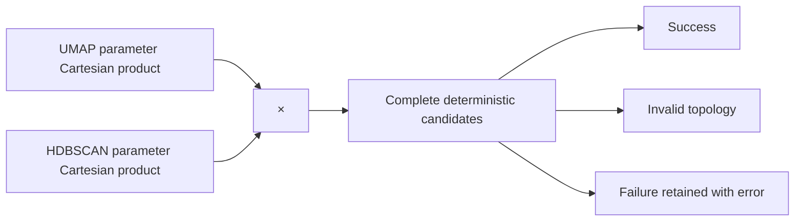
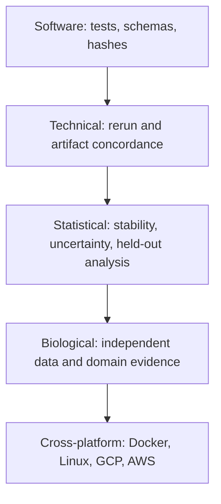

# 5. Density clustering, validation, and circular inference

*Guiding question:* **When does a dense region justify a cluster, and what evidence can validate it?**

Prerequisites: 3–4.

## Why the question matters

Internal diagnostics are computed on the same representation used to construct candidates, so they guide selection without becoming independent confirmation.

HDBSCAN labels are algorithmic; post-selection summaries are descriptive unless a valid independent or selective-inference design is supplied.

This chapter develops the question in the order needed for a reader to move from statistical principle to current implementation, retained evidence, and a defensible statement. Its central worked task is: Draw a five-point mutual-reachability graph, identify an unassigned point, and separate internal, structural, and external validation claims.

## Learning objectives

After completing Chapter 5, the reader can:

1. define core distance and explain its role without exceeding the stated caution;
2. define mutual reachability and explain its role without exceeding the stated caution;
3. define HDBSCAN stability and explain its role without exceeding the stated caution;
4. define noise label and explain its role without exceeding the stated caution;
5. define silhouette and explain its role without exceeding the stated caution;
6. trace the relevant package functions and generated artifacts;
7. complete the worked task and distinguish observation from interpretation.

## Conceptual and mathematical development

### core distance

Distance from a point to its min_samples-th neighbor. A compact notation is `core_k(x)`. In practical terms, larger min_samples changes the density scale and may increase unassigned points. [@campello2015hdbscan]

Within Freeze 3 RC1 the concept is connected to `fit_hdbscan (hdbscan delegate)` and is visible through `candidate labels`. This connection is narrower than the general statistical idea: software evidence establishes the implemented route, while the mapped primary or internal evidence supplies background authority. The distinction prevents a mathematical definition from being mistaken for proof that a particular scientific interpretation is correct.

### mutual reachability

Density-aware dissimilarity used by hdbscan. A compact notation is `d_mr(a,b)=max(core_k(a),core_k(b),d(a,b))`. In practical terms, it smooths single-linkage effects without removing parameter dependence. [@campello2015hdbscan]

Within Freeze 3 RC1 the concept is connected to `fit_hdbscan` and is visible through `condensed tree state`. This connection is narrower than the general statistical idea: software evidence establishes the implemented route, while the mapped primary or internal evidence supplies background authority. The distinction prevents a mathematical definition from being mistaken for proof that a particular scientific interpretation is correct.

### HDBSCAN stability

Persistence of a cluster through the density hierarchy. A compact notation is `Stability(C)=sum_(x in C)(lambda_x-lambda_birth)`. In practical terms, the library computes the hierarchy; Freeze 3 records persistence summaries. [@campello2015hdbscan; @mcinnes2017hdbscan]

Within Freeze 3 RC1 the concept is connected to `fit_hdbscan; evaluate_candidate` and is visible through `model_table.csv`. This connection is narrower than the general statistical idea: software evidence establishes the implemented route, while the mapped primary or internal evidence supplies background authority. The distinction prevents a mathematical definition from being mistaken for proof that a particular scientific interpretation is correct.

### noise label

Label -1 for points unassigned under a fitted density model. A compact notation is `label_i=-1`. In practical terms, noise is algorithmic and parameter-conditional, never a biological-null statement. [@campello2015hdbscan]

Within Freeze 3 RC1 the concept is connected to `fit_hdbscan` and is visible through `labels.tsv`. This connection is narrower than the general statistical idea: software evidence establishes the implemented route, while the mapped primary or internal evidence supplies background authority. The distinction prevents a mathematical definition from being mistaken for proof that a particular scientific interpretation is correct.

### silhouette

Within-versus-nearest-other-cluster separation under a configured metric. A compact notation is `s(i)=(b(i)-a(i))/max(a(i),b(i))`. In practical terms, freeze 3 can exclude noise and supplies the configured HDBSCAN metric. [@rousseeuw1987]

Within Freeze 3 RC1 the concept is connected to `evaluate_candidate` and is visible through `model_table.csv`. This connection is narrower than the general statistical idea: software evidence establishes the implemented route, while the mapped primary or internal evidence supplies background authority. The distinction prevents a mathematical definition from being mistaken for proof that a particular scientific interpretation is correct.

### DBCV

Density-based validity index. A compact notation is `weighted cluster validity in [-1,1]`. In practical terms, it is optional and supplementary under legacy_dimple, not the default score component. [@moulavi2014dbcv]

Within Freeze 3 RC1 the concept is connected to `evaluate_candidate` and is visible through `model_table.csv`. This connection is narrower than the general statistical idea: software evidence establishes the implemented route, while the mapped primary or internal evidence supplies background authority. The distinction prevents a mathematical definition from being mistaken for proof that a particular scientific interpretation is correct.

### circular analysis

Reuse of discovery data for apparently confirmatory inference. A compact notation is `selection(Y) then test(Y) without adjustment`. In practical terms, same-data heatmaps and correlations are descriptive; independent or selective-inference designs are needed for confirmatory claims. [@kriegeskorte2009; @gao2024]

Within Freeze 3 RC1 the concept is connected to `run_explanation` and is visible through `explanation outputs`. This connection is narrower than the general statistical idea: software evidence establishes the implemented route, while the mapped primary or internal evidence supplies background authority. The distinction prevents a mathematical definition from being mistaken for proof that a particular scientific interpretation is correct.

### validation ladder

Separate software, technical, structural, statistical, biological, external, and cross-platform evidence. A compact notation is `E_software != E_biological`. In practical terms, passing tests or exact fixture replay cannot substitute for external biological validation.

Within Freeze 3 RC1 the concept is connected to `run_validation` and is visible through `validation_report.json`. This connection is narrower than the general statistical idea: software evidence establishes the implemented route, while the mapped primary or internal evidence supplies background authority. The distinction prevents a mathematical definition from being mistaken for proof that a particular scientific interpretation is correct.

## Reconstructed operational foundation

Edition 1 contained the following verified operational material in separate short notes. Edition 2 consolidates it here and subjects it to the concept and evidence boundaries above.

### Evidence retained from former Chapter 8

### Operational foundation

When the same data choose a representation, select a partition, and then supply the evidence used to declare that partition meaningful, naive inferential statements can be circular. Internal scores are useful for navigation within a declared candidate population, but they do not become independent hypothesis tests. Original-space correlations computed after selecting labels are descriptive conditional summaries.

A validation ladder keeps claims calibrated. Software validation checks code contracts. Technical validation checks whether an analysis and its artifacts can be rerun or compared under stated conditions. Statistical validation studies stability, uncertainty, multiplicity, and selection. Biological validation uses independent data, domain evidence, or an appropriately designed external analysis. Cross-platform validation tests the packaged workflow on the claimed systems.

The safe pattern is: describe what was selected and why, report sensitivity and uncertainty, reserve inferential claims for methods that address the selection process, and seek held-out or independent validation.

### Retained evidence

The synthetic comparison has ARI=NMI=noise Jaccard=mapped membership=1. That establishes bounded structural concordance for the fixture; it does not validate the biological interpretation of real IDPs.

### Output-reading checkpoint

Inspect the score/selection manifest, comparison summary, validation report, exclusions, and any independent validation artifacts. Record which validation layer each supports.

### Misinterpretations to avoid

Do not perform an ANOVA on the same matrix and labels and present the p-value as independent cluster confirmation. Do not turn an internal score into biological effect size or uncertainty.

### Boundary inherited from Edition 1

Selective-inference literature establishes the general problem, but the cited hierarchical-clustering procedure is not a turnkey inferential solution for the complete UMAP+HDBSCAN selection pipeline.

## Evidence and references

See Gao, Bien & Witten (2024), DOI 10.1080/01621459.2022.2116331. The scope difference from DIMPLE-GWAS is explicit.

### Evidence retained from former Chapter 18

### Operational foundation

Freeze 3 fits the contributed `hdbscan` package to each concatenated embedding. `min_cluster_size` sets the smallest extracted group, while `min_samples` affects core distances and conservativeness. `cluster_selection_epsilon` can merge fine structure below a distance threshold. `cluster_selection_method` is `eom` or `leaf`; `max_cluster_size` has no effect for leaf selection and is recorded with a parameter note when set. Other exposed controls are persistence, alpha, single-cluster permission, maximum cluster size, and metric.

The standard grid uses min-cluster-size 5 through 49, min-samples 2 through 19, and epsilon 0,1,2: 2,430 candidates. Candidate identity also includes UMAP family. Every evaluation becomes `success`, `invalid_topology` when fewer than two non-noise clusters are found, or `failed` with an error. Failure rows are retained, not removed.

## Evidence diagram or figure

*Complete search-space enumeration. Editable source: `assets/diagrams/diagram_05_search_space.mmd`.*

### Retained evidence

Edition 2 Lab 2 evaluates min-cluster-size 4/6, min-samples 2/4, epsilon 0/0.05, and scalar EOM/Euclidean settings across four UMAP families. All 32 candidates succeeded and produced three clusters with no noise.

### Output-reading checkpoint

Inspect `hdbscan_id`, flattened parameters, status, error message, cluster/noise counts, persistence summaries, metric warnings, candidate runtime, and `model_failures.tsv`.

### Misinterpretations to avoid

Do not interpret increasing `min_samples` as universally better. Do not use numeric cluster labels as stable identity across fits. Do not call noise observations false or biologically irrelevant.

### Boundary inherited from Edition 1

Density structure depends on the concatenated representation and metric. A grid can expose sensitivity but does not identify a uniquely correct biological scale.

## Evidence and references

See Campello et al. (2015), DOI 10.1145/2733381; McInnes et al. (2017), DOI 10.21105/joss.00205; and official hdbscan API documentation.

### Evidence retained from former Chapter 19

### Operational foundation

Candidate metrics serve different purposes. Topology fields describe non-noise cluster count, noise count/fraction, and cluster sizes. Silhouette uses the configured HDBSCAN metric and the declared sampling scope. DBCV is optionally computed as a density-aware diagnostic. Calinski–Harabasz and Davies–Bouldin are supplied with explicit metric/context fields. HDBSCAN persistence summaries describe retained clusters. Trustworthiness and continuity belong to the embedding family, not to one HDBSCAN extraction.

Metrics can be missing when a topology is invalid, a calculation is undefined, a backend cannot support a metric, or a candidate fails. Read `status`, scope, sampled flags, sample sizes, and `metric_warnings` before comparing numbers. The candidate table is deliberately wide so these qualifications are not hidden.

### Retained evidence

The selected Edition 2 Lab 2 candidate has silhouette about 0.970354 and DBCV about 0.976386, with three equal clusters and no noise. These values describe the designed fixture under Euclidean geometry; they are not expected production targets.

### Output-reading checkpoint

Inspect metric value plus its metric/scope/sampled/sample-size columns, topology counts, persistence, warnings, and the run's compute flags.

### Misinterpretations to avoid

Do not call silhouette inherently Euclidean; Freeze 3 supplies the configured metric. Do not compare a sampled score with a full score without noting scope. Do not call DBCV the universal best metric.

### Boundary inherited from Edition 1

All internal metrics are conditional on representation and candidate population. They lack independent biological evidence and can disagree legitimately.

## Evidence and references

See Rousseeuw (1987), DOI 10.1016/0377-0427(87)90125-7, and Moulavi et al. (2014), DOI 10.1137/1.9781611973440.96.

### Evidence retained from former Chapter 28

### Operational foundation

HDBSCAN label `-1` means that the fitted hierarchy/extraction did not assign an observation to a retained cluster under the current representation, metric, density parameters, and selection method. It is an algorithmic status, not a biological category. Changing UMAP parameters, seed aggregation, min-cluster-size, min-samples, epsilon, metric, or selection method can change the noise set.

Inspect unassigned observations rather than discarding them rhetorically. Report count/fraction, exact IDs, probabilities/persistence when available, original-space relationships, stability across justified settings, and transitions in comparison outputs. Use ‘unassigned’ or ‘HDBSCAN noise’ with the condition attached. Avoid ‘non-pleiotropic,’ ‘failed IDP,’ ‘irrelevant,’ or ‘no shared structure.’

### Retained evidence

The synthetic tutorials have zero noise. The historical 164-IDP record has 102 unassigned and 62 assigned across five clusters; this is historical evidence and does not imply 102 biologically irrelevant IDPs.

### Output-reading checkpoint

Inspect label tables, noise count/fraction, candidate parameters, membership comparison, changed-noise status, exclusions under noise policy, and historical source status.

### Misinterpretations to avoid

Do not drop noise before reporting its magnitude. Do not compare noise labels without exact IDs. Do not treat absence of assigned cluster as absence of any genetic correlation.

### Boundary inherited from Edition 1

Freeze 3 does not provide a calibrated biological uncertainty interval for each label. Stability and external data must be studied separately.

## Evidence and references

See Campello et al. (2015), DOI 10.1145/2733381.

### Evidence retained from former Chapter 29

### Operational foundation

‘Double dipping’ occurs when data-dependent choices are ignored in a later inferential statement. DIMPLE-GWAS uses the matrix to create an embedding, enumerate/extract partitions, and select one using internal metrics. Testing separation or correlation on the same matrix as though the partition were fixed in advance can yield overconfident evidence. Multiple candidate models and analyst inspection add further selection.

Safe outputs in Freeze 3 are descriptive summaries with explicit conditioning. For inference, plan held-out variables, independent cohorts, preregistered replication, sample splitting, perturbation/stability designs, or a selective-inference method whose assumptions actually match the pipeline. Report effect sizes and uncertainty appropriate to the validation design. Never describe an omitted p-value as a flaw: the explanation utility intentionally avoids cluster ANOVA and post-selection significance.

### Retained evidence

Edition 2 Lab 3 reports within/between similarities and a heatmap but no ANOVA p-values. That is a deliberate boundary, not missing validation.

### Output-reading checkpoint

Inspect candidate population, selection rule, all exploratory views used, independent validation plan, comparison/stability evidence, and whether any test data were held out before selection.

### Misinterpretations to avoid

Do not call high within-cluster correlation a validation test. Do not choose external outcomes after seeing the partition without disclosure. Do not cite a general selective-inference paper as if it implemented this exact pipeline.

### Boundary inherited from Edition 1

Independent validation may still inherit sample overlap, ancestry, measurement, or harmonization biases. The design—not the word ‘replication’—determines evidential strength.

## Evidence and references

See Gao, Bien & Witten (2024), DOI 10.1080/01621459.2022.2116331, with the scope limitation stated above.

### Evidence retained from former Chapter 30

### Operational foundation

Validation is layered. Software validation covers tests and schemas. Technical reproducibility covers source/input/configuration identity, reruns, hashes, labels, and numeric tolerance. Structural concordance uses ARI/NMI/noise/mapped membership. Statistical validation addresses parameter sensitivity, instability, selection, uncertainty, and multiplicity. Biological validation asks whether groupings recur or predict independent domain evidence. Cross-platform validation tests the claimed package on Docker/Linux/cloud environments.

A result should be reported at the strongest layer actually supported. Forty-five tests support software. Twenty-four artifact checks support one run contract. Perfect fixture concordance supports bounded same-platform technical structure. MNIST supports known-label engineering behavior. None proves the historical IDP clusters biologically distinct. The fresh 164-IDP and Docker/cloud layers remain pending.

## Evidence diagram or figure

*Validation ladder; each layer requires its own evidence. Editable source: `assets/diagrams/diagram_10_validation_ladder.mmd`.*

### Retained evidence

Use `assets/diagrams/diagram_10_validation_ladder.mmd` and Appendix G to classify every manual evidence item. No arrow can be skipped by renaming a lower layer.

### Output-reading checkpoint

Inspect test JUnit/logs, validation checks, comparison metrics, source/input/config hashes, historical evidence, external-study design, and platform matrices separately.

### Misinterpretations to avoid

Do not write ‘validated’ without an object, method, dataset, platform, and criterion. Do not let a checksum pass stand in for scientific replication.

### Boundary inherited from Edition 1

Statistical and biological validation protocols are context dependent and may require data or governance outside this package. This manual does not invent those results.

## Implementation trace

**`hdbscan_runner.estimator_kwargs`** is defined at `dimple_gwas/hdbscan_runner.py:15` with signature `parameters: Mapping[str, Any], core_dist_n_jobs: int=1`. Implementation callable for estimator kwargs. It is reached from hdbscan_runner.fit_hdbscan and connects to No package-defined dependency detected. Its direct artifact contract is No direct canonical artifact; in-memory/supporting result; its explicit error surface is No explicit raise in this symbol; delegated calls may raise.. Test evidence is recorded as No direct symbol-name test reference; assess through caller/integration coverage. This is a B-tier contract, so the complete 20-field dossier is retained in the function atlas.

**`hdbscan_runner.fit_hdbscan`** is defined at `dimple_gwas/hdbscan_runner.py:34` with signature `embedding, parameters: Mapping[str, Any], core_dist_n_jobs: int=1`. Fit contributed HDBSCAN with normalized Freeze 3 parameters. It is reached from pipeline._evaluate_one; pipeline.run_search and connects to hdbscan_runner.estimator_kwargs. Its direct artifact contract is No direct canonical artifact; in-memory/supporting result; its explicit error surface is No explicit raise in this symbol; delegated calls may raise.. Test evidence is recorded as tests/test_failure_and_provenance.py::test_failed_candidate_is_retained. This is a A-tier contract, so the complete 20-field dossier is retained in the function atlas.

**`interpretation.is_noise_label`** is defined at `dimple_gwas/interpretation.py:30` with signature `value: Any`. Implementation callable for is noise label. It is reached from comparison.run_comparison; interpretation.calculate_cluster_summary; interpretation.label_sort_key; interpretation.run_explanation and connects to No package-defined dependency detected. Its direct artifact contract is No direct canonical artifact; in-memory/supporting result; its explicit error surface is No explicit raise in this symbol; delegated calls may raise.. Test evidence is recorded as No direct symbol-name test reference; assess through caller/integration coverage. This is a B-tier contract, so the complete 20-field dossier is retained in the function atlas.

**`interpretation.label_sort_key`** is defined at `dimple_gwas/interpretation.py:35` with signature `value: Any`. Implementation callable for label sort key. It is reached from comparison.run_comparison; interpretation.compute_order and connects to interpretation.is_noise_label. Its direct artifact contract is No direct canonical artifact; in-memory/supporting result; its explicit error surface is No explicit raise in this symbol; delegated calls may raise.. Test evidence is recorded as No direct symbol-name test reference; assess through caller/integration coverage. This is a B-tier contract, so the complete 20-field dossier is retained in the function atlas.

**`interpretation.detect_coordinate_columns`** is defined at `dimple_gwas/interpretation.py:44` with signature `frame, requested: Sequence[str] | str | None=None`. Implementation callable for detect coordinate columns. It is reached from comparison.run_comparison; interpretation.run_explanation and connects to No package-defined dependency detected. Its direct artifact contract is No direct canonical artifact; in-memory/supporting result; its explicit error surface is ValueError. Test evidence is recorded as tests/test_freeze3_interpretation.py::test_coordinate_detection_is_numeric_suffix_order. This is a B-tier contract, so the complete 20-field dossier is retained in the function atlas.

**`interpretation.compute_similarity`** is defined at `dimple_gwas/interpretation.py:145` with signature `analysis, *, method: str, undefined_policy: str`. Implementation callable for compute similarity. It is reached from interpretation.run_explanation and connects to No package-defined dependency detected. Its direct artifact contract is No direct canonical artifact; in-memory/supporting result; its explicit error surface is ValueError. Test evidence is recorded as tests/test_freeze3_interpretation.py::test_similarity_undefined_fails_by_default. This is a A-tier contract, so the complete 20-field dossier is retained in the function atlas.

**`interpretation.compute_order`** is defined at `dimple_gwas/interpretation.py:184` with signature `correlation, labels: Sequence[Any], *, method: str, noise_policy: str`. Implementation callable for compute order. It is reached from interpretation.run_explanation and connects to interpretation._hierarchical_order; interpretation.label_sort_key. Its direct artifact contract is No direct canonical artifact; in-memory/supporting result; its explicit error surface is No explicit raise in this symbol; delegated calls may raise.. Test evidence is recorded as tests/test_freeze3_interpretation.py::test_cluster_order_is_numeric_and_noise_last. This is a A-tier contract, so the complete 20-field dossier is retained in the function atlas.

**`interpretation.calculate_cutpoints`** is defined at `dimple_gwas/interpretation.py:209` with signature `labels: Sequence[Any]`. Implementation callable for calculate cutpoints. It is reached from interpretation.run_explanation and connects to No package-defined dependency detected. Its direct artifact contract is No direct canonical artifact; in-memory/supporting result; its explicit error surface is No explicit raise in this symbol; delegated calls may raise.. Test evidence is recorded as tests/test_freeze3_interpretation.py::test_cutpoint_indices_are_auditable. This is a B-tier contract, so the complete 20-field dossier is retained in the function atlas.

**`interpretation.calculate_cluster_summary`** is defined at `dimple_gwas/interpretation.py:233` with signature `correlation, labels: Sequence[Any]`. Implementation callable for calculate cluster summary. It is reached from interpretation.run_explanation and connects to interpretation.is_noise_label. Its direct artifact contract is No direct canonical artifact; in-memory/supporting result; its explicit error surface is No explicit raise in this symbol; delegated calls may raise.. Test evidence is recorded as No direct symbol-name test reference; assess through caller/integration coverage. This is a B-tier contract, so the complete 20-field dossier is retained in the function atlas.

**`interpretation.coordinate_association_table`** is defined at `dimple_gwas/interpretation.py:262` with signature `analysis, coordinates, *, methods: Sequence[str], top_n: int`. Implementation callable for coordinate association table. It is reached from interpretation.run_explanation and connects to No package-defined dependency detected. Its direct artifact contract is No direct canonical artifact; in-memory/supporting result; its explicit error surface is No explicit raise in this symbol; delegated calls may raise.. Test evidence is recorded as No direct symbol-name test reference; assess through caller/integration coverage. This is a A-tier contract, so the complete 20-field dossier is retained in the function atlas.

**`interpretation.run_explanation`** is defined at `dimple_gwas/interpretation.py:307` with signature `*, output_dir: str | Path, interpretation_config: Mapping[str, Any], model_json: str | Path | None=None, legacy_table: str | Path | None=None, input_path: str | Path | None=None, input_sep: str | None=None, input_sheet: str | int=0, legacy_sheet: str | int=0, matrix_orientation: str='auto', vector_id_source: str='auto', drop_first_n_cols: int | None=None, zscore_transform: str | None=None, id_column: str | None=None, label_column: str | None=None, coordinate_columns: Sequence[str] | str | None=None, command: list[str] | None=None`. Return to original input space, align IDs, calculate similarities/summaries, order a heatmap, and record a non-refitting explanation manifest. It is reached from cli._explain and connects to interpretation._align_inputs; interpretation._native_sources; interpretation._resolve_column; interpretation._write_readme; interpretation.calculate_cluster_summary; interpretation.calculate_cutpoints; interpretation.compute_order; interpretation.compute_similarity; interpretation.coordinate_association_table; interpretation.detect_coordinate_columns; interpretation.is_noise_label; io.atomic_json_dump; io.ensure_empty_output_dir; io.json_safe; io.read_table; io.validated_identifiers; metrics.embedding_quality_metrics; preprocessing.infer_explanation_orientation; preprocessing.prepare_explanation_matrix; provenance.base_manifest; provenance.file_record; provenance.utc_now; visualization.render_heatmap. Its direct artifact contract is original_space_similarity.tsv.gz; heatmap_order.tsv; cluster_cutpoints.tsv; cluster_summary.tsv; projection_quality.tsv; coordinate_associations.tsv; exclusions.tsv; original_space_heatmap.png; original_space_heatmap.html; interpretation_manifest.json; README.md; its explicit error surface is ValueError. Test evidence is recorded as tests/test_freeze3_interpretation.py::test_legacy_incomplete_matching_writes_exclusions; tests/test_freeze3_interpretation.py::test_native_explanation_end_to_end; tests/test_freeze3_interpretation.py::test_native_explanation_refuses_nonempty_output. This is a A-tier contract, so the complete 20-field dossier is retained in the function atlas.

**`metrics.effective_neighbor_count`** is defined at `dimple_gwas/metrics.py:9` with signature `n_samples: int, requested: int`. Implementation callable for effective neighbor count. It is reached from metrics.embedding_quality_metrics and connects to No package-defined dependency detected. Its direct artifact contract is No direct canonical artifact; in-memory/supporting result; its explicit error surface is No explicit raise in this symbol; delegated calls may raise.. Test evidence is recorded as tests/test_preprocessing_metrics.py::test_effective_neighbor_edge_cases. This is a B-tier contract, so the complete 20-field dossier is retained in the function atlas.

## Claim adjudication notebook

The following statements are admitted to the draft only in their safe form:

- **SCORE-002 (reject):** Silhouette is defined relative to a distance; Freeze 3 passes the configured HDBSCAN metric to scikit-learn. [@rousseeuw1987] Limitation: Metric choice remains geometry-dependent; CH and DB use Euclidean centroid geometry. Implementation evidence: `metrics.evaluate_candidate`.

- **INT-003 (verified_with_qualification):** Pearson/Spearman summaries are post-selection descriptive diagnostics conditional on the retained partition. [@kriegeskorte2009; @gao2024] Limitation: They do not provide causal, replication, or unbiased significance evidence. Implementation evidence: `interpretation.py`.

- **INT-004 (verified_with_qualification):** Classical tests on the same data used for group discovery are vulnerable to circularity; Freeze 3 omits cluster ANOVA and post-selection p-values. [@kriegeskorte2009; @gao2024] Limitation: The cited selective method is not a turnkey HDBSCAN procedure. Implementation evidence: `interpretation.py; limitations docs`.

- **CMP-001 (reject):** K-means targets centroid-based partitions and may mismatch irregular density structure; it is not universally ineffective. Limitation: Performance depends on representation and objective. Implementation evidence: `not implemented`.

## Worked reasoning and evidence exercise

Draw a five-point mutual-reachability graph, identify an unassigned point, and separate internal, structural, and external validation claims.

A complete Chapter 5 answer must expose its intermediate reasoning, name the source or output used for `Density clustering, validation, and circular inference`, and finish with separate support and non-support statements. Applying that discipline to the question “When does a dense region justify a cluster, and what evidence can validate it?” prevents a calculation, a software observation, and a scientific interpretation from collapsing into one claim.

## Assumptions, diagnostics, and recovery

The Chapter 5 analysis assumes the stated unit and inputs, the recorded configuration and software identity, and a diagnostic that addresses the claimed property rather than a convenient surrogate. Its decisive boundary is: HDBSCAN labels are algorithmic; post-selection summaries are descriptive unless a valid independent or selective-inference design is supplied.

If the Chapter 5 route fails, retain its log and candidate status before deciding whether the cause is input, configuration, dependency, compute, identifier alignment, or output-root state. Correct an operational failure by writing a new result directory. Treat instability in `Density clustering, validation, and circular inference` as sensitivity evidence: report it and identify the independent evidence needed instead of relabeling ambiguity as a software exception.

## Chapter synthesis

Internal diagnostics are computed on the same representation used to construct candidates, so they guide selection without becoming independent confirmation. The implementation trace makes the current behavior auditable, but the evidence boundary remains part of the result. Chapter 6 returns to the exact data contract before the method is derived.

## Exercises

1. For `Density clustering, validation, and circular inference`, name the unit of analysis and one plausible but invalid substitute.
2. Reconstruct the notation for core distance; define its dimensions or denominator and interpret every term.
3. Choose a Tier A function mapped to Chapter 5; identify its caller and direct output, then propose a topic-specific edge case.
4. Select one Chapter 5 artifact from the output atlas and state three integrity checks that must precede scientific reading.
5. Convert a tempting `Density clustering, validation, and circular inference` overclaim into one observed statement followed by its limitation.
6. Draw a five-point mutual-reachability graph, identify an unassigned point, and separate internal, structural, and external validation claims.

Appendix J gives the Chapter 5 adjudication guide. Its further-reading keys supply statistical context; no external paper is treated as automatic validation of the current software or dataset.
