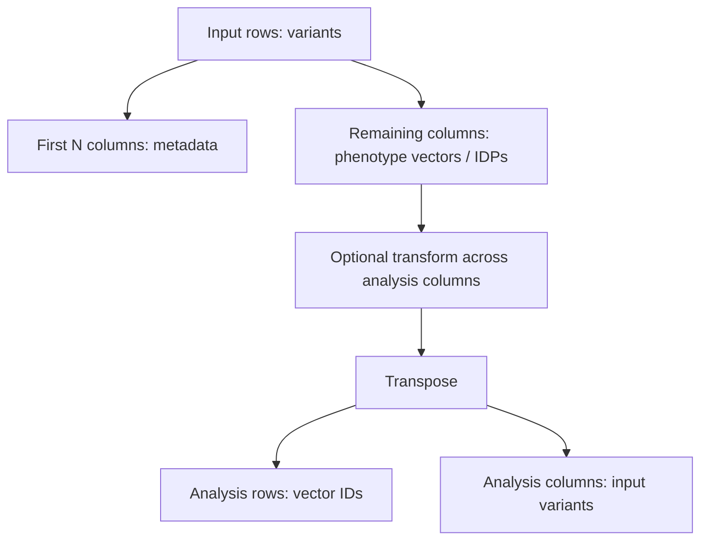

# 6. Data contract, preprocessing, RINT, and orientation

*Guiding question:* **Which cells become the vectors that UMAP actually sees?**

Prerequisites: 2–3.

## Why the question matters

Row and column language changes after transposition; an apparently small orientation mistake changes the unit being clustered.

Production `run` rejects missing or nonnumeric analysis cells; explanation mode supports two explicit orientations with identifier-based inference safeguards.

This chapter develops the question in the order needed for a reader to move from statistical principle to current implementation, retained evidence, and a defensible statement. Its central worked task is: Follow the Lab 0 six-by-eight table through metadata removal, average-rank RINT, transpose, and its final four-by-six analysis matrix.

## Learning objectives

After completing Chapter 6, the reader can:

1. define GWAS-derived vector and explain its role without exceeding the stated caution;
2. define identifier alignment and explain its role without exceeding the stated caution;
3. define scaling and transformation and explain its role without exceeding the stated caution;
4. define RINT ties and missingness and explain its role without exceeding the stated caution;
5. trace the relevant package functions and generated artifacts;
6. complete the worked task and distinguish observation from interpretation.

## Conceptual and mathematical development

### GWAS-derived vector

Effect estimates or association statistics for one phenotype across matched variants. A compact notation is `X in R^(p x v)`. In practical terms, a vector is a statistical summary, not a person or causal mechanism. [@elliott2018; @buliksullivan2015]

Within Freeze 3 RC1 the concept is connected to `prepare_analysis_matrix` and is visible through `input matrix`. This connection is narrower than the general statistical idea: software evidence establishes the implemented route, while the mapped primary or internal evidence supplies background authority. The distinction prevents a mathematical definition from being mistaken for proof that a particular scientific interpretation is correct.

### identifier alignment

A one-to-one correspondence between vector or feature identifiers across artifacts. A compact notation is `I_A = I_B`. In practical terms, order is not identity; normalize and validate keys before joining.

Within Freeze 3 RC1 the concept is connected to `validated_identifiers; align_rows` and is visible through `labels.tsv; coordinates.tsv`. This connection is narrower than the general statistical idea: software evidence establishes the implemented route, while the mapped primary or internal evidence supplies background authority. The distinction prevents a mathematical definition from being mistaken for proof that a particular scientific interpretation is correct.

### scaling and transformation

Changes to marginal scale before geometric analysis. A compact notation is `z=(x-mu)/sigma; z_i=Phi^-1((r_i-0.5)/n)`. In practical terms, transformation changes geometry; it does not create independent evidence. [@beasley2009]

Within Freeze 3 RC1 the concept is connected to `rank_inverse_normal_transform; prepare_analysis_matrix` and is visible through `resolved_config.yaml`. This connection is narrower than the general statistical idea: software evidence establishes the implemented route, while the mapped primary or internal evidence supplies background authority. The distinction prevents a mathematical definition from being mistaken for proof that a particular scientific interpretation is correct.

### RINT ties and missingness

Average ranks with missing values retained during ranking. A compact notation is `r_i=average tied rank`. In practical terms, freeze 3 rejects missing analysis cells before the pipeline and applies RINT column-wise before transpose. [@beasley2009]

Within Freeze 3 RC1 the concept is connected to `rank_inverse_normal_transform` and is visible through `prepared matrix`. This connection is narrower than the general statistical idea: software evidence establishes the implemented route, while the mapped primary or internal evidence supplies background authority. The distinction prevents a mathematical definition from being mistaken for proof that a particular scientific interpretation is correct.

## Reconstructed operational foundation

Edition 1 contained the following verified operational material in separate short notes. Edition 2 consolidates it here and subjects it to the concept and evidence boundaries above.

### Evidence retained from former Chapter 10

### Operational foundation

The standard run contract is a CSV/TSV table with variants in rows, a declared leading metadata prefix, and vectors/IDPs in the remaining columns. The default `drop_first_n_cols` is 4. Analysis columns must be numeric after parsing. Their column names become `feature_id` values after transpose, so they must be stable and unique. The original row axis supplies the variables across which vectors are compared.

Freeze 3 reads the separator explicitly when configured or through its table reader, drops the prefix, optionally transforms analysis columns, and transposes. The native explanation path expects exact retained IDs and the original matrix. Legacy explanation can infer orientation only through exact overlap and should use explicit orientation/ID options when ambiguity exists. Missing, nonnumeric, constant, duplicate, or mismatched values can make preprocessing or correlations undefined.

The input-orientation diagram at `assets/diagrams/diagram_02_input_orientation.mmd` is the safest mental model.

## Evidence diagram or figure

*Input orientation and transposition. Editable source: `assets/diagrams/diagram_02_input_orientation.mmd`.*

### Retained evidence

The fixture `benchmarks/synthetic/synthetic_matrix.tsv` has 80 rows and 28 columns: four metadata plus 24 vectors. After the prefix is dropped and data are transposed, the analysis matrix is 24 vectors by 80 variables.

### Output-reading checkpoint

Before a run, inspect header uniqueness, first rows, dimensions, numeric conversion, missing counts, separator, and the annotation join column. After a run, confirm the manifest's `input_contract` and input SHA-256.

### Misinterpretations to avoid

Do not set `drop_first_n_cols` by guessing. Do not use annotation row number as vector identity. Do not let spreadsheet software rewrite scientific notation or identifiers. Do not silently impute missing values outside an approved upstream protocol.

### Boundary inherited from Edition 1

Freeze 3 cannot determine whether upstream variants are allele-aligned, comparable across phenotypes, or scientifically eligible. Protected study matrices should not be copied into the manual or image.

### Evidence retained from former Chapter 15

### Operational foundation

Preprocessing defines the geometry presented to UMAP. Freeze 3 removes `input.drop_first_n_cols` leading columns, validates that analysis columns are numeric, optionally applies rank inverse normal transformation to each analysis column before transpose, and then transposes to vectors by input variables. With `zscore_transform=none`, values are not RINT-transformed. The historical option name is retained although the implemented alternative is `rint`.

For a column with ranks, RINT maps rank-based probabilities through the standard-normal quantile function. It can reduce marginal scale differences and the influence of extreme values, but it also changes the scientific quantity and does not repair upstream harmonization or dependence. The configuration default is `none`; enable RINT only with a documented rationale that matches the intended historical or prospective protocol.

### Retained evidence

The preprocessing tests cover RINT and numeric-matrix behavior. Both executed synthetic tutorials use `none`, so their values remain on the fixture's generated scale.

### Output-reading checkpoint

Inspect the input config, resolved transform, input-contract manifest, prepared-shape log line, identifier set, and any preprocessing warnings. Record upstream transformations separately.

### Misinterpretations to avoid

Do not describe RINT as row-wise without naming the table orientation: implementation applies it to analysis columns before transpose. Do not call it z-scoring or assume it creates independence.

### Boundary inherited from Edition 1

RINT can alter ties, correlations, distances, and downstream partitions. The manual makes no universal recommendation between transformed and untransformed analyses.

## Implementation trace

**`config.builtin_config`** is defined at `dimple_gwas/config.py:128` with signature `mode: str`. Implementation callable for builtin config. It is reached from config.resolve_config and connects to config._base_config. Its direct artifact contract is No direct canonical artifact; in-memory/supporting result; its explicit error surface is ValueError. Test evidence is recorded as No direct symbol-name test reference; assess through caller/integration coverage. This is a B-tier contract, so the complete 20-field dossier is retained in the function atlas.

**`config.deep_merge`** is defined at `dimple_gwas/config.py:164` with signature `base: Mapping[str, Any], overlay: Mapping[str, Any]`. Implementation callable for deep merge. It is reached from config.resolve_config and connects to No package-defined dependency detected. Its direct artifact contract is No direct canonical artifact; in-memory/supporting result; its explicit error surface is No explicit raise in this symbol; delegated calls may raise.. Test evidence is recorded as No direct symbol-name test reference; assess through caller/integration coverage. This is a B-tier contract, so the complete 20-field dossier is retained in the function atlas.

**`config.load_yaml`** is defined at `dimple_gwas/config.py:174` with signature `path: str | Path`. Implementation callable for load yaml. It is reached from config.resolve_config and connects to No package-defined dependency detected. Its direct artifact contract is No direct canonical artifact; in-memory/supporting result; its explicit error surface is FileNotFoundError; RuntimeError; ValueError. Test evidence is recorded as No direct symbol-name test reference; assess through caller/integration coverage. This is a B-tier contract, so the complete 20-field dossier is retained in the function atlas.

**`config.set_dotted`** is defined at `dimple_gwas/config.py:191` with signature `config: dict[str, Any], dotted: str, value: Any`. Implementation callable for set dotted. It is reached from config.resolve_config and connects to No package-defined dependency detected. Its direct artifact contract is No direct canonical artifact; in-memory/supporting result; its explicit error surface is No explicit raise in this symbol; delegated calls may raise.. Test evidence is recorded as No direct symbol-name test reference; assess through caller/integration coverage. This is a B-tier contract, so the complete 20-field dossier is retained in the function atlas.

**`config.resolve_config`** is defined at `dimple_gwas/config.py:203` with signature `mode: str, config_path: str | Path | None=None, overrides: Mapping[str, Any] | None=None`. Implementation callable for resolve config. It is reached from cli._explain; cli._reproduce; cli._resolved; cli._score and connects to config.builtin_config; config.deep_merge; config.load_yaml; config.set_dotted; config.validate_config. Its direct artifact contract is No direct canonical artifact; in-memory/supporting result; its explicit error surface is No explicit raise in this symbol; delegated calls may raise.. Test evidence is recorded as tests/test_config.py::test_cli_override_precedence; tests/test_config.py::test_fixed_mode_rejects_lists; tests/test_config.py::test_invalid_combinations_rejected; tests/test_config.py::test_standard_defaults_match_dev_declarations; tests/test_freeze3_interpretation.py::test_interpretation_defaults_are_additive; tests/test_freeze3_interpretation.py::test_invalid_interpretation_configuration_fails; tests/test_freeze3_interpretation.py::test_legacy_incomplete_matching_writes_exclusions; tests/test_freeze3_interpretation.py::test_native_explanation_end_to_end; tests/test_freeze3_interpretation.py::test_native_explanation_refuses_nonempty_output; tests/test_search_space.py::test_search_enumeration_and_stable_ids; tests/test_search_space.py::test_search_limit_never_silently_samples. This is a A-tier contract, so the complete 20-field dossier is retained in the function atlas.

**`config.as_list`** is defined at `dimple_gwas/config.py:277` with signature `value: Any, cast: type | None=None`. Implementation callable for as list. It is reached from config.normalized_parameter_space and connects to config._coerce_bool; config._range_values; config._string_sequence. Its direct artifact contract is No direct canonical artifact; in-memory/supporting result; its explicit error surface is ValueError. Test evidence is recorded as tests/test_config.py::test_scalar_list_and_range_handling. This is a B-tier contract, so the complete 20-field dossier is retained in the function atlas.

**`config.normalized_parameter_space`** is defined at `dimple_gwas/config.py:298` with signature `config: Mapping[str, Any]`. Implementation callable for normalized parameter space. It is reached from config.validate_config; search_space.count_candidates; search_space.enumerate_candidates and connects to config.as_list. Its direct artifact contract is No direct canonical artifact; in-memory/supporting result; its explicit error surface is ValueError. Test evidence is recorded as tests/test_config.py::test_cli_override_precedence. This is a A-tier contract, so the complete 20-field dossier is retained in the function atlas.

**`config.validate_config`** is defined at `dimple_gwas/config.py:343` with signature `config: Mapping[str, Any]`. Implementation callable for validate config. It is reached from cli._explain; cli._reproduce; config.resolve_config and connects to config._finite; config.normalized_parameter_space. Its direct artifact contract is No direct canonical artifact; in-memory/supporting result; its explicit error surface is ValueError. Test evidence is recorded as No direct symbol-name test reference; assess through caller/integration coverage. This is a A-tier contract, so the complete 20-field dossier is retained in the function atlas.

**`config.config_as_json`** is defined at `dimple_gwas/config.py:489` with signature `config: Mapping[str, Any]`. Implementation callable for config as json. It is reached from CLI/import/direct caller or no package caller detected and connects to No package-defined dependency detected. Its direct artifact contract is No direct canonical artifact; in-memory/supporting result; its explicit error surface is No explicit raise in this symbol; delegated calls may raise.. Test evidence is recorded as No direct symbol-name test reference; assess through caller/integration coverage. This is a B-tier contract, so the complete 20-field dossier is retained in the function atlas.

**`io.resolve_separator`** is defined at `dimple_gwas/io.py:10` with signature `path: str | Path, override: str | None=None`. Implementation callable for resolve separator. It is reached from io.read_model_table; io.read_table and connects to No package-defined dependency detected. Its direct artifact contract is No direct canonical artifact; in-memory/supporting result; its explicit error surface is No explicit raise in this symbol; delegated calls may raise.. Test evidence is recorded as No direct symbol-name test reference; assess through caller/integration coverage. This is a B-tier contract, so the complete 20-field dossier is retained in the function atlas.

**`io.read_table`** is defined at `dimple_gwas/io.py:16` with signature `path: str | Path, sep: str | None=None, *, sheet: str | int=0, nrows: int | None=None`. Implementation callable for read table. It is reached from comparison._resolve_labels; interpretation.run_explanation; pipeline._annotation_frame; pipeline.run_search; validation.run_validation and connects to io.resolve_separator. Its direct artifact contract is No direct canonical artifact; in-memory/supporting result; its explicit error surface is FileNotFoundError; RuntimeError. Test evidence is recorded as tests/test_freeze3_interpretation.py::test_reader_supports_excel_sheet. This is a A-tier contract, so the complete 20-field dossier is retained in the function atlas.

**`io.read_model_table`** is defined at `dimple_gwas/io.py:45` with signature `path: str | Path`. Implementation callable for read model table. It is reached from cli._score; cli._summarize; validation.run_validation and connects to io.resolve_separator. Its direct artifact contract is No direct canonical artifact; in-memory/supporting result; its explicit error surface is No explicit raise in this symbol; delegated calls may raise.. Test evidence is recorded as No direct symbol-name test reference; assess through caller/integration coverage. This is a B-tier contract, so the complete 20-field dossier is retained in the function atlas.

## Claim adjudication notebook

The following statements are admitted to the draft only in their safe form:

- **DATA-001 (implementation_specific):** Production input has variants in rows, four declared metadata columns by default, and vector/IDP columns; preprocessing drops the prefix and transposes to vectors by variants. Limitation: Explanation mode also permits an explicit vectors-by-variants orientation. Implementation evidence: `preprocessing.py; io.py`.

- **DATA-002 (implementation_specific):** RINT is optional, off by default, and applied column-wise to analysis columns before transpose using average ranks and (rank-0.5)/n. [@beasley2009] Limitation: The post-transpose viewpoint reverses row/column language; always state the orientation. Implementation evidence: `preprocessing.rank_inverse_normal_transform`.

- **METH-001 (verified_with_qualification):** Freeze 3 maps observed marginal ranks to normal scores; that deterministic sample transformation does not validate downstream parametric assumptions or causal interpretation. [@beasley2009] Limitation: Dependence, ties, and selection remain. Implementation evidence: `preprocessing.py`.

## Worked reasoning and evidence exercise

Follow the Lab 0 six-by-eight table through metadata removal, average-rank RINT, transpose, and its final four-by-six analysis matrix.

A complete Chapter 6 answer must expose its intermediate reasoning, name the source or output used for `Data contract, preprocessing, RINT, and orientation`, and finish with separate support and non-support statements. Applying that discipline to the question “Which cells become the vectors that UMAP actually sees?” prevents a calculation, a software observation, and a scientific interpretation from collapsing into one claim.

## Assumptions, diagnostics, and recovery

The Chapter 6 analysis assumes the stated unit and inputs, the recorded configuration and software identity, and a diagnostic that addresses the claimed property rather than a convenient surrogate. Its decisive boundary is: Production `run` rejects missing or nonnumeric analysis cells; explanation mode supports two explicit orientations with identifier-based inference safeguards.

If the Chapter 6 route fails, retain its log and candidate status before deciding whether the cause is input, configuration, dependency, compute, identifier alignment, or output-root state. Correct an operational failure by writing a new result directory. Treat instability in `Data contract, preprocessing, RINT, and orientation` as sensitivity evidence: report it and identify the independent evidence needed instead of relabeling ambiguity as a software exception.

## Chapter synthesis

Row and column language changes after transposition; an apparently small orientation mistake changes the unit being clustered. The implementation trace makes the current behavior auditable, but the evidence boundary remains part of the result. Chapter 7 derives the UMAP/densMAP representation built from that matrix.

## Exercises

1. For `Data contract, preprocessing, RINT, and orientation`, name the unit of analysis and one plausible but invalid substitute.
2. Reconstruct the notation for GWAS-derived vector; define its dimensions or denominator and interpret every term.
3. Choose a Tier A function mapped to Chapter 6; identify its caller and direct output, then propose a topic-specific edge case.
4. Select one Chapter 6 artifact from the output atlas and state three integrity checks that must precede scientific reading.
5. Convert a tempting `Data contract, preprocessing, RINT, and orientation` overclaim into one observed statement followed by its limitation.
6. Follow the Lab 0 six-by-eight table through metadata removal, average-rank RINT, transpose, and its final four-by-six analysis matrix.

Appendix J gives the Chapter 6 adjudication guide. Its further-reading keys supply statistical context; no external paper is treated as automatic validation of the current software or dataset.
