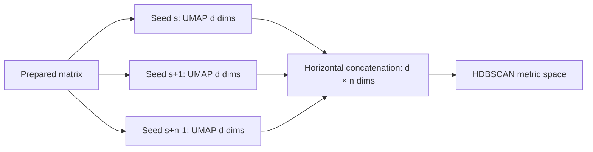

# 8. Repeated stochastic embeddings and concatenated geometry

*Guiding question:* **Why fit more than one seeded layout, and what geometry results from concatenating them?**

Prerequisites: 7.

## Why the question matters

Repeats expose and aggregate stochastic layouts, but raw concatenation does not align coordinate axes or prove consensus.

Freeze 3 records seed schedules and returns a raw horizontal concatenation; it does not persist per-seed or full concatenated arrays as files.

This chapter develops the question in the order needed for a reader to move from statistical principle to current implementation, retained evidence, and a defensible statement. Its central worked task is: Prove the squared-distance sum identity for two two-dimensional runs, then rescale one run and recalculate its contribution.

## Learning objectives

After completing Chapter 8, the reader can:

1. define UMAP cross-entropy and explain its role without exceeding the stated caution;
2. define seed schedule and explain its role without exceeding the stated caution;
3. define concatenated geometry and explain its role without exceeding the stated caution;
4. define floating-point reproducibility and explain its role without exceeding the stated caution;
5. trace the relevant package functions and generated artifacts;
6. complete the worked task and distinguish observation from interpretation.

## Conceptual and mathematical development

### UMAP cross-entropy

Low-dimensional layout objective balancing represented and absent fuzzy edges. A compact notation is `C=sum_ij [w_ij log(w_ij/v_ij)+(1-w_ij)log((1-w_ij)/(1-v_ij))]`. In practical terms, optimization is stochastic and coordinates are non-identifiable up to layout symmetries. [@mcinnes2018umap]

Within Freeze 3 RC1 the concept is connected to `_fit_one` and is visible through `visualization_embedding.tsv`. This connection is narrower than the general statistical idea: software evidence establishes the implemented route, while the mapped primary or internal evidence supplies background authority. The distinction prevents a mathematical definition from being mistaken for proof that a particular scientific interpretation is correct.

### seed schedule

Deterministic list controlling repeated stochastic fits. A compact notation is `legacy: 1,...,S; current: r,...,r+S-1`. In practical terms, recorded seeds permit replay but do not guarantee cross-platform bitwise identity. [@reproduciblesum2015]

Within Freeze 3 RC1 the concept is connected to `ensemble_seeds` and is visible through `embedding_manifest.json`. This connection is narrower than the general statistical idea: software evidence establishes the implemented route, while the mapped primary or internal evidence supplies background authority. The distinction prevents a mathematical definition from being mistaken for proof that a particular scientific interpretation is correct.

### concatenated geometry

Horizontal concatenation of s embeddings with q components. A compact notation is `Y*=[Y^(1)|...|Y^(S)] in R^(p x Sq)`. In practical terms, squared Euclidean distances add across runs, so unaligned rotations/scales influence the aggregate.

Within Freeze 3 RC1 the concept is connected to `run_repeated_umap` and is visible through `embedding.npy`. This connection is narrower than the general statistical idea: software evidence establishes the implemented route, while the mapped primary or internal evidence supplies background authority. The distinction prevents a mathematical definition from being mistaken for proof that a particular scientific interpretation is correct.

### floating-point reproducibility

Dependence of finite-precision results on operation order and platform. A compact notation is `fl((a+b)+c) may differ from fl(a+(b+c))`. In practical terms, pinned dependencies improve control but do not guarantee universal bitwise equality. [@reproduciblesum2015]

Within Freeze 3 RC1 the concept is connected to `capture_environment` and is visible through `environment.json`. This connection is narrower than the general statistical idea: software evidence establishes the implemented route, while the mapped primary or internal evidence supplies background authority. The distinction prevents a mathematical definition from being mistaken for proof that a particular scientific interpretation is correct.

## Reconstructed operational foundation

Edition 1 contained the following verified operational material in separate short notes. Edition 2 consolidates it here and subjects it to the concept and evidence boundaries above.

### Evidence retained from former Chapter 6

### Operational foundation

UMAP is a nonlinear neighborhood-based embedding method; densMAP augments its objective to encourage correspondence in local density. DIMPLE-GWAS repeats seeded embeddings because one stochastic optimization can be sensitive to initialization. It concatenates the repeated coordinates so HDBSCAN receives information from all executed repeats. Density clustering is attractive because it can represent irregular clusters and explicitly leave low-density observations unassigned.

The rationale is empirical, not a mathematical guarantee. Concatenation does not prove that stochasticity has vanished, that Euclidean distances estimate an exact expectation, that ‘true topology’ has been recovered, or that a formal consensus partition has been computed. Base parameters, number and sequence of seeds, implementation versions, numerical libraries, hardware, threads, and the input matrix all remain part of the result.

### Retained evidence

Edition 2 Lab 1 uses one repeated seed for speed; Edition 2 Lab 2 uses two. The production standard declares 1,000. These are tutorial value, tutorial value, and configuration default—not interchangeable recommendations.

### Output-reading checkpoint

Inspect the resolved UMAP parameters, `random_seeds`, package versions, thread settings, projection-quality fields, and HDBSCAN metric in the manifest/candidate table.

### Misinterpretations to avoid

Do not interpret a clean 2D plot as proof that the concatenated representation is stable. Do not increase repeats without estimating compute and storage consequences. Do not call label `-1` a failed phenotype.

### Boundary inherited from Edition 1

Nonlinear embeddings can distort global distances, and density clustering is parameter dependent. Empirical stability should be assessed across justified perturbations and, for scientific conclusions, external or held-out evidence.

## Evidence and references

See McInnes et al. (2018), DOI 10.21105/joss.00861; Narayan et al. (2021), DOI 10.1038/s41587-020-00801-7; and Campello et al. (2015), DOI 10.1145/2733381.

### Evidence retained from former Chapter 17

### Operational foundation

For each UMAP family, Freeze 3 derives a deterministic sequence of integer seeds from the configured base state and repeat count. It executes one embedding per seed and horizontally concatenates the resulting `n_components` coordinates. With 1,000 repeats and three components, the HDBSCAN input has 3,000 coordinates per vector. A smaller display embedding is retained separately for selected-model visualization.

Repeats multiply UMAP work and concatenated-memory width. Standard mode uses the historical ensemble seed behavior and 1,000 repeats; the tutorials set one or two for bounded execution. `n_jobs`, Numba behavior, BLAS/OpenMP libraries, architecture, and thread scheduling can affect runtime and numerical detail. Reproducing seeds is necessary but not sufficient for bitwise cross-platform identity.

The representation is an empirical aggregation. It is not averaged coordinates, a formal consensus cluster, or a proof of expected-distance estimation.

## Evidence diagram or figure

*Repeated embeddings and concatenation. Editable source: `assets/diagrams/diagram_04_repeated_embeddings.mmd`.*

### Retained evidence

Edition 2 Lab 2's manifest lists seeds 42 and 43, three components per repeat, and four UMAP families. Each family therefore supplies a 24×6 concatenated matrix in memory; this matrix is not written to disk.

### Output-reading checkpoint

Inspect `random_seeds`, `umap_seeds`, `n_random_states`, `legacy_ensemble_seeds`, UMAP runtime, package versions, thread settings, and source hash.

### Misinterpretations to avoid

Do not confuse the three display columns with all repeated coordinates. Do not publish a runtime estimate by linearly scaling a JIT-heavy smoke test without qualification. Do not promise identical floating-point embeddings across machines.

### Boundary inherited from Edition 1

The full 164-IDP 1,000-seed run is pending Docker. Cross-platform acceptance should use exact label/schema checks where appropriate and tolerances/alignment for floating-point coordinates.

## Implementation trace

**`pipeline.setup_logger`** is defined at `dimple_gwas/pipeline.py:25` with signature `output_dir: str | Path`. Implementation callable for setup logger. It is reached from pipeline.run_search and connects to No package-defined dependency detected. Its direct artifact contract is logs/run.log; its explicit error surface is No explicit raise in this symbol; delegated calls may raise.. Test evidence is recorded as No direct symbol-name test reference; assess through caller/integration coverage. This is a B-tier contract, so the complete 20-field dossier is retained in the function atlas.

**`pipeline.run_search`** is defined at `dimple_gwas/pipeline.py:130` with signature `config: Mapping[str, Any], output_dir: str | Path, command: list[str] | None=None`. Execute preprocessing, repeated embeddings, candidate evaluation, scoring, retention, reporting, and provenance for one run. It is reached from cli._reproduce; cli.main and connects to hdbscan_runner.fit_hdbscan; io.read_table; metrics.embedding_quality_metrics; pipeline._annotation_frame; pipeline._evaluate_one; pipeline._failed_row; pipeline.setup_logger; preprocessing.prepare_analysis_matrix; provenance.base_manifest; provenance.file_record; ranking.family_summaries; ranking.pareto_front; ranking.rank_models; ranking.top_models; reporting.write_model_outputs; reporting.write_resolved_config; reporting.write_search_space; scoring.apply_scoring; search_space.enumerate_candidates; search_space.stable_identifier; umap_runner.run_repeated_umap. Its direct artifact contract is No direct canonical artifact; in-memory/supporting result; its explicit error surface is RuntimeError; ValueError. Test evidence is recorded as tests/test_pipeline_integration.py::test_custom_leaf_eom_metric_and_max_size_run; tests/test_pipeline_integration.py::test_fixed_model_reproduction. This is a A-tier contract, so the complete 20-field dossier is retained in the function atlas.

**`provenance.sha256_file`** is defined at `dimple_gwas/provenance.py:17` with signature `path: str | Path`. Implementation callable for sha256 file. It is reached from interpretation._native_sources; provenance.file_record; reporting._top_artifact; validation.run_validation and connects to No package-defined dependency detected. Its direct artifact contract is No direct canonical artifact; in-memory/supporting result; its explicit error surface is No explicit raise in this symbol; delegated calls may raise.. Test evidence is recorded as tests/test_failure_and_provenance.py::test_authoritative_source_hash_unchanged. This is a B-tier contract, so the complete 20-field dossier is retained in the function atlas.

**`provenance.package_versions`** is defined at `dimple_gwas/provenance.py:25` with signature `names: Iterable[str] | None=None`. Implementation callable for package versions. It is reached from provenance.base_manifest and connects to No package-defined dependency detected. Its direct artifact contract is No direct canonical artifact; in-memory/supporting result; its explicit error surface is No explicit raise in this symbol; delegated calls may raise.. Test evidence is recorded as No direct symbol-name test reference; assess through caller/integration coverage. This is a B-tier contract, so the complete 20-field dossier is retained in the function atlas.

**`provenance.utc_now`** is defined at `dimple_gwas/provenance.py:40` with signature `class construction/data container`. Implementation callable for utc now. It is reached from comparison.run_comparison; interpretation.run_explanation; provenance.base_manifest; reporting.write_model_outputs; validation.run_validation and connects to No package-defined dependency detected. Its direct artifact contract is No direct canonical artifact; in-memory/supporting result; its explicit error surface is No explicit raise in this symbol; delegated calls may raise.. Test evidence is recorded as No direct symbol-name test reference; assess through caller/integration coverage. This is a B-tier contract, so the complete 20-field dossier is retained in the function atlas.

**`provenance.file_record`** is defined at `dimple_gwas/provenance.py:44` with signature `path: str | Path`. Implementation callable for file record. It is reached from comparison.run_comparison; interpretation.run_explanation; pipeline.run_search; reporting._top_artifact; reporting.write_model_outputs; validation.run_validation and connects to comparison._columns.<locals>.resolve; provenance.sha256_file. Its direct artifact contract is No direct canonical artifact; in-memory/supporting result; its explicit error surface is No explicit raise in this symbol; delegated calls may raise.. Test evidence is recorded as No direct symbol-name test reference; assess through caller/integration coverage. This is a B-tier contract, so the complete 20-field dossier is retained in the function atlas.

**`provenance.package_source_digest`** is defined at `dimple_gwas/provenance.py:53` with signature `class construction/data container`. Compute a stable hash over package source files for non-Git source identity. It is reached from provenance.base_manifest and connects to comparison._columns.<locals>.resolve. Its direct artifact contract is No direct canonical artifact; in-memory/supporting result; its explicit error surface is No explicit raise in this symbol; delegated calls may raise.. Test evidence is recorded as tests/test_freeze3_comparison_validation.py::test_package_source_digest_is_stable. This is a A-tier contract, so the complete 20-field dossier is retained in the function atlas.

**`provenance.base_manifest`** is defined at `dimple_gwas/provenance.py:66` with signature `command: list[str] | None=None`. Implementation callable for base manifest. It is reached from comparison.run_comparison; interpretation.run_explanation; pipeline.run_search; validation.run_validation and connects to provenance.package_source_digest; provenance.package_versions; provenance.utc_now. Its direct artifact contract is No direct canonical artifact; in-memory/supporting result; its explicit error surface is No explicit raise in this symbol; delegated calls may raise.. Test evidence is recorded as No direct symbol-name test reference; assess through caller/integration coverage. This is a A-tier contract, so the complete 20-field dossier is retained in the function atlas.

**`umap_runner.ensemble_seeds`** is defined at `dimple_gwas/umap_runner.py:32` with signature `parameters: Mapping[str, Any], repeats: int, legacy_sequence: bool`. Generate the exact repeated-embedding seed sequence under current or legacy scheduling. It is reached from umap_runner.run_repeated_umap and connects to No package-defined dependency detected. Its direct artifact contract is No direct canonical artifact; in-memory/supporting result; its explicit error surface is No explicit raise in this symbol; delegated calls may raise.. Test evidence is recorded as No direct symbol-name test reference; assess through caller/integration coverage. This is a A-tier contract, so the complete 20-field dossier is retained in the function atlas.

**`umap_runner.run_repeated_umap`** is defined at `dimple_gwas/umap_runner.py:39` with signature `matrix, parameters: Mapping[str, Any], repeats: int, n_jobs: int, legacy_sequence: bool`. Fit repeated UMAP/densMAP representations and concatenate their coordinates. It is reached from pipeline.run_search and connects to umap_runner._fit_one; umap_runner.ensemble_seeds. Its direct artifact contract is No direct canonical artifact; in-memory/supporting result; its explicit error surface is ValueError. Test evidence is recorded as No direct symbol-name test reference; assess through caller/integration coverage. This is a A-tier contract, so the complete 20-field dossier is retained in the function atlas.

## Claim adjudication notebook

The following statements are admitted to the draft only in their safe form:

- **PIPE-002 (reject):** Repeated seeded embeddings are concatenated as an empirical representation strategy; the implementation supplies no theorem that it eliminates stochasticity or recovers true topology. [@mcinnes2018umap] Limitation: Parameters, layout symmetries, libraries, and hardware still matter. Implementation evidence: `umap_runner.py`.

- **METH-003 (implementation_specific):** Freeze 3 concatenates raw run coordinates without Procrustes alignment; squared Euclidean distances therefore sum run-specific distances but remain sensitive to run scale and layout. [@mcinnes2018umap; @gower1975] Limitation: Rotation preserves within-run Euclidean distance; scale does not. Implementation evidence: `umap_runner.py`.

## Worked reasoning and evidence exercise

Prove the squared-distance sum identity for two two-dimensional runs, then rescale one run and recalculate its contribution.

A complete Chapter 8 answer must expose its intermediate reasoning, name the source or output used for `Repeated stochastic embeddings and concatenated geometry`, and finish with separate support and non-support statements. Applying that discipline to the question “Why fit more than one seeded layout, and what geometry results from concatenating them?” prevents a calculation, a software observation, and a scientific interpretation from collapsing into one claim.

## Assumptions, diagnostics, and recovery

The Chapter 8 analysis assumes the stated unit and inputs, the recorded configuration and software identity, and a diagnostic that addresses the claimed property rather than a convenient surrogate. Its decisive boundary is: Freeze 3 records seed schedules and returns a raw horizontal concatenation; it does not persist per-seed or full concatenated arrays as files.

If the Chapter 8 route fails, retain its log and candidate status before deciding whether the cause is input, configuration, dependency, compute, identifier alignment, or output-root state. Correct an operational failure by writing a new result directory. Treat instability in `Repeated stochastic embeddings and concatenated geometry` as sensitivity evidence: report it and identify the independent evidence needed instead of relabeling ambiguity as a software exception.

## Chapter synthesis

Repeats expose and aggregate stochastic layouts, but raw concatenation does not align coordinate axes or prove consensus. The implementation trace makes the current behavior auditable, but the evidence boundary remains part of the result. Chapter 9 places density clustering on the concatenated representation.

## Exercises

1. For `Repeated stochastic embeddings and concatenated geometry`, name the unit of analysis and one plausible but invalid substitute.
2. Reconstruct the notation for UMAP cross-entropy; define its dimensions or denominator and interpret every term.
3. Choose a Tier A function mapped to Chapter 8; identify its caller and direct output, then propose a topic-specific edge case.
4. Select one Chapter 8 artifact from the output atlas and state three integrity checks that must precede scientific reading.
5. Convert a tempting `Repeated stochastic embeddings and concatenated geometry` overclaim into one observed statement followed by its limitation.
6. Prove the squared-distance sum identity for two two-dimensional runs, then rescale one run and recalculate its contribution.

Appendix J gives the Chapter 8 adjudication guide. Its further-reading keys supply statistical context; no external paper is treated as automatic validation of the current software or dataset.
