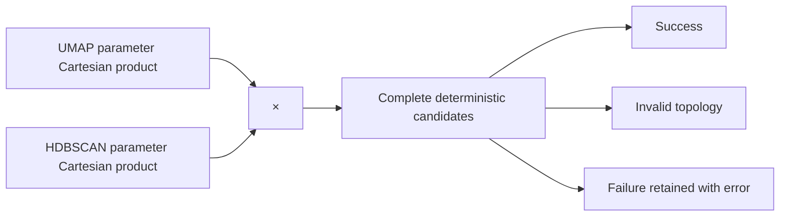

# 9. HDBSCAN hierarchy, density, selection, and noise

*Guiding question:* **How does HDBSCAN turn local density into a hierarchy and a flat partition?**

Prerequisites: 5,8.

## Why the question matters

A stable density branch can be useful without making every point belong to a cluster.

Freeze 3 delegates fitting to the contributed `hdbscan` package and records outputs; label −1 remains parameter-conditional unassignment.

This chapter develops the question in the order needed for a reader to move from statistical principle to current implementation, retained evidence, and a defensible statement. Its central worked task is: Calculate core distances and mutual reachability for a six-point line, then predict how raising `min_samples` changes the density scale.

## Learning objectives

After completing Chapter 9, the reader can:

1. define core distance and explain its role without exceeding the stated caution;
2. define mutual reachability and explain its role without exceeding the stated caution;
3. define HDBSCAN stability and explain its role without exceeding the stated caution;
4. define noise label and explain its role without exceeding the stated caution;
5. trace the relevant package functions and generated artifacts;
6. complete the worked task and distinguish observation from interpretation.

## Conceptual and mathematical development

### core distance

Distance from a point to its min_samples-th neighbor. A compact notation is `core_k(x)`. In practical terms, larger min_samples changes the density scale and may increase unassigned points. [@campello2015hdbscan]

Within Freeze 3 RC1 the concept is connected to `fit_hdbscan (hdbscan delegate)` and is visible through `candidate labels`. This connection is narrower than the general statistical idea: software evidence establishes the implemented route, while the mapped primary or internal evidence supplies background authority. The distinction prevents a mathematical definition from being mistaken for proof that a particular scientific interpretation is correct.

### mutual reachability

Density-aware dissimilarity used by hdbscan. A compact notation is `d_mr(a,b)=max(core_k(a),core_k(b),d(a,b))`. In practical terms, it smooths single-linkage effects without removing parameter dependence. [@campello2015hdbscan]

Within Freeze 3 RC1 the concept is connected to `fit_hdbscan` and is visible through `condensed tree state`. This connection is narrower than the general statistical idea: software evidence establishes the implemented route, while the mapped primary or internal evidence supplies background authority. The distinction prevents a mathematical definition from being mistaken for proof that a particular scientific interpretation is correct.

### HDBSCAN stability

Persistence of a cluster through the density hierarchy. A compact notation is `Stability(C)=sum_(x in C)(lambda_x-lambda_birth)`. In practical terms, the library computes the hierarchy; Freeze 3 records persistence summaries. [@campello2015hdbscan; @mcinnes2017hdbscan]

Within Freeze 3 RC1 the concept is connected to `fit_hdbscan; evaluate_candidate` and is visible through `model_table.csv`. This connection is narrower than the general statistical idea: software evidence establishes the implemented route, while the mapped primary or internal evidence supplies background authority. The distinction prevents a mathematical definition from being mistaken for proof that a particular scientific interpretation is correct.

### noise label

Label -1 for points unassigned under a fitted density model. A compact notation is `label_i=-1`. In practical terms, noise is algorithmic and parameter-conditional, never a biological-null statement. [@campello2015hdbscan]

Within Freeze 3 RC1 the concept is connected to `fit_hdbscan` and is visible through `labels.tsv`. This connection is narrower than the general statistical idea: software evidence establishes the implemented route, while the mapped primary or internal evidence supplies background authority. The distinction prevents a mathematical definition from being mistaken for proof that a particular scientific interpretation is correct.

## Reconstructed operational foundation

Edition 1 contained the following verified operational material in separate short notes. Edition 2 consolidates it here and subjects it to the concept and evidence boundaries above.

### Evidence retained from former Chapter 18

### Operational foundation

Freeze 3 fits the contributed `hdbscan` package to each concatenated embedding. `min_cluster_size` sets the smallest extracted group, while `min_samples` affects core distances and conservativeness. `cluster_selection_epsilon` can merge fine structure below a distance threshold. `cluster_selection_method` is `eom` or `leaf`; `max_cluster_size` has no effect for leaf selection and is recorded with a parameter note when set. Other exposed controls are persistence, alpha, single-cluster permission, maximum cluster size, and metric.

The standard grid uses min-cluster-size 5 through 49, min-samples 2 through 19, and epsilon 0,1,2: 2,430 candidates. Candidate identity also includes UMAP family. Every evaluation becomes `success`, `invalid_topology` when fewer than two non-noise clusters are found, or `failed` with an error. Failure rows are retained, not removed.

## Evidence diagram or figure

*Complete search-space enumeration. Editable source: `assets/diagrams/diagram_05_search_space.mmd`.*

### Retained evidence

Edition 2 Lab 2 evaluates min-cluster-size 4/6, min-samples 2/4, epsilon 0/0.05, and scalar EOM/Euclidean settings across four UMAP families. All 32 candidates succeeded and produced three clusters with no noise.

### Output-reading checkpoint

Inspect `hdbscan_id`, flattened parameters, status, error message, cluster/noise counts, persistence summaries, metric warnings, candidate runtime, and `model_failures.tsv`.

### Misinterpretations to avoid

Do not interpret increasing `min_samples` as universally better. Do not use numeric cluster labels as stable identity across fits. Do not call noise observations false or biologically irrelevant.

### Boundary inherited from Edition 1

Density structure depends on the concatenated representation and metric. A grid can expose sensitivity but does not identify a uniquely correct biological scale.

## Evidence and references

See Campello et al. (2015), DOI 10.1145/2733381; McInnes et al. (2017), DOI 10.21105/joss.00205; and official hdbscan API documentation.

### Evidence retained from former Chapter 28

### Operational foundation

HDBSCAN label `-1` means that the fitted hierarchy/extraction did not assign an observation to a retained cluster under the current representation, metric, density parameters, and selection method. It is an algorithmic status, not a biological category. Changing UMAP parameters, seed aggregation, min-cluster-size, min-samples, epsilon, metric, or selection method can change the noise set.

Inspect unassigned observations rather than discarding them rhetorically. Report count/fraction, exact IDs, probabilities/persistence when available, original-space relationships, stability across justified settings, and transitions in comparison outputs. Use ‘unassigned’ or ‘HDBSCAN noise’ with the condition attached. Avoid ‘non-pleiotropic,’ ‘failed IDP,’ ‘irrelevant,’ or ‘no shared structure.’

### Retained evidence

The synthetic tutorials have zero noise. The historical 164-IDP record has 102 unassigned and 62 assigned across five clusters; this is historical evidence and does not imply 102 biologically irrelevant IDPs.

### Output-reading checkpoint

Inspect label tables, noise count/fraction, candidate parameters, membership comparison, changed-noise status, exclusions under noise policy, and historical source status.

### Misinterpretations to avoid

Do not drop noise before reporting its magnitude. Do not compare noise labels without exact IDs. Do not treat absence of assigned cluster as absence of any genetic correlation.

### Boundary inherited from Edition 1

Freeze 3 does not provide a calibrated biological uncertainty interval for each label. Stability and external data must be studied separately.

## Evidence and references

See Campello et al. (2015), DOI 10.1145/2733381.

## Implementation trace

**`hdbscan_runner.estimator_kwargs`** is defined at `dimple_gwas/hdbscan_runner.py:15` with signature `parameters: Mapping[str, Any], core_dist_n_jobs: int=1`. Implementation callable for estimator kwargs. It is reached from hdbscan_runner.fit_hdbscan and connects to No package-defined dependency detected. Its direct artifact contract is No direct canonical artifact; in-memory/supporting result; its explicit error surface is No explicit raise in this symbol; delegated calls may raise.. Test evidence is recorded as No direct symbol-name test reference; assess through caller/integration coverage. This is a B-tier contract, so the complete 20-field dossier is retained in the function atlas.

**`hdbscan_runner.fit_hdbscan`** is defined at `dimple_gwas/hdbscan_runner.py:34` with signature `embedding, parameters: Mapping[str, Any], core_dist_n_jobs: int=1`. Fit contributed HDBSCAN with normalized Freeze 3 parameters. It is reached from pipeline._evaluate_one; pipeline.run_search and connects to hdbscan_runner.estimator_kwargs. Its direct artifact contract is No direct canonical artifact; in-memory/supporting result; its explicit error surface is No explicit raise in this symbol; delegated calls may raise.. Test evidence is recorded as tests/test_failure_and_provenance.py::test_failed_candidate_is_retained. This is a A-tier contract, so the complete 20-field dossier is retained in the function atlas.

**`metrics.effective_neighbor_count`** is defined at `dimple_gwas/metrics.py:9` with signature `n_samples: int, requested: int`. Implementation callable for effective neighbor count. It is reached from metrics.embedding_quality_metrics and connects to No package-defined dependency detected. Its direct artifact contract is No direct canonical artifact; in-memory/supporting result; its explicit error surface is No explicit raise in this symbol; delegated calls may raise.. Test evidence is recorded as tests/test_preprocessing_metrics.py::test_effective_neighbor_edge_cases. This is a B-tier contract, so the complete 20-field dossier is retained in the function atlas.

**`metrics.embedding_quality_metrics`** is defined at `dimple_gwas/metrics.py:15` with signature `original, embedding, requested_k: int, max_samples: int, seed: int`. Calculate bounded trustworthiness and continuity diagnostics for an embedding. It is reached from interpretation.run_explanation; pipeline.run_search and connects to metrics.effective_neighbor_count. Its direct artifact contract is No direct canonical artifact; in-memory/supporting result; its explicit error surface is No explicit raise in this symbol; delegated calls may raise.. Test evidence is recorded as tests/test_preprocessing_metrics.py::test_optimized_trustworthiness_and_continuity. This is a A-tier contract, so the complete 20-field dossier is retained in the function atlas.

**`metrics.evaluate_candidate`** is defined at `dimple_gwas/metrics.py:60` with signature `embedding, labels, clusterer, silhouette_metric: str, fit_include_noise: bool, compute_dbcv: bool, max_samples_silhouette: int=0, silhouette_seed: int=42`. Compute cluster counts, persistence, silhouette, CH, DB, optional DBCV, and validity status for one candidate. It is reached from pipeline._evaluate_one and connects to metrics._cluster_sizes. Its direct artifact contract is No direct canonical artifact; in-memory/supporting result; its explicit error surface is No explicit raise in this symbol; delegated calls may raise.. Test evidence is recorded as No direct symbol-name test reference; assess through caller/integration coverage. This is a A-tier contract, so the complete 20-field dossier is retained in the function atlas.

**`metrics.is_finite_number`** is defined at `dimple_gwas/metrics.py:165` with signature `value: Any`. Implementation callable for is finite number. It is reached from CLI/import/direct caller or no package caller detected and connects to No package-defined dependency detected. Its direct artifact contract is No direct canonical artifact; in-memory/supporting result; its explicit error surface is No explicit raise in this symbol; delegated calls may raise.. Test evidence is recorded as No direct symbol-name test reference; assess through caller/integration coverage. This is a B-tier contract, so the complete 20-field dossier is retained in the function atlas.

**`pipeline.setup_logger`** is defined at `dimple_gwas/pipeline.py:25` with signature `output_dir: str | Path`. Implementation callable for setup logger. It is reached from pipeline.run_search and connects to No package-defined dependency detected. Its direct artifact contract is logs/run.log; its explicit error surface is No explicit raise in this symbol; delegated calls may raise.. Test evidence is recorded as No direct symbol-name test reference; assess through caller/integration coverage. This is a B-tier contract, so the complete 20-field dossier is retained in the function atlas.

**`pipeline.run_search`** is defined at `dimple_gwas/pipeline.py:130` with signature `config: Mapping[str, Any], output_dir: str | Path, command: list[str] | None=None`. Execute preprocessing, repeated embeddings, candidate evaluation, scoring, retention, reporting, and provenance for one run. It is reached from cli._reproduce; cli.main and connects to hdbscan_runner.fit_hdbscan; io.read_table; metrics.embedding_quality_metrics; pipeline._annotation_frame; pipeline._evaluate_one; pipeline._failed_row; pipeline.setup_logger; preprocessing.prepare_analysis_matrix; provenance.base_manifest; provenance.file_record; ranking.family_summaries; ranking.pareto_front; ranking.rank_models; ranking.top_models; reporting.write_model_outputs; reporting.write_resolved_config; reporting.write_search_space; scoring.apply_scoring; search_space.enumerate_candidates; search_space.stable_identifier; umap_runner.run_repeated_umap. Its direct artifact contract is No direct canonical artifact; in-memory/supporting result; its explicit error surface is RuntimeError; ValueError. Test evidence is recorded as tests/test_pipeline_integration.py::test_custom_leaf_eom_metric_and_max_size_run; tests/test_pipeline_integration.py::test_fixed_model_reproduction. This is a A-tier contract, so the complete 20-field dossier is retained in the function atlas.

## Claim adjudication notebook

The following statements are admitted to the draft only in their safe form:

- **PIPE-004 (implementation_specific):** Freeze 3 calls the contributed hdbscan package, not sklearn.cluster.HDBSCAN. [@campello2015hdbscan; @mcinnes2017hdbscan] Limitation: Backends with similar names can differ in semantics. Implementation evidence: `hdbscan_runner.py`.

- **INT-002 (reject):** Label -1 means unassigned under the fitted representation, metric, density assumptions, and parameters. [@campello2015hdbscan] Limitation: Noise status can change across candidate settings. Implementation evidence: `hdbscan_runner.py`.

## Worked reasoning and evidence exercise

Calculate core distances and mutual reachability for a six-point line, then predict how raising `min_samples` changes the density scale.

A complete Chapter 9 answer must expose its intermediate reasoning, name the source or output used for `HDBSCAN hierarchy, density, selection, and noise`, and finish with separate support and non-support statements. Applying that discipline to the question “How does HDBSCAN turn local density into a hierarchy and a flat partition?” prevents a calculation, a software observation, and a scientific interpretation from collapsing into one claim.

## Assumptions, diagnostics, and recovery

The Chapter 9 analysis assumes the stated unit and inputs, the recorded configuration and software identity, and a diagnostic that addresses the claimed property rather than a convenient surrogate. Its decisive boundary is: Freeze 3 delegates fitting to the contributed `hdbscan` package and records outputs; label −1 remains parameter-conditional unassignment.

If the Chapter 9 route fails, retain its log and candidate status before deciding whether the cause is input, configuration, dependency, compute, identifier alignment, or output-root state. Correct an operational failure by writing a new result directory. Treat instability in `HDBSCAN hierarchy, density, selection, and noise` as sensitivity evidence: report it and identify the independent evidence needed instead of relabeling ambiguity as a software exception.

## Chapter synthesis

A stable density branch can be useful without making every point belong to a cluster. The implementation trace makes the current behavior auditable, but the evidence boundary remains part of the result. Chapter 10 converts UMAP and HDBSCAN parameter families into auditable candidates.

## Exercises

1. For `HDBSCAN hierarchy, density, selection, and noise`, name the unit of analysis and one plausible but invalid substitute.
2. Reconstruct the notation for core distance; define its dimensions or denominator and interpret every term.
3. Choose a Tier A function mapped to Chapter 9; identify its caller and direct output, then propose a topic-specific edge case.
4. Select one Chapter 9 artifact from the output atlas and state three integrity checks that must precede scientific reading.
5. Convert a tempting `HDBSCAN hierarchy, density, selection, and noise` overclaim into one observed statement followed by its limitation.
6. Calculate core distances and mutual reachability for a six-point line, then predict how raising `min_samples` changes the density scale.

Appendix J gives the Chapter 9 adjudication guide. Its further-reading keys supply statistical context; no external paper is treated as automatic validation of the current software or dataset.
