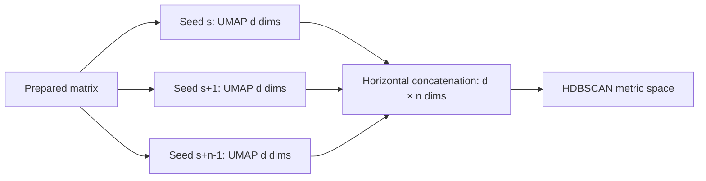

# 10. Search-space enumeration and computational design

*Guiding question:* **How many models will a configuration request, and which work is shared across them?**

Prerequisites: 8–9.

## Why the question matters

A Cartesian grid is transparent but can grow faster than intuition; deterministic enumeration does not make an oversized run wise.

The standard HDBSCAN grid is 2,430 candidates for one UMAP configuration; custom and extended modes have different, exactly enumerated counts.

This chapter develops the question in the order needed for a reader to move from statistical principle to current implementation, retained evidence, and a defensible statement. Its central worked task is: Calculate the 32 candidates in Lab 2, separate four UMAP families from eight HDBSCAN settings, and estimate the number of UMAP fits.

## Learning objectives

After completing Chapter 10, the reader can:

1. define seed schedule and explain its role without exceeding the stated caution;
2. define Cartesian search and explain its role without exceeding the stated caution;
3. define candidate identity and explain its role without exceeding the stated caution;
4. trace the relevant package functions and generated artifacts;
5. complete the worked task and distinguish observation from interpretation.

## Conceptual and mathematical development

### seed schedule

Deterministic list controlling repeated stochastic fits. A compact notation is `legacy: 1,...,S; current: r,...,r+S-1`. In practical terms, recorded seeds permit replay but do not guarantee cross-platform bitwise identity. [@reproduciblesum2015]

Within Freeze 3 RC1 the concept is connected to `ensemble_seeds` and is visible through `embedding_manifest.json`. This connection is narrower than the general statistical idea: software evidence establishes the implemented route, while the mapped primary or internal evidence supplies background authority. The distinction prevents a mathematical definition from being mistaken for proof that a particular scientific interpretation is correct.

### Cartesian search

Product of enumerated parameter families. A compact notation is `N_candidates=product_j |Theta_j|`. In practical terms, the standard grid is 45 x 18 x 3 = 2,430 for one UMAP family.

Within Freeze 3 RC1 the concept is connected to `enumerate_candidates` and is visible through `search_space.tsv`. This connection is narrower than the general statistical idea: software evidence establishes the implemented route, while the mapped primary or internal evidence supplies background authority. The distinction prevents a mathematical definition from being mistaken for proof that a particular scientific interpretation is correct.

### candidate identity

Deterministic hash and ordinal for a resolved parameter combination. A compact notation is `model_id=H(canonical parameters)`. In practical terms, identity supports replay; it is not a quality score.

Within Freeze 3 RC1 the concept is connected to `candidate_identity` and is visible through `search_space.tsv; model_table.csv`. This connection is narrower than the general statistical idea: software evidence establishes the implemented route, while the mapped primary or internal evidence supplies background authority. The distinction prevents a mathematical definition from being mistaken for proof that a particular scientific interpretation is correct.

## Reconstructed operational foundation

Edition 1 contained the following verified operational material in separate short notes. Edition 2 consolidates it here and subjects it to the concept and evidence boundaries above.

### Evidence retained from former Chapter 12

### Operational foundation

`inspect-config` resolves and validates configuration and prints candidate counts without fitting. `show-search-space` enumerates the complete deterministic Cartesian product and can retain full TSV/JSON manifests. These commands are mandatory preflight tools: they expose accidental explosions, invalid fields, and misunderstood ranges before UMAP consumes compute.

```bash
dimple-gwas show-search-space \
  --search-mode custom \
  --config docs/textbook/edition2/labs/02_custom_search_space/tutorial_config.yaml \
  --output-dir docs/textbook/edition2/labs/02_custom_search_space/search_space_new \
  --show-first 5
```

Choose a new output directory name; the manual's executed directory is evidence, not a scratch target. Standard mode proves 45 min-cluster-size choices × 18 min-samples choices × 3 epsilon choices = 2,430 candidates for one UMAP family. Shipped extended mode has 1,728 candidates, not the older provisional 5,184 number.

### Retained evidence

Executed Edition 2 Lab 1 enumerated one candidate; Edition 2 Lab 2 enumerated 32: four UMAP families times eight HDBSCAN configurations. Both counts appear in stdout and complete manifests.

### Output-reading checkpoint

Inspect `candidate_models`, UMAP/HDBSCAN family counts, candidate ordinals, stable IDs, and the first/last parameter rows. Retain config and manifest checksums together.

### Misinterpretations to avoid

Do not estimate workload from HDBSCAN choices alone when UMAP parameters also vary. Do not silently sample a large Cartesian product; Freeze 3's safety ceiling raises rather than sampling.

### Boundary inherited from Edition 1

Candidate count is not runtime by itself: repeated UMAP families dominate some workloads while HDBSCAN candidate fits dominate others. Pilot evidence is still needed.

### Evidence retained from former Chapter 17

### Operational foundation

For each UMAP family, Freeze 3 derives a deterministic sequence of integer seeds from the configured base state and repeat count. It executes one embedding per seed and horizontally concatenates the resulting `n_components` coordinates. With 1,000 repeats and three components, the HDBSCAN input has 3,000 coordinates per vector. A smaller display embedding is retained separately for selected-model visualization.

Repeats multiply UMAP work and concatenated-memory width. Standard mode uses the historical ensemble seed behavior and 1,000 repeats; the tutorials set one or two for bounded execution. `n_jobs`, Numba behavior, BLAS/OpenMP libraries, architecture, and thread scheduling can affect runtime and numerical detail. Reproducing seeds is necessary but not sufficient for bitwise cross-platform identity.

The representation is an empirical aggregation. It is not averaged coordinates, a formal consensus cluster, or a proof of expected-distance estimation.

## Evidence diagram or figure




*Repeated embeddings and concatenation. Editable source: `assets/diagrams/diagram_04_repeated_embeddings.mmd`.*

### Retained evidence

Edition 2 Lab 2's manifest lists seeds 42 and 43, three components per repeat, and four UMAP families. Each family therefore supplies a 24×6 concatenated matrix in memory; this matrix is not written to disk.

### Output-reading checkpoint

Inspect `random_seeds`, `umap_seeds`, `n_random_states`, `legacy_ensemble_seeds`, UMAP runtime, package versions, thread settings, and source hash.

### Misinterpretations to avoid

Do not confuse the three display columns with all repeated coordinates. Do not publish a runtime estimate by linearly scaling a JIT-heavy smoke test without qualification. Do not promise identical floating-point embeddings across machines.

### Boundary inherited from Edition 1

The full 164-IDP 1,000-seed run is pending Docker. Cross-platform acceptance should use exact label/schema checks where appropriate and tolerances/alignment for floating-point coordinates.

### Evidence retained from former Chapter 39

### Operational foundation

Freeze 3 enumerates the full Cartesian product of normalized UMAP and HDBSCAN parameter values. Candidate ordinals and stable hashes make enumeration auditable. It does not silently sample. `execution.max_candidate_models` is a hard safety ceiling; zero means unlimited. `warn_candidate_count` is a warning threshold.

Mode counts in this source are: standard 2,430 candidates (one UMAP family × 45 × 18 × 3 HDBSCAN values); fixed one candidate when all searched fields are scalar; Edition 2 Lab 2 custom 32; shipped extended 1,728. Extended crosses multiple UMAP and HDBSCAN fields, and its count must be derived from the current source rather than older planning documents.

Search work can reuse one repeated embedding across many HDBSCAN candidates sharing `umap_id`. Therefore candidate count, UMAP-family count, repeat count, sample/vector count, input width, metric, and thread settings all matter.

### Retained evidence

`show-search-space` writes the full flattened rows plus JSON counts. Compare the number of unique `umap_id` and `hdbscan_id` values with total candidate rows.

### Output-reading checkpoint

Inspect candidate ordinal/model/family IDs, every flattened parameter, declared enumeration note, safety settings, and checksum.

### Misinterpretations to avoid

Do not multiply only visibly changed YAML keys while ignoring inherited lists. Do not describe a truncated preview as the full manifest. Do not change the grid after examining desired labels without disclosure.

### Boundary inherited from Edition 1

Enumeration completeness is a software property, not a claim that the grid covers all meaningful models or that rank one is unique.

### Evidence retained from former Chapter 44

### Operational foundation

Workload has two nested scales: UMAP families × repeated seeds, then HDBSCAN candidates per family. Concatenated width is components × repeats; embedding storage in memory grows with vector count and that width. Original-space explanation may create a quadratic vector-by-vector similarity matrix and large heatmap. Candidate tables grow with the Cartesian product. JIT compilation makes first small runs slower than steady-state work.

Use `inspect-config`/`show-search-space` before execution. Start with the fixed fixture, then a bounded scientific pilot that preserves the intended method. Set `n_jobs` and `candidate_jobs` deliberately: when candidates run in parallel, Freeze 3 constrains HDBSCAN core-distance jobs to one to avoid nested oversubscription. Thread environment variables and numerical backends belong in provenance. Use the full-heatmap limit and avoid forcing large matrices without memory/privacy review.

The historical note records a 16-GB host caution. Current storage had ample space, but that is not a production resource recommendation. The executed 10.7-second/32-candidate and 273.47-second historical MNIST values are configuration-specific evidence, not scaling laws.

### Retained evidence

Estimate candidate count, UMAP-family count, concatenated width, model-table rows, and similarity-matrix cells for a proposed run. Then compare available memory/storage and choose one job setting before starting.

### Output-reading checkpoint

Inspect preflight counts, free storage, vector/input width, repeat/component counts, jobs/threads, UMAP/candidate runtimes, failure rates, Parquet status, and explanation matrix safeguards.

### Misinterpretations to avoid

Do not run the 164 1,000-seed workflow as an undocumented first smoke test. Do not set both job layers to unrestricted parallelism. Do not infer linear runtime from tiny fixtures.

### Boundary inherited from Edition 1

No fresh full-IDP runtime/memory benchmark exists yet. Docker profiling must precede cloud sizing and preserve scientific settings.

## Implementation trace

**`config.builtin_config`** is defined at `dimple_gwas/config.py:128` with signature `mode: str`. Implementation callable for builtin config. It is reached from config.resolve_config and connects to config._base_config. Its direct artifact contract is No direct canonical artifact; in-memory/supporting result; its explicit error surface is ValueError. Test evidence is recorded as No direct symbol-name test reference; assess through caller/integration coverage. This is a B-tier contract, so the complete 20-field dossier is retained in the function atlas.

**`config.deep_merge`** is defined at `dimple_gwas/config.py:164` with signature `base: Mapping[str, Any], overlay: Mapping[str, Any]`. Implementation callable for deep merge. It is reached from config.resolve_config and connects to No package-defined dependency detected. Its direct artifact contract is No direct canonical artifact; in-memory/supporting result; its explicit error surface is No explicit raise in this symbol; delegated calls may raise.. Test evidence is recorded as No direct symbol-name test reference; assess through caller/integration coverage. This is a B-tier contract, so the complete 20-field dossier is retained in the function atlas.

**`config.load_yaml`** is defined at `dimple_gwas/config.py:174` with signature `path: str | Path`. Implementation callable for load yaml. It is reached from config.resolve_config and connects to No package-defined dependency detected. Its direct artifact contract is No direct canonical artifact; in-memory/supporting result; its explicit error surface is FileNotFoundError; RuntimeError; ValueError. Test evidence is recorded as No direct symbol-name test reference; assess through caller/integration coverage. This is a B-tier contract, so the complete 20-field dossier is retained in the function atlas.

**`config.set_dotted`** is defined at `dimple_gwas/config.py:191` with signature `config: dict[str, Any], dotted: str, value: Any`. Implementation callable for set dotted. It is reached from config.resolve_config and connects to No package-defined dependency detected. Its direct artifact contract is No direct canonical artifact; in-memory/supporting result; its explicit error surface is No explicit raise in this symbol; delegated calls may raise.. Test evidence is recorded as No direct symbol-name test reference; assess through caller/integration coverage. This is a B-tier contract, so the complete 20-field dossier is retained in the function atlas.

**`config.resolve_config`** is defined at `dimple_gwas/config.py:203` with signature `mode: str, config_path: str | Path | None=None, overrides: Mapping[str, Any] | None=None`. Implementation callable for resolve config. It is reached from cli._explain; cli._reproduce; cli._resolved; cli._score and connects to config.builtin_config; config.deep_merge; config.load_yaml; config.set_dotted; config.validate_config. Its direct artifact contract is No direct canonical artifact; in-memory/supporting result; its explicit error surface is No explicit raise in this symbol; delegated calls may raise.. Test evidence is recorded as tests/test_config.py::test_cli_override_precedence; tests/test_config.py::test_fixed_mode_rejects_lists; tests/test_config.py::test_invalid_combinations_rejected; tests/test_config.py::test_standard_defaults_match_dev_declarations; tests/test_freeze3_interpretation.py::test_interpretation_defaults_are_additive; tests/test_freeze3_interpretation.py::test_invalid_interpretation_configuration_fails; tests/test_freeze3_interpretation.py::test_legacy_incomplete_matching_writes_exclusions; tests/test_freeze3_interpretation.py::test_native_explanation_end_to_end; tests/test_freeze3_interpretation.py::test_native_explanation_refuses_nonempty_output; tests/test_search_space.py::test_search_enumeration_and_stable_ids; tests/test_search_space.py::test_search_limit_never_silently_samples. This is a A-tier contract, so the complete 20-field dossier is retained in the function atlas.

**`config.as_list`** is defined at `dimple_gwas/config.py:277` with signature `value: Any, cast: type | None=None`. Implementation callable for as list. It is reached from config.normalized_parameter_space and connects to config._coerce_bool; config._range_values; config._string_sequence. Its direct artifact contract is No direct canonical artifact; in-memory/supporting result; its explicit error surface is ValueError. Test evidence is recorded as tests/test_config.py::test_scalar_list_and_range_handling. This is a B-tier contract, so the complete 20-field dossier is retained in the function atlas.

**`config.normalized_parameter_space`** is defined at `dimple_gwas/config.py:298` with signature `config: Mapping[str, Any]`. Implementation callable for normalized parameter space. It is reached from config.validate_config; search_space.count_candidates; search_space.enumerate_candidates and connects to config.as_list. Its direct artifact contract is No direct canonical artifact; in-memory/supporting result; its explicit error surface is ValueError. Test evidence is recorded as tests/test_config.py::test_cli_override_precedence. This is a A-tier contract, so the complete 20-field dossier is retained in the function atlas.

**`config.validate_config`** is defined at `dimple_gwas/config.py:343` with signature `config: Mapping[str, Any]`. Implementation callable for validate config. It is reached from cli._explain; cli._reproduce; config.resolve_config and connects to config._finite; config.normalized_parameter_space. Its direct artifact contract is No direct canonical artifact; in-memory/supporting result; its explicit error surface is ValueError. Test evidence is recorded as No direct symbol-name test reference; assess through caller/integration coverage. This is a A-tier contract, so the complete 20-field dossier is retained in the function atlas.

**`config.config_as_json`** is defined at `dimple_gwas/config.py:489` with signature `config: Mapping[str, Any]`. Implementation callable for config as json. It is reached from CLI/import/direct caller or no package caller detected and connects to No package-defined dependency detected. Its direct artifact contract is No direct canonical artifact; in-memory/supporting result; its explicit error surface is No explicit raise in this symbol; delegated calls may raise.. Test evidence is recorded as No direct symbol-name test reference; assess through caller/integration coverage. This is a B-tier contract, so the complete 20-field dossier is retained in the function atlas.

**`pipeline.setup_logger`** is defined at `dimple_gwas/pipeline.py:25` with signature `output_dir: str | Path`. Implementation callable for setup logger. It is reached from pipeline.run_search and connects to No package-defined dependency detected. Its direct artifact contract is logs/run.log; its explicit error surface is No explicit raise in this symbol; delegated calls may raise.. Test evidence is recorded as No direct symbol-name test reference; assess through caller/integration coverage. This is a B-tier contract, so the complete 20-field dossier is retained in the function atlas.

**`pipeline.run_search`** is defined at `dimple_gwas/pipeline.py:130` with signature `config: Mapping[str, Any], output_dir: str | Path, command: list[str] | None=None`. Execute preprocessing, repeated embeddings, candidate evaluation, scoring, retention, reporting, and provenance for one run. It is reached from cli._reproduce; cli.main and connects to hdbscan_runner.fit_hdbscan; io.read_table; metrics.embedding_quality_metrics; pipeline._annotation_frame; pipeline._evaluate_one; pipeline._failed_row; pipeline.setup_logger; preprocessing.prepare_analysis_matrix; provenance.base_manifest; provenance.file_record; ranking.family_summaries; ranking.pareto_front; ranking.rank_models; ranking.top_models; reporting.write_model_outputs; reporting.write_resolved_config; reporting.write_search_space; scoring.apply_scoring; search_space.enumerate_candidates; search_space.stable_identifier; umap_runner.run_repeated_umap. Its direct artifact contract is No direct canonical artifact; in-memory/supporting result; its explicit error surface is RuntimeError; ValueError. Test evidence is recorded as tests/test_pipeline_integration.py::test_custom_leaf_eom_metric_and_max_size_run; tests/test_pipeline_integration.py::test_fixed_model_reproduction. This is a A-tier contract, so the complete 20-field dossier is retained in the function atlas.

**`search_space.canonical_json`** is defined at `dimple_gwas/search_space.py:16` with signature `value: Any`. Implementation callable for canonical json. It is reached from search_space.stable_identifier and connects to No package-defined dependency detected. Its direct artifact contract is No direct canonical artifact; in-memory/supporting result; its explicit error surface is No explicit raise in this symbol; delegated calls may raise.. Test evidence is recorded as No direct symbol-name test reference; assess through caller/integration coverage. This is a B-tier contract, so the complete 20-field dossier is retained in the function atlas.

## Claim adjudication notebook

The following statements are admitted to the draft only in their safe form:

- **PIPE-003 (verified):** The standard grid enumerates 45 min_cluster_size values, 18 min_samples values, and 3 epsilon values: 2,430 HDBSCAN candidates for one UMAP configuration. Limitation: Custom and extended modes differ. Implementation evidence: `config.py; search_space.py`.

## Reading the generated evidence

For Chapter 10, the `Search-space enumeration and computational design` files are read as a provenance chain rather than as isolated results:

| Artifact | Producer | What to verify before interpretation |
| --- | --- | --- |
| `search_space_manifest.tsv/json` | `write_search_space` | Artifact exists under the new output root, is readable, and its checksum is recorded. |

The output atlas supplies the complete schemas, checksums, conditions, consumers, and privacy notes for this Chapter 10 route. Native manifests can contain machine paths; the assembled textbook uses sanitized excerpts while restricted evidence retains the original provenance chain.

## Worked reasoning and evidence exercise

Calculate the 32 candidates in Lab 2, separate four UMAP families from eight HDBSCAN settings, and estimate the number of UMAP fits.

A complete Chapter 10 answer must expose its intermediate reasoning, name the source or output used for `Search-space enumeration and computational design`, and finish with separate support and non-support statements. Applying that discipline to the question “How many models will a configuration request, and which work is shared across them?” prevents a calculation, a software observation, and a scientific interpretation from collapsing into one claim.

## Assumptions, diagnostics, and recovery

The Chapter 10 analysis assumes the stated unit and inputs, the recorded configuration and software identity, and a diagnostic that addresses the claimed property rather than a convenient surrogate. Its decisive boundary is: The standard HDBSCAN grid is 2,430 candidates for one UMAP configuration; custom and extended modes have different, exactly enumerated counts.

If the Chapter 10 route fails, retain its log and candidate status before deciding whether the cause is input, configuration, dependency, compute, identifier alignment, or output-root state. Correct an operational failure by writing a new result directory. Treat instability in `Search-space enumeration and computational design` as sensitivity evidence: report it and identify the independent evidence needed instead of relabeling ambiguity as a software exception.

## Chapter synthesis

A Cartesian grid is transparent but can grow faster than intuition; deterministic enumeration does not make an oversized run wise. The implementation trace makes the current behavior auditable, but the evidence boundary remains part of the result. Chapter 11 explains how each retained candidate is measured and ranked.

## Exercises

1. For `Search-space enumeration and computational design`, name the unit of analysis and one plausible but invalid substitute.
2. Reconstruct the notation for seed schedule; define its dimensions or denominator and interpret every term.
3. Choose a Tier A function mapped to Chapter 10; identify its caller and direct output, then propose a topic-specific edge case.
4. Select one Chapter 10 artifact from the output atlas and state three integrity checks that must precede scientific reading.
5. Convert a tempting `Search-space enumeration and computational design` overclaim into one observed statement followed by its limitation.
6. Calculate the 32 candidates in Lab 2, separate four UMAP families from eight HDBSCAN settings, and estimate the number of UMAP fits.

Appendix J gives the Chapter 10 adjudication guide. Its further-reading keys supply statistical context; no external paper is treated as automatic validation of the current software or dataset.
