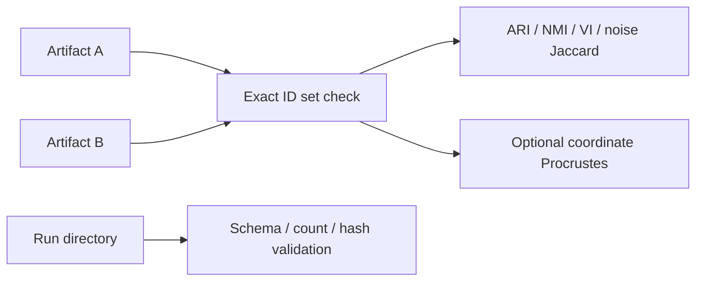
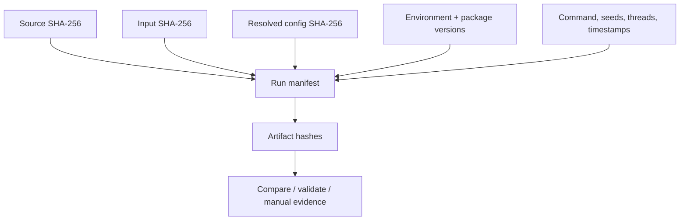

# 12. Selected-model reproduction, provenance, and comparison

*Guiding question:* **What must be retained to replay a model and decide whether two results agree?**

Prerequisites: 8–11.

## Why the question matters

Numeric labels and raw coordinates can differ while partitions agree, whereas identical labels without identifier checks can be meaningless.

Same-environment fixture concordance is technical evidence. It is not a guarantee across machines and not biological validation.

This chapter develops the question in the order needed for a reader to move from statistical principle to current implementation, retained evidence, and a defensible statement. Its central worked task is: Relabel a partition, calculate its noise Jaccard, and interpret why ARI=1 can coexist with nonidentical numeric labels.

## Learning objectives

After completing Chapter 12, the reader can:

1. define candidate identity and explain its role without exceeding the stated caution;
2. define adjusted Rand index and explain its role without exceeding the stated caution;
3. define normalized mutual information and explain its role without exceeding the stated caution;
4. define noise Jaccard and explain its role without exceeding the stated caution;
5. define Procrustes disparity and explain its role without exceeding the stated caution;
6. trace the relevant package functions and generated artifacts;
7. complete the worked task and distinguish observation from interpretation.

## Conceptual and mathematical development

### candidate identity

Deterministic hash and ordinal for a resolved parameter combination. A compact notation is `model_id=H(canonical parameters)`. In practical terms, identity supports replay; it is not a quality score.

Within Freeze 3 RC1 the concept is connected to `candidate_identity` and is visible through `search_space.tsv; model_table.csv`. This connection is narrower than the general statistical idea: software evidence establishes the implemented route, while the mapped primary or internal evidence supplies background authority. The distinction prevents a mathematical definition from being mistaken for proof that a particular scientific interpretation is correct.

### adjusted Rand index

Chance-adjusted pairwise partition agreement. A compact notation is `ARI=(RI-E[RI])/(max(RI)-E[RI])`. In practical terms, permutation invariant; a value of 1 does not imply coordinate identity. [@hubert1985]

Within Freeze 3 RC1 the concept is connected to `compare_partitions` and is visible through `comparison_summary.json`. This connection is narrower than the general statistical idea: software evidence establishes the implemented route, while the mapped primary or internal evidence supplies background authority. The distinction prevents a mathematical definition from being mistaken for proof that a particular scientific interpretation is correct.

### normalized mutual information

Normalized information shared by two labelings. A compact notation is `NMI=2I(U;V)/(H(U)+H(V))`. In practical terms, normalization conventions matter; Freeze 3 uses the sklearn convention recorded in code. [@vinh2010]

Within Freeze 3 RC1 the concept is connected to `compare_partitions` and is visible through `comparison_summary.json`. This connection is narrower than the general statistical idea: software evidence establishes the implemented route, while the mapped primary or internal evidence supplies background authority. The distinction prevents a mathematical definition from being mistaken for proof that a particular scientific interpretation is correct.

### noise Jaccard

Overlap of the two sets labeled -1. A compact notation is `J(A,B)=|A intersect B|/|A union B|`. In practical terms, it isolates agreement about unassigned membership, not all clusters.

Within Freeze 3 RC1 the concept is connected to `noise_jaccard` and is visible through `comparison_summary.json`. This connection is narrower than the general statistical idea: software evidence establishes the implemented route, while the mapped primary or internal evidence supplies background authority. The distinction prevents a mathematical definition from being mistaken for proof that a particular scientific interpretation is correct.

### Procrustes disparity

Residual after centering, scaling, and orthogonal alignment. A compact notation is `min_R ||X_c R-Y_c||_F^2`. In practical terms, low disparity supports aligned coordinate similarity under the chosen transformation, not biological replication. [@gower1975]

Within Freeze 3 RC1 the concept is connected to `compare_coordinates` and is visible through `comparison_summary.json`. This connection is narrower than the general statistical idea: software evidence establishes the implemented route, while the mapped primary or internal evidence supplies background authority. The distinction prevents a mathematical definition from being mistaken for proof that a particular scientific interpretation is correct.

### validation ladder

Separate software, technical, structural, statistical, biological, external, and cross-platform evidence. A compact notation is `E_software != E_biological`. In practical terms, passing tests or exact fixture replay cannot substitute for external biological validation.

Within Freeze 3 RC1 the concept is connected to `run_validation` and is visible through `validation_report.json`. This connection is narrower than the general statistical idea: software evidence establishes the implemented route, while the mapped primary or internal evidence supplies background authority. The distinction prevents a mathematical definition from being mistaken for proof that a particular scientific interpretation is correct.

### floating-point reproducibility

Dependence of finite-precision results on operation order and platform. A compact notation is `fl((a+b)+c) may differ from fl(a+(b+c))`. In practical terms, pinned dependencies improve control but do not guarantee universal bitwise equality. [@reproduciblesum2015]

Within Freeze 3 RC1 the concept is connected to `capture_environment` and is visible through `environment.json`. This connection is narrower than the general statistical idea: software evidence establishes the implemented route, while the mapped primary or internal evidence supplies background authority. The distinction prevents a mathematical definition from being mistaken for proof that a particular scientific interpretation is correct.

## Reconstructed operational foundation

Edition 1 contained the following verified operational material in separate short notes. Edition 2 consolidates it here and subjects it to the concept and evidence boundaries above.

### Evidence retained from former Chapter 22

### Operational foundation

A retained native `summary.json` contains the exact UMAP/HDBSCAN parameters, resolved run configuration, label-file hash, input record when available, and feature count. `reproduce-model` converts that contract to fixed mode, optionally overrides a stale input path, and performs one new fit in a new output directory. It refits; it does not copy labels.

```bash
dimple-gwas reproduce-model \
  --model-json docs/textbook/edition2/labs/01_fixed_synthetic/run_20260826/models/top_model_artifacts/model_060fac0208bb58e2/summary.json \
  --input benchmarks/synthetic/synthetic_matrix.tsv \
  --output-dir docs/textbook/edition2/labs/03_explain_compare_validate/reproduced_new \
  --n-jobs 1
```

After the rerun, use `compare` rather than assuming numeric label equality or coordinate alignment.

### Retained evidence

The executed reproduction selected the same stable model ID on the same fixture and environment. Comparison found exact ID order/set, ARI/NMI/noise Jaccard/mapped membership 1, and Procrustes disparity 2.7088×10^-31.

### Output-reading checkpoint

Inspect source summary/hash, reproduced resolved config and run manifest, new labels, comparison outputs, and validation checks.

### Misinterpretations to avoid

Do not use the original output directory. Do not call label-number equality the only correctness measure. Do not claim cross-platform determinism from a same-platform fixture.

### Boundary inherited from Edition 1

One fixed rerun tests an already selected parameterization; it does not reproduce the uncertainty or selection process of a full search.

### Evidence retained from former Chapter 23

### Operational foundation

`compare` accepts two native summaries or label tables, requires unique exact ID sets, and can require the same order. It reports adjusted Rand index, normalized mutual information, variation of information, noise-set Jaccard, optimal label mapping, mapped membership, changed noise status, cluster sizes, and optional Procrustes disparity. Numeric labels are local names, so structural metrics are primary.

`validate` inspects one run directory for required artifacts, readable JSON/YAML, enumeration counts, ranked schema, selected artifacts, and recorded hashes. It writes one pass/warn/fail row per check and returns exit code one on failure. Validation does not refit or compare biology.

```bash
dimple-gwas compare --left LEFT/summary.json --right RIGHT/summary.json --output-dir comparison_new
dimple-gwas validate --run-dir RUN --output-dir validation_new
```

## Evidence diagram or figure




*Comparison and validation paths. Editable source: `assets/diagrams/diagram_08_compare_validate.mmd`.*

### Retained evidence

Edition 2 Lab 3 comparison uses 24 IDs, three clusters, no noise, perfect structural metrics, zero variation of information, and near-zero aligned coordinate disparity. Validation reports 24/24 pass with no warnings or failures.

### Output-reading checkpoint

Inspect `comparison_summary.json`, membership table, size table, confusion, mapping, comparison manifest, `validation_checks.tsv`, report, and validation manifest.

### Misinterpretations to avoid

Do not compare raw numeric labels across fits. Do not ignore changed noise status. Do not interpret Procrustes as membership agreement. Do not call hash/schema checks biological validation.

### Boundary inherited from Edition 1

Exact label equality is stringent and environment-sensitive; permutation-invariant equality is structural. Coordinate comparison needs alignment and tolerances. Scientific conclusions need higher-layer validation.

### Evidence retained from former Chapter 42

### Operational foundation

A reproducible run is a chain of identities and decisions: source hash/version; input path/size/hash and upstream provenance; source and resolved configuration/hash; exact command; Python/platform/package versions; backends; seeds; threads; timestamps/runtime; candidate counts/statuses; selected model and formula; every artifact hash; warnings/exclusions/failures; and comparison criteria. `run_manifest.json` captures much of this; tutorial execution manifests and checksum tables close the documentation chain.

Exact comparison is appropriate for bytes, schemas, IDs, declared parameters, counts, and sometimes labels. Tolerances or invariant metrics are appropriate for floating-point metrics and aligned embeddings across platforms. Plots should be compared through source tables and structural/render checks, not byte identity alone. Dependency pinning improves traceability but cannot guarantee identical numerics across OS, architecture, hardware, BLAS/OpenMP, threads, or compiler/runtime versions.

With no Git metadata in this snapshot, use the package-source SHA-256 and complete file registers; the Docker stage should establish a versioned source identity.

## Evidence diagram or figure




*Provenance and artifact lineage. Editable source: `assets/diagrams/diagram_09_provenance_lineage.mmd`.*

### Retained evidence

The executed Edition 2 Lab 2 manifest records package-source and input hashes, configuration hash, exact package versions, seeds 42/43, jobs, backend names, runtime, counts, selected ID, and artifact hashes.

### Output-reading checkpoint

Inspect runtime environment, resolved dependencies, source/input/artifact checksum registers, run/selection/tutorial manifests, logs, comparison and validation evidence.

### Misinterpretations to avoid

Do not equate a pinned requirements file with a complete environment. Do not compare floating-point PNG bytes as scientific equality. Do not sanitize the only retained provenance copy.

### Boundary inherited from Edition 1

Provenance can contain protected paths and identifiers; maintain a private complete record and a deliberately sanitized publication record with linked hashes.

## Implementation trace

**`comparison.run_comparison`** is defined at `dimple_gwas/comparison.py:65` with signature `left_source: str | Path, right_source: str | Path, output_dir: str | Path, *, id_column: str='feature_id', label_column: str='label', require_same_order: bool=False, command: list[str] | None=None`. Compare two label artifacts using exact IDs, permutation-invariant structure, noise sets, mapping, and optional coordinates. It is reached from cli._compare and connects to comparison._columns; comparison._resolve_labels; comparison._variation_of_information; interpretation.detect_coordinate_columns; interpretation.is_noise_label; interpretation.label_sort_key; io.atomic_json_dump; io.ensure_empty_output_dir; io.json_safe; io.validated_identifiers; provenance.base_manifest; provenance.file_record; provenance.utc_now. Its direct artifact contract is comparison_summary.json; membership_comparison.tsv; cluster_sizes.tsv; label_confusion.tsv; optimal_label_mapping.tsv; comparison_manifest.json; its explicit error surface is ValueError. Test evidence is recorded as tests/test_freeze3_comparison_validation.py::test_comparison_rejects_duplicate_ids; tests/test_freeze3_comparison_validation.py::test_comparison_requires_identical_id_sets; tests/test_freeze3_comparison_validation.py::test_label_permutation_comparison_is_structurally_equal. This is a A-tier contract, so the complete 20-field dossier is retained in the function atlas.

**`pipeline.setup_logger`** is defined at `dimple_gwas/pipeline.py:25` with signature `output_dir: str | Path`. Implementation callable for setup logger. It is reached from pipeline.run_search and connects to No package-defined dependency detected. Its direct artifact contract is logs/run.log; its explicit error surface is No explicit raise in this symbol; delegated calls may raise.. Test evidence is recorded as No direct symbol-name test reference; assess through caller/integration coverage. This is a B-tier contract, so the complete 20-field dossier is retained in the function atlas.

**`pipeline.run_search`** is defined at `dimple_gwas/pipeline.py:130` with signature `config: Mapping[str, Any], output_dir: str | Path, command: list[str] | None=None`. Execute preprocessing, repeated embeddings, candidate evaluation, scoring, retention, reporting, and provenance for one run. It is reached from cli._reproduce; cli.main and connects to hdbscan_runner.fit_hdbscan; io.read_table; metrics.embedding_quality_metrics; pipeline._annotation_frame; pipeline._evaluate_one; pipeline._failed_row; pipeline.setup_logger; preprocessing.prepare_analysis_matrix; provenance.base_manifest; provenance.file_record; ranking.family_summaries; ranking.pareto_front; ranking.rank_models; ranking.top_models; reporting.write_model_outputs; reporting.write_resolved_config; reporting.write_search_space; scoring.apply_scoring; search_space.enumerate_candidates; search_space.stable_identifier; umap_runner.run_repeated_umap. Its direct artifact contract is No direct canonical artifact; in-memory/supporting result; its explicit error surface is RuntimeError; ValueError. Test evidence is recorded as tests/test_pipeline_integration.py::test_custom_leaf_eom_metric_and_max_size_run; tests/test_pipeline_integration.py::test_fixed_model_reproduction. This is a A-tier contract, so the complete 20-field dossier is retained in the function atlas.

**`provenance.sha256_file`** is defined at `dimple_gwas/provenance.py:17` with signature `path: str | Path`. Implementation callable for sha256 file. It is reached from interpretation._native_sources; provenance.file_record; reporting._top_artifact; validation.run_validation and connects to No package-defined dependency detected. Its direct artifact contract is No direct canonical artifact; in-memory/supporting result; its explicit error surface is No explicit raise in this symbol; delegated calls may raise.. Test evidence is recorded as tests/test_failure_and_provenance.py::test_authoritative_source_hash_unchanged. This is a B-tier contract, so the complete 20-field dossier is retained in the function atlas.

**`provenance.package_versions`** is defined at `dimple_gwas/provenance.py:25` with signature `names: Iterable[str] | None=None`. Implementation callable for package versions. It is reached from provenance.base_manifest and connects to No package-defined dependency detected. Its direct artifact contract is No direct canonical artifact; in-memory/supporting result; its explicit error surface is No explicit raise in this symbol; delegated calls may raise.. Test evidence is recorded as No direct symbol-name test reference; assess through caller/integration coverage. This is a B-tier contract, so the complete 20-field dossier is retained in the function atlas.

**`provenance.utc_now`** is defined at `dimple_gwas/provenance.py:40` with signature `class construction/data container`. Implementation callable for utc now. It is reached from comparison.run_comparison; interpretation.run_explanation; provenance.base_manifest; reporting.write_model_outputs; validation.run_validation and connects to No package-defined dependency detected. Its direct artifact contract is No direct canonical artifact; in-memory/supporting result; its explicit error surface is No explicit raise in this symbol; delegated calls may raise.. Test evidence is recorded as No direct symbol-name test reference; assess through caller/integration coverage. This is a B-tier contract, so the complete 20-field dossier is retained in the function atlas.

**`provenance.file_record`** is defined at `dimple_gwas/provenance.py:44` with signature `path: str | Path`. Implementation callable for file record. It is reached from comparison.run_comparison; interpretation.run_explanation; pipeline.run_search; reporting._top_artifact; reporting.write_model_outputs; validation.run_validation and connects to comparison._columns.<locals>.resolve; provenance.sha256_file. Its direct artifact contract is No direct canonical artifact; in-memory/supporting result; its explicit error surface is No explicit raise in this symbol; delegated calls may raise.. Test evidence is recorded as No direct symbol-name test reference; assess through caller/integration coverage. This is a B-tier contract, so the complete 20-field dossier is retained in the function atlas.

**`provenance.package_source_digest`** is defined at `dimple_gwas/provenance.py:53` with signature `class construction/data container`. Compute a stable hash over package source files for non-Git source identity. It is reached from provenance.base_manifest and connects to comparison._columns.<locals>.resolve. Its direct artifact contract is No direct canonical artifact; in-memory/supporting result; its explicit error surface is No explicit raise in this symbol; delegated calls may raise.. Test evidence is recorded as tests/test_freeze3_comparison_validation.py::test_package_source_digest_is_stable. This is a A-tier contract, so the complete 20-field dossier is retained in the function atlas.

**`provenance.base_manifest`** is defined at `dimple_gwas/provenance.py:66` with signature `command: list[str] | None=None`. Implementation callable for base manifest. It is reached from comparison.run_comparison; interpretation.run_explanation; pipeline.run_search; validation.run_validation and connects to provenance.package_source_digest; provenance.package_versions; provenance.utc_now. Its direct artifact contract is No direct canonical artifact; in-memory/supporting result; its explicit error surface is No explicit raise in this symbol; delegated calls may raise.. Test evidence is recorded as No direct symbol-name test reference; assess through caller/integration coverage. This is a A-tier contract, so the complete 20-field dossier is retained in the function atlas.

**`reporting.write_resolved_config`** is defined at `dimple_gwas/reporting.py:18` with signature `config: Mapping[str, Any], output_dir: str | Path`. Implementation callable for write resolved config. It is reached from pipeline.run_search and connects to No package-defined dependency detected. Its direct artifact contract is resolved_config.yaml; its explicit error surface is No explicit raise in this symbol; delegated calls may raise.. Test evidence is recorded as No direct symbol-name test reference; assess through caller/integration coverage. This is a B-tier contract, so the complete 20-field dossier is retained in the function atlas.

**`reporting.write_search_space`** is defined at `dimple_gwas/reporting.py:28` with signature `candidates: list[Mapping[str, Any]], config: Mapping[str, Any], output_dir: str | Path`. Implementation callable for write search space. It is reached from cli._show; pipeline.run_search and connects to io.atomic_json_dump; io.json_safe; reporting._write_tsv; search_space.flatten_candidate. Its direct artifact contract is search_space_manifest.tsv; search_space_manifest.json; its explicit error surface is No explicit raise in this symbol; delegated calls may raise.. Test evidence is recorded as No direct symbol-name test reference; assess through caller/integration coverage. This is a B-tier contract, so the complete 20-field dossier is retained in the function atlas.

**`reporting.write_model_outputs`** is defined at `dimple_gwas/reporting.py:105` with signature `ranked, top, pareto, families, candidates_by_id: Mapping[str, Mapping[str, Any]], labels_by_id: Mapping[str, Any], visualizations_by_umap: Mapping[str, Any], feature_ids, annotation_frame, config: Mapping[str, Any], scoring_manifest: Mapping[str, Any], run_manifest: Mapping[str, Any], output_dir: str | Path`. Write the complete candidate, ranking, selection, retained-model, compatibility, and manifest artifact family. It is reached from pipeline.run_search and connects to io.atomic_json_dump; io.json_safe; provenance.file_record; provenance.utc_now; reporting._top_artifact; reporting._write_tsv. Its direct artifact contract is run_manifest.json; models/all_models.tsv; models/all_models.parquet; models/ranked_models.tsv; models/top_models.tsv; models/best_model.json; models/model_selection_manifest.json; models/pareto_front.tsv; models/family_summaries.tsv; stage02_hdbscan_gridsearch_results.csv; stage03_optimized_cluster_solutions.csv; stage09_umap_vizdata_with_clusters.csv; stage09b_umap_vizdata_with_annotations.csv; its explicit error surface is No explicit raise in this symbol; delegated calls may raise.. Test evidence is recorded as No direct symbol-name test reference; assess through caller/integration coverage. This is a A-tier contract, so the complete 20-field dossier is retained in the function atlas.

## Claim adjudication notebook

The following statements are admitted to the draft only in their safe form:

- **VAL-002 (verified_with_qualification):** Within the prior same-environment fixture comparison, ARI, NMI, noise Jaccard, and mapped membership were 1 with near-zero Procrustes disparity. [@hubert1985; @vinh2010; @gower1975] Limitation: Does not generalize across platforms or all configurations. Implementation evidence: `comparison.py`.

- **REP-001 (reject):** Pinning improves traceability but cannot alone guarantee bitwise identity across architecture, hardware, numerical libraries, or thread schedules. [@reproduciblesum2015] Limitation: Docker/Linux/cloud validation remains pending. Implementation evidence: `provenance.py`.

## Reading the generated evidence

For Chapter 12, the `Selected-model reproduction, provenance, and comparison` files are read as a provenance chain rather than as isolated results:

| Artifact | Producer | What to verify before interpretation |
| --- | --- | --- |
| `comparison_summary.json` | `run_comparison` | Artifact exists under the new output root, is readable, and its checksum is recorded. |
| `membership_comparison.tsv, cluster_sizes.tsv, label_confusion.tsv, optimal_label_mapping.tsv` | `run_comparison` | Identifiers are unique and exactly match the intended input; label -1 is treated as noise/unassigned. |
| `comparison_manifest.json` | `run_comparison` | Artifact exists under the new output root, is readable, and its checksum is recorded. |
| `validation_checks.tsv` | `run_validation` | Every check is visible; aggregate status matches pass/warn/fail rows; a warning is not silently treated as a pass. |
| `validation_report.json + validation_manifest.json` | `run_validation` | Every check is visible; aggregate status matches pass/warn/fail rows; a warning is not silently treated as a pass. |

The output atlas supplies the complete schemas, checksums, conditions, consumers, and privacy notes for this Chapter 12 route. Native manifests can contain machine paths; the assembled textbook uses sanitized excerpts while restricted evidence retains the original provenance chain.

## Worked reasoning and evidence exercise

Relabel a partition, calculate its noise Jaccard, and interpret why ARI=1 can coexist with nonidentical numeric labels.

A complete Chapter 12 answer must expose its intermediate reasoning, name the source or output used for `Selected-model reproduction, provenance, and comparison`, and finish with separate support and non-support statements. Applying that discipline to the question “What must be retained to replay a model and decide whether two results agree?” prevents a calculation, a software observation, and a scientific interpretation from collapsing into one claim.

## Assumptions, diagnostics, and recovery

The Chapter 12 analysis assumes the stated unit and inputs, the recorded configuration and software identity, and a diagnostic that addresses the claimed property rather than a convenient surrogate. Its decisive boundary is: Same-environment fixture concordance is technical evidence. It is not a guarantee across machines and not biological validation.

If the Chapter 12 route fails, retain its log and candidate status before deciding whether the cause is input, configuration, dependency, compute, identifier alignment, or output-root state. Correct an operational failure by writing a new result directory. Treat instability in `Selected-model reproduction, provenance, and comparison` as sensitivity evidence: report it and identify the independent evidence needed instead of relabeling ambiguity as a software exception.

## Chapter synthesis

Numeric labels and raw coordinates can differ while partitions agree, whereas identical labels without identifier checks can be meaningless. The implementation trace makes the current behavior auditable, but the evidence boundary remains part of the result. Part III begins by turning these contracts into an installable, inspectable workflow.

## Exercises

1. For `Selected-model reproduction, provenance, and comparison`, name the unit of analysis and one plausible but invalid substitute.
2. Reconstruct the notation for candidate identity; define its dimensions or denominator and interpret every term.
3. Choose a Tier A function mapped to Chapter 12; identify its caller and direct output, then propose a topic-specific edge case.
4. Select one Chapter 12 artifact from the output atlas and state three integrity checks that must precede scientific reading.
5. Convert a tempting `Selected-model reproduction, provenance, and comparison` overclaim into one observed statement followed by its limitation.
6. Relabel a partition, calculate its noise Jaccard, and interpret why ARI=1 can coexist with nonidentical numeric labels.

Appendix J gives the Chapter 12 adjudication guide. Its further-reading keys supply statistical context; no external paper is treated as automatic validation of the current software or dataset.
