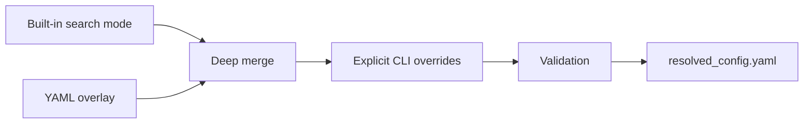

# 14. Configuration and search-space inspection

*Guiding question:* **Which values will the software actually use after built-ins, YAML, and CLI overrides are combined?**

Prerequisites: 6,10,13.

## Why the question matters

Readable YAML is not necessarily the resolved configuration, and a plausible range can still request unintended compute.

`inspect-config` and `show-search-space` are preflight tools; successful inspection does not validate the scientific suitability of settings.

This chapter develops the question in the order needed for a reader to move from statistical principle to current implementation, retained evidence, and a defensible statement. Its central worked task is: Predict one override result and the Lab 2 candidate count before comparing both with fresh command output.

## Learning objectives

After completing Chapter 14, the reader can:

1. define Cartesian search and explain its role without exceeding the stated caution;
2. define candidate identity and explain its role without exceeding the stated caution;
3. trace the relevant package functions and generated artifacts;
4. complete the worked task and distinguish observation from interpretation.

## Conceptual and mathematical development

### Cartesian search

Product of enumerated parameter families. A compact notation is `N_candidates=product_j |Theta_j|`. In practical terms, the standard grid is 45 x 18 x 3 = 2,430 for one UMAP family.

Within Freeze 3 RC1 the concept is connected to `enumerate_candidates` and is visible through `search_space.tsv`. This connection is narrower than the general statistical idea: software evidence establishes the implemented route, while the mapped primary or internal evidence supplies background authority. The distinction prevents a mathematical definition from being mistaken for proof that a particular scientific interpretation is correct.

### candidate identity

Deterministic hash and ordinal for a resolved parameter combination. A compact notation is `model_id=H(canonical parameters)`. In practical terms, identity supports replay; it is not a quality score.

Within Freeze 3 RC1 the concept is connected to `candidate_identity` and is visible through `search_space.tsv; model_table.csv`. This connection is narrower than the general statistical idea: software evidence establishes the implemented route, while the mapped primary or internal evidence supplies background authority. The distinction prevents a mathematical definition from being mistaken for proof that a particular scientific interpretation is correct.

## Reconstructed operational foundation

Edition 1 contained the following verified operational material in separate short notes. Edition 2 consolidates it here and subjects it to the concept and evidence boundaries above.

### Evidence retained from former Chapter 11

### Operational foundation

Configuration resolution is deterministic: start with a built-in search mode, deep-merge a YAML mapping, then apply only explicit CLI values. The result is validated and written as `resolved_config.yaml`. Therefore a YAML value can differ from the run value when a CLI override is present; the resolved file, not memory or the source overlay alone, is authoritative for that run.

The four modes are `standard`, `extended`, `custom`, and `fixed`. `custom` requires a YAML file. `fixed` requires one value for every searched UMAP and HDBSCAN parameter. Scalar values produce one choice; lists produce choices; numeric `{start, stop, step}` mappings are stop-exclusive; supported CLI strings may also encode comma lists or ranges. Unknown top-level or interpretation keys and invalid combinations fail validation.

```bash
dimple-gwas inspect-config \
  --search-mode custom \
  --config docs/textbook/edition2/labs/02_custom_search_space/tutorial_config.yaml
```

## Evidence diagram or figure




*Configuration precedence. Editable source: `assets/diagrams/diagram_03_config_precedence.mmd`.*

### Retained evidence

Edition 2 Lab 2 declares two values each for `umap.n_neighbors`, `umap.min_dist`, `hdbscan.min_cluster_size`, `hdbscan.min_samples`, and epsilon; other searched fields are scalar. The resolved file records two repeated states and one candidate job.

### Output-reading checkpoint

Compare the source YAML, captured `inspect-config` output, and run `resolved_config.yaml`. Use `evidence/configuration_key_reference.tsv` for every default and exposure.

### Misinterpretations to avoid

Do not call a tutorial value a default. Do not edit a resolved output and assume the past run changed. Do not use a range's `stop` as though it were included. Do not mix `custom` with no YAML.

### Boundary inherited from Edition 1

Configuration validity means fields satisfy software constraints, not that the scientific search is appropriate. Candidate-count safety and parameter justification remain analyst responsibilities.

### Evidence retained from former Chapter 12

### Operational foundation

`inspect-config` resolves and validates configuration and prints candidate counts without fitting. `show-search-space` enumerates the complete deterministic Cartesian product and can retain full TSV/JSON manifests. These commands are mandatory preflight tools: they expose accidental explosions, invalid fields, and misunderstood ranges before UMAP consumes compute.

```bash
dimple-gwas show-search-space \
  --search-mode custom \
  --config docs/textbook/edition2/labs/02_custom_search_space/tutorial_config.yaml \
  --output-dir docs/textbook/edition2/labs/02_custom_search_space/search_space_new \
  --show-first 5
```

Choose a new output directory name; the manual's executed directory is evidence, not a scratch target. Standard mode proves 45 min-cluster-size choices × 18 min-samples choices × 3 epsilon choices = 2,430 candidates for one UMAP family. Shipped extended mode has 1,728 candidates, not the older provisional 5,184 number.

### Retained evidence

Executed Edition 2 Lab 1 enumerated one candidate; Edition 2 Lab 2 enumerated 32: four UMAP families times eight HDBSCAN configurations. Both counts appear in stdout and complete manifests.

### Output-reading checkpoint

Inspect `candidate_models`, UMAP/HDBSCAN family counts, candidate ordinals, stable IDs, and the first/last parameter rows. Retain config and manifest checksums together.

### Misinterpretations to avoid

Do not estimate workload from HDBSCAN choices alone when UMAP parameters also vary. Do not silently sample a large Cartesian product; Freeze 3's safety ceiling raises rather than sampling.

### Boundary inherited from Edition 1

Candidate count is not runtime by itself: repeated UMAP families dominate some workloads while HDBSCAN candidate fits dominate others. Pilot evidence is still needed.

### Evidence retained from former Chapter 38

### Operational foundation

Configuration has seven top-level groups. `input` contains path, metadata-prefix count, separator, transform, and annotation join. `umap` contains twelve searchable embedding fields. `hdbscan` contains nine searchable density-clustering fields. `execution` contains repeats, threads, retention, safeguards, subsampling, seed, Parquet, DBCV, and strictness. `scoring` selects legacy/custom behavior. `interpretation` controls original-space similarity, order, noise, matching, figure safeguards, and optional coordinate associations. `search_mode` chooses the built-in base.

Standard defaults include four metadata columns, no transform, UMAP neighbors 30/min-dist 0/three components/Euclidean/densMAP true/base seed 42, HDBSCAN min-cluster-size 5:50, min-samples 2:20, epsilon 0:3, EOM/Euclidean, 1,000 repeats, `n_jobs=-1`, one candidate job, 20 retained models, DBCV and Parquet enabled, non-strict execution, legacy score excluding noise, and Pearson cluster-then-hclust explanation with exact matching. Stop values are exclusive.

Validation enforces finite values, supported metrics, min-dist≤spread, positive rates/sizes, EOM/leaf, valid maximum sizes, nonzero candidate jobs, valid score rules, and enumerated interpretation choices. The complete exact default/value reference is generated from source into `configuration_key_reference.tsv`.

### Retained evidence

Run `inspect-config` for standard, extended, fixed, and the tutorial custom YAML, then diff only the resolved values. This distinguishes mode defaults from overlays.

### Output-reading checkpoint

Inspect source YAML, resolved YAML, configuration hash, config-reference row, CLI exposure, validation errors, and search count.

### Misinterpretations to avoid

Do not infer a default from an example. Do not forget that `max_cluster_size` is EOM-specific. Do not enable coordinate associations or large matrices without acknowledging their output and privacy cost.

### Boundary inherited from Edition 1

The package validates syntax/ranges, not scientific choice. A permitted metric or parameter range may still be inappropriate for a specific data-generating process.

### Evidence retained from former Chapter 39

### Operational foundation

Freeze 3 enumerates the full Cartesian product of normalized UMAP and HDBSCAN parameter values. Candidate ordinals and stable hashes make enumeration auditable. It does not silently sample. `execution.max_candidate_models` is a hard safety ceiling; zero means unlimited. `warn_candidate_count` is a warning threshold.

Mode counts in this source are: standard 2,430 candidates (one UMAP family × 45 × 18 × 3 HDBSCAN values); fixed one candidate when all searched fields are scalar; Edition 2 Lab 2 custom 32; shipped extended 1,728. Extended crosses multiple UMAP and HDBSCAN fields, and its count must be derived from the current source rather than older planning documents.

Search work can reuse one repeated embedding across many HDBSCAN candidates sharing `umap_id`. Therefore candidate count, UMAP-family count, repeat count, sample/vector count, input width, metric, and thread settings all matter.

### Retained evidence

`show-search-space` writes the full flattened rows plus JSON counts. Compare the number of unique `umap_id` and `hdbscan_id` values with total candidate rows.

### Output-reading checkpoint

Inspect candidate ordinal/model/family IDs, every flattened parameter, declared enumeration note, safety settings, and checksum.

### Misinterpretations to avoid

Do not multiply only visibly changed YAML keys while ignoring inherited lists. Do not describe a truncated preview as the full manifest. Do not change the grid after examining desired labels without disclosure.

### Boundary inherited from Edition 1

Enumeration completeness is a software property, not a claim that the grid covers all meaningful models or that rank one is unique.

## Implementation trace

**`cli.build_parser`** is defined at `dimple_gwas/cli.py:146` with signature `class construction/data container`. Construct the complete user-facing command and flag grammar, including the interpret alias. It is reached from cli.main and connects to cli._add_config_source; cli._add_run_options. Its direct artifact contract is No direct canonical artifact; in-memory/supporting result; its explicit error surface is No explicit raise in this symbol; delegated calls may raise.. Test evidence is recorded as tests/test_freeze3_comparison_validation.py::test_cli_exposes_new_commands_and_alias. This is a A-tier contract, so the complete 20-field dossier is retained in the function atlas.

**`cli._inspect`** is defined at `dimple_gwas/cli.py:240` with signature `args: argparse.Namespace`. Implementation callable for inspect. It is reached from cli.main and connects to cli._resolved; search_space.count_candidates. Its direct artifact contract is No direct canonical artifact; in-memory/supporting result; its explicit error surface is No explicit raise in this symbol; delegated calls may raise.. Test evidence is recorded as No direct symbol-name test reference; assess through caller/integration coverage. This is a A-tier contract, so the complete 20-field dossier is retained in the function atlas.

**`cli._show`** is defined at `dimple_gwas/cli.py:254` with signature `args: argparse.Namespace`. Implementation callable for show. It is reached from cli.main and connects to cli._resolved; io.json_safe; reporting.write_search_space; search_space.count_candidates; search_space.enumerate_candidates; search_space.flatten_candidate. Its direct artifact contract is No direct canonical artifact; in-memory/supporting result; its explicit error surface is No explicit raise in this symbol; delegated calls may raise.. Test evidence is recorded as No direct symbol-name test reference; assess through caller/integration coverage. This is a A-tier contract, so the complete 20-field dossier is retained in the function atlas.

**`cli._score`** is defined at `dimple_gwas/cli.py:265` with signature `args: argparse.Namespace`. Implementation callable for score. It is reached from cli.main and connects to config.resolve_config; io.atomic_json_dump; io.json_safe; io.read_model_table; ranking.rank_models; scoring.apply_scoring; scoring.normalize_model_table_schema. Its direct artifact contract is rescored_table.tsv; rescored_table.tsv.manifest.json; its explicit error surface is No explicit raise in this symbol; delegated calls may raise.. Test evidence is recorded as No direct symbol-name test reference; assess through caller/integration coverage. This is a A-tier contract, so the complete 20-field dossier is retained in the function atlas.

**`cli._summarize`** is defined at `dimple_gwas/cli.py:284` with signature `args: argparse.Namespace`. Implementation callable for summarize. It is reached from cli.main and connects to io.atomic_json_dump; io.read_model_table; ranking.family_summaries; ranking.pareto_front; ranking.rank_models; ranking.top_models. Its direct artifact contract is family_summaries.tsv; pareto_front.tsv; top_models.tsv; summary.json; its explicit error surface is No explicit raise in this symbol; delegated calls may raise.. Test evidence is recorded as No direct symbol-name test reference; assess through caller/integration coverage. This is a A-tier contract, so the complete 20-field dossier is retained in the function atlas.

**`cli._reproduce`** is defined at `dimple_gwas/cli.py:301` with signature `args: argparse.Namespace`. Implementation callable for reproduce. It is reached from cli.main and connects to config.resolve_config; config.validate_config; pipeline.run_search. Its direct artifact contract is No direct canonical artifact; in-memory/supporting result; its explicit error surface is ValueError. Test evidence is recorded as No direct symbol-name test reference; assess through caller/integration coverage. This is a A-tier contract, so the complete 20-field dossier is retained in the function atlas.

**`cli._explain`** is defined at `dimple_gwas/cli.py:323` with signature `args: argparse.Namespace`. Implementation callable for explain. It is reached from cli.main and connects to config.resolve_config; config.validate_config; interpretation.run_explanation. Its direct artifact contract is No direct canonical artifact; in-memory/supporting result; its explicit error surface is ValueError. Test evidence is recorded as No direct symbol-name test reference; assess through caller/integration coverage. This is a A-tier contract, so the complete 20-field dossier is retained in the function atlas.

**`cli._compare`** is defined at `dimple_gwas/cli.py:376` with signature `args: argparse.Namespace`. Implementation callable for compare. It is reached from cli.main and connects to comparison.run_comparison. Its direct artifact contract is No direct canonical artifact; in-memory/supporting result; its explicit error surface is No explicit raise in this symbol; delegated calls may raise.. Test evidence is recorded as No direct symbol-name test reference; assess through caller/integration coverage. This is a A-tier contract, so the complete 20-field dossier is retained in the function atlas.

**`cli._validate`** is defined at `dimple_gwas/cli.py:391` with signature `args: argparse.Namespace`. Implementation callable for validate. It is reached from cli.main and connects to validation.run_validation. Its direct artifact contract is No direct canonical artifact; in-memory/supporting result; its explicit error surface is No explicit raise in this symbol; delegated calls may raise.. Test evidence is recorded as No direct symbol-name test reference; assess through caller/integration coverage. This is a A-tier contract, so the complete 20-field dossier is retained in the function atlas.

**`cli.main`** is defined at `dimple_gwas/cli.py:403` with signature `argv: list[str] | None=None`. Dispatch the command-line interface and return a process exit status. It is reached from CLI/import/direct caller or no package caller detected and connects to cli._compare; cli._explain; cli._inspect; cli._reproduce; cli._resolved; cli._score; cli._show; cli._summarize; cli._validate; cli.build_parser; pipeline.run_search. Its direct artifact contract is No direct canonical artifact; in-memory/supporting result; its explicit error surface is No explicit raise in this symbol; delegated calls may raise.. Test evidence is recorded as tests/test_freeze3_comparison_validation.py::test_cli_compare_end_to_end. This is a A-tier contract, so the complete 20-field dossier is retained in the function atlas.

**`config.builtin_config`** is defined at `dimple_gwas/config.py:128` with signature `mode: str`. Implementation callable for builtin config. It is reached from config.resolve_config and connects to config._base_config. Its direct artifact contract is No direct canonical artifact; in-memory/supporting result; its explicit error surface is ValueError. Test evidence is recorded as No direct symbol-name test reference; assess through caller/integration coverage. This is a B-tier contract, so the complete 20-field dossier is retained in the function atlas.

**`config.deep_merge`** is defined at `dimple_gwas/config.py:164` with signature `base: Mapping[str, Any], overlay: Mapping[str, Any]`. Implementation callable for deep merge. It is reached from config.resolve_config and connects to No package-defined dependency detected. Its direct artifact contract is No direct canonical artifact; in-memory/supporting result; its explicit error surface is No explicit raise in this symbol; delegated calls may raise.. Test evidence is recorded as No direct symbol-name test reference; assess through caller/integration coverage. This is a B-tier contract, so the complete 20-field dossier is retained in the function atlas.

## Claim adjudication notebook

The following statements are admitted to the draft only in their safe form:

- **PIPE-003 (verified):** The standard grid enumerates 45 min_cluster_size values, 18 min_samples values, and 3 epsilon values: 2,430 HDBSCAN candidates for one UMAP configuration. Limitation: Custom and extended modes differ. Implementation evidence: `config.py; search_space.py`.

## Reading the generated evidence

For Chapter 14, the `Configuration and search-space inspection` files are read as a provenance chain rather than as isolated results:

| Artifact | Producer | What to verify before interpretation |
| --- | --- | --- |
| `search_space_manifest.tsv/json` | `write_search_space` | Artifact exists under the new output root, is readable, and its checksum is recorded. |

The output atlas supplies the complete schemas, checksums, conditions, consumers, and privacy notes for this Chapter 14 route. Native manifests can contain machine paths; the assembled textbook uses sanitized excerpts while restricted evidence retains the original provenance chain.

## Worked reasoning and evidence exercise

Predict one override result and the Lab 2 candidate count before comparing both with fresh command output.

A complete Chapter 14 answer must expose its intermediate reasoning, name the source or output used for `Configuration and search-space inspection`, and finish with separate support and non-support statements. Applying that discipline to the question “Which values will the software actually use after built-ins, YAML, and CLI overrides are combined?” prevents a calculation, a software observation, and a scientific interpretation from collapsing into one claim.

## Assumptions, diagnostics, and recovery

The Chapter 14 analysis assumes the stated unit and inputs, the recorded configuration and software identity, and a diagnostic that addresses the claimed property rather than a convenient surrogate. Its decisive boundary is: `inspect-config` and `show-search-space` are preflight tools; successful inspection does not validate the scientific suitability of settings.

If the Chapter 14 route fails, retain its log and candidate status before deciding whether the cause is input, configuration, dependency, compute, identifier alignment, or output-root state. Correct an operational failure by writing a new result directory. Treat instability in `Configuration and search-space inspection` as sensitivity evidence: report it and identify the independent evidence needed instead of relabeling ambiguity as a software exception.

## Chapter synthesis

Readable YAML is not necessarily the resolved configuration, and a plausible range can still request unintended compute. The implementation trace makes the current behavior auditable, but the evidence boundary remains part of the result. Chapter 15 executes the resolved plan and teaches the run manifest as the primary narrative.

## Exercises

1. For `Configuration and search-space inspection`, name the unit of analysis and one plausible but invalid substitute.
2. Reconstruct the notation for Cartesian search; define its dimensions or denominator and interpret every term.
3. Choose a Tier A function mapped to Chapter 14; identify its caller and direct output, then propose a topic-specific edge case.
4. Select one Chapter 14 artifact from the output atlas and state three integrity checks that must precede scientific reading.
5. Convert a tempting `Configuration and search-space inspection` overclaim into one observed statement followed by its limitation.
6. Predict one override result and the Lab 2 candidate count before comparing both with fresh command output.

Appendix J gives the Chapter 14 adjudication guide. Its further-reading keys supply statistical context; no external paper is treated as automatic validation of the current software or dataset.
