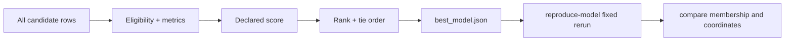
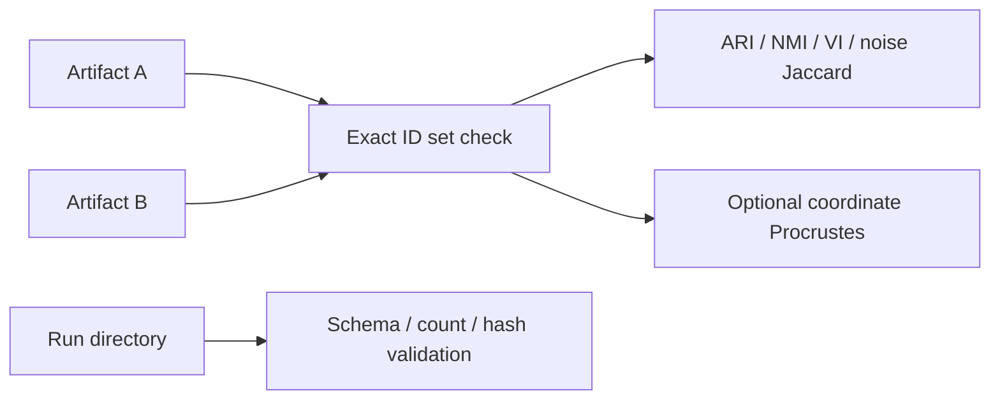

# 16. Model summaries, selection, reproduction, comparison, and validation

*Guiding question:* **How does an analyst move from a ranked table to a defensible retained model?**

Prerequisites: 11–15.

## Why the question matters

The highest score is a reproducible ordering under one objective, not an instruction to skip sensitivity, failure review, or scientific adjudication.

Commands operate on retained artifacts and exact IDs. Historical manual selection must remain disclosed when it differs from automatic rank.

This chapter develops the question in the order needed for a reader to move from statistical principle to current implementation, retained evidence, and a defensible statement. Its central worked task is: Use the tied Lab 2 top rows to explain deterministic tie ordering and write a selection note that distinguishes automatic rank from analyst choice.

## Learning objectives

After completing Chapter 16, the reader can:

1. define legacy_dimple score and explain its role without exceeding the stated caution;
2. define eligibility and ties and explain its role without exceeding the stated caution;
3. define adjusted Rand index and explain its role without exceeding the stated caution;
4. define normalized mutual information and explain its role without exceeding the stated caution;
5. define noise Jaccard and explain its role without exceeding the stated caution;
6. trace the relevant package functions and generated artifacts;
7. complete the worked task and distinguish observation from interpretation.

## Conceptual and mathematical development

### legacy_dimple score

Population-relative weighted combination of normalized silhouette, clusters, and optionally noise. A compact notation is `raw=w_s s/max(s)+w_k k/max(k)-w_n n/max(n)`. In practical terms, weights are raw dynamic ranges divided by their sum; final scores are min-max scaled.

Within Freeze 3 RC1 the concept is connected to `legacy_dimple_score` and is visible through `scoring_manifest.json; model_table.csv`. This connection is narrower than the general statistical idea: software evidence establishes the implemented route, while the mapped primary or internal evidence supplies background authority. The distinction prevents a mathematical definition from being mistaken for proof that a particular scientific interpretation is correct.

### eligibility and ties

Rules deciding which candidates receive scores and stable rank order. A compact notation is `eligible=(status=success) and finite silhouette`. In practical terms, ties resolve deterministically through configured sort keys and candidate identity.

Within Freeze 3 RC1 the concept is connected to `rank_models` and is visible through `ranked_models.csv`. This connection is narrower than the general statistical idea: software evidence establishes the implemented route, while the mapped primary or internal evidence supplies background authority. The distinction prevents a mathematical definition from being mistaken for proof that a particular scientific interpretation is correct.

### adjusted Rand index

Chance-adjusted pairwise partition agreement. A compact notation is `ARI=(RI-E[RI])/(max(RI)-E[RI])`. In practical terms, permutation invariant; a value of 1 does not imply coordinate identity. [@hubert1985]

Within Freeze 3 RC1 the concept is connected to `compare_partitions` and is visible through `comparison_summary.json`. This connection is narrower than the general statistical idea: software evidence establishes the implemented route, while the mapped primary or internal evidence supplies background authority. The distinction prevents a mathematical definition from being mistaken for proof that a particular scientific interpretation is correct.

### normalized mutual information

Normalized information shared by two labelings. A compact notation is `NMI=2I(U;V)/(H(U)+H(V))`. In practical terms, normalization conventions matter; Freeze 3 uses the sklearn convention recorded in code. [@vinh2010]

Within Freeze 3 RC1 the concept is connected to `compare_partitions` and is visible through `comparison_summary.json`. This connection is narrower than the general statistical idea: software evidence establishes the implemented route, while the mapped primary or internal evidence supplies background authority. The distinction prevents a mathematical definition from being mistaken for proof that a particular scientific interpretation is correct.

### noise Jaccard

Overlap of the two sets labeled -1. A compact notation is `J(A,B)=|A intersect B|/|A union B|`. In practical terms, it isolates agreement about unassigned membership, not all clusters.

Within Freeze 3 RC1 the concept is connected to `noise_jaccard` and is visible through `comparison_summary.json`. This connection is narrower than the general statistical idea: software evidence establishes the implemented route, while the mapped primary or internal evidence supplies background authority. The distinction prevents a mathematical definition from being mistaken for proof that a particular scientific interpretation is correct.

### Procrustes disparity

Residual after centering, scaling, and orthogonal alignment. A compact notation is `min_R ||X_c R-Y_c||_F^2`. In practical terms, low disparity supports aligned coordinate similarity under the chosen transformation, not biological replication. [@gower1975]

Within Freeze 3 RC1 the concept is connected to `compare_coordinates` and is visible through `comparison_summary.json`. This connection is narrower than the general statistical idea: software evidence establishes the implemented route, while the mapped primary or internal evidence supplies background authority. The distinction prevents a mathematical definition from being mistaken for proof that a particular scientific interpretation is correct.

### validation ladder

Separate software, technical, structural, statistical, biological, external, and cross-platform evidence. A compact notation is `E_software != E_biological`. In practical terms, passing tests or exact fixture replay cannot substitute for external biological validation.

Within Freeze 3 RC1 the concept is connected to `run_validation` and is visible through `validation_report.json`. This connection is narrower than the general statistical idea: software evidence establishes the implemented route, while the mapped primary or internal evidence supplies background authority. The distinction prevents a mathematical definition from being mistaken for proof that a particular scientific interpretation is correct.

## Reconstructed operational foundation

Edition 1 contained the following verified operational material in separate short notes. Edition 2 consolidates it here and subjects it to the concept and evidence boundaries above.

### Evidence retained from former Chapter 20

### Operational foundation

`legacy_dimple` is the default compatibility score. Among eligible candidates, each included component is divided by its maximum. Its weight is the component's raw observed range divided by the sum of included ranges. Raw score adds normalized silhouette and normalized non-noise cluster count and, only when `fit_include_noise=true`, subtracts normalized noise count. The raw score is finally scaled to [0,1] over the eligible candidate population; a zero range maps to 1.

This is population-relative: adding or removing candidates can change maxima, ranges, weights, and final scores even if an existing candidate's own metrics do not change. DBCV may be present in the table but is not a legacy-score term. No preferred cluster band, noise ceiling, largest-cluster target, or biological label is embedded.

The `custom` profile accepts explicitly declared metric weights and maximize/minimize directions. It should represent a preregistered analytic objective, not weights tuned after viewing a desired partition.

### Retained evidence

In Edition 2 Lab 2, all candidates have the same cluster count and no noise, so UMAP-family silhouette differences drive four score levels and eight-way ties within families. The selection manifest records realized formula and tie order.

### Output-reading checkpoint

Inspect `raw_score`, `score`, compatibility aliases, scoring profile, noise-fit flag, realized weights/ranges, eligible counts, and tie order in `model_selection_manifest.json`.

### Misinterpretations to avoid

Do not say DBCV selected the model when profile is legacy. Do not compare normalized scores across candidate populations as though absolute. Do not introduce outcome-informed custom weights.

### Boundary inherited from Edition 1

A heuristic rank is not a probability, confidence, p-value, or guarantee of stability. Scientific selection should combine transparent objectives, sensitivity, and external evidence.

### Evidence retained from former Chapter 21

### Operational foundation

Ranking begins after statuses and scores exist. Eligible successful rows are ordered by final score descending, raw score descending, then stable `model_id` ascending. `top_models.tsv` retains the requested number; `best_model.json` and the selection manifest identify rank one. Pareto membership and family summaries are supplementary views, not alternate truth labels.

Choosing a model should be traceable to an objective declared before inspecting preferred biological labels. Review failure/invalid rates, parameter-family patterns, tied or near-tied solutions, noise and size trade-offs, stability checks, and domain-independent constraints. A rank-one row is the implementation's selected model under the declared rule, not proof that the cluster count is uniquely correct.

Target leakage includes choosing parameters because their labels resemble a published solution when those parameters were not recovered from the historical method. The 164-IDP manual row-16 selection is disclosed rather than retroactively portrayed as automatic rank one.

## Evidence diagram or figure




*Scoring, selection, and fixed reproduction. Editable source: `assets/diagrams/diagram_06_selection_reproduction.mmd`.*

### Retained evidence

Edition 2 Lab 2's first eight models tie at score 1 because their HDBSCAN choices yield the same metrics within the best UMAP family. Stable model ID breaks remaining ties; this is an engineering rule, not a biological preference.

### Output-reading checkpoint

Inspect ranked/all/top tables, family summaries, Pareto table, model selection manifest, best-model JSON, failures, and exact parameter records.

### Misinterpretations to avoid

Do not hide ties or failed candidates. Do not select solely from a pretty plot. Do not use knowledge of desired labels to redefine the search or score and then call it replication.

### Boundary inherited from Edition 1

Internal selection uncertainty is not automatically quantified. Report sensitivity and the conditional nature of the chosen population.

### Evidence retained from former Chapter 22

### Operational foundation

A retained native `summary.json` contains the exact UMAP/HDBSCAN parameters, resolved run configuration, label-file hash, input record when available, and feature count. `reproduce-model` converts that contract to fixed mode, optionally overrides a stale input path, and performs one new fit in a new output directory. It refits; it does not copy labels.

```bash
dimple-gwas reproduce-model \
  --model-json docs/textbook/edition2/labs/01_fixed_synthetic/run_20260826/models/top_model_artifacts/model_060fac0208bb58e2/summary.json \
  --input benchmarks/synthetic/synthetic_matrix.tsv \
  --output-dir docs/textbook/edition2/labs/03_explain_compare_validate/reproduced_new \
  --n-jobs 1
```

After the rerun, use `compare` rather than assuming numeric label equality or coordinate alignment.

### Retained evidence

The executed reproduction selected the same stable model ID on the same fixture and environment. Comparison found exact ID order/set, ARI/NMI/noise Jaccard/mapped membership 1, and Procrustes disparity 2.7088×10^-31.

### Output-reading checkpoint

Inspect source summary/hash, reproduced resolved config and run manifest, new labels, comparison outputs, and validation checks.

### Misinterpretations to avoid

Do not use the original output directory. Do not call label-number equality the only correctness measure. Do not claim cross-platform determinism from a same-platform fixture.

### Boundary inherited from Edition 1

One fixed rerun tests an already selected parameterization; it does not reproduce the uncertainty or selection process of a full search.

### Evidence retained from former Chapter 23

### Operational foundation

`compare` accepts two native summaries or label tables, requires unique exact ID sets, and can require the same order. It reports adjusted Rand index, normalized mutual information, variation of information, noise-set Jaccard, optimal label mapping, mapped membership, changed noise status, cluster sizes, and optional Procrustes disparity. Numeric labels are local names, so structural metrics are primary.

`validate` inspects one run directory for required artifacts, readable JSON/YAML, enumeration counts, ranked schema, selected artifacts, and recorded hashes. It writes one pass/warn/fail row per check and returns exit code one on failure. Validation does not refit or compare biology.

```bash
dimple-gwas compare --left LEFT/summary.json --right RIGHT/summary.json --output-dir comparison_new
dimple-gwas validate --run-dir RUN --output-dir validation_new
```

## Evidence diagram or figure




*Comparison and validation paths. Editable source: `assets/diagrams/diagram_08_compare_validate.mmd`.*

### Retained evidence

Edition 2 Lab 3 comparison uses 24 IDs, three clusters, no noise, perfect structural metrics, zero variation of information, and near-zero aligned coordinate disparity. Validation reports 24/24 pass with no warnings or failures.

### Output-reading checkpoint

Inspect `comparison_summary.json`, membership table, size table, confusion, mapping, comparison manifest, `validation_checks.tsv`, report, and validation manifest.

### Misinterpretations to avoid

Do not compare raw numeric labels across fits. Do not ignore changed noise status. Do not interpret Procrustes as membership agreement. Do not call hash/schema checks biological validation.

### Boundary inherited from Edition 1

Exact label equality is stringent and environment-sensitive; permutation-invariant equality is structural. Coordinate comparison needs alignment and tolerances. Scientific conclusions need higher-layer validation.

## Implementation trace

**`cli.build_parser`** is defined at `dimple_gwas/cli.py:146` with signature `class construction/data container`. Construct the complete user-facing command and flag grammar, including the interpret alias. It is reached from cli.main and connects to cli._add_config_source; cli._add_run_options. Its direct artifact contract is No direct canonical artifact; in-memory/supporting result; its explicit error surface is No explicit raise in this symbol; delegated calls may raise.. Test evidence is recorded as tests/test_freeze3_comparison_validation.py::test_cli_exposes_new_commands_and_alias. This is a A-tier contract, so the complete 20-field dossier is retained in the function atlas.

**`cli._inspect`** is defined at `dimple_gwas/cli.py:240` with signature `args: argparse.Namespace`. Implementation callable for inspect. It is reached from cli.main and connects to cli._resolved; search_space.count_candidates. Its direct artifact contract is No direct canonical artifact; in-memory/supporting result; its explicit error surface is No explicit raise in this symbol; delegated calls may raise.. Test evidence is recorded as No direct symbol-name test reference; assess through caller/integration coverage. This is a A-tier contract, so the complete 20-field dossier is retained in the function atlas.

**`cli._show`** is defined at `dimple_gwas/cli.py:254` with signature `args: argparse.Namespace`. Implementation callable for show. It is reached from cli.main and connects to cli._resolved; io.json_safe; reporting.write_search_space; search_space.count_candidates; search_space.enumerate_candidates; search_space.flatten_candidate. Its direct artifact contract is No direct canonical artifact; in-memory/supporting result; its explicit error surface is No explicit raise in this symbol; delegated calls may raise.. Test evidence is recorded as No direct symbol-name test reference; assess through caller/integration coverage. This is a A-tier contract, so the complete 20-field dossier is retained in the function atlas.

**`cli._score`** is defined at `dimple_gwas/cli.py:265` with signature `args: argparse.Namespace`. Implementation callable for score. It is reached from cli.main and connects to config.resolve_config; io.atomic_json_dump; io.json_safe; io.read_model_table; ranking.rank_models; scoring.apply_scoring; scoring.normalize_model_table_schema. Its direct artifact contract is rescored_table.tsv; rescored_table.tsv.manifest.json; its explicit error surface is No explicit raise in this symbol; delegated calls may raise.. Test evidence is recorded as No direct symbol-name test reference; assess through caller/integration coverage. This is a A-tier contract, so the complete 20-field dossier is retained in the function atlas.

**`cli._summarize`** is defined at `dimple_gwas/cli.py:284` with signature `args: argparse.Namespace`. Implementation callable for summarize. It is reached from cli.main and connects to io.atomic_json_dump; io.read_model_table; ranking.family_summaries; ranking.pareto_front; ranking.rank_models; ranking.top_models. Its direct artifact contract is family_summaries.tsv; pareto_front.tsv; top_models.tsv; summary.json; its explicit error surface is No explicit raise in this symbol; delegated calls may raise.. Test evidence is recorded as No direct symbol-name test reference; assess through caller/integration coverage. This is a A-tier contract, so the complete 20-field dossier is retained in the function atlas.

**`cli._reproduce`** is defined at `dimple_gwas/cli.py:301` with signature `args: argparse.Namespace`. Implementation callable for reproduce. It is reached from cli.main and connects to config.resolve_config; config.validate_config; pipeline.run_search. Its direct artifact contract is No direct canonical artifact; in-memory/supporting result; its explicit error surface is ValueError. Test evidence is recorded as No direct symbol-name test reference; assess through caller/integration coverage. This is a A-tier contract, so the complete 20-field dossier is retained in the function atlas.

**`cli._explain`** is defined at `dimple_gwas/cli.py:323` with signature `args: argparse.Namespace`. Implementation callable for explain. It is reached from cli.main and connects to config.resolve_config; config.validate_config; interpretation.run_explanation. Its direct artifact contract is No direct canonical artifact; in-memory/supporting result; its explicit error surface is ValueError. Test evidence is recorded as No direct symbol-name test reference; assess through caller/integration coverage. This is a A-tier contract, so the complete 20-field dossier is retained in the function atlas.

**`cli._compare`** is defined at `dimple_gwas/cli.py:376` with signature `args: argparse.Namespace`. Implementation callable for compare. It is reached from cli.main and connects to comparison.run_comparison. Its direct artifact contract is No direct canonical artifact; in-memory/supporting result; its explicit error surface is No explicit raise in this symbol; delegated calls may raise.. Test evidence is recorded as No direct symbol-name test reference; assess through caller/integration coverage. This is a A-tier contract, so the complete 20-field dossier is retained in the function atlas.

**`cli._validate`** is defined at `dimple_gwas/cli.py:391` with signature `args: argparse.Namespace`. Implementation callable for validate. It is reached from cli.main and connects to validation.run_validation. Its direct artifact contract is No direct canonical artifact; in-memory/supporting result; its explicit error surface is No explicit raise in this symbol; delegated calls may raise.. Test evidence is recorded as No direct symbol-name test reference; assess through caller/integration coverage. This is a A-tier contract, so the complete 20-field dossier is retained in the function atlas.

**`cli.main`** is defined at `dimple_gwas/cli.py:403` with signature `argv: list[str] | None=None`. Dispatch the command-line interface and return a process exit status. It is reached from CLI/import/direct caller or no package caller detected and connects to cli._compare; cli._explain; cli._inspect; cli._reproduce; cli._resolved; cli._score; cli._show; cli._summarize; cli._validate; cli.build_parser; pipeline.run_search. Its direct artifact contract is No direct canonical artifact; in-memory/supporting result; its explicit error surface is No explicit raise in this symbol; delegated calls may raise.. Test evidence is recorded as tests/test_freeze3_comparison_validation.py::test_cli_compare_end_to_end. This is a A-tier contract, so the complete 20-field dossier is retained in the function atlas.

**`comparison.run_comparison`** is defined at `dimple_gwas/comparison.py:65` with signature `left_source: str | Path, right_source: str | Path, output_dir: str | Path, *, id_column: str='feature_id', label_column: str='label', require_same_order: bool=False, command: list[str] | None=None`. Compare two label artifacts using exact IDs, permutation-invariant structure, noise sets, mapping, and optional coordinates. It is reached from cli._compare and connects to comparison._columns; comparison._resolve_labels; comparison._variation_of_information; interpretation.detect_coordinate_columns; interpretation.is_noise_label; interpretation.label_sort_key; io.atomic_json_dump; io.ensure_empty_output_dir; io.json_safe; io.validated_identifiers; provenance.base_manifest; provenance.file_record; provenance.utc_now. Its direct artifact contract is comparison_summary.json; membership_comparison.tsv; cluster_sizes.tsv; label_confusion.tsv; optimal_label_mapping.tsv; comparison_manifest.json; its explicit error surface is ValueError. Test evidence is recorded as tests/test_freeze3_comparison_validation.py::test_comparison_rejects_duplicate_ids; tests/test_freeze3_comparison_validation.py::test_comparison_requires_identical_id_sets; tests/test_freeze3_comparison_validation.py::test_label_permutation_comparison_is_structurally_equal. This is a A-tier contract, so the complete 20-field dossier is retained in the function atlas.

**`io.resolve_separator`** is defined at `dimple_gwas/io.py:10` with signature `path: str | Path, override: str | None=None`. Implementation callable for resolve separator. It is reached from io.read_model_table; io.read_table and connects to No package-defined dependency detected. Its direct artifact contract is No direct canonical artifact; in-memory/supporting result; its explicit error surface is No explicit raise in this symbol; delegated calls may raise.. Test evidence is recorded as No direct symbol-name test reference; assess through caller/integration coverage. This is a B-tier contract, so the complete 20-field dossier is retained in the function atlas.

## Reading the generated evidence

For Chapter 16, the `Model summaries, selection, reproduction, comparison, and validation` files are read as a provenance chain rather than as isolated results:

| Artifact | Producer | What to verify before interpretation |
| --- | --- | --- |
| `resolved_config.yaml` | `write_resolved_config` | Artifact exists under the new output root, is readable, and its checksum is recorded. |
| `run_manifest.json` | `write_model_outputs` | status=complete; source/input hashes present; failed count understood; selected model and artifact records resolve. |
| `logs/run.log` | `setup_logger` | Artifact exists under the new output root, is readable, and its checksum is recorded. |
| `models/all_models.tsv` | `write_model_outputs` | Candidate count agrees with enumeration; failures remain; ranks and score eligibility are internally consistent. |
| `models/ranked_models.tsv` | `write_model_outputs` | Candidate count agrees with enumeration; failures remain; ranks and score eligibility are internally consistent. |
| `models/all_models.parquet` | `write_model_outputs` | Candidate count agrees with enumeration; failures remain; ranks and score eligibility are internally consistent. |
| `models/top_models.tsv` | `write_model_outputs` | Artifact exists under the new output root, is readable, and its checksum is recorded. |
| `models/best_model.json` | `write_model_outputs` | Artifact exists under the new output root, is readable, and its checksum is recorded. |
| `models/model_selection_manifest.json` | `write_model_outputs` | Artifact exists under the new output root, is readable, and its checksum is recorded. |
| `models/pareto_front.tsv` | `write_model_outputs` | Artifact exists under the new output root, is readable, and its checksum is recorded. |
| `models/family_summaries.tsv` | `write_model_outputs` | Artifact exists under the new output root, is readable, and its checksum is recorded. |
| `models/top_model_artifacts/<id>/labels.tsv` | `_top_artifact` | Identifiers are unique and exactly match the intended input; label -1 is treated as noise/unassigned. |
| `models/top_model_artifacts/<id>/summary.json` | `_top_artifact` | Artifact exists under the new output root, is readable, and its checksum is recorded. |
| `models/top_model_artifacts/<id>/reproduce.yaml` | `_top_artifact` | Artifact exists under the new output root, is readable, and its checksum is recorded. |

The output atlas supplies the complete schemas, checksums, conditions, consumers, and privacy notes for this Chapter 16 route. Native manifests can contain machine paths; the assembled textbook uses sanitized excerpts while restricted evidence retains the original provenance chain.

## Worked reasoning and evidence exercise

Use the tied Lab 2 top rows to explain deterministic tie ordering and write a selection note that distinguishes automatic rank from analyst choice.

A complete Chapter 16 answer must expose its intermediate reasoning, name the source or output used for `Model summaries, selection, reproduction, comparison, and validation`, and finish with separate support and non-support statements. Applying that discipline to the question “How does an analyst move from a ranked table to a defensible retained model?” prevents a calculation, a software observation, and a scientific interpretation from collapsing into one claim.

## Assumptions, diagnostics, and recovery

The Chapter 16 analysis assumes the stated unit and inputs, the recorded configuration and software identity, and a diagnostic that addresses the claimed property rather than a convenient surrogate. Its decisive boundary is: Commands operate on retained artifacts and exact IDs. Historical manual selection must remain disclosed when it differs from automatic rank.

If the Chapter 16 route fails, retain its log and candidate status before deciding whether the cause is input, configuration, dependency, compute, identifier alignment, or output-root state. Correct an operational failure by writing a new result directory. Treat instability in `Model summaries, selection, reproduction, comparison, and validation` as sensitivity evidence: report it and identify the independent evidence needed instead of relabeling ambiguity as a software exception.

## Chapter synthesis

The highest score is a reproducible ordering under one objective, not an instruction to skip sensitivity, failure review, or scientific adjudication. The implementation trace makes the current behavior auditable, but the evidence boundary remains part of the result. Chapter 17 returns to original input space without refitting the selected partition.

## Exercises

1. For `Model summaries, selection, reproduction, comparison, and validation`, name the unit of analysis and one plausible but invalid substitute.
2. Reconstruct the notation for legacy_dimple score; define its dimensions or denominator and interpret every term.
3. Choose a Tier A function mapped to Chapter 16; identify its caller and direct output, then propose a topic-specific edge case.
4. Select one Chapter 16 artifact from the output atlas and state three integrity checks that must precede scientific reading.
5. Convert a tempting `Model summaries, selection, reproduction, comparison, and validation` overclaim into one observed statement followed by its limitation.
6. Use the tied Lab 2 top rows to explain deterministic tie ordering and write a selection note that distinguishes automatic rank from analyst choice.

Appendix J gives the Chapter 16 adjudication guide. Its further-reading keys supply statistical context; no external paper is treated as automatic validation of the current software or dataset.
