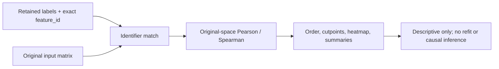

# 17. Original-space explanation, heatmaps, and responsible interpretation

*Guiding question:* **What structure do retained labels describe in the original variant dimensions?**

Prerequisites: 3,5,12,16.

## Why the question matters

A heatmap can make a selected partition intelligible while also inviting circular biological claims.

Freeze 3 reports descriptive Pearson/Spearman summaries, order and cutpoint sidecars, exclusions, and optional coordinate associations; it emits no post-selection p-values.

This chapter develops the question in the order needed for a reader to move from statistical principle to current implementation, retained evidence, and a defensible statement. Its central worked task is: Follow Lab 3 from exact ID matching through similarity, ordering, cutpoints, cluster summaries, and the rendered heatmap; state three conclusions the image cannot support.

## Learning objectives

After completing Chapter 17, the reader can:

1. define identifier alignment and explain its role without exceeding the stated caution;
2. define noise label and explain its role without exceeding the stated caution;
3. define trustworthiness and continuity and explain its role without exceeding the stated caution;
4. define Pearson association and explain its role without exceeding the stated caution;
5. define Spearman association and explain its role without exceeding the stated caution;
6. trace the relevant package functions and generated artifacts;
7. complete the worked task and distinguish observation from interpretation.

## Conceptual and mathematical development

### identifier alignment

A one-to-one correspondence between vector or feature identifiers across artifacts. A compact notation is `I_A = I_B`. In practical terms, order is not identity; normalize and validate keys before joining.

Within Freeze 3 RC1 the concept is connected to `validated_identifiers; align_rows` and is visible through `labels.tsv; coordinates.tsv`. This connection is narrower than the general statistical idea: software evidence establishes the implemented route, while the mapped primary or internal evidence supplies background authority. The distinction prevents a mathematical definition from being mistaken for proof that a particular scientific interpretation is correct.

### noise label

Label -1 for points unassigned under a fitted density model. A compact notation is `label_i=-1`. In practical terms, noise is algorithmic and parameter-conditional, never a biological-null statement. [@campello2015hdbscan]

Within Freeze 3 RC1 the concept is connected to `fit_hdbscan` and is visible through `labels.tsv`. This connection is narrower than the general statistical idea: software evidence establishes the implemented route, while the mapped primary or internal evidence supplies background authority. The distinction prevents a mathematical definition from being mistaken for proof that a particular scientific interpretation is correct.

### trustworthiness and continuity

Directed neighborhood-retention diagnostics. A compact notation is `T(k)=1-c sum_i sum_(j in U_k(i))(r(i,j)-k)`. In practical terms, freeze 3 computes both through directed calls to sklearn trustworthiness under Euclidean geometry. [@venna2010]

Within Freeze 3 RC1 the concept is connected to `embedding_quality_metrics` and is visible through `run_summary.json`. This connection is narrower than the general statistical idea: software evidence establishes the implemented route, while the mapped primary or internal evidence supplies background authority. The distinction prevents a mathematical definition from being mistaken for proof that a particular scientific interpretation is correct.

### Pearson association

Linear association in original input dimensions. A compact notation is `r=sum(x-xbar)(y-ybar)/sqrt(sum(x-xbar)^2 sum(y-ybar)^2)`. In practical terms, post-selection descriptive only; undefined constant vectors follow configured policy. [@kriegeskorte2009]

Within Freeze 3 RC1 the concept is connected to `compute_similarity` and is visible through `similarity_matrix.csv`. This connection is narrower than the general statistical idea: software evidence establishes the implemented route, while the mapped primary or internal evidence supplies background authority. The distinction prevents a mathematical definition from being mistaken for proof that a particular scientific interpretation is correct.

### Spearman association

Pearson correlation of marginal ranks. A compact notation is `rho=cor(rank(x),rank(y))`. In practical terms, ties receive average ranks; monotonic association is not mechanism.

Within Freeze 3 RC1 the concept is connected to `compute_similarity` and is visible through `similarity_matrix.csv`. This connection is narrower than the general statistical idea: software evidence establishes the implemented route, while the mapped primary or internal evidence supplies background authority. The distinction prevents a mathematical definition from being mistaken for proof that a particular scientific interpretation is correct.

### circular analysis

Reuse of discovery data for apparently confirmatory inference. A compact notation is `selection(Y) then test(Y) without adjustment`. In practical terms, same-data heatmaps and correlations are descriptive; independent or selective-inference designs are needed for confirmatory claims. [@kriegeskorte2009; @gao2024]

Within Freeze 3 RC1 the concept is connected to `run_explanation` and is visible through `explanation outputs`. This connection is narrower than the general statistical idea: software evidence establishes the implemented route, while the mapped primary or internal evidence supplies background authority. The distinction prevents a mathematical definition from being mistaken for proof that a particular scientific interpretation is correct.

## Reconstructed operational foundation

Edition 1 contained the following verified operational material in separate short notes. Edition 2 consolidates it here and subjects it to the concept and evidence boundaries above.

### Evidence retained from former Chapter 24

### Operational foundation

A loading in a linear component model has a defined relationship to an observed variable and component. A UMAP coordinate instead comes from a nonlinear, stochastic neighborhood-preservation optimization. Axis orientation, sign, rotation, scale, and even apparent global layout can vary without changing the underlying scientific identity of points. Freeze 3's display columns are therefore descriptive coordinates, not effects, loadings, mechanisms, or causal axes.

Concatenated repeated coordinates are the density-clustering representation. Selected `UMAP_1`–`UMAP_3` columns are visualization coordinates and must not be substituted for the full concatenated matrix. Correlating input dimensions with a display coordinate can be a descriptive diagnostic when explicitly enabled, but it does not turn the coordinate into a biological component.

### Retained evidence

The fresh Lab 1 display in Chapter 19 shows three separated synthetic groups. Its axis titles deliberately say ‘display coordinate,’ and its caption states that axes are not biological loadings.

### Output-reading checkpoint

Inspect display-coordinate columns, parameter/seed manifest, projection-quality table, optional coordinate-association table, and interpretation warnings.

### Misinterpretations to avoid

Do not name a coordinate ‘brain-size axis’ or infer direction of effect from its sign. Do not compare unaligned coordinates across runs. Do not equate a 2D picture with the HDBSCAN fit space.

### Boundary inherited from Edition 1

Coordinates can still be useful for visualization and diagnosing local structure, but claims should be invariant to arbitrary orientation and supported in original space or independent evidence.


## Evidence and references

See McInnes et al. (2018), DOI 10.21105/joss.00861.

### Evidence retained from former Chapter 25

### Operational foundation

`explain` returns to the original matrix after a partition has been retained. It loads native summary/labels or a legacy table, resolves input orientation, validates/strips identifiers, rejects duplicates, enforces complete matching by default, applies the recorded preprocessing contract, and computes original-space similarity without refitting UMAP or HDBSCAN.

Native mode usually needs only `--model-json`; `--input` can override a stale recorded path. Legacy mode requires a label table, original input, explicit output root, and often explicit orientation/ID/label/coordinate options. The noise policy can place unassigned vectors last, include them in ordering, or exclude them with a recorded reason.

```bash
dimple-gwas explain \
  --model-json RUN/models/top_model_artifacts/MODEL/summary.json \
  --output-dir explanation_new
```

## Evidence diagram or figure




*Original-space explanation without refitting. Editable source: `assets/diagrams/diagram_07_original_space_explanation.mmd`.*

### Retained evidence

Edition 2 Lab 3 matches all 24 synthetic feature IDs, excludes none, writes the complete similarity table, and produces ordered heatmap/summary/projection artifacts without changing labels.

### Output-reading checkpoint

Inspect interpretation manifest sources/hashes, orientation, ID counts, exclusions, `heatmap_order.tsv`, similarity table, summaries, projection quality, README, and figure sidecars.

### Misinterpretations to avoid

Do not let auto-orientation replace an explicit contract when both axes could overlap. Do not accept incomplete matching silently. Do not describe explanation as a refit or independent validation.

### Boundary inherited from Edition 1

Original-space summaries remain conditional on a selected partition and input construction. They can reveal descriptive coherence or contradictions but cannot establish causal mechanism.

### Evidence retained from former Chapter 26

### Operational foundation

Pearson correlation summarizes linear association after centering/scaling; Spearman correlates ranks and summarizes monotone association. Freeze 3 uses the configured method to build a vector-by-vector similarity table in original input-variable space. It then summarizes within-block and between-block pairs after applying the declared order/noise policy.

Undefined correlation can arise from constant or insufficiently variable vectors. The safe default is `error`; the opt-in `zero` policy replaces undefined values and records the choice. This replacement is a computational convention, not evidence of no association. Coordinate associations, when enabled, are ranked descriptive correlations between original dimensions and supplied coordinates.

Neither correlation supplies a causal effect, an unbiased post-selection p-value, or independent replication.

### Retained evidence

Edition 2 Lab 3's three synthetic clusters have within-cluster Pearson means approximately 0.9963, 0.9930, and 0.9928; between-cluster means are about 0.0033–0.0047. The fresh Lab 3 treatment in Chapters 17 and 21 labels these as post-selection descriptive summaries.

### Output-reading checkpoint

Inspect similarity method, pair counts, means/medians, between summaries, exclusions, undefined-correlation policy, and optional association method/top-N settings.

### Misinterpretations to avoid

Do not attach naive p-values to the same selected pairs. Do not interpret zero replacement as observed zero correlation. Do not compare Pearson and Spearman without explaining the different question.

### Boundary inherited from Edition 1

Shared sample, LD, preprocessing, technical structure, and selection can drive correlations. Independent evidence is required for biological interpretation.

### Evidence retained from former Chapter 27

### Operational foundation

The explanation heatmap is a rendered view of an auditable order. `heatmap_order.tsv` records 1-based display order, exact feature ID, cluster label/noise flag, and supplied coordinates. `cluster_cutpoints.tsv` records zero- and one-based inclusive block boundaries and sizes. Within a cluster, `cluster_then_hclust` applies hierarchical ordering to the original-space similarity-derived distance; other choices are cluster, hclust, or input order.

Annotations come from an optional table joined by the declared index column. The initial tutorial configuration used the wrong join key and produced a warning; the source YAML was corrected to `index` and Edition 2 Lab 1 rerun as `run_20260826`. The earlier output remains as evidence of the mistake. Figure interpretation should always use sidecars, not inferred pixel positions.

## Evidence diagram or figure


### Retained evidence

The Edition 2 Lab 3 heatmap is regenerated at publication resolution from the freshly retained similarity matrix; its source and generation record are in `qa/figure_inventory.tsv`. The synthetic groups are designed, and the image is unrestricted fixture evidence.

### Output-reading checkpoint

Inspect heatmap PNG/HTML, exact order, cutpoints, cluster summary, exclusions, annotations, manifest hash, and README caveats.

### Misinterpretations to avoid

Do not reorder the image manually and leave sidecars unchanged. Do not assume coloured blocks are statistically significant. Do not publish annotations without checking privacy/access status.

### Boundary inherited from Edition 1

Large matrices are protected by thresholds and optional forcing. A full-resolution heatmap can be unreadable or disclose identifiers; use aggregate summaries and controlled access when appropriate.

### Evidence retained from former Chapter 28

### Operational foundation

HDBSCAN label `-1` means that the fitted hierarchy/extraction did not assign an observation to a retained cluster under the current representation, metric, density parameters, and selection method. It is an algorithmic status, not a biological category. Changing UMAP parameters, seed aggregation, min-cluster-size, min-samples, epsilon, metric, or selection method can change the noise set.

Inspect unassigned observations rather than discarding them rhetorically. Report count/fraction, exact IDs, probabilities/persistence when available, original-space relationships, stability across justified settings, and transitions in comparison outputs. Use ‘unassigned’ or ‘HDBSCAN noise’ with the condition attached. Avoid ‘non-pleiotropic,’ ‘failed IDP,’ ‘irrelevant,’ or ‘no shared structure.’

### Retained evidence

The synthetic tutorials have zero noise. The historical 164-IDP record has 102 unassigned and 62 assigned across five clusters; this is historical evidence and does not imply 102 biologically irrelevant IDPs.

### Output-reading checkpoint

Inspect label tables, noise count/fraction, candidate parameters, membership comparison, changed-noise status, exclusions under noise policy, and historical source status.

### Misinterpretations to avoid

Do not drop noise before reporting its magnitude. Do not compare noise labels without exact IDs. Do not treat absence of assigned cluster as absence of any genetic correlation.

### Boundary inherited from Edition 1

Freeze 3 does not provide a calibrated biological uncertainty interval for each label. Stability and external data must be studied separately.


## Evidence and references

See Campello et al. (2015), DOI 10.1145/2733381.

### Evidence retained from former Chapter 29

### Operational foundation

‘Double dipping’ occurs when data-dependent choices are ignored in a later inferential statement. DIMPLE-GWAS uses the matrix to create an embedding, enumerate/extract partitions, and select one using internal metrics. Testing separation or correlation on the same matrix as though the partition were fixed in advance can yield overconfident evidence. Multiple candidate models and analyst inspection add further selection.

Safe outputs in Freeze 3 are descriptive summaries with explicit conditioning. For inference, plan held-out variables, independent cohorts, preregistered replication, sample splitting, perturbation/stability designs, or a selective-inference method whose assumptions actually match the pipeline. Report effect sizes and uncertainty appropriate to the validation design. Never describe an omitted p-value as a flaw: the explanation utility intentionally avoids cluster ANOVA and post-selection significance.

### Retained evidence

Edition 2 Lab 3 reports within/between similarities and a heatmap but no ANOVA p-values. That is a deliberate boundary, not missing validation.

### Output-reading checkpoint

Inspect candidate population, selection rule, all exploratory views used, independent validation plan, comparison/stability evidence, and whether any test data were held out before selection.

### Misinterpretations to avoid

Do not call high within-cluster correlation a validation test. Do not choose external outcomes after seeing the partition without disclosure. Do not cite a general selective-inference paper as if it implemented this exact pipeline.

### Boundary inherited from Edition 1

Independent validation may still inherit sample overlap, ancestry, measurement, or harmonization biases. The design—not the word ‘replication’—determines evidential strength.


## Evidence and references

See Gao, Bien & Witten (2024), DOI 10.1080/01621459.2022.2116331, with the scope limitation stated above.

## Implementation trace

**`cli.build_parser`** is defined at `dimple_gwas/cli.py:146` with signature `class construction/data container`. Construct the complete user-facing command and flag grammar, including the interpret alias. It is reached from cli.main and connects to cli._add_config_source; cli._add_run_options. Its direct artifact contract is No direct canonical artifact; in-memory/supporting result; its explicit error surface is No explicit raise in this symbol; delegated calls may raise.. Test evidence is recorded as tests/test_freeze3_comparison_validation.py::test_cli_exposes_new_commands_and_alias. This is a A-tier contract, so the complete 20-field dossier is retained in the function atlas.

**`cli._inspect`** is defined at `dimple_gwas/cli.py:240` with signature `args: argparse.Namespace`. Implementation callable for inspect. It is reached from cli.main and connects to cli._resolved; search_space.count_candidates. Its direct artifact contract is No direct canonical artifact; in-memory/supporting result; its explicit error surface is No explicit raise in this symbol; delegated calls may raise.. Test evidence is recorded as No direct symbol-name test reference; assess through caller/integration coverage. This is a A-tier contract, so the complete 20-field dossier is retained in the function atlas.

**`cli._show`** is defined at `dimple_gwas/cli.py:254` with signature `args: argparse.Namespace`. Implementation callable for show. It is reached from cli.main and connects to cli._resolved; io.json_safe; reporting.write_search_space; search_space.count_candidates; search_space.enumerate_candidates; search_space.flatten_candidate. Its direct artifact contract is No direct canonical artifact; in-memory/supporting result; its explicit error surface is No explicit raise in this symbol; delegated calls may raise.. Test evidence is recorded as No direct symbol-name test reference; assess through caller/integration coverage. This is a A-tier contract, so the complete 20-field dossier is retained in the function atlas.

**`cli._score`** is defined at `dimple_gwas/cli.py:265` with signature `args: argparse.Namespace`. Implementation callable for score. It is reached from cli.main and connects to config.resolve_config; io.atomic_json_dump; io.json_safe; io.read_model_table; ranking.rank_models; scoring.apply_scoring; scoring.normalize_model_table_schema. Its direct artifact contract is rescored_table.tsv; rescored_table.tsv.manifest.json; its explicit error surface is No explicit raise in this symbol; delegated calls may raise.. Test evidence is recorded as No direct symbol-name test reference; assess through caller/integration coverage. This is a A-tier contract, so the complete 20-field dossier is retained in the function atlas.

**`cli._summarize`** is defined at `dimple_gwas/cli.py:284` with signature `args: argparse.Namespace`. Implementation callable for summarize. It is reached from cli.main and connects to io.atomic_json_dump; io.read_model_table; ranking.family_summaries; ranking.pareto_front; ranking.rank_models; ranking.top_models. Its direct artifact contract is family_summaries.tsv; pareto_front.tsv; top_models.tsv; summary.json; its explicit error surface is No explicit raise in this symbol; delegated calls may raise.. Test evidence is recorded as No direct symbol-name test reference; assess through caller/integration coverage. This is a A-tier contract, so the complete 20-field dossier is retained in the function atlas.

**`cli._reproduce`** is defined at `dimple_gwas/cli.py:301` with signature `args: argparse.Namespace`. Implementation callable for reproduce. It is reached from cli.main and connects to config.resolve_config; config.validate_config; pipeline.run_search. Its direct artifact contract is No direct canonical artifact; in-memory/supporting result; its explicit error surface is ValueError. Test evidence is recorded as No direct symbol-name test reference; assess through caller/integration coverage. This is a A-tier contract, so the complete 20-field dossier is retained in the function atlas.

**`cli._explain`** is defined at `dimple_gwas/cli.py:323` with signature `args: argparse.Namespace`. Implementation callable for explain. It is reached from cli.main and connects to config.resolve_config; config.validate_config; interpretation.run_explanation. Its direct artifact contract is No direct canonical artifact; in-memory/supporting result; its explicit error surface is ValueError. Test evidence is recorded as No direct symbol-name test reference; assess through caller/integration coverage. This is a A-tier contract, so the complete 20-field dossier is retained in the function atlas.

**`cli._compare`** is defined at `dimple_gwas/cli.py:376` with signature `args: argparse.Namespace`. Implementation callable for compare. It is reached from cli.main and connects to comparison.run_comparison. Its direct artifact contract is No direct canonical artifact; in-memory/supporting result; its explicit error surface is No explicit raise in this symbol; delegated calls may raise.. Test evidence is recorded as No direct symbol-name test reference; assess through caller/integration coverage. This is a A-tier contract, so the complete 20-field dossier is retained in the function atlas.

**`cli._validate`** is defined at `dimple_gwas/cli.py:391` with signature `args: argparse.Namespace`. Implementation callable for validate. It is reached from cli.main and connects to validation.run_validation. Its direct artifact contract is No direct canonical artifact; in-memory/supporting result; its explicit error surface is No explicit raise in this symbol; delegated calls may raise.. Test evidence is recorded as No direct symbol-name test reference; assess through caller/integration coverage. This is a A-tier contract, so the complete 20-field dossier is retained in the function atlas.

**`cli.main`** is defined at `dimple_gwas/cli.py:403` with signature `argv: list[str] | None=None`. Dispatch the command-line interface and return a process exit status. It is reached from CLI/import/direct caller or no package caller detected and connects to cli._compare; cli._explain; cli._inspect; cli._reproduce; cli._resolved; cli._score; cli._show; cli._summarize; cli._validate; cli.build_parser; pipeline.run_search. Its direct artifact contract is No direct canonical artifact; in-memory/supporting result; its explicit error surface is No explicit raise in this symbol; delegated calls may raise.. Test evidence is recorded as tests/test_freeze3_comparison_validation.py::test_cli_compare_end_to_end. This is a A-tier contract, so the complete 20-field dossier is retained in the function atlas.

**`interpretation.is_noise_label`** is defined at `dimple_gwas/interpretation.py:30` with signature `value: Any`. Implementation callable for is noise label. It is reached from comparison.run_comparison; interpretation.calculate_cluster_summary; interpretation.label_sort_key; interpretation.run_explanation and connects to No package-defined dependency detected. Its direct artifact contract is No direct canonical artifact; in-memory/supporting result; its explicit error surface is No explicit raise in this symbol; delegated calls may raise.. Test evidence is recorded as No direct symbol-name test reference; assess through caller/integration coverage. This is a B-tier contract, so the complete 20-field dossier is retained in the function atlas.

**`interpretation.label_sort_key`** is defined at `dimple_gwas/interpretation.py:35` with signature `value: Any`. Implementation callable for label sort key. It is reached from comparison.run_comparison; interpretation.compute_order and connects to interpretation.is_noise_label. Its direct artifact contract is No direct canonical artifact; in-memory/supporting result; its explicit error surface is No explicit raise in this symbol; delegated calls may raise.. Test evidence is recorded as No direct symbol-name test reference; assess through caller/integration coverage. This is a B-tier contract, so the complete 20-field dossier is retained in the function atlas.

## Claim adjudication notebook

The following statements are admitted to the draft only in their safe form:

- **INT-001 (reject):** UMAP coordinates are descriptive latent coordinates, not biological loadings, effects, mechanisms, or causal axes. [@mcinnes2018umap] Limitation: Optional coordinate correlations remain descriptive. Implementation evidence: `interpretation.py; EXPLAINABILITY.md`.

- **INT-002 (reject):** Label -1 means unassigned under the fitted representation, metric, density assumptions, and parameters. [@campello2015hdbscan] Limitation: Noise status can change across candidate settings. Implementation evidence: `hdbscan_runner.py`.

- **INT-003 (verified_with_qualification):** Pearson/Spearman summaries are post-selection descriptive diagnostics conditional on the retained partition. [@kriegeskorte2009; @gao2024] Limitation: They do not provide causal, replication, or unbiased significance evidence. Implementation evidence: `interpretation.py`.

- **INT-004 (verified_with_qualification):** Classical tests on the same data used for group discovery are vulnerable to circularity; Freeze 3 omits cluster ANOVA and post-selection p-values. [@kriegeskorte2009; @gao2024] Limitation: The cited selective method is not a turnkey HDBSCAN procedure. Implementation evidence: `interpretation.py; limitations docs`.

## Reading the generated evidence

For Chapter 17, the `Original-space explanation, heatmaps, and responsible interpretation` files are read as a provenance chain rather than as isolated results:

| Artifact | Producer | What to verify before interpretation |
| --- | --- | --- |
| `original_space_similarity.tsv.gz` | `run_explanation` | Artifact exists under the new output root, is readable, and its checksum is recorded. |
| `heatmap_order.tsv` | `run_explanation` | Image dimensions are nonzero; order and cutpoints match sidecars; no inferential claim is attached. |
| `cluster_cutpoints.tsv` | `run_explanation` | Artifact exists under the new output root, is readable, and its checksum is recorded. |
| `cluster_summary.tsv` | `run_explanation` | Artifact exists under the new output root, is readable, and its checksum is recorded. |
| `projection_quality.tsv` | `run_explanation` | Artifact exists under the new output root, is readable, and its checksum is recorded. |
| `coordinate_associations.tsv` | `run_explanation` | Artifact exists under the new output root, is readable, and its checksum is recorded. |
| `exclusions.tsv` | `run_explanation` | Artifact exists under the new output root, is readable, and its checksum is recorded. |
| `original_space_heatmap.png/html` | `run_explanation` | Image dimensions are nonzero; order and cutpoints match sidecars; no inferential claim is attached. |
| `interpretation_manifest.json + README.md` | `run_explanation` | Artifact exists under the new output root, is readable, and its checksum is recorded. |

The output atlas supplies the complete schemas, checksums, conditions, consumers, and privacy notes for this Chapter 17 route. Native manifests can contain machine paths; the assembled textbook uses sanitized excerpts while restricted evidence retains the original provenance chain.

## Worked reasoning and evidence exercise

Follow Lab 3 from exact ID matching through similarity, ordering, cutpoints, cluster summaries, and the rendered heatmap; state three conclusions the image cannot support.

A complete Chapter 17 answer must expose its intermediate reasoning, name the source or output used for `Original-space explanation, heatmaps, and responsible interpretation`, and finish with separate support and non-support statements. Applying that discipline to the question “What structure do retained labels describe in the original variant dimensions?” prevents a calculation, a software observation, and a scientific interpretation from collapsing into one claim.

## Assumptions, diagnostics, and recovery

The Chapter 17 analysis assumes the stated unit and inputs, the recorded configuration and software identity, and a diagnostic that addresses the claimed property rather than a convenient surrogate. Its decisive boundary is: Freeze 3 reports descriptive Pearson/Spearman summaries, order and cutpoint sidecars, exclusions, and optional coordinate associations; it emits no post-selection p-values.

If the Chapter 17 route fails, retain its log and candidate status before deciding whether the cause is input, configuration, dependency, compute, identifier alignment, or output-root state. Correct an operational failure by writing a new result directory. Treat instability in `Original-space explanation, heatmaps, and responsible interpretation` as sensitivity evidence: report it and identify the independent evidence needed instead of relabeling ambiguity as a software exception.

## Chapter synthesis

A heatmap can make a selected partition intelligible while also inviting circular biological claims. The implementation trace makes the current behavior auditable, but the evidence boundary remains part of the result. Part IV begins with a hand-calculable integration of the method.

## Exercises

1. For `Original-space explanation, heatmaps, and responsible interpretation`, name the unit of analysis and one plausible but invalid substitute.
2. Reconstruct the notation for identifier alignment; define its dimensions or denominator and interpret every term.
3. Choose a Tier A function mapped to Chapter 17; identify its caller and direct output, then propose a topic-specific edge case.
4. Select one Chapter 17 artifact from the output atlas and state three integrity checks that must precede scientific reading.
5. Convert a tempting `Original-space explanation, heatmaps, and responsible interpretation` overclaim into one observed statement followed by its limitation.
6. Follow Lab 3 from exact ID matching through similarity, ordering, cutpoints, cluster summaries, and the rendered heatmap; state three conclusions the image cannot support.

Appendix J gives the Chapter 17 adjudication guide. Its further-reading keys supply statistical context; no external paper is treated as automatic validation of the current software or dataset.
