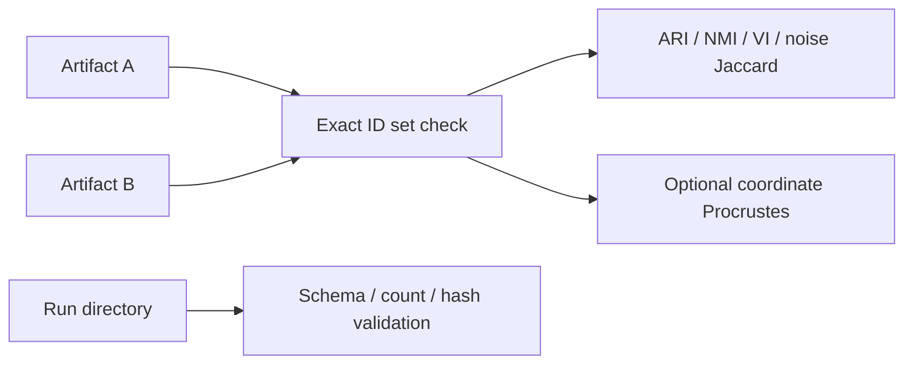

# 18. A hand-calculable toy analysis from matrix to score

*Guiding question:* **Can the essential contracts be understood without hiding behind a large run?**

Prerequisites: 6–11.

## Why the question matters

A toy must simplify UMAP while remaining literal about implemented preprocessing, diagnostics, scoring, and comparison.

Lab 0 executes valid code paths but does not claim a hand reconstruction of stochastic UMAP or HDBSCAN hierarchy.

This chapter develops the question in the order needed for a reader to move from statistical principle to current implementation, retained evidence, and a defensible statement. Its central worked task is: Reproduce every retained Lab 0 number and reconcile exact numeric inequality with permutation-invariant agreement.

## Learning objectives

After completing Chapter 18, the reader can:

1. define identifier alignment and explain its role without exceeding the stated caution;
2. define distance and similarity and explain its role without exceeding the stated caution;
3. define scaling and transformation and explain its role without exceeding the stated caution;
4. define RINT ties and missingness and explain its role without exceeding the stated caution;
5. define silhouette and explain its role without exceeding the stated caution;
6. trace the relevant package functions and generated artifacts;
7. complete the worked task and distinguish observation from interpretation.

## Conceptual and mathematical development

### identifier alignment

A one-to-one correspondence between vector or feature identifiers across artifacts. A compact notation is `I_A = I_B`. In practical terms, order is not identity; normalize and validate keys before joining.

Within Freeze 3 RC1 the concept is connected to `validated_identifiers; align_rows` and is visible through `labels.tsv; coordinates.tsv`. This connection is narrower than the general statistical idea: software evidence establishes the implemented route, while the mapped primary or internal evidence supplies background authority. The distinction prevents a mathematical definition from being mistaken for proof that a particular scientific interpretation is correct.

### distance and similarity

Geometry chosen to compare vectors or embedded points. A compact notation is `d_2(x,y)=sqrt(sum_j (x_j-y_j)^2)`. In practical terms, the metric defines which differences count as close. [@aggarwal2001]

Within Freeze 3 RC1 the concept is connected to `evaluate_candidate; compute_similarity` and is visible through `model_table.csv; similarity_matrix.csv`. This connection is narrower than the general statistical idea: software evidence establishes the implemented route, while the mapped primary or internal evidence supplies background authority. The distinction prevents a mathematical definition from being mistaken for proof that a particular scientific interpretation is correct.

### scaling and transformation

Changes to marginal scale before geometric analysis. A compact notation is `z=(x-mu)/sigma; z_i=Phi^-1((r_i-0.5)/n)`. In practical terms, transformation changes geometry; it does not create independent evidence. [@beasley2009]

Within Freeze 3 RC1 the concept is connected to `rank_inverse_normal_transform; prepare_analysis_matrix` and is visible through `resolved_config.yaml`. This connection is narrower than the general statistical idea: software evidence establishes the implemented route, while the mapped primary or internal evidence supplies background authority. The distinction prevents a mathematical definition from being mistaken for proof that a particular scientific interpretation is correct.

### RINT ties and missingness

Average ranks with missing values retained during ranking. A compact notation is `r_i=average tied rank`. In practical terms, freeze 3 rejects missing analysis cells before the pipeline and applies RINT column-wise before transpose. [@beasley2009]

Within Freeze 3 RC1 the concept is connected to `rank_inverse_normal_transform` and is visible through `prepared matrix`. This connection is narrower than the general statistical idea: software evidence establishes the implemented route, while the mapped primary or internal evidence supplies background authority. The distinction prevents a mathematical definition from being mistaken for proof that a particular scientific interpretation is correct.

### silhouette

Within-versus-nearest-other-cluster separation under a configured metric. A compact notation is `s(i)=(b(i)-a(i))/max(a(i),b(i))`. In practical terms, freeze 3 can exclude noise and supplies the configured HDBSCAN metric. [@rousseeuw1987]

Within Freeze 3 RC1 the concept is connected to `evaluate_candidate` and is visible through `model_table.csv`. This connection is narrower than the general statistical idea: software evidence establishes the implemented route, while the mapped primary or internal evidence supplies background authority. The distinction prevents a mathematical definition from being mistaken for proof that a particular scientific interpretation is correct.

### legacy_dimple score

Population-relative weighted combination of normalized silhouette, clusters, and optionally noise. A compact notation is `raw=w_s s/max(s)+w_k k/max(k)-w_n n/max(n)`. In practical terms, weights are raw dynamic ranges divided by their sum; final scores are min-max scaled.

Within Freeze 3 RC1 the concept is connected to `legacy_dimple_score` and is visible through `scoring_manifest.json; model_table.csv`. This connection is narrower than the general statistical idea: software evidence establishes the implemented route, while the mapped primary or internal evidence supplies background authority. The distinction prevents a mathematical definition from being mistaken for proof that a particular scientific interpretation is correct.

### adjusted Rand index

Chance-adjusted pairwise partition agreement. A compact notation is `ARI=(RI-E[RI])/(max(RI)-E[RI])`. In practical terms, permutation invariant; a value of 1 does not imply coordinate identity. [@hubert1985]

Within Freeze 3 RC1 the concept is connected to `compare_partitions` and is visible through `comparison_summary.json`. This connection is narrower than the general statistical idea: software evidence establishes the implemented route, while the mapped primary or internal evidence supplies background authority. The distinction prevents a mathematical definition from being mistaken for proof that a particular scientific interpretation is correct.

### normalized mutual information

Normalized information shared by two labelings. A compact notation is `NMI=2I(U;V)/(H(U)+H(V))`. In practical terms, normalization conventions matter; Freeze 3 uses the sklearn convention recorded in code. [@vinh2010]

Within Freeze 3 RC1 the concept is connected to `compare_partitions` and is visible through `comparison_summary.json`. This connection is narrower than the general statistical idea: software evidence establishes the implemented route, while the mapped primary or internal evidence supplies background authority. The distinction prevents a mathematical definition from being mistaken for proof that a particular scientific interpretation is correct.

### noise Jaccard

Overlap of the two sets labeled -1. A compact notation is `J(A,B)=|A intersect B|/|A union B|`. In practical terms, it isolates agreement about unassigned membership, not all clusters.

Within Freeze 3 RC1 the concept is connected to `noise_jaccard` and is visible through `comparison_summary.json`. This connection is narrower than the general statistical idea: software evidence establishes the implemented route, while the mapped primary or internal evidence supplies background authority. The distinction prevents a mathematical definition from being mistaken for proof that a particular scientific interpretation is correct.

## Reconstructed operational foundation

Edition 1 contained the following verified operational material in separate short notes. Edition 2 consolidates it here and subjects it to the concept and evidence boundaries above.

### Evidence retained from former Chapter 4

### Operational foundation

The Stage 1 workflow is a producer–consumer chain. Freeze 3 reads the table, removes the declared leading metadata columns, optionally applies RINT to analysis columns, and transposes to vectors by input variables. For each UMAP parameter family it generates repeated seeded UMAP/densMAP embeddings and concatenates them horizontally. It then evaluates the complete declared HDBSCAN Cartesian product, retains success, invalid-topology, and failure rows, calculates diagnostics, applies the declared score, ranks eligible candidates, and refits retained models to preserve labels.

Downstream commands do different work. `reproduce-model` refits one retained parameterization. `explain` does not refit; it matches exact IDs and returns to original input-vector space. `compare` measures structural and optional coordinate concordance. `validate` checks files, schemas, counts, readability, and recorded hashes. No PCA, SVD, or ICA reducer is silently inserted before UMAP.

## Evidence diagram or figure


*Stage 1 producer–consumer workflow. Editable source: `assets/diagrams/diagram_01_stage1_workflow.mmd`.*

### Retained evidence

Follow `assets/diagrams/diagram_01_stage1_workflow.mmd` from input to downstream utilities. Each arrow corresponds to an implementation module named in `evidence/source_to_manual_traceability.tsv`.

### Output-reading checkpoint

At the run root, inspect `resolved_config.yaml`, the search-space manifests, `models/`, `run_manifest.json`, and `logs/run.log`. Appendix D maps every named output to its producer and consumer.

### Misinterpretations to avoid

Do not treat `stage09_*` display coordinates as the full concatenated embedding. Do not expect cleaned inputs or individual repeated embeddings on disk; current Freeze 3 keeps them in memory.

### Boundary inherited from Edition 1

A workflow diagram explains control and data flow, not scientific validity. Every transformation can change geometry, and the selected model remains conditional on the declared search and score.

### Evidence retained from former Chapter 5

### Operational foundation

A GWAS summary statistic is a result indexed by a genetic variant and phenotype. A vector is the ordered set of analysis values for one phenotype across the aligned variant rows. A distance metric maps two vectors—or two embedded observations—to a nonnegative dissimilarity. A partition assigns observations to groups; HDBSCAN may also leave observations unassigned with label `-1`.

Internal clustering metrics summarize geometric properties of the same representation used to fit or assess the partition. Silhouette contrasts an observation's mean within-cluster distance with its nearest other-cluster mean distance. DBCV evaluates density connectedness and separation. Neither asks whether a cluster is biologically meaningful. Projection metrics such as trustworthiness and continuity assess neighborhood preservation, not labels or mechanism.

Pleiotropy is a biological/statistical concept about genetic effects across traits. A density cluster among phenotype vectors can generate hypotheses about shared structure, but cluster membership is not itself proof of pleiotropy or its cause.

### Retained evidence

For three points, compute within- and between-cluster distances under two metrics. The exercise shows why a metric choice is part of the scientific definition of neighborhood rather than a cosmetic option.

### Output-reading checkpoint

Candidate tables contain topology counts, cluster-size summaries, silhouette, DBCV, Calinski–Harabasz, Davies–Bouldin, HDBSCAN persistence, projection metrics, status, warnings, and errors. Check each metric's scope and metric columns.

### Misinterpretations to avoid

Do not compare metric values calculated under undocumented metrics or representations. Do not treat a large score as an external p-value. Do not call every input column a ‘feature’ when the clustered observation is the vector/IDP.

### Boundary inherited from Edition 1

Distance concentration, correlations among variants, scaling, missingness, and finite sample size can alter geometry. Internal metrics can reward a representation-specific structure that fails to reproduce externally.


## Evidence and references

See Rousseeuw (1987), DOI 10.1016/0377-0427(87)90125-7, and Moulavi et al. (2014), DOI 10.1137/1.9781611973440.96.

### Evidence retained from former Chapter 15

### Operational foundation

Preprocessing defines the geometry presented to UMAP. Freeze 3 removes `input.drop_first_n_cols` leading columns, validates that analysis columns are numeric, optionally applies rank inverse normal transformation to each analysis column before transpose, and then transposes to vectors by input variables. With `zscore_transform=none`, values are not RINT-transformed. The historical option name is retained although the implemented alternative is `rint`.

For a column with ranks, RINT maps rank-based probabilities through the standard-normal quantile function. It can reduce marginal scale differences and the influence of extreme values, but it also changes the scientific quantity and does not repair upstream harmonization or dependence. The configuration default is `none`; enable RINT only with a documented rationale that matches the intended historical or prospective protocol.

### Retained evidence

The preprocessing tests cover RINT and numeric-matrix behavior. Both executed synthetic tutorials use `none`, so their values remain on the fixture's generated scale.

### Output-reading checkpoint

Inspect the input config, resolved transform, input-contract manifest, prepared-shape log line, identifier set, and any preprocessing warnings. Record upstream transformations separately.

### Misinterpretations to avoid

Do not describe RINT as row-wise without naming the table orientation: implementation applies it to analysis columns before transpose. Do not call it z-scoring or assume it creates independence.

### Boundary inherited from Edition 1

RINT can alter ties, correlations, distances, and downstream partitions. The manual makes no universal recommendation between transformed and untransformed analyses.

### Evidence retained from former Chapter 19

### Operational foundation

Candidate metrics serve different purposes. Topology fields describe non-noise cluster count, noise count/fraction, and cluster sizes. Silhouette uses the configured HDBSCAN metric and the declared sampling scope. DBCV is optionally computed as a density-aware diagnostic. Calinski–Harabasz and Davies–Bouldin are supplied with explicit metric/context fields. HDBSCAN persistence summaries describe retained clusters. Trustworthiness and continuity belong to the embedding family, not to one HDBSCAN extraction.

Metrics can be missing when a topology is invalid, a calculation is undefined, a backend cannot support a metric, or a candidate fails. Read `status`, scope, sampled flags, sample sizes, and `metric_warnings` before comparing numbers. The candidate table is deliberately wide so these qualifications are not hidden.

### Retained evidence

The selected Edition 2 Lab 2 candidate has silhouette about 0.970354 and DBCV about 0.976386, with three equal clusters and no noise. These values describe the designed fixture under Euclidean geometry; they are not expected production targets.

### Output-reading checkpoint

Inspect metric value plus its metric/scope/sampled/sample-size columns, topology counts, persistence, warnings, and the run's compute flags.

### Misinterpretations to avoid

Do not call silhouette inherently Euclidean; Freeze 3 supplies the configured metric. Do not compare a sampled score with a full score without noting scope. Do not call DBCV the universal best metric.

### Boundary inherited from Edition 1

All internal metrics are conditional on representation and candidate population. They lack independent biological evidence and can disagree legitimately.


## Evidence and references

See Rousseeuw (1987), DOI 10.1016/0377-0427(87)90125-7, and Moulavi et al. (2014), DOI 10.1137/1.9781611973440.96.

### Evidence retained from former Chapter 20

### Operational foundation

`legacy_dimple` is the default compatibility score. Among eligible candidates, each included component is divided by its maximum. Its weight is the component's raw observed range divided by the sum of included ranges. Raw score adds normalized silhouette and normalized non-noise cluster count and, only when `fit_include_noise=true`, subtracts normalized noise count. The raw score is finally scaled to [0,1] over the eligible candidate population; a zero range maps to 1.

This is population-relative: adding or removing candidates can change maxima, ranges, weights, and final scores even if an existing candidate's own metrics do not change. DBCV may be present in the table but is not a legacy-score term. No preferred cluster band, noise ceiling, largest-cluster target, or biological label is embedded.

The `custom` profile accepts explicitly declared metric weights and maximize/minimize directions. It should represent a preregistered analytic objective, not weights tuned after viewing a desired partition.

### Retained evidence

In Edition 2 Lab 2, all candidates have the same cluster count and no noise, so UMAP-family silhouette differences drive four score levels and eight-way ties within families. The selection manifest records realized formula and tie order.

### Output-reading checkpoint

Inspect `raw_score`, `score`, compatibility aliases, scoring profile, noise-fit flag, realized weights/ranges, eligible counts, and tie order in `model_selection_manifest.json`.

### Misinterpretations to avoid

Do not say DBCV selected the model when profile is legacy. Do not compare normalized scores across candidate populations as though absolute. Do not introduce outcome-informed custom weights.

### Boundary inherited from Edition 1

A heuristic rank is not a probability, confidence, p-value, or guarantee of stability. Scientific selection should combine transparent objectives, sensitivity, and external evidence.

### Evidence retained from former Chapter 23

### Operational foundation

`compare` accepts two native summaries or label tables, requires unique exact ID sets, and can require the same order. It reports adjusted Rand index, normalized mutual information, variation of information, noise-set Jaccard, optimal label mapping, mapped membership, changed noise status, cluster sizes, and optional Procrustes disparity. Numeric labels are local names, so structural metrics are primary.

`validate` inspects one run directory for required artifacts, readable JSON/YAML, enumeration counts, ranked schema, selected artifacts, and recorded hashes. It writes one pass/warn/fail row per check and returns exit code one on failure. Validation does not refit or compare biology.

```bash
dimple-gwas compare --left LEFT/summary.json --right RIGHT/summary.json --output-dir comparison_new
dimple-gwas validate --run-dir RUN --output-dir validation_new
```

## Evidence diagram or figure




*Comparison and validation paths. Editable source: `assets/diagrams/diagram_08_compare_validate.mmd`.*

### Retained evidence

Edition 2 Lab 3 comparison uses 24 IDs, three clusters, no noise, perfect structural metrics, zero variation of information, and near-zero aligned coordinate disparity. Validation reports 24/24 pass with no warnings or failures.

### Output-reading checkpoint

Inspect `comparison_summary.json`, membership table, size table, confusion, mapping, comparison manifest, `validation_checks.tsv`, report, and validation manifest.

### Misinterpretations to avoid

Do not compare raw numeric labels across fits. Do not ignore changed noise status. Do not interpret Procrustes as membership agreement. Do not call hash/schema checks biological validation.

### Boundary inherited from Edition 1

Exact label equality is stringent and environment-sensitive; permutation-invariant equality is structural. Coordinate comparison needs alignment and tolerances. Scientific conclusions need higher-layer validation.

## Implementation trace

**`comparison.run_comparison`** is defined at `dimple_gwas/comparison.py:65` with signature `left_source: str | Path, right_source: str | Path, output_dir: str | Path, *, id_column: str='feature_id', label_column: str='label', require_same_order: bool=False, command: list[str] | None=None`. Compare two label artifacts using exact IDs, permutation-invariant structure, noise sets, mapping, and optional coordinates. It is reached from cli._compare and connects to comparison._columns; comparison._resolve_labels; comparison._variation_of_information; interpretation.detect_coordinate_columns; interpretation.is_noise_label; interpretation.label_sort_key; io.atomic_json_dump; io.ensure_empty_output_dir; io.json_safe; io.validated_identifiers; provenance.base_manifest; provenance.file_record; provenance.utc_now. Its direct artifact contract is comparison_summary.json; membership_comparison.tsv; cluster_sizes.tsv; label_confusion.tsv; optimal_label_mapping.tsv; comparison_manifest.json; its explicit error surface is ValueError. Test evidence is recorded as tests/test_freeze3_comparison_validation.py::test_comparison_rejects_duplicate_ids; tests/test_freeze3_comparison_validation.py::test_comparison_requires_identical_id_sets; tests/test_freeze3_comparison_validation.py::test_label_permutation_comparison_is_structurally_equal. This is a A-tier contract, so the complete 20-field dossier is retained in the function atlas.

**`metrics.effective_neighbor_count`** is defined at `dimple_gwas/metrics.py:9` with signature `n_samples: int, requested: int`. Implementation callable for effective neighbor count. It is reached from metrics.embedding_quality_metrics and connects to No package-defined dependency detected. Its direct artifact contract is No direct canonical artifact; in-memory/supporting result; its explicit error surface is No explicit raise in this symbol; delegated calls may raise.. Test evidence is recorded as tests/test_preprocessing_metrics.py::test_effective_neighbor_edge_cases. This is a B-tier contract, so the complete 20-field dossier is retained in the function atlas.

**`metrics.embedding_quality_metrics`** is defined at `dimple_gwas/metrics.py:15` with signature `original, embedding, requested_k: int, max_samples: int, seed: int`. Calculate bounded trustworthiness and continuity diagnostics for an embedding. It is reached from interpretation.run_explanation; pipeline.run_search and connects to metrics.effective_neighbor_count. Its direct artifact contract is No direct canonical artifact; in-memory/supporting result; its explicit error surface is No explicit raise in this symbol; delegated calls may raise.. Test evidence is recorded as tests/test_preprocessing_metrics.py::test_optimized_trustworthiness_and_continuity. This is a A-tier contract, so the complete 20-field dossier is retained in the function atlas.

**`metrics.evaluate_candidate`** is defined at `dimple_gwas/metrics.py:60` with signature `embedding, labels, clusterer, silhouette_metric: str, fit_include_noise: bool, compute_dbcv: bool, max_samples_silhouette: int=0, silhouette_seed: int=42`. Compute cluster counts, persistence, silhouette, CH, DB, optional DBCV, and validity status for one candidate. It is reached from pipeline._evaluate_one and connects to metrics._cluster_sizes. Its direct artifact contract is No direct canonical artifact; in-memory/supporting result; its explicit error surface is No explicit raise in this symbol; delegated calls may raise.. Test evidence is recorded as No direct symbol-name test reference; assess through caller/integration coverage. This is a A-tier contract, so the complete 20-field dossier is retained in the function atlas.

**`metrics.is_finite_number`** is defined at `dimple_gwas/metrics.py:165` with signature `value: Any`. Implementation callable for is finite number. It is reached from CLI/import/direct caller or no package caller detected and connects to No package-defined dependency detected. Its direct artifact contract is No direct canonical artifact; in-memory/supporting result; its explicit error surface is No explicit raise in this symbol; delegated calls may raise.. Test evidence is recorded as No direct symbol-name test reference; assess through caller/integration coverage. This is a B-tier contract, so the complete 20-field dossier is retained in the function atlas.

**`preprocessing.ExplanationMatrix`** is defined at `dimple_gwas/preprocessing.py:12` with signature `class construction/data container`. Implementation callable for ExplanationMatrix. It is reached from preprocessing.prepare_explanation_matrix and connects to No package-defined dependency detected. Its direct artifact contract is No direct canonical artifact; in-memory/supporting result; its explicit error surface is No explicit raise in this symbol; delegated calls may raise.. Test evidence is recorded as No direct symbol-name test reference; assess through caller/integration coverage. This is a B-tier contract, so the complete 20-field dossier is retained in the function atlas.

**`preprocessing.rank_inverse_normal_transform`** is defined at `dimple_gwas/preprocessing.py:19` with signature `frame`. Apply the implementation's rank-based inverse-normal transform to numeric analysis columns. It is reached from preprocessing.prepare_analysis_matrix; preprocessing.prepare_explanation_matrix and connects to No package-defined dependency detected. Its direct artifact contract is No direct canonical artifact; in-memory/supporting result; its explicit error surface is ValueError. Test evidence is recorded as tests/test_preprocessing_metrics.py::test_rint_and_numeric_matrix. This is a A-tier contract, so the complete 20-field dossier is retained in the function atlas.

**`preprocessing.prepare_analysis_matrix`** is defined at `dimple_gwas/preprocessing.py:34` with signature `frame, config: Mapping[str, Any]`. Validate the input contract, remove metadata, transform if requested, transpose, and return vector-by-variant analysis data. It is reached from pipeline.run_search and connects to preprocessing.rank_inverse_normal_transform. Its direct artifact contract is No direct canonical artifact; in-memory/supporting result; its explicit error surface is ValueError. Test evidence is recorded as tests/test_preprocessing_metrics.py::test_rint_and_numeric_matrix. This is a A-tier contract, so the complete 20-field dossier is retained in the function atlas.

**`preprocessing.infer_explanation_orientation`** is defined at `dimple_gwas/preprocessing.py:67` with signature `frame, expected_vector_ids, *, drop_first_n_cols: int`. Infer orientation only when one exact ID source is uniquely supported. It is reached from interpretation.run_explanation and connects to io.normalize_identifier; io.validated_identifiers. Its direct artifact contract is No direct canonical artifact; in-memory/supporting result; its explicit error surface is ValueError. Test evidence is recorded as tests/test_freeze3_interpretation.py::test_orientation_inference_uses_exact_overlap. This is a B-tier contract, so the complete 20-field dossier is retained in the function atlas.

**`preprocessing.prepare_explanation_matrix`** is defined at `dimple_gwas/preprocessing.py:112` with signature `frame, *, orientation: str, drop_first_n_cols: int, vector_id_source: str='matrix_columns', zscore_transform: str='none'`. Prepare vectors × original dimensions for post-run interpretation. It is reached from interpretation.run_explanation and connects to io.validated_identifiers; preprocessing.ExplanationMatrix; preprocessing._unique_feature_names; preprocessing.rank_inverse_normal_transform. Its direct artifact contract is No direct canonical artifact; in-memory/supporting result; its explicit error surface is ValueError. Test evidence is recorded as tests/test_freeze3_interpretation.py::test_variants_by_vectors_preserves_vector_ids; tests/test_freeze3_interpretation.py::test_vectors_by_variants_explicit_id_column. This is a A-tier contract, so the complete 20-field dossier is retained in the function atlas.

**`ranking.rank_models`** is defined at `dimple_gwas/ranking.py:8` with signature `frame`. Apply deterministic eligibility, score, and tie ordering to candidate rows. It is reached from cli._score; cli._summarize; pipeline.run_search and connects to No package-defined dependency detected. Its direct artifact contract is No direct canonical artifact; in-memory/supporting result; its explicit error surface is No explicit raise in this symbol; delegated calls may raise.. Test evidence is recorded as tests/test_scoring_ranking.py::test_custom_scoring_ranking_top_n_and_pareto. This is a A-tier contract, so the complete 20-field dossier is retained in the function atlas.

**`ranking.top_models`** is defined at `dimple_gwas/ranking.py:23` with signature `frame, n: int`. Implementation callable for top models. It is reached from cli._summarize; pipeline.run_search and connects to No package-defined dependency detected. Its direct artifact contract is No direct canonical artifact; in-memory/supporting result; its explicit error surface is No explicit raise in this symbol; delegated calls may raise.. Test evidence is recorded as tests/test_scoring_ranking.py::test_custom_scoring_ranking_top_n_and_pareto. This is a B-tier contract, so the complete 20-field dossier is retained in the function atlas.

## Claim adjudication notebook

The following statements are admitted to the draft only in their safe form:

- **DATA-002 (implementation_specific):** RINT is optional, off by default, and applied column-wise to analysis columns before transpose using average ranks and (rank-0.5)/n. [@beasley2009] Limitation: The post-transpose viewpoint reverses row/column language; always state the orientation. Implementation evidence: `preprocessing.rank_inverse_normal_transform`.

- **SCORE-001 (reject):** DBCV is an optional diagnostic; legacy_dimple ranks with normalized silhouette and cluster count and optionally subtracts a noise component. [@moulavi2014dbcv] Limitation: Computing a diagnostic does not make it part of the ranking objective. Implementation evidence: `metrics.py; scoring.py`.

- **METH-001 (verified_with_qualification):** Freeze 3 maps observed marginal ranks to normal scores; that deterministic sample transformation does not validate downstream parametric assumptions or causal interpretation. [@beasley2009] Limitation: Dependence, ties, and selection remain. Implementation evidence: `preprocessing.py`.

## Reading the generated evidence

For Chapter 18, the `A hand-calculable toy analysis from matrix to score` files are read as a provenance chain rather than as isolated results:

| Artifact | Producer | What to verify before interpretation |
| --- | --- | --- |
| `resolved_config.yaml` | `write_resolved_config` | Artifact exists under the new output root, is readable, and its checksum is recorded. |
| `run_manifest.json` | `write_model_outputs` | status=complete; source/input hashes present; failed count understood; selected model and artifact records resolve. |
| `logs/run.log` | `setup_logger` | Artifact exists under the new output root, is readable, and its checksum is recorded. |
| `models/all_models.tsv` | `write_model_outputs` | Candidate count agrees with enumeration; failures remain; ranks and score eligibility are internally consistent. |
| `models/ranked_models.tsv` | `write_model_outputs` | Candidate count agrees with enumeration; failures remain; ranks and score eligibility are internally consistent. |
| `models/all_models.parquet` | `write_model_outputs` | Candidate count agrees with enumeration; failures remain; ranks and score eligibility are internally consistent. |
| `models/top_models.tsv` | `write_model_outputs` | Artifact exists under the new output root, is readable, and its checksum is recorded. |
| `models/best_model.json` | `write_model_outputs` | Artifact exists under the new output root, is readable, and its checksum is recorded. |
| `models/model_selection_manifest.json` | `write_model_outputs` | Artifact exists under the new output root, is readable, and its checksum is recorded. |
| `models/pareto_front.tsv` | `write_model_outputs` | Artifact exists under the new output root, is readable, and its checksum is recorded. |
| `models/family_summaries.tsv` | `write_model_outputs` | Artifact exists under the new output root, is readable, and its checksum is recorded. |
| `models/top_model_artifacts/<id>/labels.tsv` | `_top_artifact` | Identifiers are unique and exactly match the intended input; label -1 is treated as noise/unassigned. |
| `models/top_model_artifacts/<id>/summary.json` | `_top_artifact` | Artifact exists under the new output root, is readable, and its checksum is recorded. |
| `models/top_model_artifacts/<id>/reproduce.yaml` | `_top_artifact` | Artifact exists under the new output root, is readable, and its checksum is recorded. |

The output atlas supplies the complete schemas, checksums, conditions, consumers, and privacy notes for this Chapter 18 route. Native manifests can contain machine paths; the assembled textbook uses sanitized excerpts while restricted evidence retains the original provenance chain.

## Worked reasoning and evidence exercise

Reproduce every retained Lab 0 number and reconcile exact numeric inequality with permutation-invariant agreement.

A complete Chapter 18 answer must expose its intermediate reasoning, name the source or output used for `A hand-calculable toy analysis from matrix to score`, and finish with separate support and non-support statements. Applying that discipline to the question “Can the essential contracts be understood without hiding behind a large run?” prevents a calculation, a software observation, and a scientific interpretation from collapsing into one claim.

## Assumptions, diagnostics, and recovery

The Chapter 18 analysis assumes the stated unit and inputs, the recorded configuration and software identity, and a diagnostic that addresses the claimed property rather than a convenient surrogate. Its decisive boundary is: Lab 0 executes valid code paths but does not claim a hand reconstruction of stochastic UMAP or HDBSCAN hierarchy.

If the Chapter 18 route fails, retain its log and candidate status before deciding whether the cause is input, configuration, dependency, compute, identifier alignment, or output-root state. Correct an operational failure by writing a new result directory. Treat instability in `A hand-calculable toy analysis from matrix to score` as sensitivity evidence: report it and identify the independent evidence needed instead of relabeling ambiguity as a software exception.

## Chapter synthesis

A toy must simplify UMAP while remaining literal about implemented preprocessing, diagnostics, scoring, and comparison. The implementation trace makes the current behavior auditable, but the evidence boundary remains part of the result. Chapter 19 increases realism by running the packaged fixed synthetic fixture end to end.

## Exercises

1. For `A hand-calculable toy analysis from matrix to score`, name the unit of analysis and one plausible but invalid substitute.
2. Reconstruct the notation for identifier alignment; define its dimensions or denominator and interpret every term.
3. Choose a Tier A function mapped to Chapter 18; identify its caller and direct output, then propose a topic-specific edge case.
4. Select one Chapter 18 artifact from the output atlas and state three integrity checks that must precede scientific reading.
5. Convert a tempting `A hand-calculable toy analysis from matrix to score` overclaim into one observed statement followed by its limitation.
6. Reproduce every retained Lab 0 number and reconcile exact numeric inequality with permutation-invariant agreement.

Appendix J gives the Chapter 18 adjudication guide. Its further-reading keys supply statistical context; no external paper is treated as automatic validation of the current software or dataset.
