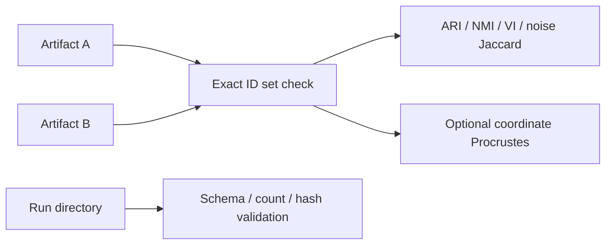
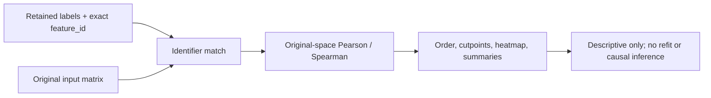

# 21. Explanation, comparison, validation, and report generation

*Guiding question:* **Can retained outputs be interpreted and compared without rerunning discovery or losing identifier integrity?**

Prerequisites: 16–17,19.

## Why the question matters

Post-run tooling increases auditability but does not convert same-data summaries into confirmatory inference.

Lab 3 is exact same-environment fixture evidence; publishable reporting must use sanitized paths and preserve conditional language.

This chapter develops the question in the order needed for a reader to move from statistical principle to current implementation, retained evidence, and a defensible statement. Its central worked task is: Reproduce, explain, compare, and validate Lab 1; then write one technical result paragraph and one separate scientific-limitations paragraph.

## Learning objectives

After completing Chapter 21, the reader can:

1. define identifier alignment and explain its role without exceeding the stated caution;
2. define trustworthiness and continuity and explain its role without exceeding the stated caution;
3. define adjusted Rand index and explain its role without exceeding the stated caution;
4. define normalized mutual information and explain its role without exceeding the stated caution;
5. define noise Jaccard and explain its role without exceeding the stated caution;
6. trace the relevant package functions and generated artifacts;
7. complete the worked task and distinguish observation from interpretation.

## Conceptual and mathematical development

### identifier alignment

A one-to-one correspondence between vector or feature identifiers across artifacts. A compact notation is `I_A = I_B`. In practical terms, order is not identity; normalize and validate keys before joining.

Within Freeze 3 RC1 the concept is connected to `validated_identifiers; align_rows` and is visible through `labels.tsv; coordinates.tsv`. This connection is narrower than the general statistical idea: software evidence establishes the implemented route, while the mapped primary or internal evidence supplies background authority. The distinction prevents a mathematical definition from being mistaken for proof that a particular scientific interpretation is correct.

### trustworthiness and continuity

Directed neighborhood-retention diagnostics. A compact notation is `T(k)=1-c sum_i sum_(j in U_k(i))(r(i,j)-k)`. In practical terms, freeze 3 computes both through directed calls to sklearn trustworthiness under Euclidean geometry. [@venna2010]

Within Freeze 3 RC1 the concept is connected to `embedding_quality_metrics` and is visible through `run_summary.json`. This connection is narrower than the general statistical idea: software evidence establishes the implemented route, while the mapped primary or internal evidence supplies background authority. The distinction prevents a mathematical definition from being mistaken for proof that a particular scientific interpretation is correct.

### adjusted Rand index

Chance-adjusted pairwise partition agreement. A compact notation is `ARI=(RI-E[RI])/(max(RI)-E[RI])`. In practical terms, permutation invariant; a value of 1 does not imply coordinate identity. [@hubert1985]

Within Freeze 3 RC1 the concept is connected to `compare_partitions` and is visible through `comparison_summary.json`. This connection is narrower than the general statistical idea: software evidence establishes the implemented route, while the mapped primary or internal evidence supplies background authority. The distinction prevents a mathematical definition from being mistaken for proof that a particular scientific interpretation is correct.

### normalized mutual information

Normalized information shared by two labelings. A compact notation is `NMI=2I(U;V)/(H(U)+H(V))`. In practical terms, normalization conventions matter; Freeze 3 uses the sklearn convention recorded in code. [@vinh2010]

Within Freeze 3 RC1 the concept is connected to `compare_partitions` and is visible through `comparison_summary.json`. This connection is narrower than the general statistical idea: software evidence establishes the implemented route, while the mapped primary or internal evidence supplies background authority. The distinction prevents a mathematical definition from being mistaken for proof that a particular scientific interpretation is correct.

### noise Jaccard

Overlap of the two sets labeled -1. A compact notation is `J(A,B)=|A intersect B|/|A union B|`. In practical terms, it isolates agreement about unassigned membership, not all clusters.

Within Freeze 3 RC1 the concept is connected to `noise_jaccard` and is visible through `comparison_summary.json`. This connection is narrower than the general statistical idea: software evidence establishes the implemented route, while the mapped primary or internal evidence supplies background authority. The distinction prevents a mathematical definition from being mistaken for proof that a particular scientific interpretation is correct.

### Procrustes disparity

Residual after centering, scaling, and orthogonal alignment. A compact notation is `min_R ||X_c R-Y_c||_F^2`. In practical terms, low disparity supports aligned coordinate similarity under the chosen transformation, not biological replication. [@gower1975]

Within Freeze 3 RC1 the concept is connected to `compare_coordinates` and is visible through `comparison_summary.json`. This connection is narrower than the general statistical idea: software evidence establishes the implemented route, while the mapped primary or internal evidence supplies background authority. The distinction prevents a mathematical definition from being mistaken for proof that a particular scientific interpretation is correct.

### Pearson association

Linear association in original input dimensions. A compact notation is `r=sum(x-xbar)(y-ybar)/sqrt(sum(x-xbar)^2 sum(y-ybar)^2)`. In practical terms, post-selection descriptive only; undefined constant vectors follow configured policy. [@kriegeskorte2009]

Within Freeze 3 RC1 the concept is connected to `compute_similarity` and is visible through `similarity_matrix.csv`. This connection is narrower than the general statistical idea: software evidence establishes the implemented route, while the mapped primary or internal evidence supplies background authority. The distinction prevents a mathematical definition from being mistaken for proof that a particular scientific interpretation is correct.

### Spearman association

Pearson correlation of marginal ranks. A compact notation is `rho=cor(rank(x),rank(y))`. In practical terms, ties receive average ranks; monotonic association is not mechanism.

Within Freeze 3 RC1 the concept is connected to `compute_similarity` and is visible through `similarity_matrix.csv`. This connection is narrower than the general statistical idea: software evidence establishes the implemented route, while the mapped primary or internal evidence supplies background authority. The distinction prevents a mathematical definition from being mistaken for proof that a particular scientific interpretation is correct.

### circular analysis

Reuse of discovery data for apparently confirmatory inference. A compact notation is `selection(Y) then test(Y) without adjustment`. In practical terms, same-data heatmaps and correlations are descriptive; independent or selective-inference designs are needed for confirmatory claims. [@kriegeskorte2009; @gao2024]

Within Freeze 3 RC1 the concept is connected to `run_explanation` and is visible through `explanation outputs`. This connection is narrower than the general statistical idea: software evidence establishes the implemented route, while the mapped primary or internal evidence supplies background authority. The distinction prevents a mathematical definition from being mistaken for proof that a particular scientific interpretation is correct.

### validation ladder

Separate software, technical, structural, statistical, biological, external, and cross-platform evidence. A compact notation is `E_software != E_biological`. In practical terms, passing tests or exact fixture replay cannot substitute for external biological validation.

Within Freeze 3 RC1 the concept is connected to `run_validation` and is visible through `validation_report.json`. This connection is narrower than the general statistical idea: software evidence establishes the implemented route, while the mapped primary or internal evidence supplies background authority. The distinction prevents a mathematical definition from being mistaken for proof that a particular scientific interpretation is correct.

## Reconstructed operational foundation

Edition 1 contained the following verified operational material in separate short notes. Edition 2 consolidates it here and subjects it to the concept and evidence boundaries above.

### Evidence retained from former Chapter 23

### Operational foundation

`compare` accepts two native summaries or label tables, requires unique exact ID sets, and can require the same order. It reports adjusted Rand index, normalized mutual information, variation of information, noise-set Jaccard, optimal label mapping, mapped membership, changed noise status, cluster sizes, and optional Procrustes disparity. Numeric labels are local names, so structural metrics are primary.

`validate` inspects one run directory for required artifacts, readable JSON/YAML, enumeration counts, ranked schema, selected artifacts, and recorded hashes. It writes one pass/warn/fail row per check and returns exit code one on failure. Validation does not refit or compare biology.

```bash
dimple-gwas compare --left LEFT/summary.json --right RIGHT/summary.json --output-dir comparison_new
dimple-gwas validate --run-dir RUN --output-dir validation_new
```

## Evidence diagram or figure




*Comparison and validation paths. Editable source: `assets/diagrams/diagram_08_compare_validate.mmd`.*

### Retained evidence

Edition 2 Lab 3 comparison uses 24 IDs, three clusters, no noise, perfect structural metrics, zero variation of information, and near-zero aligned coordinate disparity. Validation reports 24/24 pass with no warnings or failures.

### Output-reading checkpoint

Inspect `comparison_summary.json`, membership table, size table, confusion, mapping, comparison manifest, `validation_checks.tsv`, report, and validation manifest.

### Misinterpretations to avoid

Do not compare raw numeric labels across fits. Do not ignore changed noise status. Do not interpret Procrustes as membership agreement. Do not call hash/schema checks biological validation.

### Boundary inherited from Edition 1

Exact label equality is stringent and environment-sensitive; permutation-invariant equality is structural. Coordinate comparison needs alignment and tolerances. Scientific conclusions need higher-layer validation.

### Evidence retained from former Chapter 25

### Operational foundation

`explain` returns to the original matrix after a partition has been retained. It loads native summary/labels or a legacy table, resolves input orientation, validates/strips identifiers, rejects duplicates, enforces complete matching by default, applies the recorded preprocessing contract, and computes original-space similarity without refitting UMAP or HDBSCAN.

Native mode usually needs only `--model-json`; `--input` can override a stale recorded path. Legacy mode requires a label table, original input, explicit output root, and often explicit orientation/ID/label/coordinate options. The noise policy can place unassigned vectors last, include them in ordering, or exclude them with a recorded reason.

```bash
dimple-gwas explain \
  --model-json RUN/models/top_model_artifacts/MODEL/summary.json \
  --output-dir explanation_new
```

## Evidence diagram or figure




*Original-space explanation without refitting. Editable source: `assets/diagrams/diagram_07_original_space_explanation.mmd`.*

### Retained evidence

Edition 2 Lab 3 matches all 24 synthetic feature IDs, excludes none, writes the complete similarity table, and produces ordered heatmap/summary/projection artifacts without changing labels.

### Output-reading checkpoint

Inspect interpretation manifest sources/hashes, orientation, ID counts, exclusions, `heatmap_order.tsv`, similarity table, summaries, projection quality, README, and figure sidecars.

### Misinterpretations to avoid

Do not let auto-orientation replace an explicit contract when both axes could overlap. Do not accept incomplete matching silently. Do not describe explanation as a refit or independent validation.

### Boundary inherited from Edition 1

Original-space summaries remain conditional on a selected partition and input construction. They can reveal descriptive coherence or contradictions but cannot establish causal mechanism.

### Evidence retained from former Chapter 26

### Operational foundation

Pearson correlation summarizes linear association after centering/scaling; Spearman correlates ranks and summarizes monotone association. Freeze 3 uses the configured method to build a vector-by-vector similarity table in original input-variable space. It then summarizes within-block and between-block pairs after applying the declared order/noise policy.

Undefined correlation can arise from constant or insufficiently variable vectors. The safe default is `error`; the opt-in `zero` policy replaces undefined values and records the choice. This replacement is a computational convention, not evidence of no association. Coordinate associations, when enabled, are ranked descriptive correlations between original dimensions and supplied coordinates.

Neither correlation supplies a causal effect, an unbiased post-selection p-value, or independent replication.

### Retained evidence

Edition 2 Lab 3's three synthetic clusters have within-cluster Pearson means approximately 0.9963, 0.9930, and 0.9928; between-cluster means are about 0.0033–0.0047. The fresh Lab 3 treatment in Chapters 17 and 21 labels these as post-selection descriptive summaries.

### Output-reading checkpoint

Inspect similarity method, pair counts, means/medians, between summaries, exclusions, undefined-correlation policy, and optional association method/top-N settings.

### Misinterpretations to avoid

Do not attach naive p-values to the same selected pairs. Do not interpret zero replacement as observed zero correlation. Do not compare Pearson and Spearman without explaining the different question.

### Boundary inherited from Edition 1

Shared sample, LD, preprocessing, technical structure, and selection can drive correlations. Independent evidence is required for biological interpretation.

### Evidence retained from former Chapter 27

### Operational foundation

The explanation heatmap is a rendered view of an auditable order. `heatmap_order.tsv` records 1-based display order, exact feature ID, cluster label/noise flag, and supplied coordinates. `cluster_cutpoints.tsv` records zero- and one-based inclusive block boundaries and sizes. Within a cluster, `cluster_then_hclust` applies hierarchical ordering to the original-space similarity-derived distance; other choices are cluster, hclust, or input order.

Annotations come from an optional table joined by the declared index column. The initial tutorial configuration used the wrong join key and produced a warning; the source YAML was corrected to `index` and Edition 2 Lab 1 rerun as `run_20260826`. The earlier output remains as evidence of the mistake. Figure interpretation should always use sidecars, not inferred pixel positions.

## Evidence diagram or figure


### Retained evidence

The Edition 2 Lab 3 heatmap is regenerated at publication resolution from the freshly retained similarity matrix; its source and generation record are in `qa/figure_inventory.tsv`. The synthetic groups are designed, and the image is unrestricted fixture evidence.

### Output-reading checkpoint

Inspect heatmap PNG/HTML, exact order, cutpoints, cluster summary, exclusions, annotations, manifest hash, and README caveats.

### Misinterpretations to avoid

Do not reorder the image manually and leave sidecars unchanged. Do not assume coloured blocks are statistically significant. Do not publish annotations without checking privacy/access status.

### Boundary inherited from Edition 1

Large matrices are protected by thresholds and optional forcing. A full-resolution heatmap can be unreadable or disclose identifiers; use aggregate summaries and controlled access when appropriate.

### Evidence retained from former Chapter 34

### Operational foundation

Edition 2 Lab 3 begins with real native outputs rather than rerunning the entire search. `score-existing` normalizes and ranks an existing model table while preserving a scoring manifest. `summarize-models` writes family, Pareto, top-model, and count summaries. `reproduce-model` performs one fixed refit. `explain` produces original-space descriptive artifacts without refitting. `compare` evaluates exact-ID structural and coordinate concordance. `validate` checks the original run contract.

All six executed commands exited zero. The same-environment fixed rerun has 24 exact IDs; ARI, NMI, noise Jaccard, and optimally mapped membership are 1; variation of information is zero; Procrustes disparity is 2.7088204667806472×10^-31. The canonical Edition 2 Lab 1 run passes 24/24 validation checks. Original-space within-cluster means are near 0.993–0.996 on the designed fixture.

Each result answers a different question. Scoring is not refitting; reproducing is not explaining; comparison is not schema validation; descriptive similarity is not biological inference.

## Evidence diagram or figure


### Retained evidence

Run the six commands from the exact command JSON in `docs/textbook/edition2/labs/execution_manifest.json`, substituting new output roots. Verify the generated file set against Appendix D.

### Output-reading checkpoint

Inspect rescoring manifest, summary counts, fixed rerun manifest, explanation manifest/sidecars, all comparison files, all validation files, and command logs.

### Misinterpretations to avoid

Do not overwrite the original run. Do not compare label integers directly. Do not treat an exit-zero command as sufficient without checking its semantic assertions.

### Boundary inherited from Edition 1

The tutorial uses a small, same-platform fixture and does not test legacy incomplete matching, large heatmap safeguards, cross-hardware numerics, or biological replication.

## Implementation trace

**`comparison.run_comparison`** is defined at `dimple_gwas/comparison.py:65` with signature `left_source: str | Path, right_source: str | Path, output_dir: str | Path, *, id_column: str='feature_id', label_column: str='label', require_same_order: bool=False, command: list[str] | None=None`. Compare two label artifacts using exact IDs, permutation-invariant structure, noise sets, mapping, and optional coordinates. It is reached from cli._compare and connects to comparison._columns; comparison._resolve_labels; comparison._variation_of_information; interpretation.detect_coordinate_columns; interpretation.is_noise_label; interpretation.label_sort_key; io.atomic_json_dump; io.ensure_empty_output_dir; io.json_safe; io.validated_identifiers; provenance.base_manifest; provenance.file_record; provenance.utc_now. Its direct artifact contract is comparison_summary.json; membership_comparison.tsv; cluster_sizes.tsv; label_confusion.tsv; optimal_label_mapping.tsv; comparison_manifest.json; its explicit error surface is ValueError. Test evidence is recorded as tests/test_freeze3_comparison_validation.py::test_comparison_rejects_duplicate_ids; tests/test_freeze3_comparison_validation.py::test_comparison_requires_identical_id_sets; tests/test_freeze3_comparison_validation.py::test_label_permutation_comparison_is_structurally_equal. This is a A-tier contract, so the complete 20-field dossier is retained in the function atlas.

**`interpretation.is_noise_label`** is defined at `dimple_gwas/interpretation.py:30` with signature `value: Any`. Implementation callable for is noise label. It is reached from comparison.run_comparison; interpretation.calculate_cluster_summary; interpretation.label_sort_key; interpretation.run_explanation and connects to No package-defined dependency detected. Its direct artifact contract is No direct canonical artifact; in-memory/supporting result; its explicit error surface is No explicit raise in this symbol; delegated calls may raise.. Test evidence is recorded as No direct symbol-name test reference; assess through caller/integration coverage. This is a B-tier contract, so the complete 20-field dossier is retained in the function atlas.

**`interpretation.label_sort_key`** is defined at `dimple_gwas/interpretation.py:35` with signature `value: Any`. Implementation callable for label sort key. It is reached from comparison.run_comparison; interpretation.compute_order and connects to interpretation.is_noise_label. Its direct artifact contract is No direct canonical artifact; in-memory/supporting result; its explicit error surface is No explicit raise in this symbol; delegated calls may raise.. Test evidence is recorded as No direct symbol-name test reference; assess through caller/integration coverage. This is a B-tier contract, so the complete 20-field dossier is retained in the function atlas.

**`interpretation.detect_coordinate_columns`** is defined at `dimple_gwas/interpretation.py:44` with signature `frame, requested: Sequence[str] | str | None=None`. Implementation callable for detect coordinate columns. It is reached from comparison.run_comparison; interpretation.run_explanation and connects to No package-defined dependency detected. Its direct artifact contract is No direct canonical artifact; in-memory/supporting result; its explicit error surface is ValueError. Test evidence is recorded as tests/test_freeze3_interpretation.py::test_coordinate_detection_is_numeric_suffix_order. This is a B-tier contract, so the complete 20-field dossier is retained in the function atlas.

**`interpretation.compute_similarity`** is defined at `dimple_gwas/interpretation.py:145` with signature `analysis, *, method: str, undefined_policy: str`. Implementation callable for compute similarity. It is reached from interpretation.run_explanation and connects to No package-defined dependency detected. Its direct artifact contract is No direct canonical artifact; in-memory/supporting result; its explicit error surface is ValueError. Test evidence is recorded as tests/test_freeze3_interpretation.py::test_similarity_undefined_fails_by_default. This is a A-tier contract, so the complete 20-field dossier is retained in the function atlas.

**`interpretation.compute_order`** is defined at `dimple_gwas/interpretation.py:184` with signature `correlation, labels: Sequence[Any], *, method: str, noise_policy: str`. Implementation callable for compute order. It is reached from interpretation.run_explanation and connects to interpretation._hierarchical_order; interpretation.label_sort_key. Its direct artifact contract is No direct canonical artifact; in-memory/supporting result; its explicit error surface is No explicit raise in this symbol; delegated calls may raise.. Test evidence is recorded as tests/test_freeze3_interpretation.py::test_cluster_order_is_numeric_and_noise_last. This is a A-tier contract, so the complete 20-field dossier is retained in the function atlas.

**`interpretation.calculate_cutpoints`** is defined at `dimple_gwas/interpretation.py:209` with signature `labels: Sequence[Any]`. Implementation callable for calculate cutpoints. It is reached from interpretation.run_explanation and connects to No package-defined dependency detected. Its direct artifact contract is No direct canonical artifact; in-memory/supporting result; its explicit error surface is No explicit raise in this symbol; delegated calls may raise.. Test evidence is recorded as tests/test_freeze3_interpretation.py::test_cutpoint_indices_are_auditable. This is a B-tier contract, so the complete 20-field dossier is retained in the function atlas.

**`interpretation.calculate_cluster_summary`** is defined at `dimple_gwas/interpretation.py:233` with signature `correlation, labels: Sequence[Any]`. Implementation callable for calculate cluster summary. It is reached from interpretation.run_explanation and connects to interpretation.is_noise_label. Its direct artifact contract is No direct canonical artifact; in-memory/supporting result; its explicit error surface is No explicit raise in this symbol; delegated calls may raise.. Test evidence is recorded as No direct symbol-name test reference; assess through caller/integration coverage. This is a B-tier contract, so the complete 20-field dossier is retained in the function atlas.

**`interpretation.coordinate_association_table`** is defined at `dimple_gwas/interpretation.py:262` with signature `analysis, coordinates, *, methods: Sequence[str], top_n: int`. Implementation callable for coordinate association table. It is reached from interpretation.run_explanation and connects to No package-defined dependency detected. Its direct artifact contract is No direct canonical artifact; in-memory/supporting result; its explicit error surface is No explicit raise in this symbol; delegated calls may raise.. Test evidence is recorded as No direct symbol-name test reference; assess through caller/integration coverage. This is a A-tier contract, so the complete 20-field dossier is retained in the function atlas.

**`interpretation.run_explanation`** is defined at `dimple_gwas/interpretation.py:307` with signature `*, output_dir: str | Path, interpretation_config: Mapping[str, Any], model_json: str | Path | None=None, legacy_table: str | Path | None=None, input_path: str | Path | None=None, input_sep: str | None=None, input_sheet: str | int=0, legacy_sheet: str | int=0, matrix_orientation: str='auto', vector_id_source: str='auto', drop_first_n_cols: int | None=None, zscore_transform: str | None=None, id_column: str | None=None, label_column: str | None=None, coordinate_columns: Sequence[str] | str | None=None, command: list[str] | None=None`. Return to original input space, align IDs, calculate similarities/summaries, order a heatmap, and record a non-refitting explanation manifest. It is reached from cli._explain and connects to interpretation._align_inputs; interpretation._native_sources; interpretation._resolve_column; interpretation._write_readme; interpretation.calculate_cluster_summary; interpretation.calculate_cutpoints; interpretation.compute_order; interpretation.compute_similarity; interpretation.coordinate_association_table; interpretation.detect_coordinate_columns; interpretation.is_noise_label; io.atomic_json_dump; io.ensure_empty_output_dir; io.json_safe; io.read_table; io.validated_identifiers; metrics.embedding_quality_metrics; preprocessing.infer_explanation_orientation; preprocessing.prepare_explanation_matrix; provenance.base_manifest; provenance.file_record; provenance.utc_now; visualization.render_heatmap. Its direct artifact contract is original_space_similarity.tsv.gz; heatmap_order.tsv; cluster_cutpoints.tsv; cluster_summary.tsv; projection_quality.tsv; coordinate_associations.tsv; exclusions.tsv; original_space_heatmap.png; original_space_heatmap.html; interpretation_manifest.json; README.md; its explicit error surface is ValueError. Test evidence is recorded as tests/test_freeze3_interpretation.py::test_legacy_incomplete_matching_writes_exclusions; tests/test_freeze3_interpretation.py::test_native_explanation_end_to_end; tests/test_freeze3_interpretation.py::test_native_explanation_refuses_nonempty_output. This is a A-tier contract, so the complete 20-field dossier is retained in the function atlas.

**`reporting.write_resolved_config`** is defined at `dimple_gwas/reporting.py:18` with signature `config: Mapping[str, Any], output_dir: str | Path`. Implementation callable for write resolved config. It is reached from pipeline.run_search and connects to No package-defined dependency detected. Its direct artifact contract is resolved_config.yaml; its explicit error surface is No explicit raise in this symbol; delegated calls may raise.. Test evidence is recorded as No direct symbol-name test reference; assess through caller/integration coverage. This is a B-tier contract, so the complete 20-field dossier is retained in the function atlas.

**`reporting.write_search_space`** is defined at `dimple_gwas/reporting.py:28` with signature `candidates: list[Mapping[str, Any]], config: Mapping[str, Any], output_dir: str | Path`. Implementation callable for write search space. It is reached from cli._show; pipeline.run_search and connects to io.atomic_json_dump; io.json_safe; reporting._write_tsv; search_space.flatten_candidate. Its direct artifact contract is search_space_manifest.tsv; search_space_manifest.json; its explicit error surface is No explicit raise in this symbol; delegated calls may raise.. Test evidence is recorded as No direct symbol-name test reference; assess through caller/integration coverage. This is a B-tier contract, so the complete 20-field dossier is retained in the function atlas.

## Claim adjudication notebook

The following statements are admitted to the draft only in their safe form:

- **INT-003 (verified_with_qualification):** Pearson/Spearman summaries are post-selection descriptive diagnostics conditional on the retained partition. [@kriegeskorte2009; @gao2024] Limitation: They do not provide causal, replication, or unbiased significance evidence. Implementation evidence: `interpretation.py`.

## Reading the generated evidence

For Chapter 21, the `Explanation, comparison, validation, and report generation` files are read as a provenance chain rather than as isolated results:

| Artifact | Producer | What to verify before interpretation |
| --- | --- | --- |
| `original_space_similarity.tsv.gz` | `run_explanation` | Artifact exists under the new output root, is readable, and its checksum is recorded. |
| `heatmap_order.tsv` | `run_explanation` | Image dimensions are nonzero; order and cutpoints match sidecars; no inferential claim is attached. |
| `cluster_cutpoints.tsv` | `run_explanation` | Artifact exists under the new output root, is readable, and its checksum is recorded. |
| `cluster_summary.tsv` | `run_explanation` | Artifact exists under the new output root, is readable, and its checksum is recorded. |
| `projection_quality.tsv` | `run_explanation` | Artifact exists under the new output root, is readable, and its checksum is recorded. |
| `coordinate_associations.tsv` | `run_explanation` | Artifact exists under the new output root, is readable, and its checksum is recorded. |
| `exclusions.tsv` | `run_explanation` | Artifact exists under the new output root, is readable, and its checksum is recorded. |
| `original_space_heatmap.png/html` | `run_explanation` | Image dimensions are nonzero; order and cutpoints match sidecars; no inferential claim is attached. |
| `interpretation_manifest.json + README.md` | `run_explanation` | Artifact exists under the new output root, is readable, and its checksum is recorded. |
| `comparison_summary.json` | `run_comparison` | Artifact exists under the new output root, is readable, and its checksum is recorded. |
| `membership_comparison.tsv, cluster_sizes.tsv, label_confusion.tsv, optimal_label_mapping.tsv` | `run_comparison` | Identifiers are unique and exactly match the intended input; label -1 is treated as noise/unassigned. |
| `comparison_manifest.json` | `run_comparison` | Artifact exists under the new output root, is readable, and its checksum is recorded. |
| `validation_checks.tsv` | `run_validation` | Every check is visible; aggregate status matches pass/warn/fail rows; a warning is not silently treated as a pass. |
| `validation_report.json + validation_manifest.json` | `run_validation` | Every check is visible; aggregate status matches pass/warn/fail rows; a warning is not silently treated as a pass. |

The output atlas supplies the complete schemas, checksums, conditions, consumers, and privacy notes for this Chapter 21 route. Native manifests can contain machine paths; the assembled textbook uses sanitized excerpts while restricted evidence retains the original provenance chain.

## Worked reasoning and evidence exercise

Reproduce, explain, compare, and validate Lab 1; then write one technical result paragraph and one separate scientific-limitations paragraph.

A complete Chapter 21 answer must expose its intermediate reasoning, name the source or output used for `Explanation, comparison, validation, and report generation`, and finish with separate support and non-support statements. Applying that discipline to the question “Can retained outputs be interpreted and compared without rerunning discovery or losing identifier integrity?” prevents a calculation, a software observation, and a scientific interpretation from collapsing into one claim.

## Assumptions, diagnostics, and recovery

The Chapter 21 analysis assumes the stated unit and inputs, the recorded configuration and software identity, and a diagnostic that addresses the claimed property rather than a convenient surrogate. Its decisive boundary is: Lab 3 is exact same-environment fixture evidence; publishable reporting must use sanitized paths and preserve conditional language.

If the Chapter 21 route fails, retain its log and candidate status before deciding whether the cause is input, configuration, dependency, compute, identifier alignment, or output-root state. Correct an operational failure by writing a new result directory. Treat instability in `Explanation, comparison, validation, and report generation` as sensitivity evidence: report it and identify the independent evidence needed instead of relabeling ambiguity as a software exception.

## Chapter synthesis

Post-run tooling increases auditability but does not convert same-data summaries into confirmatory inference. The implementation trace makes the current behavior auditable, but the evidence boundary remains part of the result. Chapter 22 contrasts a public benchmark with the historically important 164-IDP workflow.

## Exercises

1. For `Explanation, comparison, validation, and report generation`, name the unit of analysis and one plausible but invalid substitute.
2. Reconstruct the notation for identifier alignment; define its dimensions or denominator and interpret every term.
3. Choose a Tier A function mapped to Chapter 21; identify its caller and direct output, then propose a topic-specific edge case.
4. Select one Chapter 21 artifact from the output atlas and state three integrity checks that must precede scientific reading.
5. Convert a tempting `Explanation, comparison, validation, and report generation` overclaim into one observed statement followed by its limitation.
6. Reproduce, explain, compare, and validate Lab 1; then write one technical result paragraph and one separate scientific-limitations paragraph.

Appendix J gives the Chapter 21 adjudication guide. Its further-reading keys supply statistical context; no external paper is treated as automatic validation of the current software or dataset.
