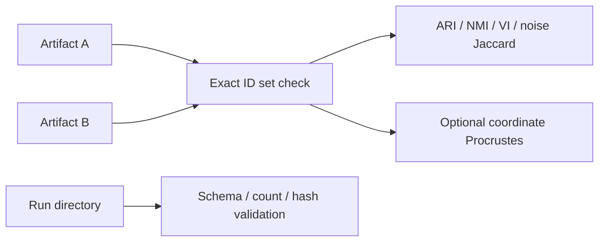
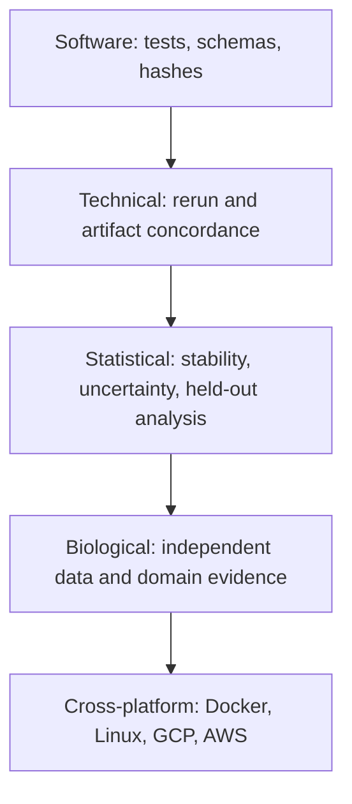
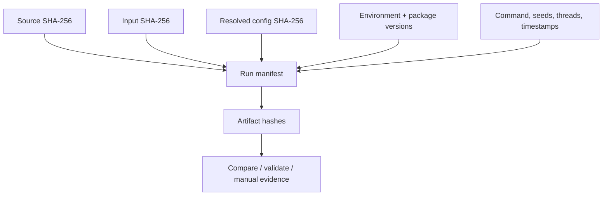

# 23. Technical, statistical, biological, and cross-platform validation

*Guiding question:* **What evidence would justify each kind of claim an analyst might want to make?**

Prerequisites: 5,12,19–22.

## Why the question matters

One impressive metric cannot stand in for software, structural, statistical, biological, external, and platform evidence simultaneously.

Current evidence supports local contracts and fixed fixtures; external biological and Docker/Linux/cloud layers remain incomplete.

This chapter develops the question in the order needed for a reader to move from statistical principle to current implementation, retained evidence, and a defensible statement. Its central worked task is: Assign twelve checks to the validation ladder, choose exact or tolerance-based acceptance, and identify which layers remain unanswered.

## Learning objectives

After completing Chapter 23, the reader can:

1. define adjusted Rand index and explain its role without exceeding the stated caution;
2. define normalized mutual information and explain its role without exceeding the stated caution;
3. define noise Jaccard and explain its role without exceeding the stated caution;
4. define Procrustes disparity and explain its role without exceeding the stated caution;
5. define circular analysis and explain its role without exceeding the stated caution;
6. trace the relevant package functions and generated artifacts;
7. complete the worked task and distinguish observation from interpretation.

## Conceptual and mathematical development

### adjusted Rand index

Chance-adjusted pairwise partition agreement. A compact notation is `ARI=(RI-E[RI])/(max(RI)-E[RI])`. In practical terms, permutation invariant; a value of 1 does not imply coordinate identity. [@hubert1985]

Within Freeze 3 RC1 the concept is connected to `compare_partitions` and is visible through `comparison_summary.json`. This connection is narrower than the general statistical idea: software evidence establishes the implemented route, while the mapped primary or internal evidence supplies background authority. The distinction prevents a mathematical definition from being mistaken for proof that a particular scientific interpretation is correct.

### normalized mutual information

Normalized information shared by two labelings. A compact notation is `NMI=2I(U;V)/(H(U)+H(V))`. In practical terms, normalization conventions matter; Freeze 3 uses the sklearn convention recorded in code. [@vinh2010]

Within Freeze 3 RC1 the concept is connected to `compare_partitions` and is visible through `comparison_summary.json`. This connection is narrower than the general statistical idea: software evidence establishes the implemented route, while the mapped primary or internal evidence supplies background authority. The distinction prevents a mathematical definition from being mistaken for proof that a particular scientific interpretation is correct.

### noise Jaccard

Overlap of the two sets labeled -1. A compact notation is `J(A,B)=|A intersect B|/|A union B|`. In practical terms, it isolates agreement about unassigned membership, not all clusters.

Within Freeze 3 RC1 the concept is connected to `noise_jaccard` and is visible through `comparison_summary.json`. This connection is narrower than the general statistical idea: software evidence establishes the implemented route, while the mapped primary or internal evidence supplies background authority. The distinction prevents a mathematical definition from being mistaken for proof that a particular scientific interpretation is correct.

### Procrustes disparity

Residual after centering, scaling, and orthogonal alignment. A compact notation is `min_R ||X_c R-Y_c||_F^2`. In practical terms, low disparity supports aligned coordinate similarity under the chosen transformation, not biological replication. [@gower1975]

Within Freeze 3 RC1 the concept is connected to `compare_coordinates` and is visible through `comparison_summary.json`. This connection is narrower than the general statistical idea: software evidence establishes the implemented route, while the mapped primary or internal evidence supplies background authority. The distinction prevents a mathematical definition from being mistaken for proof that a particular scientific interpretation is correct.

### circular analysis

Reuse of discovery data for apparently confirmatory inference. A compact notation is `selection(Y) then test(Y) without adjustment`. In practical terms, same-data heatmaps and correlations are descriptive; independent or selective-inference designs are needed for confirmatory claims. [@kriegeskorte2009; @gao2024]

Within Freeze 3 RC1 the concept is connected to `run_explanation` and is visible through `explanation outputs`. This connection is narrower than the general statistical idea: software evidence establishes the implemented route, while the mapped primary or internal evidence supplies background authority. The distinction prevents a mathematical definition from being mistaken for proof that a particular scientific interpretation is correct.

### validation ladder

Separate software, technical, structural, statistical, biological, external, and cross-platform evidence. A compact notation is `E_software != E_biological`. In practical terms, passing tests or exact fixture replay cannot substitute for external biological validation.

Within Freeze 3 RC1 the concept is connected to `run_validation` and is visible through `validation_report.json`. This connection is narrower than the general statistical idea: software evidence establishes the implemented route, while the mapped primary or internal evidence supplies background authority. The distinction prevents a mathematical definition from being mistaken for proof that a particular scientific interpretation is correct.

### floating-point reproducibility

Dependence of finite-precision results on operation order and platform. A compact notation is `fl((a+b)+c) may differ from fl(a+(b+c))`. In practical terms, pinned dependencies improve control but do not guarantee universal bitwise equality. [@reproduciblesum2015]

Within Freeze 3 RC1 the concept is connected to `capture_environment` and is visible through `environment.json`. This connection is narrower than the general statistical idea: software evidence establishes the implemented route, while the mapped primary or internal evidence supplies background authority. The distinction prevents a mathematical definition from being mistaken for proof that a particular scientific interpretation is correct.

## Reconstructed operational foundation

Edition 1 contained the following verified operational material in separate short notes. Edition 2 consolidates it here and subjects it to the concept and evidence boundaries above.

### Evidence retained from former Chapter 8

### Operational foundation

When the same data choose a representation, select a partition, and then supply the evidence used to declare that partition meaningful, naive inferential statements can be circular. Internal scores are useful for navigation within a declared candidate population, but they do not become independent hypothesis tests. Original-space correlations computed after selecting labels are descriptive conditional summaries.

A validation ladder keeps claims calibrated. Software validation checks code contracts. Technical validation checks whether an analysis and its artifacts can be rerun or compared under stated conditions. Statistical validation studies stability, uncertainty, multiplicity, and selection. Biological validation uses independent data, domain evidence, or an appropriately designed external analysis. Cross-platform validation tests the packaged workflow on the claimed systems.

The safe pattern is: describe what was selected and why, report sensitivity and uncertainty, reserve inferential claims for methods that address the selection process, and seek held-out or independent validation.

### Retained evidence

The synthetic comparison has ARI=NMI=noise Jaccard=mapped membership=1. That establishes bounded structural concordance for the fixture; it does not validate the biological interpretation of real IDPs.

### Output-reading checkpoint

Inspect the score/selection manifest, comparison summary, validation report, exclusions, and any independent validation artifacts. Record which validation layer each supports.

### Misinterpretations to avoid

Do not perform an ANOVA on the same matrix and labels and present the p-value as independent cluster confirmation. Do not turn an internal score into biological effect size or uncertainty.

### Boundary inherited from Edition 1

Selective-inference literature establishes the general problem, but the cited hierarchical-clustering procedure is not a turnkey inferential solution for the complete UMAP+HDBSCAN selection pipeline.


## Evidence and references

See Gao, Bien & Witten (2024), DOI 10.1080/01621459.2022.2116331. The scope difference from DIMPLE-GWAS is explicit.

### Evidence retained from former Chapter 23

### Operational foundation

`compare` accepts two native summaries or label tables, requires unique exact ID sets, and can require the same order. It reports adjusted Rand index, normalized mutual information, variation of information, noise-set Jaccard, optimal label mapping, mapped membership, changed noise status, cluster sizes, and optional Procrustes disparity. Numeric labels are local names, so structural metrics are primary.

`validate` inspects one run directory for required artifacts, readable JSON/YAML, enumeration counts, ranked schema, selected artifacts, and recorded hashes. It writes one pass/warn/fail row per check and returns exit code one on failure. Validation does not refit or compare biology.

```bash
dimple-gwas compare --left LEFT/summary.json --right RIGHT/summary.json --output-dir comparison_new
dimple-gwas validate --run-dir RUN --output-dir validation_new
```

## Evidence diagram or figure




*Comparison and validation paths. Editable source: `assets/diagrams/diagram_08_compare_validate.mmd`.*

### Retained evidence

Edition 2 Lab 3 comparison uses 24 IDs, three clusters, no noise, perfect structural metrics, zero variation of information, and near-zero aligned coordinate disparity. Validation reports 24/24 pass with no warnings or failures.

### Output-reading checkpoint

Inspect `comparison_summary.json`, membership table, size table, confusion, mapping, comparison manifest, `validation_checks.tsv`, report, and validation manifest.

### Misinterpretations to avoid

Do not compare raw numeric labels across fits. Do not ignore changed noise status. Do not interpret Procrustes as membership agreement. Do not call hash/schema checks biological validation.

### Boundary inherited from Edition 1

Exact label equality is stringent and environment-sensitive; permutation-invariant equality is structural. Coordinate comparison needs alignment and tolerances. Scientific conclusions need higher-layer validation.

### Evidence retained from former Chapter 29

### Operational foundation

‘Double dipping’ occurs when data-dependent choices are ignored in a later inferential statement. DIMPLE-GWAS uses the matrix to create an embedding, enumerate/extract partitions, and select one using internal metrics. Testing separation or correlation on the same matrix as though the partition were fixed in advance can yield overconfident evidence. Multiple candidate models and analyst inspection add further selection.

Safe outputs in Freeze 3 are descriptive summaries with explicit conditioning. For inference, plan held-out variables, independent cohorts, preregistered replication, sample splitting, perturbation/stability designs, or a selective-inference method whose assumptions actually match the pipeline. Report effect sizes and uncertainty appropriate to the validation design. Never describe an omitted p-value as a flaw: the explanation utility intentionally avoids cluster ANOVA and post-selection significance.

### Retained evidence

Edition 2 Lab 3 reports within/between similarities and a heatmap but no ANOVA p-values. That is a deliberate boundary, not missing validation.

### Output-reading checkpoint

Inspect candidate population, selection rule, all exploratory views used, independent validation plan, comparison/stability evidence, and whether any test data were held out before selection.

### Misinterpretations to avoid

Do not call high within-cluster correlation a validation test. Do not choose external outcomes after seeing the partition without disclosure. Do not cite a general selective-inference paper as if it implemented this exact pipeline.

### Boundary inherited from Edition 1

Independent validation may still inherit sample overlap, ancestry, measurement, or harmonization biases. The design—not the word ‘replication’—determines evidential strength.


## Evidence and references

See Gao, Bien & Witten (2024), DOI 10.1080/01621459.2022.2116331, with the scope limitation stated above.

### Evidence retained from former Chapter 30

### Operational foundation

Validation is layered. Software validation covers tests and schemas. Technical reproducibility covers source/input/configuration identity, reruns, hashes, labels, and numeric tolerance. Structural concordance uses ARI/NMI/noise/mapped membership. Statistical validation addresses parameter sensitivity, instability, selection, uncertainty, and multiplicity. Biological validation asks whether groupings recur or predict independent domain evidence. Cross-platform validation tests the claimed package on Docker/Linux/cloud environments.

A result should be reported at the strongest layer actually supported. Forty-five tests support software. Twenty-four artifact checks support one run contract. Perfect fixture concordance supports bounded same-platform technical structure. MNIST supports known-label engineering behavior. None proves the historical IDP clusters biologically distinct. The fresh 164-IDP and Docker/cloud layers remain pending.

## Evidence diagram or figure




*Validation ladder; each layer requires its own evidence. Editable source: `assets/diagrams/diagram_10_validation_ladder.mmd`.*

### Retained evidence

Use `assets/diagrams/diagram_10_validation_ladder.mmd` and Appendix G to classify every manual evidence item. No arrow can be skipped by renaming a lower layer.

### Output-reading checkpoint

Inspect test JUnit/logs, validation checks, comparison metrics, source/input/config hashes, historical evidence, external-study design, and platform matrices separately.

### Misinterpretations to avoid

Do not write ‘validated’ without an object, method, dataset, platform, and criterion. Do not let a checksum pass stand in for scientific replication.

### Boundary inherited from Edition 1

Statistical and biological validation protocols are context dependent and may require data or governance outside this package. This manual does not invent those results.

### Evidence retained from former Chapter 42

### Operational foundation

A reproducible run is a chain of identities and decisions: source hash/version; input path/size/hash and upstream provenance; source and resolved configuration/hash; exact command; Python/platform/package versions; backends; seeds; threads; timestamps/runtime; candidate counts/statuses; selected model and formula; every artifact hash; warnings/exclusions/failures; and comparison criteria. `run_manifest.json` captures much of this; tutorial execution manifests and checksum tables close the documentation chain.

Exact comparison is appropriate for bytes, schemas, IDs, declared parameters, counts, and sometimes labels. Tolerances or invariant metrics are appropriate for floating-point metrics and aligned embeddings across platforms. Plots should be compared through source tables and structural/render checks, not byte identity alone. Dependency pinning improves traceability but cannot guarantee identical numerics across OS, architecture, hardware, BLAS/OpenMP, threads, or compiler/runtime versions.

With no Git metadata in this snapshot, use the package-source SHA-256 and complete file registers; the Docker stage should establish a versioned source identity.

## Evidence diagram or figure




*Provenance and artifact lineage. Editable source: `assets/diagrams/diagram_09_provenance_lineage.mmd`.*

### Retained evidence

The executed Edition 2 Lab 2 manifest records package-source and input hashes, configuration hash, exact package versions, seeds 42/43, jobs, backend names, runtime, counts, selected ID, and artifact hashes.

### Output-reading checkpoint

Inspect runtime environment, resolved dependencies, source/input/artifact checksum registers, run/selection/tutorial manifests, logs, comparison and validation evidence.

### Misinterpretations to avoid

Do not equate a pinned requirements file with a complete environment. Do not compare floating-point PNG bytes as scientific equality. Do not sanitize the only retained provenance copy.

### Boundary inherited from Edition 1

Provenance can contain protected paths and identifiers; maintain a private complete record and a deliberately sanitized publication record with linked hashes.

### Evidence retained from former Chapter 46

### Operational foundation

Current open release issues are visible, not buried. There is no usable Git commit/tag identity; checksums substitute. The full fresh 164-IDP 1,000-seed run is deferred until Docker. Original 2,315-IDP and 459-IDP raw inputs/parameters are incomplete or unresolved. Docker/Linux/GCP/AWS execution and security validation are absent. Exact Yang/Zhao reviewer citations are unresolved in the supplied correspondence. Optional coordinate associations were not executed in the tutorials. Only macOS arm64 has fresh test/tutorial evidence.

Scientific limitations are equally important: nonlinear embeddings and density clusters are parameter dependent; repeated concatenation has no stated topology-recovery theorem; internal metrics are not biological validation; legacy scoring is candidate-population relative; selection can create circular inference; UMAP axes are not loadings; original-space correlations are conditional descriptors; noise is algorithmic; numerical determinism is platform dependent; and original-IDP interpretations may change with ongoing development.

Operational limitations include optional Parquet dependencies/failure handling, large similarity matrices, thread oversubscription, first-run JIT overhead, strict absent/empty output roots for safety, and manifests that can expose paths or identifiers. Use `evidence/03_missing_evidence_register.tsv`, `evidence/tutorial_issue_register.tsv`, and the Docker handoff as living registers.

### Retained evidence

The manual labels itself an RC1 first draft with named limitations rather than hiding Gate I/J dependencies. Appendix G shows which layers pass, are bounded, are historical, or are pending.

### Output-reading checkpoint

Inspect missing-evidence, authority/conflict, claim/correction, citation-gap, tutorial-issue, QA, build-report, and Docker-handoff records before release language changes.

### Misinterpretations to avoid

Do not close an issue by changing prose alone. Do not infer missing reviewer references. Do not present original IDP material as final when development may change it.

### Boundary inherited from Edition 1

Some gates need new authority/data/compute rather than documentation. They remain named blockers with exact completion protocols.

## Implementation trace

**`comparison.run_comparison`** is defined at `dimple_gwas/comparison.py:65` with signature `left_source: str | Path, right_source: str | Path, output_dir: str | Path, *, id_column: str='feature_id', label_column: str='label', require_same_order: bool=False, command: list[str] | None=None`. Compare two label artifacts using exact IDs, permutation-invariant structure, noise sets, mapping, and optional coordinates. It is reached from cli._compare and connects to comparison._columns; comparison._resolve_labels; comparison._variation_of_information; interpretation.detect_coordinate_columns; interpretation.is_noise_label; interpretation.label_sort_key; io.atomic_json_dump; io.ensure_empty_output_dir; io.json_safe; io.validated_identifiers; provenance.base_manifest; provenance.file_record; provenance.utc_now. Its direct artifact contract is comparison_summary.json; membership_comparison.tsv; cluster_sizes.tsv; label_confusion.tsv; optimal_label_mapping.tsv; comparison_manifest.json; its explicit error surface is ValueError. Test evidence is recorded as tests/test_freeze3_comparison_validation.py::test_comparison_rejects_duplicate_ids; tests/test_freeze3_comparison_validation.py::test_comparison_requires_identical_id_sets; tests/test_freeze3_comparison_validation.py::test_label_permutation_comparison_is_structurally_equal. This is a A-tier contract, so the complete 20-field dossier is retained in the function atlas.

**`metrics.effective_neighbor_count`** is defined at `dimple_gwas/metrics.py:9` with signature `n_samples: int, requested: int`. Implementation callable for effective neighbor count. It is reached from metrics.embedding_quality_metrics and connects to No package-defined dependency detected. Its direct artifact contract is No direct canonical artifact; in-memory/supporting result; its explicit error surface is No explicit raise in this symbol; delegated calls may raise.. Test evidence is recorded as tests/test_preprocessing_metrics.py::test_effective_neighbor_edge_cases. This is a B-tier contract, so the complete 20-field dossier is retained in the function atlas.

**`metrics.embedding_quality_metrics`** is defined at `dimple_gwas/metrics.py:15` with signature `original, embedding, requested_k: int, max_samples: int, seed: int`. Calculate bounded trustworthiness and continuity diagnostics for an embedding. It is reached from interpretation.run_explanation; pipeline.run_search and connects to metrics.effective_neighbor_count. Its direct artifact contract is No direct canonical artifact; in-memory/supporting result; its explicit error surface is No explicit raise in this symbol; delegated calls may raise.. Test evidence is recorded as tests/test_preprocessing_metrics.py::test_optimized_trustworthiness_and_continuity. This is a A-tier contract, so the complete 20-field dossier is retained in the function atlas.

**`metrics.evaluate_candidate`** is defined at `dimple_gwas/metrics.py:60` with signature `embedding, labels, clusterer, silhouette_metric: str, fit_include_noise: bool, compute_dbcv: bool, max_samples_silhouette: int=0, silhouette_seed: int=42`. Compute cluster counts, persistence, silhouette, CH, DB, optional DBCV, and validity status for one candidate. It is reached from pipeline._evaluate_one and connects to metrics._cluster_sizes. Its direct artifact contract is No direct canonical artifact; in-memory/supporting result; its explicit error surface is No explicit raise in this symbol; delegated calls may raise.. Test evidence is recorded as No direct symbol-name test reference; assess through caller/integration coverage. This is a A-tier contract, so the complete 20-field dossier is retained in the function atlas.

**`metrics.is_finite_number`** is defined at `dimple_gwas/metrics.py:165` with signature `value: Any`. Implementation callable for is finite number. It is reached from CLI/import/direct caller or no package caller detected and connects to No package-defined dependency detected. Its direct artifact contract is No direct canonical artifact; in-memory/supporting result; its explicit error surface is No explicit raise in this symbol; delegated calls may raise.. Test evidence is recorded as No direct symbol-name test reference; assess through caller/integration coverage. This is a B-tier contract, so the complete 20-field dossier is retained in the function atlas.

**`provenance.sha256_file`** is defined at `dimple_gwas/provenance.py:17` with signature `path: str | Path`. Implementation callable for sha256 file. It is reached from interpretation._native_sources; provenance.file_record; reporting._top_artifact; validation.run_validation and connects to No package-defined dependency detected. Its direct artifact contract is No direct canonical artifact; in-memory/supporting result; its explicit error surface is No explicit raise in this symbol; delegated calls may raise.. Test evidence is recorded as tests/test_failure_and_provenance.py::test_authoritative_source_hash_unchanged. This is a B-tier contract, so the complete 20-field dossier is retained in the function atlas.

**`provenance.package_versions`** is defined at `dimple_gwas/provenance.py:25` with signature `names: Iterable[str] | None=None`. Implementation callable for package versions. It is reached from provenance.base_manifest and connects to No package-defined dependency detected. Its direct artifact contract is No direct canonical artifact; in-memory/supporting result; its explicit error surface is No explicit raise in this symbol; delegated calls may raise.. Test evidence is recorded as No direct symbol-name test reference; assess through caller/integration coverage. This is a B-tier contract, so the complete 20-field dossier is retained in the function atlas.

**`provenance.utc_now`** is defined at `dimple_gwas/provenance.py:40` with signature `class construction/data container`. Implementation callable for utc now. It is reached from comparison.run_comparison; interpretation.run_explanation; provenance.base_manifest; reporting.write_model_outputs; validation.run_validation and connects to No package-defined dependency detected. Its direct artifact contract is No direct canonical artifact; in-memory/supporting result; its explicit error surface is No explicit raise in this symbol; delegated calls may raise.. Test evidence is recorded as No direct symbol-name test reference; assess through caller/integration coverage. This is a B-tier contract, so the complete 20-field dossier is retained in the function atlas.

**`provenance.file_record`** is defined at `dimple_gwas/provenance.py:44` with signature `path: str | Path`. Implementation callable for file record. It is reached from comparison.run_comparison; interpretation.run_explanation; pipeline.run_search; reporting._top_artifact; reporting.write_model_outputs; validation.run_validation and connects to comparison._columns.<locals>.resolve; provenance.sha256_file. Its direct artifact contract is No direct canonical artifact; in-memory/supporting result; its explicit error surface is No explicit raise in this symbol; delegated calls may raise.. Test evidence is recorded as No direct symbol-name test reference; assess through caller/integration coverage. This is a B-tier contract, so the complete 20-field dossier is retained in the function atlas.

**`provenance.package_source_digest`** is defined at `dimple_gwas/provenance.py:53` with signature `class construction/data container`. Compute a stable hash over package source files for non-Git source identity. It is reached from provenance.base_manifest and connects to comparison._columns.<locals>.resolve. Its direct artifact contract is No direct canonical artifact; in-memory/supporting result; its explicit error surface is No explicit raise in this symbol; delegated calls may raise.. Test evidence is recorded as tests/test_freeze3_comparison_validation.py::test_package_source_digest_is_stable. This is a A-tier contract, so the complete 20-field dossier is retained in the function atlas.

**`provenance.base_manifest`** is defined at `dimple_gwas/provenance.py:66` with signature `command: list[str] | None=None`. Implementation callable for base manifest. It is reached from comparison.run_comparison; interpretation.run_explanation; pipeline.run_search; validation.run_validation and connects to provenance.package_source_digest; provenance.package_versions; provenance.utc_now. Its direct artifact contract is No direct canonical artifact; in-memory/supporting result; its explicit error surface is No explicit raise in this symbol; delegated calls may raise.. Test evidence is recorded as No direct symbol-name test reference; assess through caller/integration coverage. This is a A-tier contract, so the complete 20-field dossier is retained in the function atlas.

**`validation.run_validation`** is defined at `dimple_gwas/validation.py:15` with signature `run_dir: str | Path, output_dir: str | Path | None=None, *, command: list[str] | None=None`. Audit a run directory against required files, schemas, counts, identities, hashes, and manifest contracts. It is reached from cli._validate and connects to comparison._columns.<locals>.resolve; io.atomic_json_dump; io.ensure_empty_output_dir; io.json_safe; io.read_model_table; io.read_table; provenance.base_manifest; provenance.file_record; provenance.sha256_file; provenance.utc_now; validation.run_validation.<locals>.record. Its direct artifact contract is validation_checks.tsv; validation_report.json; validation_manifest.json; its explicit error surface is FileNotFoundError. Test evidence is recorded as tests/test_freeze3_comparison_validation.py::test_validation_detects_hash_mismatch; tests/test_freeze3_comparison_validation.py::test_validation_passes_complete_contract. This is a A-tier contract, so the complete 20-field dossier is retained in the function atlas.

## Claim adjudication notebook

The following statements are admitted to the draft only in their safe form:

- **REL-001 (verified_with_qualification):** Freeze 3 RC1 is a software-complete release candidate under current local and fixed-fixture evidence; it is not scientifically frozen or cross-platform validated. Limitation: Fresh 164-IDP and Docker/cloud gates remain pending. Implementation evidence: `pyproject.toml; source; tests`.

- **PIPE-002 (reject):** Repeated seeded embeddings are concatenated as an empirical representation strategy; the implementation supplies no theorem that it eliminates stochasticity or recovers true topology. [@mcinnes2018umap] Limitation: Parameters, layout symmetries, libraries, and hardware still matter. Implementation evidence: `umap_runner.py`.

- **INT-004 (verified_with_qualification):** Classical tests on the same data used for group discovery are vulnerable to circularity; Freeze 3 omits cluster ANOVA and post-selection p-values. [@kriegeskorte2009; @gao2024] Limitation: The cited selective method is not a turnkey HDBSCAN procedure. Implementation evidence: `interpretation.py; limitations docs`.

- **VAL-001 (verified_with_qualification):** The local suite's passing tests support bounded software contracts, not biological validity. Limitation: One environment cannot establish cross-platform behavior. Implementation evidence: `tests`.

- **VAL-002 (verified_with_qualification):** Within the prior same-environment fixture comparison, ARI, NMI, noise Jaccard, and mapped membership were 1 with near-zero Procrustes disparity. [@hubert1985; @vinh2010; @gower1975] Limitation: Does not generalize across platforms or all configurations. Implementation evidence: `comparison.py`.

- **HIST-002 (reject):** Freeze 3 adapted and rescored immutable historical outputs, but a fresh 1,000-seed 164-IDP fit remains deferred until Docker. Limitation: The book supplies a protocol and acceptance criteria, not fabricated results. Implementation evidence: `original-IDP configs`.

- **REP-001 (reject):** Pinning improves traceability but cannot alone guarantee bitwise identity across architecture, hardware, numerical libraries, or thread schedules. [@reproduciblesum2015] Limitation: Docker/Linux/cloud validation remains pending. Implementation evidence: `provenance.py`.

- **GWAS-001 (verified_with_qualification):** Vector geometry can reflect shared biology, LD structure, sample overlap, scale, confounding, and preprocessing; DIMPLE-GWAS does not separate these causes. [@buliksullivan2015] Limitation: Interpretation requires upstream harmonization and independent evidence. Implementation evidence: `scope and input only`.

## Reading the generated evidence

For Chapter 23, the `Technical, statistical, biological, and cross-platform validation` files are read as a provenance chain rather than as isolated results:

| Artifact | Producer | What to verify before interpretation |
| --- | --- | --- |
| `comparison_summary.json` | `run_comparison` | Artifact exists under the new output root, is readable, and its checksum is recorded. |
| `membership_comparison.tsv, cluster_sizes.tsv, label_confusion.tsv, optimal_label_mapping.tsv` | `run_comparison` | Identifiers are unique and exactly match the intended input; label -1 is treated as noise/unassigned. |
| `comparison_manifest.json` | `run_comparison` | Artifact exists under the new output root, is readable, and its checksum is recorded. |
| `validation_checks.tsv` | `run_validation` | Every check is visible; aggregate status matches pass/warn/fail rows; a warning is not silently treated as a pass. |
| `validation_report.json + validation_manifest.json` | `run_validation` | Every check is visible; aggregate status matches pass/warn/fail rows; a warning is not silently treated as a pass. |

The output atlas supplies the complete schemas, checksums, conditions, consumers, and privacy notes for this Chapter 23 route. Native manifests can contain machine paths; the assembled textbook uses sanitized excerpts while restricted evidence retains the original provenance chain.

## Worked reasoning and evidence exercise

Assign twelve checks to the validation ladder, choose exact or tolerance-based acceptance, and identify which layers remain unanswered.

A complete Chapter 23 answer must expose its intermediate reasoning, name the source or output used for `Technical, statistical, biological, and cross-platform validation`, and finish with separate support and non-support statements. Applying that discipline to the question “What evidence would justify each kind of claim an analyst might want to make?” prevents a calculation, a software observation, and a scientific interpretation from collapsing into one claim.

## Assumptions, diagnostics, and recovery

The Chapter 23 analysis assumes the stated unit and inputs, the recorded configuration and software identity, and a diagnostic that addresses the claimed property rather than a convenient surrogate. Its decisive boundary is: Current evidence supports local contracts and fixed fixtures; external biological and Docker/Linux/cloud layers remain incomplete.

If the Chapter 23 route fails, retain its log and candidate status before deciding whether the cause is input, configuration, dependency, compute, identifier alignment, or output-root state. Correct an operational failure by writing a new result directory. Treat instability in `Technical, statistical, biological, and cross-platform validation` as sensitivity evidence: report it and identify the independent evidence needed instead of relabeling ambiguity as a software exception.

## Chapter synthesis

One impressive metric cannot stand in for software, structural, statistical, biological, external, and platform evidence simultaneously. The implementation trace makes the current behavior auditable, but the evidence boundary remains part of the result. Chapter 24 turns the full evidence chain into reporting, migration, and reviewer-facing documentation.

## Exercises

1. For `Technical, statistical, biological, and cross-platform validation`, name the unit of analysis and one plausible but invalid substitute.
2. Reconstruct the notation for adjusted Rand index; define its dimensions or denominator and interpret every term.
3. Choose a Tier A function mapped to Chapter 23; identify its caller and direct output, then propose a topic-specific edge case.
4. Select one Chapter 23 artifact from the output atlas and state three integrity checks that must precede scientific reading.
5. Convert a tempting `Technical, statistical, biological, and cross-platform validation` overclaim into one observed statement followed by its limitation.
6. Assign twelve checks to the validation ladder, choose exact or tolerance-based acceptance, and identify which layers remain unanswered.

Appendix J gives the Chapter 23 adjudication guide. Its further-reading keys supply statistical context; no external paper is treated as automatic validation of the current software or dataset.
