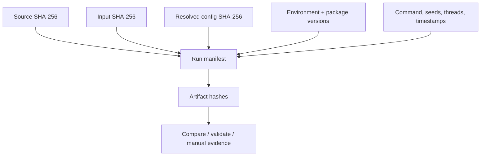

# 24. Reproducible reporting, limitations, migration, and reviewer-facing methods

*Guiding question:* **How can a methods section be exact about software while remaining modest about scientific inference?**

Prerequisites: 1–23.

## Why the question matters

A polished narrative can conceal unresolved evidence unless every claim is connected to manifests, code, literature, and named limitations.

This internal-review edition preserves unresolved Yang/Zhao attribution as a gap, keeps reviewer correspondence private, and leaves public release, Docker, and team adjudication pending.

This chapter develops the question in the order needed for a reader to move from statistical principle to current implementation, retained evidence, and a defensible statement. Its central worked task is: Draft a methods paragraph from the Lab 2 manifest, a limitations paragraph from the claim register, and a Docker handoff acceptance block.

## Learning objectives

After completing Chapter 24, the reader can:

1. define GWAS-derived vector and explain its role without exceeding the stated caution;
2. define identifier alignment and explain its role without exceeding the stated caution;
3. define candidate identity and explain its role without exceeding the stated caution;
4. define circular analysis and explain its role without exceeding the stated caution;
5. define validation ladder and explain its role without exceeding the stated caution;
6. trace the relevant package functions and generated artifacts;
7. complete the worked task and distinguish observation from interpretation.

## Conceptual and mathematical development

### GWAS-derived vector

Effect estimates or association statistics for one phenotype across matched variants. A compact notation is `X in R^(p x v)`. In practical terms, a vector is a statistical summary, not a person or causal mechanism. [@elliott2018; @buliksullivan2015]

Within Freeze 3 RC1 the concept is connected to `prepare_analysis_matrix` and is visible through `input matrix`. This connection is narrower than the general statistical idea: software evidence establishes the implemented route, while the mapped primary or internal evidence supplies background authority. The distinction prevents a mathematical definition from being mistaken for proof that a particular scientific interpretation is correct.

### identifier alignment

A one-to-one correspondence between vector or feature identifiers across artifacts. A compact notation is `I_A = I_B`. In practical terms, order is not identity; normalize and validate keys before joining.

Within Freeze 3 RC1 the concept is connected to `validated_identifiers; align_rows` and is visible through `labels.tsv; coordinates.tsv`. This connection is narrower than the general statistical idea: software evidence establishes the implemented route, while the mapped primary or internal evidence supplies background authority. The distinction prevents a mathematical definition from being mistaken for proof that a particular scientific interpretation is correct.

### candidate identity

Deterministic hash and ordinal for a resolved parameter combination. A compact notation is `model_id=H(canonical parameters)`. In practical terms, identity supports replay; it is not a quality score.

Within Freeze 3 RC1 the concept is connected to `candidate_identity` and is visible through `search_space.tsv; model_table.csv`. This connection is narrower than the general statistical idea: software evidence establishes the implemented route, while the mapped primary or internal evidence supplies background authority. The distinction prevents a mathematical definition from being mistaken for proof that a particular scientific interpretation is correct.

### circular analysis

Reuse of discovery data for apparently confirmatory inference. A compact notation is `selection(Y) then test(Y) without adjustment`. In practical terms, same-data heatmaps and correlations are descriptive; independent or selective-inference designs are needed for confirmatory claims. [@kriegeskorte2009; @gao2024]

Within Freeze 3 RC1 the concept is connected to `run_explanation` and is visible through `explanation outputs`. This connection is narrower than the general statistical idea: software evidence establishes the implemented route, while the mapped primary or internal evidence supplies background authority. The distinction prevents a mathematical definition from being mistaken for proof that a particular scientific interpretation is correct.

### validation ladder

Separate software, technical, structural, statistical, biological, external, and cross-platform evidence. A compact notation is `E_software != E_biological`. In practical terms, passing tests or exact fixture replay cannot substitute for external biological validation.

Within Freeze 3 RC1 the concept is connected to `run_validation` and is visible through `validation_report.json`. This connection is narrower than the general statistical idea: software evidence establishes the implemented route, while the mapped primary or internal evidence supplies background authority. The distinction prevents a mathematical definition from being mistaken for proof that a particular scientific interpretation is correct.

### floating-point reproducibility

Dependence of finite-precision results on operation order and platform. A compact notation is `fl((a+b)+c) may differ from fl(a+(b+c))`. In practical terms, pinned dependencies improve control but do not guarantee universal bitwise equality. [@reproduciblesum2015]

Within Freeze 3 RC1 the concept is connected to `capture_environment` and is visible through `environment.json`. This connection is narrower than the general statistical idea: software evidence establishes the implemented route, while the mapped primary or internal evidence supplies background authority. The distinction prevents a mathematical definition from being mistaken for proof that a particular scientific interpretation is correct.

## Reconstructed operational foundation

Edition 1 contained the following verified operational material in separate short notes. Edition 2 consolidates it here and subjects it to the concept and evidence boundaries above.

### Evidence retained from former Chapter 3

### Operational foundation

Release language is an evidence statement. ‘Software-complete RC1’ means the intended commands and local contracts are present and the bounded test evidence passes. ‘Scientifically frozen’ would additionally require the agreed full scientific reconstruction and resolution of material scientific issues. ‘Cross-platform validated’ would require evidenced execution and comparison on the target Docker/Linux/cloud platforms.

Freeze 3 therefore has four evidence classes: fresh local evidence; historical-only evidence; protocol-only pending work; and out-of-scope methods. The 45-test result and synthetic tutorials are fresh local evidence. Historical 164-IDP counts and the manual row-16 selection are historical. The fresh 1,000-seed 164-IDP run and Docker/GCP/AWS work are pending. Stage 2 and other association tools are outside the executable core.

### Retained evidence

Use Appendix G as a validation matrix. Notice that a pass at the software layer does not change the pending status of biological or cross-platform validation.

### Output-reading checkpoint

The environment snapshot, missing-evidence register, test report, tutorial manifests, and Docker handoff are the release-status evidence set.

### Misinterpretations to avoid

Avoid ‘fully reproducible,’ ‘platform independent,’ ‘Freeze 3 final,’ or ‘validated’ without naming the validation layer and platform. Do not use historical adaptation as shorthand for a fresh rerun.

### Boundary inherited from Edition 1

This status can change only when new artifacts directly meet a named gate. Editorial confidence or dependency pinning cannot substitute for execution evidence.

### Evidence retained from former Chapter 7

### Operational foundation

Methods are comparable only after their questions and outputs are aligned. PCA provides orthogonal linear variance components and loadings; ICA seeks statistically independent linear components; k-means creates exhaustive centroid-based groups; hierarchical clustering supplies a nested grouping; mixture models provide probabilistic components. UMAP is a representation method, while HDBSCAN is the clustering stage. DBCV is a diagnostic, not a clustering algorithm.

Genomic SEM models multivariate genetic covariance, MTAG estimates trait-specific multi-trait associations, PLEIO provides joint pleiotropic-locus tests, and MOSTest is an omnibus multivariate association approach. These methods do not all accept the same inputs or return the same scientific object as DIMPLE-GWAS. They may be alternatives for a different question or complementary stages, but they are not implemented by Freeze 3.

No method is universally ‘completely ineffective.’ PCA/ICA components can be useful and reproducible without becoming automatically causal biological mechanisms.

### Retained evidence

Use `evidence/comparator_matrix.tsv` to select a method for three questions: reduce a matrix linearly, identify omnibus associated loci, and cluster phenotype vectors with an unassigned-noise option.

### Output-reading checkpoint

The comparator matrix records purpose, input, output, assumptions, noise handling, interpretability, strengths, limitations, relationship to DIMPLE-GWAS, and implementation status.

### Misinterpretations to avoid

Do not rank unlike methods with a single ‘best’ score. Do not imply that the manual executed a comparator marked `implemented_in_freeze3=no`. Correctly attribute the genomic PCA/ICA paper to Oblong et al., not to an inferred reviewer author.

### Boundary inherited from Edition 1

Conceptual comparisons do not establish empirical superiority. A fair benchmark would need common data, preregistered objectives, suitable metrics, and evidence for each implementation.

## Evidence and references

See Oblong et al. (2024), DOI 10.1111/gbb.12876; Grotzinger et al. (2019), DOI 10.1038/s41562-019-0566-x; MTAG DOI 10.1038/s41588-017-0009-4; MOSTest DOI 10.1038/s41467-020-17368-1; and PLEIO DOI 10.1016/j.ajhg.2020.11.017.

### Evidence retained from former Chapter 31

### Operational foundation

A complete report states: software/version/source identity; input cohort and upstream GWAS construction; matrix shape/orientation/metadata prefix; preprocessing; UMAP/densMAP parameters, repeat/seed sequence, and metric; HDBSCAN search space and backend; candidate counts/failures; all calculated metrics; scoring formula/profile/noise term; selection/ties/manual decisions; retained cluster/noise counts; original-space descriptive summaries; sensitivity/comparison evidence; validation layer; and limitations.

Use conditional language: ‘under the specified representation and HDBSCAN parameters, the selected model assigned…’. Separate implementation results from interpretation and hypotheses. Disclose the historical manual row-16 choice. Name unassigned observations neutrally. If results come from adapted historical labels, say so. Include exact artifact identifiers/checksums in supplements or repositories permitted by data policy.

Methods should be reproducible without claiming bitwise platform independence; results should be readable without turning internal scores into biological proof.

### Retained evidence

A safe synthetic sentence is: ‘In the 24-vector fixed fixture, the one-candidate RC1 run assigned three clusters of eight and no noise; a same-environment fixed rerun had ARI and NMI 1. These engineering checks do not establish biological validity.’

### Output-reading checkpoint

Report from resolved config, run/selection manifests, all/ranked models, retained summary/labels, explanation/comparison/validation manifests, source/input hashes, and issue register.

### Misinterpretations to avoid

Do not omit failed candidates, ties, noise, manual selection, or pending gates. Do not present display axes as biological components. Do not claim causal mechanisms from correlations.

### Boundary inherited from Edition 1

Journal word limits may require a concise main text; place complete contracts and machine-readable evidence in a suitable supplement without exposing restricted data.

### Evidence retained from former Chapter 36

### Operational foundation

The original 164-IDP case has two tracks. Track A is historical reconstruction: the authoritative record contains 164 IDPs, 102 HDBSCAN-noise assignments, and five assigned clusters of sizes 9, 13, 15, 14, and 11. The published historical solution used epsilon 0, min-samples 4, and min-cluster-size 6 and was manually selected from sorted row 16—not automatic rank one. One historical `UMAP_3` cell is missing, while labels are complete. Freeze 3 can adapt and rescore the immutable historical artifacts; that is not a new 1,000-seed fit.

Track B is the pending fresh protocol. Use the authoritative input checksum and `configs/original_idp_164_historical_search.yaml`, run `inspect-config` and complete enumeration, preflight storage/threads, then execute standard-scale 1,000 repeated seeds in a new mounted output root inside the later Docker workflow. Preserve source, input, resolved config, command, environment, seeds, thread settings, logs, failures, all candidate rows, retained artifacts, explanation, comparison to historical labels, and validation. Do not tune toward the published labels.

Original material is permitted in the project, but scientific content is provisional because development has advanced; this manual shows aggregate historical counts and protocols rather than claiming a final interpretation.

## Evidence diagram or figure

### Retained evidence

The Edition 2 evidence-status graphic in Chapter 22 separates historical evidence from a prominent fresh-run-pending status. The protocol config and historical selected config are source artifacts; no fresh outputs are implied.

### Output-reading checkpoint

Track A: historical workbook/table, row-16 record, exact label vector, adaptation/rescoring manifests and counts. Track B: authoritative input/config hashes, preflight, complete run, comparison/validation, and Docker platform record.

### Misinterpretations to avoid

Do not say ‘reproduced the 164 analysis’ when only labels were adapted/rescored. Do not choose a new candidate because it most resembles historical labels. Do not fill missing fresh metrics with historical numbers.

### Boundary inherited from Edition 1

The original raw 2,315- and 459-IDP inputs remain incomplete/unresolved in this workspace. Fresh 164 execution and cross-platform acceptance are named release gates.

### Evidence retained from former Chapter 42

### Operational foundation

A reproducible run is a chain of identities and decisions: source hash/version; input path/size/hash and upstream provenance; source and resolved configuration/hash; exact command; Python/platform/package versions; backends; seeds; threads; timestamps/runtime; candidate counts/statuses; selected model and formula; every artifact hash; warnings/exclusions/failures; and comparison criteria. `run_manifest.json` captures much of this; tutorial execution manifests and checksum tables close the documentation chain.

Exact comparison is appropriate for bytes, schemas, IDs, declared parameters, counts, and sometimes labels. Tolerances or invariant metrics are appropriate for floating-point metrics and aligned embeddings across platforms. Plots should be compared through source tables and structural/render checks, not byte identity alone. Dependency pinning improves traceability but cannot guarantee identical numerics across OS, architecture, hardware, BLAS/OpenMP, threads, or compiler/runtime versions.

With no Git metadata in this snapshot, use the package-source SHA-256 and complete file registers; the Docker stage should establish a versioned source identity.

## Evidence diagram or figure

*Provenance and artifact lineage. Editable source: `assets/diagrams/diagram_09_provenance_lineage.mmd`.*

### Retained evidence

The executed Edition 2 Lab 2 manifest records package-source and input hashes, configuration hash, exact package versions, seeds 42/43, jobs, backend names, runtime, counts, selected ID, and artifact hashes.

### Output-reading checkpoint

Inspect runtime environment, resolved dependencies, source/input/artifact checksum registers, run/selection/tutorial manifests, logs, comparison and validation evidence.

### Misinterpretations to avoid

Do not equate a pinned requirements file with a complete environment. Do not compare floating-point PNG bytes as scientific equality. Do not sanitize the only retained provenance copy.

### Boundary inherited from Edition 1

Provenance can contain protected paths and identifiers; maintain a private complete record and a deliberately sanitized publication record with linked hashes.

### Evidence retained from former Chapter 45

### Operational foundation

Freeze 3 retains selected legacy CLI aliases and stage filenames so existing users can transition, but its native contracts are manifests, TSV/JSON model tables, stable IDs, per-model summaries, and explicit downstream utilities. Historical notebook columns such as `Silhouette_avg`, `Clusters`, `Noise_points`, `Epsilon`, `Min_samples`, and `Min_cluster_size` can be normalized by `score-existing`; source score columns are preserved with `source_` prefixes.

Migration should preserve the historical environment/configuration and labels before adaptation. Map old flags to canonical names, inspect the resolved Freeze 3 config, enumerate counts, rescore without refitting, compare exact IDs and permutation-invariant labels, and only then decide whether a fresh fixed/full run is authorized. Compatibility aliases do not prove that the new implementation recreated every intermediate byte.

The default path still matches the declared Dev-style standard search where verified, but Freeze 3 adds comprehensive manifests, failures, metrics/scopes, stable artifacts, explanation, comparison, and validation. Shipped extended count is 1,728, so older 5,184 planning statements must not migrate into new reports.

### Retained evidence

Use the historical 164 adapter as the pattern: immutable historical rows/labels are read, canonical score behavior is applied, manual row-16 status remains explicit, and fresh execution is not implied.

### Output-reading checkpoint

Inspect migration/backward-compatibility docs, alias help, schema-migration manifest, source-prefixed columns, historical checksums, comparison metrics, and new provenance.

### Misinterpretations to avoid

Do not rewrite historical spreadsheets in place. Do not call an adapted table a fresh model fit. Do not assume stage aliases contain every new native field.

### Boundary inherited from Edition 1

Some original inputs/parameters remain missing or ambiguous; those migrations stay historical-only until authoritative evidence is supplied.

### Evidence retained from former Chapter 46

### Operational foundation

Current open release issues are visible, not buried. There is no usable Git commit/tag identity; checksums substitute. The full fresh 164-IDP 1,000-seed run is deferred until Docker. Original 2,315-IDP and 459-IDP raw inputs/parameters are incomplete or unresolved. Docker/Linux/GCP/AWS execution and security validation are absent. Exact Yang/Zhao reviewer citations are unresolved in the supplied correspondence. Optional coordinate associations were not executed in the tutorials. Only macOS arm64 has fresh test/tutorial evidence.

Scientific limitations are equally important: nonlinear embeddings and density clusters are parameter dependent; repeated concatenation has no stated topology-recovery theorem; internal metrics are not biological validation; legacy scoring is candidate-population relative; selection can create circular inference; UMAP axes are not loadings; original-space correlations are conditional descriptors; noise is algorithmic; numerical determinism is platform dependent; and original-IDP interpretations may change with ongoing development.

Operational limitations include optional Parquet dependencies/failure handling, large similarity matrices, thread oversubscription, first-run JIT overhead, strict absent/empty output roots for safety, and manifests that can expose paths or identifiers. Use `evidence/03_missing_evidence_register.tsv`, `evidence/tutorial_issue_register.tsv`, and the Docker handoff as living registers.

### Retained evidence

The manual labels itself an RC1 first draft with named limitations rather than hiding Gate I/J dependencies. Appendix G shows which layers pass, are bounded, are historical, or are pending.

### Output-reading checkpoint

Inspect missing-evidence, authority/conflict, claim/correction, citation-gap, tutorial-issue, QA, build-report, and Docker-handoff records before release language changes.

### Misinterpretations to avoid

Do not close an issue by changing prose alone. Do not infer missing reviewer references. Do not present original IDP material as final when development may change it.

### Boundary inherited from Edition 1

Some gates need new authority/data/compute rather than documentation. They remain named blockers with exact completion protocols.

## Implementation trace

**`cli.build_parser`** is defined at `dimple_gwas/cli.py:146` with signature `class construction/data container`. Construct the complete user-facing command and flag grammar, including the interpret alias. It is reached from cli.main and connects to cli._add_config_source; cli._add_run_options. Its direct artifact contract is No direct canonical artifact; in-memory/supporting result; its explicit error surface is No explicit raise in this symbol; delegated calls may raise.. Test evidence is recorded as tests/test_freeze3_comparison_validation.py::test_cli_exposes_new_commands_and_alias. This is a A-tier contract, so the complete 20-field dossier is retained in the function atlas.

**`cli._inspect`** is defined at `dimple_gwas/cli.py:240` with signature `args: argparse.Namespace`. Implementation callable for inspect. It is reached from cli.main and connects to cli._resolved; search_space.count_candidates. Its direct artifact contract is No direct canonical artifact; in-memory/supporting result; its explicit error surface is No explicit raise in this symbol; delegated calls may raise.. Test evidence is recorded as No direct symbol-name test reference; assess through caller/integration coverage. This is a A-tier contract, so the complete 20-field dossier is retained in the function atlas.

**`cli._show`** is defined at `dimple_gwas/cli.py:254` with signature `args: argparse.Namespace`. Implementation callable for show. It is reached from cli.main and connects to cli._resolved; io.json_safe; reporting.write_search_space; search_space.count_candidates; search_space.enumerate_candidates; search_space.flatten_candidate. Its direct artifact contract is No direct canonical artifact; in-memory/supporting result; its explicit error surface is No explicit raise in this symbol; delegated calls may raise.. Test evidence is recorded as No direct symbol-name test reference; assess through caller/integration coverage. This is a A-tier contract, so the complete 20-field dossier is retained in the function atlas.

**`cli._score`** is defined at `dimple_gwas/cli.py:265` with signature `args: argparse.Namespace`. Implementation callable for score. It is reached from cli.main and connects to config.resolve_config; io.atomic_json_dump; io.json_safe; io.read_model_table; ranking.rank_models; scoring.apply_scoring; scoring.normalize_model_table_schema. Its direct artifact contract is rescored_table.tsv; rescored_table.tsv.manifest.json; its explicit error surface is No explicit raise in this symbol; delegated calls may raise.. Test evidence is recorded as No direct symbol-name test reference; assess through caller/integration coverage. This is a A-tier contract, so the complete 20-field dossier is retained in the function atlas.

**`cli._summarize`** is defined at `dimple_gwas/cli.py:284` with signature `args: argparse.Namespace`. Implementation callable for summarize. It is reached from cli.main and connects to io.atomic_json_dump; io.read_model_table; ranking.family_summaries; ranking.pareto_front; ranking.rank_models; ranking.top_models. Its direct artifact contract is family_summaries.tsv; pareto_front.tsv; top_models.tsv; summary.json; its explicit error surface is No explicit raise in this symbol; delegated calls may raise.. Test evidence is recorded as No direct symbol-name test reference; assess through caller/integration coverage. This is a A-tier contract, so the complete 20-field dossier is retained in the function atlas.

**`cli._reproduce`** is defined at `dimple_gwas/cli.py:301` with signature `args: argparse.Namespace`. Implementation callable for reproduce. It is reached from cli.main and connects to config.resolve_config; config.validate_config; pipeline.run_search. Its direct artifact contract is No direct canonical artifact; in-memory/supporting result; its explicit error surface is ValueError. Test evidence is recorded as No direct symbol-name test reference; assess through caller/integration coverage. This is a A-tier contract, so the complete 20-field dossier is retained in the function atlas.

**`cli._explain`** is defined at `dimple_gwas/cli.py:323` with signature `args: argparse.Namespace`. Implementation callable for explain. It is reached from cli.main and connects to config.resolve_config; config.validate_config; interpretation.run_explanation. Its direct artifact contract is No direct canonical artifact; in-memory/supporting result; its explicit error surface is ValueError. Test evidence is recorded as No direct symbol-name test reference; assess through caller/integration coverage. This is a A-tier contract, so the complete 20-field dossier is retained in the function atlas.

**`cli._compare`** is defined at `dimple_gwas/cli.py:376` with signature `args: argparse.Namespace`. Implementation callable for compare. It is reached from cli.main and connects to comparison.run_comparison. Its direct artifact contract is No direct canonical artifact; in-memory/supporting result; its explicit error surface is No explicit raise in this symbol; delegated calls may raise.. Test evidence is recorded as No direct symbol-name test reference; assess through caller/integration coverage. This is a A-tier contract, so the complete 20-field dossier is retained in the function atlas.

**`cli._validate`** is defined at `dimple_gwas/cli.py:391` with signature `args: argparse.Namespace`. Implementation callable for validate. It is reached from cli.main and connects to validation.run_validation. Its direct artifact contract is No direct canonical artifact; in-memory/supporting result; its explicit error surface is No explicit raise in this symbol; delegated calls may raise.. Test evidence is recorded as No direct symbol-name test reference; assess through caller/integration coverage. This is a A-tier contract, so the complete 20-field dossier is retained in the function atlas.

**`cli.main`** is defined at `dimple_gwas/cli.py:403` with signature `argv: list[str] | None=None`. Dispatch the command-line interface and return a process exit status. It is reached from CLI/import/direct caller or no package caller detected and connects to cli._compare; cli._explain; cli._inspect; cli._reproduce; cli._resolved; cli._score; cli._show; cli._summarize; cli._validate; cli.build_parser; pipeline.run_search. Its direct artifact contract is No direct canonical artifact; in-memory/supporting result; its explicit error surface is No explicit raise in this symbol; delegated calls may raise.. Test evidence is recorded as tests/test_freeze3_comparison_validation.py::test_cli_compare_end_to_end. This is a A-tier contract, so the complete 20-field dossier is retained in the function atlas.

**`provenance.sha256_file`** is defined at `dimple_gwas/provenance.py:17` with signature `path: str | Path`. Implementation callable for sha256 file. It is reached from interpretation._native_sources; provenance.file_record; reporting._top_artifact; validation.run_validation and connects to No package-defined dependency detected. Its direct artifact contract is No direct canonical artifact; in-memory/supporting result; its explicit error surface is No explicit raise in this symbol; delegated calls may raise.. Test evidence is recorded as tests/test_failure_and_provenance.py::test_authoritative_source_hash_unchanged. This is a B-tier contract, so the complete 20-field dossier is retained in the function atlas.

**`provenance.package_versions`** is defined at `dimple_gwas/provenance.py:25` with signature `names: Iterable[str] | None=None`. Implementation callable for package versions. It is reached from provenance.base_manifest and connects to No package-defined dependency detected. Its direct artifact contract is No direct canonical artifact; in-memory/supporting result; its explicit error surface is No explicit raise in this symbol; delegated calls may raise.. Test evidence is recorded as No direct symbol-name test reference; assess through caller/integration coverage. This is a B-tier contract, so the complete 20-field dossier is retained in the function atlas.

## Claim adjudication notebook

The following statements are admitted to the draft only in their safe form:

- **REL-001 (verified_with_qualification):** Freeze 3 RC1 is a software-complete release candidate under current local and fixed-fixture evidence; it is not scientifically frozen or cross-platform validated. Limitation: Fresh 164-IDP and Docker/cloud gates remain pending. Implementation evidence: `pyproject.toml; source; tests`.

- **SCORE-003 (verified):** The default score has no biological label, pQTL target, preferred cluster band, or noise ceiling. Limitation: The population-relative heuristic still embeds trade-offs via ranges. Implementation evidence: `scoring.py; config.py`.

- **CMP-001 (reject):** K-means targets centroid-based partitions and may mismatch irregular density structure; it is not universally ineffective. Limitation: Performance depends on representation and objective. Implementation evidence: `not implemented`.

- **CMP-002 (reject):** Genomic PCA/ICA provide linear components; reproducible components do not by themselves establish mechanisms or a gold standard. [@oblong2024] Limitation: These tools answer different questions from DIMPLE-GWAS Stage 1. Implementation evidence: `not implemented`.

- **CMP-003 (verified_with_qualification):** These multivariate association tools and DIMPLE-GWAS have different inputs, objectives, and outputs; compare questions rather than a single rank. [@turley2018; @vandermeer2020; @lee2021] Limitation: Workflows can be complementary. Implementation evidence: `scope docs`.

- **HIST-001 (historical_only):** The historical five-cluster solution was manually selected from sorted row 16, not the top automatic score. Limitation: The historical retained table contains 333 successful rows from a theoretical 2,430-candidate grid. Implementation evidence: `historical adapter/docs`.

- **REP-001 (reject):** Pinning improves traceability but cannot alone guarantee bitwise identity across architecture, hardware, numerical libraries, or thread schedules. [@reproduciblesum2015] Limitation: Docker/Linux/cloud validation remains pending. Implementation evidence: `provenance.py`.

- **REV-001 (reject):** Principal and independent genomic components of brain structure and function is by Oblong et al. (2024), DOI 10.1111/gbb.12876. [@oblong2024] Limitation: No exact Yang/Zhao reviewer paper is identifiable; do not guess. Implementation evidence: `manuscript bibliography`.

## Reading the generated evidence

For Chapter 24, the `Reproducible reporting, limitations, migration, and reviewer-facing methods` files are read as a provenance chain rather than as isolated results:

| Artifact | Producer | What to verify before interpretation |
| --- | --- | --- |
| `resolved_config.yaml` | `write_resolved_config` | Artifact exists under the new output root, is readable, and its checksum is recorded. |
| `run_manifest.json` | `write_model_outputs` | status=complete; source/input hashes present; failed count understood; selected model and artifact records resolve. |
| `logs/run.log` | `setup_logger` | Artifact exists under the new output root, is readable, and its checksum is recorded. |
| `models/all_models.tsv` | `write_model_outputs` | Candidate count agrees with enumeration; failures remain; ranks and score eligibility are internally consistent. |
| `models/ranked_models.tsv` | `write_model_outputs` | Candidate count agrees with enumeration; failures remain; ranks and score eligibility are internally consistent. |
| `models/all_models.parquet` | `write_model_outputs` | Candidate count agrees with enumeration; failures remain; ranks and score eligibility are internally consistent. |
| `models/top_models.tsv` | `write_model_outputs` | Artifact exists under the new output root, is readable, and its checksum is recorded. |
| `models/best_model.json` | `write_model_outputs` | Artifact exists under the new output root, is readable, and its checksum is recorded. |
| `models/model_selection_manifest.json` | `write_model_outputs` | Artifact exists under the new output root, is readable, and its checksum is recorded. |
| `models/pareto_front.tsv` | `write_model_outputs` | Artifact exists under the new output root, is readable, and its checksum is recorded. |
| `models/family_summaries.tsv` | `write_model_outputs` | Artifact exists under the new output root, is readable, and its checksum is recorded. |
| `models/top_model_artifacts/<id>/labels.tsv` | `_top_artifact` | Identifiers are unique and exactly match the intended input; label -1 is treated as noise/unassigned. |
| `models/top_model_artifacts/<id>/summary.json` | `_top_artifact` | Artifact exists under the new output root, is readable, and its checksum is recorded. |
| `models/top_model_artifacts/<id>/reproduce.yaml` | `_top_artifact` | Artifact exists under the new output root, is readable, and its checksum is recorded. |

The output atlas supplies the complete schemas, checksums, conditions, consumers, and privacy notes for this Chapter 24 route. Native manifests can contain machine paths; the assembled textbook uses sanitized excerpts while restricted evidence retains the original provenance chain.

## Worked reasoning and evidence exercise

Draft a methods paragraph from the Lab 2 manifest, a limitations paragraph from the claim register, and a Docker handoff acceptance block.

A complete Chapter 24 answer must expose its intermediate reasoning, name the source or output used for `Reproducible reporting, limitations, migration, and reviewer-facing methods`, and finish with separate support and non-support statements. Applying that discipline to the question “How can a methods section be exact about software while remaining modest about scientific inference?” prevents a calculation, a software observation, and a scientific interpretation from collapsing into one claim.

## Assumptions, diagnostics, and recovery

The Chapter 24 analysis assumes the stated unit and inputs, the recorded configuration and software identity, and a diagnostic that addresses the claimed property rather than a convenient surrogate. Its decisive boundary is: This internal-review edition preserves unresolved Yang/Zhao attribution as a gap, keeps reviewer correspondence private, and leaves public release, Docker, and team adjudication pending.

If the Chapter 24 route fails, retain its log and candidate status before deciding whether the cause is input, configuration, dependency, compute, identifier alignment, or output-root state. Correct an operational failure by writing a new result directory. Treat instability in `Reproducible reporting, limitations, migration, and reviewer-facing methods` as sensitivity evidence: report it and identify the independent evidence needed instead of relabeling ambiguity as a software exception.

## Chapter synthesis

A polished narrative can conceal unresolved evidence unless every claim is connected to manifests, code, literature, and named limitations. The implementation trace makes the current behavior auditable, but the evidence boundary remains part of the result. The appendices provide the exact CLI, configuration, function, output, migration, solution, and evidence references.

## Exercises

1. For `Reproducible reporting, limitations, migration, and reviewer-facing methods`, name the unit of analysis and one plausible but invalid substitute.
2. Reconstruct the notation for GWAS-derived vector; define its dimensions or denominator and interpret every term.
3. Choose a Tier A function mapped to Chapter 24; identify its caller and direct output, then propose a topic-specific edge case.
4. Select one Chapter 24 artifact from the output atlas and state three integrity checks that must precede scientific reading.
5. Convert a tempting `Reproducible reporting, limitations, migration, and reviewer-facing methods` overclaim into one observed statement followed by its limitation.
6. Draft a methods paragraph from the Lab 2 manifest, a limitations paragraph from the claim register, and a Docker handoff acceptance block.

Appendix J gives the Chapter 24 adjudication guide. Its further-reading keys supply statistical context; no external paper is treated as automatic validation of the current software or dataset.
