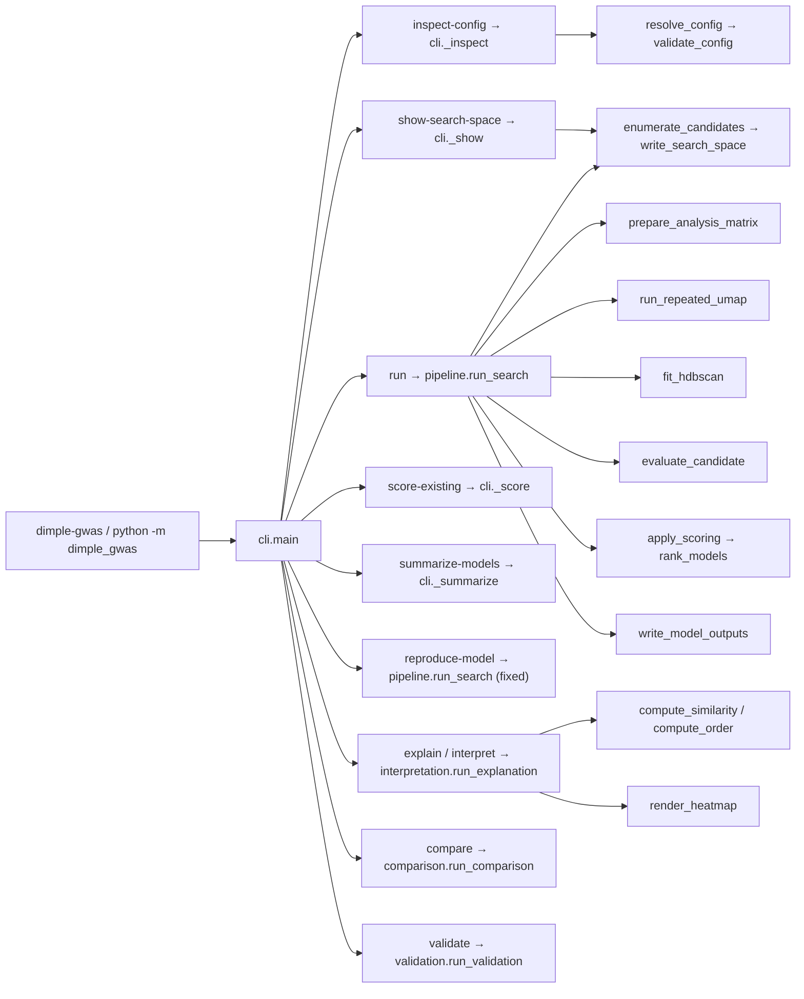

# Command-to-function call graph

This graph is a teaching-level view derived from the current CLI dispatch and package call graph. The complete symbol-level inventory and dependencies are in `function_inventory.tsv`.

The `interpret` spelling is a compatibility alias for `explain`, not a separate analytical implementation. `reproduce-model` resolves a one-candidate fixed configuration and enters the same audited search pipeline; it is not an unrecorded shortcut.
